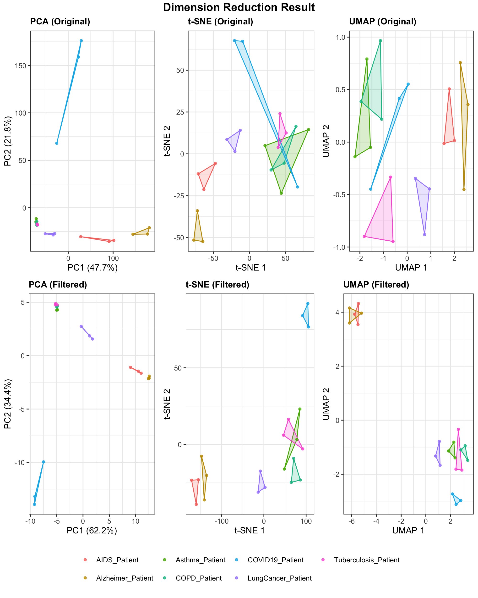
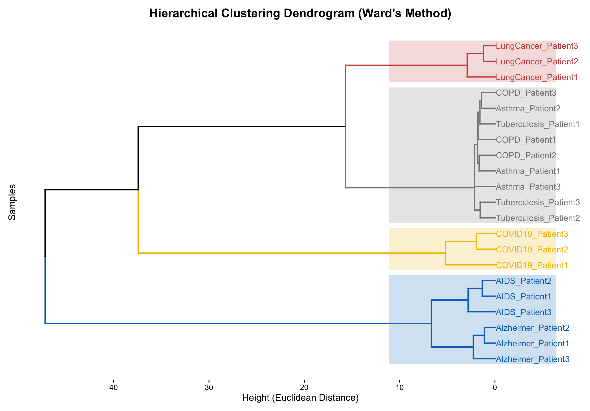
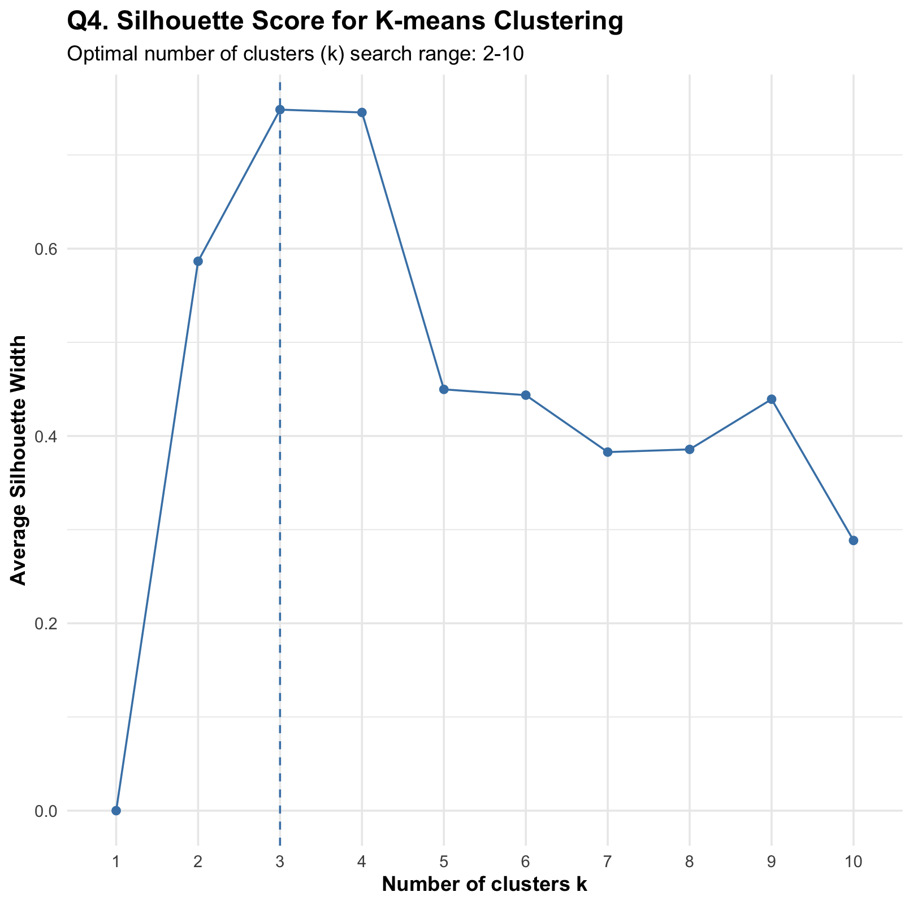
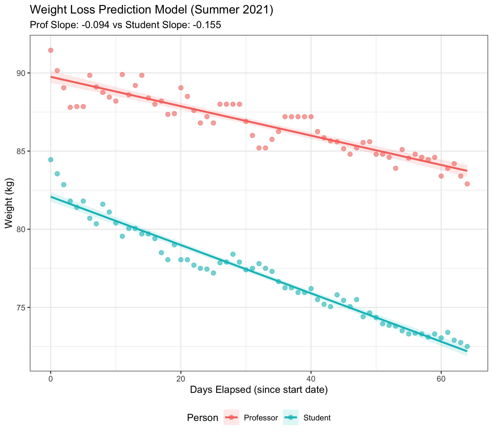
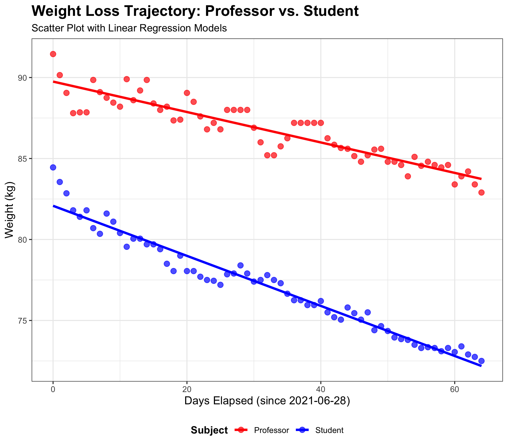

# HW2 과제 해설 — 비지도 학습

[레포지토리 안내](../../README.ko.md) | [English](Assignment-Explanation.md) | [한국어](Assignment-Explanation.ko.md)

> **최종 수정일:** 2026-11-27

> **학습 목표:**
> 1. 고차원 유전자 발현 데이터에 PCA, t-SNE, UMAP을 적용하고, 특성 수가 다른 두 데이터의 2차원 시각화 결과를 비교할 수 있다
> 2. 계층적 군집화의 거리 척도와 연결법을 정하고 덴드로그램을 잘라 군집을 구성할 수 있다
> 3. Silhouette 점수의 정의를 설명하고 K-means 군집화의 군집 수를 평가할 수 있다
> 4. 체중 기록에 단순 선형 회귀 모델을 적합하고 추정된 계수와 결정계수로 두 대상을 비교할 수 있다
> 5. 적합한 모델로 관측 기간 밖의 체중을 예측하고 그 예측의 신뢰성을 평가할 수 있다

---

## 목차

- [1. 과제 구성](#1-과제-구성)
- [2. 요구사항](#2-요구사항)
- [3. 문제 1, 2: 두 데이터의 차원 축소 시각화](#3-문제-1-2-두-데이터의-차원-축소-시각화)
  - [3.1 분석 방법](#31-분석-방법)
  - [3.2 결과](#32-결과)
  - [3.3 문제 2의 답](#33-문제-2의-답)
- [4. 문제 3: 계층적 군집화](#4-문제-3-계층적-군집화)
- [5. 문제 4: K-means 군집화와 Silhouette 점수](#5-문제-4-k-means-군집화와-silhouette-점수)
- [6. 문제 5: 종합 해석](#6-문제-5-종합-해석)
- [7. 문제 6: 체중 변화 모델](#7-문제-6-체중-변화-모델)
- [8. 문제 7: 2021-11-22의 체중 예측](#8-문제-7-2021-11-22의-체중-예측)
- [9. 문제 8: 산점도와 적합된 모델](#9-문제-8-산점도와-적합된-모델)
- [10. 문제 9: 2022-11-23의 체중 예측과 해석](#10-문제-9-2022-11-23의-체중-예측과-해석)
- [요약](#요약)
- [점검 문제](#점검-문제)

---

<br>

## 1. 과제 구성

> **풀어 보기:** 이 문서는 정답과 풀이를 담고 있다. 먼저 [과제 안내문](Original/Assignment.ko.md)의 문제를 직접 풀어 본 뒤 읽는다.

과제는 두 종류의 데이터를 다루는 아홉 문제로 이루어진다. 문제 1\~5는 질병 7개의 환자 21명에 대한 유전자 발현 데이터로 차원 축소와 군집화를 수행하고, 문제 6\~9는 교수와 학생의 체중 기록으로 선형 회귀 모델을 세워 예측한다. 서술형 답만 요구하는 문제 2와 문제 5를 뺀 일곱 문제는 문제마다 R 스크립트 하나로 풀었다. 스크립트 전체의 해설은 [HW2 코드 총정리](Code-Walkthrough.ko.md)에 있다.

| 문제 | 데이터 | 스크립트 | 관련 단원 |
|:-----|:-----|:-----|:-----|
| 문제 1 | 원본과 필터링 유전자 발현 데이터 | [`Assignment2_Q1.R`](Solution/Assignment2_Q1.R) | [4장](../../Lecture-Notes/Ch04_Dimension-Reduction-and-PCA/Concepts_Lecture.ko.md) |
| 문제 2 | 문제 1의 결과 | 서술형 | 4장 |
| 문제 3 | 유전자 발현 데이터 | [`Assignment2_Q3.R`](Solution/Assignment2_Q3.R) | [3장](../../Lecture-Notes/Ch03_Unsupervised-Learning/Concepts_Lecture.ko.md) |
| 문제 4 | 유전자 발현 데이터 | [`Assignment2_Q4.R`](Solution/Assignment2_Q4.R) | 3장 |
| 문제 5 | 문제 1~4의 결과 | 서술형 | 3장, 4장 |
| 문제 6 | 체중 데이터 | [`Assignment2_Q6.R`](Solution/Assignment2_Q6.R) | [5장](../../Lecture-Notes/Ch05_Modeling/Concepts_Lecture.ko.md) |
| 문제 7 | 체중 데이터 | [`Assignment2_Q7.R`](Solution/Assignment2_Q7.R) | 5장 |
| 문제 8 | 체중 데이터 | [`Assignment2_Q8.R`](Solution/Assignment2_Q8.R) | 5장 |
| 문제 9 | 체중 데이터 | [`Assignment2_Q9.R`](Solution/Assignment2_Q9.R) | 5장 |

*표 1. 문제별 데이터, 스크립트, 관련 단원*

---

<br>

## 2. 요구사항

과제가 요구하는 결과물은 다음과 같다. 보고서와 R 코드 전체를 함께 제출하며, R 코드는 조교가 실행했을 때 문제없이 실행되어야 한다.

| 문제 | 요구 | 제출물 |
|:-----|:-----|:-----|
| 문제 1 | 두 데이터에 PCA, t-SNE, UMAP을 수행하고 처음 두 차원을 질병별 색으로 그린다 | 그림 6개 |
| 문제 2 | 두 데이터의 결과 차이와 그 이유, 써야 할 데이터를 밝힌다 | 서술형 답 |
| 문제 3 | 차원 축소 결과와 가장 비슷한 계층적 군집화의 매개변수를 찾고 덴드로그램을 최적 군집 수로 자른다 | 덴드로그램 |
| 문제 4 | Euclidean 거리의 K-means 군집화에서 K = 2, ..., 10의 Silhouette 점수로 최적의 K를 찾는다 | Silhouette 그림 |
| 문제 5 | 문제 1~4의 결과를 정보학자의 관점에서 해석한다 | 2쪽 이내의 서술형 답 |
| 문제 6 | 교수와 학생의 체중 변화를 각각 모델링하고 추정된 통계량으로 감량 속도를 비교한다 | 두 모델과 해석 |
| 문제 7 | 2021-11-22의 두 사람의 체중을 예측한다 | 예측값 2개 |
| 문제 8 | 산점도에 두 사람의 모델을 서로 다른 색으로 그린다 | 산점도 |
| 문제 9 | 2022-11-23의 두 사람의 체중을 예측하고 모델을 해석한다 | 예측값 2개와 1쪽 이내의 해석 |

*표 2. 문제별 요구와 제출물*

유전자 발현 데이터는 두 파일이다. 원본 데이터는 21개 샘플 × 16,273개 특성, 필터링 데이터는 같은 21개 샘플 × 100개 특성의 행렬이고, 샘플 이름은 `COVID19_Patient1`처럼 질병 이름(COVID19, Asthma, COPD, Tuberculosis, LungCancer, AIDS, Alzheimer)과 환자 번호로 이루어진다. 체중 데이터는 2021-06-28부터 2021-08-31까지 65일 동안 하루에 한 번씩 기록한 두 사람의 체중이다.

---

<br>

## 3. 문제 1, 2: 두 데이터의 차원 축소 시각화

### 3.1 분석 방법

[`Assignment2_Q1.R`](Solution/Assignment2_Q1.R)은 두 데이터에 같은 절차를 적용한다.

1. **표준화:** `scale()`로 각 특성(유전자)을 평균 0, 표준편차 1로 바꾼다(3장 4.3절의 Z-scoring). 측정 규모가 큰 유전자가 거리 계산을 지배하지 않게 하기 위해서이다.
2. **라벨 추출:** 샘플 이름 끝의 `_Patient1` 같은 부분 중 숫자와 밑줄을 지워 `COVID19_Patient`처럼 질병마다 같은 라벨을 만든다.
3. **PCA:** `prcomp()`로 주성분을 구하고, 각 주성분의 분산을 전체 분산으로 나눈 설명 분산 비율을 축 이름에 적는다(4장 5~6절).
4. **t-SNE:** `Rtsne()`로 2차원에 임베딩한다(4장 9.2절). Rtsne는 perplexity가 $(n - 1)/3$ 이하여야 하므로 샘플 21개에 대해 perplexity를 $\lfloor 20/3 \rfloor = 6$으로 둔다.
5. **UMAP:** `umap()`으로 2차원에 임베딩한다(4장 9.3절). 이웃 수 `n_neighbors`는 15이다.
6. **시각화:** 처음 두 차원의 산점도를 질병별 색으로 그리고, 같은 질병의 세 점을 잇는 볼록 껍질(convex hull)을 반투명하게 칠해 질병마다 차지하는 영역을 보인다. 여섯 그림은 위쪽 행에 원본 데이터, 아래쪽 행에 필터링 데이터를 두는 2행 3열로 배치한다.

t-SNE와 UMAP은 초기화에 난수를 쓰므로 `set.seed(2025)`로 결과를 고정한다.

### 3.2 결과



*그림 1. 원본 데이터(위)와 필터링 데이터(아래)의 PCA, t-SNE, UMAP 결과*

- **원본 데이터:** PCA의 처음 두 주성분이 전체 분산의 47.7%와 21.8%를 설명하지만, COVID19 샘플 세 개가 PC2 방향으로 멀리 흩어져 축의 범위를 대부분 차지하고 Asthma, COPD, Tuberculosis는 한 점처럼 겹친다. t-SNE와 UMAP에서도 COVID19, Asthma, COPD, Tuberculosis의 영역이 넓게 퍼지거나 서로 겹친다.
- **필터링 데이터:** PCA의 처음 두 주성분이 62.2%와 34.4%를 설명하여 두 축으로 전체 분산의 96.6%를 나타낸다. 질병들은 네 무리로 모인다. Asthma, COPD, Tuberculosis가 한 곳에 겹치고, AIDS와 Alzheimer가 다른 한 곳에 모이며, LungCancer와 COVID19는 각각 떨어진 자리에 놓인다. t-SNE와 UMAP도 같은 네 무리를 보이며, 같은 질병의 세 샘플이 원본 데이터보다 좁은 영역에 모인다.

### 3.3 문제 2의 답

제출한 답은 다음과 같다.

Original Data의 결과를 보면 PCA, t-SNE, UMAP의 모든 그래프에서 샘플을 나타내는 점들이 서로 뭉치지 못하고 산발적으로 흩어져 있거나, 서로 다른 질병 그룹끼리 경계가 모호하게 겹쳐 있다. 1만 6천 개가 넘는 방대한 유전자 변수 속에 질병을 구분하는 데 도움이 되지 않는 무의미한 잡음, 즉 노이즈가 다량 섞여 있어 데이터 사이의 거리 계산이 왜곡되었고, 그 결과 군집화가 제대로 이루어지지 않았기 때문이라고 추정할 수 있다.

반면 Filtered Data의 결과는 이와 대조적이다. 특히 t-SNE와 UMAP 그래프를 보면 같은 질병에 속하는 샘플들이 더 가깝게 뭉쳐 군집을 형성하고, 다른 질병 그룹과 시각적으로도 분리되어 있다. 또 겹쳐 있던 영역들이 대체로 분리되었다. 이는 전처리 과정에서 노이즈를 제거하고 질병 사이의 차이를 가장 잘 설명하는 핵심 유전자 변수들만 선별하여 신호의 선명도가 높아졌기 때문으로 추정된다. 따라서 Filtered Data를 사용하는 것이 적합하다.

> **참고:** 특성이 16,273개이고 샘플이 21개인 원본 데이터에서는 질병과 무관한 유전자도 모두 같은 가중치로 거리에 들어간다. 무관한 차원이 많을수록 샘플 사이의 거리가 비슷해져 가까운 이웃과 먼 이웃의 구분이 흐려지는데, 이것이 4장 1.3절의 차원의 저주이다. 필터링 데이터는 100개 유전자만 남겨 이 효과를 줄인 데이터로 볼 수 있다.

---

<br>

## 4. 문제 3: 계층적 군집화

[`Assignment2_Q3.R`](Solution/Assignment2_Q3.R)은 문제 2의 결론에 따라 필터링 데이터를 쓴다. 각 유전자를 Z-score로 표준화한 뒤 다음 매개변수로 군집화한다.

- **거리 척도:** Euclidean 거리(3장 3.2절)이다. 문제 1의 PCA는 표준화한 데이터의 Euclidean 거리 구조를 가장 잘 보존하는 직교 투영이므로, 같은 거리를 쓰면 군집 구조를 PCA 산점도와 직접 비교할 수 있다.
- **연결법:** Ward 연결법(`ward.D2`)이다. 두 군집을 합칠 때 늘어나는 군집 내 제곱합이 가장 작은 쌍을 먼저 합치므로, 크기가 비슷하고 촘촘한 군집을 만든다. 3장 7.5절의 Single, Complete, Average 연결법과 달리 거리 자체가 아니라 분산의 증가량을 기준으로 삼는다. R의 `hclust()`에서 `"ward.D2"`는 거리를 제곱하여 Ward의 기준을 정확히 구현한 방법이고, `"ward.D"`는 제곱하지 않은 거리에 같은 갱신식을 적용한다.
- **군집 수:** 덴드로그램을 4개 군집으로 잘라 색과 상자로 표시한다.



*그림 2. 필터링 데이터의 계층적 군집화 덴드로그램*

| 군집 | 샘플 |
|:-----|:-----|
| 1 | LungCancer 3개 |
| 2 | Asthma 3개, COPD 3개, Tuberculosis 3개 |
| 3 | COVID19 3개 |
| 4 | AIDS 3개, Alzheimer 3개 |

*표 3. 덴드로그램을 4개로 자른 군집*

네 군집은 그림 1의 필터링 데이터에서 본 네 무리와 같다. 덴드로그램에서 AIDS와 Alzheimer의 군집은 높이 약 47에서 마지막으로 합쳐지고, COVID19는 약 37에서, LungCancer는 약 16에서 호흡기 질환 군집에 합쳐진다. 4개 군집으로 자르는 높이 아래에서는 각 질병의 세 샘플이 같은 군집에 속하지만, Asthma, COPD, Tuberculosis는 높이 약 2.5 이하에서 질병 구분 없이 섞여 합쳐지므로 이 데이터로는 세 질병을 서로 나누기 어렵다.

---

<br>

## 5. 문제 4: K-means 군집화와 Silhouette 점수

**Silhouette 점수**는 각 샘플이 자기 군집에 얼마나 잘 들어맞는지를 나타낸다. 샘플 $i$에 대해 $a(i)$를 같은 군집의 다른 샘플까지의 평균 거리, $b(i)$를 가장 가까운 다른 군집의 샘플까지의 평균 거리라 하면 다음과 같다.

$$
s(i) = \frac{b(i) - a(i)}{\max\lbrace a(i), b(i) \rbrace}, \qquad -1 \le s(i) \le 1
$$

$s(i)$가 1에 가까우면 자기 군집에 잘 속하고, 0 근처이면 두 군집의 경계에 있으며, 음수이면 다른 군집에 더 가깝다. 모든 샘플의 평균을 평균 Silhouette 폭(average silhouette width)이라 하고, 이 값이 가장 큰 K를 최적의 군집 수로 고른다.

[`Assignment2_Q4.R`](Solution/Assignment2_Q4.R)은 표준화한 필터링 데이터에 factoextra의 `fviz_nbclust(std_data, kmeans, method = "silhouette", k.max = 10)`을 적용한다. 이 함수는 K마다 Euclidean 거리의 K-means 군집화를 수행하고 평균 Silhouette 폭을 그리며, 가장 큰 K에 세로 점선을 긋는다.



*그림 3. K에 따른 K-means 군집화의 평균 Silhouette 폭*

| K | 2 | 3 | 4 | 5 | 6 | 7 | 8 | 9 | 10 |
|:-----|-----:|-----:|-----:|-----:|-----:|-----:|-----:|-----:|-----:|
| 평균 Silhouette 폭 | 0.587 | 0.748 | 0.745 | 0.450 | 0.444 | 0.383 | 0.386 | 0.439 | 0.288 |

*표 4. K별 평균 Silhouette 폭*

평균 Silhouette 폭은 K = 3에서 0.748로 가장 크고, K = 4의 0.745와의 차이는 0.003이다. K = 5부터는 0.45 이하로 떨어진다. 따라서 Silhouette 점수는 군집 수 3과 4를 거의 같은 정도로 지지하며, 질병의 개수인 7은 지지하지 않는다. 그림에서 K = 1의 값이 0인 것은 군집이 하나이면 Silhouette 점수를 정의할 수 없어 함수가 0으로 표시하기 때문이다.

> **주의:** K-means 군집화는 초기 중심을 무작위로 고른다. 스크립트에는 `set.seed()`가 없지만 `fviz_nbclust()`가 함수 안에서 `set.seed(123)`을 호출하므로, 실행할 때마다 표 4와 같은 값이 나온다. 다만 `kmeans()`의 기본값 `nstart = 1`은 초기 중심을 한 번만 고르므로 K가 클수록 국소 최적에 머물기 쉽다. 초기 중심을 50번 골라 가장 좋은 결과를 쓰면(`nstart = 50`) K = 5, 6의 평균 Silhouette 폭은 0.690, 0.633으로 표 4보다 크지만, 가장 큰 값은 여전히 K = 3(0.748)과 K = 4(0.745)이다.

---

<br>

## 6. 문제 5: 종합 해석

제출한 답은 다음과 같다.

이번 과제에서 수행한 차원 축소와 군집 분석의 결과는 생물정보학(Bioinformatics)의 관점에서 데이터의 품질 관리와 적절한 변수 선택이 분석의 성패를 좌우한다는 점을 명확하게 보여 준다. 전체 유전자를 포함한 Original Data는 차원과 노이즈 문제로 질병 사이의 경계가 모호했으나, 핵심 유전자를 선별한 Filtered Data는 더 선명한 데이터 구조를 드러냈다. 다만 전처리된 데이터가 보여 준 구조는 개별 질병의 완벽한 분리보다는 생물학적 기전이 유사한 질병끼리의 군집화 특성을 강하게 나타냈다.

비지도 학습 방법론 측면에서 볼 때, 복잡한 생물학적 관계를 파악하는 데에는 선형적인 PCA보다 비선형적인 t-SNE와 UMAP이 효과적이었다. 그러나 군집 분석 결과인 계층적 군집화의 덴드로그램과 K-means의 Silhouette 점수를 종합하면, 이 데이터셋의 최적 군집 수는 7개(질병 개수)가 아닌 4개로 나타났다. 이는 정보학적으로 흥미로운 결과를 시사한다. 데이터는 모든 질병을 개별적으로 구분하기보다, 유전자 발현 패턴이 유사한 질병들을 하나의 큰 범주로 묶으려는 경향을 보였다.

구체적으로 Asthma, COPD, Tuberculosis 환자군이 하나의 그룹으로 묶인 것은 이들이 모두 호흡기와 폐에 관련된 염증성 질환이라는 공통된 병리학적 특성을 공유하기 때문으로 해석된다. 분석에 사용된 100개의 핵심 유전자가 특정 질병만의 고유한 마커라기보다는 폐 손상이나 염증 반응과 같은 포괄적인 생물학적 경로(pathway)와 깊은 연관이 있음을 방증한다. 또 Alzheimer와 AIDS가 하나의 그룹으로 묶인 현상은 서로 다른 범주의 질병인데도 면역 체계의 붕괴나 신경 염증처럼 분자 수준에서 공유하는 특정 신호 전달 체계가 존재할 가능성을 시사한다. 반면 Lung Cancer와 COVID-19는 각각 독자적인 군집을 형성하여, 다른 질병들과 확연히 구분되는 독특한 유전자 발현 프로파일을 가지고 있음이 확인되었다.

결론적으로 이 데이터셋을 활용한 예측 모델링에는 계층적 접근(hierarchical approach)이 필요할 것으로 판단된다. 먼저 비지도 학습이 찾아낸 4개의 큰 범주(호흡기 질환군, 신경과 면역 질환군, 폐암, 코로나19)를 분류하는 모델을 구축하면 높은 정확도를 달성할 수 있을 것으로 예상된다. 그러나 Asthma와 COPD처럼 같은 군집에 묶인 질병들을 정밀하게 구분하려면 현재의 100개 변수 외에 각 질병의 미세한 차이를 설명할 수 있는 추가적인 바이오마커 발굴이나, 지도 학습 기반의 고도화된 분류 기법이 병행되어야 할 것이다.

> **참고:** 표 4에서 평균 Silhouette 폭만 보면 K = 3이 가장 크다. 그러나 K = 4와의 차이가 0.003에 불과하고, 덴드로그램(그림 2)과 차원 축소 결과(그림 1)가 모두 같은 네 무리를 보이므로 세 근거를 함께 보면 4개 군집이 데이터의 구조를 가장 잘 요약한다고 해석할 수 있다.

---

<br>

## 7. 문제 6: 체중 변화 모델

[`Assignment2_Q6.R`](Solution/Assignment2_Q6.R)은 첫 기록일(2021-06-28)부터 지난 날수를 설명변수 `Days`(0\~64)로 만들고, 교수와 학생의 체중에 각각 단순 선형 회귀 모델(5장 5~6절)을 최소제곱법으로 적합한다.

$$
\widehat{\text{Weight}} = \hat{\beta}_0 + \hat{\beta}_1 \times \text{Days}
$$

| 대상 | 계수 | 추정값 | 표준오차 | t 값 | 유의확률 |
|:-----|:-----|-----:|-----:|-----:|-----:|
| 교수 | 절편 $\hat{\beta}_0$ | 89.7492 | 0.1885 | 476.01 | $< 10^{-100}$ |
| 교수 | 기울기 $\hat{\beta}_1$ | -0.09394 | 0.00508 | -18.48 | $3.9 \times 10^{-27}$ |
| 학생 | 절편 $\hat{\beta}_0$ | 82.0794 | 0.1522 | 539.29 | $< 10^{-100}$ |
| 학생 | 기울기 $\hat{\beta}_1$ | -0.15453 | 0.00410 | -37.66 | $6.5 \times 10^{-45}$ |

*표 5. 두 단순 선형 회귀 모델의 추정 결과*

결정계수 $R^2$는 교수 모델이 0.8443, 학생 모델이 0.9575이다. 그림 4는 두 모델을 신뢰 구간과 함께 그린 결과이다.



*그림 4. 교수와 학생의 체중 감량 모델과 95% 신뢰 구간*

제출한 답은 다음과 같다.

교수의 모델은 Prof. Weight = 89.75 - 0.0939 × Days이다. $R^2$ = 0.8443으로 데이터 변동의 약 84.4%를 설명하여 적합도가 높고, 교수의 체중은 하루에 약 0.094kg씩 감소한다. 학생의 모델은 Student Weight = 82.08 - 0.1545 × Days이다. $R^2$ = 0.9575로 데이터 변동의 약 95.8%를 설명하여 거의 완벽한 선형 관계를 보이며, 학생의 체중은 하루에 약 0.155kg씩 감소한다.

두 모델의 기울기를 비교하여 감량 효과를 판단하면, 학생의 감량 속도(-0.1545)의 절댓값이 교수의 감량 속도(-0.0939)의 절댓값보다 크다. 따라서 통계적으로 추정된 회귀 계수를 비교했을 때 학생이 교수보다 약 1.6배 빠른 속도로 체중을 감량하고 있다. 두 모델 모두 유의확률 0.001 미만의 수준에서 통계적으로 유의하므로 이 결과를 신뢰할 수 있다.

> **참고:** 두 기울기의 차이 자체를 검정하려면 두 사람의 자료를 합치고 대상을 나타내는 변수 Person과의 상호작용항을 넣은 모델 `lm(Weight ~ Days * Person)`을 적합한다. 상호작용항의 계수가 기울기의 차이이며, 이 자료에서는 학생의 기울기가 교수보다 하루 0.0606kg 더 가파르다(표준오차 0.0065, t = -9.27, 유의확률 $6.4 \times 10^{-16}$). 기울기의 95% 신뢰 구간도 교수 [-0.1041, -0.0838], 학생 [-0.1627, -0.1463]으로 겹치지 않는다. 두 방법 모두 학생의 감량 속도가 더 빠르다는 결론을 지지한다.

---

<br>

## 8. 문제 7: 2021-11-22의 체중 예측

[`Assignment2_Q7.R`](Solution/Assignment2_Q7.R)은 문제 6과 같은 모델을 다시 적합한 뒤 `predict()`로 예측한다. 2021-06-28부터 2021-11-22까지는 147일이므로 `Days` = 147을 대입한다.

```math
\begin{aligned}
\text{교수:} \quad & 89.7492 - 0.093942 \times 147 = 75.94 \text{ kg} \\
\text{학생:} \quad & 82.0794 - 0.154526 \times 147 = 59.36 \text{ kg}
\end{aligned}
```

제출한 답은 교수 75.94kg, 학생 59.36kg이다. 관측 기간의 마지막 날이 `Days` = 64이므로 이 예측은 관측 범위의 두 배를 넘는 지점까지 직선을 연장한 외삽이다.

---

<br>

## 9. 문제 8: 산점도와 적합된 모델

[`Assignment2_Q8.R`](Solution/Assignment2_Q8.R)은 두 사람의 기록을 하나의 긴 형식 데이터로 합치고, 교수는 빨간색, 학생은 파란색으로 점과 회귀 직선을 그린다. 문제 6의 그림과 달리 신뢰 구간을 그리지 않아 직선과 점의 관계가 잘 보인다.



*그림 5. 교수와 학생의 체중 산점도와 적합된 회귀 직선*

학생의 점은 처음 며칠 동안 직선보다 위에 있다가 중간에는 직선 아래로 내려가고, 마지막 열흘쯤에는 다시 직선 위로 올라온다. 교수의 점은 직선 주위에 더 넓게 흩어져 있어 $R^2$가 학생보다 낮다.

---

<br>

## 10. 문제 9: 2022-11-23의 체중 예측과 해석

[`Assignment2_Q9.R`](Solution/Assignment2_Q9.R)은 2022-11-23까지의 날수 513일을 대입한다.

```math
\begin{aligned}
\text{교수:} \quad & 89.7492 - 0.093942 \times 513 = 41.56 \text{ kg} \\
\text{학생:} \quad & 82.0794 - 0.154526 \times 513 = 2.81 \text{ kg}
\end{aligned}
```

제출한 답은 교수 41.56kg, 학생 2.81kg이며, 모델의 해석은 다음과 같다.

단순 선형 회귀 모델로 예측한 2022년 11월 23일의 체중은 교수 약 41.6kg, 학생 약 2.8kg이다. 이 결과는 통계적 계산에 의한 수치일 뿐 현실적으로 불가능하며, 특히 성인 학생의 몸무게가 2.8kg이 된다는 것은 생물학적으로 생존할 수 없음을 뜻한다. 이는 단순 선형 회귀(simple linear regression)를 인체 데이터에 무리하게 적용했을 때 생기는 치명적인 한계와 위험성을 극명하게 보여 준다.

1. **통계적 가정의 위배:** R로 수행한 잔차 분석(Residuals vs Fitted)을 보면 잔차들이 0을 중심으로 무작위로 분포하기보다 특정한 패턴을 보이거나 일부 구간에서 한쪽으로 치우친다. 이는 데이터가 완전한 선형 관계가 아님을 시사하며, 현재의 선형 모델이 체중 감량의 복잡한 패턴을 충분히 설명하지 못한다는 통계적 증거이다.
2. **외삽(extrapolation)의 위험성:** 회귀 모델은 학습 데이터가 있는 구간(2021년 여름방학, 약 2달) 안에서는 유효한 설명력(interpolation)을 가진다. 그러나 이 범위를 8배 이상 벗어난 1년 5개월 뒤의 미래를 예측하는 것은 모델의 신뢰 구간을 벗어나는 과도한 시도이다. 짧은 기간의 추세를 먼 미래까지 단순히 연장했기 때문에 오차가 크게 불어난 것이다.
3. **비현실적인 선형성 가정:** 선형 회귀는 감량 속도(기울기)가 영원히 일정하다고 가정한다. 그러나 실제 생물학적 체중 감량은 비선형적이다. 초기에는 급격한 감량이 일어나지만, 시간이 지날수록 대사 적응(metabolic adaptation)과 항상성(homeostasis) 기전이 작용하여 기초대사량이 감소하고 체중은 점차 정체기(plateau)에 도달한다.

따라서 인체 데이터처럼 물리적, 생물학적 하한선이 있는 데이터를 장기 예측할 때는 단순 선형 모델을 사용해서는 안 된다. 대신 시간이 지남에 따라 감량 속도가 줄어들고 특정 값에 수렴하는 지수 감쇠 모델(exponential decay model)이나 로지스틱 모델과 같은 비선형 모델을 사용하는 것이 정보학적으로 타당하다.

> **참고:** 제출한 스크립트에는 잔차 그림을 그리는 코드가 없다. 같은 모델에 `plot(model_stud, which = 1)`을 적용하면 Residuals vs Fitted 그림을 얻으며, 수치로도 첫 번째 항목을 확인할 수 있다. 학생 모델의 잔차 평균은 0\~10일에 +0.51kg, 11\~54일에 -0.18kg, 55\~64일에 +0.21kg으로, 처음과 끝이 양수이고 가운데가 음수인 U자 패턴이다. 학생 모델에 `Days`의 제곱항을 더하면 그 계수가 양수(0.00086)이고 유의하지만(유의확률 0.00026), 교수 모델에서는 유의하지 않다(유의확률 0.27). 또 학생의 513일 예측에 대한 95% 예측 구간은 [-1.33, 6.94]kg으로 음수 체중까지 포함한다.

---

<br>

## 요약

| 개념 | 핵심 요약 |
|:-----|:-----|
| 표준화와 차원 축소 | 각 유전자를 Z-score로 표준화한 뒤 PCA, t-SNE, UMAP으로 2차원에 나타내며, 샘플이 21개이면 Rtsne의 perplexity는 $20/3$ 이하여야 하므로 6을 쓴다. |
| 원본과 필터링 데이터 | 특성 16,273개의 원본 데이터에서는 질병 영역이 겹쳤고, 100개로 줄인 필터링 데이터에서는 질병들이 네 무리로 모였다. |
| 계층적 군집화 | Euclidean 거리와 Ward 연결법(`ward.D2`)으로 만든 덴드로그램을 4개로 자르면 차원 축소의 네 무리와 같은 군집이 나온다. |
| Silhouette 점수 | $s(i) = (b(i) - a(i))/\max\lbrace a(i), b(i) \rbrace$의 평균이 가장 큰 K를 고르며, 이 데이터에서는 K = 3(0.748)과 K = 4(0.745)가 거의 같다. |
| 체중 모델 | 교수는 하루 0.094kg, 학생은 하루 0.155kg씩 감량하는 직선 모델이 적합되었고, 상호작용항 검정에서도 기울기 차이가 유의하다. |
| 외삽 | 관측 범위 밖으로 직선을 연장한 513일 예측은 학생 2.81kg이라는 불가능한 값을 주며, 잔차의 U자 패턴은 선형성 가정이 맞지 않음을 보인다. |

---

<br>

## 점검 문제

1. **perplexity의 제한:** 샘플이 21개인 데이터에 Rtsne의 기본 perplexity 30을 쓸 수 없는 이유와 스크립트가 고른 값을 설명하라.

   <details>
   <summary>정답</summary>

   Rtsne는 각 점의 이웃을 $3 \times \text{perplexity}$개까지 쓰므로 $3 \times \text{perplexity} \le n - 1$이어야 한다. $n = 21$이면 perplexity는 $20/3 \approx 6.67$ 이하여야 하므로 30은 오류를 낸다. 스크립트는 `floor((nrow - 1) / 3)`으로 6을 쓴다.

   </details>

2. **Silhouette 점수 계산:** 어떤 샘플의 같은 군집 평균 거리가 $a = 2$, 가장 가까운 다른 군집의 평균 거리가 $b = 8$일 때 $s$를 구하고, $a = 8$, $b = 2$이면 어떻게 되는지 쓰라.

   <details>
   <summary>정답</summary>

   첫 경우 $s = (8 - 2)/\max\lbrace 2, 8 \rbrace = 6/8 = 0.75$로, 자기 군집에 잘 속한다. 두 번째 경우 $s = (2 - 8)/8 = -0.75$로, 다른 군집에 더 가까워 잘못 배정된 샘플이다.

   </details>

3. **예측값 계산:** 학생 모델 $82.0794 - 0.154526 \times \text{Days}$로 2021-08-31(`Days` = 64)의 체중을 예측하라. 이 예측이 2022-11-23의 예측보다 믿을 만한 이유는 무엇인가?

   <details>
   <summary>정답</summary>

   $82.0794 - 0.154526 \times 64 = 72.19$ kg이다. `Days` = 64는 관측 범위(0\~64) 안의 값이므로 모델이 실제 자료로 뒷받침되는 보간이다. 513일 예측은 관측 범위의 끝(64일)의 8배를 넘는 지점까지 직선을 연장한 외삽이어서 기울기가 계속 일정하다는 검증되지 않은 가정에 의존한다.

   </details>

4. **기울기 비교:** 두 모델의 기울기 추정값만 보고 "학생이 더 빨리 감량했다"고 결론짓는 것보다 상호작용항 모델이 나은 점을 설명하라.

   <details>
   <summary>정답</summary>

   기울기 추정값에는 표본 오차가 있으므로 두 값의 차이가 우연히 생겼을 수도 있다. 상호작용항 모델 `lm(Weight ~ Days * Person)`은 기울기의 차이를 하나의 계수로 추정하고 그 표준오차와 유의확률을 주므로, 차이가 통계적으로 유의한지 직접 판단할 수 있다. 이 자료에서는 차이가 하루 0.0606kg이고 유의확률이 $6.4 \times 10^{-16}$이다.

   </details>
