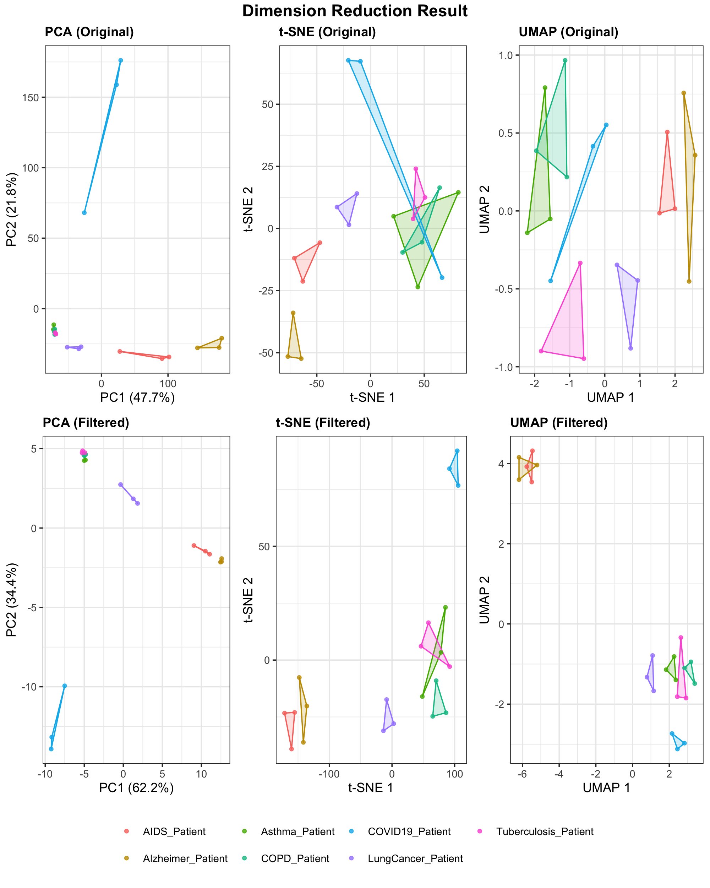
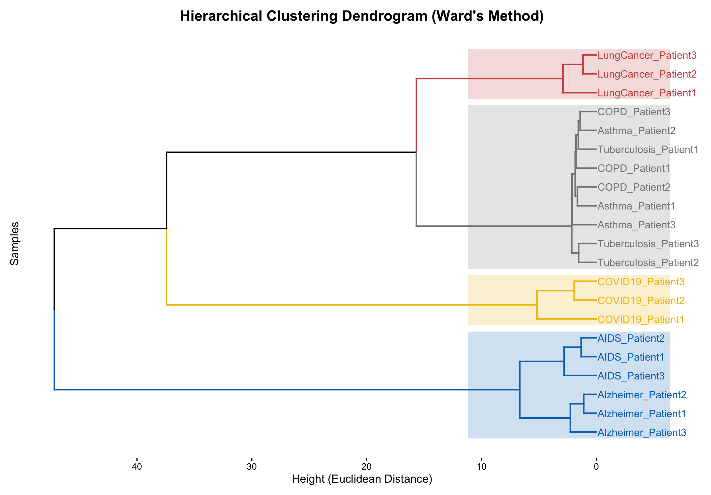
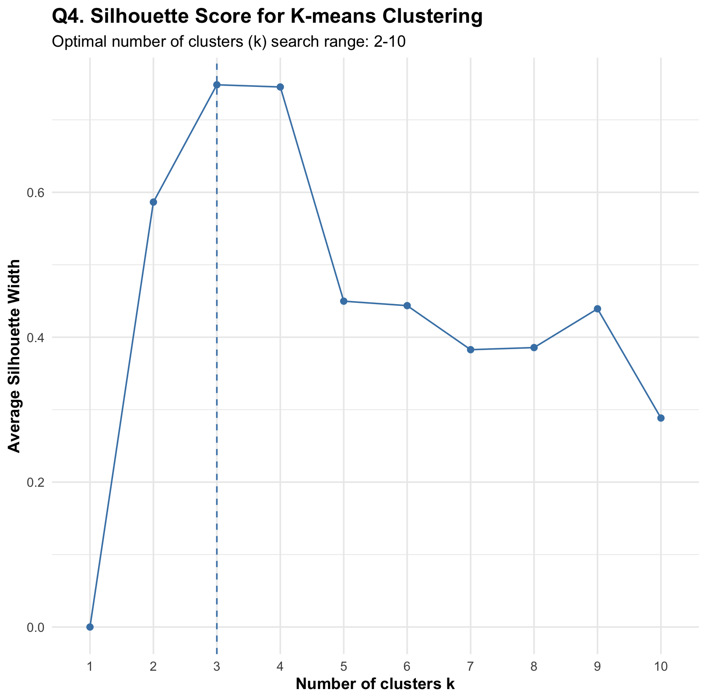
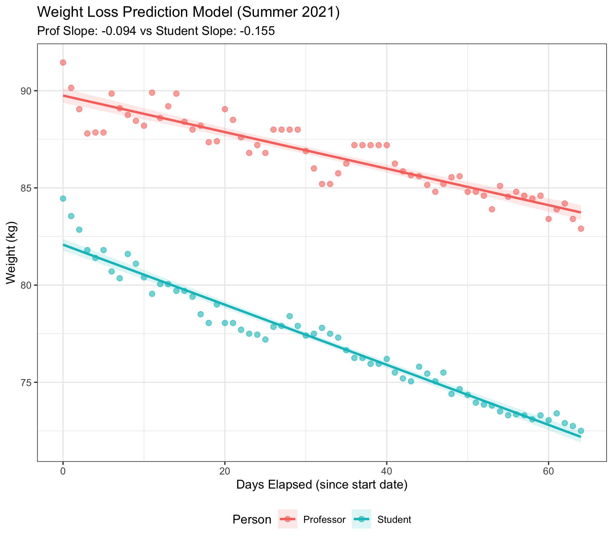
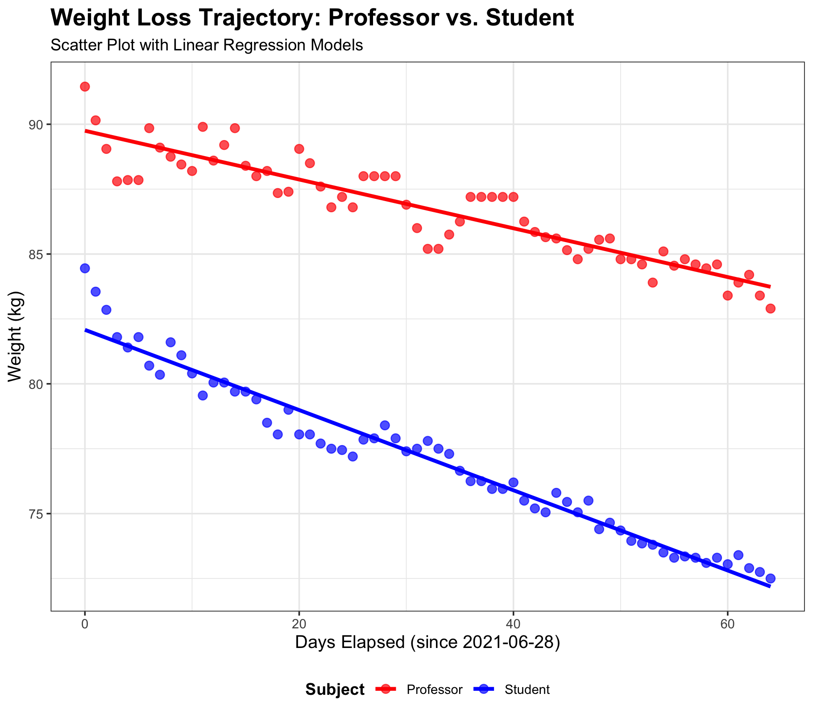

# HW2 Assignment Explanation — Unsupervised Learning

[Repository Guide](../../README.md) | [English](Assignment-Explanation.md) | [한국어](Assignment-Explanation.ko.md)

> **Last Updated:** 2026-11-17

> **Learning Objectives:**
> 1. Apply PCA, t-SNE, and UMAP to high-dimensional gene expression data and compare the two-dimensional visualizations of two datasets with different numbers of features
> 2. Choose the distance metric and linkage method of hierarchical clustering and form clusters by cutting the dendrogram
> 3. Explain the definition of the Silhouette score and evaluate the number of clusters of K-means clustering
> 4. Fit simple linear regression models to weight records and compare two subjects by the estimated coefficients and coefficients of determination
> 5. Predict weights outside the observation period with the fitted models and evaluate the reliability of those predictions

---

## Table of Contents

- [1. Assignment Structure](#1-assignment-structure)
- [2. Requirements](#2-requirements)
- [3. Problems 1 and 2: Dimension Reduction Visualization of the Two Datasets](#3-problems-1-and-2-dimension-reduction-visualization-of-the-two-datasets)
  - [3.1 Analysis Method](#31-analysis-method)
  - [3.2 Results](#32-results)
  - [3.3 Answer to Problem 2](#33-answer-to-problem-2)
- [4. Problem 3: Hierarchical Clustering](#4-problem-3-hierarchical-clustering)
- [5. Problem 4: K-Means Clustering and the Silhouette Score](#5-problem-4-k-means-clustering-and-the-silhouette-score)
- [6. Problem 5: Overall Interpretation](#6-problem-5-overall-interpretation)
- [7. Problem 6: Weight Change Models](#7-problem-6-weight-change-models)
- [8. Problem 7: Weight Prediction for 2021-11-22](#8-problem-7-weight-prediction-for-2021-11-22)
- [9. Problem 8: Scatter Plot with Fitted Models](#9-problem-8-scatter-plot-with-fitted-models)
- [10. Problem 9: Weight Prediction for 2022-11-23 and Interpretation](#10-problem-9-weight-prediction-for-2022-11-23-and-interpretation)
- [Summary](#summary)
- [Self-Check Questions](#self-check-questions)

---

<br>

## 1. Assignment Structure

> **Try It First:** This document contains the answers and solutions. Solve the problems in the [assignment handout](Original/Assignment.md) yourself before reading on.

The assignment consists of nine problems on two kinds of data. Problems 1-5 perform dimension reduction and clustering on gene expression data of 21 patients with 7 diseases, and Problems 6-9 build linear regression models from the weight records of a professor and a student and make predictions. Except for Problems 2 and 5, which ask only for written answers, each of the seven problems was solved with one R script. The [HW2 code walkthrough](Code-Walkthrough.md) explains all the scripts.

| Problem | Data | Script | Related Unit |
|:-----|:-----|:-----|:-----|
| Problem 1 | Original and filtered gene expression data | [`Assignment2_Q1.R`](Solution/Assignment2_Q1.R) | [Chapter 4](../../Lecture-Notes/Ch04_Dimension-Reduction-and-PCA/Concepts_Lecture.md) |
| Problem 2 | Results of Problem 1 | Written answer | Chapter 4 |
| Problem 3 | Gene expression data | [`Assignment2_Q3.R`](Solution/Assignment2_Q3.R) | [Chapter 3](../../Lecture-Notes/Ch03_Unsupervised-Learning/Concepts_Lecture.md) |
| Problem 4 | Gene expression data | [`Assignment2_Q4.R`](Solution/Assignment2_Q4.R) | Chapter 3 |
| Problem 5 | Results of Problems 1-4 | Written answer | Chapters 3 and 4 |
| Problem 6 | Weight data | [`Assignment2_Q6.R`](Solution/Assignment2_Q6.R) | [Chapter 5](../../Lecture-Notes/Ch05_Modeling/Concepts_Lecture.md) |
| Problem 7 | Weight data | [`Assignment2_Q7.R`](Solution/Assignment2_Q7.R) | Chapter 5 |
| Problem 8 | Weight data | [`Assignment2_Q8.R`](Solution/Assignment2_Q8.R) | Chapter 5 |
| Problem 9 | Weight data | [`Assignment2_Q9.R`](Solution/Assignment2_Q9.R) | Chapter 5 |

*Table 1. Data, script, and related unit of each problem*

---

<br>

## 2. Requirements

The assignment requires the following results. The report and the entire R code are submitted together, and the R code must run without problems when the TA executes it.

| Problem | Requirement | Deliverable |
|:-----|:-----|:-----|
| Problem 1 | Perform PCA, t-SNE, and UMAP on both datasets and plot the first two dimensions colored by disease | 6 plots |
| Problem 2 | State the difference between the results of the two datasets, its reason, and the dataset to use | Written answer |
| Problem 3 | Find the hierarchical clustering parameters most similar to the dimension reduction result and cut the dendrogram at the optimal number of clusters | Dendrogram |
| Problem 4 | Find the optimal K by the Silhouette score of K-means clustering with Euclidean distance for K = 2, ..., 10 | Silhouette plot |
| Problem 5 | Interpret the results of Problems 1-4 from the informatician standpoint | Written answer within 2 pages |
| Problem 6 | Model the weight changes of the professor and the student separately and compare the weight loss speeds by estimated statistics | Two models and interpretation |
| Problem 7 | Predict the weights of the two people on 2021-11-22 | 2 predicted values |
| Problem 8 | Draw the two people's models in different colors on a scatter plot | Scatter plot |
| Problem 9 | Predict the weights of the two people on 2022-11-23 and interpret the model | 2 predicted values and an interpretation within 1 page |

*Table 2. Requirement and deliverable of each problem*

The gene expression data come in two files. The original data are a matrix of 21 samples × 16,273 features, the filtered data are a matrix of the same 21 samples × 100 features, and the sample names consist of a disease name (COVID19, Asthma, COPD, Tuberculosis, LungCancer, AIDS, Alzheimer) and a patient number, as in `COVID19_Patient1`. The weight data are the two people's weights recorded once a day for 65 days from 2021-06-28 to 2021-08-31.

---

<br>

## 3. Problems 1 and 2: Dimension Reduction Visualization of the Two Datasets

### 3.1 Analysis Method

[`Assignment2_Q1.R`](Solution/Assignment2_Q1.R) applies the same procedure to both datasets.

1. **Standardization:** `scale()` turns each feature (gene) into mean 0 and standard deviation 1 (Z-scoring in Section 4.3 of Chapter 3), so that genes with large measurement scales do not dominate the distance computation.
2. **Label extraction:** Removing the digits and underscores at the end of sample names such as `_Patient1` gives the same label for each disease, such as `COVID19_Patient`.
3. **PCA:** `prcomp()` computes the principal components, and the explained variance ratio, the variance of each component divided by the total variance, is written in the axis labels (Sections 5-6 of Chapter 4).
4. **t-SNE:** `Rtsne()` embeds the data into two dimensions (Section 9.2 of Chapter 4). Rtsne requires the perplexity to be at most $(n - 1)/3$, so for 21 samples the perplexity is set to $\lfloor 20/3 \rfloor = 6$.
5. **UMAP:** `umap()` embeds the data into two dimensions (Section 9.3 of Chapter 4). The number of neighbors `n_neighbors` is 15.
6. **Visualization:** The scatter plot of the first two dimensions is colored by disease, and the convex hull connecting the three points of each disease is filled semi-transparently to show the area of each disease. The six plots are arranged in 2 rows and 3 columns, with the original data in the top row and the filtered data in the bottom row.

Because t-SNE and UMAP use random numbers for initialization, `set.seed(2025)` fixes the results.

### 3.2 Results



*Figure 1. PCA, t-SNE, and UMAP results of the original data (top) and the filtered data (bottom)*

- **Original data:** The first two principal components of PCA explain 47.7% and 21.8% of the total variance, but the three COVID19 samples scatter far along PC2 and take up most of the axis range, while Asthma, COPD, and Tuberculosis overlap like a single point. In t-SNE and UMAP as well, the areas of COVID19, Asthma, COPD, and Tuberculosis spread widely or overlap each other.
- **Filtered data:** The first two principal components of PCA explain 62.2% and 34.4%, so the two axes represent 96.6% of the total variance. The diseases gather into four groups. Asthma, COPD, and Tuberculosis overlap in one place, AIDS and Alzheimer gather in another, and LungCancer and COVID19 each lie apart. t-SNE and UMAP show the same four groups, and the three samples of each disease gather in a narrower area than in the original data.

### 3.3 Answer to Problem 2

The submitted answer is as follows.

In the results of the Original Data, the points representing the samples in all the PCA, t-SNE, and UMAP plots fail to cluster together and scatter sporadically, or the different disease groups overlap with blurred boundaries. It can be presumed that this is because the vast set of more than 16,000 gene variables contains a large amount of meaningless noise that does not help distinguish the diseases, which distorted the distance computation between data points, and as a result the clustering did not work properly.

In contrast, the results of the Filtered Data are different. In the t-SNE and UMAP plots in particular, the samples of the same disease gather more closely to form clusters and are visually separated from the other disease groups. The previously overlapping areas are also mostly separated. This is presumed to be because the preprocessing removed the noise and selected only the key gene variables that best explain the differences between diseases, which sharpened the signal. Therefore, using the Filtered Data is appropriate.

> **Note:** In the original data with 16,273 features and 21 samples, genes unrelated to the diseases also enter the distance with the same weight. The more irrelevant dimensions there are, the more similar the distances between samples become and the less distinct near and far neighbors are, which is the curse of dimensionality in Section 1.3 of Chapter 4. The filtered data can be seen as data that reduce this effect by keeping only 100 genes.

---

<br>

## 4. Problem 3: Hierarchical Clustering

Following the conclusion of Problem 2, [`Assignment2_Q3.R`](Solution/Assignment2_Q3.R) uses the filtered data. After standardizing each gene by Z-score, it clusters the data with the following parameters.

- **Distance metric:** Euclidean distance (Section 3.2 of Chapter 3). Since the PCA of Problem 1 is the orthogonal projection that best preserves the Euclidean distance structure of the standardized data, using the same distance lets the cluster structure be compared directly with the PCA scatter plot.
- **Linkage method:** Ward's linkage (`ward.D2`). It first merges the pair of clusters whose merge increases the within-cluster sum of squares the least, so it produces compact clusters of similar size. Unlike the single, complete, and average linkage methods in Section 7.5 of Chapter 3, its criterion is the increase in variance rather than the distance itself. In R's `hclust()`, `"ward.D2"` squares the distances and implements Ward's criterion exactly, while `"ward.D"` applies the same update formula to unsquared distances.
- **Number of clusters:** The dendrogram is cut into 4 clusters, marked with colors and boxes.



*Figure 2. Hierarchical clustering dendrogram of the filtered data*

| Cluster | Samples |
|:-----|:-----|
| 1 | 3 LungCancer |
| 2 | 3 Asthma, 3 COPD, 3 Tuberculosis |
| 3 | 3 COVID19 |
| 4 | 3 AIDS, 3 Alzheimer |

*Table 3. Clusters from cutting the dendrogram into 4*

The four clusters are the same as the four groups seen in the filtered data of Figure 1. In the dendrogram, the AIDS and Alzheimer cluster merges last at a height of about 47, while COVID19 joins the respiratory disease cluster at about 37 and LungCancer at about 16. Below the height that cuts the tree into 4 clusters, the three samples of each disease belong to the same cluster, but Asthma, COPD, and Tuberculosis merge in a mixed order regardless of disease below a height of about 2.5, so these data can hardly separate the three diseases from each other.

---

<br>

## 5. Problem 4: K-Means Clustering and the Silhouette Score

The **Silhouette score** shows how well each sample fits its own cluster. For sample $i$, let $a(i)$ be the mean distance to the other samples of the same cluster and $b(i)$ be the mean distance to the samples of the nearest other cluster. Then it is as follows.

$$
s(i) = \frac{b(i) - a(i)}{\max\lbrace a(i), b(i) \rbrace}, \qquad -1 \le s(i) \le 1
$$

When $s(i)$ is close to 1, the sample fits its cluster well; near 0, it lies on the boundary of two clusters; and when negative, it is closer to another cluster. The mean over all samples is called the average silhouette width, and the K with the largest value is chosen as the optimal number of clusters.

[`Assignment2_Q4.R`](Solution/Assignment2_Q4.R) applies factoextra's `fviz_nbclust(std_data, kmeans, method = "silhouette", k.max = 10)` to the standardized filtered data. For each K, this function performs K-means clustering with Euclidean distance, plots the average silhouette width, and draws a vertical dashed line at the K with the largest value.



*Figure 3. Average silhouette width of K-means clustering by K*

| K | 2 | 3 | 4 | 5 | 6 | 7 | 8 | 9 | 10 |
|:-----|-----:|-----:|-----:|-----:|-----:|-----:|-----:|-----:|-----:|
| Average silhouette width | 0.587 | 0.748 | 0.745 | 0.450 | 0.444 | 0.383 | 0.386 | 0.439 | 0.288 |

*Table 4. Average silhouette width by K*

The average silhouette width is largest at K = 3 with 0.748, and the difference from 0.745 at K = 4 is 0.003. From K = 5 on, it drops to 0.45 or below. The Silhouette score therefore supports 3 and 4 clusters almost equally, and it does not support 7, the number of diseases. The value 0 at K = 1 in the figure appears because the Silhouette score is undefined for a single cluster and the function shows it as 0.

> **Caution:** K-means clustering picks its initial centers at random. The script has no `set.seed()`, but `fviz_nbclust()` calls `set.seed(123)` inside the function, so every run gives the same values as Table 4. However, the default `nstart = 1` of `kmeans()` picks the initial centers only once, so the result is more likely to stay at a local optimum as K grows. When the initial centers are picked 50 times and the best result is kept (`nstart = 50`), the average silhouette widths at K = 5 and 6 are 0.690 and 0.633, larger than in Table 4, but the largest values are still at K = 3 (0.748) and K = 4 (0.745).

---

<br>

## 6. Problem 5: Overall Interpretation

The submitted answer is as follows.

The results of the dimension reduction and clustering analyses performed in this assignment clearly show, from the standpoint of bioinformatics, that data quality control and appropriate variable selection determine the success of an analysis. The Original Data, which include all genes, had blurred boundaries between diseases because of dimensionality and noise, whereas the Filtered Data, which select the key genes, revealed a clearer data structure. However, the structure shown by the preprocessed data strongly reflected the clustering of diseases with similar biological mechanisms rather than a perfect separation of individual diseases.

In terms of unsupervised learning methodology, the nonlinear t-SNE and UMAP were more effective than the linear PCA in capturing the complex biological relationships. Combining the dendrogram of hierarchical clustering and the Silhouette score of K-means, however, the optimal number of clusters for this dataset turned out to be 4, not 7 (the number of diseases). This suggests an interesting result from an informatics standpoint. Rather than distinguishing every disease individually, the data tended to group diseases with similar gene expression patterns into one large category.

Specifically, the grouping of the Asthma, COPD, and Tuberculosis patient groups is interpreted as reflecting a shared pathological characteristic: they are all inflammatory diseases related to the respiratory system and the lungs. This indicates that the 100 key genes used in the analysis are deeply associated with comprehensive biological pathways such as lung damage or inflammatory responses rather than being unique markers of a specific disease. The grouping of Alzheimer and AIDS suggests the possibility of specific signaling systems shared at the molecular level, such as the collapse of the immune system or neuroinflammation, even though they are diseases of different categories. On the other hand, Lung Cancer and COVID-19 each formed an independent cluster, confirming that they have unique gene expression profiles clearly distinguished from the other diseases.

In conclusion, predictive modeling with this dataset is judged to require a hierarchical approach. A model that first classifies the 4 large categories found by unsupervised learning (respiratory diseases, neurological and immune diseases, lung cancer, COVID-19) is expected to achieve high accuracy. However, to precisely distinguish diseases grouped in the same cluster, such as Asthma and COPD, additional biomarker discovery that can explain the subtle differences of each disease beyond the current 100 variables, or advanced classification techniques based on supervised learning, should be pursued in parallel.

> **Note:** Judged by the average silhouette width alone in Table 4, K = 3 is the largest. However, the difference from K = 4 is only 0.003, and the dendrogram (Figure 2) and the dimension reduction results (Figure 1) both show the same four groups, so taking the three pieces of evidence together, 4 clusters can be interpreted as the best summary of the data structure.

---

<br>

## 7. Problem 6: Weight Change Models

[`Assignment2_Q6.R`](Solution/Assignment2_Q6.R) makes the number of days elapsed since the first record (2021-06-28) the explanatory variable `Days` (0-64) and fits a simple linear regression model (Sections 5-6 of Chapter 5) to each of the professor's and the student's weights by least squares.

$$
\widehat{\text{Weight}} = \hat{\beta}_0 + \hat{\beta}_1 \times \text{Days}
$$

| Subject | Coefficient | Estimate | Std. Error | t Value | p-value |
|:-----|:-----|-----:|-----:|-----:|-----:|
| Professor | Intercept $\hat{\beta}_0$ | 89.7492 | 0.1885 | 476.01 | $< 10^{-100}$ |
| Professor | Slope $\hat{\beta}_1$ | -0.09394 | 0.00508 | -18.48 | $3.9 \times 10^{-27}$ |
| Student | Intercept $\hat{\beta}_0$ | 82.0794 | 0.1522 | 539.29 | $< 10^{-100}$ |
| Student | Slope $\hat{\beta}_1$ | -0.15453 | 0.00410 | -37.66 | $6.5 \times 10^{-45}$ |

*Table 5. Estimation results of the two simple linear regression models*

The coefficient of determination $R^2$ is 0.8443 for the professor's model and 0.9575 for the student's model. Figure 4 draws the two models with their confidence bands.



*Figure 4. Weight loss models of the professor and the student with 95% confidence bands*

The submitted answer is as follows.

The professor's model is Prof. Weight = 89.75 - 0.0939 × Days. With $R^2$ = 0.8443, it explains about 84.4% of the variation in the data, a high goodness of fit, and the professor's weight decreases by about 0.094 kg per day. The student's model is Student Weight = 82.08 - 0.1545 × Days. With $R^2$ = 0.9575, it explains about 95.8% of the variation in the data, an almost perfect linear relationship, and the student's weight decreases by about 0.155 kg per day.

Judging the weight loss effect by comparing the slopes of the two models, the absolute value of the student's weight loss speed (-0.1545) is larger than that of the professor's (-0.0939). Therefore, comparing the statistically estimated regression coefficients, the student is losing weight about 1.6 times faster than the professor. Both models are statistically significant at a p-value below 0.001, so this result can be trusted.

> **Note:** To test the difference between the two slopes itself, combine the two people's data and fit the model `lm(Weight ~ Days * Person)` with an interaction term with the variable Person indicating the subject. The coefficient of the interaction term is the slope difference, and in these data the student's slope is steeper than the professor's by 0.0606 kg per day (standard error 0.0065, t = -9.27, p-value $6.4 \times 10^{-16}$). The 95% confidence intervals of the slopes, [-0.1041, -0.0838] for the professor and [-0.1627, -0.1463] for the student, also do not overlap. Both methods support the conclusion that the student lost weight faster.

---

<br>

## 8. Problem 7: Weight Prediction for 2021-11-22

[`Assignment2_Q7.R`](Solution/Assignment2_Q7.R) refits the same models as Problem 6 and predicts with `predict()`. There are 147 days from 2021-06-28 to 2021-11-22, so `Days` = 147 is substituted.

```math
\begin{aligned}
\text{Professor:} \quad & 89.7492 - 0.093942 \times 147 = 75.94 \text{ kg} \\
\text{Student:} \quad & 82.0794 - 0.154526 \times 147 = 59.36 \text{ kg}
\end{aligned}
```

The submitted answer is 75.94 kg for the professor and 59.36 kg for the student. Since the last day of the observation period is `Days` = 64, this prediction is an extrapolation that extends the line to a point more than twice the observed range.

---

<br>

## 9. Problem 8: Scatter Plot with Fitted Models

[`Assignment2_Q8.R`](Solution/Assignment2_Q8.R) combines the two people's records into one long-format dataset and draws the points and regression lines in red for the professor and blue for the student. Unlike the plot of Problem 6, it draws no confidence bands, so the relationship between the lines and the points is easy to see.



*Figure 5. Weight scatter plot of the professor and the student with fitted regression lines*

The student's points lie above the line for the first few days, fall below it in the middle, and rise above it again for about the last ten days. The professor's points scatter more widely around the line, so the $R^2$ is lower than the student's.

---

<br>

## 10. Problem 9: Weight Prediction for 2022-11-23 and Interpretation

[`Assignment2_Q9.R`](Solution/Assignment2_Q9.R) substitutes the 513 days until 2022-11-23.

```math
\begin{aligned}
\text{Professor:} \quad & 89.7492 - 0.093942 \times 513 = 41.56 \text{ kg} \\
\text{Student:} \quad & 82.0794 - 0.154526 \times 513 = 2.81 \text{ kg}
\end{aligned}
```

The submitted answer is 41.56 kg for the professor and 2.81 kg for the student, and the interpretation of the model is as follows.

The weights on November 23, 2022 predicted by the simple linear regression models are about 41.6 kg for the professor and about 2.8 kg for the student. These are merely numbers from a statistical computation and are impossible in reality; in particular, an adult student weighing 2.8 kg means a state in which survival is biologically impossible. This starkly shows the critical limitations and risks of forcing simple linear regression onto human body data.

1. **Violation of statistical assumptions:** The residual analysis (Residuals vs Fitted) performed in R shows that the residuals, rather than being randomly distributed around 0, show a certain pattern or are biased in some intervals. This suggests that the data are not perfectly linear and is statistical evidence that the current linear model does not sufficiently explain the complex pattern of weight loss.
2. **Risk of extrapolation:** A regression model has valid explanatory power (interpolation) within the interval where training data exist (the 2021 summer vacation, about 2 months). However, predicting the future 1 year and 5 months later, more than 8 times beyond this range, is an excessive attempt that goes beyond the confidence interval of the model. Because the trend of a short period was simply extended into the distant future, the error grew large.
3. **Unrealistic linearity assumption:** Linear regression assumes that the weight loss speed (slope) stays constant forever. Actual biological weight loss, however, is nonlinear. Rapid weight loss occurs at first, but as time passes, metabolic adaptation and homeostasis mechanisms act, the basal metabolic rate decreases, and the weight gradually reaches a plateau.

Therefore, simple linear models should not be used for long-term prediction of data with physical and biological lower bounds, such as human body data. Instead, it is informatically sound to use nonlinear models such as an exponential decay model or a logistic model, in which the weight loss speed decreases over time and converges to a certain value.

> **Note:** The submitted scripts contain no code that draws a residual plot. Applying `plot(model_stud, which = 1)` to the same model gives the Residuals vs Fitted plot, and the first point can also be checked numerically. The mean residuals of the student's model are +0.51 kg on days 0-10, -0.18 kg on days 11-54, and +0.21 kg on days 55-64, a U-shaped pattern that is positive at the start and end and negative in the middle. Adding the square of `Days` to the student's model gives a positive (0.00086) and significant coefficient (p-value 0.00026), but it is not significant in the professor's model (p-value 0.27). The 95% prediction interval for the student's day-513 prediction is [-1.33, 6.94] kg, which even includes negative weights.

---

<br>

## Summary

| Concept | Key Summary |
|:-----|:-----|
| Standardization and dimension reduction | Each gene is standardized by Z-score and shown in two dimensions by PCA, t-SNE, and UMAP; with 21 samples, Rtsne's perplexity must be at most $20/3$, so 6 is used. |
| Original and filtered data | In the original data with 16,273 features the disease areas overlapped, and in the filtered data reduced to 100 features the diseases gathered into four groups. |
| Hierarchical clustering | Cutting the dendrogram built with Euclidean distance and Ward's linkage (`ward.D2`) into 4 gives the same clusters as the four groups of dimension reduction. |
| Silhouette score | The K with the largest mean of $s(i) = (b(i) - a(i))/\max\lbrace a(i), b(i) \rbrace$ is chosen, and in these data K = 3 (0.748) and K = 4 (0.745) are almost equal. |
| Weight models | Linear models were fitted in which the professor loses 0.094 kg and the student 0.155 kg per day, and the interaction test also shows a significant slope difference. |
| Extrapolation | The day-513 prediction that extends the line beyond the observed range gives an impossible 2.81 kg for the student, and the U-shaped residual pattern shows that the linearity assumption does not hold. |

---

<br>

## Self-Check Questions

1. **Limit on perplexity:** Explain why Rtsne's default perplexity of 30 cannot be used for data with 21 samples and which value the script chose.

   <details>
   <summary>Answer</summary>

   Rtsne uses up to $3 \times \text{perplexity}$ neighbors for each point, so $3 \times \text{perplexity} \le n - 1$ must hold. With $n = 21$, the perplexity must be at most $20/3 \approx 6.67$, so 30 raises an error. The script uses 6 from `floor((nrow - 1) / 3)`.

   </details>

2. **Computing the Silhouette score:** For a sample with mean distance $a = 2$ within its cluster and mean distance $b = 8$ to the nearest other cluster, compute $s$, and state what happens when $a = 8$ and $b = 2$.

   <details>
   <summary>Answer</summary>

   In the first case, $s = (8 - 2)/\max\lbrace 2, 8 \rbrace = 6/8 = 0.75$, so the sample fits its cluster well. In the second case, $s = (2 - 8)/8 = -0.75$, so the sample is closer to another cluster and is misassigned.

   </details>

3. **Computing a prediction:** Predict the weight on 2021-08-31 (`Days` = 64) with the student's model $82.0794 - 0.154526 \times \text{Days}$. Why is this prediction more reliable than the prediction for 2022-11-23?

   <details>
   <summary>Answer</summary>

   $82.0794 - 0.154526 \times 64 = 72.19$ kg. Since `Days` = 64 lies within the observed range (0-64), it is an interpolation supported by actual data. The day-513 prediction is an extrapolation that extends the line to a point more than 8 times the end of the observed range (day 64), so it depends on the unverified assumption that the slope stays constant.

   </details>

4. **Comparing slopes:** Explain why the interaction model is better than concluding "the student lost weight faster" from the slope estimates of the two models alone.

   <details>
   <summary>Answer</summary>

   Slope estimates contain sampling error, so the difference between two values may have arisen by chance. The interaction model `lm(Weight ~ Days * Person)` estimates the slope difference as a single coefficient and gives its standard error and p-value, so it lets you judge directly whether the difference is statistically significant. In these data the difference is 0.0606 kg per day with a p-value of $6.4 \times 10^{-16}$.

   </details>
