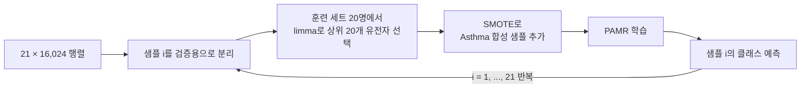
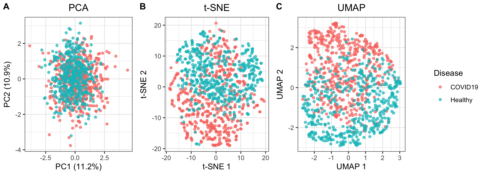
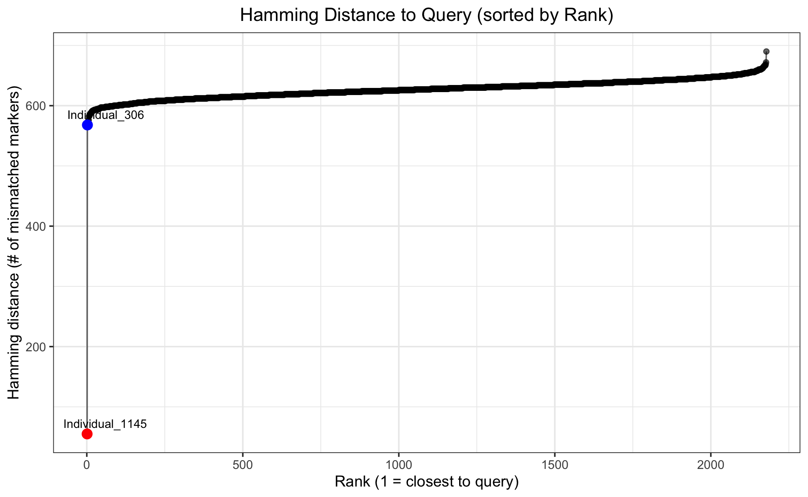
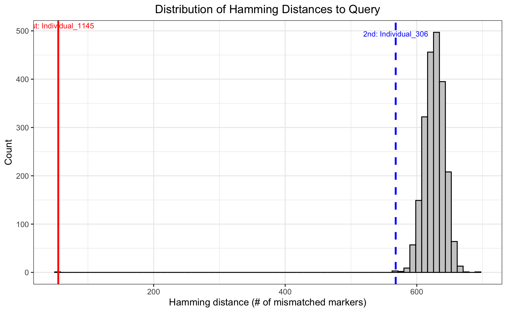
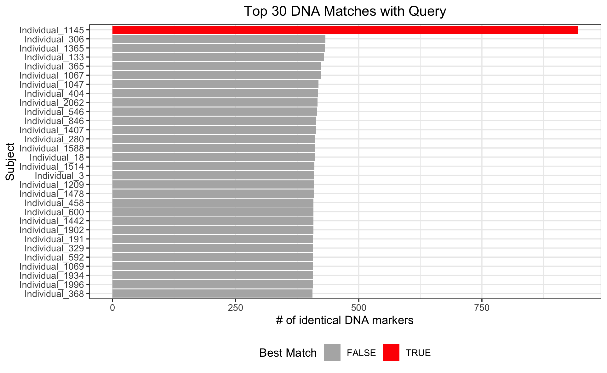
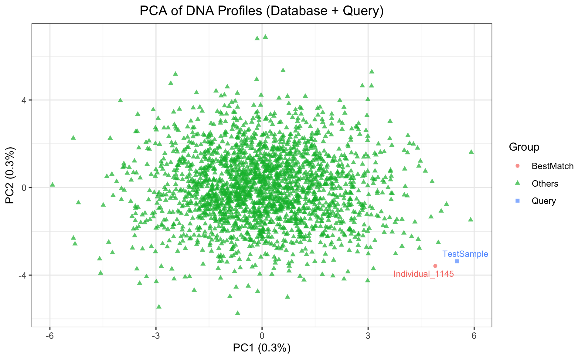

# HW3 과제 해설 — 지도 학습

[레포지토리 안내](../../README.ko.md) | [English](Assignment-Explanation.md) | [한국어](Assignment-Explanation.ko.md)

> **최종 수정일:** 2026-11-27

> **학습 목표:**
> 1. 특성 수가 샘플 수보다 훨씬 많은 데이터에서 LOOCV로 분류 모형을 평가할 때, 특성 선택과 전처리를 각 반복의 훈련 세트 안에서만 하는 절차를 설계할 수 있다
> 2. 분류기의 매개변수가 실제 예측에 쓰이는 정보를 어떻게 바꾸는지 코드의 동작으로 확인할 수 있다
> 3. 10차원 자료를 2차원에 시각화하여 두 집단의 분리 가능성을 판단할 수 있다
> 4. caret의 반복 K-겹 교차 검증으로 여러 분류 모델을 정확도와 민감도 기준에서 비교할 수 있다
> 5. 이산값 벡터 사이의 일치 개수와 거리로 데이터베이스에서 가장 비슷한 개체를 찾고, 그 결과를 시각화로 뒷받침할 수 있다

---

## 목차

- [1. 과제 구성](#1-과제-구성)
- [2. 요구사항](#2-요구사항)
- [3. 문제 1: Asthma 예측 모형](#3-문제-1-asthma-예측-모형)
  - [3.1 데이터 준비](#31-데이터-준비)
  - [3.2 LOOCV 안의 학습 절차](#32-loocv-안의-학습-절차)
  - [3.3 결과와 제출한 답](#33-결과와-제출한-답)
  - [3.4 임계값 선택의 검토](#34-임계값-선택의-검토)
- [4. 문제 2-1: 999명의 시각화](#4-문제-2-1-999명의-시각화)
- [5. 문제 2-2: 정확도 기준의 모델 비교](#5-문제-2-2-정확도-기준의-모델-비교)
- [6. 문제 2-3: 민감도 기준의 모델 비교](#6-문제-2-3-민감도-기준의-모델-비교)
- [7. 문제 3: DNA 정보를 이용한 신원 확인](#7-문제-3-dna-정보를-이용한-신원-확인)
  - [7.1 문제 3-1: 분석 방법론](#71-문제-3-1-분석-방법론)
  - [7.2 문제 3-2: 결과와 결론](#72-문제-3-2-결과와-결론)
  - [7.3 문제 3-3: 시각화](#73-문제-3-3-시각화)
- [요약](#요약)
- [점검 문제](#점검-문제)

---

 

## 1. 과제 구성

> **풀어 보기:** 이 문서는 정답과 풀이를 담고 있다. 먼저 [과제 안내문](Original/Assignment.ko.md)의 문제를 직접 풀어 본 뒤 읽는다.

과제는 세 문제, 총 110점으로 이루어진다. 문제 1은 유전자 발현 자료로 Asthma를 예측하는 모형을 LOOCV로 평가하고, 문제 2는 10가지 특성값으로 COVID-19를 예측하는 모델을 시각화와 여러 모델의 비교로 설계하며, 문제 3은 DNA 데이터베이스에서 쿼리와 같은 사람을 찾는다. 각 문제는 R 스크립트로 풀었고, 스크립트 전체의 해설은 [HW3 코드 총정리](Code-Walkthrough.ko.md)에 있다.

| 문제 | 배점 | 데이터 | 스크립트 | 관련 단원 |
|:-----|-----:|:-----|:-----|:-----|
| 문제 1 | 40 | `Data1.tsv` | [`Assignment3_Q1.R`](Solution/Assignment3_Q1.R) | [4장](../../Lecture-Notes/Ch04_Dimension-Reduction-and-PCA/Concepts_Lecture.ko.md), [6장](../../Lecture-Notes/Ch06_Supervised-Learning/Concepts_Lecture.ko.md) |
| 문제 2-1 | 10 | `Data2.tsv` | [`Assignment3_Q2-1.R`](Solution/Assignment3_Q2-1.R) | 4장 |
| 문제 2-2 | 20 | `Data2.tsv` | [`Assignment3_Q2-2.R`](Solution/Assignment3_Q2-2.R) | 6장 |
| 문제 2-3 | 10 | `Data2.tsv` | [`Assignment3_Q2-3.R`](Solution/Assignment3_Q2-3.R) | 6장 |
| 문제 3 | 30 | `Data3_DNA_Database.csv`, `Data3_DNA_Query.csv` | [`Assignment3_Q3.R`](Solution/Assignment3_Q3.R) | [3장](../../Lecture-Notes/Ch03_Unsupervised-Learning/Concepts_Lecture.ko.md), 4장 |

*표 1. 문제별 배점, 데이터, 스크립트, 관련 단원*

---

 

## 2. 요구사항

과제가 요구하는 결과물은 다음과 같다. 보고서(.docx)와 R 코드 전체를 함께 제출하며, R 코드는 조교가 실행했을 때 문제없이 실행되어야 한다.

| 문제 | 요구 |
|:-----|:-----|
| 문제 1 | Asthma를 정확하게 예측하는 모형을 개발하고, LOOCV로 평가한 최종 예측 정확도를 1쪽 이내로 기술한다 |
| 문제 2-1 | 모델링 전에 999명을 한 번에 시각화하여 COVID-19 환자를 일반인과 구분할 수 있는지 조사한다 |
| 문제 2-2 | 최소 8개의 모델링 방법으로 정확도 면에서 최고의 모델을 찾는다 |
| 문제 2-3 | 최소 8개의 모델링 방법으로 민감도 면에서 최고의 모델을 찾는다 |
| 문제 3-1 | 연쇄 살인범을 찾는 데 사용한 분석 방법론과 그 이유를 밝힌다 |
| 문제 3-2 | 수행한 모델링의 개요와 결론을 쓴다 |
| 문제 3-3 | 결과를 뒷받침하는 시각화를 보인다 |

*표 2. 문제별 요구*

`Data1.tsv`는 HW2의 원본 데이터와 같은 파일로, 질환 7개의 환자 21명(질환마다 3명) × 특성 16,273개이다. `Data2.tsv`는 999명 × 특성 10개(`F1`\~`F10`)이고, COVID19가 500명, Healthy가 499명이다. `Data3_DNA_Database.csv`는 2,178명 × DNA 마커 1,000개이며, 모든 마커 값은 0, 1, 2 가운데 하나이다. `Data3_DNA_Query.csv`는 `Subject`가 `TestSample`인 한 행이다.

---

 

## 3. 문제 1: Asthma 예측 모형

### 3.1 데이터 준비

[`Assignment3_Q1.R`](Solution/Assignment3_Q1.R)은 샘플 이름에 `Asthma`가 들어 있으면 Asthma, 아니면 Control로 두는 이진 라벨을 만든다. 나머지 6개 질환을 모두 Control로 묶으므로 Asthma 3명, Control 18명이다. 첫 열을 뺀 특성값을 수치 행렬로 바꾸고, 결측값(NA)과 무한값(Inf)을 0으로 바꾼 뒤, caret의 `nearZeroVar()`가 분산이 거의 없다고 판정한 특성 249개를 지운다. 남는 행렬은 21 × 16,024이다.

### 3.2 LOOCV 안의 학습 절차

**LOOCV**(6장 7.2절)는 샘플 하나를 검증용으로 빼고 나머지로 학습하는 일을 모든 샘플에 대해 반복한다. 스크립트는 반복마다 검증용 1명을 뺀 훈련 세트 20명 안에서만 다음 세 단계를 수행하여, 검증 샘플의 정보가 특성 선택이나 학습에 들어가지 않게 한다.

*그림 1. 문제 1의 LOOCV 파이프라인*

1. **limma 특성 선택:** limma 패키지의 `lmFit()`과 `eBayes()`로 유전자마다 Asthma와 Control의 발현 차이를 검정하고, `topTable()`로 유의확률이 가장 작은 유전자 20개를 고른다. limma는 유전자마다 선형 모델을 적합하되 모든 유전자의 분산 정보를 함께 써서 분산 추정을 안정시키는 조정된(moderated) t 통계량을 쓰므로, 샘플이 적은 발현 자료에 많이 쓰인다. 이 단계는 4장 2.1절의 특성 선택에 해당한다.
2. **SMOTE:** smotefamily 패키지의 `SMOTE()`는 소수 클래스의 샘플과 그 최근접 이웃(`K = 1`) 사이의 선분 위에 합성 샘플을 만들어 클래스 비율을 맞춘다. `dup_size = 0`이면 두 클래스의 크기가 비슷해지도록 만들 개수를 자동으로 정한다.
3. **PAMR:** pamr 패키지의 nearest shrunken centroids 분류기이다. 클래스마다 유전자별 평균(centroid)을 구하고, 각 클래스 평균과 전체 평균의 표준화된 차이를 임계값(threshold) $\Delta$만큼 0 쪽으로 줄인다(soft thresholding). 차이가 $\Delta$보다 작은 유전자는 그 클래스의 평균이 전체 평균과 같아져 분류에 기여하지 않는다. 새 샘플은 수축된 클래스 평균까지의 표준화된 거리에 클래스 사전 확률의 보정을 더한 값이 가장 작은 클래스로 분류한다.

스크립트는 `pamr.train()`이 만든 임계값 벡터의 마지막 값으로 검증 샘플을 예측한다.

### 3.3 결과와 제출한 답

LOOCV의 21개 예측은 모두 실제 라벨과 일치했다.

| 실제 \ 예측 | Asthma | Control |
|:-----|-----:|-----:|
| Asthma | 3 | 0 |
| Control | 0 | 18 |

*표 3. 문제 1의 LOOCV 혼동 행렬*

제출한 답은 다음과 같다.

Data1.tsv는 총 21명의 환자에 대해 16,273개의 유전자 발현값이 측정된 고차원 소표본 구조의 데이터이며, 질환 구성은 Asthma 3명이고 그 외 6개 질환(COVID-19, COPD, Tuberculosis, Lung cancer, AIDS, Alzheimer)을 모두 Control 범주로 묶어 총 18명의 Control로 정의하였다. sampleName에 "Asthma" 문자열이 들어 있는지를 기준으로 이진 레이블(Asthma vs Control)을 만들고, 첫 번째 열을 제외한 모든 유전자 발현값을 수치형 행렬로 변환하였다. 이후 분석 과정의 수렴 문제를 막기 위해 NA와 Inf 값은 0으로 치환하고, 정보량이 거의 없는 near-zero variance 특성은 제거하여 최종적으로 21명 × 16,024개 feature 구조의 데이터셋을 얻었다.

검증 방법으로는 표본 수가 매우 적다는 점을 고려하여 각 환자를 한 번씩 검증용으로 사용하는 LOOCV를 적용하였다. LOOCV의 각 반복에서 1명을 검증 세트로 제외하고 나머지 20명을 훈련 세트로 사용하였으며, 모든 전처리, 특징 선택, 모형 학습은 해당 훈련 세트에서만 수행하여 데이터 누출을 방지하였다. 먼저 훈련 세트에 대해서만 limma 패키지로 Asthma와 Control 사이의 차등 발현 분석을 수행하고, p-value가 가장 작은 상위 20개 유전자를 선별하여 분류에 사용할 특징 집합으로 제한하였다. 이는 수만 개 수준의 유전자 가운데 통계적으로 유의한 신호를 가지는 소수의 유전자만 남겨 과적합을 줄이고 해석 가능성을 높이기 위한 절차이다. 이후 Asthma가 소수 클래스(3명)에 불과하다는 점을 보완하기 위해 smotefamily 패키지의 SMOTE 기법으로 훈련 세트 안에서 Asthma 주변의 근접 이웃(k = 1)을 기반으로 합성 샘플을 생성하여 Asthma와 Control의 비율을 더 균형 있게 맞추었다.

최종 분류 모형으로는 마이크로어레이와 RNA-seq 같은 고차원 유전자 데이터 분석에 특화된 PAMR(Nearest Shrunken Centroids) 알고리즘을 사용하였다. SMOTE로 보강된 훈련 데이터의 상위 20개 유전자만으로 PAMR 모델을 학습하고, 각 클래스의 중심 벡터를 추정한 뒤 작은 효과를 가지는 유전자의 계수를 0으로 수축(shrink)하여 노이즈를 제거하였다. LOOCV의 각 반복에서 학습된 PAMR 모델에 대해 threshold 벡터 중 가장 작은 값을 사용하여 검증용 1명을 예측하였고, 이를 21명 전체에 대해 반복하여 최종 예측값을 얻었다. 그 결과 21개 샘플 모두에서 실제 레이블과 예측 레이블이 일치하여 LOOCV 기준 최종 정확도는 100.00%였으며, Asthma 3명을 모두 정확히 Asthma로 분류하여 Asthma에 대한 민감도(sensitivity) 역시 100.00%를 기록하였다.

### 3.4 임계값 선택의 검토

제출한 답은 임계값 벡터의 가장 작은 값을 썼다고 적었지만, 코드의 `pam_fit$threshold[length(pam_fit$threshold)]`는 벡터의 마지막 값이다. `pamr.train(threshold = NULL)`은 0에서 시작하여 모든 유전자의 차이가 0이 되는 값까지 커지는 임계값 30개를 만들므로, 마지막 값은 가장 큰 임계값이다. 각 반복의 마지막 임계값에서 일어나는 일은 다음과 같다.

- **남는 유전자 수:** 21개 반복 모두에서 마지막 임계값에 남는 유전자는 0개이다. 모든 클래스 평균이 전체 평균으로 수축되어 검증 샘플까지의 거리가 클래스와 상관없이 같아지므로, 예측은 훈련 세트의 클래스 비율(사전 확률)로만 정해진다.
- **클래스 비율:** 검증 샘플이 Control이면 훈련 세트는 Asthma 3명과 Control 17명이고 SMOTE 뒤에 15 대 17이 되어 Control이 예측된다. 검증 샘플이 Asthma이면 훈련 세트는 Asthma 2명과 Control 18명이고 SMOTE 뒤에 18 대 18이 되어 사후 확률이 0.5로 같아지며, pamr은 앞선 수준인 Asthma를 고른다. SMOTE 뒤의 `as.factor()`가 수준을 알파벳순으로 다시 정하므로 첫 수준은 Asthma이다.

| 예측에 쓴 임계값 | 남는 유전자 수 | 정확도 | Asthma 민감도 |
|:-----|-----:|-----:|-----:|
| 마지막 값 (제출한 코드) | 0 | 100.00% (21/21) | 100% (3/3) |
| 첫 값 0 | 20 | 76.19% (16/21) | 0% (0/3) |

*표 4. PAMR 임계값에 따른 LOOCV 결과*

> **주의:** 마지막 임계값에서는 유전자 발현이 예측에 전혀 쓰이지 않고, 검증 샘플의 라벨이 훈련 세트의 클래스 크기를 바꾸어 그 크기가 다시 예측을 정한다. 따라서 표 3의 100%는 검증 샘플의 라벨이 간접적으로 새어 들어간 결과이며 모형의 예측력을 보여 주지 않는다. 20개 유전자를 모두 쓰는 첫 임계값에서는 Asthma 3명이 모두 Control로, COPD_Patient3과 AIDS_Patient3이 Asthma로 잘못 분류된다. 임계값은 훈련 세트 안의 교차 검증(`pamr.cv()`)으로 고르고, 고른 임계값에서 남는 유전자 수(`pam_fit$nonzero`)를 함께 확인해야 한다.

---

 

## 4. 문제 2-1: 999명의 시각화

[`Assignment3_Q2-1.R`](Solution/Assignment3_Q2-1.R)은 특성 10개를 표준화한 뒤 PCA, t-SNE(perplexity 30), UMAP(기본 설정)으로 2차원에 나타내고, COVID19와 Healthy를 서로 다른 색으로 칠한 세 그림을 공통 범례와 함께 한 줄로 배치한다. t-SNE와 UMAP의 난수는 `set.seed(2025)`로 고정한다.

*그림 2. Data2의 999명에 대한 PCA, t-SNE, UMAP 결과*

PCA의 처음 두 주성분은 각각 전체 분산의 11.2%와 10.9%만 설명하고, 두 집단의 점이 원점 근처에 겹쳐 있다. t-SNE와 UMAP에서는 COVID19가 아래쪽이나 위쪽에, Healthy가 다른 쪽에 조금 더 많이 모이는 경향이 보이지만 두 집단이 넓게 섞여 있다.

제출한 답은 다음과 같다.

PCA, t-SNE, UMAP은 레이블을 전혀 사용하지 않는 비지도 차원 축소이므로, 질병 라벨이 잘 분리되도록 학습되는 것이 아니라 전체 데이터 구조를 기준으로 평면에 펼친다. 이 데이터는 10개의 feature에서 COVID19와 Healthy의 차이가 있기는 하지만, 그 차이가 극단적이지 않고 다른 변동(개인차, 노이즈 등)과 섞여 있어서 위 결과처럼 섞여 보일 수 있다. 따라서 지도 학습 모델로 모델링하는 것이 라벨을 고려한 더 좋은 결과를 낼 수 있을 것이다.

---

 

## 5. 문제 2-2: 정확도 기준의 모델 비교

[`Assignment3_Q2-2.R`](Solution/Assignment3_Q2-2.R)은 caret의 `train()`으로 아홉 모델을 같은 조건에서 비교한다. 교차 검증은 10-겹을 3회 반복하는 `repeatedcv`이고, Random Forest와 GBM을 뺀 모델에는 표준화(`center`, `scale`)를 적용하며, 모델마다 매개변수 후보 가운데 교차 검증 정확도가 가장 높은 값을 고른다.

| 순위 | 모델 | 조정한 매개변수 | 최고 정확도 |
|-----:|:-----|:-----|-----:|
| 1 | Naive Bayes | `usekernel` (`fL` = 0, `adjust` = 1) | 0.9306 |
| 2 | QDA | 없음 | 0.9256 |
| 3 | GBM | 트리 수, 깊이, 학습률, 잎 노드의 최소 샘플 수 | 0.9212 |
| 4 | Random Forest | `mtry` = 2, ..., 8 | 0.9152 |
| 5 | RBF SVM | `C` (`sigma`는 자료에서 자동 추정) | 0.8812 |
| 6 | kNN | k = 3, 5, ..., 25 | 0.8308 |
| 7 | 선형 SVM | `C` = $2^{-5}, \dots, 2^{5}$ | 0.6026 |
| 8 | LDA | 없음 | 0.6019 |
| 9 | 로지스틱 회귀 | 없음 | 0.6003 |

*표 5. 반복 10-겹 교차 검증의 모델별 최고 정확도*

제출한 답은 다음과 같다.

Accuracy 기준 최적 모델은 Naive Bayes이다. Data2.tsv는 999명의 대상자에 대해 10개의 연속형 특성과 COVID-19 감염 여부(Healthy / COVID19)를 포함하는 이진 분류 데이터이다. 먼저 Disease 변수를 Healthy와 COVID19 두 수준의 범주형 변수로 정의하고, F1\~F10을 예측 변수로 사용하였다. 모델 비교는 caret 패키지의 train 함수로 10-fold 교차 검증을 3회 반복하는 설정으로 통일하였고, 대부분의 모델에서 평균 0, 표준편차 1 기준의 표준화를 적용한 뒤 Accuracy(정확도)를 성능 지표로 사용하였다.

로지스틱 회귀, LDA, QDA, k-NN, Naive Bayes, 선형 SVM, RBF SVM, Random Forest, GBM까지 총 9개 모델을 활용한 결과, 각 모델의 최고 Accuracy는 Naive Bayes 0.9306, QDA 0.9256, GBM 0.9212, Random Forest 0.9152, SVM-RBF 0.8812, k-NN 0.8308, SVM-Linear 0.6026, LDA 0.6019, Logistic Regression 0.6003 순으로 나타났다. 이 가운데 Naive Bayes가 약 93.1%의 최고 Accuracy로 가장 우수하여 Accuracy 기준 최적 모델로 선정되었다. 최종 Naive Bayes 모델은 10개 특성을 모두 중심화하고 표준화한 뒤 가우시안 분포 가정을 사용하는 형태(usekernel = FALSE, fL = 0, adjust = 1)로 학습되었고, Kappa 값도 약 0.86 수준으로 두 클래스를 균형 있게 잘 구분하는 것으로 확인되었다.

> **참고:** 선형 결정 경계를 쓰는 로지스틱 회귀, LDA, 선형 SVM은 정확도가 0.60 안팎에 머물고, 클래스마다 분산을 따로 추정하는 QDA와 Gaussian Naive Bayes는 0.93 근처에 이른다. 실제로 두 집단은 대부분의 특성에서 평균의 차이보다 분산의 차이가 크다. 예를 들어 F3의 표준편차는 COVID19가 20.07, Healthy가 3.97이고, F10은 9.96과 32.58이다. 평균이 비슷하고 퍼진 정도가 다른 두 집단은 직선으로 나누기 어렵고, 분산의 차이를 반영하는 2차 경계로는 잘 나뉜다. 그림 2의 비지도 시각화에서 두 집단이 겹쳐 보인 것도 같은 이유이다.

---

 

## 6. 문제 2-3: 민감도 기준의 모델 비교

[`Assignment3_Q2-3.R`](Solution/Assignment3_Q2-3.R)은 문제 2-2와 같은 아홉 모델과 매개변수 후보를 쓰되, 다음 세 가지를 바꾼다.

- `Disease`의 수준 순서를 `c("COVID19", "Healthy")`로 두어 COVID19를 양성 클래스로 지정한다. caret의 이진 분류 지표는 첫 번째 수준을 양성으로 본다.
- `trainControl()`에 `summaryFunction = twoClassSummary`를 주어 ROC 곡선 아래 넓이, 민감도, 특이도를 계산한다(6장 8절).
- `metric = "Sens"`로 모델마다 교차 검증 민감도가 가장 높은 매개변수를 고른다.

| 순위 | 모델 | 최고 민감도 |
|-----:|:-----|-----:|
| 1 | GBM | 0.9107 |
| 2 | QDA | 0.9093 |
| 3 | Naive Bayes | 0.9087 |
| 4 | Random Forest | 0.8920 |
| 5 | RBF SVM | 0.8600 |
| 6 | kNN | 0.7373 |
| 7 | LDA | 0.5847 |
| 8 | 로지스틱 회귀 | 0.5840 |
| 9 | 선형 SVM | 0.5833 |

*표 6. 반복 10-겹 교차 검증의 모델별 최고 민감도*

선택된 GBM의 매개변수는 트리 300개, 깊이 3, 학습률 0.1, 잎 노드의 최소 샘플 수 20이고, 이때 교차 검증의 ROC 곡선 아래 넓이는 0.9730, 민감도는 0.9107, 특이도는 0.9319이다.

제출한 답은 다음과 같다.

민감도 기준 최적 모델은 GBM이다. 평가 기준을 민감도로 바꾸어, 특히 COVID19 양성 환자를 얼마나 잘 검출하는지에 초점을 맞추었다. 이를 위해 Disease 변수의 레벨 순서를 c("COVID19", "Healthy")로 설정하여 COVID19를 positive 클래스로 지정하고, trainControl에서 classProbs = TRUE, summaryFunction = twoClassSummary를 사용하여 ROC, Sensitivity, Specificity를 동시에 계산하도록 하였다. 교차 검증 설정과 입력 변수는 문제 2-2와 같게 유지하되, metric = "Sens"로 설정하여 각 모델이 교차 검증에서 달성하는 민감도가 최대가 되도록 하였다.

같은 9개 모델의 민감도 기준 최고 성능을 비교한 결과 GBM 0.9107, QDA 0.9093, Naive Bayes 0.9087, Random Forest 0.8920, SVM-RBF 0.8600, k-NN 0.7373, LDA 0.5847, Logistic Regression 0.5840, SVM-Linear 0.5833 순으로 나타났다. 정확도 기준에서는 Naive Bayes가 1위였지만, 민감도 기준에서는 GBM이 약간 더 높은 0.9107을 기록하여 최적 모델로 선정되었다. 최종 선택된 GBM 모형은 n.trees = 300, interaction.depth = 3, shrinkage = 0.10, n.minobsinnode = 20으로 튜닝되었으며, 교차 검증 기준 ROC는 약 0.973, Sensitivity는 약 91%, Specificity는 약 93% 수준을 보였다. 즉 COVID19 양성 환자의 약 91%를 올바르게 찾아내면서 음성에 대해서도 높은 특이도를 유지하므로, 양성 환자를 놓치지 않는다는 관점에서 가장 적절한 분류 모형으로 평가할 수 있다.

> **참고:** 민감도만 기준으로 삼으면 모든 사람을 양성으로 분류하는 모델이 민감도 1을 얻는다. 따라서 민감도로 모델을 고를 때는 특이도나 ROC 곡선 아래 넓이를 함께 확인해야 하며, 선택된 GBM은 특이도 0.932를 유지한다. 1\~3위의 민감도 차이는 0.002 이내여서, 다른 반복 분할에서는 순위가 바뀔 수 있다.

---

 

## 7. 문제 3: DNA 정보를 이용한 신원 확인

### 7.1 문제 3-1: 분석 방법론

[`Assignment3_Q3.R`](Solution/Assignment3_Q3.R)은 데이터베이스의 각 개인과 쿼리 사이에서 값이 같은 마커의 개수(일치 개수), 값이 다른 마커의 개수(Hamming 거리), Euclidean 거리를 계산하고, Hamming 거리가 가장 작은 개인을 후보로 고른다. 두 벡터 $\mathbf{x}$, $\mathbf{q}$의 Hamming 거리는 다음과 같다.

$$
d_H(\mathbf{x}, \mathbf{q}) = \sum_{j=1}^{1000} \mathbb{1}[x_j \ne q_j] = 1000 - (\text{일치 개수})
$$

제출한 답은 다음과 같다.

Data3_DNA_Database.csv에는 서울에 거주하는 2,178명의 범죄자에 대한 DNA 정보가, Data3_DNA_Query.csv에는 사건 현장에서 채취된 대상자의 DNA 정보가 주어져 있다. 각 행은 한 개인을, 각 열(DNA_1\~DNA_1000)은 특정 DNA 마커의 수치화된 정보를 나타내며, 모든 값은 이미 전처리된 실수(실제로는 0, 1, 2 수준의 범주형 코딩)이다. 문제에서 DNA 정보는 수 세기에 걸쳐 거의 변하지 않으며 모든 feature에서 값이 같을수록 동일인일 가능성이 높다고 제시하므로, 이 문제는 결국 쿼리 DNA 벡터와 가장 비슷한(가장 많이 일치하는) 개인을 데이터베이스에서 찾는 고차원 유사도 검색 문제로 볼 수 있다.

이에 따라 별도의 학습 라벨(연쇄 살인범 여부)이 주어지지 않았으므로 지도 학습 모형 대신 고차원 공간에서의 거리 기반 최근접 이웃(1-NN)에 해당하는 방법을 사용했다. 구체적으로는 데이터베이스의 각 개인에 대해 쿼리 샘플과 (1) 같은 DNA 마커의 개수(일치 개수)와 (2) 서로 다른 마커의 개수(해밍 거리)를 계산하여, 쿼리와의 거리가 가장 짧고 일치 개수가 가장 많은 개인을 후보로 선정하였다. 모든 DNA 마커가 같은 척도(0, 1, 2)로 주어져 있으므로 추가적인 표준화 없이 각 feature를 같은 가중치로 취급하는 것이 자연스럽고, 변하지 않는 DNA 특성이 최대한 많이 일치할수록 동일인일 가능성이 높다는 문제의 힌트와도 직접 부합한다. 나아가 수업에서 다룬 분석 기법을 활용하기 위해 전체 2,178명과 쿼리 1명을 합쳐 PCA를 수행하고, 2차원 주성분 공간에서 쿼리 샘플과 각 개인의 상대적 위치를 확인하여 거리 기반 결과를 시각적으로도 검증하였다.

### 7.2 문제 3-2: 결과와 결론

| 항목 | 값 |
|:-----|:-----|
| 일치 개수의 평균과 표준편차 | 373.48, 19.42 |
| 일치 개수의 중앙값과 99번째 백분위수 | 373, 408 |
| 1위 후보 | Individual_1145: 일치 945, Hamming 거리 55, Euclidean 거리 10.15 |
| 2위 후보 | Individual_306: 일치 432, Hamming 거리 568, Euclidean 거리 30.36 |

*표 7. 쿼리와 데이터베이스의 일치 결과*

1위 후보의 일치 개수는 평균보다 $(945 - 373.48)/19.42 \approx 29.4$ 표준편차 크다. 마커 값이 0, 1, 2 가운데 하나이므로 무관한 두 사람도 마커의 약 37%에서 우연히 같은 값을 갖는다.

제출한 답은 다음과 같다.

먼저 데이터베이스에서 DNA_1\~DNA_1000의 1,000개 DNA feature를 추출하여 2,178 × 1,000 행렬을 구성하고, 쿼리 샘플도 같은 1,000차원 벡터로 정리하였다. 이후 각 i(1 ≤ i ≤ 2,178)에 대해 쿼리와 값이 완전히 같은 DNA 마커의 개수를 계산한 결과 평균 일치 개수는 약 373개(표준편차 약 19개) 수준이었으며, 대부분의 개인은 350\~400개 정도의 마커만 쿼리와 우연히 일치하였다. 상위 1%의 경계값도 408개 정도였고, 두 번째로 높은 개인 역시 432/1000(43.2%) 수준의 일치에 그쳤다. 그러나 Individual_1145는 쿼리 샘플과 945/1000개의 DNA 마커가 완전히 같아 전체 2,178명 가운데 압도적으로 가장 높은 일치도를 보였다. 이는 평균(약 373개)보다 570개 이상 많은 마커가 일치하는 값으로, 표준편차로 환산하면 약 29표준편차 이상 떨어진 극단적인 이상치에 해당한다. 해밍 거리(서로 다른 마커 개수)의 관점에서도 대부분의 개인이 쿼리와 약 620 전후의 마커에서 차이를 보이는 반면, Individual_1145는 단 55개 마커만 다르고 나머지 945개는 같아 거리 기준으로도 독보적인 최단 거리 후보임을 확인하였다. 종합하면 사건 현장의 DNA 쿼리 샘플과 가장 잘 일치하는(즉 동일인으로 추정되는) 데이터베이스상의 인물은 Individual_1145이며, 따라서 이 분석에서는 이 인물을 연쇄 살인범으로 결론지었다.

### 7.3 문제 3-3: 시각화

스크립트는 결과를 뒷받침하는 그림 네 개를 그린다. 제출한 답의 설명을 각 그림 아래에 옮긴다.

*그림 3. 쿼리와의 Hamming 거리를 순위대로 정렬한 그림*

데이터베이스 2,178명에 대해 쿼리와의 해밍 거리를 계산한 뒤 거리가 작은 순으로 정렬하여, 순위와 해밍 거리의 선과 점 그래프를 그렸다. 대부분의 개인은 완만한 곡선을 따라 분포하지만, 최종 후보는 가장 왼쪽(1위)에서 유일하게 매우 낮은 해밍 거리를 가지며 2위 후보와도 눈에 띄게 큰 격차를 보여, 쿼리와의 유사도가 단일한 이상치임을 직관적으로 확인할 수 있다.

*그림 4. 쿼리와의 Hamming 거리 분포와 1위, 2위 후보의 위치*

해밍 거리 분포의 히스토그램에서도 대부분의 표본이 중간 영역에 몰려 있는 반면, 최종 후보의 해밍 거리는 분포의 극단적인 왼쪽 끝에 있고 2위 후보는 그보다 오른쪽에 있어, 1위와 나머지 전체 사이의 구조적 차이가 뚜렷하게 드러난다.

*그림 5. 쿼리와 일치하는 마커 개수의 상위 30명*

쿼리와 일치하는 DNA 마커 개수 기준 상위 30명의 막대그래프에서 상위 후보 대부분은 비슷한 높이(비슷한 일치 개수)를 보이는 반면, 최종 후보는 훨씬 높은 막대로 홀로 튀어나와 있어 거의 완전히 겹치는 DNA 패턴을 가진 유일한 표본임을 강조한다.

*그림 6. 데이터베이스와 쿼리를 함께 투영한 PCA 산점도*

데이터베이스 전체와 쿼리를 함께 PCA로 2차원에 투영한 산점도에서는 쿼리와 최종 후보가 서로 가까운 위치에, 다른 표본들은 상대적으로 떨어진 위치에 나타나 거리 기반 분석 결과를 보조적으로 뒷받침한다. 이 시각화들은 모두 쿼리 DNA와 최종 후보가 고차원 DNA 공간에서 사실상 한 쌍으로 묶일 정도로 가깝고, 다른 누구와도 비교할 수 없을 만큼 비슷하다는 점을 명확히 보여 준다.

> **참고:** 그림 6의 두 주성분은 각각 전체 분산의 0.3%만 설명한다. 마커 1,000개가 서로 거의 독립이면 분산이 모든 방향에 고르게 퍼져 처음 두 주성분도 전체 구조를 거의 담지 못한다. 따라서 PCA 산점도는 보조 근거이고, 신원 확인의 주된 근거는 그림 3\~5의 Hamming 거리와 일치 개수이다.

---

 

## 요약

| 개념 | 핵심 요약 |
|:-----|:-----|
| 누출 없는 LOOCV | 특성 선택(limma), 과대 표집(SMOTE), 학습(PAMR)을 각 반복의 훈련 세트 안에서만 수행해야 검증 샘플이 평가에 영향을 주지 않는다. |
| PAMR의 임계값 | 임계값이 클수록 더 많은 유전자의 클래스 차이가 0으로 수축되며, 모든 유전자가 사라지는 임계값에서는 예측이 클래스 사전 확률로만 정해진다. |
| 문제 1의 결과 | 제출한 코드의 100% 정확도는 SMOTE 뒤의 클래스 크기가 검증 샘플의 라벨에 따라 달라져 생긴 것이며, 20개 유전자를 모두 쓰면 정확도는 76.19%이다. |
| 비지도 시각화의 한계 | 라벨을 쓰지 않는 PCA, t-SNE, UMAP에서 두 집단이 겹쳐 보여도 지도 학습 모델은 두 집단을 잘 나눌 수 있다. |
| 모델 비교 | 반복 10-겹 교차 검증에서 정확도는 Naive Bayes(0.9306), 민감도는 GBM(0.9107)이 가장 높았고, 선형 경계의 모델은 0.60 안팎이었다. |
| DNA 신원 확인 | Hamming 거리가 가장 작은 Individual_1145는 945개 마커가 일치하여 평균보다 약 29.4 표준편차 크며, 2위(432개)와도 크게 떨어져 있다. |

---

 

## 점검 문제

1. **특성 선택의 위치:** LOOCV에서 limma 특성 선택을 반복문 밖에서 21명 전체에 대해 한 번만 수행하면 어떤 문제가 생기는지 설명하라.

   

   
정답

   특성 선택에 검증 샘플의 라벨과 발현값이 이미 쓰였으므로, 고른 20개 유전자가 검증 샘플을 맞히는 데 유리하게 정해진다. 이는 데이터 누출이며 LOOCV 정확도를 실제보다 높게 만든다. 특성 선택도 모형 학습의 일부이므로 각 반복의 훈련 세트 안에서만 해야 한다.

   

2. **사전 확률로만 정해지는 예측:** PAMR에서 남는 유전자가 0개일 때, 훈련 세트가 Asthma 15명과 Control 17명이면 어떤 검증 샘플이든 어느 클래스로 예측되는가? 그 이유는 무엇인가?

   

   
정답

   Control로 예측된다. 남는 유전자가 없으면 모든 클래스 평균이 전체 평균과 같아져 검증 샘플까지의 거리가 두 클래스에서 같다. 남는 차이는 사전 확률뿐이며 Control의 비율 17/32가 Asthma의 15/32보다 크므로, 발현값과 관계없이 항상 Control이 된다.

   

3. **민감도 계산:** 양성 클래스가 COVID19이고 어떤 모델이 COVID19 500명 가운데 455명을 COVID19로, Healthy 499명 가운데 36명을 COVID19로 예측했다면 민감도와 특이도는 얼마인가?

   

   
정답

   민감도는 $455/500 = 0.910$이다. Healthy 가운데 Healthy로 맞게 예측한 사람은 $499 - 36 = 463$명이므로 특이도는 $463/499 \approx 0.928$이다.

   

4. **Hamming 거리와 Euclidean 거리:** 마커 값이 0, 1, 2인 두 벡터에서 Hamming 거리는 같지만 Euclidean 거리가 다를 수 있는 예를 들고, 이 문제에서 Hamming 거리가 더 자연스러운 이유를 설명하라.

   

   
정답

   쿼리가 (0, 0)일 때 (1, 0)과 (2, 0)은 모두 Hamming 거리가 1이지만 Euclidean 거리는 1과 2이다. 문제는 모든 특성에서 같은 값을 가질수록 표적일 가능성이 높다고 하므로, 값의 차이의 크기보다 같은지 다른지가 중요하다. Hamming 거리는 일치하지 않는 마커의 개수를 그대로 세므로 이 기준에 직접 맞는다.

   

