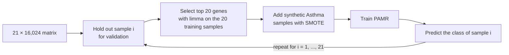
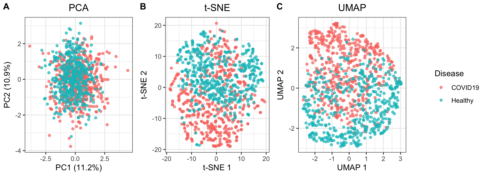
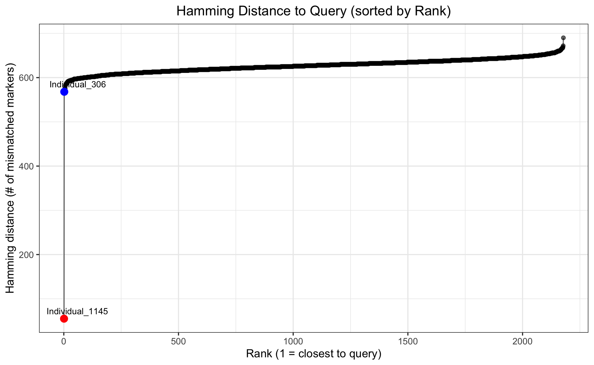
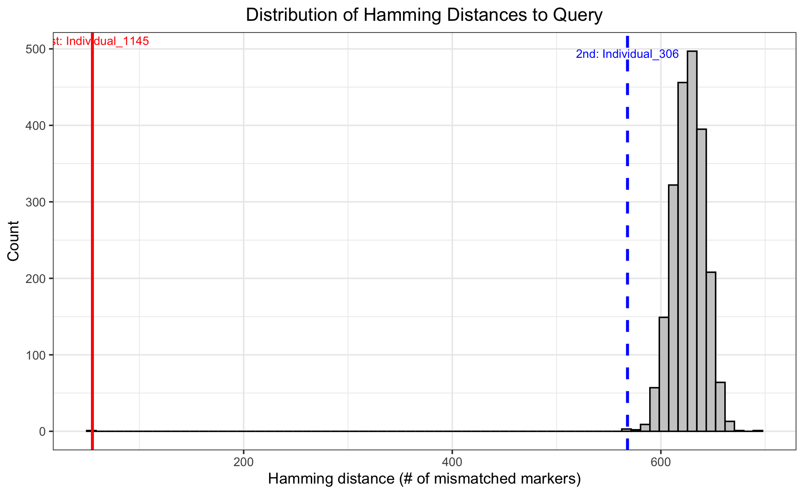
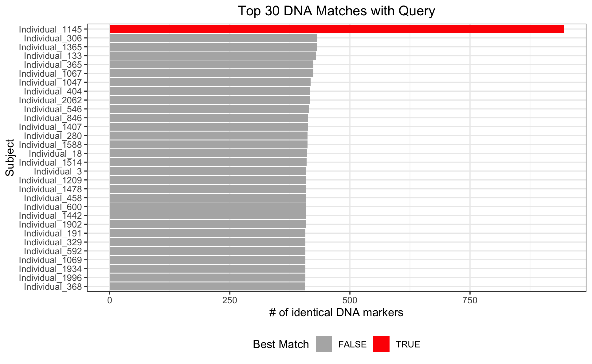
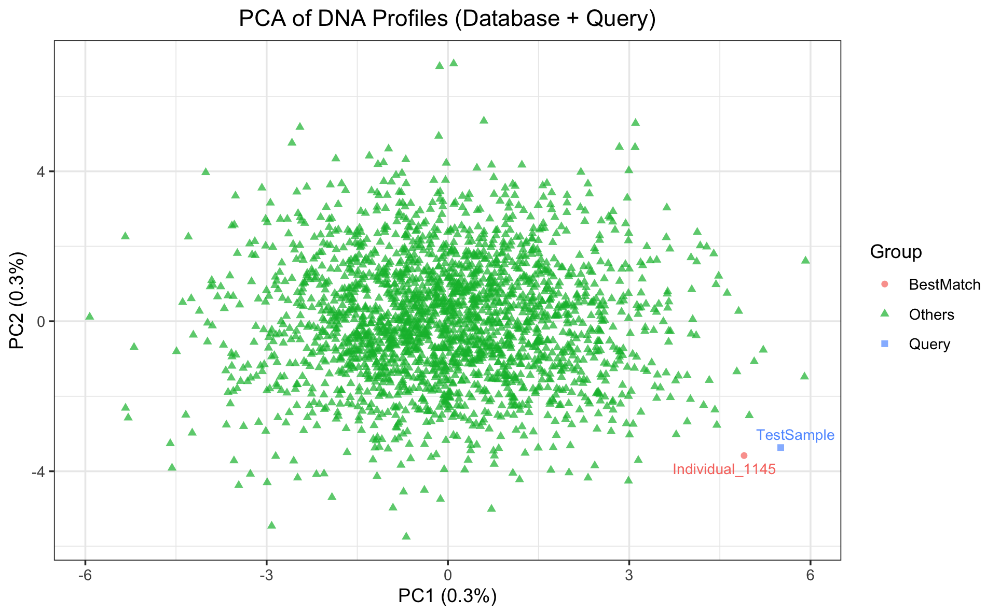

# HW3 Assignment Explanation — Supervised Learning

[Repository Guide](../../README.md) | [English](Assignment-Explanation.md) | [한국어](Assignment-Explanation.ko.md)

> **Last Updated:** 2026-11-16

> **Learning Objectives:**
> 1. Design a procedure that performs feature selection and preprocessing only within the training set of each iteration when evaluating a classification model by LOOCV on data with far more features than samples
> 2. Check through the behavior of the code how a classifier's parameter changes the information actually used for prediction
> 3. Visualize 10-dimensional data in two dimensions and judge whether two groups can be separated
> 4. Compare several classification models by accuracy and sensitivity with caret's repeated K-fold cross-validation
> 5. Find the most similar individual in a database by the number of matches and the distance between discrete-valued vectors, and support the result with visualizations

---

## Table of Contents

- [1. Assignment Structure](#1-assignment-structure)
- [2. Requirements](#2-requirements)
- [3. Problem 1: Asthma Prediction Model](#3-problem-1-asthma-prediction-model)
  - [3.1 Data Preparation](#31-data-preparation)
  - [3.2 Training Procedure Inside LOOCV](#32-training-procedure-inside-loocv)
  - [3.3 Results and Submitted Answer](#33-results-and-submitted-answer)
  - [3.4 Review of the Threshold Choice](#34-review-of-the-threshold-choice)
- [4. Problem 2-1: Visualizing the 999 People](#4-problem-2-1-visualizing-the-999-people)
- [5. Problem 2-2: Model Comparison by Accuracy](#5-problem-2-2-model-comparison-by-accuracy)
- [6. Problem 2-3: Model Comparison by Sensitivity](#6-problem-2-3-model-comparison-by-sensitivity)
- [7. Problem 3: Identification with DNA Information](#7-problem-3-identification-with-dna-information)
  - [7.1 Problem 3-1: Analysis Methodology](#71-problem-3-1-analysis-methodology)
  - [7.2 Problem 3-2: Results and Conclusion](#72-problem-3-2-results-and-conclusion)
  - [7.3 Problem 3-3: Visualization](#73-problem-3-3-visualization)
- [Summary](#summary)
- [Self-Check Questions](#self-check-questions)

---

 

## 1. Assignment Structure

> **Try It First:** This document contains the answers and solutions. Solve the problems in the [assignment handout](Original/Assignment.md) yourself before reading on.

The assignment consists of three problems worth 110 points in total. Problem 1 evaluates a model that predicts Asthma from gene expression data by LOOCV, Problem 2 designs a model that predicts COVID-19 from 10 feature values through visualization and a comparison of several models, and Problem 3 finds the person matching the query in a DNA database. Each problem was solved with R scripts, and the [HW3 code walkthrough](Code-Walkthrough.md) explains all the scripts.

| Problem | Points | Data | Script | Related Unit |
|:-----|-----:|:-----|:-----|:-----|
| Problem 1 | 40 | `Data1.tsv` | [`Assignment3_Q1.R`](Solution/Assignment3_Q1.R) | [Chapter 4](../../Lecture-Notes/Ch04_Dimension-Reduction-and-PCA/Concepts_Lecture.md), [Chapter 6](../../Lecture-Notes/Ch06_Supervised-Learning/Concepts_Lecture.md) |
| Problem 2-1 | 10 | `Data2.tsv` | [`Assignment3_Q2-1.R`](Solution/Assignment3_Q2-1.R) | Chapter 4 |
| Problem 2-2 | 20 | `Data2.tsv` | [`Assignment3_Q2-2.R`](Solution/Assignment3_Q2-2.R) | Chapter 6 |
| Problem 2-3 | 10 | `Data2.tsv` | [`Assignment3_Q2-3.R`](Solution/Assignment3_Q2-3.R) | Chapter 6 |
| Problem 3 | 30 | `Data3_DNA_Database.csv`, `Data3_DNA_Query.csv` | [`Assignment3_Q3.R`](Solution/Assignment3_Q3.R) | [Chapter 3](../../Lecture-Notes/Ch03_Unsupervised-Learning/Concepts_Lecture.md), Chapter 4 |

*Table 1. Points, data, script, and related unit of each problem*

---

 

## 2. Requirements

The assignment requires the following results. The report (.docx) and the entire R code are submitted together, and the R code must run without problems when the TA executes it.

| Problem | Requirement |
|:-----|:-----|
| Problem 1 | Develop a model that accurately predicts Asthma and describe the final prediction accuracy evaluated by LOOCV within 1 page |
| Problem 2-1 | Before modeling, visualize the 999 people at once and examine whether COVID-19 patients can be distinguished from normal people |
| Problem 2-2 | Find the best model in terms of accuracy with at least 8 modeling methods |
| Problem 2-3 | Find the best model in terms of sensitivity with at least 8 modeling methods |
| Problem 3-1 | State the analysis methodology used to find the serial killer and the reason for it |
| Problem 3-2 | Write an overview of the modeling performed and the conclusion |
| Problem 3-3 | Show visualizations that support the result |

*Table 2. Requirement of each problem*

`Data1.tsv` is the same file as the original data of HW2: 21 patients with 7 diseases (3 per disease) × 16,273 features. `Data2.tsv` has 999 people × 10 features (`F1`-`F10`), with 500 COVID19 and 499 Healthy. `Data3_DNA_Database.csv` has 2,178 people × 1,000 DNA markers, and every marker value is one of 0, 1, and 2. `Data3_DNA_Query.csv` is a single row whose `Subject` is `TestSample`.

---

 

## 3. Problem 1: Asthma Prediction Model

### 3.1 Data Preparation

[`Assignment3_Q1.R`](Solution/Assignment3_Q1.R) creates a binary label that is Asthma if the sample name contains `Asthma` and Control otherwise. All the other 6 diseases are grouped as Control, giving 3 Asthma and 18 Control. It converts the feature values except the first column into a numeric matrix, replaces missing values (NA) and infinite values (Inf) with 0, and removes the 249 features that caret's `nearZeroVar()` judges to have almost no variance. The remaining matrix is 21 × 16,024.

### 3.2 Training Procedure Inside LOOCV

**LOOCV** (Section 7.2 of Chapter 6) repeats, for every sample, holding out one sample for validation and training on the rest. In each iteration, the script performs the following three steps only within the training set of 20 people left after holding out one validation sample, so that the information of the validation sample does not enter feature selection or training.

*Figure 1. LOOCV pipeline of Problem 1*

1. **limma feature selection:** The `lmFit()` and `eBayes()` functions of the limma package test the expression difference between Asthma and Control for each gene, and `topTable()` picks the 20 genes with the smallest p-values. limma fits a linear model to each gene but uses a moderated t statistic that stabilizes the variance estimates by sharing the variance information of all genes, so it is widely used for expression data with few samples. This step corresponds to the feature selection in Section 2.1 of Chapter 4.
2. **SMOTE:** The `SMOTE()` of the smotefamily package creates synthetic samples on the segments between minority-class samples and their nearest neighbors (`K = 1`) to balance the class ratio. With `dup_size = 0`, it decides the number to create automatically so that the two classes become similar in size.
3. **PAMR:** The nearest shrunken centroids classifier of the pamr package. It computes the gene-wise mean (centroid) of each class and shrinks the standardized difference between each class mean and the overall mean toward 0 by the threshold $\Delta$ (soft thresholding). For a gene whose difference is smaller than $\Delta$, the class mean becomes equal to the overall mean and the gene does not contribute to classification. A new sample is assigned to the class with the smallest standardized distance to the shrunken class mean plus a correction for the class prior probability.

The script predicts the validation sample with the last value of the threshold vector built by `pamr.train()`.

### 3.3 Results and Submitted Answer

All 21 LOOCV predictions matched the actual labels.

| Actual \ Predicted | Asthma | Control |
|:-----|-----:|-----:|
| Asthma | 3 | 0 |
| Control | 0 | 18 |

*Table 3. LOOCV confusion matrix of Problem 1*

The submitted answer is as follows.

Data1.tsv is high-dimensional, small-sample data in which 16,273 gene expression values were measured for a total of 21 patients; the disease composition is 3 Asthma, and all the other 6 diseases (COVID-19, COPD, Tuberculosis, Lung cancer, AIDS, Alzheimer) were grouped into the Control category, defining 18 Controls in total. A binary label (Asthma vs Control) was created according to whether the sampleName contains the string "Asthma", and all the gene expression values except the first column were converted into a numeric matrix. Then, to prevent convergence problems in the analysis, NA and Inf values were replaced with 0, and near-zero variance features with almost no information were removed, finally giving a dataset of 21 people × 16,024 features.

As the validation method, considering the very small number of samples, LOOCV was applied, using each patient once for validation. In each LOOCV iteration, 1 person was held out as the validation set and the remaining 20 were used as the training set, and all preprocessing, feature selection, and model training were performed only on that training set to prevent data leakage. First, a differential expression analysis between Asthma and Control was performed with the limma package on the training set only, and the top 20 genes with the smallest p-values were selected to restrict the feature set used for classification. This procedure keeps only the few genes with statistically significant signals among tens of thousands of genes, reducing overfitting and increasing interpretability. Then, to compensate for Asthma being a minority class (3 people), the SMOTE technique of the smotefamily package generated synthetic samples within the training set based on the nearest neighbors (k = 1) around Asthma, balancing the ratio of Asthma and Control.

As the final classification model, the PAMR (Nearest Shrunken Centroids) algorithm, specialized for analyzing high-dimensional gene data such as microarray and RNA-seq data, was used. A PAMR model was trained with only the top 20 genes of the SMOTE-augmented training data, and after estimating the centroid vector of each class, the coefficients of genes with small effects were shrunk to 0 to remove noise. In each LOOCV iteration, the validation person was predicted with the smallest value of the threshold vector for the trained PAMR model, and repeating this for all 21 people gave the final predictions. As a result, the actual and predicted labels matched for all 21 samples, so the final LOOCV accuracy was 100.00%, and all 3 Asthma patients were correctly classified as Asthma, so the sensitivity for Asthma was also 100.00%.

### 3.4 Review of the Threshold Choice

The submitted answer states that the smallest value of the threshold vector was used, but `pam_fit$threshold[length(pam_fit$threshold)]` in the code is the last value of the vector. `pamr.train(threshold = NULL)` builds 30 thresholds that start at 0 and increase up to the value at which the differences of all genes become 0, so the last value is the largest threshold. Rerunning the same code and checking the threshold of each iteration gives the following.

- **Number of remaining genes:** In all 21 iterations, 0 genes remain at the last threshold. All class means shrink to the overall mean, so the distance to the validation sample is the same regardless of class, and the prediction is decided only by the class ratio (prior probability) of the training set.
- **Class ratio:** When the validation sample is Control, the training set has 3 Asthma and 17 Control, which becomes 15 to 17 after SMOTE, so Control is predicted. When the validation sample is Asthma, the training set has 2 Asthma and 18 Control, which becomes 18 to 18 after SMOTE, so the posterior probabilities tie at 0.5 and pamr picks the earlier level, Asthma.

| Threshold Used for Prediction | Remaining Genes | Accuracy | Asthma Sensitivity |
|:-----|-----:|-----:|-----:|
| Last value (submitted code) | 0 | 100.00% (21/21) | 100% (3/3) |
| First value 0 | 20 | 76.19% (16/21) | 0% (0/3) |

*Table 4. LOOCV results by PAMR threshold*

> **Caution:** At the last threshold, gene expression is not used for prediction at all; the label of the validation sample changes the class sizes of the training set, and those sizes in turn decide the prediction. The 100% in Table 3 is therefore the result of the validation label leaking in indirectly and does not show the predictive power of the model. At the first threshold, which uses all 20 genes, all 3 Asthma patients are misclassified as Control, and COPD_Patient3 and AIDS_Patient3 as Asthma. The threshold should be chosen by cross-validation within the training set (`pamr.cv()`), together with a check of the number of genes remaining at the chosen threshold (`pam_fit$nonzero`).

---

 

## 4. Problem 2-1: Visualizing the 999 People

[`Assignment3_Q2-1.R`](Solution/Assignment3_Q2-1.R) standardizes the 10 features, shows the data in two dimensions with PCA, t-SNE (perplexity 30), and UMAP (default settings), and arranges the three plots, with COVID19 and Healthy in different colors, in one row with a shared legend. The random numbers of t-SNE and UMAP are fixed with `set.seed(2025)`.

*Figure 2. PCA, t-SNE, and UMAP results for the 999 people of Data2*

The first two principal components of PCA explain only 11.2% and 10.9% of the total variance, and the points of the two groups overlap near the origin. In t-SNE and UMAP, COVID19 tends to gather slightly more on the lower or upper side and Healthy on the other, but the two groups are widely mixed.

The submitted answer is as follows.

PCA, t-SNE, and UMAP are unsupervised dimension reduction methods that use no labels at all, so they are not trained to separate the disease labels but spread the data on the plane according to the overall data structure. These data do have differences between COVID19 and Healthy in the 10 features, but the differences are not extreme and are mixed with other variation (individual differences, noise, and so on), so they can look mixed as in the results above. Therefore, modeling with supervised learning models will give better results that take the labels into account.

---

 

## 5. Problem 2-2: Model Comparison by Accuracy

[`Assignment3_Q2-2.R`](Solution/Assignment3_Q2-2.R) compares nine models under the same conditions with caret's `train()`. The cross-validation is `repeatedcv`, 10-fold repeated 3 times; standardization (`center`, `scale`) is applied to all models except Random Forest and GBM; and for each model, the parameter candidate with the highest cross-validated accuracy is chosen.

| Rank | Model | Tuned Parameters | Best Accuracy |
|-----:|:-----|:-----|-----:|
| 1 | Naive Bayes | `usekernel` (`fL` = 0, `adjust` = 1) | 0.9306 |
| 2 | QDA | None | 0.9256 |
| 3 | GBM | Number of trees, depth, learning rate, minimum samples in a leaf node | 0.9212 |
| 4 | Random Forest | `mtry` = 2, ..., 8 | 0.9152 |
| 5 | RBF SVM | `C` (`sigma` estimated automatically from the data) | 0.8812 |
| 6 | kNN | k = 3, 5, ..., 25 | 0.8308 |
| 7 | Linear SVM | `C` = $2^{-5}, \dots, 2^{5}$ | 0.6026 |
| 8 | LDA | None | 0.6019 |
| 9 | Logistic regression | None | 0.6003 |

*Table 5. Best accuracy of each model by repeated 10-fold cross-validation*

The submitted answer is as follows.

The best model by Accuracy is Naive Bayes. Data2.tsv is binary classification data containing 10 continuous features and COVID-19 infection status (Healthy / COVID19) for 999 subjects. First, the Disease variable was defined as a categorical variable with the two levels Healthy and COVID19, and F1-F10 were used as predictors. The model comparison was unified with the train function of the caret package under a setting of 10-fold cross-validation repeated 3 times, and after applying standardization to mean 0 and standard deviation 1 in most models, Accuracy was used as the performance metric.

Using a total of 9 models, logistic regression, LDA, QDA, k-NN, Naive Bayes, linear SVM, RBF SVM, Random Forest, and GBM, the best Accuracy of each model was, in order, Naive Bayes 0.9306, QDA 0.9256, GBM 0.9212, Random Forest 0.9152, SVM-RBF 0.8812, k-NN 0.8308, SVM-Linear 0.6026, LDA 0.6019, and Logistic Regression 0.6003. Among them, Naive Bayes was the best with the highest Accuracy of about 93.1% and was selected as the best model by Accuracy. The final Naive Bayes model was trained after centering and standardizing all 10 features, in the form using the Gaussian distribution assumption (usekernel = FALSE, fL = 0, adjust = 1), and its Kappa of about 0.86 confirmed that it distinguishes the two classes well and in a balanced way.

> **Note:** Logistic regression, LDA, and linear SVM, which use linear decision boundaries, stay around 0.60 in accuracy, while QDA and Gaussian Naive Bayes, which estimate the variance of each class separately, reach about 0.93. In fact, the two groups differ more in variance than in mean in most features. For example, the standard deviation of F3 is 20.07 for COVID19 and 3.97 for Healthy, and that of F10 is 9.96 and 32.58. Two groups with similar means and different spreads are hard to separate with a straight line but are separated well by a quadratic boundary that reflects the variance difference. The same reason explains why the two groups looked overlapping in the unsupervised visualization of Figure 2.

---

 

## 6. Problem 2-3: Model Comparison by Sensitivity

[`Assignment3_Q2-3.R`](Solution/Assignment3_Q2-3.R) uses the same nine models and parameter candidates as Problem 2-2 but changes the following three things.

- It sets the level order of `Disease` to `c("COVID19", "Healthy")`, making COVID19 the positive class. caret's binary classification metrics treat the first level as positive.
- It gives `summaryFunction = twoClassSummary` to `trainControl()` to compute the area under the ROC curve, sensitivity, and specificity (Section 8 of Chapter 6).
- With `metric = "Sens"`, it chooses for each model the parameter with the highest cross-validated sensitivity.

| Rank | Model | Best Sensitivity |
|-----:|:-----|-----:|
| 1 | GBM | 0.9107 |
| 2 | QDA | 0.9093 |
| 3 | Naive Bayes | 0.9087 |
| 4 | Random Forest | 0.8920 |
| 5 | RBF SVM | 0.8600 |
| 6 | kNN | 0.7373 |
| 7 | LDA | 0.5847 |
| 8 | Logistic regression | 0.5840 |
| 9 | Linear SVM | 0.5833 |

*Table 6. Best sensitivity of each model by repeated 10-fold cross-validation*

The parameters of the selected GBM are 300 trees, depth 3, learning rate 0.1, and a minimum of 20 samples in a leaf node, and with them the cross-validated area under the ROC curve is 0.9730, the sensitivity is 0.9107, and the specificity is 0.9272.

The submitted answer is as follows.

The best model by sensitivity is GBM. The evaluation criterion was changed to sensitivity, focusing in particular on how well COVID19-positive patients are detected. For this, the level order of the Disease variable was set to c("COVID19", "Healthy") to make COVID19 the positive class, and classProbs = TRUE and summaryFunction = twoClassSummary were used in trainControl to compute ROC, Sensitivity, and Specificity together. The cross-validation setting and input variables were kept the same as in Problem 2-2, but metric = "Sens" was set so that each model maximizes the sensitivity it achieves in cross-validation.

Comparing the best sensitivity of the same 9 models gave, in order, GBM 0.9107, QDA 0.9093, Naive Bayes 0.9087, Random Forest 0.8920, SVM-RBF 0.8600, k-NN 0.7373, LDA 0.5847, Logistic Regression 0.5840, and SVM-Linear 0.5833. Naive Bayes ranked first by accuracy, but by sensitivity GBM recorded a slightly higher 0.9107 and was selected as the best model. The finally selected GBM model was tuned to n.trees = 300, interaction.depth = 3, shrinkage = 0.10, and n.minobsinnode = 20, and by cross-validation it showed an ROC of about 0.973, a Sensitivity of about 91%, and a Specificity of about 93%. That is, it correctly finds about 91% of COVID19-positive patients while maintaining high specificity for negatives, so it can be evaluated as the most appropriate classification model from the standpoint of not missing positive patients.

> **Note:** With sensitivity as the only criterion, a model that classifies everyone as positive achieves a sensitivity of 1. When choosing a model by sensitivity, the specificity or the area under the ROC curve must therefore be checked as well, and the selected GBM maintains a specificity of 0.927. The sensitivities of ranks 1-3 differ by at most 0.002, so the ranking may change under different repeated splits.

---

 

## 7. Problem 3: Identification with DNA Information

### 7.1 Problem 3-1: Analysis Methodology

[`Assignment3_Q3.R`](Solution/Assignment3_Q3.R) computes, between each individual of the database and the query, the number of markers with the same value (number of matches), the number of markers with different values (Hamming distance), and the Euclidean distance, and chooses the individual with the smallest Hamming distance as the candidate. The Hamming distance of two vectors $\mathbf{x}$ and $\mathbf{q}$ is as follows.

$$
d_H(\mathbf{x}, \mathbf{q}) = \sum_{j=1}^{1000} \mathbb{1}[x_j \ne q_j] = 1000 - (\text{number of matches})
$$

The submitted answer is as follows.

Data3_DNA_Database.csv gives the DNA information of 2,178 criminals living in Seoul, and Data3_DNA_Query.csv gives the DNA information of the target collected at the crime scene. Each row represents one individual, each column (DNA_1-DNA_1000) represents the numerical information of a specific DNA marker, and all values are already preprocessed real numbers (actually categorical coding at the levels 0, 1, and 2). Since the problem states that DNA information hardly changes over centuries and that having the same value in all features makes the same person more likely, this problem can be seen as a high-dimensional similarity search that finds the individual in the database most similar to (matching the most with) the query DNA vector.

Accordingly, since no separate training label (whether a person is the serial killer) was given, a method corresponding to distance-based nearest neighbor (1-NN) in a high-dimensional space was used instead of a supervised learning model. Specifically, for each individual in the database, (1) the number of identical DNA markers (number of matches) and (2) the number of different markers (Hamming distance) with the query sample were computed, and the individual with the shortest distance to the query and the most matches was selected as the candidate. Since all DNA markers are given on the same scale (0, 1, 2), it is natural to treat every feature with the same weight without additional standardization, and this also directly fits the hint of the problem that the more unchanging DNA characteristics match, the more likely the same person is. Furthermore, to use the analysis techniques covered in class, PCA was performed on all 2,178 people together with the 1 query, and the distance-based result was also verified visually by checking the relative positions of the query sample and each individual in the two-dimensional principal component space.

### 7.2 Problem 3-2: Results and Conclusion

| Item | Value |
|:-----|:-----|
| Mean and standard deviation of the number of matches | 373.48, 19.42 |
| Median and 99th percentile of the number of matches | 373, 408 |
| First candidate | Individual_1145: 945 matches, Hamming distance 55, Euclidean distance 10.15 |
| Second candidate | Individual_306: 432 matches, Hamming distance 568, Euclidean distance 30.36 |

*Table 7. Matching results between the query and the database*

The number of matches of the first candidate exceeds the mean by $(945 - 373.48)/19.42 \approx 29.4$ standard deviations. Since each marker value is one of 0, 1, and 2, even two unrelated people share the same value by chance in about 37% of the markers.

The submitted answer is as follows.

First, the 1,000 DNA features DNA_1-DNA_1000 were extracted from the database to form a 2,178 × 1,000 matrix, and the query sample was also arranged as the same 1,000-dimensional vector. Then, computing for each i (1 ≤ i ≤ 2,178) the number of DNA markers whose values are exactly the same as the query gave a mean number of matches of about 373 (standard deviation about 19), and most individuals matched the query by chance in only about 350-400 markers. The boundary of the top 1% was also only about 408, and even the individual with the second highest number matched only 432/1000 (43.2%). However, Individual_1145 had exactly the same values as the query sample in 945/1000 DNA markers, showing by far the highest match among all 2,178 people. This is more than 570 matches above the mean (about 373), an extreme outlier about 29 or more standard deviations away. From the standpoint of the Hamming distance (number of different markers) as well, most individuals differ from the query in about 620 markers, whereas Individual_1145 differs in only 55 markers and matches in the remaining 945, confirming it as the unrivaled shortest-distance candidate. In sum, the person in the database who best matches the DNA query sample from the crime scene (that is, presumed to be the same person) is Individual_1145, and this analysis therefore concluded that this person is the serial killer.

### 7.3 Problem 3-3: Visualization

The script draws four plots that support the result. The description from the submitted answer is given below each plot.

*Figure 3. Hamming distances to the query sorted by rank*

After computing the Hamming distance to the query for the 2,178 people of the database and sorting them in increasing order, a line-and-point plot of rank versus Hamming distance was drawn. Most individuals lie along a gentle curve, but the final candidate alone has a very low Hamming distance at the far left (rank 1) and shows a noticeably large gap from the second candidate, so it can be seen intuitively that its similarity to the query is a single outlier.

*Figure 4. Distribution of Hamming distances to the query and the positions of the first and second candidates*

In the histogram of the Hamming distance distribution as well, most samples are concentrated in the middle range, whereas the Hamming distance of the final candidate lies at the extreme left end of the distribution and the second candidate lies to its right, so the structural difference between the first candidate and all the others stands out clearly.

*Figure 5. Top 30 individuals by the number of markers matching the query*

In the bar chart of the top 30 people by the number of DNA markers matching the query, most top candidates have similar heights (similar numbers of matches), whereas the final candidate sticks out alone with a much taller bar, emphasizing that it is the only sample with an almost completely overlapping DNA pattern.

*Figure 6. PCA scatter plot projecting the database and the query together*

In the scatter plot projecting the whole database and the query together into two dimensions by PCA, the query and the final candidate appear close to each other while the other samples appear relatively far away, supplementarily supporting the distance-based result. All these visualizations clearly show that the query DNA and the final candidate are so close in the high-dimensional DNA space that they practically form a pair, and that they are more similar than anyone else.

> **Note:** The two principal components in Figure 6 each explain only 0.3% of the total variance. When the 1,000 markers are nearly independent of each other, the variance spreads evenly in all directions, so even the first two principal components capture almost none of the overall structure. The PCA scatter plot is therefore supplementary evidence, and the main evidence for the identification is the Hamming distance and the number of matches in Figures 3-5.

---

 

## Summary

| Concept | Key Summary |
|:-----|:-----|
| Leakage-free LOOCV | Feature selection (limma), oversampling (SMOTE), and training (PAMR) must be performed only within the training set of each iteration so that the validation sample does not affect the evaluation. |
| PAMR threshold | The larger the threshold, the more genes have their class differences shrunk to 0, and at the threshold where all genes vanish, the prediction is decided only by the class prior probabilities. |
| Result of Problem 1 | The 100% accuracy of the submitted code arises because the class sizes after SMOTE depend on the label of the validation sample, and with all 20 genes the accuracy is 76.19%. |
| Limits of unsupervised visualization | Even when two groups look overlapping in PCA, t-SNE, and UMAP, which use no labels, supervised learning models can separate them well. |
| Model comparison | In repeated 10-fold cross-validation, Naive Bayes had the highest accuracy (0.9306) and GBM the highest sensitivity (0.9107), while models with linear boundaries stayed around 0.60. |
| DNA identification | Individual_1145, with the smallest Hamming distance, matches in 945 markers, about 29.4 standard deviations above the mean, and is far from the second candidate (432). |

---

 

## Self-Check Questions

1. **Where feature selection goes:** Explain what problem arises if limma feature selection in LOOCV is performed only once on all 21 people outside the loop.

   

   
Answer

   The label and expression values of the validation sample have already been used in feature selection, so the 20 chosen genes are biased toward predicting the validation sample correctly. This is data leakage, and it makes the LOOCV accuracy higher than the true accuracy. Feature selection is part of model training, so it must be done only within the training set of each iteration.

   

2. **Prediction decided only by priors:** In PAMR with 0 remaining genes, if the training set has 15 Asthma and 17 Control, to which class is any validation sample predicted? Why?

   

   
Answer

   It is predicted as Control. With no remaining genes, all class means equal the overall mean, so the distance to the validation sample is the same for both classes. The only remaining difference is the prior probability, and the Control proportion 17/32 is larger than the Asthma proportion 15/32, so the prediction is always Control regardless of the expression values.

   

3. **Computing sensitivity:** With COVID19 as the positive class, if a model predicts 455 of the 500 COVID19 people as COVID19 and 36 of the 499 Healthy people as COVID19, what are the sensitivity and specificity?

   

   
Answer

   The sensitivity is $455/500 = 0.910$. The Healthy people correctly predicted as Healthy number $499 - 36 = 463$, so the specificity is $463/499 \approx 0.928$.

   

4. **Hamming distance and Euclidean distance:** Give an example of two vectors with marker values 0, 1, 2 whose Hamming distances are equal but whose Euclidean distances differ, and explain why the Hamming distance is more natural for this problem.

   

   
Answer

   When the query is (0, 0), both (1, 0) and (2, 0) have a Hamming distance of 1, but their Euclidean distances are 1 and 2. The problem says that having the same value in all features makes a target more likely, so whether values are equal matters more than the size of their difference. The Hamming distance counts the mismatched markers directly, so it fits this criterion directly.

   

