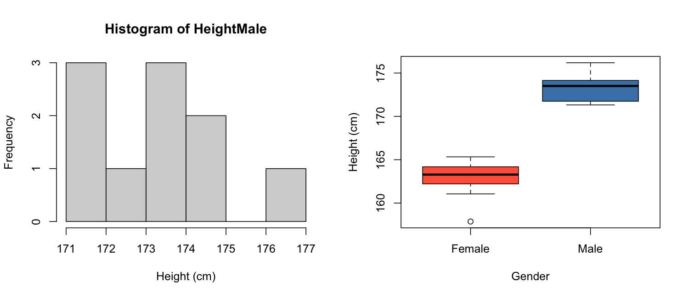
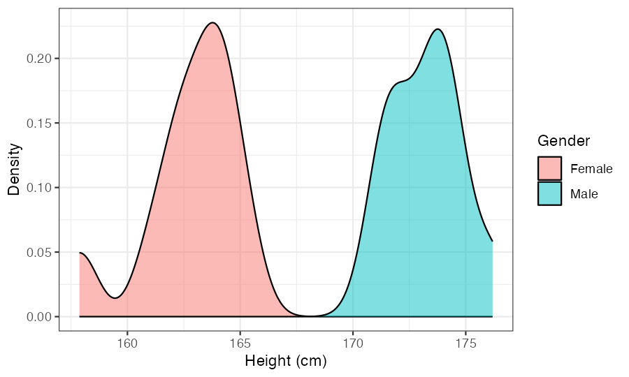

# 1장 — R 프로그래밍 기초

[레포지토리 안내](../../README.ko.md) | [English](Concepts_Lecture.md) | [한국어](Concepts_Lecture.ko.md)

> **최종 수정일:** 2026-11-27

> **학습 목표:**
> 1. R과 RStudio 환경을 설정하고 기본 명령을 실행할 수 있다
> 2. R의 데이터 유형과 기본 자료 구조(벡터, 팩터, 데이터 프레임)를 이해할 수 있다
> 3. 변수와 표현식을 사용한 간단한 R 스크립트를 작성할 수 있다
> 4. 원자 벡터의 유형, 강제 변환, 벡터화와 재활용 규칙을 설명할 수 있다
> 5. 리스트, 행렬, 데이터 프레임을 만들고 원하는 원소를 꺼낼 수 있다
> 6. 모의 데이터를 생성하여 기술 통계와 그림으로 요약할 수 있다

---

## 목차

- [1. R 소개](#1-r-소개)
  - [1.1 R 소개](#11-r-소개)
  - [1.2 데이터 사이언스에 R을 사용하는 이유](#12-데이터-사이언스에-r을-사용하는-이유)
  - [1.3 RStudio (R을 위한 IDE)](#13-rstudio-r을-위한-ide)
  - [1.4 R 콘솔 / 사용자 프롬프트](#14-r-콘솔--사용자-프롬프트)
  - [1.5 좋은 프로그래밍 습관](#15-좋은-프로그래밍-습관)
  - [1.6 RStudio 치트시트](#16-rstudio-치트시트)
  - [1.7 R 작업 공간 (Workspace)](#17-r-작업-공간-workspace)
  - [1.8 R과 RStudio 설치](#18-r과-rstudio-설치)
  - [1.9 대소문자 구분과 객체 이름 규칙](#19-대소문자-구분과-객체-이름-규칙)
  - [1.10 스크립트 실행과 주석](#110-스크립트-실행과-주석)
- [2. 기본 데이터 유형](#2-기본-데이터-유형)
  - [2.1 핵심 데이터 유형](#21-핵심-데이터-유형)
  - [2.2 유형 확인 및 검사](#22-유형-확인-및-검사)
  - [2.3 데이터 프레임 (Data Frame)](#23-데이터-프레임-data-frame)
  - [2.4 원자 벡터의 여섯 유형](#24-원자-벡터의-여섯-유형)
  - [2.5 특수한 값: NA, NULL, NaN, Inf](#25-특수한-값-na-null-nan-inf)
  - [2.6 강제 변환 (Coercion)](#26-강제-변환-coercion)
  - [2.7 자료 구조의 분류와 리스트](#27-자료-구조의-분류와-리스트)
  - [2.8 데이터 프레임 다루기](#28-데이터-프레임-다루기)
  - [2.9 CSV 파일 읽기와 쓰기](#29-csv-파일-읽기와-쓰기)
- [3. 변수와 할당](#3-변수와-할당)
  - [3.1 할당 연산자](#31-할당-연산자)
  - [3.2 변수 제거](#32-변수-제거)
  - [3.3 함수 호출과 인수](#33-함수-호출과-인수)
  - [3.4 산술 연산자와 부동소수점 비교](#34-산술-연산자와-부동소수점-비교)
- [4. 벡터와 연산](#4-벡터와-연산)
  - [4.1 c()로 벡터 생성](#41-c로-벡터-생성)
  - [4.2 수열 생성](#42-수열-생성)
  - [4.3 난수 생성](#43-난수-생성)
  - [4.4 벡터 인덱싱](#44-벡터-인덱싱)
  - [4.5 벡터 산술 연산](#45-벡터-산술-연산)
  - [4.6 벡터 결합](#46-벡터-결합)
  - [4.7 벡터화 (Vectorization)](#47-벡터화-vectorization)
  - [4.8 재활용 규칙 (Recycling Rule)](#48-재활용-규칙-recycling-rule)
  - [4.9 논리 인덱싱](#49-논리-인덱싱)
  - [4.10 결측값 처리](#410-결측값-처리)
  - [4.11 rep()와 seq()의 인수와 난수 시드](#411-rep와-seq의-인수와-난수-시드)
  - [4.12 정렬과 순위: sort(), order(), rank()](#412-정렬과-순위-sort-order-rank)
- [5. 기본 함수](#5-기본-함수)
  - [5.1 출력 함수](#51-출력-함수)
  - [5.2 요약 통계 함수](#52-요약-통계-함수)
  - [5.3 데이터 검사 함수](#53-데이터-검사-함수)
  - [5.4 행렬과 팩터 함수](#54-행렬과-팩터-함수)
  - [5.5 도움말 사용](#55-도움말-사용)
  - [5.6 팩터와 summary()](#56-팩터와-summary)
  - [5.7 행렬 만들기](#57-행렬-만들기)
  - [5.8 apply 계열 함수와 유전자 발현 행렬](#58-apply-계열-함수와-유전자-발현-행렬)
  - [5.9 분위수, 분산, 빈도표](#59-분위수-분산-빈도표)
  - [5.10 도움말 문서의 구성](#510-도움말-문서의-구성)
- [6. 패키지](#6-패키지)
  - [6.1 패키지 설치 및 로드](#61-패키지-설치-및-로드)
  - [6.2 패키지 찾기](#62-패키지-찾기)
  - [6.3 패키지를 활용한 시각화](#63-패키지를-활용한-시각화)
  - [6.4 키 데이터의 생성과 요약](#64-키-데이터의-생성과-요약)
  - [6.5 흔한 실수](#65-흔한-실수)
- [요약](#요약)
- [점검 문제](#점검-문제)
- [참고 문헌](#참고-문헌)

---

<br>

## 1. R 소개

### 1.1 R 소개

R은 통계 컴퓨팅과 데이터 분석을 위해 설계된 무료 오픈소스 프로그래밍 언어이다. Python과 함께 데이터 사이언스를 위한 가장 대표적인 두 언어 중 하나이다.

### 1.2 데이터 사이언스에 R을 사용하는 이유

- **무료 오픈소스:** [https://cran.r-project.org/](https://cran.r-project.org/)에서 내려받아 쓸 수 있다.
- 실습 중심의 데이터 분석을 **비교적 쉽게** 배울 수 있다.
- **확장성:** CRAN에서 커뮤니티가 기여한 수천 개의 패키지를 이용할 수 있다.
- **강력한 통계 지원:** 통계 모델링과 시각화를 위한 내장 함수를 제공한다.

### 1.3 RStudio (R을 위한 IDE)

RStudio는 R 프로그래밍을 보다 쉽게 해 주는 통합 개발 환경(IDE, Integrated Development Environment)이다. IDE는 일반적으로 소스 코드 편집기, 빌드 자동화 도구, 디버거로 구성된다.

RStudio는 네 개의 주요 패널로 구성된다. 기본 배치에서는 왼쪽 위에 코드 편집기, 왼쪽 아래에 R 콘솔, 오른쪽 위에 환경과 히스토리, 오른쪽 아래에 파일, 플롯, 패키지, 도움말 패널이 놓인다.

```text
┌──────────────────────┬────────────────────────────┐
│ Code Editor          │ Environment / History      │
│                      │                            │
├──────────────────────┼────────────────────────────┤
│ R Console            │ Files / Plots /            │
│                      │ Packages / Help            │
└──────────────────────┴────────────────────────────┘
```

*그림 1. RStudio의 기본 패널 배치*

| 패널 | 용도 |
|------|------|
| 코드 편집기 (Code Editor) | R 스크립트 작성 및 편집 |
| R 콘솔 (R Console) | 대화형으로 명령어 실행 |
| 환경/히스토리 (Environment/History) | 로드된 변수 및 명령어 기록 확인 |
| 파일/플롯/패키지/도움말 (Files/Plots/Packages/Help) | 파일 탐색, 플롯 보기, 패키지 관리, 도움말 접근 |

*표 1. RStudio의 주요 패널과 용도*

### 1.4 R 콘솔 / 사용자 프롬프트

- 명령어는 R 사용자 프롬프트(`>`)에서 대화형으로 입력한다.
- **위/아래** 방향키로 명령어 기록을 탐색할 수 있다.
- 프롬프트 창에서 직접 프로그래밍하는 것은 **권장하지 않는다.** 시스템이 충돌하거나 정전이 발생하면 저장하지 않은 모든 작업을 잃게 되기 때문이다.

### 1.5 좋은 프로그래밍 습관

- 스크립트는 항상 주기적으로 저장하고 백업을 만든다.
- 가장 좋은 습관 중 하나는 스크립트를 수정할 때마다 저장하는 것이다.
- 의미 있는 파일 이름 규칙을 사용하고, `final`, `Realfinal`, `Realfinal222` 같은 이름은 피한다.

### 1.6 RStudio 치트시트

RStudio는 **Help > Cheatsheets**를 통해 접근할 수 있는 내장 참조 시트를 제공한다. 치트시트는 IDE, 데이터 변환, 시각화 등에 대해 가장 널리 사용되는 명령어와 단축키를 다룬다.

가장 자주 사용하는 연산의 키 바인딩을 외워 두면 작업 흐름이 크게 빨라진다.

### 1.7 R 작업 공간 (Workspace)

```r
getwd()       # 현재 작업 디렉토리 확인
setwd("path") # 작업 디렉토리 변경 (주의: "\"는 이스케이프 문자)
```

`getwd()`는 현재 작업 디렉토리를 반환하고, `setwd()`는 작업 디렉토리를 바꾼다. R 문자열에서 `\`는 이스케이프 문자이므로 Windows 경로는 `"C:/data"`나 `"C:\\data"`처럼 `/` 또는 `\\`로 구분해야 한다.

작업을 저장하는 방법은 두 가지이다.
1. **R 스크립트 저장:** 코드만 텍스트 형식으로 저장한다.
2. **R 작업 공간 저장:** `save.image()`를 사용하여 메모리(RAM)에 있는 작업 공간의 모든 변수를 `.RData` 파일로 저장한다.

> **핵심:** R은 **대소문자를 구분하는(case-sensitive)** 언어이다. `variableName`과 `variablename`은 서로 다른 두 개의 변수로 취급된다.

### 1.8 R과 RStudio 설치

R은 두 단계로 설치한다. 먼저 CRAN에서 운영체제에 맞는 R 설치 파일을 내려받는다. CRAN은 Windows와 macOS 사용자를 위해 기본 시스템과 기여 패키지를 미리 컴파일한 바이너리 배포본을 제공하며, 많은 Linux 배포판은 R을 자체 패키지 관리 시스템으로도 제공한다. 다음으로 R을 편하게 쓰기 위한 IDE인 RStudio Desktop(오픈 소스 라이선스)을 설치한다. RStudio는 R을 대신하는 프로그램이 아니라 이미 설치된 R을 불러 쓰는 작업 환경이므로, R을 먼저 설치해야 한다.

RStudio를 처음 실행하면 코드 편집기 없이 왼쪽의 R 콘솔과 오른쪽 위아래의 두 창만 보인다. 스크립트 파일을 새로 만들거나 열면 왼쪽 위에 코드 편집기가 생기면서 1.3절의 네 창 배치가 된다.

### 1.9 대소문자 구분과 객체 이름 규칙

1.7절에서 본 대로 R은 대소문자를 구분한다. 다음 코드는 철자는 같고 대소문자만 다른 두 이름에 서로 다른 값을 넣는다.

```r
variableName <- "test"
variablename <- "test2"
variableName
variablename
```

```text
[1] "test"
[1] "test2"
```

두 이름은 서로 다른 객체를 가리키므로 각각 자기 값을 출력한다. 출력 앞의 `[1]`은 그 줄의 첫 원소가 벡터의 1번째 원소라는 뜻이며, 원소가 많아 출력이 여러 줄로 나뉘면 각 줄 앞에 그 줄이 시작하는 위치가 붙는다.

R의 객체 이름은 문자 또는 점(`.`)으로 시작하고, 문자, 숫자, 점, 밑줄(`_`)로 이루어진다. 점 바로 뒤에 숫자가 오는 이름(`.2way`)과 숫자로 시작하는 이름(`2nd`)은 쓸 수 없고, `if`, `for`, `function`, `TRUE`, `NULL` 같은 예약어도 이름으로 쓸 수 없다. 1.5절의 이름 짓기 습관은 객체 이름에도 적용된다. `x1`, `temp2`보다 `heightMale`, `geneExpr`처럼 내용을 드러내는 이름이 코드를 읽기 쉽게 만든다.

### 1.10 스크립트 실행과 주석

1.4절에서 말한 대로 코드는 콘솔에 직접 치기보다 스크립트 파일(`.R`)에 쓰고 저장한다. RStudio의 코드 편집기에서는 커서가 있는 줄이나 선택한 여러 줄을 단축키(Windows와 Linux는 Ctrl+Enter, macOS는 Cmd+Enter)로 콘솔에 보내 실행하고, `source("analysis.R")`로 스크립트 전체를 처음부터 끝까지 실행한다. 스크립트 전체를 다시 실행해도 같은 결과가 나와야 재현 가능한 분석이며, 이를 위해 스크립트 맨 앞에서 패키지를 불러오고(6.1절) 난수 시드를 고정한다(4.11절).

`#` 뒤의 내용은 줄 끝까지 **주석(comment)** 이며 실행되지 않는다. 주석에는 코드가 무엇을 하는지보다 왜 그렇게 하는지(자료의 출처, 기준값을 정한 이유, 단위)를 적는 것이 유용하다. 예를 들어 `x <- x[x > 0]  # 측정 장비의 검출 한계 아래 값 제거`처럼 쓰면, 나중에 코드를 읽는 사람이 이 필터의 목적을 알 수 있다.

---

<br>

## 2. 기본 데이터 유형

### 2.1 핵심 데이터 유형

| 유형 | 설명 | 예시 |
|------|------|------|
| `numeric` | 실수 (숫자의 기본 유형) | `3.14`, `42` |
| `integer` | 정수 (`L`을 붙임) | `5L`, `100L` |
| `character` | 텍스트 문자열 (따옴표로 감쌈) | `"Hello"`, `'World'` |
| `logical` | 논리값 (Boolean) | `TRUE`, `FALSE` |
| `factor` | 수준(level)을 갖는 범주형 변수 | `factor(c("a", "b"))` |

*표 2. R의 핵심 데이터 유형*

이 중 `factor`는 엄밀히 말하면 기본 자료형이 아니라 정수 코드에 수준(level) 정보를 붙인 객체이다. 그래서 `class()`는 `"factor"`를 반환하지만 `typeof()`는 `"integer"`를 반환한다.

### 2.2 유형 확인 및 검사

```r
class(x)   # 변수의 데이터 유형 확인
str(x)     # 객체의 내부 구조 확인
ls()       # 환경에 로드된 모든 변수 나열
```

### 2.3 데이터 프레임 (Data Frame)

하나의 숫자만 담은 변수는 데이터를 저장하는 데 그리 유용하지 않다. R에서 데이터셋을 저장하는 가장 일반적인 방법은 **데이터 프레임(Data Frame)** 이다.

데이터 프레임은 다음과 같은 표이다.
- **행(Row)** 은 관측치(개별 데이터 포인트)를 나타낸다.
- **열(Column)** 은 변수(각 관측치에 대해 측정된 속성)를 나타낸다.

데이터 프레임은 수치형, 문자형, 논리형, 팩터 등 **서로 다른 데이터 유형을 하나의 객체에 결합**할 수 있기 때문에 특히 유용하다. 열마다 다른 유형을 가질 수 있고, 한 열 안의 값은 같은 유형이다. 이것이 모든 원소가 같은 유형이어야 하는 행렬(Matrix)과의 핵심적인 차이점이다.

```r
# 데이터 프레임 vs. 행렬
# - 데이터 프레임은 열/행 이름과 혼합 데이터 유형(팩터 포함)을 지원
# - 행렬은 모든 원소가 같은 유형이어야 함
```

`data()`를 사용하여 내장 데이터셋을 로드하고(예: `data(iris)`), `head()`, `tail()`, `dim()`, `nrow()`, `ncol()`을 사용하여 빠르게 검사할 수 있다.

### 2.4 원자 벡터의 여섯 유형

2.1절의 유형은 R의 가장 기본적인 자료 구조인 **원자 벡터(atomic vector)** 의 유형이다. 원자 벡터는 모든 원소가 같은 유형인 1차원 자료이며, 길이가 1인 값(`42`)도 원소가 하나인 벡터이다. R은 원자 벡터의 유형을 여섯 가지로 구분한다.

> **용어 정의:** **원자 벡터(atomic vector)** 는 모든 원소가 같은 기본 유형(논리형, 정수형, 실수형, 복소수형, 문자형, 원시형 중 하나)을 갖는 1차원 자료 구조이다.

| `typeof()` 값 | 담는 값 | 예 | `class()` 값 |
|:--|:--|:--|:--|
| `logical` | `TRUE`, `FALSE`, `NA` | `TRUE` | `"logical"` |
| `integer` | 정수 | `42L` | `"integer"` |
| `double` | 실수(배정밀도 부동소수점) | `42`, `3.14` | `"numeric"` |
| `complex` | 복소수 | `2 + 3i` | `"complex"` |
| `character` | 문자열 | `"ACGT"` | `"character"` |
| `raw` | 바이트 | `charToRaw("A")` | `"raw"` |

*표 3. 원자 벡터의 여섯 유형*

`typeof()`는 R이 값을 메모리에 저장하는 내부 유형을, `class()`는 함수가 객체를 어떻게 다룰지 정하는 클래스를 돌려준다. 숫자만 쓴 `42`의 내부 유형은 `double`이지만 클래스는 `"numeric"`이며, `L`을 붙인 `42L`만 정수형이다. 2.1절의 `numeric`은 `integer`와 `double`을 함께 부르는 이름이므로 `is.numeric(42L)`도 `TRUE`이다.

```r
x_num <- 42
x_int <- 42L
x_chr <- "ACGT"
x_lgl <- TRUE
x_cpx <- 2 + 3i
x_raw <- charToRaw("A")
sapply(list(x_num, x_int, x_chr, x_lgl, x_cpx, x_raw), typeof)
class(x_num)
is.numeric(x_int)
```

```text
[1] "double"    "integer"   "character" "logical"   "complex"   "raw"
[1] "numeric"
[1] TRUE
```

`sapply()`는 리스트의 각 원소에 함수(`typeof`)를 적용하고 결과를 벡터로 모은다. 데이터 분석에서 주로 쓰는 유형은 `logical`, `integer`, `double`, `character`이고, `complex`와 `raw`는 신호 처리나 이진 파일 처리 같은 특수한 경우에 쓴다.

### 2.5 특수한 값: NA, NULL, NaN, Inf

원자 벡터에는 보통의 값 말고도 몇 가지 특수한 값이 들어갈 수 있다.

| 값 | 뜻 | 길이 | 예 |
|:--|:--|:--|:--|
| `NA` | 값이 있어야 하지만 알 수 없는 결측값 | 1 | 측정하지 못한 환자의 혈압 |
| `NULL` | 아무것도 없음(빈 객체) | 0 | 아직 만들지 않은 결과 |
| `NaN` | 수학적으로 정의되지 않은 수(Not a Number) | 1 | `0 / 0` |
| `Inf`, `-Inf` | 양의 무한대와 음의 무한대 | 1 | `1 / 0`, `-1 / 0` |

*표 4. R의 특수한 값*

```r
c(1 / 0, -1 / 0, 0 / 0)
NA > 1
length(NA)
length(NULL)
```

```text
[1]  Inf -Inf  NaN
[1] NA
[1] 1
[1] 0
```

`NA`는 "모르는 값"이므로 `NA > 1`의 결과도 알 수 없어 `NA`이다. `NA`는 자리를 차지하는 값이라 길이가 1이지만, `NULL`은 아무것도 없다는 뜻이라 길이가 0이다. `NaN`은 결측의 한 종류로도 취급되어 `is.na(NaN)`이 `TRUE`이다. 결측값을 다루는 함수는 4.10절에서 정리한다.

### 2.6 강제 변환 (Coercion)

원자 벡터는 원소의 유형이 모두 같아야 하므로, `c()`로 서로 다른 유형의 값을 묶으면 R은 모든 원소를 담을 수 있는 하나의 유형으로 바꾼다. 이를 **강제 변환(coercion)** 이라 한다. 변환은 다음 순서에서 더 오른쪽 유형으로 일어난다.

```math
\text{logical} \rightarrow \text{integer} \rightarrow \text{double} \rightarrow \text{complex} \rightarrow \text{character}
```

> **용어 정의:** **강제 변환(coercion)** 은 서로 다른 유형의 값을 한 원자 벡터에 담거나 연산할 때, R이 정보를 잃지 않는 쪽의 유형으로 값을 자동으로 바꾸는 동작이다.

```r
c(1, "a", TRUE)
c(1, TRUE, FALSE)
logicalVector <- c("TRUE", "TRUE", "FALSE")
class(logicalVector)
as.logical(logicalVector)
as.numeric(c("3.5", "abc"))
```

```text
[1] "1"    "a"    "TRUE"
[1] 1 1 0
[1] "character"
[1]  TRUE  TRUE FALSE
[1] 3.5  NA
Warning message:
NAs introduced by coercion
```

첫 줄은 문자열 `"a"`가 섞여 있으므로 1과 `TRUE`까지 문자열 `"1"`과 `"TRUE"`가 된다. 둘째 줄은 수와 논리값이 섞여 논리값이 수로 바뀌며, `TRUE`는 1, `FALSE`는 0이 된다. 셋째부터 다섯째 줄은 따옴표로 감싼 `"TRUE"`가 논리값이 아니라 문자열이라는 점을 보여 준다. 이 벡터는 이름이 `logicalVector`이어도 문자형이며, `as.logical()`로 명시적으로 변환해야 논리형이 된다. 마지막 줄처럼 수로 해석할 수 없는 문자열을 수로 바꾸면 그 자리가 `NA`가 되고 경고가 나온다.

강제 변환은 산술 연산에서도 일어난다. `TRUE + TRUE`는 2이고, `sum(x > 25)`처럼 논리 벡터를 더하면 `TRUE`의 개수가 나온다(4.9절). 반대로 문자형으로 바뀐 숫자는 더 이상 산술 연산을 할 수 없으므로(`"1" + 1`은 오류), 데이터를 읽은 뒤 각 열의 유형을 `str()`로 확인하는 습관이 필요하다.

### 2.7 자료 구조의 분류와 리스트

R의 자료 구조는 차원 수와 원소 유형이 같은지(동질적인지)에 따라 나눌 수 있다.

| 차원 | 동질적 (모든 원소가 같은 유형) | 이질적 (원소마다 유형이 다를 수 있음) |
|:--|:--|:--|
| 1차원 | 원자 벡터 (`c()`) | 리스트 (`list()`) |
| 2차원 | 행렬 (`matrix()`) | 데이터 프레임 (`data.frame()`) |
| n차원 | 배열 (`array()`) | - |

*표 5. 차원과 동질성에 따른 R 자료 구조의 분류*

팩터는 정수 벡터에 수준 정보를 붙인 것이므로 1차원 동질 구조에 속한다(2.1절). 각 구조를 만들어 `str()`로 내부를 보면 다음과 같다.

```r
v  <- c(5.1, 4.9, 4.7)
m  <- matrix(1:6, nrow = 2)
a  <- array(1:24, dim = c(2, 3, 4))
df <- data.frame(id = c("S1", "S2"), height = c(171.2, 162.5))
f  <- factor(c("case", "control", "case"))
str(v); str(m); str(a); str(df); str(f)
```

```text
 num [1:3] 5.1 4.9 4.7
 int [1:2, 1:3] 1 2 3 4 5 6
 int [1:2, 1:3, 1:4] 1 2 3 4 5 6 7 8 9 10 ...
'data.frame':	2 obs. of  2 variables:
 $ id    : chr  "S1" "S2"
 $ height: num  171 162
 Factor w/ 2 levels "case","control": 1 2 1
```

`str()`의 출력은 유형(`num`, `int`, `chr`), 각 차원의 범위(`[1:2, 1:3]`), 앞쪽 원소를 차례로 보여 준다. 행렬과 배열은 원자 벡터에 `dim` 속성을 붙인 것이어서 원소 유형이 하나뿐이다. 팩터의 `1 2 1`은 수준 `"case"`가 1, `"control"`이 2로 저장되었다는 뜻이다.

**리스트(list)** 는 유형과 길이가 서로 다른 객체를 원소로 담는 1차원 구조이다. 원소에 이름을 붙일 수 있고, 리스트 안에 리스트를 넣을 수도 있다. 함수가 여러 결과를 한꺼번에 돌려줄 때 주로 리스트를 쓴다.

```r
l <- list(sample = "S1", reads = 15230L, qc_pass = TRUE)
str(l)
l$sample
l[["reads"]]
l["reads"]
class(l["reads"]); class(l[["reads"]])
```

```text
List of 3
 $ sample : chr "S1"
 $ reads  : int 15230
 $ qc_pass: logi TRUE
[1] "S1"
[1] 15230
$reads
[1] 15230

[1] "list"
[1] "integer"
```

- `list()`는 이름이 `sample`, `reads`, `qc_pass`인 세 원소로 시퀀싱 표본 하나의 기록을 만든다.
- `l$sample`과 `l[["reads"]]`는 원소 자체를 꺼내므로 각각 문자형과 정수형 값이 나온다.
- `l["reads"]`는 원소 하나만 담은 **리스트**를 돌려준다. 그래서 출력에 `$reads`라는 이름이 붙고, 클래스가 `"list"`이다.

한 겹 대괄호 `[ ]`는 같은 종류의 구조에서 일부를 잘라 내고, 두 겹 대괄호 `[[ ]]`와 `$`는 원소 하나를 꺼낸다. 이 구분은 데이터 프레임에도 그대로 적용된다.

### 2.8 데이터 프레임 다루기

**데이터 프레임(data frame)** 은 길이가 같은 벡터들을 열로 묶은 리스트이다. 그래서 열마다 유형이 다를 수 있으면서도(리스트의 성질), 모든 열의 길이가 같아 행과 열로 된 표처럼 다룰 수 있다(행렬의 성질). R의 내장 데이터셋 `iris`는 붓꽃 150송이의 꽃받침 길이와 너비, 꽃잎 길이와 너비, 종(`Species`)을 담은 데이터 프레임이다.

> **용어 정의:** **데이터 프레임(data frame)** 은 행이 관측치, 열이 변수이며, 길이가 같은 벡터를 열로 묶어 열마다 다른 유형을 허용하는 R의 표 형식 자료 구조이다.

1차원 객체에서 `length()`는 원소의 개수를 돌려준다. 데이터 프레임은 열의 리스트이므로, 데이터 프레임의 일부에 `length()`를 쓰면 그 일부가 어떤 구조인지에 따라 결과가 달라진다.

```r
length(iris[1, ])
length(iris[, 1])
dim(iris)
length(iris[, 6])
```

```text
[1] 5
[1] 150
[1] 150   5
Error in `[.data.frame`(iris, , 6) : undefined columns selected
```

- `iris[1, ]`는 첫 행을 뽑은 데이터 프레임(열 5개짜리 리스트)이므로 길이가 열의 개수인 5이다.
- `iris[, 1]`은 첫 열 `Sepal.Length`를 벡터로 꺼내므로 길이가 관측치 수인 150이다.
- `dim()`은 행과 열의 수를 함께 돌려주며, `nrow()`와 `ncol()`은 그중 하나씩을 돌려준다.
- `iris`의 열은 5개뿐이므로 6번째 열을 요청하면 범위를 벗어나 `undefined columns selected` 오류가 난다. 벡터에서 범위를 벗어난 인덱스(`x[10]`)는 오류 없이 `NA`를 돌려주는 것과 다르다.

행은 논리 조건으로, 열은 이름으로 고를 수 있다. 다음 코드는 꽃잎 길이가 6.5 cm를 넘는 꽃의 종과 꽃잎 길이를 뽑는다.

```r
iris[iris$Petal.Length > 6.5, c("Species", "Petal.Length")]
```

```text
      Species Petal.Length
106 virginica          6.6
118 virginica          6.7
119 virginica          6.9
123 virginica          6.7
```

`iris$Petal.Length > 6.5`는 길이 150의 논리 벡터이고, 행 자리에 이 벡터를 넣으면 `TRUE`인 행만 남는다(4.9절). 왼쪽의 106, 118 같은 수는 원래 데이터에서의 행 이름이다.

데이터 프레임과 행렬의 차이를 정리하면 다음과 같다.

| 항목 | 데이터 프레임 | 행렬 |
|:--|:--|:--|
| 원소 유형 | 열마다 다를 수 있음 | 모든 원소가 같은 유형 |
| 팩터 열 | 가능 | 불가능 (문자나 정수로 바뀜) |
| 행 이름과 열 이름 | 기본으로 가짐 | 선택 사항 |
| 통계 모형 공식 (`lm(y ~ x, data = )`) | 바로 사용 | 데이터 프레임으로 변환 후 사용 |
| 선형대수 연산 (`%*%`, `solve()`) | 행렬로 변환 후 사용 | 바로 사용 |
| 전치 `t()` | 결과가 행렬이 됨 | 결과가 행렬 |

*표 6. 데이터 프레임과 행렬의 비교*

데이터 프레임을 전치하면 행 이름이 열 이름이 되어, 표본이 열에 놓인 유전자 발현 표처럼 행과 열의 역할을 바꿔야 할 때 유용하다. 다만 전치 결과는 행렬이므로 모든 원소가 한 유형으로 강제 변환된다.

```r
tt <- t(head(iris[, 1:2], 3))
tt
class(tt)
```

```text
               1   2   3
Sepal.Length 5.1 4.9 4.7
Sepal.Width  3.5 3.0 3.2
[1] "matrix" "array"
```

두 수치 열만 골라 전치했으므로 결과는 수치 행렬이다. `Species` 같은 팩터 열까지 포함해 전치하면 모든 원소가 문자열이 된다.

### 2.9 CSV 파일 읽기와 쓰기

실제 분석 자료는 대개 파일로 주어지며, 가장 흔한 형식은 값을 쉼표로 구분한 CSV(comma-separated values) 파일이다. CSV 파일의 첫 줄은 보통 열 이름이고, 둘째 줄부터 한 줄이 관측치 하나이다. `write.csv()`는 데이터 프레임을 CSV 파일로 쓰고, `read.csv()`는 CSV 파일을 읽어 데이터 프레임을 만든다.

```r
f <- file.path(tempdir(), "heights.csv")
d <- data.frame(id = c("S1", "S2", "S3"), sex = c("M", "F", "F"),
                height = c(172.4, 161.8, 165.0))
write.csv(d, f, row.names = FALSE)
cat(readLines(f), sep = "\n")
d2 <- read.csv(f, stringsAsFactors = TRUE)
str(d2)
```

```text
"id","sex","height"
"S1","M",172.4
"S2","F",161.8
"S3","F",165
'data.frame':	3 obs. of  3 variables:
 $ id    : Factor w/ 3 levels "S1","S2","S3": 1 2 3
 $ sex   : Factor w/ 2 levels "F","M": 2 1 1
 $ height: num  172 162 165
```

- `tempdir()`는 R 세션이 쓰는 임시 폴더이고, `file.path()`는 운영체제에 맞는 구분자로 경로를 잇는다. 파일 이름만 주면 1.7절의 작업 디렉토리를 기준으로 읽고 쓴다.
- `row.names = FALSE`는 행 이름(1, 2, 3)을 파일의 첫 열로 쓰지 않게 한다. 이 인수를 빼면 다시 읽을 때 이름 없는 열 `X`가 하나 더 생긴다.
- `readLines()`로 파일의 원래 내용을 보면 문자열은 따옴표로 감싸이고 수는 그대로 쓰인다.
- `read.csv()`는 각 열의 유형을 스스로 추측한다. `stringsAsFactors = TRUE`를 주면 문자 열을 팩터로 읽으며, 기본값 `FALSE`이면 문자형으로 읽는다.

파일을 읽은 직후에는 `str()`, `head()`, `summary()`로 열의 유형과 값의 범위를 확인한다. 수치 열에 "n/a" 같은 문자열이 하나라도 섞여 있으면 그 열 전체가 문자형으로 읽히는데(2.6절), 이런 문제는 읽은 직후에 발견해야 분석 결과가 조용히 틀리는 것을 막을 수 있다.

---

<br>

## 3. 변수와 할당

### 3.1 할당 연산자

```r
x <- 10           # 권장되는 할당 연산자
y <- "Hello"       # 문자열 할당
z <- TRUE          # 논리값 할당
```

`=`도 할당에 사용할 수 있지만, 동등 비교 연산자 `==`와의 혼동을 피하기 위해 `<-`를 사용하는 것이 **강력히 권장된다**.

### 3.2 변수 제거

```r
rm(x)              # 단일 변수 제거
rm(list = ls())    # 환경에서 모든 변수 제거
```

> **핵심:** R에서 할당에는 항상 `<-`를 사용하고, `=`는 함수 인수를 지정할 때 사용한다(예: `rnorm(n = 100, mean = 0)`).

### 3.3 함수 호출과 인수

R의 함수는 `함수이름(인수1, 인수2, ...)` 형태로 호출한다. 인수는 정의된 순서대로 위치로 넘길 수도 있고, `이름 = 값` 형태로 이름을 붙여 순서와 관계없이 넘길 수도 있다. 기본값이 정해진 인수는 생략할 수 있다. `args()`는 함수가 받는 인수와 기본값을 보여 준다.

```r
args(rnorm)
set.seed(7); rnorm(3, 10, 1)
set.seed(7); rnorm(sd = 1, mean = 10, n = 3)
round(5.6789, 2); round(5.6789)
```

```text
function (n, mean = 0, sd = 1) 
NULL
[1] 12.287247  8.803228  9.305707
[1] 12.287247  8.803228  9.305707
[1] 5.68
[1] 6
```

`rnorm()`은 `n`, `mean`, `sd`의 세 인수를 받으며 `mean`의 기본값은 0, `sd`의 기본값은 1이다. 위치로 넘긴 `rnorm(3, 10, 1)`과 이름으로 순서를 바꿔 넘긴 `rnorm(sd = 1, mean = 10, n = 3)`은 같은 호출이므로, 같은 시드에서 같은 난수를 낸다. `round()`의 둘째 인수 `digits`는 기본값이 0이어서 생략하면 정수로 반올림한다. 인수가 많은 함수는 앞의 한두 개만 위치로 넘기고 나머지는 이름을 붙이는 것이 읽기 쉽고 실수가 적다. 3.1절의 핵심 상자에서 말한 대로 인수를 넘길 때는 `=`를 쓰며, 이것은 할당이 아니다.

### 3.4 산술 연산자와 부동소수점 비교

R 콘솔은 계산기로도 쓸 수 있다. 사칙연산 `+`, `-`, `*`, `/` 외에 거듭제곱 `^`, 정수 나눗셈의 몫 `%/%`, 나머지 `%%`가 있다.

```r
7 / 2; 7 %/% 2; 7 %% 2; 2^10
-2^2; (-2)^2
1 + 2 * 3^2
0.1 + 0.2 == 0.3
isTRUE(all.equal(0.1 + 0.2, 0.3))
print(0.1 + 0.2, digits = 17)
```

```text
[1] 3.5
[1] 3
[1] 1
[1] 1024
[1] -4
[1] 4
[1] 19
[1] FALSE
[1] TRUE
[1] 0.30000000000000004
```

- `7 / 2`는 실수 나눗셈 3.5이고, `7 %/% 2`는 몫 3, `7 %% 2`는 나머지 1이다. 나머지 연산은 짝수와 홀수를 가르거나(`x %% 2 == 0`) 일정한 주기로 표본을 고를 때 쓴다.
- 연산자에는 우선순위가 있어 거듭제곱이 부호보다 먼저 계산된다. 그래서 `-2^2`는 $`-(2^2) = -4`$이고, -2를 제곱하려면 `(-2)^2`처럼 괄호를 써야 한다. `1 + 2 * 3^2`도 거듭제곱(9), 곱셈(18), 덧셈(19)의 순서로 계산된다.
- 컴퓨터는 실수를 유한한 자릿수의 이진수로 저장하므로 0.1과 0.2를 정확히 나타내지 못한다. 그 합은 0.30000000000000004로 저장되어 `0.1 + 0.2 == 0.3`이 `FALSE`가 된다. 계산 결과로 나온 실수를 비교할 때는 `==` 대신 허용 오차 안에서 같은지 보는 `all.equal()`을 쓰고, 조건문에서는 `isTRUE()`로 감싸 논리값 하나를 얻는다.

부동소수점 오차는 R만의 문제가 아니라 IEEE 754 배정밀도 실수를 쓰는 모든 언어에 공통이다. 평균이나 분산처럼 많은 값을 더하는 계산에서 마지막 자리가 조금씩 달라지는 것은 이 때문이며, 결과를 보고할 때는 `round()`로 의미 있는 자릿수까지만 쓴다.

---

<br>

## 4. 벡터와 연산

### 4.1 c()로 벡터 생성

벡터(Vector)는 R에서 가장 기본적인 데이터 구조이다. `c()` 함수는 값을 결합하여 벡터를 생성한다.

```r
numericVector   <- c(1, 2, 3, 4, 5)
characterVector <- c("One", "Two", "Three", "Four", "Five")
logicalVector   <- c(TRUE, TRUE, FALSE, FALSE, FALSE)
```

### 4.2 수열 생성

```r
# 콜론 연산자 사용
1:10                              # 1, 2, 3, ..., 10

# seq() 사용
seq(from = 1, to = 10)            # 1:10과 동일
seq(from = 1, to = 10, by = 2)    # 1, 3, 5, 7, 9
seq(1, 10, length = 5)            # 균등 간격의 5개 값

# rep() 사용
rep(1, 3)                         # 1, 1, 1
rep(c("a", "b"), 5)               # "a","b","a","b",...
rep(1:3, each = 10)               # 1,1,...,2,2,...,3,3,...
```

### 4.3 난수 생성

```r
rnorm(n = 100, mean = 180, sd = 1)  # N(180, 1)에서 100개의 난수 값
```

### 4.4 벡터 인덱싱

```r
x <- c(10, 20, 30, 40, 50)
x[1]          # 첫 번째 원소: 10
x[c(1, 3)]   # 첫 번째와 세 번째 원소: 10, 30
x[-2]         # 두 번째를 제외한 모든 원소: 10, 30, 40, 50
```

R의 인덱스는 1부터 시작하며, 음수 인덱스는 해당 위치의 원소를 제외한다.

> **[컴퓨터프로그래밍]** C와 Python의 배열과 리스트는 인덱스가 0부터 시작하고, Python의 음수 인덱스 `-1`은 마지막 원소를 가리킨다. R은 인덱스가 1부터 시작하고 음수 인덱스로 원소를 제외하므로, 같은 `x[-1]`이 Python에서는 마지막 원소를, R에서는 첫 원소를 뺀 나머지 원소를 돌려준다.

### 4.5 벡터 산술 연산

```r
a <- c(1, 2, 3)
b <- c(4, 5, 6)

a + b    # 원소별 덧셈: 5, 7, 9
a * b    # 원소별 곱셈: 4, 10, 18
a > 2    # 원소별 비교: FALSE, FALSE, TRUE
```

### 4.6 벡터 결합

```r
cbind(a, b)   # 열 방향으로 결합 (나란히)
rbind(a, b)   # 행 방향으로 결합 (쌓기)
```

길이가 3인 `a`와 `b`를 결합하면 `cbind(a, b)`는 3행 2열 행렬을, `rbind(a, b)`는 2행 3열 행렬을 만든다.

> **핵심:** R의 산술 연산, 비교 연산과 많은 내장 함수는 기본적으로 **벡터화(vectorized)** 되어 있어, 명시적인 반복문 없이 원소별로 적용된다.

### 4.7 벡터화 (Vectorization)

4.5절의 `a + b`처럼 함수나 연산자가 벡터 전체를 받아 원소마다 같은 계산을 하고 같은 길이의 벡터를 돌려주는 성질을 **벡터화(vectorization)** 라 한다. 벡터화된 연산을 쓰면 반복문 없이 짧은 코드로 같은 계산을 표현할 수 있고, 반복이 R 내부의 컴파일된 코드에서 일어나므로 R 수준의 `for` 반복문보다 대개 빠르다.

> **용어 정의:** **벡터화(vectorization)** 는 연산이나 함수가 벡터의 모든 원소에 원소별로 적용되어 결과를 벡터로 돌려주는 성질이다.

다음은 유전자 하나의 표본 다섯 개 발현값을 Z-점수로 표준화하는 계산이다. Z-점수 $`z_i = (x_i - \bar{x}) / s`$는 각 값이 평균에서 표준편차 몇 개만큼 떨어져 있는지를 나타낸다(3장의 4.3절).

```r
expr <- c(2.1, 3.5, 1.8, 4.2, 2.9)
z <- (expr - mean(expr)) / sd(expr)
round(z, 3)
z_loop <- numeric(length(expr))
for (i in seq_along(expr)) {
  z_loop[i] <- (expr[i] - mean(expr)) / sd(expr)
}
all.equal(z, z_loop)
```

```text
[1] -0.810  0.608 -1.114  1.317  0.000
[1] TRUE
```

- 둘째 줄의 `expr - mean(expr)`은 길이 5의 벡터에서 수 하나(평균 2.9)를 빼므로 다섯 원소 모두에서 2.9를 뺀다. 이어서 다섯 편차를 표준편차 0.9874로 나눈다.
- 넷째부터 일곱째 줄은 같은 계산을 반복문으로 쓴 것이다. `numeric(5)`로 0이 다섯 개인 벡터를 먼저 만들고, `seq_along(expr)`이 돌려주는 1부터 5까지의 위치마다 값을 채운다.
- `all.equal()`은 두 결과가 부동소수점 오차 범위 안에서 같은지 확인한다. 두 방법의 결과는 같다.

중간값을 보면 평균은 $`(2.1 + 3.5 + 1.8 + 4.2 + 2.9)/5 = 14.5/5 = 2.9`$이고, 첫 원소의 Z-점수는 $`(2.1 - 2.9)/0.9874 = -0.810`$이다. 평균과 같은 다섯째 원소의 Z-점수는 0이다.

### 4.8 재활용 규칙 (Recycling Rule)

길이가 다른 두 벡터로 원소별 연산을 하면 R은 짧은 벡터를 처음부터 되풀이해 긴 벡터의 길이에 맞춘다. 이를 **재활용 규칙(recycling rule)** 이라 한다. 4.7절에서 벡터에서 수 하나를 뺀 것도 길이 1인 벡터가 다섯 번 재활용된 경우이다.

```r
1:6 + c(10, 20)
1:5 + c(10, 20)
```

```text
[1] 11 22 13 24 15 26
[1] 11 22 13 24 15
Warning message:
In 1:5 + c(10, 20) :
  longer object length is not a multiple of shorter object length
```

첫 줄에서 `c(10, 20)`은 `c(10, 20, 10, 20, 10, 20)`으로 늘어나 1부터 6까지에 차례로 더해진다. 둘째 줄은 긴 벡터의 길이 5가 짧은 벡터의 길이 2의 배수가 아니므로, 계산은 하되 경고를 낸다. 경고가 나와도 결과가 만들어지므로, 의도하지 않은 재활용은 결과를 조용히 틀리게 만들 수 있다.

> **주의:** 재활용은 길이가 배수 관계이면 경고 없이 일어난다. 예를 들어 표본 6개의 측정값에 보정 계수 3개를 차례로 곱해야 하는데 계수를 2개만 넣으면, 6이 2의 배수이므로 R은 계수 2개를 세 번 되풀이해 경고 없이 잘못된 결과를 낸다. 길이가 다른 벡터를 연산할 때는 `length()`로 길이를 먼저 확인한다.

### 4.9 논리 인덱싱

4.4절의 인덱스 자리에는 위치 번호뿐 아니라 같은 길이의 논리 벡터도 넣을 수 있다. 이때 `TRUE`인 자리의 원소만 남는다. 이를 **논리 인덱싱(logical indexing)** 이라 하며, 조건에 맞는 관측치를 고르는 가장 기본적인 방법이다.

```r
x <- c(10, 20, 30, 40, 50)
x > 25
x[x > 25]
which(x > 25)
sum(x > 25)
mean(x > 25)
```

```text
[1] FALSE FALSE  TRUE  TRUE  TRUE
[1] 30 40 50
[1] 3 4 5
[1] 3
[1] 0.6
```

- `x > 25`는 비교가 벡터화되어 원소마다 참과 거짓을 판정한다.
- `x[x > 25]`는 그 논리 벡터로 원소를 골라 30, 40, 50을 돌려준다.
- `which()`는 `TRUE`인 위치 번호를 돌려준다.
- `sum()`과 `mean()`은 2.6절의 강제 변환으로 `TRUE`를 1, `FALSE`를 0으로 바꿔 계산하므로, 조건을 만족하는 원소의 개수(3)와 비율(3/5 = 0.6)이 나온다.

여러 조건은 원소별 논리 연산자 `&`(그리고), `|`(또는), `!`(부정)로 묶는다. 예를 들어 `x[x > 15 & x < 45]`는 20, 30, 40이다. `&&`와 `||`는 길이 1인 값에만 쓰는 연산자이며, R 4.3.0부터는 길이가 2 이상인 벡터 조건에 쓰면 오류가 난다 [1].

### 4.10 결측값 처리

결측값 `NA`가 하나라도 있으면 대부분의 요약 함수는 결과를 `NA`로 돌려준다. 모르는 값이 섞여 있으면 합이나 평균도 알 수 없기 때문이다.

```r
y <- c(4, NA, 7)
mean(y)
mean(y, na.rm = TRUE)
is.na(y)
sum(is.na(y))
```

```text
[1] NA
[1] 5.5
[1] FALSE  TRUE FALSE
[1] 1
```

`na.rm = TRUE`는 결측값을 빼고 계산하라는 인수이며, 이때 평균은 $`(4 + 7)/2 = 5.5`$이다. `is.na()`는 원소마다 결측인지 판정하고, 그 합은 결측값의 개수이다. 결측값을 찾을 때 `y == NA`를 쓰면 모든 원소가 `NA`가 되므로 반드시 `is.na()`를 써야 한다. 결측값을 빼는 것은 결측이 무작위로 생겼다는 가정 아래에서만 안전하며, 특정 집단에서 결측이 몰려 있으면 남은 자료가 모집단을 대표하지 못한다(2장의 2.4절).

### 4.11 rep()와 seq()의 인수와 난수 시드

`rep(x, times)`는 `x`를 되풀이한 벡터를 만든다. 같은 값이 연속으로 반복되는 벡터는 직접 쓸 수도 있지만 `rep()`로 쓰면 짧고 실수가 적다.

```r
A <- c(1, 1, 1, 2, 2, 2, 3, 3, 3)
B <- c(rep(1, 3), rep(2, 3), rep(3, 3))
identical(A, B)
D <- rep(1:3, each = 3)
D
identical(A, D)
all.equal(A, D)
rep("a", times = 4)
rep(c("a", "b"), 3)
```

```text
[1] TRUE
[1] 1 1 1 2 2 2 3 3 3
[1] FALSE
[1] TRUE
[1] "a" "a" "a" "a"
[1] "a" "b" "a" "b" "a" "b"
```

- `B`는 1, 2, 3을 각각 세 번 반복한 벡터 세 개를 `c()`로 이어 붙여 `A`와 같은 벡터를 만든다.
- `rep(1:3, each = 3)`은 각 원소를 연속으로 세 번씩 반복하므로 화면에 보이는 값은 `A`와 같다. 그러나 `1:3`은 정수형이라 `D`도 정수형이고, `A`는 실수형이므로 `identical()`은 유형까지 비교해 `FALSE`를 돌려준다. 값만 비교하는 `all.equal()`은 `TRUE`이다.
- `times`는 벡터 전체를 반복하는 횟수이다. `rep(c("a", "b"), 3)`은 `"a", "b"` 묶음을 세 번 반복하며, `each`와 달리 원소가 번갈아 나온다.

`seq()`는 등차수열을 만들며, 시작(`from`), 끝(`to`), 간격(`by`), 길이(`length.out`) 가운데 세 가지를 정하면 나머지가 결정된다.

```r
seq(1, 10, length = 5)
seq(from = 1, by = 2, length.out = 10)
```

```text
[1]  1.00  3.25  5.50  7.75 10.00
 [1]  1  3  5  7  9 11 13 15 17 19
```

첫 줄은 시작, 끝, 길이를 정했으므로 간격이 $`(10 - 1)/(5 - 1) = 2.25`$로 정해진다. 둘째 줄은 끝을 정하지 않고 간격 2로 10개를 만들므로 마지막 값이 $`1 + 2 \times 9 = 19`$이다. 인수 이름 `length`는 `length.out`을 줄여 쓴 것이며, R은 인수 이름의 앞부분이 하나로 정해지면 줄임을 허용한다.

**정규분포(normal distribution)** 는 Gaussian 분포라고도 부르는 연속 확률분포로, 평균 $`\mu`$를 중심으로 좌우 대칭인 종 모양이다. 키, 측정 오차처럼 여러 작은 요인이 더해져 생기는 실수 값 변수를 나타낼 때 흔히 쓰며, 분포가 알려지지 않은 실수 값 확률변수의 모형으로도 널리 쓴다. 확률밀도함수는 다음과 같다.

```math
f(x) = \frac{1}{\sqrt{2\pi}\,\sigma} \exp\left( -\frac{(x - \mu)^2}{2\sigma^2} \right)
```

정규분포를 따르는 확률변수를 정규 변량(normal deviate)이라 하며, `rnorm(n, mean, sd)`는 평균 `mean`, 표준편차 `sd`인 정규분포에서 정규 변량 `n`개를 생성한다. 컴퓨터의 난수는 시드(seed)라는 초깃값에서 시작하는 의사 난수이므로, `set.seed()`로 시드를 고정하면 같은 난수가 다시 나온다.

```r
set.seed(2025)
round(rnorm(5, mean = 173, sd = 2), 2)
set.seed(2025)
round(rnorm(5, mean = 173, sd = 2), 2)
```

```text
[1] 174.24 173.07 174.55 175.54 173.74
[1] 174.24 173.07 174.55 175.54 173.74
```

같은 시드에서 생성한 두 결과가 같다. 분석 결과를 다른 사람이 재현할 수 있게 하려면 난수를 쓰는 코드 앞에 시드를 고정한다. 시드 값이 같아도 R의 버전이나 난수 생성 방식이 다르면 다른 수가 나올 수 있다.

### 4.12 정렬과 순위: sort(), order(), rank()

값을 크기순으로 다루는 함수는 세 가지이며, 돌려주는 것이 서로 다르므로 구분해 두어야 한다. 다음은 환자 다섯 명에게 투여한 약물 용량(mg)의 예이다.

```r
dose <- c(30, 10, 50, 20, 10)
sort(dose)
sort(dose, decreasing = TRUE)
order(dose)
dose[order(dose)]
rank(dose)
```

```text
[1] 10 10 20 30 50
[1] 50 30 20 10 10
[1] 2 5 4 1 3
[1] 10 10 20 30 50
[1] 4.0 1.5 5.0 3.0 1.5
```

- `sort()`는 **정렬된 값**을 돌려주며, `decreasing = TRUE`이면 내림차순이다.
- `order()`는 값을 오름차순으로 늘어놓으려면 원래 벡터의 몇 번째 원소를 차례로 가져와야 하는지, 즉 **정렬 순서의 위치 번호**를 돌려준다. 가장 작은 값 10이 2번째와 5번째에 있으므로 결과가 2, 5로 시작한다. `dose[order(dose)]`는 `sort(dose)`와 같고, 데이터 프레임의 행을 어떤 열 기준으로 정렬할 때는 `df[order(df$열), ]`처럼 `order()`를 쓴다.
- `rank()`는 각 원소가 전체에서 **몇 번째로 작은지**를 돌려준다. 동점인 두 10은 1위와 2위를 나눠 가져 평균 순위 1.5를 받는다.

`order()`는 6장의 K-Nearest Neighbors에서 거리가 가장 가까운 이웃을 고를 때, `rank()`는 3장의 Spearman 상관계수가 값을 순위로 바꿀 때 쓰는 연산이다.

---

<br>

## 5. 기본 함수

### 5.1 출력 함수

```r
print("Hello World")     # 단일 객체의 서식화된 출력
cat("Value:", x, "\n")   # 연결된 일반 텍스트 출력
```

### 5.2 요약 통계 함수

```r
sum(1:100)       # 합: 5050
mean(x)          # 산술 평균
median(x)        # 중앙값
sd(x)            # 표준편차
length(x)        # 원소 개수
min(x)           # 최솟값
max(x)           # 최댓값
summary(x)       # 최솟값, Q1, 중앙값, 평균, Q3, 최댓값
```

### 5.3 데이터 검사 함수

```r
head(iris)          # 처음 6행 (기본값)
tail(iris)          # 마지막 6행 (기본값)
head(iris, n = 10)  # 처음 10행
dim(iris)           # 차원 (행, 열)
nrow(iris)          # 행 수
ncol(iris)          # 열 수
fix(iris)           # 스프레드시트 형태의 편집기에서 데이터 열기
```

### 5.4 행렬과 팩터 함수

```r
# 행렬 생성
A <- matrix(NA, nrow = 10, ncol = 5)

# 팩터 변수 생성
B <- factor(c("a", "b", "a", "b"))
levels(B)     # 팩터 수준 확인
```

### 5.5 도움말 사용

```r
help(sum)      # 함수의 도움말 페이지 열기
?sum           # help()의 단축키
help.start()   # 브라우저에서 R의 HTML 도움말 시스템 열기
```

> **핵심:** `summary()`를 수치형 변수에 사용하면 기술 통계량을 얻을 수 있고, 팩터 변수에 사용하면 빈도수를 얻을 수 있다. 동작이 변수 유형에 따라 자동으로 달라진다.

### 5.6 팩터와 summary()

`factor()`는 수치형이나 문자형 벡터를 **팩터(factor)** 로 부호화한다. 팩터는 범주(category) 또는 열거형(enumerated type)이라고도 부르며, 범주형 변수를 R에서 나타내는 표준 방법이다.

> **용어 정의:** **팩터(factor)** 는 범주형 변수를 나타내는 R 객체로, 서로 다른 값의 목록인 수준(levels)과 각 원소가 몇 번째 수준인지를 나타내는 정수 코드로 이루어진다.

```r
A <- rep(c("a", "b"), 5)
B <- factor(A)
class(A); class(B)
B
levels(B)
as.integer(B)
head(cbind(A, B), 3)
```

```text
[1] "character"
[1] "factor"
 [1] a b a b a b a b a b
Levels: a b
[1] "a" "b"
 [1] 1 2 1 2 1 2 1 2 1 2
     A   B
[1,] "a" "1"
[2,] "b" "2"
[3,] "a" "1"
```

`A`는 문자형 벡터이고 `B`는 같은 값을 팩터로 바꾼 것이다. 팩터를 출력하면 따옴표 없이 값을 보여 주고 아래에 수준을 적는다. 수준은 기본적으로 알파벳순으로 정해지며, `as.integer(B)`는 각 원소의 정수 코드(`"a"`는 1, `"b"`는 2)를 보여 준다. `cbind(A, B)`는 행렬을 만들므로 팩터 열이 정수 코드로 바뀌고 다시 문자형으로 강제 변환되어 `"1"`, `"2"`가 된다. 팩터를 보존하려면 `data.frame(A, B)`를 써야 한다.

`summary()`는 여러 모형 적합 결과나 변수의 요약을 만드는 **제네릭 함수(generic function)** 이다. 제네릭 함수는 인수의 클래스를 보고 그 클래스에 맞는 방법을 골라 실행하므로, 같은 `summary()`라도 변수의 유형에 따라 결과의 형태가 달라진다.

```r
summary(c(2.1, 3.5, 1.8, 4.2, 2.9))
summary(A)
summary(B)
C <- factor(rep(c("a", "b", "c", "d"), 5))
summary(C)
```

```text
   Min. 1st Qu.  Median    Mean 3rd Qu.    Max.
    1.8     2.1     2.9     2.9     3.5     4.2
   Length     Class      Mode
       10 character character
a b
5 5
a b c d
5 5 5 5
```

수치형 벡터에는 최솟값, 1사분위수, 중앙값, 평균, 3사분위수, 최댓값의 다섯 수 요약과 평균이 나온다. 문자형 벡터에는 길이와 유형만 나오지만, 같은 값을 팩터로 바꾸면 수준별 빈도가 나온다. 범주형 변수를 문자형이 아니라 팩터로 저장해야 하는 이유가 여기에 있다. 데이터 프레임은 팩터 열을 그대로 담을 수 있지만 행렬(`data.matrix()`의 결과 포함)은 팩터를 정수 코드로 바꾸므로, 범주형 변수가 있는 데이터는 데이터 프레임으로 다룬다.

### 5.7 행렬 만들기

`matrix(value, nrow, ncol, byrow)`는 주어진 값으로 행렬을 만든다. 값이 하나뿐이면 재활용 규칙(4.8절)에 따라 모든 칸이 그 값으로 채워지므로, `matrix(0, nrow = 10, ncol = 5)`는 0으로 채운 10행 5열 행렬이고 `matrix(NA, nrow = 10, ncol = 5)`는 결과를 나중에 채울 빈 행렬이다.

```r
M <- matrix(NA, nrow = 10, ncol = 5)
dim(M); nrow(M); ncol(M); class(M)
matrix(1:6, nrow = 2)
matrix(1:6, nrow = 2, byrow = TRUE)
```

```text
[1] 10  5
[1] 10
[1] 5
[1] "matrix" "array"
     [,1] [,2] [,3]
[1,]    1    3    5
[2,]    2    4    6
     [,1] [,2] [,3]
[1,]    1    2    3
[2,]    4    5    6
```

R은 기본적으로 값을 **열 우선(column-major)** 순서로 채운다. 그래서 `matrix(1:6, nrow = 2)`는 첫 열에 1, 2를, 둘째 열에 3, 4를 넣는다. `byrow = TRUE`를 주면 행 우선으로 채워 첫 행이 1, 2, 3이 된다. `class()`가 `"matrix"`와 `"array"`를 함께 돌려주는 것은 행렬이 2차원 배열의 특수한 경우이기 때문이다.

길이 5인 벡터 두 개를 결합하는 4.6절의 예를 확인하면 다음과 같다.

```r
A <- c(1, 2, 3, 4, 5)
B <- A
C <- cbind(A, B)
length(A); length(B)
nrow(C); ncol(C)
rbind(A, B)
```

```text
[1] 5
[1] 5
[1] 5
[1] 2
  [,1] [,2] [,3] [,4] [,5]
A    1    2    3    4    5
B    1    2    3    4    5
```

`B <- A`는 `A`의 값을 복사한 새 객체를 만든다. 열 방향으로 결합한 `C`는 5행 2열이고, 행 방향으로 결합한 `rbind(A, B)`는 2행 5열이며 각 행의 이름이 원래 벡터의 이름 `A`, `B`가 된다.

### 5.8 apply 계열 함수와 유전자 발현 행렬

생물정보학에서 가장 흔한 자료 형태의 하나는 행이 유전자, 열이 표본인 **유전자 발현 행렬(gene expression matrix)** 이다. 다음 행렬은 유전자 3개의 발현값을 대조군 표본 3개(C1\~C3)와 처리군 표본 3개(T1\~T3)에서 잰 모의 자료이며, 값은 이미 밑이 2인 로그로 변환되어 있다고 가정한다.

```r
expr <- matrix(c(5.1, 5.3, 4.9, 7.8, 8.1, 7.6,
                 3.2, 3.0, 3.4, 3.1, 3.3, 2.9,
                 6.0, 6.4, 5.8, 3.9, 4.2, 4.0),
               nrow = 3, byrow = TRUE,
               dimnames = list(c("GeneA", "GeneB", "GeneC"),
                               c("C1", "C2", "C3", "T1", "T2", "T3")))
group <- c("C", "C", "C", "T", "T", "T")
apply(expr, 1, mean)
meanC <- rowMeans(expr[, group == "C"])
meanT <- rowMeans(expr[, group == "T"])
round(meanT - meanC, 3)
names(which(abs(meanT - meanC) > 1))
```

```text
   GeneA    GeneB    GeneC 
6.466667 3.150000 5.050000 
 GeneA  GeneB  GeneC 
 2.733 -0.100 -2.033 
[1] "GeneA" "GeneC"
```

- `matrix()`의 `byrow = TRUE`는 한 유전자의 값 6개를 한 행에 채우고, `dimnames`는 행 이름(유전자)과 열 이름(표본)을 리스트로 붙인다.
- `apply(expr, 1, mean)`은 행렬의 각 행(둘째 인수 1)에 `mean`을 적용해 유전자별 평균 발현값을 구한다. 둘째 인수를 2로 주면 열(표본)마다 적용한다. `rowMeans()`, `colMeans()`는 행과 열의 평균만을 위한 더 빠른 함수이다.
- `group == "C"`는 열을 고르는 논리 벡터이고(4.9절), `expr[, group == "C"]`는 대조군의 세 열만 남긴다. 따라서 `meanC`와 `meanT`는 집단별 유전자 평균이다.
- 로그 척도에서 두 평균의 차이 `meanT - meanC`는 **로그 배수 변화(log fold change)** 이다. GeneA의 2.733은 처리군의 발현이 대조군의 약 $`2^{2.733} \approx 6.65`$배라는 뜻이고, GeneC의 -2.033은 약 4분의 1로 줄었다는 뜻이다.
- 마지막 줄은 절댓값이 1보다 큰(두 배 넘게 변한) 유전자의 이름을 고른다.

이 계산에는 반복문이 하나도 없지만 유전자가 2만 개로 늘어도 코드는 그대로이다. 벡터화, 논리 인덱싱, `apply` 계열 함수를 함께 쓰는 이 방식이 R로 고차원 생물학 자료를 다루는 기본 형태이다. 배수 변화만으로는 차이가 우연인지 알 수 없으므로, 실제 분석에서는 표본 내 변동을 고려한 통계 검정을 함께 쓴다. `sapply()`는 리스트나 벡터의 원소마다, `tapply()`는 집단마다 함수를 적용하는 같은 계열의 함수이다(2.4절, 6.4절).

### 5.9 분위수, 분산, 빈도표

5.2절의 요약 함수 말고도 자료의 위치와 퍼짐을 재는 함수가 몇 가지 더 있다. 다음은 성인 7명의 몸무게(kg)와 8명의 혈액형 자료이다.

```r
w <- c(62, 70, 58, 81, 66, 74, 90)
quantile(w)
var(w); sd(w); IQR(w)
blood <- c("A", "O", "B", "A", "O", "O", "AB", "A")
table(blood)
prop.table(table(blood))
```

```text
  0%  25%  50%  75% 100% 
58.0 64.0 70.0 77.5 90.0 
[1] 123.9524
[1] 11.13339
[1] 13.5
blood
 A AB  B  O 
 3  1  1  3 
blood
    A    AB     B     O 
0.375 0.125 0.125 0.375 
```

- `quantile()`은 자료를 크기순으로 늘어놓았을 때 0%, 25%, 50%, 75%, 100% 위치의 값을 돌려준다. 정렬한 몸무게 58, 62, 66, 70, 74, 81, 90에서 25% 위치는 $`1 + (7 - 1) \times 0.25 = 2.5`$번째이므로 2번째 값 62와 3번째 값 66의 중간인 64이고, 75% 위치는 5.5번째이므로 74와 81의 중간인 77.5이다. 분위수를 정하는 방법은 여러 가지이며, 이것은 R의 기본 방법(type 7)의 결과이다.
- `var()`와 `sd()`는 2장의 2.3절처럼 n - 1로 나눈 표본분산과 표본표준편차이다. 표준편차 11.13은 분산 123.95의 제곱근이다.
- `IQR()`은 사분위 범위 Q3 - Q1 = 77.5 - 64 = 13.5이다. 상자 그림의 상자 길이가 이 값이며(6.4절), 중앙값과 함께 쓰면 이상치에 덜 흔들리는 위치와 퍼짐의 요약이 된다.
- `table()`은 범주형 자료의 값마다 빈도를 세고, `prop.table()`은 빈도를 비율로 바꾼다. 혈액형 A와 O가 각각 3명(37.5%)으로 가장 많다.

범주형 변수에는 평균이나 분산 대신 빈도와 비율로 요약한다. 두 범주형 변수의 빈도를 함께 세려면 `table(x, y)`로 교차표를 만들며, 6장의 혼동 행렬도 실제 클래스와 예측 클래스의 교차표이다.

### 5.10 도움말 문서의 구성

5.5절의 `help()`나 `?`로 연 도움말 문서는 항상 같은 순서의 절로 이루어진다. 처음 보는 함수는 이 구조를 따라 읽으면 빠르게 쓸 수 있다.

| 절 | 내용 |
|:--|:--|
| Description | 함수가 하는 일의 요약 |
| Usage | 함수의 호출 형식과 인수의 기본값 (3.3절의 `args()`와 같은 정보) |
| Arguments | 각 인수의 뜻과 허용되는 값 |
| Details | 계산 방법, 특수한 경우의 처리 |
| Value | 함수가 돌려주는 객체의 구조 (벡터인지 리스트인지, 리스트라면 어떤 원소를 가지는지) |
| See Also | 관련된 함수 |
| Examples | 그대로 실행해 볼 수 있는 예제 코드 |

*표 7. R 도움말 문서의 절*

예를 들어 `?sd`의 Details 절은 분모가 n - 1이라는 것을 밝히고, `?quantile`의 Details 절은 5.9절에서 말한 9가지 분위수 계산 방법(type 1~9)을 설명한다. Value 절은 결과를 다음 계산에 넘길 때 특히 중요하다. `example(sd)`처럼 `example()`에 함수 이름을 주면 Examples 절의 코드가 콘솔에서 차례로 실행된다. 함수 이름을 모를 때는 `help.search("standard deviation")`이나 `??"standard deviation"`으로 설치된 패키지의 도움말 전체를 검색한다.

---

<br>

## 6. 패키지

### 6.1 패키지 설치 및 로드

```r
# 패키지 다운로드를 위한 저장소 설정
setRepositories()

# CRAN에서 패키지 설치
install.packages("ggplot2")

# 현재 세션에 패키지 로드
library(ggplot2)
```

### 6.2 패키지 찾기

- 이용 가능한 패키지는 CRAN의 목록 [https://cran.r-project.org/web/packages/available_packages_by_name.html](https://cran.r-project.org/web/packages/available_packages_by_name.html)에서 탐색할 수 있다.
- 특정 기능이 필요하면 Google에서 검색한다(예: "R package for boxplot").

### 6.3 패키지를 활용한 시각화

R은 기본적인 플로팅 함수를 제공하지만, `ggplot2`나 `ggpubr` 같은 서드파티 패키지를 사용하면 보다 고급스럽고 시각적으로 우수한 시각화가 가능하다.

```r
# 기본 R 시각화
hist(HeightMale)                                          # 히스토그램
boxplot(Height ~ Gender, data = ourData, col = c("blue", "red"))  # 상자 그림

# 고급 시각화는 ggplot2 / ggpubr 패키지 필요
```

> **핵심:** R의 가장 큰 강점 중 하나는 패키지 생태계이다. 새로운 함수를 작성하고 이를 **R 패키지**로 묶어 CRAN을 통해 커뮤니티에 공유할 수 있다. 패키지를 흔히 R 라이브러리라고도 부르지만, R에서 라이브러리는 엄밀히 패키지가 설치된 디렉토리를 뜻한다.

### 6.4 키 데이터의 생성과 요약

지금까지의 함수를 모아 모의 데이터를 만들고 요약한다. 표본 20명에 대해 성별(Gender)과 키(Height)의 두 특성을 만들되, 처음 10명은 남성으로 평균 173, 표준편차 2인 정규분포에서, 나머지 10명은 여성으로 평균 162.3, 표준편차 2인 정규분포에서 키를 생성한다. 실제 키 자료를 모으기 전에 분포를 가정한 모의 데이터로 분석 절차를 먼저 점검하는 것은 생명과학 연구에서 흔히 쓰는 방법이다.

```r
set.seed(1)
HeightMale   <- rnorm(10, mean = 173, sd = 2)
HeightFemale <- rnorm(10, mean = 162.3, sd = 2)
ourData <- data.frame(Gender = factor(rep(c("Male", "Female"), each = 10)),
                      Height = c(HeightMale, HeightFemale))
head(ourData, 3)
summary(ourData)
mean(ourData[, 2]); sd(ourData[, 2]); median(ourData[, 2])
tapply(ourData$Height, ourData$Gender, mean)
```

```text
  Gender   Height
1   Male 171.7471
2   Male 173.3673
3   Male 171.3287
    Gender       Height
 Female:10   Min.   :157.9
 Male  :10   1st Qu.:163.4
             Median :168.3
             Mean   :168.0
             3rd Qu.:173.4
             Max.   :176.2
[1] 168.031
[1] 5.670213
[1] 168.3262
  Female     Male
162.7977 173.2644
```

- 첫 줄은 시드를 고정해 같은 결과가 다시 나오게 한다.
- 둘째와 셋째 줄은 남녀 각 10명의 키를 정규분포에서 생성한다.
- 넷째와 다섯째 줄은 성별 팩터(각 수준을 10번씩 반복)와 키 벡터를 열로 묶어 데이터 프레임을 만든다.
- `summary(ourData)`는 열마다 제네릭 함수를 적용하므로, 팩터 열에는 수준별 빈도가, 수치 열에는 다섯 수 요약과 평균이 나온다.
- `ourData[, 2]`는 둘째 열(키)을 벡터로 꺼내 전체 평균 168.03, 표준편차 5.67, 중앙값 168.33을 구한다.
- `tapply()`는 키를 성별로 나누어 집단마다 평균을 구한다. 남성 평균 173.26과 여성 평균 162.80은 생성에 쓴 모평균 173과 162.3에 가깝지만 같지는 않으며, 그 차이가 표본오차이다(2장의 2.4절).

전체 표준편차 5.67이 각 집단의 표준편차(약 2)보다 훨씬 큰 것은 평균이 다른 두 집단이 섞여 있기 때문이다. 집단 정보를 무시하고 전체를 한꺼번에 요약하면 이런 구조가 가려지므로, 요약 통계는 집단별로도 구한다. 같은 자료를 행렬로 만들면 성별 문자열 때문에 키도 문자열로 바뀌어 `mean()`을 쓸 수 없으므로(2.6절), 이 자료에는 데이터 프레임이 맞다.

기본 그래픽 함수로 남성 키의 히스토그램과 성별 상자 그림을 그리면 그림 2와 같다.

```r
hist(HeightMale)
boxplot(Height ~ Gender, data = ourData, col = c("tomato", "steelblue"))
```



*그림 2. 남성 키의 히스토그램과 성별 키의 상자 그림*

히스토그램은 값의 범위를 구간으로 나누어 구간마다 관측치의 빈도를 막대로 그린다. 상자 그림의 상자는 1사분위수부터 3사분위수까지(R의 `boxplot()`은 이와 거의 같은 Tukey의 힌지를 쓴다)이고, 상자 안의 굵은 선이 중앙값이며, 수염은 상자에서 사분위 범위의 1.5배 안에 있는 가장 먼 관측치까지 이어진다. 그 밖에 있는 점(여성 집단 아래쪽의 원)은 이상치 후보로 따로 표시된다. `Height ~ Gender`는 "키를 성별에 따라 나누어"라는 뜻의 **공식(formula)** 이며, 5장의 회귀 모형도 같은 문법을 쓴다.

`ggplot2`는 데이터, 미적 대응(aesthetic mapping), 기하 객체(geometric object)를 층으로 쌓아 그림을 만든다. 다음 코드는 성별마다 키의 밀도 곡선을 겹쳐 그린다(그림 3).

```r
library(ggplot2)
ggplot(ourData, aes(x = Height, fill = Gender)) +
  geom_density(alpha = 0.5) +
  labs(x = "Height (cm)", y = "Density") +
  theme_bw()
```



*그림 3. 성별 키의 밀도 곡선*

`aes()`는 키를 x축에, 성별을 채움 색에 대응시키고, `geom_density()`는 히스토그램을 매끄럽게 만든 커널 밀도 추정 곡선을 그린다. `alpha = 0.5`는 두 곡선이 겹치는 부분도 보이도록 반투명하게 칠한다. 두 봉우리가 뚜렷이 떨어져 있어 키만으로 두 집단을 상당히 잘 구분할 수 있음을 알 수 있다. 이처럼 시각화는 요약 통계의 숫자만으로는 드러나지 않는 분포의 모양, 집단 차이, 이상치를 보여 준다. `ggpubr`는 `ggplot2` 위에 논문용 그림을 빠르게 만드는 함수를 더한 패키지이다.

### 6.5 흔한 실수

1. **따옴표로 감싼 논리값:** `c("TRUE", "FALSE")`는 문자형 벡터이다. 논리값은 따옴표 없이 `TRUE`, `FALSE`로 쓴다(2.6절).
2. **`=`와 `==`의 혼동:** `if (x = 3)`처럼 비교 자리에 할당 기호를 쓰면 오류가 나거나 뜻이 달라진다. 비교는 `==`, 할당은 `<-`로 쓴다(3.1절).
3. **0부터 세는 인덱스:** R의 인덱스는 1부터 시작하며 `x[0]`은 길이 0인 벡터를 돌려준다(4.4절).
4. **의도하지 않은 재활용:** 길이가 배수 관계인 두 벡터는 경고 없이 재활용된다(4.8절).
5. **`== NA`로 결측값 찾기:** 결과가 모두 `NA`가 되므로 `is.na()`를 쓴다(4.10절).
6. **`[ ]`와 `[[ ]]`의 혼동:** 리스트와 데이터 프레임에서 `[ ]`는 부분 구조를, `[[ ]]`와 `$`는 원소 자체를 돌려준다(2.7절).
7. **범주형 변수를 행렬에 넣기:** 행렬은 원소 유형이 하나뿐이어서 수치 열까지 문자열로 바뀐다. 범주형 변수는 팩터로 만들어 데이터 프레임에 넣는다(5.6절).
8. **시드 없이 난수 사용:** 시드를 고정하지 않으면 실행할 때마다 결과가 달라져 재현할 수 없다(4.11절).
9. **패키지를 설치만 하고 불러오지 않기:** `install.packages()`는 한 번만 하면 되지만, `library()`는 새 세션마다 실행해야 그 패키지의 함수를 쓸 수 있다(6.1절).

---

<br>

## 요약

| 개념 | 핵심 요약 |
|------|------------|
| R과 RStudio | R은 통계 컴퓨팅을 위한 무료 오픈소스 언어이고, RStudio는 R을 위한 IDE이다. |
| 콘솔과 프롬프트 | 방향키로 명령어 기록을 탐색할 수 있으며, 프롬프트에서 직접 프로그래밍하면 작업을 잃을 위험이 있다. |
| 좋은 습관 | 스크립트를 주기적으로 저장하고, 백업을 만들고, 의미 있는 파일 이름을 사용한다. |
| 데이터 유형 | 핵심 데이터 유형은 `numeric`, `integer`, `character`, `logical`, `factor`이다. |
| 할당 | 변수에 값을 할당할 때는 `=` 대신 `<-`를 사용한다. |
| 벡터 | `c()`로 생성하며, 벡터화된 산술 연산과 인덱싱을 지원한다. |
| 수열 | `seq()`로 등차 수열을, `rep()`로 반복을, `rnorm()`으로 정규 분포 난수를 생성한다. |
| 기본 함수 | 자주 쓰는 기본 함수로 `sum()`, `mean()`, `length()`, `summary()`, `head()`, `str()`이 있다. |
| 패키지 | `install.packages()`로 설치하고 `library()`로 로드한다. |
| 데이터 프레임 | 서로 다른 데이터 유형을 결합하는 표 구조이며, 행은 관측치, 열은 변수를 나타낸다. |
| 시각화 | 기본 R은 `hist()`, `boxplot()`을 제공하고, 고급 시각화에는 `ggplot2`, `ggpubr`를 사용한다. |
| 원자 벡터 | 모든 원소가 같은 유형인 1차원 구조이며, 내부 유형은 `logical`, `integer`, `double`, `complex`, `character`, `raw`의 여섯 가지이다. |
| 특수한 값 | `NA`는 길이 1인 결측값, `NULL`은 길이 0인 빈 객체, `NaN`은 정의되지 않은 수, `Inf`는 무한대이다. |
| 강제 변환 | 유형이 섞이면 logical, integer, double, complex, character 순서에서 오른쪽 유형으로 자동 변환된다. |
| 리스트 | 유형과 길이가 다른 객체를 원소로 담으며, `[ ]`는 부분 리스트를, `[[ ]]`와 `$`는 원소 자체를 돌려준다. |
| 벡터화와 재활용 | 연산이 원소별로 적용되며, 길이가 다르면 짧은 벡터가 되풀이되고 배수가 아니면 경고가 난다. |
| 논리 인덱싱 | 같은 길이의 논리 벡터로 `TRUE`인 원소만 고르며, `sum()`과 `mean()`으로 조건을 만족하는 개수와 비율을 구한다. |
| 팩터와 제네릭 함수 | 팩터는 수준과 정수 코드로 범주형 변수를 나타내고, `summary()`는 클래스에 따라 다섯 수 요약이나 빈도를 낸다. |
| 시드 | `set.seed()`로 의사 난수의 초깃값을 고정하면 같은 난수가 다시 생성되어 결과를 재현할 수 있다. |

---

<br>

## 점검 문제

1. **벡터 인덱싱:** `x <- c(10, 20, 30, 40, 50)`일 때 `x[c(2, 5)]`와 `x[-c(1, 2)]`의 결과를 쓰라.

   <details>
   <summary>정답</summary>

   R의 인덱스는 1부터 시작하므로 `x[c(2, 5)]`는 두 번째와 다섯 번째 원소인 20, 50이다. 음수 인덱스는 해당 위치의 원소를 제외하므로 `x[-c(1, 2)]`는 첫 번째와 두 번째 원소를 뺀 30, 40, 50이다.

   </details>

2. **수열 생성:** `seq(1, 10, by = 3)`, `rep(c(1, 2), each = 2)`, `seq(1, 10, length = 5)`의 결과를 쓰라.

   <details>
   <summary>정답</summary>

   `seq(1, 10, by = 3)`은 1에서 시작해 10을 넘지 않는 범위에서 3씩 더하므로 1, 4, 7, 10이다. `rep(c(1, 2), each = 2)`는 각 원소를 두 번씩 반복하므로 1, 1, 2, 2이다. `seq(1, 10, length = 5)`는 1과 10 사이에 균등한 간격으로 놓인 5개 값이며, 간격이 (10 - 1) / 4 = 2.25이므로 1.00, 3.25, 5.50, 7.75, 10.00이다.

   </details>

3. **벡터 산술:** `a <- c(1, 2, 3)`, `b <- c(4, 5, 6)`일 때 `b - a`, `a * 2`, `sum(a * b)`의 결과를 쓰라.

   <details>
   <summary>정답</summary>

   연산이 원소별로 적용되므로 `b - a`는 3, 3, 3이다. `a * 2`는 2가 모든 원소에 곱해져 2, 4, 6이다. `a * b`는 4, 10, 18이므로 `sum(a * b)`는 4 + 10 + 18 = 32이다.

   </details>

4. **데이터 프레임과 행렬:** 학생의 키(수치)와 성별(범주)을 한 객체에 저장하려 한다. 행렬과 데이터 프레임 중 어느 것이 적합한지 이유와 함께 쓰라.

   <details>
   <summary>정답</summary>

   데이터 프레임이 적합하다. 행렬은 모든 원소가 같은 유형이어야 하므로 키와 성별을 함께 넣으면 키까지 문자형으로 바뀐다. 예를 들어 `cbind(c(170, 160), c("M", "F"))`는 `"170"`, `"160"`, `"M"`, `"F"`를 원소로 갖는 문자형 행렬이 된다. 데이터 프레임은 열마다 다른 유형을 가질 수 있으므로 키는 수치형, 성별은 팩터로 저장할 수 있다.

   </details>

5. **강제 변환:** `c(2, "3", FALSE)`, `c(2L, 3.5)`, `TRUE + TRUE + FALSE`의 결과와 그 유형을 쓰라.

   <details>
   <summary>정답</summary>

   `c(2, "3", FALSE)`는 문자열이 섞여 있으므로 모든 원소가 문자형으로 바뀌어 `"2"`, `"3"`, `"FALSE"`인 문자형 벡터이다. `c(2L, 3.5)`는 정수와 실수가 섞여 실수형 벡터 2.0, 3.5가 된다. `TRUE + TRUE + FALSE`는 산술 연산에서 논리값이 1과 0으로 바뀌므로 1 + 1 + 0 = 2이며 정수형이다.

   </details>

6. **재활용 규칙:** `c(1, 2, 3, 4) * c(10, 100)`과 `c(1, 2, 3) + c(1, 2)`의 결과를 쓰고, 둘 중 경고가 나는 것을 고르라.

   <details>
   <summary>정답</summary>

   첫 식은 `c(10, 100)`이 `c(10, 100, 10, 100)`으로 재활용되어 10, 200, 30, 400이며, 길이 4가 2의 배수이므로 경고가 없다. 둘째 식은 `c(1, 2)`가 `c(1, 2, 1)`로 늘어나 2, 4, 4가 되지만, 길이 3이 2의 배수가 아니므로 경고가 난다.

   </details>

7. **리스트와 데이터 프레임의 인덱싱:** `iris`에서 `class(iris["Species"])`와 `class(iris[["Species"]])`의 결과가 다른 이유를 설명하라. 또 `length(iris[2, ])`의 값을 쓰라.

   <details>
   <summary>정답</summary>

   데이터 프레임은 열의 리스트이므로 한 겹 대괄호 `iris["Species"]`는 열 하나만 담은 데이터 프레임(`"data.frame"`)을 돌려주고, 두 겹 대괄호 `iris[["Species"]]`는 열 자체인 팩터(`"factor"`)를 돌려준다. `iris[2, ]`는 둘째 행을 담은 열 5개짜리 데이터 프레임이므로 길이는 5이다.

   </details>

8. **집단별 요약:** 6.4절의 `ourData`에서 전체 키의 표준편차(5.67)가 각 성별의 표준편차(약 2)보다 큰 이유를 설명하고, 성별 평균을 구하는 코드를 쓰라.

   <details>
   <summary>정답</summary>

   전체 자료는 평균이 약 173과 약 163인 두 집단이 섞여 있으므로, 각 값이 전체 평균 168에서 떨어진 정도에 집단 평균의 차이가 더해져 표준편차가 커진다. 집단 안의 퍼짐만 보려면 성별로 나누어 요약해야 하며, 코드는 `tapply(ourData$Height, ourData$Gender, mean)`이다. 같은 방식으로 `mean` 대신 `sd`를 쓰면 성별 표준편차를 구할 수 있다.

   </details>

---

<br>

## 참고 문헌

1. R Core Team, "R News," *The Comprehensive R Archive Network*, accessed Nov. 19, 2026. https://cran.r-project.org/doc/manuals/r-release/NEWS.html
