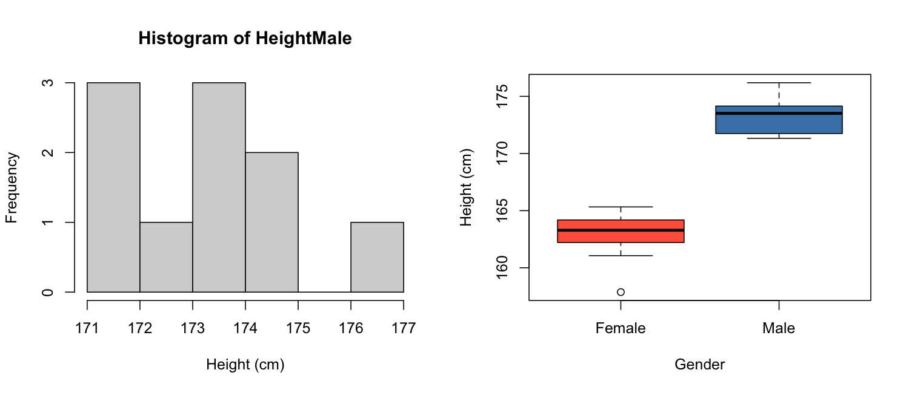
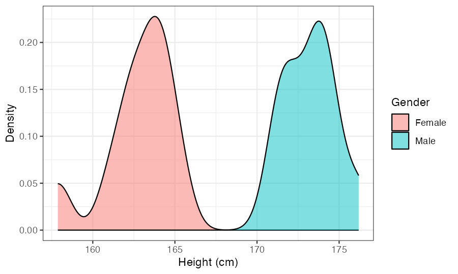

# Chapter 1 — R Programming Basics

[Repository Guide](../../README.md) | [English](Concepts_Lecture.md) | [한국어](Concepts_Lecture.ko.md)

> **Last Updated:** 2026-11-19

> **Learning Objectives:**
> 1. Set up the R and RStudio environment and run basic commands
> 2. Understand R data types and basic data structures (vectors, factors, data frames)
> 3. Write simple R scripts with variables and expressions
> 4. Explain the atomic vector types, coercion, vectorization, and the recycling rule
> 5. Create lists, matrices, and data frames and extract the elements needed
> 6. Generate simulated data and summarize it with descriptive statistics and plots

---

## Table of Contents

- [1. Introduction to R](#1-introduction-to-r)
  - [1.1 Introduction to R](#11-introduction-to-r)
  - [1.2 Reasons to Use R for Data Science](#12-reasons-to-use-r-for-data-science)
  - [1.3 RStudio (IDE for R)](#13-rstudio-ide-for-r)
  - [1.4 R Console / User Prompt](#14-r-console--user-prompt)
  - [1.5 Good Programming Habits](#15-good-programming-habits)
  - [1.6 RStudio Cheatsheets](#16-rstudio-cheatsheets)
  - [1.7 R Workspace](#17-r-workspace)
  - [1.8 Installing R and RStudio](#18-installing-r-and-rstudio)
  - [1.9 Case Sensitivity and Object Naming Rules](#19-case-sensitivity-and-object-naming-rules)
  - [1.10 Running Scripts and Comments](#110-running-scripts-and-comments)
- [2. Basic Data Types](#2-basic-data-types)
  - [2.1 Core Data Types](#21-core-data-types)
  - [2.2 Checking and Inspecting Types](#22-checking-and-inspecting-types)
  - [2.3 Data Frames](#23-data-frames)
  - [2.4 The Six Atomic Vector Types](#24-the-six-atomic-vector-types)
  - [2.5 Special Values: NA, NULL, NaN, Inf](#25-special-values-na-null-nan-inf)
  - [2.6 Coercion](#26-coercion)
  - [2.7 Classification of Data Structures and Lists](#27-classification-of-data-structures-and-lists)
  - [2.8 Working with Data Frames](#28-working-with-data-frames)
  - [2.9 Reading and Writing CSV Files](#29-reading-and-writing-csv-files)
- [3. Variables and Assignment](#3-variables-and-assignment)
  - [3.1 Assignment Operator](#31-assignment-operator)
  - [3.2 Removing Variables](#32-removing-variables)
  - [3.3 Function Calls and Arguments](#33-function-calls-and-arguments)
  - [3.4 Arithmetic Operators and Floating-Point Comparison](#34-arithmetic-operators-and-floating-point-comparison)
- [4. Vectors and Operations](#4-vectors-and-operations)
  - [4.1 Creating Vectors with c()](#41-creating-vectors-with-c)
  - [4.2 Generating Sequences](#42-generating-sequences)
  - [4.3 Generating Random Values](#43-generating-random-values)
  - [4.4 Vector Indexing](#44-vector-indexing)
  - [4.5 Vector Arithmetic](#45-vector-arithmetic)
  - [4.6 Binding Vectors](#46-binding-vectors)
  - [4.7 Vectorization](#47-vectorization)
  - [4.8 Recycling Rule](#48-recycling-rule)
  - [4.9 Logical Indexing](#49-logical-indexing)
  - [4.10 Handling Missing Values](#410-handling-missing-values)
  - [4.11 Arguments of rep() and seq() and the Random Seed](#411-arguments-of-rep-and-seq-and-the-random-seed)
  - [4.12 Sorting and Ranking: sort(), order(), rank()](#412-sorting-and-ranking-sort-order-rank)
- [5. Basic Functions](#5-basic-functions)
  - [5.1 Output Functions](#51-output-functions)
  - [5.2 Summary Statistics](#52-summary-statistics)
  - [5.3 Data Inspection Functions](#53-data-inspection-functions)
  - [5.4 Matrix and Factor Functions](#54-matrix-and-factor-functions)
  - [5.5 Getting Help](#55-getting-help)
  - [5.6 Factors and summary()](#56-factors-and-summary)
  - [5.7 Creating Matrices](#57-creating-matrices)
  - [5.8 The apply Family and a Gene Expression Matrix](#58-the-apply-family-and-a-gene-expression-matrix)
  - [5.9 Quantiles, Variance, and Frequency Tables](#59-quantiles-variance-and-frequency-tables)
  - [5.10 Structure of a Help Page](#510-structure-of-a-help-page)
- [6. Packages](#6-packages)
  - [6.1 Installing and Loading Packages](#61-installing-and-loading-packages)
  - [6.2 Finding Packages](#62-finding-packages)
  - [6.3 Visualization with Packages](#63-visualization-with-packages)
  - [6.4 Generating and Summarizing Height Data](#64-generating-and-summarizing-height-data)
  - [6.5 Common Mistakes](#65-common-mistakes)
- [Summary](#summary)
- [Self-Check Questions](#self-check-questions)
- [References](#references)

---

<br>

## 1. Introduction to R

### 1.1 Introduction to R

R is a free, open-source programming language designed for statistical computing and data analysis. Along with Python, it is one of the two most representative languages for data science.

### 1.2 Reasons to Use R for Data Science

- **Free and open-source:** It can be downloaded from [https://cran.r-project.org/](https://cran.r-project.org/).
- Hands-on data analysis is **relatively easy** to learn in R.
- **Extensible:** Thousands of community-contributed packages are available on CRAN.
- **Strong statistical support:** It provides built-in functions for statistical modeling and visualization.

### 1.3 RStudio (IDE for R)

RStudio is an integrated development environment (IDE) that makes programming in R easier. An IDE typically consists of a source code editor, build automation tools, and a debugger.

RStudio has four main panes. In the default layout, the code editor is at the top left, the R console at the bottom left, the environment and history at the top right, and the files, plots, packages, and help pane at the bottom right.

```text
┌──────────────────────┬────────────────────────────┐
│ Code Editor          │ Environment / History      │
│                      │                            │
├──────────────────────┼────────────────────────────┤
│ R Console            │ Files / Plots /            │
│                      │ Packages / Help            │
└──────────────────────┴────────────────────────────┘
```

*Figure 1. Default pane layout of RStudio*

| Pane | Purpose |
|------|---------|
| Code Editor | Write and edit R scripts |
| R Console | Execute commands interactively |
| Environment/History | View loaded variables and command history |
| Files/Plots/Packages/Help | Browse files, view plots, manage packages, access help |

*Table 1. Main panes of RStudio and their purposes*

### 1.4 R Console / User Prompt

- Commands are entered interactively at the R user prompt (`>`).
- The **up** and **down** arrow keys scroll through the command history.
- Programming directly in the prompt window is **not recommended**, because all unsaved work is lost if the system crashes or a blackout occurs.

### 1.5 Good Programming Habits

- Always save your scripts regularly and make backups.
- One of the best habits is to save every time you modify a script.
- Use meaningful file naming conventions and avoid names like `final`, `Realfinal`, and `Realfinal222`.

### 1.6 RStudio Cheatsheets

RStudio provides built-in reference sheets accessible via **Help > Cheatsheets**. These cover the most widely used commands and shortcuts for the IDE, data transformation, visualization, and more.

Memorizing the key bindings for the operations you use most frequently significantly speeds up your workflow.

### 1.7 R Workspace

```r
getwd()       # Check current working directory
setwd("path") # Change working directory (Warning: "\" is escape character)
```

`getwd()` returns the current working directory, and `setwd()` changes it. Because `\` is the escape character in R strings, Windows paths must be separated with `/` or `\\`, as in `"C:/data"` or `"C:\\data"`.

There are two ways to save your work.
1. **Save your R script:** This saves only the code in text format.
2. **Save your R workspace:** `save.image()` saves all variables of the workspace held in memory (RAM) to an `.RData` file.

> **Key Point:** R is a **case-sensitive** language. `variableName` and `variablename` are treated as two different variables.

### 1.8 Installing R and RStudio

R is installed in two steps. First, download the R installer for the operating system from CRAN. CRAN provides precompiled binary distributions of the base system and contributed packages for Windows and macOS users, and many Linux distributions also provide R through their own package management systems. Next, install RStudio Desktop (open source license), an IDE that makes R easier to use. RStudio is not a replacement for R but a working environment that calls an R installation, so R must be installed first.

When RStudio is started for the first time, three panes appear. The left pane is the R console; the top right pane holds tabs such as Environment and History, and the bottom right pane holds the Files, Plots, Packages, Help, and Viewer tabs (the tabs may change between versions). Creating or opening a script file adds the code editor at the top left, giving the four-pane layout of Section 1.3. Clicking a tab moves to that feature.

### 1.9 Case Sensitivity and Object Naming Rules

As noted in Section 1.7, R is case sensitive. The following code stores different values in two names that are spelled the same and differ only in case.

```r
variableName <- "test"
variablename <- "test2"
variableName
variablename
```

```text
[1] "test"
[1] "test2"
```

The two names refer to different objects, so each prints its own value. The `[1]` before the output means that the first element on that line is element 1 of the vector; when a long vector is printed over several lines, each line starts with the position of its first element.

An R object name starts with a letter or a dot (`.`) and consists of letters, digits, dots, and underscores (`_`). A name in which a digit directly follows the leading dot (`.2way`) and a name starting with a digit (`2nd`) are not allowed, and reserved words such as `if`, `for`, `function`, `TRUE`, and `NULL` cannot be used as names. The naming habits of Section 1.5 also apply to object names: names that reveal their content, such as `heightMale` and `geneExpr`, make code easier to read than `x1` or `temp2`.

### 1.10 Running Scripts and Comments

As Section 1.4 says, code is written and saved in a script file (`.R`) rather than typed directly into the console. In the code editor of RStudio, the line at the cursor or several selected lines are sent to the console and run with a shortcut (Ctrl+Enter on Windows and Linux, Cmd+Enter on macOS), and `source("analysis.R")` runs a whole script from start to finish. An analysis is reproducible when rerunning the whole script gives the same result, and to that end packages are loaded (Section 6.1) and the random seed is fixed (Section 4.11) at the top of the script.

Everything after `#` up to the end of the line is a **comment** and is not executed. In comments it is more useful to record why the code does something (the source of the data, the reason for a cutoff, the units) than what it does. For example, writing `x <- x[x > 0]  # remove values below the detection limit of the instrument` lets a later reader know the purpose of this filter.

---

<br>

## 2. Basic Data Types

### 2.1 Core Data Types

| Type | Description | Example |
|------|-------------|---------|
| `numeric` | Real numbers (default for numbers) | `3.14`, `42` |
| `integer` | Whole numbers (append `L`) | `5L`, `100L` |
| `character` | Text strings (enclosed in quotes) | `"Hello"`, `'World'` |
| `logical` | Boolean values | `TRUE`, `FALSE` |
| `factor` | Categorical variables with levels | `factor(c("a", "b"))` |

*Table 2. Core data types of R*

Strictly speaking, `factor` is not a basic type but an object that attaches level information to integer codes. Therefore `class()` returns `"factor"`, while `typeof()` returns `"integer"`.

### 2.2 Checking and Inspecting Types

```r
class(x)   # Check the data type of a variable
str(x)     # View the internal structure of an object
ls()       # List all loaded variables in the environment
```

### 2.3 Data Frames

A variable that holds a single number is not very useful for storing data. The most common way of storing a dataset in R is in a **data frame**.

A data frame is a table where:
- **Rows** represent observations (individual data points).
- **Columns** represent variables (attributes measured for each observation).

Data frames are particularly useful because they can **combine different data types** (numeric, character, logical, factor) into one object. Each column can have a different type, while the values within one column share a type. This is the key difference from matrices, which require all elements to be the same type.

```r
# Data frames vs. matrices
# - Data frames support column/row names and mixed data types (including factors)
# - Matrices require all elements to be the same type
```

Use `data()` to load built-in datasets (e.g., `data(iris)`), and use `head()`, `tail()`, `dim()`, `nrow()`, `ncol()` to quickly inspect them.

### 2.4 The Six Atomic Vector Types

The types in Section 2.1 are the types of the **atomic vector**, the most basic data structure in R. An atomic vector is one-dimensional data whose elements all have the same type, and a single value (`42`) is also a vector with one element. R distinguishes six atomic vector types.

> **Definition:** An **atomic vector** is a one-dimensional data structure whose elements all have the same basic type (one of logical, integer, double, complex, character, and raw).

| `typeof()` value | Values held | Example | `class()` value |
|:--|:--|:--|:--|
| `logical` | `TRUE`, `FALSE`, `NA` | `TRUE` | `"logical"` |
| `integer` | Integers | `42L` | `"integer"` |
| `double` | Real numbers (double-precision floating point) | `42`, `3.14` | `"numeric"` |
| `complex` | Complex numbers | `2 + 3i` | `"complex"` |
| `character` | Strings | `"ACGT"` | `"character"` |
| `raw` | Bytes | `charToRaw("A")` | `"raw"` |

*Table 3. The six atomic vector types*

`typeof()` returns the internal type in which R stores a value in memory, and `class()` returns the class that decides how functions treat the object. The internal type of a bare number `42` is `double` while its class is `"numeric"`; only `42L`, with the suffix `L`, is an integer. The `numeric` of Section 2.1 is the common name for `integer` and `double`, so `is.numeric(42L)` is also `TRUE`.

```r
x_num <- 42
x_int <- 42L
x_chr <- "ACGT"
x_lgl <- TRUE
x_cpx <- 2 + 3i
x_raw <- charToRaw("A")
sapply(list(x_num, x_int, x_chr, x_lgl, x_cpx, x_raw), typeof)
class(x_num)
is.numeric(x_int)
```

```text
[1] "double"    "integer"   "character" "logical"   "complex"   "raw"
[1] "numeric"
[1] TRUE
```

`sapply()` applies a function (`typeof`) to each element of a list and collects the results in a vector. The types used most in data analysis are `logical`, `integer`, `double`, and `character`; `complex` and `raw` serve special purposes such as signal processing and binary file handling.

### 2.5 Special Values: NA, NULL, NaN, Inf

Besides ordinary values, an atomic vector can hold a few special values.

| Value | Meaning | Length | Example |
|:--|:--|:--|:--|
| `NA` | A missing value that should exist but is unknown | 1 | The blood pressure of a patient who was not measured |
| `NULL` | Nothing (an empty object) | 0 | A result not yet created |
| `NaN` | A mathematically undefined number (Not a Number) | 1 | `0 / 0` |
| `Inf`, `-Inf` | Positive and negative infinity | 1 | `1 / 0`, `-1 / 0` |

*Table 4. Special values in R*

```r
c(1 / 0, -1 / 0, 0 / 0)
NA > 1
length(NA)
length(NULL)
```

```text
[1]  Inf -Inf  NaN
[1] NA
[1] 1
[1] 0
```

`NA` means "an unknown value", so the result of `NA > 1` is also unknown and is `NA`. `NA` occupies a position and has length 1, whereas `NULL` means that nothing is there and has length 0. `NaN` is also treated as a kind of missing value, so `is.na(NaN)` is `TRUE`. Functions for missing values are summarized in Section 4.10.

### 2.6 Coercion

Because the elements of an atomic vector must all have the same type, combining values of different types with `c()` makes R convert all elements to one type that can hold them all. This is called **coercion**. The conversion goes toward the type further right in the following order.

```math
\text{logical} \rightarrow \text{integer} \rightarrow \text{double} \rightarrow \text{complex} \rightarrow \text{character}
```

> **Definition:** **Coercion** is the automatic conversion by which R changes values to the type that loses no information when values of different types are placed in one atomic vector or combined in an operation.

```r
c(1, "a", TRUE)
c(1, TRUE, FALSE)
logicalVector <- c("TRUE", "TRUE", "FALSE")
class(logicalVector)
as.logical(logicalVector)
as.numeric(c("3.5", "abc"))
```

```text
[1] "1"    "a"    "TRUE"
[1] 1 1 0
[1] "character"
[1]  TRUE  TRUE FALSE
[1] 3.5  NA
Warning message:
NAs introduced by coercion
```

In the first line the string `"a"` is present, so 1 and `TRUE` also become the strings `"1"` and `"TRUE"`. In the second line numbers and logical values are mixed, so the logical values become numbers: `TRUE` becomes 1 and `FALSE` becomes 0. The third to fifth lines show that a quoted `"TRUE"` is a string, not a logical value. The vector is of character type even though it is named `logicalVector`, and it becomes logical only through an explicit conversion with `as.logical()`. As the last line shows, converting a string that cannot be read as a number produces `NA` at that position together with a warning.

Coercion also happens in arithmetic. `TRUE + TRUE` is 2, and summing a logical vector, as in `sum(x > 25)`, gives the number of `TRUE` values (Section 4.9). Conversely, numbers that have become strings no longer support arithmetic (`"1" + 1` is an error), so after reading data it is good practice to check the type of each column with `str()`.

### 2.7 Classification of Data Structures and Lists

The data structures of R can be classified by the number of dimensions and by whether all elements have the same type (homogeneous).

| Dimensions | Homogeneous (all elements of one type) | Heterogeneous (elements may differ in type) |
|:--|:--|:--|
| 1 | Atomic vector (`c()`) | List (`list()`) |
| 2 | Matrix (`matrix()`) | Data frame (`data.frame()`) |
| n | Array (`array()`) | - |

*Table 5. Classification of R data structures by dimension and homogeneity*

A factor is an integer vector with level information attached, so it belongs to the one-dimensional homogeneous structures (Section 2.1). Creating each structure and inspecting it with `str()` gives the following.

```r
v  <- c(5.1, 4.9, 4.7)
m  <- matrix(1:6, nrow = 2)
a  <- array(1:24, dim = c(2, 3, 4))
df <- data.frame(id = c("S1", "S2"), height = c(171.2, 162.5))
f  <- factor(c("case", "control", "case"))
str(v); str(m); str(a); str(df); str(f)
```

```text
 num [1:3] 5.1 4.9 4.7
 int [1:2, 1:3] 1 2 3 4 5 6
 int [1:2, 1:3, 1:4] 1 2 3 4 5 6 7 8 9 10 ...
'data.frame':	2 obs. of  2 variables:
 $ id    : chr  "S1" "S2"
 $ height: num  171 162
 Factor w/ 2 levels "case","control": 1 2 1
```

The output of `str()` shows the type (`num`, `int`, `chr`), the range of each dimension (`[1:2, 1:3]`), and the leading elements in order. Matrices and arrays are atomic vectors with a `dim` attribute, so they have only one element type. The `1 2 1` of the factor means that the level `"case"` is stored as 1 and `"control"` as 2.

A **list** is a one-dimensional structure whose elements are objects of different types and lengths. Elements can be named, and a list can contain other lists. Functions mainly use lists to return several results at once.

```r
l <- list(sample = "S1", reads = 15230L, qc_pass = TRUE)
str(l)
l$sample
l[["reads"]]
l["reads"]
class(l["reads"]); class(l[["reads"]])
```

```text
List of 3
 $ sample : chr "S1"
 $ reads  : int 15230
 $ qc_pass: logi TRUE
[1] "S1"
[1] 15230
$reads
[1] 15230

[1] "list"
[1] "integer"
```

- `list()` builds the record of one sequencing sample from three elements named `sample`, `reads`, and `qc_pass`.
- `l$sample` and `l[["reads"]]` extract the elements themselves, so they give a character value and an integer value.
- `l["reads"]` returns a **list** that holds only one element. Its output therefore carries the name `$reads`, and its class is `"list"`.

Single brackets `[ ]` cut out part of a structure as a structure of the same kind, while double brackets `[[ ]]` and `$` extract a single element. The same distinction applies to data frames.

### 2.8 Working with Data Frames

A **data frame** is a list of vectors of equal length bound together as columns. Columns may therefore differ in type (a property of lists), while all columns have the same length, so it can be handled as a table of rows and columns (a property of matrices). The built-in dataset `iris` is a data frame holding the sepal length and width, petal length and width, and species (`Species`) of 150 iris flowers.

> **Definition:** A **data frame** is the tabular data structure of R whose rows are observations and columns are variables, built from equal-length vectors as columns so that each column may have its own type.

For a one-dimensional object, `length()` returns the number of elements. Because a data frame is a list of columns, `length()` applied to part of a data frame gives a result that depends on what structure that part is.

```r
length(iris[1, ])
length(iris[, 1])
dim(iris)
length(iris[, 6])
```

```text
[1] 5
[1] 150
[1] 150   5
Error in `[.data.frame`(iris, , 6) : undefined columns selected
```

- `iris[1, ]` is a data frame holding the first row (a list of five columns), so its length is the number of columns, 5.
- `iris[, 1]` extracts the first column `Sepal.Length` as a vector, so its length is the number of observations, 150.
- `dim()` returns the numbers of rows and columns together, and `nrow()` and `ncol()` return one of them each.
- `iris` has only five columns, so requesting the sixth column goes out of bounds and raises the error `undefined columns selected`. This differs from a vector, where an out-of-range index (`x[10]`) returns `NA` without an error.

Rows can be selected with a logical condition and columns by name. The following code extracts the species and petal length of the flowers whose petal length exceeds 6.5 cm.

```r
iris[iris$Petal.Length > 6.5, c("Species", "Petal.Length")]
```

```text
      Species Petal.Length
106 virginica          6.6
118 virginica          6.7
119 virginica          6.9
123 virginica          6.7
```

`iris$Petal.Length > 6.5` is a logical vector of length 150, and placing it in the row position keeps only the rows where it is `TRUE` (Section 4.9). The numbers on the left, such as 106 and 118, are the row names in the original data.

The differences between data frames and matrices are summarized below.

| Item | Data frame | Matrix |
|:--|:--|:--|
| Element type | May differ by column | All elements of one type |
| Factor columns | Possible | Not possible (become characters or integers) |
| Row and column names | Present by default | Optional |
| Model formulas (`lm(y ~ x, data = )`) | Used directly | Used after conversion to a data frame |
| Linear algebra (`%*%`, `solve()`) | Used after conversion to a matrix | Used directly |
| Transpose `t()` | The result becomes a matrix | The result is a matrix |

*Table 6. Comparison of data frames and matrices*

Transposing a data frame turns row names into column names, which is useful when the roles of rows and columns must be swapped, as in a gene expression table with samples in columns. The result of the transpose, however, is a matrix, so all elements are coerced to a single type.

```r
tt <- t(head(iris[, 1:2], 3))
tt
class(tt)
```

```text
               1   2   3
Sepal.Length 5.1 4.9 4.7
Sepal.Width  3.5 3.0 3.2
[1] "matrix" "array"
```

Only the two numeric columns were transposed, so the result is a numeric matrix. If a factor column such as `Species` were included in the transpose, every element would become a string.

### 2.9 Reading and Writing CSV Files

Real analysis data usually arrive as files, and the most common format is the CSV (comma-separated values) file, whose values are separated by commas. The first line of a CSV file is usually the column names, and from the second line on each line is one observation. `write.csv()` writes a data frame to a CSV file, and `read.csv()` reads a CSV file into a data frame.

```r
f <- file.path(tempdir(), "heights.csv")
d <- data.frame(id = c("S1", "S2", "S3"), sex = c("M", "F", "F"),
                height = c(172.4, 161.8, 165.0))
write.csv(d, f, row.names = FALSE)
cat(readLines(f), sep = "\n")
d2 <- read.csv(f, stringsAsFactors = TRUE)
str(d2)
```

```text
"id","sex","height"
"S1","M",172.4
"S2","F",161.8
"S3","F",165
'data.frame':	3 obs. of  3 variables:
 $ id    : Factor w/ 3 levels "S1","S2","S3": 1 2 3
 $ sex   : Factor w/ 2 levels "F","M": 2 1 1
 $ height: num  172 162 165
```

- `tempdir()` is the temporary folder used by the R session, and `file.path()` joins a path with the separator of the operating system. Given only a file name, reading and writing are relative to the working directory of Section 1.7.
- `row.names = FALSE` keeps the row names (1, 2, 3) from being written as the first column of the file. Without this argument, reading the file back adds an extra unnamed column `X`.
- Viewing the raw content of the file with `readLines()` shows that strings are quoted and numbers are written as they are.
- `read.csv()` guesses the type of each column. With `stringsAsFactors = TRUE` character columns are read as factors; with the default `FALSE` they are read as characters.

Right after reading a file, check the column types and value ranges with `str()`, `head()`, and `summary()`. If even one string such as "n/a" is mixed into a numeric column, the whole column is read as character (Section 2.6), and such problems must be found right after reading to keep the analysis from going silently wrong.

---

<br>

## 3. Variables and Assignment

### 3.1 Assignment Operator

```r
x <- 10           # Preferred assignment operator
y <- "Hello"       # Assign a character string
z <- TRUE          # Assign a logical value
```

While `=` can also be used for assignment, `<-` is **highly recommended** to avoid confusion with the equality operator `==`.

### 3.2 Removing Variables

```r
rm(x)              # Remove a single variable
rm(list = ls())    # Remove all variables from the environment
```

> **Key Point:** Always use `<-` for assignment in R, and use `=` for specifying function arguments (e.g., `rnorm(n = 100, mean = 0)`).

### 3.3 Function Calls and Arguments

An R function is called in the form `functionName(argument1, argument2, ...)`. Arguments can be passed by position in their defined order, or by name in the form `name = value` in any order. Arguments with default values can be omitted. `args()` shows the arguments a function takes and their defaults.

```r
args(rnorm)
set.seed(7); rnorm(3, 10, 1)
set.seed(7); rnorm(sd = 1, mean = 10, n = 3)
round(5.6789, 2); round(5.6789)
```

```text
function (n, mean = 0, sd = 1) 
NULL
[1] 12.287247  8.803228  9.305707
[1] 12.287247  8.803228  9.305707
[1] 5.68
[1] 6
```

`rnorm()` takes three arguments, `n`, `mean`, and `sd`, with default values 0 for `mean` and 1 for `sd`. The positional call `rnorm(3, 10, 1)` and the named call in a different order `rnorm(sd = 1, mean = 10, n = 3)` are the same call, so they give the same random numbers from the same seed. The second argument of `round()`, `digits`, defaults to 0, so omitting it rounds to an integer. For functions with many arguments, passing only the first one or two by position and naming the rest is easier to read and less error-prone. As the key point of Section 3.1 says, arguments are passed with `=`, and this is not an assignment.

### 3.4 Arithmetic Operators and Floating-Point Comparison

The R console can also be used as a calculator. Besides the four basic operations `+`, `-`, `*`, and `/`, there are exponentiation `^`, the integer quotient `%/%`, and the remainder `%%`.

```r
7 / 2; 7 %/% 2; 7 %% 2; 2^10
-2^2; (-2)^2
1 + 2 * 3^2
0.1 + 0.2 == 0.3
isTRUE(all.equal(0.1 + 0.2, 0.3))
print(0.1 + 0.2, digits = 17)
```

```text
[1] 3.5
[1] 3
[1] 1
[1] 1024
[1] -4
[1] 4
[1] 19
[1] FALSE
[1] TRUE
[1] 0.30000000000000004
```

- `7 / 2` is the real division 3.5, `7 %/% 2` is the quotient 3, and `7 %% 2` is the remainder 1. The remainder operation is used to separate even and odd numbers (`x %% 2 == 0`) or to select samples at a fixed interval.
- Operators have precedence, and exponentiation is evaluated before the sign. `-2^2` is therefore $`-(2^2) = -4`$, and squaring -2 requires parentheses as in `(-2)^2`. `1 + 2 * 3^2` is likewise evaluated in the order exponentiation (9), multiplication (18), addition (19).
- A computer stores real numbers as binary numbers with a finite number of digits, so it cannot represent 0.1 and 0.2 exactly. Their sum is stored as 0.30000000000000004, so `0.1 + 0.2 == 0.3` is `FALSE`. When comparing real numbers that come out of computations, use `all.equal()`, which checks equality within a tolerance, instead of `==`, and wrap it in `isTRUE()` in conditions to get a single logical value.

Floating-point error is not specific to R; it is common to every language that uses IEEE 754 double-precision numbers. This is why the last digits of computations that add many values, such as means and variances, can differ slightly, and results should be reported with `round()` only to meaningful digits.

---

<br>

## 4. Vectors and Operations

### 4.1 Creating Vectors with c()

Vectors are the most basic data structure in R. The `c()` function combines values into a vector.

```r
numericVector   <- c(1, 2, 3, 4, 5)
characterVector <- c("One", "Two", "Three", "Four", "Five")
logicalVector   <- c(TRUE, TRUE, FALSE, FALSE, FALSE)
```

### 4.2 Generating Sequences

```r
# Using the colon operator
1:10                              # 1, 2, 3, ..., 10

# Using seq()
seq(from = 1, to = 10)            # Same as 1:10
seq(from = 1, to = 10, by = 2)    # 1, 3, 5, 7, 9
seq(1, 10, length = 5)            # 5 evenly spaced values

# Using rep()
rep(1, 3)                         # 1, 1, 1
rep(c("a", "b"), 5)               # "a","b","a","b",...
rep(1:3, each = 10)               # 1,1,...,2,2,...,3,3,...
```

### 4.3 Generating Random Values

```r
rnorm(n = 100, mean = 180, sd = 1)  # 100 random values from N(180, 1)
```

### 4.4 Vector Indexing

```r
x <- c(10, 20, 30, 40, 50)
x[1]          # First element: 10
x[c(1, 3)]   # First and third elements: 10, 30
x[-2]         # All except the second: 10, 30, 40, 50
```

Indices in R start at 1, and a negative index excludes the element at that position.

> **[Computer Programming]** Arrays and lists in C and Python are indexed from 0, and the negative index `-1` in Python refers to the last element. R indexes from 1 and uses a negative index to exclude an element, so the same `x[-1]` returns the last element in Python but all elements except the first in R.

### 4.5 Vector Arithmetic

```r
a <- c(1, 2, 3)
b <- c(4, 5, 6)

a + b    # Element-wise addition: 5, 7, 9
a * b    # Element-wise multiplication: 4, 10, 18
a > 2    # Element-wise comparison: FALSE, FALSE, TRUE
```

### 4.6 Binding Vectors

```r
cbind(a, b)   # Combine column-wise (side by side)
rbind(a, b)   # Combine row-wise (stacked)
```

When `a` and `b` have length 3, `cbind(a, b)` creates a matrix with 3 rows and 2 columns, and `rbind(a, b)` creates a matrix with 2 rows and 3 columns.

> **Key Point:** Arithmetic operators, comparison operators, and many built-in functions in R are **vectorized** by default: they apply element-wise without the need for explicit loops.

### 4.7 Vectorization

The property by which a function or operator, like `a + b` in Section 4.5, takes a whole vector, performs the same computation on each element, and returns a vector of the same length is called **vectorization**. Vectorized operations express a computation in short code without loops, and because the iteration happens in R's internal compiled code, they are usually faster than a `for` loop written in R.

> **Definition:** **Vectorization** is the property by which an operation or function is applied element by element to all elements of a vector and returns the result as a vector.

The following computation standardizes the expression values of one gene in five samples into Z-scores. The Z-score $`z_i = (x_i - \bar{x}) / s`$ tells how many standard deviations each value lies from the mean (Section 4.3 of Chapter 3).

```r
expr <- c(2.1, 3.5, 1.8, 4.2, 2.9)
z <- (expr - mean(expr)) / sd(expr)
round(z, 3)
z_loop <- numeric(length(expr))
for (i in seq_along(expr)) {
  z_loop[i] <- (expr[i] - mean(expr)) / sd(expr)
}
all.equal(z, z_loop)
```

```text
[1] -0.810  0.608 -1.114  1.317  0.000
[1] TRUE
```

- In the second line, `expr - mean(expr)` subtracts one number (the mean, 2.9) from a vector of length 5, so 2.9 is subtracted from all five elements. The five deviations are then divided by the standard deviation 0.9874.
- The fourth to seventh lines write the same computation as a loop. `numeric(5)` first creates a vector of five zeros, and a value is filled in at each position from 1 to 5 returned by `seq_along(expr)`.
- `all.equal()` checks whether two results are equal within floating-point tolerance. The two methods give the same result.

In terms of intermediate values, the mean is $`(2.1 + 3.5 + 1.8 + 4.2 + 2.9)/5 = 14.5/5 = 2.9`$, and the Z-score of the first element is $`(2.1 - 2.9)/0.9874 = -0.810`$. The fifth element, equal to the mean, has a Z-score of 0.

### 4.8 Recycling Rule

When an element-wise operation combines two vectors of different lengths, R repeats the shorter vector from its start to match the length of the longer one. This is called the **recycling rule**. Subtracting a single number from a vector in Section 4.7 is also a case in which a vector of length 1 was recycled five times.

```r
1:6 + c(10, 20)
1:5 + c(10, 20)
```

```text
[1] 11 22 13 24 15 26
[1] 11 22 13 24 15
Warning message:
In 1:5 + c(10, 20) :
  longer object length is not a multiple of shorter object length
```

In the first line `c(10, 20)` is stretched to `c(10, 20, 10, 20, 10, 20)` and added to 1 through 6 in turn. In the second line the longer length 5 is not a multiple of the shorter length 2, so R computes the result but issues a warning. Because a result is produced even with a warning, unintended recycling can silently make results wrong.

> **Caution:** Recycling happens without any warning when the lengths are multiples of each other. For example, if the measurements of six samples must be multiplied in turn by three correction factors but only two factors are supplied, 6 is a multiple of 2, so R repeats the two factors three times and produces a wrong result without a warning. Check the lengths with `length()` before operating on vectors of different lengths.

### 4.9 Logical Indexing

The index position of Section 4.4 accepts not only position numbers but also a logical vector of the same length. Only the elements at `TRUE` positions remain. This is called **logical indexing**, and it is the most basic way to select observations that satisfy a condition.

```r
x <- c(10, 20, 30, 40, 50)
x > 25
x[x > 25]
which(x > 25)
sum(x > 25)
mean(x > 25)
```

```text
[1] FALSE FALSE  TRUE  TRUE  TRUE
[1] 30 40 50
[1] 3 4 5
[1] 3
[1] 0.6
```

- `x > 25` is a vectorized comparison that judges each element true or false.
- `x[x > 25]` selects elements with that logical vector and returns 30, 40, and 50.
- `which()` returns the positions that are `TRUE`.
- `sum()` and `mean()` compute after the coercion of Section 2.6 turns `TRUE` into 1 and `FALSE` into 0, giving the number (3) and the proportion (3/5 = 0.6) of elements that satisfy the condition.

Several conditions are combined with the element-wise logical operators `&` (and), `|` (or), and `!` (not). For example, `x[x > 15 & x < 45]` is 20, 30, 40. The operators `&&` and `||` are meant only for values of length 1, and from R 4.3.0 on, using them with a vector condition of length 2 or more raises an error (the R 4.2 series gives a warning) [1].

### 4.10 Handling Missing Values

If even one missing value `NA` is present, most summary functions return `NA`. When an unknown value is mixed in, the sum and the mean are also unknown.

```r
y <- c(4, NA, 7)
mean(y)
mean(y, na.rm = TRUE)
is.na(y)
sum(is.na(y))
```

```text
[1] NA
[1] 5.5
[1] FALSE  TRUE FALSE
[1] 1
```

`na.rm = TRUE` is an argument that tells the function to compute after removing missing values; the mean is then $`(4 + 7)/2 = 5.5`$. `is.na()` judges each element missing or not, and its sum is the number of missing values. Searching for missing values with `y == NA` makes every element `NA`, so `is.na()` must be used. Removing missing values is safe only under the assumption that they arose at random; if missingness concentrates in a particular group, the remaining data no longer represent the population (Section 2.4 of Chapter 2).

### 4.11 Arguments of rep() and seq() and the Random Seed

`rep(x, times)` creates a vector that repeats `x`. A vector in which the same value repeats in a row can be typed directly, but writing it with `rep()` is shorter and less error-prone.

```r
A <- c(1, 1, 1, 2, 2, 2, 3, 3, 3)
B <- c(rep(1, 3), rep(2, 3), rep(3, 3))
identical(A, B)
D <- rep(1:3, each = 3)
D
identical(A, D)
all.equal(A, D)
rep("a", times = 4)
rep(c("a", "b"), 3)
```

```text
[1] TRUE
[1] 1 1 1 2 2 2 3 3 3
[1] FALSE
[1] TRUE
[1] "a" "a" "a" "a"
[1] "a" "b" "a" "b" "a" "b"
```

- `B` joins with `c()` three vectors that repeat 1, 2, and 3 three times each, giving the same vector as `A`.
- `rep(1:3, each = 3)` repeats each element three times in a row, so the printed values equal those of `A`. However, `1:3` is of integer type, so `D` is an integer vector, while `A` is a double vector; `identical()` compares types as well and returns `FALSE`. `all.equal()`, which compares values only, returns `TRUE`.
- `times` is the number of times the whole vector is repeated. `rep(c("a", "b"), 3)` repeats the pair `"a", "b"` three times, so unlike `each` the elements alternate.

`seq()` creates arithmetic sequences; fixing three of the start (`from`), end (`to`), step (`by`), and length (`length.out`) determines the rest.

```r
seq(1, 10, length = 5)
seq(from = 1, by = 2, length.out = 10)
```

```text
[1]  1.00  3.25  5.50  7.75 10.00
 [1]  1  3  5  7  9 11 13 15 17 19
```

The first line fixes the start, end, and length, so the step becomes $`(10 - 1)/(5 - 1) = 2.25`$. The second line fixes no end and creates 10 values with step 2, so the last value is $`1 + 2 \times 9 = 19`$. The argument name `length` abbreviates `length.out`; R accepts an abbreviation when the leading part of the argument name identifies a single argument.

The **normal distribution**, also called the Gaussian distribution, is a continuous probability distribution with a symmetric bell shape centered at the mean $`\mu`$. It is commonly used for real-valued variables that arise from the sum of many small factors, such as height and measurement error, and it is widely used as a model for real-valued random variables whose distribution is not known. Its probability density function is as follows.

```math
f(x) = \frac{1}{\sqrt{2\pi}\,\sigma} \exp\left( -\frac{(x - \mu)^2}{2\sigma^2} \right)
```

A normally distributed random variable is called a normal deviate, and `rnorm(n, mean, sd)` generates `n` normal deviates from the normal distribution with mean `mean` and standard deviation `sd`. Computer random numbers are pseudo-random numbers that start from an initial value called the seed, so fixing the seed with `set.seed()` reproduces the same random numbers.

```r
set.seed(2025)
round(rnorm(5, mean = 173, sd = 2), 2)
set.seed(2025)
round(rnorm(5, mean = 173, sd = 2), 2)
```

```text
[1] 174.24 173.07 174.55 175.54 173.74
[1] 174.24 173.07 174.55 175.54 173.74
```

The two results generated from the same seed are identical. To let others reproduce an analysis, fix the seed before the code that uses random numbers. Even with the same seed value, a different R version or random number generator may produce different numbers.

### 4.12 Sorting and Ranking: sort(), order(), rank()

Three functions deal with values in order of size, and since each returns something different they must be kept apart. The following example holds the drug doses (mg) given to five patients.

```r
dose <- c(30, 10, 50, 20, 10)
sort(dose)
sort(dose, decreasing = TRUE)
order(dose)
dose[order(dose)]
rank(dose)
```

```text
[1] 10 10 20 30 50
[1] 50 30 20 10 10
[1] 2 5 4 1 3
[1] 10 10 20 30 50
[1] 4.0 1.5 5.0 3.0 1.5
```

- `sort()` returns the **sorted values**, in decreasing order with `decreasing = TRUE`.
- `order()` returns which elements of the original vector must be taken, one after another, to arrange the values in increasing order, that is, the **positions in sorted order**. The smallest value 10 is at positions 2 and 5, so the result begins with 2 and 5. `dose[order(dose)]` equals `sort(dose)`, and to sort the rows of a data frame by a column, `order()` is used as in `df[order(df$column), ]`.
- `rank()` returns **how small each element is** relative to the others. The two tied values 10 share first and second place and both receive the average rank 1.5.

`order()` is the operation used to pick the nearest neighbors by distance in the K-nearest neighbors method of Chapter 6, and `rank()` the operation that turns values into ranks for the Spearman correlation coefficient of Chapter 3.

---

<br>

## 5. Basic Functions

### 5.1 Output Functions

```r
print("Hello World")     # Formatted output of a single object
cat("Value:", x, "\n")   # Concatenated plain-text output
```

### 5.2 Summary Statistics

```r
sum(1:100)       # Sum: 5050
mean(x)          # Arithmetic mean
median(x)        # Median
sd(x)            # Standard deviation
length(x)        # Number of elements
min(x)           # Minimum value
max(x)           # Maximum value
summary(x)       # Min, Q1, Median, Mean, Q3, Max
```

### 5.3 Data Inspection Functions

```r
head(iris)          # First 6 rows (default)
tail(iris)          # Last 6 rows (default)
head(iris, n = 10)  # First 10 rows
dim(iris)           # Dimensions (rows, columns)
nrow(iris)          # Number of rows
ncol(iris)          # Number of columns
fix(iris)           # Open data in spreadsheet-like editor
```

### 5.4 Matrix and Factor Functions

```r
# Create a matrix
A <- matrix(NA, nrow = 10, ncol = 5)

# Create a factor variable
B <- factor(c("a", "b", "a", "b"))
levels(B)     # View factor levels
```

### 5.5 Getting Help

```r
help(sum)      # Open help page for a function
?sum           # Shortcut for help()
help.start()   # Open R's HTML help system in a browser
```

> **Key Point:** Use `summary()` on numeric variables to get descriptive statistics, and on factor variables to get frequency counts. The behavior adapts to the variable type.

### 5.6 Factors and summary()

`factor()` encodes a numeric or character vector as a **factor**. Factors are also called categories or enumerated types, and they are the standard way to represent categorical variables in R.

> **Definition:** A **factor** is an R object that represents a categorical variable by its levels, the list of distinct values, and an integer code giving the level of each element.

```r
A <- rep(c("a", "b"), 5)
B <- factor(A)
class(A); class(B)
B
levels(B)
as.integer(B)
head(cbind(A, B), 3)
```

```text
[1] "character"
[1] "factor"
 [1] a b a b a b a b a b
Levels: a b
[1] "a" "b"
 [1] 1 2 1 2 1 2 1 2 1 2
     A   B
[1,] "a" "1"
[2,] "b" "2"
[3,] "a" "1"
```

`A` is a character vector, and `B` is the same values converted to a factor. A printed factor shows its values without quotes and lists the levels below them. Levels are in alphabetical order by default, and `as.integer(B)` shows the integer code of each element (1 for `"a"`, 2 for `"b"`). `cbind(A, B)` builds a matrix, so the factor column becomes its integer codes, which are then coerced to the strings `"1"` and `"2"`. To keep the factor, use `data.frame(A, B)`.

`summary()` is a **generic function** that produces summaries of the results of various model-fitting functions and of variables. A generic function looks at the class of its argument and runs the method for that class, so the same `summary()` gives results of different forms depending on the variable type.

```r
summary(c(2.1, 3.5, 1.8, 4.2, 2.9))
summary(A)
summary(B)
C <- factor(rep(c("a", "b", "c", "d"), 5))
summary(C)
```

```text
   Min. 1st Qu.  Median    Mean 3rd Qu.    Max.
    1.8     2.1     2.9     2.9     3.5     4.2
   Length     Class      Mode
       10 character character
a b
5 5
a b c d
5 5 5 5
```

For a numeric vector, the result is the five-number summary (minimum, first quartile, median, third quartile, maximum) together with the mean. For a character vector only the length and type appear, but converting the same values to a factor gives the frequency of each level. This is why categorical variables should be stored as factors rather than characters. A data frame can hold factor columns as they are, but a matrix (including the result of `data.matrix()`) turns factors into integer codes, so data with categorical variables are handled as data frames.

### 5.7 Creating Matrices

`matrix(value, nrow, ncol, byrow)` creates a matrix from the given values. With a single value, the recycling rule (Section 4.8) fills every cell with it, so `matrix(0, nrow = 10, ncol = 5)` is a 10-by-5 matrix of zeros, and `matrix(NA, nrow = 10, ncol = 5)` is an empty matrix to be filled with results later.

```r
M <- matrix(NA, nrow = 10, ncol = 5)
dim(M); nrow(M); ncol(M); class(M)
matrix(1:6, nrow = 2)
matrix(1:6, nrow = 2, byrow = TRUE)
```

```text
[1] 10  5
[1] 10
[1] 5
[1] "matrix" "array"
     [,1] [,2] [,3]
[1,]    1    3    5
[2,]    2    4    6
     [,1] [,2] [,3]
[1,]    1    2    3
[2,]    4    5    6
```

By default R fills values in **column-major** order. `matrix(1:6, nrow = 2)` therefore puts 1 and 2 in the first column and 3 and 4 in the second. With `byrow = TRUE` the matrix is filled row by row, so the first row becomes 1, 2, 3. `class()` returns both `"matrix"` and `"array"` because a matrix is a special case of a two-dimensional array.

Checking the example of Section 4.6, which binds two vectors of length 5, gives the following.

```r
A <- c(1, 2, 3, 4, 5)
B <- A
C <- cbind(A, B)
length(A); length(B)
nrow(C); ncol(C)
rbind(A, B)
```

```text
[1] 5
[1] 5
[1] 5
[1] 2
  [,1] [,2] [,3] [,4] [,5]
A    1    2    3    4    5
B    1    2    3    4    5
```

`B <- A` creates a new object holding a copy of the values of `A`. The column-wise binding `C` has 5 rows and 2 columns, and the row-wise binding `rbind(A, B)` has 2 rows and 5 columns, with the rows named after the original vectors `A` and `B`.

### 5.8 The apply Family and a Gene Expression Matrix

One of the most common data forms in bioinformatics is the **gene expression matrix**, whose rows are genes and columns are samples. The following matrix is simulated data holding the expression values of three genes measured in three control samples (C1-C3) and three treated samples (T1-T3); the values are assumed to be already transformed by the base-2 logarithm.

```r
expr <- matrix(c(5.1, 5.3, 4.9, 7.8, 8.1, 7.6,
                 3.2, 3.0, 3.4, 3.1, 3.3, 2.9,
                 6.0, 6.4, 5.8, 3.9, 4.2, 4.0),
               nrow = 3, byrow = TRUE,
               dimnames = list(c("GeneA", "GeneB", "GeneC"),
                               c("C1", "C2", "C3", "T1", "T2", "T3")))
group <- c("C", "C", "C", "T", "T", "T")
apply(expr, 1, mean)
meanC <- rowMeans(expr[, group == "C"])
meanT <- rowMeans(expr[, group == "T"])
round(meanT - meanC, 3)
names(which(abs(meanT - meanC) > 1))
```

```text
   GeneA    GeneB    GeneC 
6.466667 3.150000 5.050000 
 GeneA  GeneB  GeneC 
 2.733 -0.100 -2.033 
[1] "GeneA" "GeneC"
```

- `byrow = TRUE` in `matrix()` fills the six values of one gene into one row, and `dimnames` attaches the row names (genes) and column names (samples) as a list.
- `apply(expr, 1, mean)` applies `mean` to each row of the matrix (second argument 1), giving the mean expression of each gene. With 2 as the second argument the function is applied to each column (sample). `rowMeans()` and `colMeans()` are faster functions dedicated to row and column means.
- `group == "C"` is a logical vector that selects columns (Section 4.9), and `expr[, group == "C"]` keeps only the three control columns. `meanC` and `meanT` are therefore the gene means by group.
- On the log scale the difference of the two means, `meanT - meanC`, is the **log fold change**. The 2.733 of GeneA means that expression in the treated group is about $`2^{2.733} \approx 6.65`$ times that of the control group, and the -2.033 of GeneC means a drop to about one quarter.
- The last line selects the names of the genes whose absolute value exceeds 1 (changed more than twofold).

This computation contains no loop, yet the code stays the same even when there are 20,000 genes. Combining vectorization, logical indexing, and the apply family in this way is the basic pattern for handling high-dimensional biological data in R. A fold change alone cannot tell whether a difference is due to chance, so real analyses also use statistical tests that account for the variation within samples. `sapply()`, which applies a function to each element of a list or vector, and `tapply()`, which applies a function to each group, belong to the same family (Sections 2.4 and 6.4).

### 5.9 Quantiles, Variance, and Frequency Tables

Besides the summary functions of Section 5.2, several more functions measure the location and spread of data. The following data hold the body weights (kg) of seven adults and the blood types of eight people.

```r
w <- c(62, 70, 58, 81, 66, 74, 90)
quantile(w)
var(w); sd(w); IQR(w)
blood <- c("A", "O", "B", "A", "O", "O", "AB", "A")
table(blood)
prop.table(table(blood))
```

```text
  0%  25%  50%  75% 100% 
58.0 64.0 70.0 77.5 90.0 
[1] 123.9524
[1] 11.13339
[1] 13.5
blood
 A AB  B  O 
 3  1  1  3 
blood
    A    AB     B     O 
0.375 0.125 0.125 0.375 
```

- `quantile()` returns the values at the 0%, 25%, 50%, 75%, and 100% positions of the data arranged by size. In the sorted weights 58, 62, 66, 70, 74, 81, 90, the 25% position is $`1 + (7 - 1) \times 0.25 = 2.5`$, halfway between the second value 62 and the third value 66, giving 64; the 75% position is 5.5, halfway between 74 and 81, giving 77.5. There are several ways to define quantiles, and this is the result of R's default method (type 7).
- `var()` and `sd()` are the sample variance and sample standard deviation divided by n - 1, as in Section 2.3 of Chapter 2. The standard deviation 11.13 is the square root of the variance 123.95.
- `IQR()` is the interquartile range Q3 - Q1 = 77.5 - 64 = 13.5. It is the length of the box of a box plot (Section 6.4), and together with the median it gives a summary of location and spread that is less affected by outliers.
- `table()` counts the frequency of each value of categorical data, and `prop.table()` turns the frequencies into proportions. Blood types A and O are the most common, with 3 people (37.5%) each.

Categorical variables are summarized by frequencies and proportions instead of means or variances. To count two categorical variables together, `table(x, y)` builds a cross-tabulation; the confusion matrix of Chapter 6 is also a cross-tabulation of the actual and predicted classes.

### 5.10 Structure of a Help Page

A help page opened with `help()` or `?` from Section 5.5 always consists of sections in the same order. Reading an unfamiliar function's page along this structure makes it quick to use.

| Section | Content |
|:--|:--|
| Description | A summary of what the function does |
| Usage | The calling form of the function and the default values of its arguments (the same information as `args()` in Section 3.3) |
| Arguments | The meaning and allowed values of each argument |
| Details | The computation method and the handling of special cases |
| Value | The structure of the object the function returns (a vector or a list, and if a list, which elements it has) |
| See Also | Related functions |
| Examples | Example code that can be run as is |

*Table 7. Sections of an R help page*

For example, the Details section of `?sd` states that the denominator is n - 1, and the Details section of `?quantile` explains the nine quantile methods (types 1-9) mentioned in Section 5.9. The Value section is especially important when passing a result on to the next computation. Giving a function name to `example()`, as in `example(sd)`, runs the code of the Examples section in the console in turn. When the function name is unknown, `help.search("standard deviation")` or `??"standard deviation"` searches the help pages of all installed packages.

---

<br>

## 6. Packages

### 6.1 Installing and Loading Packages

```r
# Set repository for downloading packages
setRepositories()

# Install a package from CRAN
install.packages("ggplot2")

# Load a package into the current session
library(ggplot2)
```

### 6.2 Finding Packages

- Available packages can be browsed in the CRAN list at [https://cran.r-project.org/web/packages/available_packages_by_name.html](https://cran.r-project.org/web/packages/available_packages_by_name.html).
- For specific functionality, search Google (e.g., "R package for boxplot").

### 6.3 Visualization with Packages

R provides basic plotting functions, but third-party packages like `ggplot2` and `ggpubr` enable more advanced and aesthetically pleasing visualizations.

```r
# Basic R visualization
hist(HeightMale)                                          # Histogram
boxplot(Height ~ Gender, data = ourData, col = c("blue", "red"))  # Boxplot

# Advanced visualization requires ggplot2 / ggpubr packages
```

> **Key Point:** One of the greatest strengths of R is its package ecosystem. You can write new functions, bundle them into an **R package**, and share them with the community via CRAN. Packages are often called R libraries, but strictly speaking, a library in R is a directory where packages are installed.

### 6.4 Generating and Summarizing Height Data

This section combines the functions so far to generate and summarize simulated data. For 20 subjects, two features, gender (Gender) and height (Height), are created: the first 10 subjects are male with heights drawn from a normal distribution with mean 173 and standard deviation 2, and the remaining 10 are female with heights drawn from a normal distribution with mean 162.3 and standard deviation 2. Checking an analysis procedure on simulated data with an assumed distribution before collecting real measurements is a common practice in life-science research.

```r
set.seed(1)
HeightMale   <- rnorm(10, mean = 173, sd = 2)
HeightFemale <- rnorm(10, mean = 162.3, sd = 2)
ourData <- data.frame(Gender = factor(rep(c("Male", "Female"), each = 10)),
                      Height = c(HeightMale, HeightFemale))
head(ourData, 3)
summary(ourData)
mean(ourData[, 2]); sd(ourData[, 2]); median(ourData[, 2])
tapply(ourData$Height, ourData$Gender, mean)
```

```text
  Gender   Height
1   Male 171.7471
2   Male 173.3673
3   Male 171.3287
    Gender       Height
 Female:10   Min.   :157.9
 Male  :10   1st Qu.:163.4
             Median :168.3
             Mean   :168.0
             3rd Qu.:173.4
             Max.   :176.2
[1] 168.031
[1] 5.670213
[1] 168.3262
  Female     Male
162.7977 173.2644
```

- The first line fixes the seed so that the same result appears again.
- The second and third lines generate the heights of 10 men and 10 women from normal distributions.
- The fourth and fifth lines bind a gender factor (each level repeated 10 times) and the height vector as columns of a data frame.
- `summary(ourData)` applies the generic function to each column, giving level frequencies for the factor column and the five-number summary with the mean for the numeric column.
- `ourData[, 2]` extracts the second column (height) as a vector and gives the overall mean 168.03, standard deviation 5.67, and median 168.33.
- `tapply()` splits the heights by gender and computes the mean of each group. The male mean 173.26 and the female mean 162.80 are close to, but not equal to, the population means 173 and 162.3 used for generation; the difference is sampling error (Section 2.4 of Chapter 2).

The overall standard deviation 5.67 is much larger than the standard deviation within each group (about 2) because two groups with different means are mixed. Summarizing everything at once while ignoring group information hides this structure, so summary statistics should also be computed by group. If the same data were built as a matrix, the gender strings would turn the heights into strings as well and `mean()` could not be used (Section 2.6), so a data frame is the right structure for these data.

Drawing a histogram of the male heights and a box plot of height by gender with the base graphics functions gives Figure 2.

```r
hist(HeightMale)
boxplot(Height ~ Gender, data = ourData, col = c("tomato", "steelblue"))
```



*Figure 2. Histogram of male heights and box plot of height by gender*

A histogram divides the range of values into bins and draws a bar for the frequency of observations in each bin. The box of a box plot spans the first to the third quartile (R's `boxplot()` uses Tukey's hinges, which are nearly the same), the thick line inside the box is the median, and the whiskers extend to the farthest observations within 1.5 times the interquartile range from the box. Points beyond them (the circle below the female group) are marked separately as candidate outliers. `Height ~ Gender` is a **formula** meaning "height split by gender", and the regression models of Chapter 5 use the same syntax.

`ggplot2` builds a plot by stacking layers of data, aesthetic mappings, and geometric objects. The following code overlays the density curves of height for each gender (Figure 3).

```r
library(ggplot2)
ggplot(ourData, aes(x = Height, fill = Gender)) +
  geom_density(alpha = 0.5) +
  labs(x = "Height (cm)", y = "Density") +
  theme_bw()
```



*Figure 3. Density curves of height by gender*

`aes()` maps height to the x-axis and gender to the fill color, and `geom_density()` draws a kernel density estimate, a smoothed version of the histogram. `alpha = 0.5` makes the fill semi-transparent so that the overlap of the two curves remains visible. The two peaks are clearly separated, showing that height alone separates the two groups fairly well. Visualization thus reveals the shape of a distribution, group differences, and outliers that the numbers of summary statistics alone do not show. `ggpubr` is a package that adds functions on top of `ggplot2` for quickly producing publication-ready plots.

### 6.5 Common Mistakes

1. **Quoted logical values:** `c("TRUE", "FALSE")` is a character vector. Logical values are written without quotes as `TRUE` and `FALSE` (Section 2.6).
2. **Confusing `=` and `==`:** Writing the assignment symbol in a comparison, as in `if (x = 3)`, raises an error or changes the meaning. Use `==` for comparison and `<-` for assignment (Section 3.1).
3. **Counting indices from 0:** R indices start at 1, and `x[0]` returns a vector of length 0 (Section 4.4).
4. **Unintended recycling:** Two vectors whose lengths are multiples of each other are recycled without a warning (Section 4.8).
5. **Finding missing values with `== NA`:** The result is all `NA`, so use `is.na()` (Section 4.10).
6. **Confusing `[ ]` and `[[ ]]`:** In lists and data frames, `[ ]` returns a substructure, while `[[ ]]` and `$` return the element itself (Section 2.7).
7. **Putting categorical variables in a matrix:** A matrix has only one element type, so even the numeric columns become strings. Make categorical variables factors and put them in a data frame (Section 5.6).
8. **Using random numbers without a seed:** Without a fixed seed, results change with every run and cannot be reproduced (Section 4.11).
9. **Installing a package without loading it:** `install.packages()` is needed only once, but `library()` must be run in every new session before the package's functions can be used (Section 6.1).

---

<br>

## Summary

| Concept | Key Summary |
|---------|-------------|
| R and RStudio | R is a free, open-source language for statistical computing, and RStudio is an IDE for R. |
| Console and prompt | The arrow keys browse the command history, and programming directly in the prompt risks losing work. |
| Good habits | Save scripts regularly, make backups, and use meaningful file names. |
| Data types | The core data types are `numeric`, `integer`, `character`, `logical`, and `factor`. |
| Assignment | Use `<-` (not `=`) to assign values to variables. |
| Vectors | Vectors are created with `c()` and support vectorized arithmetic and indexing. |
| Sequences | `seq()` generates regular sequences, `rep()` generates repetitions, and `rnorm()` generates normally distributed random values. |
| Basic functions | Frequently used basic functions include `sum()`, `mean()`, `length()`, `summary()`, `head()`, and `str()`. |
| Packages | Packages are installed with `install.packages()` and loaded with `library()`. |
| Data frames | A data frame is a table structure combining different data types, with rows as observations and columns as variables. |
| Visualization | Base R provides `hist()` and `boxplot()`, and advanced visualization uses `ggplot2` and `ggpubr`. |
| Atomic vector | A one-dimensional structure whose elements all have one type; the six internal types are `logical`, `integer`, `double`, `complex`, `character`, and `raw`. |
| Special values | `NA` is a missing value of length 1, `NULL` an empty object of length 0, `NaN` an undefined number, and `Inf` infinity. |
| Coercion | Mixed types are converted automatically toward the right in the order logical, integer, double, complex, character. |
| List | Holds objects of different types and lengths as elements; `[ ]` returns a sublist, while `[[ ]]` and `$` return the element itself. |
| Vectorization and recycling | Operations apply element by element; with different lengths the shorter vector is repeated, with a warning when the lengths are not multiples. |
| Logical indexing | A logical vector of the same length selects the `TRUE` elements, and `sum()` and `mean()` give the count and proportion satisfying a condition. |
| Factors and generic functions | A factor represents a categorical variable by levels and integer codes, and `summary()` gives a five-number summary or frequencies depending on the class. |
| Seed | Fixing the initial value of the pseudo-random numbers with `set.seed()` regenerates the same random numbers, making results reproducible. |

---

<br>

## Self-Check Questions

1. **Vector indexing:** For `x <- c(10, 20, 30, 40, 50)`, write the results of `x[c(2, 5)]` and `x[-c(1, 2)]`.

   <details>
   <summary>Answer</summary>

   Indices in R start at 1, so `x[c(2, 5)]` gives the second and fifth elements, 20 and 50. A negative index excludes the element at that position, so `x[-c(1, 2)]` gives 30, 40, 50, without the first and second elements.

   </details>

2. **Generating sequences:** Write the results of `seq(1, 10, by = 3)`, `rep(c(1, 2), each = 2)`, and `seq(1, 10, length = 5)`.

   <details>
   <summary>Answer</summary>

   `seq(1, 10, by = 3)` starts at 1 and adds 3 while staying at most 10, giving 1, 4, 7, 10. `rep(c(1, 2), each = 2)` repeats each element twice, giving 1, 1, 2, 2. `seq(1, 10, length = 5)` gives 5 evenly spaced values between 1 and 10; the step is (10 - 1) / 4 = 2.25, so the result is 1.00, 3.25, 5.50, 7.75, 10.00.

   </details>

3. **Vector arithmetic:** For `a <- c(1, 2, 3)` and `b <- c(4, 5, 6)`, write the results of `b - a`, `a * 2`, and `sum(a * b)`.

   <details>
   <summary>Answer</summary>

   The operations apply element-wise, so `b - a` is 3, 3, 3. In `a * 2`, every element is multiplied by 2, giving 2, 4, 6. `a * b` is 4, 10, 18, so `sum(a * b)` is 4 + 10 + 18 = 32.

   </details>

4. **Data frames and matrices:** You want to store students' heights (numeric) and genders (categorical) in one object. Which is suitable, a matrix or a data frame? Give the reason.

   <details>
   <summary>Answer</summary>

   A data frame is suitable. A matrix requires all elements to be the same type, so putting heights and genders together turns the heights into characters as well. For example, `cbind(c(170, 160), c("M", "F"))` becomes a character matrix with the elements `"170"`, `"160"`, `"M"`, `"F"`. A data frame can have a different type in each column, so heights can be stored as numeric and genders as a factor.

   </details>

5. **Coercion:** Give the results of `c(2, "3", FALSE)`, `c(2L, 3.5)`, and `TRUE + TRUE + FALSE` and their types.

   <details>
   <summary>Answer</summary>

   `c(2, "3", FALSE)` contains a string, so all elements become characters, giving the character vector `"2"`, `"3"`, `"FALSE"`. `c(2L, 3.5)` mixes an integer and a double and becomes the double vector 2.0, 3.5. In `TRUE + TRUE + FALSE`, arithmetic turns the logical values into 1 and 0, so the result is 1 + 1 + 0 = 2, of integer type.

   </details>

6. **Recycling rule:** Give the results of `c(1, 2, 3, 4) * c(10, 100)` and `c(1, 2, 3) + c(1, 2)`, and identify the one that raises a warning.

   <details>
   <summary>Answer</summary>

   In the first expression `c(10, 100)` is recycled to `c(10, 100, 10, 100)`, giving 10, 200, 30, 400, with no warning because length 4 is a multiple of 2. In the second, `c(1, 2)` is stretched to `c(1, 2, 1)`, giving 2, 4, 4, but a warning is raised because length 3 is not a multiple of 2.

   </details>

7. **Indexing lists and data frames:** Explain why `class(iris["Species"])` and `class(iris[["Species"]])` differ for `iris`. Also give the value of `length(iris[2, ])`.

   <details>
   <summary>Answer</summary>

   A data frame is a list of columns, so the single bracket `iris["Species"]` returns a data frame holding one column (`"data.frame"`), and the double bracket `iris[["Species"]]` returns the column itself, a factor (`"factor"`). `iris[2, ]` is a data frame of five columns holding the second row, so its length is 5.

   </details>

8. **Summaries by group:** In `ourData` of Section 6.4, explain why the standard deviation of all heights (5.67) is larger than the standard deviation within each gender (about 2), and write code that computes the mean by gender.

   <details>
   <summary>Answer</summary>

   The full data mix two groups with means of about 173 and about 163, so the distance of each value from the overall mean 168 includes the difference between the group means, which inflates the standard deviation. To see only the spread within groups, the data must be summarized by gender, with the code `tapply(ourData$Height, ourData$Gender, mean)`. Using `sd` instead of `mean` in the same way gives the standard deviation by gender.

   </details>

---

<br>

## References

1. R Core Team, "R News," *The Comprehensive R Archive Network*, accessed Nov. 19, 2026. https://cran.r-project.org/doc/manuals/r-release/NEWS.html
