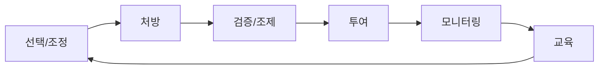
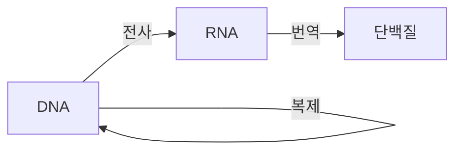
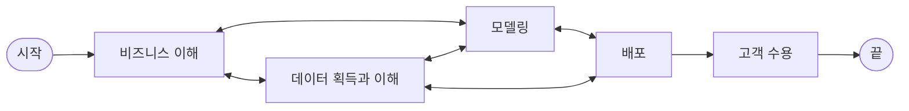

# 2장 — 융합정보학 개론

[레포지토리 안내](../../README.ko.md) | [English](Concepts_Lecture.md) | [한국어](Concepts_Lecture.ko.md)

> **최종 수정일:** 2026-11-19

> **학습 목표:**
> 1. 융합정보학의 범위와 응용을 이해할 수 있다
> 2. 데이터 사이언스의 핵심 워크플로와 방법론을 식별할 수 있다
> 3. 학제 간 연구에서 정보학의 역할을 설명할 수 있다
> 4. 모수와 통계량, 표본오차와 표본편향, 변동계수를 구분하고 계산할 수 있다
> 5. 데이터셋의 유형과 표 형식 데이터의 구조를 설명하고 R로 기술 통계 함수를 구현할 수 있다
> 6. 데이터 사이언스 작업 흐름의 단계를 설명할 수 있다

---

## 목차

- [1. 융합정보학의 개요](#1-융합정보학의-개요)
  - [1.1 정보학의 정의](#11-정보학의-정의)
  - [1.2 융합(다학제적) 정보학](#12-융합다학제적-정보학)
  - [1.3 데이터 사이언스의 핵심 요소](#13-데이터-사이언스의-핵심-요소)
  - [1.4 데이터 사이언티스트](#14-데이터-사이언티스트)
  - [1.5 정보학의 전망과 구성 요소](#15-정보학의-전망과-구성-요소)
- [2. 통계학의 기본 개념](#2-통계학의-기본-개념)
  - [2.1 모집단과 표본](#21-모집단과-표본)
  - [2.2 중심 경향성 측도](#22-중심-경향성-측도)
  - [2.3 산포도 측도](#23-산포도-측도)
  - [2.4 표본추출 개념](#24-표본추출-개념)
  - [2.5 기술 통계와 추론 통계](#25-기술-통계와-추론-통계)
  - [2.6 변수와 확률변수](#26-변수와-확률변수)
  - [2.7 모수와 통계량](#27-모수와-통계량)
  - [2.8 대표성과 표본추출 방법](#28-대표성과-표본추출-방법)
  - [2.9 중앙값, 평균, 변동계수의 계산](#29-중앙값-평균-변동계수의-계산)
  - [2.10 R로 기술 통계 함수 구현하기](#210-r로-기술-통계-함수-구현하기)
- [3. 데이터 유형과 구조](#3-데이터-유형과-구조)
  - [3.1 정형 데이터 vs 비정형 데이터](#31-정형-데이터-vs-비정형-데이터)
  - [3.2 확률변수 (Random Variable, R.V.)](#32-확률변수-random-variable-rv)
  - [3.3 자유도 문제 (Freedom Degree Issue)](#33-자유도-문제-freedom-degree-issue)
  - [3.4 표 작성 (Tabulation)](#34-표-작성-tabulation)
  - [3.5 특성 추출, 선택, 엔지니어링](#35-특성-추출-선택-엔지니어링)
  - [3.6 데이터셋의 유형](#36-데이터셋의-유형)
  - [3.7 데이터셋의 구성: 객체와 속성](#37-데이터셋의-구성-객체와-속성)
  - [3.8 비정형 데이터의 특징과 빅데이터](#38-비정형-데이터의-특징과-빅데이터)
  - [3.9 데이터셋 유형별 예](#39-데이터셋-유형별-예)
  - [3.10 표 형식 데이터와 관계형 모델](#310-표-형식-데이터와-관계형-모델)
  - [3.11 구조의 스펙트럼과 표를 넘어선 데이터 모델](#311-구조의-스펙트럼과-표를-넘어선-데이터-모델)
- [4. 지도 학습 vs 비지도 학습 개요](#4-지도-학습-vs-비지도-학습-개요)
  - [4.1 비교표](#41-비교표)
  - [4.2 지도 학습에서의 클래스 (레이블)](#42-지도-학습에서의-클래스-레이블)
  - [4.3 분류와 회귀 (지도 학습)](#43-분류와-회귀-지도-학습)
  - [4.4 군집화와 연관 (비지도 학습)](#44-군집화와-연관-비지도-학습)
  - [4.5 인공지능과 학습의 정의](#45-인공지능과-학습의-정의)
- [5. 정보학의 응용](#5-정보학의-응용)
  - [5.1 의료정보학 (Medical Informatics)](#51-의료정보학-medical-informatics)
  - [5.2 약학정보학 (Pharmacoinformatics)](#52-약학정보학-pharmacoinformatics)
  - [5.3 의료정보학의 구성 요소와 진단 지원](#53-의료정보학의-구성-요소와-진단-지원)
  - [5.4 약물 사용 과정의 정보 기술](#54-약물-사용-과정의-정보-기술)
  - [5.5 생물정보학 (Bioinformatics)](#55-생물정보학-bioinformatics)
- [6. 데이터 사이언스의 응용과 작업 흐름](#6-데이터-사이언스의-응용과-작업-흐름)
  - [6.1 응용 사례와 필요한 데이터](#61-응용-사례와-필요한-데이터)
  - [6.2 데이터 사이언스의 작업 흐름](#62-데이터-사이언스의-작업-흐름)
  - [6.3 문제 정의와 실험 설계](#63-문제-정의와-실험-설계)
  - [6.4 흔한 실수](#64-흔한-실수)
- [요약](#요약)
- [점검 문제](#점검-문제)
- [참고 문헌](#참고-문헌)

---

<br>

## 1. 융합정보학의 개요

### 1.1 정보학의 정의

- 정보학은 데이터 사이언스와 같은 분야이고 기계학습과도 대부분 겹친다(**Data Science == Informatics =~ Machine Learning**).
- 정보학(Informatics)은 방대한 양의 데이터로부터 (자동적 또는 계산적으로) 지식을 관리, 조작, 추출, 해석하는 분야이다.
- 데이터 사이언스(Data Science)와 정보학(Informatics)은 데이터 기반 문제를 해결하는 것을 목표로 하는 **다학제적(multidisciplinary)** 학문 분야이다.

이 용어는 독일어 *Informatik* (Karl Steinbuch, 1957)에서 유래한다. *Informatik*은 영어의 Computer Science에 해당하며, 프랑스어 *Informatique* (Philippe Dreyfus, 1962)와 영어 *Informatics* (Walter F. Bauer, 1962)도 같은 개념을 가리킨다 [1].

- 데이터 사이언스의 원칙은 크기와 관계없이 **모든 데이터**에 적용된다.

### 1.2 융합(다학제적) 정보학

융합정보학(Convergence Informatics)은 다양한 분야의 지식을 통합하여 데이터에서 의미 있는 통찰을 추출한다. 융합정보학은 다음 분야를 기반으로 한다.

- 데이터 사이언스의 개념
- R 프로그래밍
- 정보학을 위한 통계적 기술
- 정보학을 위한 계산 기술
- 생물정보학(Bioinformatics)과 계산생물학(Computational Biology): 컴퓨터과학, 화학, 공학, 수학, 생화학, 통계학, 생물학이 교차하는 다학제 분야이다.
- 정보학의 응용

### 1.3 데이터 사이언스의 핵심 요소

데이터 사이언스는 통계학, 패턴 인식, 기계학습, AI, 데이터 마이닝, 데이터베이스, 시각화 등 여러 분야 간의 상호작용을 포함한다. 과학, 공학, 경제학, 정치학, 금융, 교육 분야의 이론과 기법이 모두 하나로 결합된다.

### 1.4 데이터 사이언티스트

- 데이터 사이언티스트는 정보학자(Informatician)와 같은 말이며(**Data Scientist == Informatician**), "The Sexiest Job of the 21st Century"(21세기의 가장 섹시한 직업)라고 불린다.
- 데이터 사이언티스트는 빅데이터가 제시하는 기회를 실현하는 핵심 인물이다. 이들은 데이터에 구조를 부여하고, 매력적인 패턴을 발견하며, 제품, 프로세스, 의사결정에 대해 조언한다.

**데이터 사이언티스트(정보학자)에게 필요한 역량:**

| 분류 | 세부 내용 |
|------|-----------|
| 수학 (Mathematics) | 수학 및 응용수학 |
| 통계학 (Statistics) | 통계학 및 응용통계학 |
| 프로그래밍 (Programming) | C/C++, Java, R, Python, Julia, SQL, JavaScript |
| 데이터 마이닝 (Data Mining) | 패턴 발견 및 지식 추출 |
| 데이터베이스 (Database) | 데이터베이스 저장 및 관리 |
| 기계학습 (Machine Learning) | 기계학습 및 발견 |

*표 1. 데이터 사이언티스트에게 필요한 역량*

> **핵심:** 융합정보학은 본질적으로 다학제적(multidisciplinary)이며, 수학, 통계학, 탄탄한 프로그래밍, 데이터 마이닝, 데이터베이스 관리, 기계학습 역량을 요구한다. 모든 학문 분야가 서로 상호작용한다.

### 1.5 정보학의 전망과 구성 요소

정보학(데이터 사이언스)은 과거와 현재뿐 아니라 앞으로도 중요한 분야로 꼽힌다. 신기술에 대한 기대가 시간에 따라 변하는 모습을 그린 **기대 곡선(hype cycle)** 은 기술 촉발(innovation trigger), 부풀려진 기대의 정점(peak of inflated expectations), 환멸의 골짜기(trough of disillusionment), 계몽의 비탈(slope of enlightenment), 생산성의 고원(plateau of productivity)의 다섯 단계로 이루어진다. 2014년 7월 기준으로 그린 기대 곡선에서 데이터 사이언스, 처방적 분석(prescriptive analytics), 빅데이터 같은 데이터 관련 기술은 기대의 정점 부근에 놓여 있다. 기대 곡선은 기대가 정점을 지나 환멸의 골짜기를 거친 기술도 실제 가치가 확인되면 생산성의 고원에 이른다는 것을 나타낸다.

데이터 사이언스의 구성 요소를 그림으로 나타내면, 데이터 사이언스를 가운데에 두고 통계학, 패턴 인식, 기계학습, 신경 컴퓨팅(neurocomputing), 인공지능, 데이터 마이닝, 데이터베이스와 데이터 처리, 시각화가 서로 겹치는 영역으로 둘러싼다. 데이터베이스에서 지식을 발견하는 과정(KDD, knowledge discovery in databases)은 데이터 마이닝과 데이터베이스가 겹치는 곳에 놓인다. 그 바깥에는 도메인 지식, 문제 해결, 탐구심(inquisitiveness), 의사소통, 결과 발표, 비즈니스 분석, 비즈니스 전략이 하나의 순환을 이룬다. 기술 영역만으로는 목표에 이를 수 없고, 문제를 이해하고 결과를 전달하는 능력이 함께 필요하다는 뜻이다.

1.4절의 표 1처럼 필요한 역량이 많아서 좋은 정보학자가 되기는 쉽지 않다. 그러나 모든 학문 분야가 서로 연결되어 있으므로, 한 분야에서 쌓은 지식은 다른 분야를 배우는 발판이 된다. 처음부터 모든 역량을 갖추려 하기보다 프로그래밍과 기초 통계부터 차례로 쌓아 가는 것이 현실적인 경로이다.

---

<br>

## 2. 통계학의 기본 개념

### 2.1 모집단과 표본

| 용어 | 정의 |
|------|------|
| **모집단 (Population)** | 주어진 주제와 관련된 모든 가능한 사건과 결과의 합집합 |
| **표본 (Sample)** | 분석에 사용되는 모집단의 부분집합 |

*표 2. 모집단과 표본의 정의*

### 2.2 중심 경향성 측도

- **평균(Average, Arithmetic Mean):** 모든 값의 합을 값의 개수로 나눈 값이다.
- **중앙값(Median):** 데이터를 크기순으로 정렬했을 때 가운데에 위치하는 값이다. 값의 개수가 짝수이면 가운데 두 값의 평균을 중앙값으로 한다.

### 2.3 산포도 측도

- **범위(Range):** 최댓값과 최솟값의 차이이다.

- **모분산(Population Variance):** 크기가 N인 모집단의 평균을 $\mu$라 하면 다음과 같다.

  $$V = \sigma^2 = \frac{\sum_{i=1}^{N} (x_i - \mu)^2}{N}$$

- **표본분산(Sample Variance):** 크기가 n인 표본의 평균을 $\bar{x}$라 하면 다음과 같다.

  $$V_s = \sigma_s^2 = \frac{\sum_{i=1}^{n} (x_i - \bar{x})^2}{n - 1}$$

- **표준편차(Standard Deviation):** 분산의 제곱근이다.

> **핵심:** 표본분산은 표본 크기 n 대신 **n - 1**로 나눈다(베셀 보정, Bessel's correction). 표본평균 $\bar{x}$를 중심으로 구한 편차 제곱합은 모평균 $\mu$를 중심으로 구한 것보다 작아지는 경향이 있어 n으로 나누면 모분산을 체계적으로 과소 추정하며, n - 1로 나누면 모분산의 비편향 추정량(unbiased estimator)을 얻는다.

> **[확률및통계]** 추정량의 기댓값이 추정하려는 모수와 같으면 그 추정량을 비편향 추정량이라 한다. 확률및통계의 추정 이론은 n - 1로 나눈 표본분산의 기댓값이 모분산 $\sigma^2$과 같음을 보이며, 이것이 표본분산의 분모를 n - 1로 두는 근거이다.

### 2.4 표본추출 개념

| 개념 | 설명 |
|------|------|
| **대표성 (Representativeness)** | 표본이 모집단의 특성을 얼마나 잘 반영하는지의 정도 |
| **표본오차 (Sampling Error)** | 표본을 추출할 때 자연스럽게 발생하는 무작위 변동 |
| **표본편향 (Sampling Bias)** | 표본이 모집단을 잘못 대표하게 만드는 체계적 왜곡 |

*표 3. 표본추출의 주요 개념*

> **핵심:** 표본오차(Sampling Error)는 피할 수 없는 무작위 변동이며 표본 크기를 늘리면 줄어든다. 표본편향(Sampling Bias)은 데이터 수집 과정의 체계적 문제로, 표본을 늘려도 사라지지 않으므로 식별하고 교정해야 한다.

### 2.5 기술 통계와 추론 통계

**통계학(statistics)** 은 자료를 수집하고 정리하고 요약하며, 그 결과로 불확실성 아래에서 판단하는 방법을 다루는 학문이다. 통계학은 목적에 따라 두 갈래로 나뉜다.

- **기술 통계(descriptive statistics):** 모은 자료 자체를 정리하고 요약한다. 평균, 중앙값, 표준편차 같은 수치와 히스토그램, 상자 그림 같은 그림이 여기에 속한다(1장의 6.4절).
- **추론 통계(inferential statistics):** 전체의 일부(표본)만 관측하고, 그로부터 전체(모집단)에 관한 정보를 끌어낸다. 모수의 추정과 가설 검정이 여기에 속한다.

> **용어 정의:** **추론 통계(inferential statistics)** 는 모집단의 일부인 표본을 관측하여 모집단 전체의 특성을 추정하거나 가설을 검정하는 통계학의 분야이다.

통계학의 방법을 생물학과 보건 의료의 자료에 적용하는 분야를 **생물통계학(biostatistics)** 이라 한다. 분자생물학 실험, 공중보건 조사, 임상 시험 같은 생물의학 자료는 개체마다 변동이 크고, 표본 수에 비해 측정하는 변수가 많은 경우가 흔하다(예: 환자 수십 명에서 유전자 수만 개를 측정). 이런 자료의 특성 때문에 정보학에서는 기술 통계로 자료를 이해하는 단계와 추론 통계로 결론을 일반화하는 단계를 모두 거친다.

### 2.6 변수와 확률변수

공중보건에서 통계를 쓰는 주된 목적 하나는 건강 결과에 영향을 주는 요인을 찾고 그 영향이 어떻게 나타나는지 설명하는 것이다. 모든 사람이 같은 값을 가지는 양은 변수가 아니라 상수이며, 상수로는 그 요인에 따라 건강 결과가 어떻게 달라지는지 볼 수 없다. 그래서 분석의 대상은 개체마다 값이 달라지는 **변수(variable)** 이다.

변수의 값이 일정한 확률 규칙에 따라 관측되면 그 변수를 **확률변수(random variable)** 라 한다. 확률과 통계에서 확률변수는 값이 무작위 현상의 결과에 따라 정해지는 변수로 설명되며, 임의 양(random quantity), 우연 변수(aleatory variable), 확률적 변수(stochastic variable)라고도 부른다. 예를 들어 성인 한 명을 무작위로 골라 잰 수축기 혈압은 누구를 고르느냐에 따라 값이 달라지는 확률변수이다. 3.2절은 같은 개념을 실제 현상을 수치로 대응시키는 함수라는 관점에서 설명한다.

변수는 값의 성질에 따라 **양적 변수(quantitative variable)** 와 **질적 변수(qualitative variable)** 로 나뉜다. 양적 변수는 키, 혈압처럼 연속적이고 수치적인 특성을, 질적 변수는 혈액형, 흡연 여부처럼 범주적이고 수치가 아닌 특성을 나타낸다. 이 구분은 3.2절의 연속형과 범주형에 대응한다.

### 2.7 모수와 통계량

모집단의 분포를 정하는 상수를 **모수(parameter)** 라 한다. 예를 들어 모집단이 평균 $`\mu`$, 분산 $`\sigma^2`$인 정규분포 $`N(\mu, \sigma^2)`$를 따른다고 가정하면, $`\mu`$와 $`\sigma^2`$가 그 모형의 통계적 성질을 정하는 모수이다. 모수는 보통 알 수 없으므로 표본으로 추정한다.

> **용어 정의:** **통계량(statistic)** 은 표본의 관측값 $`Y_1, \ldots, Y_n`$만으로 계산하는 값으로, 모수를 추정하는 데 쓰며 표본이 바뀌면 값도 바뀐다.

크기가 n인 표본 $`Y_1, \ldots, Y_n`$에서 표본평균과 표본분산은 다음과 같다.

```math
\bar{Y} = \frac{1}{n} \sum_{i=1}^{n} Y_i, \qquad S^2 = \frac{1}{n - 1} \sum_{i=1}^{n} \left( Y_i - \bar{Y} \right)^2
```

| 구분 | 모집단 (모수) | 표본 (통계량) |
|:--|:--|:--|
| 크기 | N | n |
| 평균 | $`\mu`$ | $`\bar{Y}`$ (또는 $`\bar{x}`$) |
| 분산 | $`\sigma^2`$ | $`S^2`$ |
| 표준편차 | $`\sigma`$ | $`S`$ |
| 성질 | 고정된 상수이지만 대개 알 수 없음 | 계산할 수 있지만 표본마다 달라지는 확률변수 |

*표 4. 모수와 통계량의 표기*

모수는 하나로 고정되어 있지만 통계량은 표본마다 달라진다는 점을 R로 확인할 수 있다. 다음 코드는 평균 173, 표준편차 2인 정규 모집단에서 크기 10인 표본과 크기 1,000인 표본을 각각 세 번 뽑아 표본평균을 구한다.

```r
set.seed(10)
round(replicate(3, mean(rnorm(10, mean = 173, sd = 2))), 2)
round(replicate(3, mean(rnorm(1000, mean = 173, sd = 2))), 2)
```

```text
[1] 172.02 173.74 171.17
[1] 173.04 173.02 172.95
```

`replicate(3, ...)`는 괄호 안의 식을 세 번 실행해 결과를 벡터로 모은다. 크기 10인 표본의 평균은 171.17부터 173.74까지 모평균 173에서 2 가까이 벗어나지만, 크기 1,000인 표본의 평균은 172.95부터 173.04까지 모평균에 매우 가깝다. 표본을 키우면 표본오차가 줄어든다는 2.4절의 설명을 수치로 보여 주는 결과이다.

### 2.8 대표성과 표본추출 방법

**모집단(population)** 은 연구의 대상 전체이며 개별 원소로 이루어지고, 원소의 수는 유한할 수도 무한할 수도 있다. 가능하면 모집단의 모든 원소를 조사하겠지만, 비용과 시간 때문에 대개는 모집단에서 표본을 뽑는다. 이때 표본을 어떻게 고르는지가 결과의 신뢰성을 좌우하며, 그 기준이 2.4절의 대표성이다.

대표성은 그림 한 점에 비유하면 이해하기 쉽다. 모나리자 그림 전체를 모집단이라 하면, 그림의 픽셀 가운데 1%를 무작위로 뽑아 다시 그린 그림은 형체만 겨우 알아볼 수 있고, 3%, 5%, 10%로 늘릴수록 얼굴이 점점 또렷해진다. 무작위로 뽑은 표본이 클수록 모집단을 더 정확히 보여 주는 것이다. 한편 그림을 비슷한 영역(얼굴, 손, 배경)으로 나누고 영역마다 일정 비율을 뽑는 방식으로 2.5%만 뽑아도 무작위로 뽑은 3%보다 또렷한 그림이 된다. 반대로 표본을 뽑는 방식 자체가 한쪽으로 치우치면 그림이 일그러지며, 이 일그러짐은 뽑는 양을 늘려도 사라지지 않는다. 이것이 표본편향이다.

- **단순 무작위 추출(simple random sampling):** 모집단의 모든 원소가 같은 확률로 뽑히게 한다.
- **층화 추출(stratified sampling):** 모집단을 성질이 비슷한 원소끼리 묶은 층(stratum)으로 나누고, 층마다 무작위로 뽑는다. 층 안의 변동이 작을수록 같은 표본 크기에서 단순 무작위 추출보다 정밀하며, 모든 층이 표본에 반드시 들어가므로 작은 집단도 빠지지 않는다.

> **용어 정의:** **층화 추출(stratified sampling)** 은 모집단을 서로 겹치지 않는 동질적인 층으로 나눈 뒤, 각 층에서 따로 무작위 표본을 뽑아 합치는 표본추출 방법이다.

표본을 관측하는 과정에서 생기는 오차의 원인으로는 다음이 있다.

- 목표 모집단과 실제로 표본을 뽑은 집단의 차이
- 설문지의 결함(모호하거나 유도하는 문항)
- 무응답
- 조사원의 오류
- 조사 대상에서의 누락
- 데이터 처리 과정의 오류

> **참고:** **표본오차와 비표본오차.** 표본조사 이론에서는 표본을 모집단 대신 관측했다는 사실 때문에 생기는 무작위 변동만을 좁은 뜻의 표본오차라 하고, 설문지 결함, 무응답, 조사원 오류, 처리 오류처럼 조사 과정에서 생기는 오차를 비표본오차(non-sampling error)로 따로 구분한다. 비표본오차는 표본을 키워도 줄지 않으며, 체계적으로 한쪽에 치우치면 표본편향의 원인이 된다.

### 2.9 중앙값, 평균, 변동계수의 계산

자료 5, 13, 9, 7, 1, 9, 2, 9, 11의 중심과 퍼짐을 차례로 구한다.

1. **중앙값:** 오름차순으로 정렬하면 1, 2, 5, 7, 9, 9, 9, 11, 13이다. 값이 9개(홀수)이므로 가운데인 5번째 값 9가 중앙값이다.
2. **평균:** 합은 $`5 + 13 + 9 + 7 + 1 + 9 + 2 + 9 + 11 = 66`$이므로 평균은 $`66/9 \approx 7.33`$이다. 작은 값 1과 2가 평균을 끌어내려 평균이 중앙값보다 작다. 평균은 모든 값의 크기를 반영하므로 극단값에 민감하고, 중앙값은 순서만 쓰므로 극단값에 강건하다.
3. **범위:** 최댓값과 최솟값의 차이는 $`13 - 1 = 12`$이다.
4. **분산:** 제곱의 합은 $`\sum x_i^2 = 612`$이고 편차 제곱합은 $`\sum (x_i - \bar{x})^2 = 612 - 9 \times (66/9)^2 = 612 - 484 = 128`$이다. 이 9개를 표본으로 보면 표본분산은 $`128/8 = 16`$, 표본표준편차는 4이다. 모집단 전체로 보면 모분산은 $`128/9 \approx 14.22`$이다.

**변동계수(coefficient of variation, CV)** 는 표준편차를 평균으로 나눈 값이다.

```math
CV = \frac{\sigma}{\bar{x}}
```

> **용어 정의:** **변동계수(coefficient of variation)** 는 표준편차를 평균으로 나누어 단위를 없앤 상대적 산포도로, 단위나 크기가 다른 변수의 퍼짐을 비교할 때 쓴다.

위 자료의 변동계수는 $`4/7.33 \approx 0.545`$이다. 표준편차는 원래 자료와 같은 단위를 가지므로, 단위가 다른 두 변수의 표준편차를 직접 비교하면 의미가 없다. 다음 코드는 성인 50명의 키(cm)와 몸무게(kg)를 모의로 생성해 두 지표를 비교한다.

```r
cv <- function(v) sd(v) / mean(v)
set.seed(3)
ht <- rnorm(50, 170, 6); wt <- rnorm(50, 65, 9)
round(c(sd_height = sd(ht), sd_weight = sd(wt)), 2)
round(c(cv_height = cv(ht), cv_weight = cv(wt)), 3)
```

```text
sd_height sd_weight
     5.34      7.41
cv_height cv_weight
    0.031     0.113
```

표준편차는 5.34 cm와 7.41 kg으로 단위가 달라 어느 쪽이 더 퍼져 있는지 말할 수 없다. 변동계수는 키 0.031(평균의 약 3%), 몸무게 0.113(평균의 약 11%)으로, 몸무게가 자기 평균에 비해 훨씬 크게 흩어져 있다. 변동계수는 평균이 양수이고 0이 "없음"을 뜻하는 비율 척도의 변수에서만 의미가 있다. 평균이 0에 가까우면 값이 폭증하고, 섭씨온도처럼 0이 임의로 정해진 변수에는 쓰지 않는다.

### 2.10 R로 기술 통계 함수 구현하기

R의 `mean()` 함수로 평균을 구할 수 있다는 것은 알지만, 그 함수도 누군가가 식을 코드로 옮겨 만든 것이다. 데이터 사이언스에서 컴퓨터과학 배경을 가진 사람에게 기본으로 요구되는 능력은 이런 함수와 패키지를 직접 구현하는 것이다. 평균의 식 $`\bar{x} = \sum_{i=1}^{n} x_i / n`$을 그대로 함수로 옮기면 다음과 같다.

```r
set.seed(1)
Height <- rnorm(300, 173, 2)
ConvergenceInformatics_mean <- function(inputNumericValue) {
  message("Let's calculate mean() by using my own function entitled ConvergenceInformatics_mean()")
  n <- length(inputNumericValue)
  sumx <- sum(inputNumericValue)
  output <- sumx / n
  return(output)
}
ConvergenceInformatics_mean(Height)
mean(Height)
```

```text
Let's calculate mean() by using my own function entitled ConvergenceInformatics_mean()
[1] 173.0672
[1] 173.0672
```

- 둘째 줄은 평균 173, 표준편차 2인 정규분포에서 키 300개를 생성한다.
- `function(inputNumericValue)`는 인수 하나를 받는 함수를 만들고, 그 함수를 `ConvergenceInformatics_mean`이라는 이름에 할당한다. 중괄호 안이 함수의 본문이다.
- `message()`는 진행 상황을 알리는 문장을 출력한다. 계산 결과와 따로 표시되는 안내 문구이다.
- 본문은 원소 개수 `n`과 합 `sumx`를 구하고, 둘을 나눈 값을 `output`에 담아 `return()`으로 돌려준다.
- 마지막 두 줄은 직접 만든 함수와 내장 함수 `mean()`의 결과가 173.0672로 같음을 확인한다.

이미 만들어진 함수의 코드는 괄호 없이 함수 이름만 입력하면 볼 수 있다. 그러나 많은 함수는 패키지 안에 구현되어 있어 조금 다른 방법이 필요하다.

```r
mean
head(deparse(base:::mean.default), 3)
```

```text
function (x, ...)
UseMethod("mean")
<bytecode: 0x1318671f0>
<environment: namespace:base>
[1] "function (x, trim = 0, na.rm = FALSE, ...) "
[2] "{"
[3] "    if (!is.numeric(x) && !is.complex(x) && !is.logical(x)) {"
```

`mean`을 입력하면 본문이 `UseMethod("mean")` 한 줄뿐이다. `mean()`은 1장의 5.6절에서 본 제네릭 함수이므로, 실제 계산은 인수의 클래스에 맞는 메서드가 한다. 수치 벡터에 쓰는 메서드는 `base` 패키지의 `mean.default`이며, `패키지이름:::함수이름` 형식으로 그 코드를 꺼낼 수 있다(`ConvergenceInformatics_mean`처럼 직접 만든 함수는 이름만 입력해도 전체 코드가 나온다). `<bytecode: ...>`의 주소는 세션마다 다르다.

표본표준편차의 식 $`s = \sqrt{s^2}`$, $`s^2 = \sum_{i=1}^{n} (x_i - \bar{x})^2 / (n - 1)`$을 함수로 옮기고, 결과를 내장 함수 `sd()`와 비교한다. 자료는 $`N(5, 4)`$, 즉 평균 5, 분산 4(표준편차 2)인 정규분포에서 생성한 값 300개이다.

```r
CI_sd <- function(x) {
  n <- length(x)
  xbar <- sum(x) / n
  s2 <- sum((x - xbar)^2) / (n - 1)
  sqrt(s2)
}
set.seed(2)
A <- rnorm(300, mean = 5, sd = 2)
CI_sd(A)
sd(A)
```

```text
[1] 2.137064
[1] 2.137064
```

`(x - xbar)^2`는 벡터화된 연산이므로 300개의 편차 제곱을 한 번에 구하고, `sum()`이 이를 더한다. 함수 본문의 마지막 식 `sqrt(s2)`의 값이 반환값이 되므로 `return()`을 생략할 수 있다. `rnorm()`의 셋째 인수는 분산이 아니라 표준편차이므로, $`N(5, 4)`$에서 생성하려면 `sd = 2`를 준다.

분산과 표준편차를 함께 돌려주려면 1장의 2.7절의 리스트를 반환값으로 쓴다. 다음 함수는 입력 벡터의 앞뒤 다섯 값을 보여 준 뒤 두 값을 계산해 리스트로 돌려준다.

```r
CI_var_sd <- function(x) {
  cat("***This function is to calculate Variance Standard Deviation***\n")
  cat("[First and last 5 values of input vector]\n")
  cat("First five values:\n"); print(head(x, 5))
  cat("Last five values:\n"); print(tail(x, 5))
  n <- length(x)
  s2 <- sum((x - mean(x))^2) / (n - 1)
  s <- sqrt(s2)
  cat("Estimated Sample Variance:", s2, "\n")
  cat("Estimated Sample SD:", s, "\n")
  return(list(variance = s2, sd = s))
}
res <- CI_var_sd(A)
res$variance; var(A)
```

```text
***This function is to calculate Variance Standard Deviation***
[First and last 5 values of input vector]
First five values:
[1] 3.206171 5.369698 8.175691 2.739249 4.839496
Last five values:
[1] 4.2918135 5.8372968 0.8051289 2.2590396 3.6310743
Estimated Sample Variance: 4.567043
Estimated Sample SD: 2.137064
[1] 4.567043
[1] 4.567043
```

`cat()`은 인수를 공백으로 이어 그대로 출력하고, `"\n"`은 줄을 바꾼다. 함수는 이름이 붙은 원소 `variance`와 `sd`를 가진 리스트를 돌려주므로, 호출한 쪽에서 `res$variance`, `res$sd`로 각각 꺼내 쓴다. R 함수는 값을 하나만 돌려줄 수 있으므로 결과가 여럿이면 이처럼 리스트로 묶는다. 표본분산 4.567이 모분산 4와 조금 다른 것은 2.7절의 표본오차 때문이다.

---

<br>

## 3. 데이터 유형과 구조

### 3.1 정형 데이터 vs 비정형 데이터

| 유형 | 설명 | 예시 |
|------|------|------|
| **정형 데이터 (Structured)** | 고정된 스키마로 행과 열에 구조화된 데이터 | 데이터베이스, 스프레드시트, CSV 파일 |
| **비정형 데이터 (Unstructured)** | 사전 정의된 데이터 모델이 없는 데이터 | 이메일, 이미지, 비디오, 웹 페이지, 센서 출력 |

*표 5. 정형 데이터와 비정형 데이터*

기계학습 분석에 바로 쓸 수 있는 **정형 데이터의 요건**은 다음과 같다.
- 정의된 행과 열의 수로 관계를 표현하는 **스키마(schema)** 가 있어야 한다.
- 모든 값이 **실수(real number)** 여야 한다. 성별 같은 범주형 값도 숫자로 부호화하여 저장한다.
- **행렬(matrix)** 형태여야 한다.
- 행의 수와 열의 수가 정해진 스키마, 행렬 형태의 데이터, 모두 실수인 값을 함께 갖추면 정형 데이터이다.

비정형 데이터는 전통적인 데이터베이스에 저장되지 않으며, 내부 구조가 있을 수 있지만 관계형 모델에 맞지 않고, 전 세계 데이터의 약 **85%** 를 차지하는 것으로 추정된다.

비정형 데이터의 체계적 활용은 **빅데이터(Big Data)** 의 핵심 과제이다.

### 3.2 확률변수 (Random Variable, R.V.)

확률변수(Random Variable)는 실제 현상을 데이터 값으로 매핑하는 함수이다. 주요 유형은 연속형과 범주형 두 가지이며, 이산형은 문맥에 따라 둘 중 하나로 해석된다.

| 유형 | 다른 명칭 | 목적 | 예시 |
|------|-----------|------|------|
| **연속형 (Continuous)** (수치형) | 양적 (Quantitative) | 계산 (수량) | 키, 몸무게, 온도 |
| **범주형 (Categorical)** (특성형) | 질적 (Qualitative) | 분류 (등급) | 성별, 색상, 결혼 여부 |
| **이산형 (Discrete)** | (셀 수 있는 값의 부분집합) | 문맥에 따라 다름 | 정수 값 카운트, 만 나이 |

*표 6. 확률변수의 유형*

- **연속형 속성(Continuous attributes)** 은 실수 값을 가지며 셀 수 없이 무한히 많은 값을 취할 수 있고, 보통 부동소수점 변수로 표현한다.
- **이산형 속성(Discrete attributes)** 은 유한하거나 셀 수 있는 무한 집합의 값을 가지며 보통 정수로 표현한다. 이진 속성(binary attributes)은 이산형 속성의 특수한 형태이다.
- **이산형과 범주형의 미묘한 차이:** 정수형 데이터를 어떻게 해석할지는 분석 목적에 따라 달라진다.
  - **연속형 해석:** 숫자를 계산을 위한 수량으로 취급한다(예: 평균을 계산하거나 회귀 분석에 쓰는 나이 22세).
  - **범주형 해석:** 숫자를 분류를 위한 등급으로 취급한다(예: 그룹 빈도를 집계하거나 그룹 간 특성을 비교하기 위한 20대 그룹).
- 연속형 변수는 **구간화(binning)** 를 통해 이산형 변수로 변환할 수 있다.
- 변수가 연속형인지 범주형인지는 **매핑 과정**에 의해 결정된다.

### 3.3 자유도 문제 (Freedom Degree Issue)

데이터를 범주화할 때는 같은 값을 갖는 표본이 **최소 3개** 있어야 의미 있는 범주로 본다는 경험 규칙(rule of thumb)을 따른다. 이는 통계 분석의 자유도(degrees of freedom)와 관련된다.

**예시:** 다음 표는 같은 나이를 세 가지 해상도로 표현한다. Age_Cont는 소수점 아래까지 나타낸 나이, Age_Cate1은 정수 부분만 남긴 나이, Age_Cate2는 10년 단위의 연령대이다.

| 대상 | Age_Cont | Age_Cate1 | Age_Cate2 |
|------|----------|-----------|-----------|
| Student_1 | 10.41412 | 10 | 10s |
| Student_2 | 20.5213 | 20 | 20s |
| Student_3 | 22.2139123 | 22 | 20s |
| Student_4 | 23.1213 | 23 | 20s |

*표 7. 해상도가 다른 세 나이 변수의 값*

| | Age_Cont | Age_Cate1 | Age_Cate2 |
|---|----------|-----------|-----------|
| **해상도** | 최고 | | 최저 |
| **유형** | 연속형 | 연속형 / 범주형 | 범주형 |

*표 8. 나이 변수별 해상도와 유형*

- (10, 10, 10, 20, 22, 23, 23, ...) 같은 값을 가진 Age_Cate1은 일부 값이 3개 이상의 동일 값 표본을 갖기 때문에 **범주형 확률변수(Categorical R.V.)** 로 취급될 가능성이 높다.
- 자유도 요건은 범주화가 통계적으로 유의미한지를 결정한다.

### 3.4 표 작성 (Tabulation)

표 작성(Tabulation)은 분류된 데이터를 행과 열에 체계적으로 배열하여 **비정형 데이터를 정형 데이터로 변환**하는 과정이다.

데이터를 모으는 과정은 목적에 따라 두 가지로 나뉜다. **데이터 사이언스 과정**은 실험 설계, 모집단 결정, 변수 설정, 값 획득의 순서로 진행하여, 필요한 변수를 먼저 정해 두고 그 값을 모은다. **데이터 마이닝 과정**은 실험 설계와 모집단 결정 뒤에 값을 먼저 얻고, 사전 검사로 얻은 값에서 쓸 만한 정보를 골라낸다. 두 과정에 나오는 단계는 다음과 같다.

1. **실험 설계:** 연구 질문을 정의한다.
2. **모집단 결정:** 대상 모집단을 식별한다.
3. **변수 설정과 값 획득:** 특성을 정의하고 측정값을 수집한다.
4. **사전 검사(Prescreening):** 데이터를 정제하고 검증한다(데이터 마이닝).

### 3.5 특성 추출, 선택, 엔지니어링

- **특성 추출(Feature Extraction):** 표로 정리된 원시 데이터에서 의미 있는 변수를 도출한다.
- **특성 선택(Feature Selection):** 분석에 유용한 정보를 제공하지 않는 저신호 변수를 제거한다.
- **특성 엔지니어링(Feature Engineering):** 모델 성능을 높이기 위해 도메인과 관련된 유익한 속성을 도입한다.

**특성 추출 예시:** 12개 표본이 각각 AAAAA, BB, CCC, D 중 하나의 비정형 문자 시퀀스일 때, 각 표본의 전체 문자 수와 문자별 개수를 세어 표로 정리하면 다음과 같다.

| Sample | # of Alphabets | # of A | # of B | # of C | # of D |
|--------|---------------|--------|--------|--------|--------|
| S1 | 5 | 5 | 0 | 0 | 0 |
| S2 | 5 | 5 | 0 | 0 | 0 |
| S3 | 5 | 5 | 0 | 0 | 0 |
| S4 | 2 | 0 | 2 | 0 | 0 |
| S5 | 2 | 0 | 2 | 0 | 0 |
| S6 | 2 | 0 | 2 | 0 | 0 |
| S7 | 3 | 0 | 0 | 3 | 0 |
| S8 | 3 | 0 | 0 | 3 | 0 |
| S9 | 3 | 0 | 0 | 3 | 0 |
| S10 | 1 | 0 | 0 | 0 | 1 |
| S11 | 1 | 0 | 0 | 0 | 1 |
| S12 | 1 | 0 | 0 | 0 | 1 |

*표 9. 문자 시퀀스에서 추출한 특성*

이 기법은 이미지, 비디오, 시퀀스 및 기타 비정형 형식에 적용할 수 있다.

### 3.6 데이터셋의 유형

**레코드 기반 데이터:**
- **데이터 행렬(Data Matrix):** $n \times p$ 행렬이며, n개의 행은 객체를, p개의 열은 속성을 나타낸다.
- **문서 데이터(Document Data):** 각 문서를 용어 벡터(단어 빈도)로 표현한다.
- **트랜잭션 데이터(Transaction Data):** 각 레코드가 항목의 집합이다(장바구니 데이터).

**그래프 기반 데이터:**
- 월드 와이드 웹, 분자 구조, 지도 데이터가 이에 속한다.

**순서 데이터:**
- 공간 데이터, 시간 데이터, 순차 데이터, 유전 및 유전체 시퀀스 데이터가 이에 속한다.

> **핵심:** 정형 데이터는 확률변수의 집합이고, 데이터는 변수의 조합이다. 분석의 질은 근본적으로 원시 데이터를 얼마나 잘 표로 만들고 구조화하는지에 달려 있다.

### 3.7 데이터셋의 구성: 객체와 속성

**데이터셋(dataset)** 은 속성으로 기술된 객체들의 집합이다. 객체는 분야에 따라 인스턴스(instance), 개체(individual), 표본(sample), 대상(subject), 레코드라고도 부르며 표의 한 행에 해당한다. 속성(attribute)은 특성(characteristic), 특징(feature), 변수(variable)라고도 부르며 표의 한 열에 해당한다. 표 10은 납세자 10명의 기록이다.

| Tid | Refund | Marital Status | Taxable Income | Cheat |
|:--|:--|:--|:--|:--|
| 1 | Yes | Single | 125K | No |
| 2 | No | Married | 100K | No |
| 3 | No | Single | 70K | No |
| 4 | Yes | Married | 120K | No |
| 5 | No | Divorced | 95K | Yes |
| 6 | No | Married | 60K | No |
| 7 | Yes | Divorced | 220K | No |
| 8 | No | Single | 85K | Yes |
| 9 | No | Married | 75K | No |
| 10 | No | Single | 90K | Yes |

*표 10. 객체(행)와 속성(열)으로 이루어진 데이터셋의 예*

각 행(Tid 1~10)이 객체이고, 환급 여부(Refund), 혼인 상태(Marital Status), 과세 소득(Taxable Income), 탈세 여부(Cheat)가 속성이다. Refund와 Cheat는 두 값만 갖는 이진 범주형, Marital Status는 세 값을 갖는 범주형, Taxable Income은 연속형 속성이다. Cheat를 예측하려는 목적이라면 Cheat가 4.2절의 클래스가 된다.

속성은 특정 객체의 성질이다. 사람을 객체로 보면 눈의 크기(mm), 눈 색, 피부색, 키(cm), 안경 착용 여부, 성별, 나이, 손가락 길이(cm) 등이 속성이 될 수 있다. 이 가운데 눈의 크기, 키, 손가락 길이는 연속형이고, 눈 색, 피부색, 안경 착용 여부, 성별은 범주형이며, 나이는 3.2절처럼 분석 목적에 따라 어느 쪽으로든 해석된다. 각 속성은 실제 현상을 실수로 대응시키는 확률변수이므로, 정형 데이터는 확률변수의 집합이고 데이터는 변수의 조합이다.

### 3.8 비정형 데이터의 특징과 빅데이터

3.1절의 비정형 데이터는 다음과 같은 특징을 가진다.

- 전통적인 데이터베이스나 데이터 웨어하우스에 들어 있지 않다.
- 내부 구조가 있을 수 있지만 관계형 데이터 모델(3.10절)에 맞지 않는다.
- 사람과 기계가 모두 만들어 낸다.
- 대개 텍스트와 멀티미디어 콘텐츠, 기계 사이의 통신 기록이다.

예로는 개인 메시지(전자 우편, 메신저, 짧은 게시글, 채팅), 업무 문서(보고서, 발표 자료, 설문 응답), 웹 콘텐츠(웹 페이지, 블로그, 위키, 오디오 파일, 사진, 동영상), 센서 출력(위성 영상, 위치 정보, 스캐너 거래 기록)이 있다.

전 세계에서 만들어지는 데이터의 양은 해마다 빠르게 늘어 제타바이트(zettabyte) 단위로 헤아린다. 1 제타바이트는 국제단위계의 접두어로 $`10^{21}`$바이트이며, 이 데이터의 약 85%가 비정형 데이터로 추정된다(3.1절). **빅데이터(big data)** 는 크기, 복잡성, 변동성이 매우 커서 기존의 수집, 저장, 처리, 분석, 관리 능력으로는 그 가치를 충분히 실현할 수 없는 데이터 집합을 가리킨다. 비정형 데이터를 체계적으로 활용하는 것이 빅데이터의 과제이며, 그 첫 단계가 3.4절의 표 작성이다.

### 3.9 데이터셋 유형별 예

3.6절의 세 가지 데이터셋 유형을 예와 함께 자세히 보면 다음과 같다.

**레코드 기반 데이터**는 레코드의 모음이며, 각 레코드는 고정된 속성 집합으로 이루어진다.

- **데이터 행렬:** 선형대수학에서 온 용어이다. 객체가 고정된 개수의 수치 속성으로 이루어지면 각 객체를 다차원 공간의 한 점으로 볼 수 있고, 자료 전체는 n개의 행이 객체, p개의 열이 속성인 $`n \times p`$ 행렬이 된다. 1장의 `iris`는 꽃 150송이를 4차원 공간의 점으로 나타낸 $`150 \times 4`$ 데이터 행렬(종을 뺀 경우)이다. 3장의 거리와 4장의 PCA가 모두 이 관점에서 출발한다.
- **문서 데이터:** 각 문서를 용어 벡터로 나타낸다. 벡터의 각 성분은 용어 하나에 대응하고, 값은 그 용어가 문서에 나온 횟수이다(표 11).
- **트랜잭션 데이터:** 특수한 레코드로, 각 레코드(트랜잭션)가 항목의 집합이다. 장바구니 데이터라고도 하며, 레코드마다 항목의 개수가 다르다(표 12).

| 문서 | gene | protein | cell | mutation | cancer |
|:--|--:|--:|--:|--:|--:|
| 논문 1 | 5 | 2 | 0 | 3 | 4 |
| 논문 2 | 0 | 6 | 4 | 0 | 0 |
| 논문 3 | 3 | 0 | 1 | 5 | 6 |

*표 11. 논문 초록을 용어 빈도 벡터로 나타낸 문서 데이터*

| TID | 항목 |
|:--|:--|
| 1 | 빵, 우유 |
| 2 | 빵, 기저귀, 맥주, 달걀 |
| 3 | 우유, 기저귀, 맥주, 콜라 |
| 4 | 빵, 우유, 기저귀, 맥주 |

*표 12. 장바구니 형태의 트랜잭션 데이터*

**그래프 기반 데이터**는 그래프 $`G = (V, E)`$로 나타내며, $`V`$는 정점(노드)의 집합, $`E`$는 간선(호, 링크)의 집합이다. 월드 와이드 웹은 HTML 문서를 정점, 하이퍼링크를 간선으로 하는 그래프이고, 분자 구조는 원자를 정점, 화학 결합을 간선으로 하는 그래프이며, 사회 연결망은 사람을 정점, 관계를 간선으로 하는 그래프이다. 단백질 사이의 상호작용 연결망도 같은 형태이다.

**순서 데이터**는 원소의 순서 자체가 정보인 데이터이다.

- **트랜잭션의 순서열:** 한 고객의 구매 기록을 시간순으로 늘어놓은 것처럼, 트랜잭션에 순서가 붙는다.
- **유전 및 유전체 서열 데이터:** DNA 서열은 A, C, G, T의 네 문자로 이루어진 문자열이며, 같은 문자 구성이라도 순서가 다르면 다른 정보를 담는다.
- **시계열 데이터:** 한 환자의 혈당을 한 시간마다 잰 기록처럼 시간 축을 따라 관측한 값이다.
- **시공간 데이터:** 월별 해수면 온도를 지도의 격자마다 기록한 것처럼 위치와 시간이 함께 붙는다.

### 3.10 표 형식 데이터와 관계형 모델

정형 데이터의 대표 형태는 표이다. **표(table)** 는 행과 열의 모음이며, 각 행에는 인덱스가 있고 각 열에는 이름이 있다. 칸 하나는 (인덱스, 이름)의 쌍으로 지정되며, 칸에는 값이 있을 수도 없을 수도 있다(결측). 스프레드시트의 표를 파일로 저장하는 가장 흔한 형식은 CSV이며, 한 줄이 한 행이고 열의 값을 쉼표로 구분한다(1장의 2.9절).

**데이터 모델(data model)** 은 데이터를 기술하는 개념의 모음이고, **스키마(schema)** 는 주어진 데이터 모델로 특정 데이터 모음을 기술한 것이다. 예를 들어 "데이터는 이름 붙은 열을 가진 표로 이루어진다"는 것이 데이터 모델이고, "학생 표는 학번, 이름, 로그인, 나이, 평점의 다섯 열을 가진다"는 것이 스키마이다.

> **용어 정의:** **스키마(schema)** 는 특정 데이터 모델을 써서 한 데이터 모음의 구조(표의 이름, 열의 이름과 유형, 제약)를 기술한 것이다.

가장 널리 쓰이는 데이터 모델은 E. F. Codd가 제안한 **관계형 모델(relational model)** 이다. Codd는 이 업적으로 1981년 튜링상을 받았다. 관계형 모델은 MySQL, PostgreSQL, Oracle, DB2, SQL Server 같은 데이터베이스 관리 시스템의 기반이며, 기초 연구는 IBM의 System R과 UC Berkeley의 Ingres 시스템에서 이루어졌다. 그 뒤 Berkeley의 POSTGRES 연구로 객체 지향 개념이 합쳐졌고, 반정형 데이터인 XML도 지원하게 되었다. 표 13은 학생 관계의 인스턴스이고, 그 아래는 이 관계의 스키마를 정의하는 SQL 문이다.

| sid | name | login | age | gpa |
|:--|:--|:--|--:|--:|
| 53666 | Jones | jones@cs | 18 | 3.4 |
| 53688 | Smith | smith@eecs | 18 | 3.2 |
| 53650 | Smith | smith@math | 19 | 3.8 |

*표 13. 학생 관계의 인스턴스*

```sql
CREATE TABLE Students
  (sid CHAR(20),
   name CHAR(20),
   login CHAR(10),
   age INTEGER,
   gpa FLOAT)
```

`CREATE TABLE`은 표 이름 `Students`와 다섯 열의 이름과 유형을 정한다. 문자열 열은 최대 길이를 정한 `CHAR`, 나이는 정수 `INTEGER`, 평점은 실수 `FLOAT`이다. 표의 행을 넣기 전에 스키마를 먼저 정하는 이 방식을 스키마 우선(schema-first)이라 한다(3.11절).

프로그래밍 언어도 같은 표 형식 데이터 모델을 제공한다. Python의 pandas에서 `DataFrame`은 `Series` 객체의 사전(dict)이며, 각 `Series`가 한 열이다. `Series`는 이름 붙은 순서 있는 사전으로, 사전의 키가 인덱스이고, NumPy의 `ndarray` 위에 만들어져 값으로 NumPy의 어떤 자료형이든 담을 수 있다. R의 `data.frame`은 벡터 객체의 리스트이며 각 벡터가 한 열이고, 가능한 벡터 유형은 1장의 2.4절의 logical, integer, double, complex, character, raw이다. 두 경우 모두 데이터는 메모리에 저장되고 연산은 각 언어의 셸에서 수행한다.

표 형식 데이터에 쓰는 연산은 다음과 같다.

- **통합(join), 변환(transform), 정제(clean), 대체(impute):** 여러 표를 합치고, 값을 바꾸고, 잘못된 값을 고치고, 결측값을 채운다.
- **집계(aggregate):** 합, 개수, 평균, 최댓값, 최솟값을 구한다.
- **정렬(sort)** 과 **피벗(pivot):** 행의 순서를 바꾸고, 긴 표와 넓은 표 사이를 바꾼다.
- **관계 연산:** 합집합, 교집합, 차집합, 카티션 곱(CROSS JOIN), 선택(select, filter), 투영(project), 조인(자연 조인 또는 INNER JOIN, 세타 조인, 세미 조인 등), 이름 바꾸기(rename).

R에서 선택과 투영, 집계, 자연 조인을 해 보면 다음과 같다.

```r
students <- data.frame(sid = c(53666, 53688, 53650),
                       name = c("Jones", "Smith", "Smith"),
                       age = c(18, 18, 19), gpa = c(3.4, 3.2, 3.8))
subset(students, age == 18, select = c(name, gpa))
aggregate(gpa ~ age, data = students, FUN = mean)
enroll <- data.frame(sid = c(53666, 53650, 53650),
                     course = c("CI101", "CI101", "BIO200"))
merge(students[, c("sid", "name")], enroll, by = "sid")
```

```text
   name gpa
1 Jones 3.4
2 Smith 3.2
  age gpa
1  18 3.3
2  19 3.8
    sid  name course
1 53650 Smith  CI101
2 53650 Smith BIO200
3 53666 Jones  CI101
```

- `subset()`은 나이가 18인 행만 고르고(선택), 이름과 평점 열만 남긴다(투영).
- `aggregate(gpa ~ age, ...)`는 나이별로 평점의 평균을 구한다. 18세 두 명의 평균은 $`(3.4 + 3.2)/2 = 3.3`$이다.
- `merge()`는 두 표에서 `sid`가 같은 행끼리 이어 붙이는 자연 조인이다. 수강 기록이 없는 53688은 결과에서 빠지고, 두 과목을 듣는 53650은 두 행이 된다.

### 3.11 구조의 스펙트럼과 표를 넘어선 데이터 모델

데이터는 구조가 정해지는 시점에 따라 세 가지로 나눌 수 있다(표 14).

| 구분 | 스키마 | 예 |
|:--|:--|:--|
| 정형 (structured) | 스키마 우선 (schema-first) | 관계형 데이터베이스, 형식이 정해진 메시지 |
| 반정형 (semi-structured) | 스키마 나중 (schema-later) | 문서, XML, 태그가 붙은 텍스트와 미디어 |
| 비정형 (unstructured) | 스키마 없음 (schema-never) | 일반 텍스트, 미디어 |

*표 14. 구조의 스펙트럼*

데이터베이스 연구자 Jim Gray는 사람들이 데이터베이스라는 말로 뜻하는 것은 결국 데이터가 스스로를 설명하고 스키마를 가져야 한다는 것이라고 보았다. 표는 이 요구를 가장 단순하게 충족하지만, 구조가 너무 제한적이고 경직되었다는 비판도 받는다. 이런 비판에서 관계형 모델이 아닌 데이터 모델을 쓰는 NoSQL 데이터베이스들이 나왔다. Cassandra와 HBase는 열 패밀리(column family), CouchDB, MongoDB, Riak은 문서(document), Neo4j는 그래프, Redis는 컬렉션, Scalaris, Tokyo Cabinet, Voldemort는 키와 값(key/value) 모델을 쓴다.

그래도 구조는 중요하다. 구조가 있으면 컴퓨터가 사용자를 도와 데이터를 조작하고 관리할 수 있기 때문이다. 시간(과 비용)에 따른 기능을 비교하면, 비정형(스키마 없음) 데이터는 처음부터 끝까지 기능이 낮게 머무르고, 정형(스키마 우선) 데이터는 스키마를 만드는 초기 비용을 치른 뒤에야 높은 기능을 얻는다. 데이터스페이스(dataspace)는 그 사이에서 필요할 때마다 구조를 조금씩 더하는(pay-as-you-go) 방식으로 기능을 점진적으로 높인다. 비정형 데이터를 분석하려면 결국 어느 시점에 구조를 부여해야 하며, 3.4절의 표 작성이 그 작업이다.

---

<br>

## 4. 지도 학습 vs 비지도 학습 개요

### 4.1 비교표

| 측면 | 지도 학습 (Supervised Learning) | 비지도 학습 (Unsupervised Learning) |
|------|--------------------------------|-------------------------------------|
| **정답** | 사전 정의된 정답(레이블)이 존재 | 사전 정의된 정답 없음 |
| **정답의 수** | 단일 정답 | 다수의 가능한 정답 |
| **목표** | 예측 (데이터와 클래스 간의 관계 발견) | 패턴 인식 (데이터 구조 또는 숨겨진 패턴 발견) |
| **예시 작업** | 분류(Classification), 회귀(Regression) | 군집화(Clustering), 연관(Association) |
| **레이블** | 있음 | 없음 |
| **다양한 결과** | 아니오 | 예 |
| **학습 데이터** | 레이블 있음 (입력-출력 쌍) | 레이블 없음 (입력만) |

*표 15. 지도 학습과 비지도 학습의 비교*

**지도 학습(SL)과 비지도 학습(USL)에 필요한 데이터 요건:**

| | 정형 데이터 | 사전 정의된 정답 (= 클래스) |
|---|---|---|
| **지도 학습** | 필요 | 필요 |
| **비지도 학습** | 필요 | 불필요 |

*표 16. 학습 방식별 데이터 요건*

지도 학습과 비지도 학습 모두 **정형 데이터**가 필요하며, 차이점은 **사전 정의된 정답(클래스)** 의 존재 여부이다.

### 4.2 지도 학습에서의 클래스 (레이블)

클래스(class)는 **레이블(label), 정답(exact answer), 실측값(ground truth), 반응 변수(response variable), 결과 변수(outcome variable), 종속 변수(dependent variable)** 등 여러 이름으로 불린다. 중요한 것은 **어떤 확률변수든 클래스가 될 수 있다**는 점이며, 무엇을 클래스로 삼을지는 분석 목적에 따라 달라진다.

**정형 데이터에서 클래스의 존재 여부**

항상 존재하는 것은 아니다. 클래스의 존재 여부는 **분석의 목적**에 의해 결정된다. 클래스의 존재는 데이터 자체의 고유한 속성이 아니라, 사용자가 무엇을 원하는지에 달려 있다. 특정 변수를 예측하거나 추론하고 싶을 때 해당 변수를 클래스로 지정한다(지도 학습 수행). 예측 없이 구조나 패턴을 발견하고 싶을 때는 클래스 없이 작업한다(비지도 학습 수행).

### 4.3 분류와 회귀 (지도 학습)

- **분류(Classification):** 알려진 레이블이 있는 학습 집합을 바탕으로 새로운 관측치를 사전 정의된 범주에 할당한다. 즉, 새로운 데이터의 **범주형 레이블**을 예측한다.
- **회귀(Regression):** 새로운 데이터의 **연속형 값**을 예측한다(예: 데이터 포인트를 지나는 직선 적합).

### 4.4 군집화와 연관 (비지도 학습)

비지도 학습은 종종 **인간 두뇌의 지능**에 비유되며, **패턴 인식**이 그 핵심 메커니즘이다. 인간은 주변 세계를 자연스럽게 그룹화하고 분류하는 타고난 능력이 있다. 0과 1만 처리하는 컴퓨터는 이를 복제하기 위해 특별히 설계된 함수가 필요하다.

- **군집화(Clustering, 클래스 발견):** 객체 간의 **유사성**을 기반으로 객체를 부분집합(클러스터)으로 묶는다. 데이터의 구조를 발견하고 시각화하며, 이상치 식별 같은 품질 관리 과정에도 활용한다.
- **연관(Association):** 레이블 없는 데이터에서 서로 다른 항목 간의 관계를 찾는다(예: 함께 자주 구매되는 항목을 찾는 장바구니 분석).

> **핵심:** 지도 학습(Supervised Learning)은 레이블이 있는 데이터를 필요로 하며 특정 결과를 예측하는 것이 목표이고(분류는 범주형, 회귀는 연속형), 비지도 학습(Unsupervised Learning)은 레이블 없는 데이터로 숨겨진 패턴이나 그룹을 발견하는 것이 목표이다(군집화는 그룹, 연관은 관계).

### 4.5 인공지능과 학습의 정의

**인공지능(artificial intelligence)** 은 사람이 할 수 있지만 기계가 아직 하지 못하는 일을 기계가 사람처럼 행동하게 하여 수행하게 하는 것이며, 나아가 사람과 기계가 함께 이전에는 어느 쪽도 하지 못하던 일을 해내게 하는 것이다. 이 정의에 따르면 인공지능의 범위는 고정되어 있지 않고, 기계가 새로운 일을 할 수 있게 될 때마다 넓어진다.

**학습(learning)** 은 기계가 주어진 입력을 알맞은 출력으로 바꾸는 규칙이나 함수를 스스로 만들거나 고치는 과정이다. 지도 학습은 입력과 정답의 쌍에서 입력을 정답으로 보내는 함수를 학습하고, 비지도 학습은 정답 없이 입력만으로 데이터의 구조를 나타내는 규칙(군집, 연관)을 학습한다. 규칙을 사람이 직접 적어 넣는 프로그램과 달리, 학습하는 프로그램은 데이터가 바뀌면 규칙도 바뀐다.

---

<br>

## 5. 정보학의 응용

정보학은 대부분의 학문 분야와 산업에 적용된다. 응용 범위는 무궁무진하지만, 이 장에서는 정보학의 개념이 가장 잘 확립된 생의학(bio-medical science) 분야를 중심으로 살펴본다.

### 5.1 의료정보학 (Medical Informatics)

의료정보학(Medical Informatics)은 컴퓨터, 통신, 정보 기술 및 시스템을 의학의 모든 분야(의료, 의학 교육, 의학 연구)에 적용하는 분야이다. 의학과 생물학, 수학, 정보 시스템, 컴퓨터과학, 통계학, 의사결정 분석, 경제학과 보건 정책, 심리학을 통합하는 **다학제적(multidisciplinary)** 분야이다.

**전자의무기록 (Electronic Medical Records, EMR):**

EMR 시스템의 주요 이점은 다음과 같다.
- **접근성(Access):** 기록의 가용성이 높고, 기록을 전송하고 검색하기 쉽다.
- **가독성(Legibility):** 명확하고 읽기 쉬운 데이터로 추출하고 보고할 수 있다.
- **속도(Speed):** 종이 기록보다 데이터를 **4배 빠르게** 찾을 수 있다.
- **데이터 입력 감소:** 데이터를 재사용하므로 중복 입력이 사라진다.
- 구조를 부여하므로 기록을 더 잘 정리할 수 있다.
- 저장 공간을 효율적으로 쓴다.
- 집계를 포함한 여러 관점의 보기(view)를 제공한다.
- 데이터를 입력할 때 철자 검사 같은 자동 검사를 한다.
- 데이터 품질과 표준 준수를 강화한다.
- 자동화된 의사결정 지원을 제공한다.
- 통계 분석과 연구에 활용할 수 있다.

**진단을 위한 의사결정 지원:**

계산 도구가 디지털 영상, 방사선 정보 시스템, 환자 모니터링 시스템을 활용하여 임상의의 진단적 추론 및 치료 계획을 지원한다.

**가상 현실과 컴퓨터 시뮬레이션:**

**다빈치 수술 시스템 (da Vinci Surgical System)** (Intuitive Surgical, 캘리포니아, 미국)이 대표적인 예이다. 외과의는 수술 부위를 3D로 보여 주는 제어 콘솔에 앉아 로봇 수술 도구를 조종하여 수술한다.

### 5.2 약학정보학 (Pharmacoinformatics)

약학정보학(Pharmacoinformatics)은 정보학의 원리를 약학에 적용하는 분야이다. 이 역시 대표적인 **다학제적(multidisciplinary)** 분야이다.

- **신약 개발(Drug discovery)** 은 화학, 생물학, 약학, 제약 기술 등 여러 과학 및 기술 분야의 통합과 정보 기술의 광범위한 활용이 필요하다.
- 핵심 아이디어는 다양한 정보학 분야(생물정보학, 화학정보학, 면역정보학 등)를 하나의 플랫폼으로 통합하여 끊김 없는 신약 개발 과정을 구현하는 것이다.
- "Pharmacoinformatics"라는 용어가 처음 언급된 것은 **1993년**이다.
- **ASHP의 정보학에서 약사의 역할에 관한 성명(ASHP Statement on the Pharmacist's Role in Informatics):** 이 성명은 약학 정보학(pharmacy informatics)을 건강 결과를 개선하기 위해 약물 사용 과정에서 데이터, 정보, 지식, 기술, 자동화를 사용하고 통합하는 것으로 정의한다.

**약물 사용 과정 주기 (Medication Use Process Cycle):** 약물 사용 과정은 선택과 조정, 처방, 검증과 조제, 투여, 모니터링, 교육의 여섯 단계를 거친 뒤 다시 처음으로 돌아가는 주기이다.



*그림 1. 약물 사용 과정 주기*

| 단계 | 담당자 |
|------|--------|
| **약물 선택 / 조정 (Medication Selection / Reconciliation)** | 처방자, 간호사, 약사 |
| **처방 (Ordering)** | 처방자, 간호사, 약사 |
| **검증 / 조제 (Verification / Dispensing)** | 약사, 기술자 |
| **투여 (Administration)** | 간호사, 보호자, 환자 |
| **모니터링 (Monitoring)** | 처방자, 간호사, 약사, 환자, 보호자, 의료 시스템 |
| **교육 (Education)** | 처방자, 간호사, 약사, 환자, 보호자 |

*표 17. 약물 사용 과정의 단계별 담당자*

> **핵심:** 의료정보학(Medical Informatics)과 약학정보학(Pharmacoinformatics)은 정보학이 도메인 특화 분야와 융합되어 EMR 시스템부터 자동화된 신약 개발 파이프라인까지 데이터 기반 의사결정을 위한 강력한 도구를 만들어 내는 방식을 보여 준다.

### 5.3 의료정보학의 구성 요소와 진단 지원

의료정보학은 의료 제공자와 환자 사이에서 정보가 흐르는 여러 층으로 이루어진다.

- **자료 획득과 저장:** 전자의무기록, 검사 정보 시스템(laboratory IS), 영상의학 정보 시스템(radiological IS), 디지털 영상, 환자 모니터링 시스템, 의료 기기와의 기계 인터페이스가 자료를 모은다.
- **자료의 조직과 검색:** 모은 자료를 정리해 저장하고, 표준 용어 체계(vocabulary)로 같은 개념을 같은 이름으로 기록하며, 필요할 때 찾아 쓴다.
- **임상 판단:** 진단적 추론(진단과 해석)과 치료 계획(치료와 관리)이 자료를 바탕으로 이루어진다.
- **의사결정 지원:** 자동 알림과 경고 시스템, 전자 처방과 처방 입력, 약물 정보 시스템과 자동 조제가 임상 판단을 돕는다.
- **지식 자원:** 데이터베이스, 검색 엔진, 근거 기반 출판물, 요약된 임상 근거 모음이 최신 의학 지식을 제공한다.
- **국가 기반:** 국가 보건 데이터뱅크, 국가 보건 코드, 국가 보건 카드, 원격 의료가 개별 병원을 넘어 정보를 연결한다.

진단을 위한 의사결정 지원의 한 예는 의료 영상의 자동 분할이다. 복부 CT 영상에서 간, 신장, 췌장, 부신, 대장, 십이지장, 대정맥 같은 장기를 자동으로 찾아 색으로 구분하거나, 흉부 CT에서 폐의 혈관과 기도를 3차원으로 재구성하면 의사가 병변의 위치와 범위를 더 빠르고 정확하게 판단할 수 있다. 이런 도구는 진단을 대신하지 않고, 임상의의 진단적 추론과 치료 계획을 지원한다.

### 5.4 약물 사용 과정의 정보 기술

5.2절의 약물 사용 과정은 처방 평가와 입력, 검토와 승인 및 협의, 조제와 배분, 투약 확인과 투여 및 기록, 다시 처방 평가로 이어지는 흐름으로도 볼 수 있으며, 단계마다 정보 기술이 쓰인다.

- **처방 단계:** 전산화된 처방 입력(CPOE, computerized prescriber order entry), 임상 의사결정 지원, 약국 정보 시스템, 자동화된 업무 흐름 관리
- **조제와 배분 단계:** 재고 관리 시스템, 단위 용량 포장기와 바코드 포장기, 무균 조제 자동화 장비, 자동 카트와 봉투 충전 시스템, 자동 약품 보관함, 자동 회전식 보관대
- **투여 단계:** 병상 투약 확인(bedside medication verification), 전자 투약 기록(eMAR), 지능형 수액 펌프, 전자의무기록
- **평가 단계:** 임상 사건 보고, 약물 안전 보고, 감시(surveillance), 결과 피드백 순환, 임상 중재 기록, 대시보드와 시스템 보고

이 기술들을 하나로 묶는 것이 **전자건강기록(EHR, electronic health record)** 이다. 약학정보학은 약학 실무, 자동화와 기술, 임상 의사결정 지원이 겹치는 영역이며, EHR이 이 세 영역을 순환하며 연결한다. EHR은 한 기관의 진료 기록인 EMR(5.1절)을 기관 사이에서 공유할 수 있게 넓힌 기록으로, 약학정보학의 핵심 기반이다.

### 5.5 생물정보학 (Bioinformatics)

**생물정보학(bioinformatics)** 은 생물학적 데이터를 이해하기 위한 방법과 소프트웨어 도구를 개발하는 학제 간 분야이다. 생물학, 컴퓨터과학, 정보공학, 수학, 통계학을 결합해 생물학적 데이터를 분석하고 해석하며, 의료정보학과 약학정보학처럼 대표적인 다학제 분야이다.

> **용어 정의:** **생물정보학(bioinformatics)** 은 생물학, 컴퓨터과학, 수학, 통계학을 결합하여 생물학적 데이터를 저장, 분석, 해석하는 방법과 소프트웨어 도구를 개발하는 학제 간 분야이다.

생물정보학은 생물학적 질문을 수학적, 통계적 기법으로 컴퓨터 안에서 분석하는 **인 실리코(in silico)** 분석에 쓰여 왔다. 이 말은 두 가지 뜻으로 쓰인다. 하나는 컴퓨터 프로그래밍을 방법론의 일부로 쓰는 생물학 연구 전체를 아우르는 말이고, 다른 하나는 특히 유전체학에서 반복해서 쓰는 특정한 분석 파이프라인을 가리키는 말이다. 관점에 따라 정의도 달라진다. 생물학자의 관점에서는 컴퓨터과학과 통계학의 알고리즘과 기법을 분자생물학의 문제를 푸는 데 쓰는 것이고, 컴퓨터과학자나 통계학자의 관점에서는 생물학적 데이터의 관리와 분석에 정보 기술을 적용하는 것이다.

생물정보학의 세부 분야와 응용은 분자 의학, 유전자 치료, 신약 개발(5.2절의 약학정보학과 겹친다), 미생물 유전체 응용, 작물 개량, 가축 육종, 법의학 분석, 생명공학, 진화 분석, 인간 질병 연구 등으로 넓다. 생물정보학은 생각할 수 있는 모든 생물에 관한 분자 수준 연구에서 이미 필수이다. 같은 기술은 유익한 연구와 해로운 목적에 모두 쓰일 수 있는 이중 용도(dual-use) 기술이기도 하다. 생물정보학의 분석 도구가 생물무기 개발에 악용될 가능성은 생물보안(biosecurity)의 주요 관심사이며, 연구 윤리와 규제의 대상이 된다.

생물학적 데이터는 크게 DNA, RNA, 단백질의 세 종류로 나눌 수 있으며, 셋은 **중심 원리(central dogma)** 로 연결된다. DNA는 복제(replication)로 자신을 복사하고, 전사(transcription)로 RNA를 만들며, RNA는 번역(translation)으로 단백질을 만든다(그림 2).



*그림 2. 생물학의 중심 원리*

세 종류의 데이터는 성질이 서로 다르다. DNA 데이터는 A, C, G, T 네 염기의 서열이고(3.9절의 순서 데이터), RNA 데이터는 서열 정보와 함께 유전자마다 얼마나 많이 전사되었는지를 나타내는 발현량 정보로 자주 쓰이며(1장의 5.8절의 유전자 발현 행렬), 단백질 데이터는 20가지 아미노산의 서열과 3차원 구조, 기능 정보를 담는다. 생물정보학은 현재 정보학의 응용 가운데 가장 대표적인 분야이며, 생물정보학의 방법을 익히면 다른 분야로 넓히기도 쉽다. 생물학과 의학의 기초 지식과 서열 분석은 7장과 8장에서 다룬다.

---

<br>

## 6. 데이터 사이언스의 응용과 작업 흐름

### 6.1 응용 사례와 필요한 데이터

데이터 사이언스와 기계학습은 이미 많은 서비스의 바탕이 되었다. 표 18은 대표적인 응용과 각 응용이 요구하는 데이터의 형태를 정리한 것이다.

| 응용 | 입력 데이터의 형태 | 데이터셋 유형 (3.6절) |
|:--|:--|:--|
| 자연어 처리와 음성 인식 | 텍스트, 음성 신호 | 순서 데이터 |
| 추천 시스템 (동영상, 음악) | 사용자와 항목의 시청, 평가 기록 | 레코드(트랜잭션), 그래프 |
| 챗봇 | 질문과 응답의 대화 쌍 | 순서 데이터 |
| 흑백 사진의 색 복원 | 흑백 영상과 컬러 영상의 쌍 | 레코드(픽셀 행렬) |
| 저화질 사진의 해상도 복원 | 저해상도 영상과 고해상도 영상의 쌍 | 레코드(픽셀 행렬) |
| 동작 감지 | 동영상의 연속 프레임 | 순서 데이터(시공간) |
| 영상 설명문 생성 | 영상과 설명 문장의 쌍 | 레코드와 순서 데이터의 결합 |
| 새 영상 생성 | 영상 모음 | 레코드(픽셀 행렬) |
| 자율 주행 자동차 | 카메라, 거리 센서, 위치 신호의 연속 기록 | 순서 데이터(시공간) |
| 로봇 공학 | 센서 입력과 동작의 연속 기록 | 순서 데이터 |

*표 18. 데이터 사이언스의 응용과 필요한 데이터*

이런 시스템을 지금 당장 만들라고 하면 막막하지만, 출발점은 같다. 이 응용에 어떤 종류의 데이터가 필요한지 생각하고, 그 데이터의 구조를 그려 보며, 정확한 수식은 몰라도 어떤 종류의 기법(분류, 회귀, 군집화, 차원 축소 등)이 필요한지 아는 것이다. 이 장의 데이터 구조와 3~6장의 기법이 그 기초이다.

### 6.2 데이터 사이언스의 작업 흐름

데이터 사이언스의 일반적인 작업 흐름은 데이터를 계단처럼 한 단계씩 올려 가는 과정이다.

1. **추출(extract):** 원천 시스템에서 데이터를 꺼낸다.
2. **수신(receive):** 꺼낸 데이터를 분석 환경으로 받는다.
3. **적재(load):** 받은 데이터를 저장소에 넣는다.
4. **분석(analytics):** 데이터를 분석해 패턴과 모형을 얻는다.
5. **통합(consolidate):** 여러 분석 결과를 하나로 묶는다.
6. **작업 산출물(work products):** 결과를 모형, 표, 그림 같은 산출물로 만든다.
7. **보고(reporting):** 의사결정자에게 결과를 전달한다.

이 흐름은 한 방향으로만 진행되지 않는다. 새로운 데이터, 새로운 통찰, 인력과 자원의 변화, 요구사항의 변경, 오류(bug) 같은 교란이 생기면 앞 단계로 돌아가 다시 진행한다.

작업 흐름을 순환으로 그리면 데이터 사이언스 생애주기(data science lifecycle)가 된다(그림 3). 시작하면 먼저 비즈니스 이해 단계에서 풀 문제와 성공 기준을 정한다. 데이터 획득과 이해 단계는 데이터 원천(내부 서버와 클라우드, 데이터베이스와 파일), 파이프라인(스트리밍과 일괄 처리, 낮은 빈도와 높은 빈도), 환경(내부 서버와 클라우드, 데이터베이스와 데이터 레이크, 데이터의 크기)을 정하고, 데이터를 다듬고 탐색하고 정제한다(정형과 비정형, 데이터 검증, 시각화). 모델링 단계는 특성 공학(변환, 구간화, 시간, 텍스트, 영상 특성, 특성 선택), 모형 훈련(알고리즘, 앙상블, 매개변수 조정, 재훈련, 모형 관리), 모형 평가(교차 검증, 모형 보고, A/B 검정)로 이루어진다. 배포 단계에서는 모형을 저장소, 웹 서비스, 지능형 응용 프로그램으로 내보내고 점수 계산과 성능 감시를 계속한다. 고객이 결과를 받아들이면 한 주기가 끝난다. 각 단계 사이의 화살표는 양방향이어서, 모델링 중에 데이터가 부족하면 데이터 단계로, 데이터를 보다가 문제 정의가 바뀌면 비즈니스 이해 단계로 돌아간다.



*그림 3. 데이터 사이언스 생애주기*

### 6.3 문제 정의와 실험 설계

모든 작업의 첫 단계는 **문제 정의**이다. 문제는 다른 사람과의 대화에서, 스스로 고민하는 과정에서, 다른 사람이 불편하다고 말하는 것에서, 뉴스 기사에서, 또는 전혀 관계없는 활동을 하는 중에 떠오를 수 있다. 일상에서 무언가 불편하다고 느끼면 기록해 두는 습관이 유용하다. 그 불편함이 미래 핵심 기술의 질문이 될 수 있기 때문이다.

둘째 단계는 데이터를 얻기 위한 **실험 설계**이다. 데이터를 모으기 전에 목적에 맞게 어떤 데이터를 모아야 하는지 생각해야 한다.

- 어떤 특성이 중요한가
- 특성을 몇 개 잴 것인가
- 표본을 몇 개 모을 것인가
- 특성의 유형(연속형, 범주형)은 무엇인가
- 대상 개체(모집단)는 누구인가

이 질문들은 서로 연결되어 있다. 대상 개체를 정하는 것은 2.8절의 대표성 문제이고, 특성의 유형은 3.2절의 확률변수 해석을 정하며, 특성의 수에 비해 표본이 적으면 4장의 차원의 저주가 생긴다. 실험 설계는 통계학과의 실험계획법 과목에서 체계적으로 다룬다.

### 6.4 흔한 실수

1. **모수와 통계량의 혼동:** 표본평균 $`\bar{x}`$는 모평균 $`\mu`$의 추정값일 뿐이며, 표본이 바뀌면 값도 바뀐다(2.7절).
2. **표본분산을 n으로 나누기:** 표본으로 모분산을 추정할 때는 n - 1로 나눈다. R의 `var()`와 `sd()`도 n - 1을 쓴다(2.3절).
3. **표본을 키우면 편향도 사라진다는 생각:** 표본 크기는 표본오차만 줄이며, 표본편향과 비표본오차는 수집 방법을 바꿔야 줄어든다(2.4절, 2.8절).
4. **단위가 다른 변수의 표준편차를 비교하기:** 단위가 다르면 변동계수로 비교하고, 평균이 0에 가까운 변수에는 변동계수를 쓰지 않는다(2.9절).
5. **범주 코드를 수량으로 다루기:** 혈액형을 1, 2, 3, 4로 부호화했다고 해서 그 평균에 의미가 생기지 않는다. 숫자의 해석은 매핑 과정이 정한다(3.2절).
6. **스키마 없이 표 만들기:** 열의 이름과 유형, 결측의 표시 방법을 먼저 정하지 않으면 같은 정보가 열마다 다른 형식으로 기록된다(3.10절).
7. **평균만 보고 분포를 판단하기:** 2.9절의 자료처럼 평균과 중앙값이 다르면 분포가 한쪽으로 치우친 것이므로, 중앙값과 그림을 함께 본다.

---

<br>

## 요약

| 개념 | 핵심 요약 |
|------|------------|
| 융합정보학 (Convergence Informatics) | 데이터 사이언스, 통계학, 프로그래밍, 도메인 지식을 통합하는 다학제적 분야이다. |
| 데이터 사이언티스트 (Data Scientist) | 정보학자(Informatician)와 같은 말로 "The Sexiest Job of the 21st Century"라고 불리며, 수학, 통계, 프로그래밍(C/C++, Java, R, Python, Julia, SQL, JavaScript), 데이터 마이닝, 데이터베이스, 기계학습 역량이 필요하다. |
| 데이터 사이언스 범위 | 데이터 사이언스의 원칙은 크기와 관계없이 모든 데이터에 적용된다. |
| 모집단과 표본 | 모집단은 주제와 관련된 모든 가능한 결과이고, 표본은 분석에 사용하는 모집단의 부분집합이다. |
| 분산 (Variance) | 모분산은 N으로 나누고, 표본분산은 비편향 추정을 위해 n - 1로 나눈다. |
| 표본추출 (Sampling) | 표본오차는 무작위 변동이고, 표본편향은 체계적 왜곡이다. |
| 정형 데이터 (Structured Data) | 행과 열이 정해진 스키마를 갖고 모든 값이 실수인 행렬 형태의 데이터이다. |
| 비정형 데이터 (Unstructured Data) | 전 세계 데이터의 약 85%를 차지하는 것으로 추정되며, 관계형 모델에 맞지 않고, 표 작성을 통해 정형 데이터로 변환한다. |
| 확률변수 (Random Variables) | 계산에 쓰는 연속형(수치형)과 분류에 쓰는 범주형(특성형)으로 나뉘며, 이산형의 해석은 분석 목적에 따라 달라진다. |
| 자유도 (Freedom Degree) | 범주화에는 같은 값을 갖는 표본이 최소 3개 필요하다는 경험 규칙이 있으며, 예시의 Age_Cont, Age_Cate1, Age_Cate2는 해상도 수준이 서로 다르다. |
| 표 작성 (Tabulation) | 데이터를 행과 열에 체계적으로 배열하는 과정으로, 데이터 사이언스 파이프라인의 핵심 단계이다. |
| 특성 추출 (Feature Extraction) | 원시 데이터에서 의미 있는 변수를 도출한다(예: 비정형 시퀀스에서 문자 빈도 집계). |
| 특성 선택 (Feature Selection) | 저신호 변수를 제거하여 분석 품질을 높인다. |
| 특성 엔지니어링 (Feature Engineering) | 도메인과 관련된 유익한 속성을 도입한다. |
| 지도 학습 (Supervised Learning) | 레이블 있는 데이터와 단일 정답을 바탕으로 예측을 목표로 하며, 분류(범주형)와 회귀(연속형)가 있다. |
| 비지도 학습 (Unsupervised Learning) | 레이블 없는 데이터에서 패턴 인식을 목표로 하고 가능한 정답이 여럿이며, 군집화(유사성 기반 그룹화)와 연관(항목 간 관계)이 있다. |
| 클래스 (Class, Label) | 어떤 확률변수든 클래스가 될 수 있으며, 클래스의 존재 여부는 데이터 자체가 아니라 분석 목적에 따라 결정된다. |
| 의료정보학 (Medical Informatics) | EMR(4배 빠른 데이터 검색, 중복 입력 감소), 진단을 위한 의사결정 지원, 다빈치 수술 시스템이 대표적인 응용이다. |
| 약학정보학 (Pharmacoinformatics) | 신약 개발을 위한 다학제적 통합 분야로, 1993년에 용어가 처음 언급되었으며 약물 사용 과정 주기를 다룬다. |
| 생물정보학 (Bioinformatics) | 컴퓨터과학, 화학, 공학, 수학, 생화학, 통계학, 생물학이 교차하는 분야이다. |
| 기술 통계와 추론 통계 | 기술 통계는 모은 자료를 정리하고 요약하며, 추론 통계는 표본으로 모집단의 특성을 추정하고 검정한다. |
| 모수와 통계량 | 모수는 모집단 분포를 정하는 고정된 상수이고, 통계량은 표본으로 계산하며 표본마다 달라진다. |
| 층화 추출 | 모집단을 동질적인 층으로 나누어 층마다 무작위로 뽑으며, 같은 크기에서 단순 무작위 추출보다 정밀할 수 있다. |
| 변동계수 (CV) | 표준편차를 평균으로 나눈 단위 없는 산포도로, 단위가 다른 변수의 퍼짐을 비교하는 데 쓴다. |
| 함수 구현 | `function()`으로 식을 코드로 옮기고, 결과가 여럿이면 리스트로 묶어 돌려준다. |
| 데이터셋의 구성 | 데이터셋은 속성(열)으로 기술된 객체(행)의 집합이며, 각 속성은 확률변수이다. |
| 관계형 모델 | 데이터를 스키마가 정해진 표의 모음으로 나타내며, 선택, 투영, 조인 같은 관계 연산으로 다룬다. |
| 구조의 스펙트럼 | 정형은 스키마 우선, 반정형은 스키마 나중, 비정형은 스키마 없음이며, 구조가 있어야 컴퓨터가 데이터 관리를 돕는다. |
| 중심 원리 | DNA는 복제로 복사되고 전사로 RNA를, RNA는 번역으로 단백질을 만들며, 세 데이터는 성질이 서로 다르다. |
| 작업 흐름 | 문제 정의와 실험 설계에서 시작해 데이터 획득, 모델링, 배포를 오가며 반복하는 순환 과정이다. |

---

<br>

## 점검 문제

1. **분산 계산:** 값 2, 4, 6, 8의 평균과 중앙값을 구하고, 이 네 값을 표본으로 볼 때의 표본분산과 모집단 전체로 볼 때의 모분산을 각각 구하라.

   <details>
   <summary>정답</summary>

   평균은 (2 + 4 + 6 + 8) / 4 = 5이다. 값의 개수가 짝수이므로 중앙값은 가운데 두 값 4와 6의 평균인 5이다. 평균과의 편차는 -3, -1, 1, 3이고 편차 제곱합은 9 + 1 + 1 + 9 = 20이다. 표본분산은 20 / (4 - 1) ≈ 6.67이고, 모분산은 20 / 4 = 5이다.

   </details>

2. **학습 방식 구분:** 다음 작업이 분류, 회귀, 군집화, 연관 중 무엇인지 쓰라. (a) 환자의 검사 수치로 질병 유무를 예측한다. (b) 집의 면적으로 집값을 예측한다. (c) 레이블 없는 고객 구매 기록에서 비슷한 고객끼리 묶는다. (d) 장바구니 기록에서 함께 자주 팔리는 상품을 찾는다.

   <details>
   <summary>정답</summary>

   (a)는 질병 있음과 없음이라는 범주형 레이블을 예측하므로 분류이다. (b)는 연속형 값을 예측하므로 회귀이다. (c)는 사전 정의된 정답 없이 유사성으로 객체를 묶으므로 군집화이다. (d)는 항목 간의 관계를 찾으므로 연관이다. (a)와 (b)는 지도 학습, (c)와 (d)는 비지도 학습에 속한다.

   </details>

3. **특성 추출:** 표 9와 같은 방식으로 문자 시퀀스 ABBA와 CCD의 특성(전체 문자 수와 A, B, C, D의 개수)을 구하라.

   <details>
   <summary>정답</summary>

   ABBA는 전체 문자 수가 4이고 A가 2개, B가 2개, C와 D는 0개이다. CCD는 전체 문자 수가 3이고 A와 B는 0개, C가 2개, D가 1개이다. 이렇게 하면 길이와 구성이 다른 비정형 시퀀스도 같은 열을 갖는 정형 데이터의 행으로 바뀐다.

   </details>

4. **확률변수의 해석:** 나이 22세를 연속형으로 해석하는 경우와 범주형으로 해석하는 경우를 각각 예를 들어 설명하라.

   <details>
   <summary>정답</summary>

   연속형으로 해석하면 22를 계산을 위한 수량으로 보고 평균을 구하거나 회귀 분석의 입력으로 쓴다. 범주형으로 해석하면 22세를 20대라는 등급에 넣고 그룹별 빈도를 세거나 그룹 간 특성을 비교한다. 어느 해석을 택할지는 분석 목적이 결정한다.

   </details>

5. **표본오차와 표본편향:** 온라인 설문으로 전 국민의 하루 인터넷 사용 시간을 추정하려 한다. 응답자를 10배로 늘리면 추정의 문제가 해결되는지 설명하라.

   <details>
   <summary>정답</summary>

   해결되지 않는다. 온라인 설문의 응답자는 인터넷을 많이 쓰는 사람에 치우쳐 있으므로 이 문제는 표본편향, 즉 체계적 왜곡이다. 표본 크기를 늘리면 무작위 변동인 표본오차는 줄지만 편향은 그대로 남는다. 표본이 모집단을 대표하도록 수집 방법을 바꿔야 한다.

   </details>

6. **모수와 통계량:** 자료 5, 13, 9, 7, 1, 9, 2, 9, 11을 모집단에서 뽑은 표본으로 볼 때 표본평균, 표본표준편차, 변동계수를 구하라. 또 이 값들이 모수가 아니라 통계량인 이유를 설명하라.

   <details>
   <summary>정답</summary>

   표본평균은 $`66/9 \approx 7.33`$이다. 편차 제곱합은 $`612 - 484 = 128`$이므로 표본분산은 $`128/8 = 16`$, 표본표준편차는 4이고, 변동계수는 $`4/7.33 \approx 0.545`$이다. 세 값은 모두 관측한 9개 값만으로 계산했으므로 통계량이다. 같은 모집단에서 다른 9개를 뽑으면 값이 달라지며, 모평균과 모표준편차는 이 값들로 추정할 뿐 알 수 없다.

   </details>

7. **표본추출 방법:** 어느 병원이 환자 만족도를 조사하려 한다. 환자의 80%가 외래, 20%가 입원 환자이다. 외래 대기실에서만 설문지를 나눠 주는 방법과 외래와 입원 환자를 나누어 각각 무작위로 뽑는 방법을 비교하라.

   <details>
   <summary>정답</summary>

   첫 방법은 입원 환자가 표본에 들어갈 수 없으므로 모집단을 체계적으로 잘못 대표하는 표본편향이 생기며, 설문지를 더 많이 나눠 줘도 편향은 그대로이다. 둘째 방법은 층화 추출이다. 외래와 입원이라는 층마다 무작위로 뽑으므로 두 집단이 모두 표본에 들어가고, 층 안의 만족도가 비슷하면 같은 표본 크기에서 더 정밀한 추정을 얻는다.

   </details>

8. **데이터셋 유형:** 다음 자료가 레코드 기반, 그래프 기반, 순서 데이터 중 무엇인지 쓰라. (a) 환자 100명의 나이, 혈압, 콜레스테롤 수치 (b) 단백질 사이의 상호작용 목록 (c) 한 유전자의 DNA 염기 서열 (d) 중환자실 환자의 심박수를 1분마다 기록한 자료

   <details>
   <summary>정답</summary>

   (a)는 환자마다 같은 세 속성을 가진 레코드 기반 데이터, 그중에서도 $`100 \times 3`$ 데이터 행렬이다. (b)는 단백질을 정점, 상호작용을 간선으로 하는 그래프 기반 데이터이다. (c)는 염기의 순서가 정보를 담는 유전체 서열 데이터로 순서 데이터이다. (d)는 시간 축을 따라 관측한 시계열 데이터로 순서 데이터이다.

   </details>

---

<br>

## 참고 문헌

1. "Informatics," *Wikipedia*, accessed Oct. 18, 2026. https://en.wikipedia.org/wiki/Informatics
