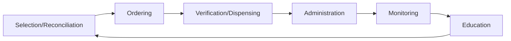

# Chapter 2 — Introduction to Convergence Informatics

[Repository Guide](../../README.md) | [English](Concepts_Lecture.md) | [한국어](Concepts_Lecture.ko.md)

> **Last Updated:** 2026-10-26

> **Learning Objectives:**
> 1. Understand the scope and applications of convergence informatics
> 2. Identify key data science workflows and methodologies
> 3. Describe the role of informatics in interdisciplinary research

---

## Table of Contents

- [1. What is Convergence Informatics](#1-what-is-convergence-informatics)
  - [1.1 Definition of Informatics](#11-definition-of-informatics)
  - [1.2 Convergence (Multidisciplinary) Informatics](#12-convergence-multidisciplinary-informatics)
  - [1.3 Key Elements of Data Science](#13-key-elements-of-data-science)
  - [1.4 The Data Scientist](#14-the-data-scientist)
- [2. Basic Concepts in Statistics](#2-basic-concepts-in-statistics)
  - [2.1 Population and Sample](#21-population-and-sample)
  - [2.2 Measures of Central Tendency](#22-measures-of-central-tendency)
  - [2.3 Measures of Spread](#23-measures-of-spread)
  - [2.4 Sampling Concepts](#24-sampling-concepts)
- [3. Data Types and Structures](#3-data-types-and-structures)
  - [3.1 Structured vs Unstructured Data](#31-structured-vs-unstructured-data)
  - [3.2 Random Variables (R.V.)](#32-random-variables-rv)
  - [3.3 Freedom Degree Issue](#33-freedom-degree-issue)
  - [3.4 Tabulation](#34-tabulation)
  - [3.5 Feature Extraction, Selection, and Engineering](#35-feature-extraction-selection-and-engineering)
  - [3.6 Types of Datasets](#36-types-of-datasets)
- [4. Supervised vs Unsupervised Learning Overview](#4-supervised-vs-unsupervised-learning-overview)
  - [4.1 Comparison Table](#41-comparison-table)
  - [4.2 Class (Label) in Supervised Learning](#42-class-label-in-supervised-learning)
  - [4.3 Classification and Regression (SL)](#43-classification-and-regression-sl)
  - [4.4 Clustering and Association (USL)](#44-clustering-and-association-usl)
- [5. Applications of Informatics](#5-applications-of-informatics)
  - [5.1 Medical Informatics](#51-medical-informatics)
  - [5.2 Pharmacoinformatics](#52-pharmacoinformatics)
- [Summary](#summary)
- [Self-Check Questions](#self-check-questions)
- [References](#references)

---

 

## 1. What is Convergence Informatics

### 1.1 Definition of Informatics

- Informatics is the same field as data science and largely overlaps with machine learning (**Data Science == Informatics =~ Machine Learning**).
- Informatics is an area that manages, manipulates, extracts, and interprets knowledge from a tremendous amount of data (automatically or computationally).
- Data science and informatics are a **multidisciplinary** field of study with the goal of addressing data-driven challenges.

The term originates from the German word *Informatik* (Karl Steinbuch, 1957). *Informatik* is equivalent to Computer Science in English, and the French *Informatique* (Philippe Dreyfus, 1962) and the English *Informatics* (Walter F. Bauer, 1962) refer to the same concept [1].

- Data science principles apply to **all data**, big and small.

### 1.2 Convergence (Multidisciplinary) Informatics

Convergence Informatics integrates knowledge from diverse fields to extract meaningful insights from data. It draws upon the following fields.

- Concept of Data Science
- R Programming
- Statistical Skills for Informatics
- Computational Technologies for Informatics
- Bioinformatics and Computational Biology: a multidisciplinary intersection of Computer Science, Chemistry, Engineering, Mathematics, Biochemistry, Statistics, and Biology.
- Application of Informatics

### 1.3 Key Elements of Data Science

Data science involves interactions among many fields: Statistics, Pattern Recognition, Machine Learning, AI, Data Mining, Databases, Visualizations, and more. Theories and techniques from science, engineering, economics, politics, finance, and education are all brought together.

### 1.4 The Data Scientist

- A data scientist is the same as an informatician (**Data Scientist == Informatician**), and the job has been called "The Sexiest Job of the 21st Century".
- Data scientists are the key to realizing the opportunities presented by big data. They bring structure to data, find compelling patterns, and advise on products, processes, and decisions.

**Required skills for a Data Scientist (Informatician):**

| Category | Details |
|----------|---------|
| Mathematics | Mathematics and Applied Mathematics |
| Statistics | Statistics and Applied Statistics |
| Programming | C/C++, Java, R, Python, Julia, SQL, JavaScript |
| Data Mining | Pattern discovery and knowledge extraction |
| Database | Database storage and management |
| Machine Learning | Machine Learning and discovery |

*Table 1. Skills required of a data scientist*

> **Key Point:** Convergence Informatics is inherently multidisciplinary and requires skills in mathematics, statistics, solid programming, data mining, database management, and machine learning. All disciplines interact with each other.

---

 

## 2. Basic Concepts in Statistics

### 2.1 Population and Sample

| Term | Definition |
|------|-----------|
| **Population** | The union of all possible events and outcomes relevant to a given topic |
| **Sample** | A subset of the population used for analysis |

*Table 2. Definitions of population and sample*

### 2.2 Measures of Central Tendency

- **Average (Arithmetic Mean):** The sum of all values divided by the number of values.
- **Median:** The middle value when the data is sorted by size. When the number of values is even, the median is the mean of the two middle values.

### 2.3 Measures of Spread

- **Range:** The difference between the maximum and minimum values.

- **Variance (Population):** For a population of size N with mean $\mu$, it is as follows.

  $$V = \sigma^2 = \frac{\sum_{i=1}^{N} (x_i - \mu)^2}{N}$$

- **Variance (Sample):** For a sample of size n with mean $\bar{x}$, it is as follows.

  $$V_s = \sigma_s^2 = \frac{\sum_{i=1}^{n} (x_i - \bar{x})^2}{n - 1}$$

- **Standard Deviation:** The square root of variance.

> **Key Point:** Sample variance divides by **n - 1** instead of the sample size n (Bessel's correction). The sum of squared deviations around the sample mean $\bar{x}$ tends to be smaller than that around the population mean $\mu$, so dividing by n systematically underestimates the population variance, while dividing by n - 1 gives an unbiased estimator of the population variance.

> **[Probability and Statistics]** An estimator is unbiased when its expected value equals the parameter it estimates. Estimation theory in probability and statistics shows that the expected value of the sample variance divided by n - 1 equals the population variance $\sigma^2$, which is why the sample variance uses n - 1 as its denominator.

### 2.4 Sampling Concepts

| Concept | Description |
|---------|-------------|
| **Representativeness** | How well a sample reflects the characteristics of the population |
| **Sampling Error** | Random variation that occurs naturally when drawing a sample |
| **Sampling Bias** | Systematic distortion that causes the sample to misrepresent the population |

*Table 3. Key concepts of sampling*

> **Key Point:** Sampling error is unavoidable random variation, and it shrinks as the sample size grows. Sampling bias is a systematic problem in the data collection process; it does not disappear with a larger sample, so it must be identified and corrected.

---

 

## 3. Data Types and Structures

### 3.1 Structured vs Unstructured Data

| Type | Description | Examples |
|------|-------------|----------|
| **Structured** | Data organized in rows and columns with a fixed schema | Databases, spreadsheets, CSV files |
| **Unstructured** | Data without a predefined data model | Emails, images, videos, web pages, sensor output |

*Table 4. Structured and unstructured data*

The **requirements of structured data** that can be used directly for machine learning analysis are as follows.
- It must have a **schema** that represents a relation with a defined number of rows and columns.
- All values must be **real numbers**. Categorical values such as gender are also stored as numeric codes.
- It must take the form of a **matrix**.
- If data has a schema with a fixed number of rows and columns, matrix-form data, and all real-number values, it is structured data.

Unstructured data does not reside in traditional databases, may have internal structure but does not fit a relational model, and is estimated to account for approximately **85%** of all global data.

The systematic use of unstructured data is a central **Big Data** challenge.

### 3.2 Random Variables (R.V.)

A Random Variable is a function that maps real phenomena into data values. The two main types are continuous and categorical, and discrete variables are interpreted as either one depending on the context.

| Type | Also Known As | Purpose | Example |
|------|---------------|---------|---------|
| **Continuous** (Numerical) | Quantitative | Calculation (quantity) | Height, weight, temperature |
| **Categorical** (Characteristic) | Qualitative | Classification (class) | Gender, color, marital status |
| **Discrete** | (subset of countable values) | Depends on context | Integer-valued counts, age in whole years |

*Table 5. Types of random variables*

- **Continuous attributes** have real-number values, can take infinitely many uncountable values, and are usually represented as floating-point variables.
- **Discrete attributes** have a finite or countably infinite set of values and are usually expressed as integers. Binary attributes are a special form of discrete attributes.
- **Discrete vs categorical nuance:** How you interpret integer data depends on your analysis goal.
  - **Continuous interpretation:** Treat the number as a quantity for calculation (e.g., an age of 22 used for computing the mean or running regression).
  - **Categorical interpretation:** Treat the number as a class for classification (e.g., the 20s group used for counting group frequencies or comparing characteristics between groups).
- Continuous variables can be converted to discrete variables through **binning**.
- Whether a variable is continuous or categorical is determined by the **mapping process**.

### 3.3 Freedom Degree Issue

Categorizing data follows the rule of thumb that a meaningful category needs **at least 3** samples with the same value. This is related to the degrees of freedom in statistical analysis.

**Example:** The following table represents the same ages at three resolutions. Age_Cont is the age with decimal places, Age_Cate1 keeps only the integer part, and Age_Cate2 is the age group by decade.

| Target | Age_Cont | Age_Cate1 | Age_Cate2 |
|--------|----------|-----------|-----------|
| Student_1 | 10.41412 | 10 | 10s |
| Student_2 | 20.5213 | 20 | 20s |
| Student_3 | 22.2139123 | 22 | 20s |
| Student_4 | 23.1213 | 23 | 20s |

*Table 6. Values of three age variables at different resolutions*

| | Age_Cont | Age_Cate1 | Age_Cate2 |
|---|----------|-----------|-----------|
| **Resolution** | Highest | | Lowest |
| **Type** | Continuous | Continuous / Categorical | Categorical |

*Table 7. Resolution and type of each age variable*

- Age_Cate1 with values like (10, 10, 10, 20, 22, 23, 23, ...) is more likely to be treated as a **Categorical R.V.** because some values have 3 or more same-value samples.
- The freedom degree requirement determines whether categorization is statistically meaningful.

### 3.4 Tabulation

Tabulation is the process of converting **unstructured data into structured data** by systematically arranging classified data in rows and columns.

The tabulation process follows these steps.

1. **Experimental design:** Define the research question.
2. **Determination of population:** Identify the target population.
3. **Set variables and get values:** Define features and collect measurements.
4. **Prescreening:** Clean and validate the data (Data Mining).

### 3.5 Feature Extraction, Selection, and Engineering

- **Feature extraction:** Derive meaningful variables from raw tabulated data.
- **Feature selection:** Remove low-signal variables that do not contribute useful information to the analysis.
- **Feature engineering:** Introduce domain-relevant, informative attributes to improve model performance.

**Feature extraction example:** When each of 12 samples is one of the unstructured letter sequences AAAAA, BB, CCC, and D, counting the total number of letters and the count of each letter in every sample gives the following table.

| Sample | # of Alphabets | # of A | # of B | # of C | # of D |
|--------|---------------|--------|--------|--------|--------|
| S1 | 5 | 5 | 0 | 0 | 0 |
| S2 | 5 | 5 | 0 | 0 | 0 |
| S3 | 5 | 5 | 0 | 0 | 0 |
| S4 | 2 | 0 | 2 | 0 | 0 |
| S5 | 2 | 0 | 2 | 0 | 0 |
| S6 | 2 | 0 | 2 | 0 | 0 |
| S7 | 3 | 0 | 0 | 3 | 0 |
| S8 | 3 | 0 | 0 | 3 | 0 |
| S9 | 3 | 0 | 0 | 3 | 0 |
| S10 | 1 | 0 | 0 | 0 | 1 |
| S11 | 1 | 0 | 0 | 0 | 1 |
| S12 | 1 | 0 | 0 | 0 | 1 |

*Table 8. Features extracted from letter sequences*

This technique can be applied to images, video, sequences, and other unstructured formats.

### 3.6 Types of Datasets

**Record-based data:**
- **Data matrix:** An $n \times p$ matrix whose n rows represent objects and p columns represent attributes.
- **Document data:** Each document is represented by a term vector (word frequency).
- **Transaction data:** Each record is a collection of items (market basket data).

**Graph-based data:**
- Examples include the World Wide Web, molecular structures, and map data.

**Ordered data:**
- Examples include spatial data, temporal data, sequential data, and genetic and genomic sequence data.

> **Key Point:** Structured data is a set of random variables, and data is a combination of variables. The quality of your analysis fundamentally depends on how well you tabulate and structure your raw data.

---

 

## 4. Supervised vs Unsupervised Learning Overview

### 4.1 Comparison Table

| Aspect | Supervised Learning | Unsupervised Learning |
|--------|--------------------|-----------------------|
| **Answer** | Predefined answer (label) exists | No predefined answer |
| **Number of answers** | Single answer | Numerous possible answers |
| **Goal** | Prediction (find relation between Data & Class) | Pattern recognition (find data structures or hidden patterns) |
| **Example tasks** | Classification, Regression | Clustering, Association |
| **Label** | Yes | No |
| **Diverse results** | No | Yes |
| **Training data** | Labeled (input-output pairs) | Unlabeled (input only) |

*Table 9. Comparison of supervised and unsupervised learning*

**Data requirements for SL and USL:**

| | Structured Data | Predefined Answer (= Class) |
|---|---|---|
| **Supervised** | Required | Required |
| **Unsupervised** | Required | Not required |

*Table 10. Data requirements by learning type*

Both supervised and unsupervised learning require **structured data**; the difference is whether a **predefined answer (class)** exists.

### 4.2 Class (Label) in Supervised Learning

A class goes by many names: **label, exact answer, ground truth, response variable, outcome variable, dependent variable**. Importantly, **any R.V. can be a class**, and which variable becomes the class depends on your analysis purpose.

**Does a class always exist in structured data?**

Not always. The existence of a class is determined by the **purpose of the analysis**. It is not an intrinsic property of the data itself; it depends on what you want. When you want to predict or infer a specific variable, you designate that variable as the class (doing SL). When you want to discover structures or patterns without prediction, you work without a class (doing USL).

### 4.3 Classification and Regression (SL)

- **Classification:** Assigns new observations to predefined categories based on a training set with known labels. In other words, it predicts a **categorical label** for a new piece of data.
- **Regression:** Predicts a **continuous value** for a new piece of data (e.g., fitting a line through data points).

### 4.4 Clustering and Association (USL)

Unsupervised learning is often compared to the **human brain's intelligence**, with **pattern recognition** being its central mechanism. Humans have an innate ability to naturally group and categorize the world around them. Computers, which only process 0s and 1s, need specially designed functions to replicate this.

- **Clustering (class discovery):** Groups objects into subsets (clusters) based on **similarity** between objects. It finds and visualizes structures in the data and is also used in quality control processes such as outlier identification.
- **Association:** Finds relationships between different items in unlabeled data (e.g., market basket analysis, which discovers items that are frequently purchased together).

> **Key Point:** Supervised learning requires labeled data and aims to predict a specific outcome (classification for categorical, regression for continuous), while unsupervised learning works with unlabeled data and aims to discover hidden patterns or groupings (clustering for groups, association for relationships).

---

 

## 5. Applications of Informatics

Informatics is applied in most disciplines and industries. The applications are endless, but this chapter focuses on the bio-medical science field, where the concept of Informatics is best established.

### 5.1 Medical Informatics

Medical informatics is the application of computers, communications, and information technology and systems to all fields of medicine (medical care, medical education, and medical research). It is a **multidisciplinary** field integrating Medicine and Biology, Mathematics, Information Systems, Computer Science, Statistics, Decision Analysis, Economics and Health Care Policy, and Psychology.

**Electronic Medical Records (EMR):**

The key benefits of EMR systems are as follows.
- **Access:** Records are highly available and easy to transfer and retrieve.
- **Legibility:** Data can be abstracted and reported in a clear, readable form.
- **Speed:** Data can be found **4 times faster** than with paper records.
- **Reduced data entry:** Reusing data eliminates redundant entry.
- Imposing structure leads to better organization.
- Storage space is used efficiently.
- Multiple views, including aggregation, are allowed.
- Data entry is checked automatically, for example by spelling checks.
- Data quality and standards are enforced.
- Automated decision support is provided.
- The data supports statistics and research.

**Decision Support for Diagnosis:**

Computational tools assist clinicians in diagnostic reasoning and therapeutic planning, using digital imaging, radiological information systems, and patient monitoring systems.

**Virtual Reality and Computational Simulation:**

The **da Vinci Surgical System** (Intuitive Surgical, California, USA) is a key example. The surgeon sits at a control console that shows the surgical field in 3D and operates by controlling the robotic surgical instruments.

### 5.2 Pharmacoinformatics

Pharmacoinformatics applies informatics principles to pharmacology. It is also a representative **multidisciplinary** field.

- **Drug discovery** and development requires the integration of multiple scientific and technological disciplines (chemistry, biology, pharmacology, pharmaceutical technology) and extensive use of information technology.
- The main idea is to integrate different informatics branches (bioinformatics, chemoinformatics, immunoinformatics, etc.) into a single platform for a seamless drug discovery process.
- The first reference of the term "Pharmacoinformatics" can be found in the year **1993**.
- **ASHP Statement on the Pharmacist's Role in Informatics:** The statement defines pharmacy informatics as "the use and integration of data, information, knowledge, technology, and automation in the medication-use process for the purpose of improving health outcomes."

**Medication Use Process Cycle:** The medication use process is a cycle of six stages (selection and reconciliation, ordering, verification and dispensing, administration, monitoring, and education) that returns to the beginning after the last stage.

*Figure 1. Medication use process cycle*

| Stage | Responsible Parties |
|-------|-------------------|
| **Medication Selection / Reconciliation** | Prescriber, nurse, pharmacist |
| **Ordering** | Prescriber, nurse, pharmacist |
| **Verification / Dispensing** | Pharmacist, technician |
| **Administration** | Nurse, caretaker, patient |
| **Monitoring** | Prescriber, nurse, pharmacist, patient, caretaker, health system |
| **Education** | Prescriber, nurse, pharmacist, patient, caretaker |

*Table 11. Responsible parties at each stage of the medication use process*

> **Key Point:** Both Medical Informatics and Pharmacoinformatics exemplify how convergence of informatics with domain-specific fields creates powerful tools for data-driven decision making, from EMR systems to automated drug discovery pipelines.

---

 

## Summary

| Concept | Key Summary |
|---------|-------------|
| Convergence Informatics | Convergence informatics is a multidisciplinary field integrating data science, statistics, programming, and domain knowledge. |
| Data Scientist | A data scientist is the same as an informatician, has been called "The Sexiest Job of the 21st Century", and needs skills in math, statistics, programming (C/C++, Java, R, Python, Julia, SQL, JavaScript), data mining, databases, and machine learning. |
| Data Science Scope | Data science principles apply to all data, big and small. |
| Population and Sample | The population is all possible outcomes relevant to a topic, and a sample is the subset of the population used for analysis. |
| Variance | Population variance divides by N, and sample variance divides by n - 1 for unbiased estimation. |
| Sampling | Sampling error is random variation, and sampling bias is systematic distortion. |
| Structured Data | Structured data has a schema with fixed rows and columns, all real-number values, and matrix form. |
| Unstructured Data | Unstructured data is estimated to be about 85% of global data, does not fit a relational model, and is converted to structured data by tabulation. |
| Random Variables | Random variables are continuous (numerical, for calculation) or categorical (characteristic, for classification), and the interpretation of discrete variables depends on the analysis goal. |
| Freedom Degree | A rule of thumb says categorization requires at least 3 same-value samples, and Age_Cont, Age_Cate1, and Age_Cate2 in the example have different resolution levels. |
| Tabulation | Tabulation is the systematic arrangement of data in rows and columns and a core step in the data science pipeline. |
| Feature Extraction | Feature extraction derives meaningful variables from raw data (e.g., letter counting from unstructured sequences). |
| Feature Selection | Feature selection removes low-signal variables to improve analysis quality. |
| Feature Engineering | Feature engineering introduces domain-relevant, informative attributes. |
| Supervised Learning | Supervised learning uses labeled data and a single answer with a prediction goal, and includes classification (categorical) and regression (continuous). |
| Unsupervised Learning | Unsupervised learning uses unlabeled data with a pattern recognition goal and multiple possible answers, and includes clustering (similarity grouping) and association (item relationships). |
| Class (Label) | Any R.V. can be a class, and whether a class exists depends on the analysis purpose, not on the data itself. |
| Medical Informatics | Representative applications are EMR (4x faster data retrieval, reduced entry), decision support for diagnosis, and the da Vinci Surgical System. |
| Pharmacoinformatics | Pharmacoinformatics is a multidisciplinary integration for drug discovery, the term was first referenced in 1993, and it covers the medication use process cycle. |
| Bioinformatics | Bioinformatics is the intersection of CS, Chemistry, Engineering, Math, Biochemistry, Statistics, and Biology. |

---

 

## Self-Check Questions

1. **Variance calculation:** For the values 2, 4, 6, 8, find the mean and the median, and find the sample variance when the four values are a sample and the population variance when they are the entire population.

   

   
Answer

   The mean is (2 + 4 + 6 + 8) / 4 = 5. The number of values is even, so the median is the mean of the two middle values 4 and 6, which is 5. The deviations from the mean are -3, -1, 1, 3, and the sum of squared deviations is 9 + 1 + 1 + 9 = 20. The sample variance is 20 / (4 - 1) ≈ 6.67, and the population variance is 20 / 4 = 5.

   

2. **Identifying the learning type:** State whether each task is classification, regression, clustering, or association. (a) Predict whether a patient has a disease from test values. (b) Predict a house price from its floor area. (c) Group similar customers from unlabeled purchase records. (d) Find products that are frequently sold together from shopping basket records.

   

   
Answer

   (a) predicts a categorical label (disease or no disease), so it is classification. (b) predicts a continuous value, so it is regression. (c) groups objects by similarity without a predefined answer, so it is clustering. (d) finds relationships between items, so it is association. (a) and (b) belong to supervised learning, and (c) and (d) belong to unsupervised learning.

   

3. **Feature extraction:** In the same way as Table 8, find the features (the total number of letters and the counts of A, B, C, D) of the letter sequences ABBA and CCD.

   

   
Answer

   ABBA has 4 letters in total, with 2 A's, 2 B's, and 0 C's and D's. CCD has 3 letters in total, with 0 A's and B's, 2 C's, and 1 D. In this way, unstructured sequences of different lengths and compositions become rows of structured data with the same columns.

   

4. **Interpreting a random variable:** Using examples, explain the case where an age of 22 is interpreted as continuous and the case where it is interpreted as categorical.

   

   
Answer

   Interpreted as continuous, 22 is a quantity for calculation, used to compute a mean or as an input to regression analysis. Interpreted as categorical, 22 is placed in the class of the 20s, used to count group frequencies or compare characteristics between groups. The analysis purpose decides which interpretation to use.

   

5. **Sampling error and sampling bias:** You want to estimate the daily internet usage time of the whole population through an online survey. Explain whether increasing the number of respondents tenfold solves the problem of the estimate.

   

   
Answer

   It does not. Respondents to an online survey are skewed toward people who use the internet a lot, so the problem is sampling bias, a systematic distortion. A larger sample reduces sampling error, which is random variation, but the bias remains. The collection method must be changed so that the sample represents the population.

   

---

 

## References

1. "Informatics," *Wikipedia*, accessed Oct. 18, 2026. https://en.wikipedia.org/wiki/Informatics
