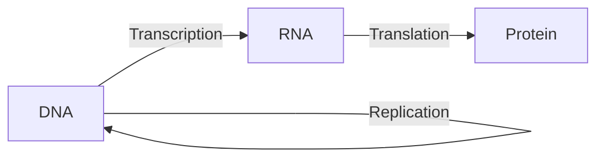
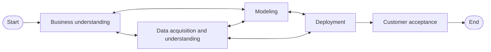

# Chapter 2 — Introduction to Convergence Informatics

[Repository Guide](../../README.md) | [English](Concepts_Lecture.md) | [한국어](Concepts_Lecture.ko.md)

> **Last Updated:** 2026-11-19

> **Learning Objectives:**
> 1. Understand the scope and applications of convergence informatics
> 2. Identify key data science workflows and methodologies
> 3. Describe the role of informatics in interdisciplinary research
> 4. Distinguish and compute parameters and statistics, sampling error and sampling bias, and the coefficient of variation
> 5. Explain the types of datasets and the structure of tabular data, and implement descriptive statistics functions in R
> 6. Explain the stages of the data science workflow

---

## Table of Contents

- [1. Overview of Convergence Informatics](#1-overview-of-convergence-informatics)
  - [1.1 Definition of Informatics](#11-definition-of-informatics)
  - [1.2 Convergence (Multidisciplinary) Informatics](#12-convergence-multidisciplinary-informatics)
  - [1.3 Key Elements of Data Science](#13-key-elements-of-data-science)
  - [1.4 The Data Scientist](#14-the-data-scientist)
  - [1.5 Prospects and Components of Informatics](#15-prospects-and-components-of-informatics)
- [2. Basic Concepts in Statistics](#2-basic-concepts-in-statistics)
  - [2.1 Population and Sample](#21-population-and-sample)
  - [2.2 Measures of Central Tendency](#22-measures-of-central-tendency)
  - [2.3 Measures of Spread](#23-measures-of-spread)
  - [2.4 Sampling Concepts](#24-sampling-concepts)
  - [2.5 Descriptive and Inferential Statistics](#25-descriptive-and-inferential-statistics)
  - [2.6 Variables and Random Variables](#26-variables-and-random-variables)
  - [2.7 Parameters and Statistics](#27-parameters-and-statistics)
  - [2.8 Representativeness and Sampling Methods](#28-representativeness-and-sampling-methods)
  - [2.9 Computing the Median, Mean, and Coefficient of Variation](#29-computing-the-median-mean-and-coefficient-of-variation)
  - [2.10 Implementing Descriptive Statistics Functions in R](#210-implementing-descriptive-statistics-functions-in-r)
- [3. Data Types and Structures](#3-data-types-and-structures)
  - [3.1 Structured vs Unstructured Data](#31-structured-vs-unstructured-data)
  - [3.2 Random Variables (R.V.)](#32-random-variables-rv)
  - [3.3 Freedom Degree Issue](#33-freedom-degree-issue)
  - [3.4 Tabulation](#34-tabulation)
  - [3.5 Feature Extraction, Selection, and Engineering](#35-feature-extraction-selection-and-engineering)
  - [3.6 Types of Datasets](#36-types-of-datasets)
  - [3.7 Composition of a Dataset: Objects and Attributes](#37-composition-of-a-dataset-objects-and-attributes)
  - [3.8 Characteristics of Unstructured Data and Big Data](#38-characteristics-of-unstructured-data-and-big-data)
  - [3.9 Examples by Dataset Type](#39-examples-by-dataset-type)
  - [3.10 Tabular Data and the Relational Model](#310-tabular-data-and-the-relational-model)
  - [3.11 The Structure Spectrum and Data Models Beyond Tables](#311-the-structure-spectrum-and-data-models-beyond-tables)
- [4. Supervised vs Unsupervised Learning Overview](#4-supervised-vs-unsupervised-learning-overview)
  - [4.1 Comparison Table](#41-comparison-table)
  - [4.2 Class (Label) in Supervised Learning](#42-class-label-in-supervised-learning)
  - [4.3 Classification and Regression (SL)](#43-classification-and-regression-sl)
  - [4.4 Clustering and Association (USL)](#44-clustering-and-association-usl)
  - [4.5 Definitions of Artificial Intelligence and Learning](#45-definitions-of-artificial-intelligence-and-learning)
- [5. Applications of Informatics](#5-applications-of-informatics)
  - [5.1 Medical Informatics](#51-medical-informatics)
  - [5.2 Pharmacoinformatics](#52-pharmacoinformatics)
  - [5.3 Components of Medical Informatics and Diagnostic Support](#53-components-of-medical-informatics-and-diagnostic-support)
  - [5.4 Information Technology in the Medication Use Process](#54-information-technology-in-the-medication-use-process)
  - [5.5 Bioinformatics](#55-bioinformatics)
- [6. Applications and Workflow of Data Science](#6-applications-and-workflow-of-data-science)
  - [6.1 Applications and the Data They Require](#61-applications-and-the-data-they-require)
  - [6.2 The Data Science Workflow](#62-the-data-science-workflow)
  - [6.3 Problem Definition and Experimental Design](#63-problem-definition-and-experimental-design)
  - [6.4 Common Mistakes](#64-common-mistakes)
- [Summary](#summary)
- [Self-Check Questions](#self-check-questions)
- [References](#references)

---

<br>

## 1. Overview of Convergence Informatics

### 1.1 Definition of Informatics

- Informatics is the same field as data science and largely overlaps with machine learning (**Data Science == Informatics =~ Machine Learning**).
- Informatics is an area that manages, manipulates, extracts, and interprets knowledge from a tremendous amount of data (automatically or computationally).
- Data science and informatics are a **multidisciplinary** field of study with the goal of addressing data-driven challenges.

The term originates from the German word *Informatik* (Karl Steinbuch, 1957). *Informatik* is equivalent to Computer Science in English, and the French *Informatique* (Philippe Dreyfus, 1962) and the English *Informatics* (Walter F. Bauer, 1962) refer to the same concept [1].

- Data science principles apply to **all data**, big and small.

### 1.2 Convergence (Multidisciplinary) Informatics

Convergence Informatics integrates knowledge from diverse fields to extract meaningful insights from data. It draws upon the following fields.

- Concept of Data Science
- R Programming
- Statistical Skills for Informatics
- Computational Technologies for Informatics
- Bioinformatics and Computational Biology: a multidisciplinary intersection of Computer Science, Chemistry, Engineering, Mathematics, Biochemistry, Statistics, and Biology.
- Application of Informatics

### 1.3 Key Elements of Data Science

Data science involves interactions among many fields: Statistics, Pattern Recognition, Machine Learning, AI, Data Mining, Databases, Visualizations, and more. Theories and techniques from science, engineering, economics, politics, finance, and education are all brought together.

### 1.4 The Data Scientist

- A data scientist is the same as an informatician (**Data Scientist == Informatician**), and the job has been called "The Sexiest Job of the 21st Century".
- Data scientists are the key to realizing the opportunities presented by big data. They bring structure to data, find compelling patterns, and advise on products, processes, and decisions.

**Required skills for a Data Scientist (Informatician):**

| Category | Details |
|----------|---------|
| Mathematics | Mathematics and Applied Mathematics |
| Statistics | Statistics and Applied Statistics |
| Programming | C/C++, Java, R, Python, Julia, SQL, JavaScript |
| Data Mining | Pattern discovery and knowledge extraction |
| Database | Database storage and management |
| Machine Learning | Machine Learning and discovery |

*Table 1. Skills required of a data scientist*

> **Key Point:** Convergence Informatics is inherently multidisciplinary and requires skills in mathematics, statistics, solid programming, data mining, database management, and machine learning. All disciplines interact with each other.

### 1.5 Prospects and Components of Informatics

Informatics (data science) is regarded as an important field not only in the past and present but also in the future. The **hype cycle**, which depicts how expectations of a new technology change over time, consists of five phases: innovation trigger, peak of inflated expectations, trough of disillusionment, slope of enlightenment, and plateau of productivity. In a hype cycle drawn as of July 2014, data-related technologies such as data science, prescriptive analytics, and big data sit near the peak of expectations. The hype cycle expresses that a technology that passes the peak and goes through the trough reaches the plateau of productivity once its real value is confirmed.

A diagram of the components of data science places data science at the center, surrounded by the overlapping areas of statistics, pattern recognition, machine learning, neurocomputing, artificial intelligence, data mining, databases and data processing, and visualization. Knowledge discovery in databases (KDD) lies where data mining and databases overlap. Around them, domain knowledge, problem solving, inquisitiveness, communication, presentation, business analysis, and business strategy form a cycle. Technical areas alone cannot reach the goal; the ability to understand the problem and communicate the results is needed as well.

As Table 1 of Section 1.4 shows, many competencies are required, so becoming a good informatician is not easy. All disciplines are connected, however, so knowledge built in one field becomes a stepping stone for learning another. Rather than trying to acquire every competency from the start, building up step by step from programming and basic statistics is the realistic path.

---

<br>

## 2. Basic Concepts in Statistics

### 2.1 Population and Sample

| Term | Definition |
|------|-----------|
| **Population** | The union of all possible events and outcomes relevant to a given topic |
| **Sample** | A subset of the population used for analysis |

*Table 2. Definitions of population and sample*

### 2.2 Measures of Central Tendency

- **Average (Arithmetic Mean):** The sum of all values divided by the number of values.
- **Median:** The middle value when the data is sorted by size. When the number of values is even, the median is the mean of the two middle values.

### 2.3 Measures of Spread

- **Range:** The difference between the maximum and minimum values.

- **Variance (Population):** For a population of size N with mean $\mu$, it is as follows.

  $$V = \sigma^2 = \frac{\sum_{i=1}^{N} (x_i - \mu)^2}{N}$$

- **Variance (Sample):** For a sample of size n with mean $\bar{x}$, it is as follows.

  $$V_s = \sigma_s^2 = \frac{\sum_{i=1}^{n} (x_i - \bar{x})^2}{n - 1}$$

- **Standard Deviation:** The square root of variance.

> **Key Point:** Sample variance divides by **n - 1** instead of the sample size n (Bessel's correction). The sum of squared deviations around the sample mean $\bar{x}$ tends to be smaller than that around the population mean $\mu$, so dividing by n systematically underestimates the population variance, while dividing by n - 1 gives an unbiased estimator of the population variance.

> **[Probability and Statistics]** An estimator is unbiased when its expected value equals the parameter it estimates. Estimation theory in probability and statistics shows that the expected value of the sample variance divided by n - 1 equals the population variance $\sigma^2$, which is why the sample variance uses n - 1 as its denominator.

### 2.4 Sampling Concepts

| Concept | Description |
|---------|-------------|
| **Representativeness** | How well a sample reflects the characteristics of the population |
| **Sampling Error** | Random variation that occurs naturally when drawing a sample |
| **Sampling Bias** | Systematic distortion that causes the sample to misrepresent the population |

*Table 3. Key concepts of sampling*

> **Key Point:** Sampling error is unavoidable random variation, and it shrinks as the sample size grows. Sampling bias is a systematic problem in the data collection process; it does not disappear with a larger sample, so it must be identified and corrected.

### 2.5 Descriptive and Inferential Statistics

**Statistics** is the discipline that collects, organizes, and summarizes data, and on that basis provides methods for making judgments under uncertainty. Statistics divides into two branches by purpose.

- **Descriptive statistics:** Organizes and summarizes the collected data themselves. Numbers such as the mean, median, and standard deviation, and plots such as histograms and box plots, belong here (Section 6.4 of Chapter 1).
- **Inferential statistics:** Observes only part of the whole (a sample) and draws information about the whole (the population) from it. Parameter estimation and hypothesis testing belong here.

> **Definition:** **Inferential statistics** is the branch of statistics that observes a sample, a part of the population, to estimate characteristics of the whole population or to test hypotheses about it.

The field that applies statistical methods to biological and health data is called **biostatistics**. Biomedical data from molecular biology experiments, public health surveys, and clinical trials vary greatly between individuals, and the number of measured variables is often large relative to the number of samples (for example, tens of thousands of genes measured in a few dozen patients). Because of these characteristics, informatics goes through both stages: understanding the data with descriptive statistics and generalizing conclusions with inferential statistics.

### 2.6 Variables and Random Variables

One main purpose of statistics in public health is to find the factors that affect health outcomes and to explain how those effects appear. A quantity that has the same value for everyone is a constant, not a variable, and a constant cannot show how health outcomes differ by that factor. The objects of analysis are therefore **variables**, whose values differ between individuals.

When the values of a variable are observed according to certain probability rules, the variable is called a **random variable**. In probability and statistics a random variable is described as a variable whose values depend on the outcomes of a random phenomenon, and it is also called a random quantity, an aleatory variable, or a stochastic variable. For example, the systolic blood pressure of an adult chosen at random is a random variable whose value depends on who is chosen. Section 3.2 explains the same concept from the viewpoint of a function that maps a real phenomenon to numbers.

By the nature of their values, variables divide into **quantitative variables** and **qualitative variables**. Quantitative variables represent continuous, numerical characteristics such as height and blood pressure, and qualitative variables represent categorical, non-numerical characteristics such as blood type and smoking status. This distinction corresponds to the continuous and categorical types of Section 3.2.

### 2.7 Parameters and Statistics

The constants that determine the distribution of a population are called **parameters**. For example, if a population is assumed to follow the normal distribution $`N(\mu, \sigma^2)`$ with mean $`\mu`$ and variance $`\sigma^2`$, then $`\mu`$ and $`\sigma^2`$ are the parameters that determine the statistical properties of the model. Parameters are usually unknown, so they are estimated from samples.

> **Definition:** A **statistic** is a value computed only from the sample observations $`Y_1, \ldots, Y_n`$; it is used to estimate a parameter, and its value changes when the sample changes.

For a sample $`Y_1, \ldots, Y_n`$ of size n, the sample mean and sample variance are as follows.

```math
\bar{Y} = \frac{1}{n} \sum_{i=1}^{n} Y_i, \qquad S^2 = \frac{1}{n - 1} \sum_{i=1}^{n} \left( Y_i - \bar{Y} \right)^2
```

| Item | Population (parameter) | Sample (statistic) |
|:--|:--|:--|
| Size | N | n |
| Mean | $`\mu`$ | $`\bar{Y}`$ (or $`\bar{x}`$) |
| Variance | $`\sigma^2`$ | $`S^2`$ |
| Standard deviation | $`\sigma`$ | $`S`$ |
| Nature | A fixed constant, usually unknown | Computable, but a random variable that differs from sample to sample |

*Table 4. Notation for parameters and statistics*

R can show that a parameter is fixed while a statistic changes from sample to sample. The following code draws three samples of size 10 and three samples of size 1,000 from a normal population with mean 173 and standard deviation 2 and computes the sample means.

```r
set.seed(10)
round(replicate(3, mean(rnorm(10, mean = 173, sd = 2))), 2)
round(replicate(3, mean(rnorm(1000, mean = 173, sd = 2))), 2)
```

```text
[1] 172.02 173.74 171.17
[1] 173.04 173.02 172.95
```

`replicate(3, ...)` runs the expression in parentheses three times and collects the results in a vector. The means of the samples of size 10 range from 171.17 to 173.74, nearly 2 away from the population mean 173, while the means of the samples of size 1,000 range from 172.95 to 173.04, very close to it. The result shows in numbers the statement of Section 2.4 that a larger sample reduces sampling error.

### 2.8 Representativeness and Sampling Methods

The **population** is the whole target of a study; it consists of individual elements, and the number of elements may be finite or infinite. Ideally every element of the population would be examined, but because of cost and time a sample is usually drawn from the population. How the sample is chosen then decides how reliable the results are, and the criterion is the representativeness of Section 2.4.

Representativeness is easy to understand through the analogy of a painting. Let the whole Mona Lisa be the population. A picture redrawn from 1% of its pixels chosen at random shows barely recognizable shapes, and as the share grows to 3%, 5%, and 10% the face becomes clearer and clearer. The larger a random sample, the more accurately it shows the population. If instead the painting is divided into similar regions (face, hands, background) and a fixed share is drawn from each region, even 2.5% gives a clearer picture than a random 3%. Conversely, if the way the sample is drawn is itself skewed, the picture is distorted, and the distortion does not disappear however much more is drawn. This is sampling bias.

- **Simple random sampling:** Every element of the population has the same probability of being chosen.
- **Stratified sampling:** The population is divided into strata of similar elements, and a random sample is drawn from each stratum. The smaller the variation within strata, the more precise the estimate is than simple random sampling of the same size, and because every stratum enters the sample, small groups are not left out.

> **Definition:** **Stratified sampling** is a sampling method that divides the population into non-overlapping homogeneous strata, draws a separate random sample from each stratum, and combines them.

Sources of error that arise while observing a sample include the following.

- The difference between the target population and the group from which the sample was actually drawn
- Faults of the questionnaire (ambiguous or leading questions)
- Non-response
- Interviewer error
- Omission from the survey
- Errors in data processing

> **Note:** **Sampling error and non-sampling error.** Survey sampling theory calls only the random variation that arises from observing a sample instead of the population sampling error in the narrow sense, and treats errors that arise in the survey process, such as questionnaire faults, non-response, interviewer error, and processing error, separately as non-sampling error. Non-sampling error does not shrink with a larger sample, and when it leans systematically to one side it becomes a source of sampling bias.

### 2.9 Computing the Median, Mean, and Coefficient of Variation

The center and spread of the data 5, 13, 9, 7, 1, 9, 2, 9, 11 are computed in turn.

1. **Median:** Sorted in ascending order, the data are 1, 2, 5, 7, 9, 9, 9, 11, 13. There are 9 values (odd), so the middle value, the fifth value 9, is the median.
2. **Mean:** The sum is $`5 + 13 + 9 + 7 + 1 + 9 + 2 + 9 + 11 = 66`$, so the mean is $`66/9 \approx 7.33`$. The small values 1 and 2 pull the mean down, so the mean is smaller than the median. The mean reflects the size of every value and is sensitive to extreme values, while the median uses only the order and is robust to them.
3. **Range:** The difference between the maximum and minimum is $`13 - 1 = 12`$.
4. **Variance:** The sum of squares is $`\sum x_i^2 = 612`$, and the sum of squared deviations is $`\sum (x_i - \bar{x})^2 = 612 - 9 \times (66/9)^2 = 612 - 484 = 128`$. Treating the 9 values as a sample, the sample variance is $`128/8 = 16`$ and the sample standard deviation is 4. Treating them as the whole population, the population variance is $`128/9 \approx 14.22`$.

The **coefficient of variation (CV)** is the standard deviation divided by the mean.

```math
CV = \frac{\sigma}{\bar{x}}
```

> **Definition:** The **coefficient of variation** is a relative measure of spread that removes units by dividing the standard deviation by the mean; it is used to compare the spread of variables with different units or scales.

The coefficient of variation of the data above is $`4/7.33 \approx 0.545`$. The standard deviation has the same unit as the data, so directly comparing the standard deviations of two variables with different units is meaningless. The following code simulates the heights (cm) and weights (kg) of 50 adults and compares the two measures.

```r
cv <- function(v) sd(v) / mean(v)
set.seed(3)
ht <- rnorm(50, 170, 6); wt <- rnorm(50, 65, 9)
round(c(sd_height = sd(ht), sd_weight = sd(wt)), 2)
round(c(cv_height = cv(ht), cv_weight = cv(wt)), 3)
```

```text
sd_height sd_weight
     5.34      7.41
cv_height cv_weight
    0.031     0.113
```

The standard deviations, 5.34 cm and 7.41 kg, have different units, so they cannot tell which variable is more spread out. The coefficients of variation, 0.031 for height (about 3% of the mean) and 0.113 for weight (about 11% of the mean), show that weight is scattered much more relative to its own mean. The coefficient of variation is meaningful only for variables on a ratio scale, with a positive mean and a zero that means "none". It explodes when the mean is near 0, and it is not used for variables with an arbitrary zero, such as temperature in degrees Celsius.

### 2.10 Implementing Descriptive Statistics Functions in R

The `mean()` function of R computes a mean, but that function was also written by someone who translated a formula into code. In data science, the basic ability expected of people with a computer science background is to implement such functions and packages themselves. Translating the formula for the mean, $`\bar{x} = \sum_{i=1}^{n} x_i / n`$, directly into a function gives the following.

```r
set.seed(1)
Height <- rnorm(300, 173, 2)
ConvergenceInformatics_mean <- function(inputNumericValue) {
  message("Let's calculate mean() by using my own function entitled ConvergenceInformatics_mean()")
  n <- length(inputNumericValue)
  sumx <- sum(inputNumericValue)
  output <- sumx / n
  return(output)
}
ConvergenceInformatics_mean(Height)
mean(Height)
```

```text
Let's calculate mean() by using my own function entitled ConvergenceInformatics_mean()
[1] 173.0672
[1] 173.0672
```

- The second line generates 300 heights from a normal distribution with mean 173 and standard deviation 2.
- `function(inputNumericValue)` creates a function that takes one argument, and the function is assigned to the name `ConvergenceInformatics_mean`. The part inside the braces is the body of the function.
- `message()` prints a sentence reporting progress. It is a notice displayed separately from the computed result.
- The body computes the number of elements `n` and the sum `sumx`, stores their quotient in `output`, and returns it with `return()`.
- The last two lines confirm that the custom function and the built-in `mean()` give the same result, 173.0672.

The code of an existing function can be seen by typing the function name without parentheses. Many functions, however, are implemented inside packages and need a slightly different method.

```r
mean
head(deparse(base:::mean.default), 3)
```

```text
function (x, ...)
UseMethod("mean")
<bytecode: 0x1318671f0>
<environment: namespace:base>
[1] "function (x, trim = 0, na.rm = FALSE, ...) "
[2] "{"
[3] "    if (!is.numeric(x) && !is.complex(x) && !is.logical(x)) {"
```

Typing `mean` shows a body of only one line, `UseMethod("mean")`. `mean()` is a generic function, as seen in Section 5.6 of Chapter 1, so the actual computation is done by the method that matches the class of the argument. The method for numeric vectors is `mean.default` in the `base` package, and its code can be retrieved in the form `package:::function` (a user-defined function such as `ConvergenceInformatics_mean` shows its whole code when only its name is typed). The address in `<bytecode: ...>` differs from session to session.

The formula for the sample standard deviation, $`s = \sqrt{s^2}`$ with $`s^2 = \sum_{i=1}^{n} (x_i - \bar{x})^2 / (n - 1)`$, is translated into a function, and the result is compared with the built-in `sd()`. The data are 300 values generated from $`N(5, 4)`$, the normal distribution with mean 5 and variance 4 (standard deviation 2).

```r
CI_sd <- function(x) {
  n <- length(x)
  xbar <- sum(x) / n
  s2 <- sum((x - xbar)^2) / (n - 1)
  sqrt(s2)
}
set.seed(2)
A <- rnorm(300, mean = 5, sd = 2)
CI_sd(A)
sd(A)
```

```text
[1] 2.137064
[1] 2.137064
```

`(x - xbar)^2` is a vectorized operation that computes the 300 squared deviations at once, and `sum()` adds them. The value of the last expression in the body, `sqrt(s2)`, becomes the return value, so `return()` can be omitted. The third argument of `rnorm()` is the standard deviation, not the variance, so generating from $`N(5, 4)`$ requires `sd = 2`.

To return the variance and the standard deviation together, use a list (Section 2.7 of Chapter 1) as the return value. The following function shows the first and last five values of the input vector, computes the two values, and returns them as a list.

```r
CI_var_sd <- function(x) {
  cat("***This function is to calculate Variance Standard Deviation***\n")
  cat("[First and last 5 values of input vector]\n")
  cat("First five values:\n"); print(head(x, 5))
  cat("Last five values:\n"); print(tail(x, 5))
  n <- length(x)
  s2 <- sum((x - mean(x))^2) / (n - 1)
  s <- sqrt(s2)
  cat("Estimated Sample Variance:", s2, "\n")
  cat("Estimated Sample SD:", s, "\n")
  return(list(variance = s2, sd = s))
}
res <- CI_var_sd(A)
res$variance; var(A)
```

```text
***This function is to calculate Variance Standard Deviation***
[First and last 5 values of input vector]
First five values:
[1] 3.206171 5.369698 8.175691 2.739249 4.839496
Last five values:
[1] 4.2918135 5.8372968 0.8051289 2.2590396 3.6310743
Estimated Sample Variance: 4.567043
Estimated Sample SD: 2.137064
[1] 4.567043
[1] 4.567043
```

`cat()` joins its arguments with spaces and prints them as they are, and `"\n"` starts a new line. The function returns a list with the named elements `variance` and `sd`, so the caller extracts them with `res$variance` and `res$sd`. An R function can return only one value, so several results are bundled in a list in this way. The sample variance 4.567 differs slightly from the population variance 4 because of the sampling error of Section 2.7.

---

<br>

## 3. Data Types and Structures

### 3.1 Structured vs Unstructured Data

| Type | Description | Examples |
|------|-------------|----------|
| **Structured** | Data organized in rows and columns with a fixed schema | Databases, spreadsheets, CSV files |
| **Unstructured** | Data without a predefined data model | Emails, images, videos, web pages, sensor output |

*Table 5. Structured and unstructured data*

The **requirements of structured data** that can be used directly for machine learning analysis are as follows.
- It must have a **schema** that represents a relation with a defined number of rows and columns.
- All values must be **real numbers**. Categorical values such as gender are also stored as numeric codes.
- It must take the form of a **matrix**.
- If data has a schema with a fixed number of rows and columns, matrix-form data, and all real-number values, it is structured data.

Unstructured data does not reside in traditional databases, may have internal structure but does not fit a relational model, and is estimated to account for approximately **85%** of all global data.

The systematic use of unstructured data is a central **Big Data** challenge.

### 3.2 Random Variables (R.V.)

A Random Variable is a function that maps real phenomena into data values. The two main types are continuous and categorical, and discrete variables are interpreted as either one depending on the context.

| Type | Also Known As | Purpose | Example |
|------|---------------|---------|---------|
| **Continuous** (Numerical) | Quantitative | Calculation (quantity) | Height, weight, temperature |
| **Categorical** (Characteristic) | Qualitative | Classification (class) | Gender, color, marital status |
| **Discrete** | (subset of countable values) | Depends on context | Integer-valued counts, age in whole years |

*Table 6. Types of random variables*

- **Continuous attributes** have real-number values, can take infinitely many uncountable values, and are usually represented as floating-point variables.
- **Discrete attributes** have a finite or countably infinite set of values and are usually expressed as integers. Binary attributes are a special form of discrete attributes.
- **Discrete vs categorical nuance:** How you interpret integer data depends on your analysis goal.
  - **Continuous interpretation:** Treat the number as a quantity for calculation (e.g., an age of 22 used for computing the mean or running regression).
  - **Categorical interpretation:** Treat the number as a class for classification (e.g., the 20s group used for counting group frequencies or comparing characteristics between groups).
- Continuous variables can be converted to discrete variables through **binning**.
- Whether a variable is continuous or categorical is determined by the **mapping process**.

### 3.3 Freedom Degree Issue

Categorizing data follows the rule of thumb that a meaningful category needs **at least 3** samples with the same value. This is related to the degrees of freedom in statistical analysis.

**Example:** The following table represents the same ages at three resolutions. Age_Cont is the age with decimal places, Age_Cate1 keeps only the integer part, and Age_Cate2 is the age group by decade.

| Target | Age_Cont | Age_Cate1 | Age_Cate2 |
|--------|----------|-----------|-----------|
| Student_1 | 10.41412 | 10 | 10s |
| Student_2 | 20.5213 | 20 | 20s |
| Student_3 | 22.2139123 | 22 | 20s |
| Student_4 | 23.1213 | 23 | 20s |

*Table 7. Values of three age variables at different resolutions*

| | Age_Cont | Age_Cate1 | Age_Cate2 |
|---|----------|-----------|-----------|
| **Resolution** | Highest | | Lowest |
| **Type** | Continuous | Continuous / Categorical | Categorical |

*Table 8. Resolution and type of each age variable*

- Age_Cate1 with values like (10, 10, 10, 20, 22, 23, 23, ...) is more likely to be treated as a **Categorical R.V.** because some values have 3 or more same-value samples.
- The freedom degree requirement determines whether categorization is statistically meaningful.

### 3.4 Tabulation

Tabulation is the process of converting **unstructured data into structured data** by systematically arranging classified data in rows and columns.

Data collection follows one of two processes depending on its purpose. The **data science process** proceeds through experimental design, determination of the population, setting variables, and getting values, so the needed variables are fixed first and their values are then collected. The **data mining process** gets values first after experimental design and determination of the population, and then picks out useful information from them by prescreening. The stages that appear in the two processes are as follows.

1. **Experimental design:** Define the research question.
2. **Determination of population:** Identify the target population.
3. **Set variables and get values:** Define features and collect measurements.
4. **Prescreening:** Clean and validate the data (Data Mining).

### 3.5 Feature Extraction, Selection, and Engineering

- **Feature extraction:** Derive meaningful variables from raw tabulated data.
- **Feature selection:** Remove low-signal variables that do not contribute useful information to the analysis.
- **Feature engineering:** Introduce domain-relevant, informative attributes to improve model performance.

**Feature extraction example:** When each of 12 samples is one of the unstructured letter sequences AAAAA, BB, CCC, and D, counting the total number of letters and the count of each letter in every sample gives the following table.

| Sample | # of Alphabets | # of A | # of B | # of C | # of D |
|--------|---------------|--------|--------|--------|--------|
| S1 | 5 | 5 | 0 | 0 | 0 |
| S2 | 5 | 5 | 0 | 0 | 0 |
| S3 | 5 | 5 | 0 | 0 | 0 |
| S4 | 2 | 0 | 2 | 0 | 0 |
| S5 | 2 | 0 | 2 | 0 | 0 |
| S6 | 2 | 0 | 2 | 0 | 0 |
| S7 | 3 | 0 | 0 | 3 | 0 |
| S8 | 3 | 0 | 0 | 3 | 0 |
| S9 | 3 | 0 | 0 | 3 | 0 |
| S10 | 1 | 0 | 0 | 0 | 1 |
| S11 | 1 | 0 | 0 | 0 | 1 |
| S12 | 1 | 0 | 0 | 0 | 1 |

*Table 9. Features extracted from letter sequences*

This technique can be applied to images, video, sequences, and other unstructured formats.

### 3.6 Types of Datasets

**Record-based data:**
- **Data matrix:** An $n \times p$ matrix whose n rows represent objects and p columns represent attributes.
- **Document data:** Each document is represented by a term vector (word frequency).
- **Transaction data:** Each record is a collection of items (market basket data).

**Graph-based data:**
- Examples include the World Wide Web, molecular structures, and map data.

**Ordered data:**
- Examples include spatial data, temporal data, sequential data, and genetic and genomic sequence data.

> **Key Point:** Structured data is a set of random variables, and data is a combination of variables. The quality of your analysis fundamentally depends on how well you tabulate and structure your raw data.

### 3.7 Composition of a Dataset: Objects and Attributes

A **dataset** is a set of objects described by attributes. Depending on the field, objects are also called instances, individuals, samples, subjects, or records, and each corresponds to a row of a table. Attributes are also called characteristics, features, or variables, and each corresponds to a column. Table 10 is the record of 10 taxpayers.

| Tid | Refund | Marital Status | Taxable Income | Cheat |
|:--|:--|:--|:--|:--|
| 1 | Yes | Single | 125K | No |
| 2 | No | Married | 100K | No |
| 3 | No | Single | 70K | No |
| 4 | Yes | Married | 120K | No |
| 5 | No | Divorced | 95K | Yes |
| 6 | No | Married | 60K | No |
| 7 | Yes | Divorced | 220K | No |
| 8 | No | Single | 85K | Yes |
| 9 | No | Married | 75K | No |
| 10 | No | Single | 90K | Yes |

*Table 10. Example of a dataset made of objects (rows) and attributes (columns)*

Each row (Tid 1-10) is an object, and Refund, Marital Status, Taxable Income, and Cheat are the attributes. Refund and Cheat are binary categorical attributes with two values, Marital Status is a categorical attribute with three values, and Taxable Income is a continuous attribute. If the purpose is to predict Cheat, Cheat becomes the class of Section 4.2.

An attribute is a property of a particular object. Taking a person as the object, eye size (mm), eye color, skin color, height (cm), whether glasses are worn, gender, age, and finger length (cm) can be attributes. Among them, eye size, height, and finger length are continuous; eye color, skin color, wearing glasses, and gender are categorical; and age is interpreted either way depending on the purpose of analysis, as in Section 3.2. Each attribute is a random variable that maps a real phenomenon to a real number, so structured data are a set of random variables and data are a combination of variables.

### 3.8 Characteristics of Unstructured Data and Big Data

The unstructured data of Section 3.1 have the following characteristics.

- They do not reside in traditional databases or data warehouses.
- They may have an internal structure but do not fit the relational data model (Section 3.10).
- Both people and machines generate them.
- They are usually textual and multimedia content and records of machine-to-machine communication.

Examples include personal messages (e-mail, instant messages, short posts, chat), business documents (reports, presentations, survey responses), web content (web pages, blogs, wikis, audio files, photos, videos), and sensor output (satellite imagery, location data, scanner transactions).

The amount of data produced worldwide grows rapidly every year and is counted in zettabytes. One zettabyte is $`10^{21}`$ bytes by the SI prefix, and about 85% of these data are estimated to be unstructured (Section 3.1). **Big data** refers to data sets of such size, complexity, and volatility that their value cannot be fully realized with existing capabilities for capture, storage, processing, analysis, and management. Systematic use of unstructured data is the challenge of big data, and its first step is the tabulation of Section 3.4.

### 3.9 Examples by Dataset Type

The three dataset types of Section 3.6 are examined in more detail with examples.

**Record-based data** are a collection of records, each consisting of a fixed set of attributes.

- **Data matrix:** A term from linear algebra. When objects consist of a fixed number of numerical attributes, each object can be viewed as a point in a multidimensional space, and the whole data set becomes an $`n \times p`$ matrix whose n rows are objects and p columns are attributes. The `iris` data of Chapter 1 (without species) form a $`150 \times 4`$ data matrix representing 150 flowers as points in a four-dimensional space. The distances of Chapter 3 and the PCA of Chapter 4 both start from this viewpoint.
- **Document data:** Each document is represented by a term vector. Each component of the vector corresponds to one term, and its value is the number of times that term appears in the document (Table 11).
- **Transaction data:** A special kind of record in which each record (transaction) is a set of items. Also called market basket data; the number of items differs from record to record (Table 12).

| Document | gene | protein | cell | mutation | cancer |
|:--|--:|--:|--:|--:|--:|
| Paper 1 | 5 | 2 | 0 | 3 | 4 |
| Paper 2 | 0 | 6 | 4 | 0 | 0 |
| Paper 3 | 3 | 0 | 1 | 5 | 6 |

*Table 11. Document data representing paper abstracts as term frequency vectors*

| TID | Items |
|:--|:--|
| 1 | Bread, Milk |
| 2 | Bread, Diapers, Beer, Eggs |
| 3 | Milk, Diapers, Beer, Cola |
| 4 | Bread, Milk, Diapers, Beer |

*Table 12. Transaction data in market basket form*

**Graph-based data** are represented by a graph $`G = (V, E)`$, where $`V`$ is the set of vertices (nodes) and $`E`$ is the set of edges (arcs, links). The World Wide Web is a graph with HTML documents as vertices and hyperlinks as edges, a molecular structure is a graph with atoms as vertices and chemical bonds as edges, and a social network is a graph with people as vertices and relationships as edges. A network of interactions between proteins has the same form.

**Ordered data** are data in which the order of the elements is itself information.

- **Sequences of transactions:** Transactions carry an order, as when one customer's purchases are listed in time order.
- **Genetic and genomic sequence data:** A DNA sequence is a string over the four letters A, C, G, T, and the same letters in a different order carry different information.
- **Time-series data:** Values observed along the time axis, such as a patient's blood glucose measured every hour.
- **Spatio-temporal data:** Location and time come together, as in monthly sea surface temperature recorded on each cell of a map grid.

### 3.10 Tabular Data and the Relational Model

The representative form of structured data is the table. A **table** is a collection of rows and columns; each row has an index and each column has a name. A cell is specified by an (index, name) pair, and a cell may or may not have a value (missing). The most common format for storing a spreadsheet table in a file is CSV, in which each line is a row and the values of the columns are separated by commas (Section 2.9 of Chapter 1).

A **data model** is a collection of concepts for describing data, and a **schema** is a description of a particular collection of data using a given data model. For example, "data consist of tables with named columns" is a data model, and "the student table has the five columns student ID, name, login, age, and GPA" is a schema.

> **Definition:** A **schema** is a description of the structure of a collection of data (table names, column names and types, and constraints) using a particular data model.

The most widely used data model is the **relational model** proposed by E. F. Codd, who received the Turing Award in 1981 for this work. The relational model is the foundation of database management systems such as MySQL, PostgreSQL, Oracle, DB2, and SQL Server, and the foundational work was done in IBM's System R and UC Berkeley's Ingres system. Later the POSTGRES research project at Berkeley merged object-oriented concepts into it, and support for XML, a form of semi-structured data, was added. Table 13 is an instance of a student relation, and below it is the SQL statement that defines the schema of this relation.

| sid | name | login | age | gpa |
|:--|:--|:--|--:|--:|
| 53666 | Jones | jones@cs | 18 | 3.4 |
| 53688 | Smith | smith@eecs | 18 | 3.2 |
| 53650 | Smith | smith@math | 19 | 3.8 |

*Table 13. An instance of the student relation*

```sql
CREATE TABLE Students
  (sid CHAR(20),
   name CHAR(20),
   login CHAR(10),
   age INTEGER,
   gpa FLOAT)
```

`CREATE TABLE` fixes the table name `Students` and the names and types of its five columns. The string columns are `CHAR` with a maximum length, age is the integer type `INTEGER`, and GPA is the real type `FLOAT`. This way of fixing the schema before inserting rows is called schema-first (Section 3.11).

Programming languages provide the same tabular data model. In Python's pandas, a `DataFrame` is a dict of `Series` objects, each `Series` being a column. A `Series` is a named, ordered dictionary whose keys are the indexes; it is built on NumPy's `ndarray`, and its values can be of any NumPy data type. R's `data.frame` is a list of vector objects, each vector being a column, and the possible vector types are logical, integer, double, complex, character, and raw from Section 2.4 of Chapter 1. In both cases the data are stored in memory and operations are performed from the shell of each language.

The operations used on tabular data are as follows.

- **Integrate (join), transform, clean, impute:** Combine tables, change values, fix wrong values, and fill in missing values.
- **Aggregate:** Compute sums, counts, averages, maxima, and minima.
- **Sort** and **pivot:** Change the order of rows, and switch between long and wide tables.
- **Relational operations:** Union, intersection, difference, Cartesian product (CROSS JOIN), select (filter), project, join (natural join or INNER JOIN, theta join, semi-join, and others), and rename.

Selection and projection, aggregation, and a natural join in R look as follows.

```r
students <- data.frame(sid = c(53666, 53688, 53650),
                       name = c("Jones", "Smith", "Smith"),
                       age = c(18, 18, 19), gpa = c(3.4, 3.2, 3.8))
subset(students, age == 18, select = c(name, gpa))
aggregate(gpa ~ age, data = students, FUN = mean)
enroll <- data.frame(sid = c(53666, 53650, 53650),
                     course = c("CI101", "CI101", "BIO200"))
merge(students[, c("sid", "name")], enroll, by = "sid")
```

```text
   name gpa
1 Jones 3.4
2 Smith 3.2
  age gpa
1  18 3.3
2  19 3.8
    sid  name course
1 53650 Smith  CI101
2 53650 Smith BIO200
3 53666 Jones  CI101
```

- `subset()` keeps only the rows with age 18 (selection) and only the name and GPA columns (projection).
- `aggregate(gpa ~ age, ...)` computes the mean GPA for each age. The mean of the two 18-year-olds is $`(3.4 + 3.2)/2 = 3.3`$.
- `merge()` is a natural join that attaches rows of the two tables with the same `sid`. Student 53688, who has no enrollment record, drops out of the result, and student 53650, who takes two courses, appears in two rows.

### 3.11 The Structure Spectrum and Data Models Beyond Tables

Data can be divided into three kinds by when their structure is fixed (Table 14).

| Kind | Schema | Examples |
|:--|:--|:--|
| Structured | Schema-first | Relational databases, formatted messages |
| Semi-structured | Schema-later | Documents, XML, tagged text and media |
| Unstructured | Schema-never | Plain text, media |

*Table 14. The structure spectrum*

The database researcher Jim Gray held that what people fundamentally mean by the word database is that the data should be self-describing and should have a schema. Tables meet this requirement in the simplest way, but they are also criticized as too limited in structure and too rigid. From these criticisms came NoSQL databases, which use data models other than the relational model. Cassandra and HBase use the column family model; CouchDB, MongoDB, and Riak the document model; Neo4j the graph model; Redis the collection model; and Scalaris, Tokyo Cabinet, and Voldemort the key/value model.

Structure still matters, because structure enables computers to help users manipulate and maintain the data. Comparing functionality over time (and cost), unstructured (schema-less) data stay at low functionality from start to finish, while structured (schema-first) data reach high functionality only after paying the up-front cost of building a schema. Dataspaces lie in between, raising functionality gradually by adding structure a little at a time as needed (pay-as-you-go). Analyzing unstructured data eventually requires imposing structure at some point, and the tabulation of Section 3.4 is that work.

---

<br>

## 4. Supervised vs Unsupervised Learning Overview

### 4.1 Comparison Table

| Aspect | Supervised Learning | Unsupervised Learning |
|--------|--------------------|-----------------------|
| **Answer** | Predefined answer (label) exists | No predefined answer |
| **Number of answers** | Single answer | Numerous possible answers |
| **Goal** | Prediction (find relation between Data & Class) | Pattern recognition (find data structures or hidden patterns) |
| **Example tasks** | Classification, Regression | Clustering, Association |
| **Label** | Yes | No |
| **Diverse results** | No | Yes |
| **Training data** | Labeled (input-output pairs) | Unlabeled (input only) |

*Table 15. Comparison of supervised and unsupervised learning*

**Data requirements for SL and USL:**

| | Structured Data | Predefined Answer (= Class) |
|---|---|---|
| **Supervised** | Required | Required |
| **Unsupervised** | Required | Not required |

*Table 16. Data requirements by learning type*

Both supervised and unsupervised learning require **structured data**; the difference is whether a **predefined answer (class)** exists.

### 4.2 Class (Label) in Supervised Learning

A class goes by many names: **label, exact answer, ground truth, response variable, outcome variable, dependent variable**. Importantly, **any R.V. can be a class**, and which variable becomes the class depends on your analysis purpose.

**Presence of a class in structured data**

A class is not always present. The existence of a class is determined by the **purpose of the analysis**. It is not an intrinsic property of the data itself; it depends on what you want. When you want to predict or infer a specific variable, you designate that variable as the class (doing SL). When you want to discover structures or patterns without prediction, you work without a class (doing USL).

### 4.3 Classification and Regression (SL)

- **Classification:** Assigns new observations to predefined categories based on a training set with known labels. In other words, it predicts a **categorical label** for a new piece of data.
- **Regression:** Predicts a **continuous value** for a new piece of data (e.g., fitting a line through data points).

### 4.4 Clustering and Association (USL)

Unsupervised learning is often compared to the **human brain's intelligence**, with **pattern recognition** being its central mechanism. Humans have an innate ability to naturally group and categorize the world around them. Computers, which only process 0s and 1s, need specially designed functions to replicate this.

- **Clustering (class discovery):** Groups objects into subsets (clusters) based on **similarity** between objects. It finds and visualizes structures in the data and is also used in quality control processes such as outlier identification.
- **Association:** Finds relationships between different items in unlabeled data (e.g., market basket analysis, which discovers items that are frequently purchased together).

> **Key Point:** Supervised learning requires labeled data and aims to predict a specific outcome (classification for categorical, regression for continuous), while unsupervised learning works with unlabeled data and aims to discover hidden patterns or groupings (clustering for groups, association for relationships).

### 4.5 Definitions of Artificial Intelligence and Learning

**Artificial intelligence** is making machines perform tasks that humans can do but machines currently cannot, by making them act like humans, and further, enabling humans and machines together to accomplish tasks that neither could perform before. By this definition the scope of artificial intelligence is not fixed; it widens every time machines become able to do something new.

**Learning** is the process by which a machine autonomously constructs or modifies the rules or functions that transform a given input into an appropriate output. Supervised learning learns, from pairs of inputs and answers, a function that sends inputs to answers, and unsupervised learning learns, from inputs alone without answers, rules that represent the structure of the data (clusters, associations). Unlike a program whose rules a person writes in directly, a learning program changes its rules when the data change.

---

<br>

## 5. Applications of Informatics

Informatics is applied in most disciplines and industries. The applications are endless, but this chapter focuses on the bio-medical science field, where the concept of Informatics is best established.

### 5.1 Medical Informatics

Medical informatics is the application of computers, communications, and information technology and systems to all fields of medicine (medical care, medical education, and medical research). It is a **multidisciplinary** field integrating Medicine and Biology, Mathematics, Information Systems, Computer Science, Statistics, Decision Analysis, Economics and Health Care Policy, and Psychology.

**Electronic Medical Records (EMR):**

The key benefits of EMR systems are as follows.
- **Access:** Records are highly available and easy to transfer and retrieve.
- **Legibility:** Data can be abstracted and reported in a clear, readable form.
- **Speed:** Data can be found **4 times faster** than with paper records.
- **Reduced data entry:** Reusing data eliminates redundant entry.
- Imposing structure leads to better organization.
- Storage space is used efficiently.
- Multiple views, including aggregation, are allowed.
- Data entry is checked automatically, for example by spelling checks.
- Data quality and standards are enforced.
- Automated decision support is provided.
- The data supports statistics and research.

**Decision Support for Diagnosis:**

Computational tools assist clinicians in diagnostic reasoning and therapeutic planning, using digital imaging, radiological information systems, and patient monitoring systems.

**Virtual Reality and Computational Simulation:**

The **da Vinci Surgical System** (Intuitive Surgical, California, USA) is a key example. The surgeon sits at a control console that shows the surgical field in 3D and operates by controlling the robotic surgical instruments.

### 5.2 Pharmacoinformatics

Pharmacoinformatics applies informatics principles to pharmacology. It is also a representative **multidisciplinary** field.

- **Drug discovery** and development requires the integration of multiple scientific and technological disciplines (chemistry, biology, pharmacology, pharmaceutical technology) and extensive use of information technology.
- The main idea is to integrate different informatics branches (bioinformatics, chemoinformatics, immunoinformatics, etc.) into a single platform for a seamless drug discovery process.
- The first reference of the term "Pharmacoinformatics" can be found in the year **1993**.
- **ASHP Statement on the Pharmacist's Role in Informatics:** The statement defines pharmacy informatics as "the use and integration of data, information, knowledge, technology, and automation in the medication-use process for the purpose of improving health outcomes."

**Medication Use Process Cycle:** The medication use process is a cycle of six stages (selection and reconciliation, ordering, verification and dispensing, administration, monitoring, and education) that returns to the beginning after the last stage.


*Figure 1. Medication use process cycle*

| Stage | Responsible Parties |
|-------|-------------------|
| **Medication Selection / Reconciliation** | Prescriber, nurse, pharmacist |
| **Ordering** | Prescriber, nurse, pharmacist |
| **Verification / Dispensing** | Pharmacist, technician |
| **Administration** | Nurse, caretaker, patient |
| **Monitoring** | Prescriber, nurse, pharmacist, patient, caretaker, health system |
| **Education** | Prescriber, nurse, pharmacist, patient, caretaker |

*Table 17. Responsible parties at each stage of the medication use process*

> **Key Point:** Both Medical Informatics and Pharmacoinformatics exemplify how convergence of informatics with domain-specific fields creates powerful tools for data-driven decision making, from EMR systems to automated drug discovery pipelines.

### 5.3 Components of Medical Informatics and Diagnostic Support

Medical informatics consists of several layers through which information flows between care providers and patients.

- **Data acquisition and storage:** Electronic medical records, laboratory information systems, radiological information systems, digital imaging, patient monitoring systems, and machine interfaces with medical devices collect data.
- **Organization and retrieval of data:** The collected data are organized and stored, the same concept is recorded under the same name through standard vocabularies, and the data are retrieved when needed.
- **Clinical judgment:** Diagnostic reasoning (diagnosis and interpretation) and therapeutic planning (therapy and management) are carried out on the basis of the data.
- **Decision support:** Automated reminders and alert systems, electronic prescription and order entry, and drug information systems with automated dispensing support clinical judgment.
- **Knowledge resources:** Databases, search engines, evidence-based publications, and collections of summarized clinical evidence provide up-to-date medical knowledge.
- **National infrastructure:** A national health databank, national health codes, national health cards, and telemedicine connect information beyond individual hospitals.

One example of decision support for diagnosis is the automatic segmentation of medical images. Automatically locating and color-coding organs such as the liver, kidneys, pancreas, adrenal glands, colon, duodenum, and vena cava in abdominal CT images, or reconstructing the blood vessels and airways of the lungs in three dimensions from chest CT, lets physicians judge the location and extent of lesions more quickly and accurately. Such tools do not replace diagnosis; they support the clinician's diagnostic reasoning and therapeutic planning.

### 5.4 Information Technology in the Medication Use Process

The medication use process of Section 5.2 can also be viewed as a flow from assessing and ordering, through review, approval, and consultation, dispensing and distribution, and verification, administration, and documentation, back to assessing the order, with information technology used at every step.

- **Ordering:** Computerized prescriber order entry (CPOE), clinical decision support, pharmacy information systems, automated workflow management
- **Dispensing and distribution:** Inventory management systems, unit dose and barcode packagers, automated sterile compounders, automated cart and envelope fill systems, automated dispensing cabinets, automated carousels
- **Administration:** Bedside medication verification, electronic medication administration records (eMAR), intelligent infusion pumps, electronic medical records
- **Assessment:** Clinical event reporting, medication safety reporting, surveillance, outcome feedback loops, clinical intervention documentation, dashboards and system reporting

What ties these technologies together is the **electronic health record (EHR)**. Pharmacy informatics is the area where pharmacy practice, automation and technology, and clinical decision support overlap, and the EHR circulates through and connects these three areas. The EHR extends the EMR (Section 5.1), the medical record of a single institution, so that it can be shared between institutions, and it is the key foundation of pharmacy informatics.

### 5.5 Bioinformatics

**Bioinformatics** is an interdisciplinary field that develops methods and software tools for understanding biological data. It combines biology, computer science, information engineering, mathematics, and statistics to analyze and interpret biological data, and like medical informatics and pharmacoinformatics it is a representative multidisciplinary field.

> **Definition:** **Bioinformatics** is the interdisciplinary field that combines biology, computer science, mathematics, and statistics to develop methods and software tools for storing, analyzing, and interpreting biological data.

Bioinformatics has been used for **in silico** analyses, which examine biological questions inside the computer with mathematical and statistical techniques. The term is used in two senses: an umbrella term for the whole body of biological studies that use computer programming as part of their methodology, and a reference to specific analysis pipelines used repeatedly, particularly in genomics. The definition also depends on the viewpoint. From a biologist's perspective, it is the use of the algorithms and techniques of computer science and statistics to solve problems in molecular biology; from the perspective of a computer scientist or statistician, it is the application of information technology to the management and analysis of biological data.

The subfields and applications of bioinformatics are broad: molecular medicine, gene therapy, drug development (overlapping with the pharmacoinformatics of Section 5.2), microbial genome applications, crop improvement, animal breeding, forensic analysis, biotechnology, evolution analysis, human disease research, and more. Bioinformatics is already essential for molecular research on every living thing one can think of.

Biological data can be roughly divided into three types, DNA, RNA, and protein, which are linked by the **central dogma**. DNA copies itself by replication and makes RNA by transcription, and RNA makes protein by translation (Figure 2).



*Figure 2. The central dogma of biology*

The three types of data have different characteristics. DNA data are sequences of the four bases A, C, G, T (the ordered data of Section 3.9); RNA data are often used, together with sequence information, as expression levels that indicate how much each gene is transcribed (the gene expression matrix of Section 5.8 of Chapter 1); and protein data hold sequences of 20 kinds of amino acids together with three-dimensional structure and function. Bioinformatics is currently the most representative of all informatics applications, and once its methods are learned, extending them to other fields is easy. The biological and medical background and sequence analysis are covered in Chapters 7 and 8.

---

<br>

## 6. Applications and Workflow of Data Science

### 6.1 Applications and the Data They Require

Data science and machine learning already underlie many services. Table 18 lists representative applications and the form of data each requires.

| Application | Form of input data | Dataset type (Section 3.6) |
|:--|:--|:--|
| Natural language processing and speech recognition | Text, speech signals | Ordered data |
| Recommendation systems (videos, music) | Viewing and rating records of users and items | Record (transaction), graph |
| Chatbots | Question-and-answer dialogue pairs | Ordered data |
| Color recovery for black-and-white photos | Pairs of grayscale and color images | Record (pixel matrix) |
| Resolution recovery for low-quality photos | Pairs of low- and high-resolution images | Record (pixel matrix) |
| Motion detection | Consecutive video frames | Ordered data (spatio-temporal) |
| Image captioning | Pairs of images and description sentences | Combination of record and ordered data |
| New image generation | Image collections | Record (pixel matrix) |
| Autonomous cars | Continuous records from cameras, range sensors, and position signals | Ordered data (spatio-temporal) |
| Robotics | Continuous records of sensor inputs and actions | Ordered data |

*Table 18. Applications of data science and the data they require*

Being asked to build such a system right away is daunting, but the starting point is the same: think about what kinds of data the application needs, sketch the structure of those data, and know what kinds of techniques (classification, regression, clustering, dimensionality reduction, and so on) are needed even without knowing the exact formulas. The data structures of this chapter and the techniques of Chapters 3-6 are the foundation.

### 6.2 The Data Science Workflow

The general workflow of data science raises data one step at a time, like a staircase.

1. **Extract:** Take data out of the source systems.
2. **Receive:** Receive the extracted data into the analysis environment.
3. **Load:** Put the received data into storage.
4. **Analytics:** Analyze the data to obtain patterns and models.
5. **Consolidate:** Combine several analysis results into one.
6. **Work products:** Turn the results into products such as models, tables, and plots.
7. **Reporting:** Deliver the results to decision makers.

The flow does not move in one direction only. When disruptions occur, such as new data, new insights, changes in staffing and resources, changed requirements, or bugs, the work returns to an earlier step and proceeds again.

Drawing the workflow as a cycle gives the data science lifecycle (Figure 3). After the start, the business understanding stage first fixes the problem to solve and the criteria for success. The data acquisition and understanding stage decides the data source (on-premises or cloud, database or files), the pipeline (streaming or batch, low or high frequency), and the environment (on-premises or cloud, database or data lake, size of the data), and then wrangles, explores, and cleans the data (structured or unstructured, data validation, visualization). The modeling stage consists of feature engineering (transformation, binning, temporal, text, and image features, feature selection), model training (algorithms, ensembles, parameter tuning, retraining, model management), and model evaluation (cross-validation, model reporting, A/B testing). The deployment stage exports the model to a model store, web services, and intelligent applications and continues scoring and performance monitoring. When the customer accepts the result, one cycle ends. The arrows between stages run both ways: if data run short during modeling, the work returns to the data stage, and if examining the data changes the problem definition, it returns to business understanding.



*Figure 3. The data science lifecycle*

### 6.3 Problem Definition and Experimental Design

The first step of all work is **problem definition**. A problem can come up in conversation with others, while struggling with it oneself, from what someone else says is inconvenient, from news articles, or during an entirely unrelated activity. A habit of writing down whatever feels inconvenient in daily life is useful, because that inconvenience could become a key question for a future core technology.

The second step is **experimental design** for obtaining data. Before collecting data, one must think about what data to collect for the purpose.

- Which features are important
- How many features to measure
- How many samples to collect
- What the types of the features are (continuous, categorical)
- Who the target individuals (population) are

These questions are connected. Choosing the target individuals is the representativeness problem of Section 2.8, the types of features fix the interpretation of the random variables in Section 3.2, and too few samples relative to the number of features cause the curse of dimensionality of Chapter 4. Experimental design is covered systematically in the experimental design course of statistics departments.

### 6.4 Common Mistakes

1. **Confusing parameters and statistics:** The sample mean $`\bar{x}`$ is only an estimate of the population mean $`\mu`$, and its value changes when the sample changes (Section 2.7).
2. **Dividing the sample variance by n:** When estimating the population variance from a sample, divide by n - 1. R's `var()` and `sd()` also use n - 1 (Section 2.3).
3. **Believing a larger sample removes bias:** Sample size reduces only sampling error; sampling bias and non-sampling error shrink only when the collection method changes (Sections 2.4 and 2.8).
4. **Comparing standard deviations of variables with different units:** With different units, compare coefficients of variation, and do not use the coefficient of variation for variables whose mean is near 0 (Section 2.9).
5. **Treating category codes as quantities:** Encoding blood types as 1, 2, 3, 4 does not give their mean any meaning. The interpretation of numbers is decided by the mapping process (Section 3.2).
6. **Building tables without a schema:** Without first fixing the column names and types and the notation for missing values, the same information is recorded in different formats in different columns (Section 3.10).
7. **Judging a distribution from the mean alone:** When the mean and median differ, as in the data of Section 2.9, the distribution is skewed, so look at the median and plots as well.

---

<br>

## Summary

| Concept | Key Summary |
|---------|-------------|
| Convergence Informatics | Convergence informatics is a multidisciplinary field integrating data science, statistics, programming, and domain knowledge. |
| Data Scientist | A data scientist is the same as an informatician, has been called "The Sexiest Job of the 21st Century", and needs skills in math, statistics, programming (C/C++, Java, R, Python, Julia, SQL, JavaScript), data mining, databases, and machine learning. |
| Data Science Scope | Data science principles apply to all data, big and small. |
| Population and Sample | The population is all possible outcomes relevant to a topic, and a sample is the subset of the population used for analysis. |
| Variance | Population variance divides by N, and sample variance divides by n - 1 for unbiased estimation. |
| Sampling | Sampling error is random variation, and sampling bias is systematic distortion. |
| Structured Data | Structured data has a schema with fixed rows and columns, all real-number values, and matrix form. |
| Unstructured Data | Unstructured data is estimated to be about 85% of global data, does not fit a relational model, and is converted to structured data by tabulation. |
| Random Variables | Random variables are continuous (numerical, for calculation) or categorical (characteristic, for classification), and the interpretation of discrete variables depends on the analysis goal. |
| Freedom Degree | A rule of thumb says categorization requires at least 3 same-value samples, and Age_Cont, Age_Cate1, and Age_Cate2 in the example have different resolution levels. |
| Tabulation | Tabulation is the systematic arrangement of data in rows and columns and a core step in the data science pipeline. |
| Feature Extraction | Feature extraction derives meaningful variables from raw data (e.g., letter counting from unstructured sequences). |
| Feature Selection | Feature selection removes low-signal variables to improve analysis quality. |
| Feature Engineering | Feature engineering introduces domain-relevant, informative attributes. |
| Supervised Learning | Supervised learning uses labeled data and a single answer with a prediction goal, and includes classification (categorical) and regression (continuous). |
| Unsupervised Learning | Unsupervised learning uses unlabeled data with a pattern recognition goal and multiple possible answers, and includes clustering (similarity grouping) and association (item relationships). |
| Class (Label) | Any R.V. can be a class, and whether a class exists depends on the analysis purpose, not on the data itself. |
| Medical Informatics | Representative applications are EMR (4x faster data retrieval, reduced entry), decision support for diagnosis, and the da Vinci Surgical System. |
| Pharmacoinformatics | Pharmacoinformatics is a multidisciplinary integration for drug discovery, the term was first referenced in 1993, and it covers the medication use process cycle. |
| Bioinformatics | Bioinformatics is the intersection of CS, Chemistry, Engineering, Math, Biochemistry, Statistics, and Biology. |
| Descriptive and inferential statistics | Descriptive statistics organizes and summarizes collected data, and inferential statistics estimates and tests characteristics of the population from a sample. |
| Parameters and statistics | A parameter is a fixed constant that determines the population distribution, and a statistic is computed from a sample and changes from sample to sample. |
| Stratified sampling | Divides the population into homogeneous strata and samples randomly from each, which can be more precise than simple random sampling of the same size. |
| Coefficient of variation (CV) | A unitless measure of spread, the standard deviation divided by the mean, used to compare the spread of variables with different units. |
| Implementing functions | `function()` translates a formula into code, and several results are bundled in a list for return. |
| Composition of a dataset | A dataset is a set of objects (rows) described by attributes (columns), and each attribute is a random variable. |
| Relational model | Represents data as a collection of tables with fixed schemas, handled by relational operations such as selection, projection, and join. |
| Structure spectrum | Structured data are schema-first, semi-structured schema-later, and unstructured schema-never; structure lets computers help manage data. |
| Central dogma | DNA is copied by replication and makes RNA by transcription, RNA makes protein by translation, and the three data types differ in character. |
| Workflow | A cycle that starts from problem definition and experimental design and moves back and forth between data acquisition, modeling, and deployment. |

---

<br>

## Self-Check Questions

1. **Variance calculation:** For the values 2, 4, 6, 8, find the mean and the median, and find the sample variance when the four values are a sample and the population variance when they are the entire population.

   <details>
   <summary>Answer</summary>

   The mean is (2 + 4 + 6 + 8) / 4 = 5. The number of values is even, so the median is the mean of the two middle values 4 and 6, which is 5. The deviations from the mean are -3, -1, 1, 3, and the sum of squared deviations is 9 + 1 + 1 + 9 = 20. The sample variance is 20 / (4 - 1) ≈ 6.67, and the population variance is 20 / 4 = 5.

   </details>

2. **Identifying the learning type:** State whether each task is classification, regression, clustering, or association. (a) Predict whether a patient has a disease from test values. (b) Predict a house price from its floor area. (c) Group similar customers from unlabeled purchase records. (d) Find products that are frequently sold together from shopping basket records.

   <details>
   <summary>Answer</summary>

   (a) predicts a categorical label (disease or no disease), so it is classification. (b) predicts a continuous value, so it is regression. (c) groups objects by similarity without a predefined answer, so it is clustering. (d) finds relationships between items, so it is association. (a) and (b) belong to supervised learning, and (c) and (d) belong to unsupervised learning.

   </details>

3. **Feature extraction:** In the same way as Table 9, find the features (the total number of letters and the counts of A, B, C, D) of the letter sequences ABBA and CCD.

   <details>
   <summary>Answer</summary>

   ABBA has 4 letters in total, with 2 A's, 2 B's, and 0 C's and D's. CCD has 3 letters in total, with 0 A's and B's, 2 C's, and 1 D. In this way, unstructured sequences of different lengths and compositions become rows of structured data with the same columns.

   </details>

4. **Interpreting a random variable:** Using examples, explain the case where an age of 22 is interpreted as continuous and the case where it is interpreted as categorical.

   <details>
   <summary>Answer</summary>

   Interpreted as continuous, 22 is a quantity for calculation, used to compute a mean or as an input to regression analysis. Interpreted as categorical, 22 is placed in the class of the 20s, used to count group frequencies or compare characteristics between groups. The analysis purpose decides which interpretation to use.

   </details>

5. **Sampling error and sampling bias:** You want to estimate the daily internet usage time of the whole population through an online survey. Explain whether increasing the number of respondents tenfold solves the problem of the estimate.

   <details>
   <summary>Answer</summary>

   It does not. Respondents to an online survey are skewed toward people who use the internet a lot, so the problem is sampling bias, a systematic distortion. A larger sample reduces sampling error, which is random variation, but the bias remains. The collection method must be changed so that the sample represents the population.

   </details>

6. **Parameters and statistics:** Treating the data 5, 13, 9, 7, 1, 9, 2, 9, 11 as a sample from a population, compute the sample mean, sample standard deviation, and coefficient of variation. Also explain why these values are statistics, not parameters.

   <details>
   <summary>Answer</summary>

   The sample mean is $`66/9 \approx 7.33`$. The sum of squared deviations is $`612 - 484 = 128`$, so the sample variance is $`128/8 = 16`$, the sample standard deviation is 4, and the coefficient of variation is $`4/7.33 \approx 0.545`$. All three were computed only from the 9 observed values, so they are statistics. Drawing another 9 values from the same population would give different values, and the population mean and standard deviation remain unknown, only estimated by these values.

   </details>

7. **Sampling methods:** A hospital wants to survey patient satisfaction. Of its patients, 80% are outpatients and 20% inpatients. Compare handing out questionnaires only in the outpatient waiting room with dividing patients into outpatients and inpatients and sampling each at random.

   <details>
   <summary>Answer</summary>

   The first method cannot include inpatients in the sample, so it produces sampling bias that systematically misrepresents the population, and handing out more questionnaires leaves the bias unchanged. The second method is stratified sampling. Sampling at random within each stratum, outpatient and inpatient, puts both groups in the sample, and if satisfaction is similar within strata it gives a more precise estimate for the same sample size.

   </details>

8. **Dataset types:** State whether each data set is record-based, graph-based, or ordered data. (a) The age, blood pressure, and cholesterol level of 100 patients (b) A list of interactions between proteins (c) The DNA base sequence of a gene (d) The heart rate of an intensive care patient recorded every minute

   <details>
   <summary>Answer</summary>

   (a) is record-based data in which every patient has the same three attributes, specifically a $`100 \times 3`$ data matrix. (b) is graph-based data with proteins as vertices and interactions as edges. (c) is genomic sequence data whose base order carries information, so it is ordered data. (d) is time-series data observed along the time axis, so it is ordered data.

   </details>

---

<br>

## References

1. "Informatics," *Wikipedia*, accessed Oct. 18, 2026. https://en.wikipedia.org/wiki/Informatics
