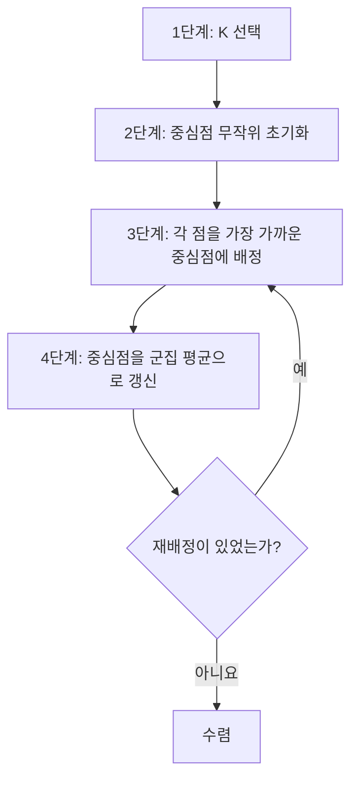

# 3장 — 비지도 학습

[레포지토리 안내](../../README.ko.md) | [English](Concepts_Lecture.md) | [한국어](Concepts_Lecture.ko.md)

> **최종 수정일:** 2026-10-26

> **학습 목표:**
> 1. 지도 학습과 비지도 학습, 군집화와 분류의 차이를 설명할 수 있다
> 2. 맨해튼 거리, 유클리드 거리, 상관관계 기반 거리를 비교하고 이상치와 스케일의 영향을 설명할 수 있다
> 3. 군집화 알고리즘(계층적 군집화, K-means)을 적용할 수 있다
> 4. 군집 수를 정하는 방법(덴드로그램의 절단 높이, K-means의 $K$)과 결과 평가의 필요성을 설명할 수 있다

---

## 목차

- [1. 군집화 vs. 분류](#1-군집화-vs-분류)
  - [1.1 군집화(Clustering)란?](#11-군집화clustering란)
  - [1.2 군집화 vs. 분류](#12-군집화-vs-분류)
- [2. 유사도와 거리](#2-유사도와-거리)
  - [2.1 유사도 지수(Similarity Index)](#21-유사도-지수similarity-index)
  - [2.2 비유사도 지수(Dissimilarity Index)](#22-비유사도-지수dissimilarity-index)
- [3. 거리 척도](#3-거리-척도)
  - [3.1 Manhattan Distance (맨해튼 거리, L1 Norm)](#31-manhattan-distance-맨해튼-거리-l1-norm)
  - [3.2 Euclidean Distance (유클리드 거리, L2 Norm)](#32-euclidean-distance-유클리드-거리-l2-norm)
  - [3.3 L1 vs. L2 비교](#33-l1-vs-l2-비교)
- [4. 거리 행렬, 이상치 영향, 정규화](#4-거리-행렬-이상치-영향-정규화)
  - [4.1 거리 행렬(Distance Matrix)](#41-거리-행렬distance-matrix)
  - [4.2 이상치가 거리 행렬에 미치는 영향](#42-이상치가-거리-행렬에-미치는-영향)
  - [4.3 정규화 (Z-scoring)](#43-정규화-z-scoring)
- [5. 상관관계 기반 거리](#5-상관관계-기반-거리)
  - [5.1 공분산(Covariance)](#51-공분산covariance)
  - [5.2 Pearson 상관계수 (Pearson's Correlation)](#52-pearson-상관계수-pearsons-correlation)
  - [5.3 Spearman 상관계수 (Spearman's Correlation)](#53-spearman-상관계수-spearmans-correlation)
  - [5.4 Pearson vs. Spearman: 구체적 예제](#54-pearson-vs-spearman-구체적-예제)
  - [5.5 상관관계 기반 거리 척도(Correlation-Based Distance Metric)](#55-상관관계-기반-거리-척도correlation-based-distance-metric)
  - [5.6 Norm 기반 vs. 상관관계 기반 거리](#56-norm-기반-vs-상관관계-기반-거리)
- [6. 군집화 알고리즘 개요](#6-군집화-알고리즘-개요)
  - [6.1 분류](#61-분류)
- [7. Hierarchical Clustering (계층적 군집화)](#7-hierarchical-clustering-계층적-군집화)
  - [7.1 개요](#71-개요)
  - [7.2 HCA 4단계](#72-hca-4단계)
  - [7.3 병합적 HC 알고리즘](#73-병합적-hc-알고리즘)
  - [7.4 덴드로그램 특성](#74-덴드로그램-특성)
  - [7.5 연결법(Linkage Methods)](#75-연결법linkage-methods)
  - [7.6 HC 풀이 예제: 6개 포인트 (A~F), 3가지 연결법 모두](#76-hc-풀이-예제-6개-포인트-af-3가지-연결법-모두)
  - [7.7 군집 레이블(Cluster Labels)](#77-군집-레이블cluster-labels)
  - [7.8 장단점](#78-장단점)
- [8. K-Means Clustering (K-평균 군집화)](#8-k-means-clustering-k-평균-군집화)
  - [8.1 개요](#81-개요)
  - [8.2 알고리즘](#82-알고리즘)
  - [8.3 수학적 정의](#83-수학적-정의)
  - [8.4 문제점 및 한계](#84-문제점-및-한계)
- [요약](#요약)
- [점검 문제](#점검-문제)

---

<br>

## 1. 군집화 vs. 분류

### 1.1 군집화(Clustering)란?

군집 분석(clustering analysis)은 객체들(실험 대상 또는 그 특성)의 집합을 **군집(cluster)** 이라 불리는 부분집합으로 그룹화하는 과정이다. 이는 사전에 정의된 레이블 없이 원시 데이터로부터 학습하는 **비지도 학습(Unsupervised Learning)** 의 가장 대표적인 형태이다.

- 군집화는 객체 간의 **유사도(Similarity)** 에 기반한다.
- 좋은 군집화는 군집 내 유사도가 높고 군집 간 유사도가 낮다.
- 군집화는 구조 탐색과 시각화, 이상치 식별, 결측값의 전역 패턴 탐지에 활용된다.

### 1.2 군집화 vs. 분류

| 측면 | 군집화(Clustering) | 분류(Classification) |
|--------|-----------|----------------|
| 학습 유형 | 비지도(Unsupervised) | 지도(Supervised) |
| 클래스 | 사전에 알 수 없음 | 미리 정의됨 |
| 목표 | 클래스 발견 (새로운/미지의 클래스 식별) | 클래스 예측 (새 사례를 알려진 클래스에 배정) |
| 접근 방식 | 탐색적 분석 | 학습 데이터로부터 분류기 탐색 |

*표 1. 군집화와 분류의 비교*

> **핵심:** 군집화에서는 클래스 정보가 없기 때문에 여러 유효한 답이 존재할 수 있다. 군집의 수는 분석 관점과 선택된 방법에 따라 달라진다.

---

<br>

## 2. 유사도와 거리

### 2.1 유사도 지수(Similarity Index)

서로 다른 객체들이 얼마나 **유사한지**를 나타내는 수치 값이다.

- 범위는 `0 <= Similarity <= 1`이다.
- 값이 높을수록 유사도가 크다.

### 2.2 비유사도 지수(Dissimilarity Index)

객체들이 얼마나 **다른지**를 나타내는 수치 값이다.

- `Distance = 1 - Similarity = Dissimilarity`로 정의한다.
- 객체 간 유사도가 높을수록 비유사도는 낮아진다.

> **핵심:** 유사도 측정 방식은 사용되는 군집화 알고리즘보다 더 중요한 경우가 많다. 유사도 또는 거리 척도의 선택이 군집화 결과를 근본적으로 결정한다.

---

<br>

## 3. 거리 척도

### 3.1 Manhattan Distance (맨해튼 거리, L1 Norm)

$$d_1(\mathbf{p}, \mathbf{q}) = \|\mathbf{p} - \mathbf{q}\|_1 = \sum_{i=1}^{n} |p_i - q_i|$$

**특성:**
- 이상치에 강건(robust)하다.
- 계산적으로 효율적이다.
- 항상 최적해를 찾을 수 있는 것은 아니다(3.3절).
- 격자형 경로를 따라 재는 시가지 거리(city block distance)를 측정한다.

### 3.2 Euclidean Distance (유클리드 거리, L2 Norm)

$$d_{euc}(\mathbf{x}, \mathbf{y}) = \sqrt{\sum_{i=1}^{n} (x_i - y_i)^2}$$

**특성:**
- 수학적 최적화를 통해 최적해를 찾을 수 있다.
- 이상치에 민감하다.
- 두 점 사이의 직선 거리를 측정한다.

### 3.3 L1 vs. L2 비교

| 특성 | L1 (Manhattan) | L2 (Euclidean) |
|----------|---------------|----------------|
| 이상치 강건성 | 강건 | 민감 |
| 계산 | 효율적 (계산적 방법) | 보다 수학적 |
| 최적해 | 항상 보장되지는 않음 | 최적해 탐색 가능 |
| 사용 사례 | 희소 데이터, 강건한 분석 | 범용 |

*표 2. L1 거리와 L2 거리의 비교*

**경사 기반 최적화에서 L2는 전역 최적해를 찾을 수 있지만 L1은 그렇지 못한 이유:**
- 두 척도 모두 부호(+/-)를 제거하는 방법을 사용한다. 거리는 음수가 될 수 없기 때문이다. 거리의 범위는 $[0, \infty)$이다.
- L2는 차이를 제곱하므로, 제곱한 L2 거리는 원점 (0, 0)을 포함한 모든 곳에서 매끄러운(미분 가능한) 표면을 만든다. 이를 통해 경사 기반 최적화가 전역해를 찾을 수 있다.
- L1은 절댓값을 사용하는데, 절댓값은 (0, 0)에서 미분할 수 없는 점을 만든다. 도함수의 부호가 그 점에서 급격히 바뀌므로, 경사 기반 방법으로는 전역 최적해를 안정적으로 찾을 수 없다.

> **참고:** **L1 기준 최적화의 전역 최적해.** 절댓값의 합도 볼록 함수이므로, L1 기준의 최적화 문제는 선형 계획법이나 부분 기울기(subgradient) 방법으로 전역 최적해를 구할 수 있다. 따라서 위의 차이는 전역 최적해의 존재가 아니라 매끄러운 경사 기반 최적화를 바로 쓸 수 있는지의 차이이다. 또 L1 기준의 최적해는 하나로 정해지지 않을 수 있다(예: 짝수 개 값의 중앙값).

> **핵심:** L1 기반 방법은 일반적으로 L2 기반 방법보다 이상치에 더 강건하다. 단 하나의 이상치가 L2 기반 거리 행렬을 크게 왜곡할 수 있다.

---

<br>

## 4. 거리 행렬, 이상치 영향, 정규화

### 4.1 거리 행렬(Distance Matrix)

$N \times P$ 데이터 행렬($N$개 표본, $P$개 특성)이 주어지면 두 가지 거리 행렬을 만들 수 있다.
- **표본 거리 행렬**은 표본 간 거리를 담은 $N \times N$ 행렬이다.
- **특성 거리 행렬**은 특성 간 거리를 담은 $P \times P$ 행렬이다.

**거리 행렬의 특성:**
- 항상 **대칭 행렬**이다($d(A,B) = d(B,A)$).
- 대각 원소는 항상 **0**이다($d(A,A) = 0$).
- 거리의 범위는 $[0, \infty)$이다.

유클리드 거리 행렬의 예는 다음과 같다.

| | Ind1 | Ind2 | Ind3 | Ind4 |
|------|------|------|------|------|
| Ind1 | 0 | 2.828 | 3.162 | 5.099 |
| Ind2 | 2.828 | 0 | 1.414 | 3.162 |
| Ind3 | 3.162 | 1.414 | 0 | 2 |
| Ind4 | 5.099 | 3.162 | 2 | 0 |

*표 3. 네 개체 사이의 유클리드 거리 행렬*

### 4.2 이상치가 거리 행렬에 미치는 영향

단 하나의 이상치가 전체 거리 행렬을 깨뜨릴 수 있다. 이 현상은 차이를 제곱하는 L2 기반 계산(제곱 거리, 분산)에서 특히 두드러진다.

**예제:** 학생 5명이 특성 (나이, 키, 성별)을 가진다. Student5의 키가 300,000으로 잘못 기록된 이상치이다(본래 약 220이어야 한다).

**이상치가 없는 경우** (L2 표본 거리 행렬):

| | St1 | St2 | St3 | St4 | St5 |
|-----|------|------|------|------|------|
| St1 | 0 | | | | |
| St2 | 1.97 | 0 | | | |
| St3 | 5.76 | 7.17 | 0 | | |
| St4 | 12.37 | 13.85 | 6.68 | 0 | |
| St5 | 50.46 | 52.09 | 44.94 | 38.31 | 0 |

*표 4. 이상치가 없을 때의 L2 표본 거리 행렬*

**이상치가 있는 경우** (Student5의 키 = 300,000, L2):

| | St1 | St2 | St3 | St4 | St5 |
|-----|------|------|------|------|--------|
| St1 | 0 | | | | |
| St2 | 1.97 | 0 | | | |
| St3 | 5.76 | 7.17 | 0 | | |
| St4 | 12.37 | 13.85 | 6.68 | 0 | |
| St5 | 299,829 | 299,831 | 299,824 | 299,817 | 0 |

*표 5. Student5의 키가 이상치일 때의 L2 표본 거리 행렬*

- St5와 관련된 거리가 약 50에서 299,000 이상으로 폭증한다.
- St5와의 L1 거리도 약 299,818까지 증가하여 거의 같은 영향을 받는다. 한 특성의 차이가 압도적으로 크면 L1 거리와 L2 거리가 모두 그 차이와 거의 같아지기 때문이다.
- 이 예는 **거리 행렬을 계산하기 전에 이상치 탐지가 중요한 이유**를 보여 준다.

### 4.3 정규화 (Z-scoring)

거리를 계산하기 전에, 비교 가능성을 확보하기 위해 특성을 정규화해야 하는 경우가 많다.

- **Z-score 정규화**는 각 특성별로 평균을 빼고 표준편차로 나눈다($z = (x - \bar{x})/s$).
- 정규화는 스케일이 큰 특성이 거리 계산을 지배하는 것을 막는다.

> **핵심:** 정규화 없이는 크기가 큰 특성이 거리 계산에 불균형적으로 큰 영향을 미치게 된다.

---

<br>

## 5. 상관관계 기반 거리

### 5.1 공분산(Covariance)

$$Cov(X, Y) = E[(X - E[X])(Y - E[Y])]$$

- 공분산은 두 변수가 각자의 평균에서 벗어난 편차를 곱한 값의 기댓값으로, 두 변수의 결합 변동성을 정량화한다.
- 공분산은 **스케일 의존적**이다. 어느 한 변수의 단위를 바꾸면 공분산의 크기도 변한다.
- 공분산을 두 표준편차의 곱으로 나누면 스케일 불변인 **Pearson 상관계수**가 된다.

> **[확률및통계]** 기댓값 $E[X]$는 확률변수 $X$가 취할 수 있는 값을 각각의 확률로 가중해 평균한 값이며, 이산형과 연속형의 공식은 4장의 8.1절에 있다. 공분산과 Pearson 상관계수는 이 기댓값으로 정의되고, 표본 데이터에서는 기댓값 대신 표본 평균을 써서 계산한다.

### 5.2 Pearson 상관계수 (Pearson's Correlation)

$$r_{xy} = \frac{Cov(x, y)}{\sigma_x \cdot \sigma_y} = \frac{S_{xy}}{\sqrt{S_{xx} S_{yy}}}$$

- L2 Norm에 기반한 수학적 방법이다.
- **선형(Linear)** 관계를 측정한다.
- 범위는 $[-1, 1]$이다.
- 이상치에 민감하다.
- $\lvert r \rvert = 1$은 완벽한 선형 관계에서만 성립한다.

### 5.3 Spearman 상관계수 (Spearman's Correlation)

$$r_s = \rho_{\text{rg}_X, \text{rg}_Y} = \frac{\text{cov}(\text{rg}_X, \text{rg}_Y)}{\sigma_{\text{rg}_X} \cdot \sigma_{\text{rg}_Y}}$$

- 순위(rank)에 기반한 계산적 방법으로, L1 개념에 가깝다.
- **단조(Monotonic)** 관계를 포착한다. 선형 관계뿐 아니라 $y = x^3$처럼 단조 증가하는 관계도 포착한다.
- 순위가 극단값을 흡수하므로 이상치에 강건하다.

### 5.4 Pearson vs. Spearman: 구체적 예제

**예제 1: 이상치가 없는 데이터 (직원 4명)**

| 직원 | 월 근무 시간 (HW) | 완료 작업 수 (TC) | 만족도 (S) |
|----------|----------------------|-----------------|--------------|
| A | 20 | 10 | 5.0 |
| B | 30 | 15 | 8.0 |
| C | 40 | 20 | 9.0 |
| D | 50 | 25 | 9.5 |

*표 6. 이상치가 없는 직원 데이터*

Pearson 상관계수:

| | HW | TC | S |
|-----|------|------|------|
| HW | 1.0 | | |
| TC | 1.0 | 1.0 | |
| S | 0.93 | 0.93 | 1.0 |

*표 7. 예제 1의 Pearson 상관계수*

Spearman 상관계수:

| | HW | TC | S |
|-----|------|------|------|
| HW | 1.0 | | |
| TC | 1.0 | 1.0 | |
| S | 1.0 | 1.0 | 1.0 |

*표 8. 예제 1의 Spearman 상관계수*

- HW와 TC는 완벽한 선형 관계(TC = HW / 2)이므로, 두 방법 모두 1.0을 정확히 측정한다.
- HW와 S는 단조 증가하지만 완벽한 선형은 아니다. Pearson은 0.93으로 과소평가하는 반면, Spearman은 완벽한 단조 추세를 1.0으로 정확히 포착한다.

**예제 2: 이상치가 있는 데이터 (직원 D의 완료 작업 수 = 5)**

| 직원 | 월 근무 시간 (HW) | 완료 작업 수 (TC) | 만족도 (S) |
|----------|----------------------|-----------------|--------------|
| A | 20 | 10 | 5.0 |
| B | 30 | 15 | 8.0 |
| C | 40 | 20 | 9.0 |
| D | 50 | **5** | 9.5 |

*표 9. 직원 D의 완료 작업 수가 이상치인 데이터*

Pearson 상관계수:

| | HW | TC | S |
|-----|-------|-------|------|
| HW | 1.0 | | |
| TC | **-0.20** | 1.0 | |
| S | 0.93 | **0.10** | 1.0 |

*표 10. 예제 2의 Pearson 상관계수*

Spearman 상관계수:

| | HW | TC | S |
|-----|------|------|------|
| HW | 1.0 | | |
| TC | **-0.20** | 1.0 | |
| S | 1.0 | **-0.20** | 1.0 |

*표 11. 예제 2의 Spearman 상관계수*

- 단 하나의 이상치로 인해 Pearson HW-TC가 **1.0에서 -0.20으로** 떨어졌다. 부호가 뒤바뀌어 근본적인 양의 추세를 잘못 표현한다.
- 이 예에서는 D의 완료 작업 수가 가장 큰 값에서 가장 작은 값으로 바뀌어 순위가 크게 변하므로, Spearman HW-TC도 **1.0에서 -0.20으로** 떨어진다. 관측이 4개뿐이면 한 관측의 순위 변화도 상관계수를 크게 바꾼다.
- 두 방법의 차이는 이상치의 크기에서 드러난다. D의 값이 0과 9 사이 어디에 있든 순위는 같으므로 Spearman은 -0.20으로 변하지 않지만, Pearson은 D = 0이면 -0.38, D = 9이면 0.05로 크게 달라진다.
- 이는 값의 크기를 그대로 쓰는 Pearson의 극단적인 이상치 민감도와, 순위만 쓰는 Spearman의 강건성을 보여 준다.

### 5.5 상관관계 기반 거리 척도(Correlation-Based Distance Metric)

$$D(X, Y) = 1 - |cor(X, Y)|$$

- 범위는 $[0, 1]$이다.

**이 변환이 필요한 이유:**
- 상관계수의 범위는 $[-1, 1]$이지만, 거리의 범위는 $[0, \infty)$여야 한다.
- 상관계수는 **음수**일 수 있으므로 그대로 거리로 사용할 수 없다.
- 변환 $D = 1 - \lvert \text{cor} \rvert$는 값을 $[0, 1]$로 옮기므로 거리의 요건을 충족한다.
- **한계:** 방향 정보가 손실된다. 변환된 값만으로는 원래 상관계수가 양수인지 음수인지 판단할 수 없다.

**상관관계 기반 거리의 장점:**
- 상관계수는 **스케일 불변**이므로 정규화가 필요 없다.
- 데이터 형태를 왜곡할 수 있는 정규화가 필요한 L1, L2 거리와 달리, 상관관계는 원본 데이터에 직접 적용할 수 있다.

### 5.6 Norm 기반 vs. 상관관계 기반 거리

| 특성 | Norm 기반 (L1/L2) | 상관관계 기반 |
|----------|-------------------|-------------------|
| 범위 | $[0, \infty)$ | $[0, 1]$ (변환 후) |
| 측정 대상 | 크기 차이 | 패턴 유사성 |
| 스케일 민감도 | 스케일 및 이상치에 매우 민감 | 스케일 불변 |
| 정규화 | 대개 필요 (데이터 왜곡 가능) | 불필요 |
| 방향 정보 | 방향 개념 없음 | 절댓값 사용 시 손실 |
| 사용 대상 | 절댓값 차이 | 데이터의 추세/형태 |
| 한계 | 높은 스케일 민감도 | 비단조 관계를 놓칠 수 있음 |

*표 12. Norm 기반 거리와 상관관계 기반 거리의 비교*

> **핵심:** Pearson 상관계수는 선형 관계를 포착하며 이상치에 민감한 반면, Spearman 상관계수는 단조 관계를 포착하며 이상치에 강건하다.

---

<br>

## 6. 군집화 알고리즘 개요

### 6.1 분류

- **상향식 병합 방법 (Bottom-up Agglomerative Methods)**
  - Hierarchical Clustering (HCL) (Eisen et al. 1998)

- **하향식 분할 방법 (Top-down Partitioning Methods)** (조합 최적화 문제)
  - K-means (Herwig et al. 1999)
  - K-medians
  - Self-Organizing Map (SOM) (Tamayo et al. 1999)

- **투영 방법 (Projection Methods)**
  - Principal Component Analysis (PCA) (Raychaudhuri et al., 2000)
  - Multi-Dimensional Scaling (MDS)

---

<br>

## 7. Hierarchical Clustering (계층적 군집화)

### 7.1 개요

HC는 여러 수준의 세분도(granularity)에서 데이터를 그룹화하는 **덴드로그램(Dendrogram)** 이라 불리는 이진 트리 구조를 생성한다.

- **병합적 (Agglomerative, 상향식)** 방법은 각 객체를 하나의 군집으로 두고 시작하여 가장 가까운 쌍을 차례로 병합한다.
- **분할적 (Divisive, 하향식)** 방법은 모든 객체를 하나의 군집으로 두고 시작하여 재귀적으로 분할한다.
- 병합적 방법이 가장 일반적으로 사용된다.

### 7.2 HCA 4단계

계층적 군집 분석(Hierarchical Clustering Analysis)을 수행하는 과정은 네 가지 주요 단계로 나눌 수 있다.

1. **거리 행렬 생성**
2. **덴드로그램 생성** (연결법을 사용)
3. **덴드로그램에서 그룹 정보 추출** (선택한 높이에서 자르기)
4. **군집화 결과 평가**

### 7.3 병합적 HC 알고리즘

1. $N$개의 객체가 $N$개의 군집을 이루게 한다(각 객체가 하나의 군집이다).
2. 거리가 가장 작은 두 군집을 병합한다(군집 수 = $N - 1$).
3. 모든 군집이 하나의 계층적 트리(덴드로그램)로 연결될 때까지 반복한다.

### 7.4 덴드로그램 특성

- 최종 군집이 **루트(Root)** 이고 각 데이터 항목이 **리프(Leaf)** 이다.
- 막대의 **높이**는 항목들이 얼마나 가까운지를 나타낸다. 낮은 높이에서 병합된 항목일수록 가깝다.
- 원하는 높이에서 덴드로그램을 잘라 군집의 수를 정한다.

### 7.5 연결법(Linkage Methods)

연결법은 군집 $G$와 $H$ 사이의 거리를 측정하는 방법을 정한다. 아래 식에서 $n_G$와 $n_H$는 두 군집의 구성원 수이다.

| 연결법 | 공식 | 설명 |
|---------|---------|-------------|
| **Single** | $d_S(G,H) = \min_{i \in G, j \in H} d(z_i, z_j)$ | 최소 거리 (최근접 이웃) |
| **Complete** | $d_C(G,H) = \max_{i \in G, j \in H} d(z_i, z_j)$ | 최대 거리 (최원접 이웃) |
| **Average** | $d_A(G,H) = \frac{1}{n_G n_H} \sum_{i \in G} \sum_{j \in H} d(z_i, z_j)$ | 모든 쌍별 거리의 평균 |

*표 13. 세 가지 연결법의 군집 간 거리 정의*

### 7.6 HC 풀이 예제: 6개 포인트 (A~F), 3가지 연결법 모두

**주어진 조건:** 2차원 공간에 데이터 포인트 6개(A~F)가 있다. 초기 **L1 (Manhattan) 거리 행렬**은 다음과 같다.

| L1 | A | B | C | D | E | F |
|----|-----|-----|-----|-----|-----|-----|
| A | 0 | | | | | |
| B | 5 | 0 | | | | |
| C | 5 | 4 | 0 | | | |
| D | 15 | 10 | 10 | 0 | | |
| E | 16 | 11 | 11 | 1 | 0 | |
| F | 19 | 14 | 14 | 4 | 3 | 0 |

*표 14. 여섯 점의 초기 L1 거리 행렬*

가장 작은 거리는 $d(D,E) = 1$이므로, 세 가지 방법 모두 {D, E}를 병합하는 것으로 시작한다.

---

#### 7.6.1 Single Linkage (최근접 이웃법)

**갱신 규칙:** $d(G \cup H, X) = \min[d(G, X), d(H, X)]$이다. 즉 병합된 군집과 $X$ 사이의 거리는 각 구성원과 $X$ 사이 거리의 최솟값이다.

**단계 1:** {D, E}를 병합한다(거리 = 1). min을 사용하여 거리를 갱신한다.
- $d(DE, A) = \min[d(D,A), d(E,A)] = \min[15, 16] = 15$
- $d(DE, B) = \min[d(D,B), d(E,B)] = \min[10, 11] = 10$
- $d(DE, C) = \min[d(D,C), d(E,C)] = \min[10, 11] = 10$
- $d(DE, F) = \min[d(D,F), d(E,F)] = \min[4, 3] = 3$

| 단계 1 | A | B | C | DE | F |
|--------|-----|-----|-----|------|-----|
| A | 0 | | | | |
| B | 5 | 0 | | | |
| C | 5 | 4 | 0 | | |
| DE | 15 | 10 | 10 | 0 | |
| F | 19 | 14 | 14 | **3** | 0 |

*표 15. Single Linkage 단계 1 이후의 거리 행렬*

**단계 2:** {F, DE}를 병합한다(거리 = 3). min을 사용하여 거리를 갱신한다.
- $d(DEF, A) = \min[d(D,A), d(E,A), d(F,A)] = \min[15, 16, 19] = 15$
- $d(DEF, B) = \min[d(D,B), d(E,B), d(F,B)] = \min[10, 11, 14] = 10$
- $d(DEF, C) = \min[d(D,C), d(E,C), d(F,C)] = \min[10, 11, 14] = 10$

| 단계 2 | A | B | C | DEF |
|--------|-----|-----|-----|------|
| A | 0 | | | |
| B | 5 | 0 | | |
| C | 5 | **4** | 0 | |
| DEF | 15 | 10 | 10 | 0 |

*표 16. Single Linkage 단계 2 이후의 거리 행렬*

**단계 3:** {B, C}를 병합한다(거리 = 4).
- $d(BC, A) = \min[d(B,A), d(C,A)] = \min[5, 5] = 5$
- $d(BC, DEF) = \min[d(B,DEF), d(C,DEF)] = \min[10, 10] = 10$

| 단계 3 | A | BC | DEF |
|--------|-----|------|------|
| A | 0 | | |
| BC | **5** | 0 | |
| DEF | 15 | 10 | 0 |

*표 17. Single Linkage 단계 3 이후의 거리 행렬*

**단계 4:** {A, BC}를 병합한다(거리 = 5).
- $d(ABC, DEF) = \min[d(A,DEF), d(BC,DEF)] = \min[15, 10] = 10$

| 단계 4 | ABC | DEF |
|--------|------|------|
| ABC | 0 | |
| DEF | **10** | 0 |

*표 18. Single Linkage 단계 4 이후의 거리 행렬*

**Single Linkage 병합 순서:** {D, E} (높이 1) → {F, DE} (높이 3) → {B, C} (높이 4) → {A, BC} (높이 5) → {ABC, DEF} (높이 10)

---

#### 7.6.2 Complete Linkage (최원접 이웃법)

**갱신 규칙:** $d(G \cup H, X) = \max[d(G, X), d(H, X)]$이다. 즉 병합된 군집과 $X$ 사이의 거리는 각 구성원과 $X$ 사이 거리의 최댓값이다.

**단계 1:** {D, E}를 병합한다(거리 = 1). max를 사용하여 거리를 갱신한다.
- $d(DE, A) = \max[d(D,A), d(E,A)] = \max[15, 16] = 16$
- $d(DE, B) = \max[d(D,B), d(E,B)] = \max[10, 11] = 11$
- $d(DE, C) = \max[d(D,C), d(E,C)] = \max[10, 11] = 11$
- $d(DE, F) = \max[d(D,F), d(E,F)] = \max[4, 3] = 4$

| 단계 1 | A | B | C | DE | F |
|--------|-----|-----|-----|------|-----|
| A | 0 | | | | |
| B | 5 | 0 | | | |
| C | 5 | **4** | 0 | | |
| DE | 16 | 11 | 11 | 0 | |
| F | 19 | 14 | 14 | 4 | 0 |

*표 19. Complete Linkage 단계 1 이후의 거리 행렬*

**단계 2:** {B, C}를 병합한다(거리 = 4). 거리가 4인 쌍은 {B, C}와 {DE, F} 두 개이며, 두 쌍은 겹치지 않으므로 어느 쪽을 먼저 병합해도 덴드로그램은 같다. max를 사용하여 거리를 갱신한다.
- $d(BC, A) = \max[d(B,A), d(C,A)] = \max[5, 5] = 5$
- $d(BC, DE) = \max[d(B,DE), d(C,DE)] = \max[11, 11] = 11$
- $d(BC, F) = \max[d(B,F), d(C,F)] = \max[14, 14] = 14$

| 단계 2 | A | BC | DE | F |
|--------|-----|------|------|-----|
| A | 0 | | | |
| BC | **5** | 0 | | |
| DE | 16 | 11 | 0 | |
| F | 19 | 14 | 4 | 0 |

*표 20. Complete Linkage 단계 2 이후의 거리 행렬*

**단계 3:** {DE, F}를 병합한다(거리 = 4).
- $d(DEF, A) = \max[d(DE,A), d(F,A)] = \max[16, 19] = 19$
- $d(DEF, BC) = \max[d(DE,BC), d(F,BC)] = \max[11, 14] = 14$

| 단계 3 | A | BC | DEF |
|--------|-----|------|------|
| A | 0 | | |
| BC | 5 | 0 | |
| DEF | 19 | **14** | 0 |

*표 21. Complete Linkage 단계 3 이후의 거리 행렬*

**단계 4:** {A, BC}를 병합한다(거리 = 5).
- $d(ABC, DEF) = \max[d(A,DEF), d(BC,DEF)] = \max[19, 14] = 19$

| 단계 4 | ABC | DEF |
|--------|------|------|
| ABC | 0 | |
| DEF | **19** | 0 |

*표 22. Complete Linkage 단계 4 이후의 거리 행렬*

**Complete Linkage 병합 순서:** {D, E} (높이 1) → {B, C} (높이 4) → {DE, F} (높이 4) → {A, BC} (높이 5) → {ABC, DEF} (높이 19)

---

#### 7.6.3 Average Linkage (평균 연결법)

**갱신 규칙:** 병합된 군집과 $X$ 사이의 거리는 병합된 군집의 각 구성원과 $X$의 각 구성원 사이 모든 쌍별 거리의 평균이다. 병합 전 군집의 거리로 쓰면 $d(G \cup H, X) = \frac{n_G d(G, X) + n_H d(H, X)}{n_G + n_H}$이다.

**단계 1:** {D, E}를 병합한다(거리 = 1). 평균을 사용하여 거리를 갱신한다.
- $d(DE, A) = \operatorname{avg}[d(D,A), d(E,A)] = \operatorname{avg}[15, 16] = 15.5$
- $d(DE, B) = \operatorname{avg}[d(D,B), d(E,B)] = \operatorname{avg}[10, 11] = 10.5$
- $d(DE, C) = \operatorname{avg}[d(D,C), d(E,C)] = \operatorname{avg}[10, 11] = 10.5$
- $d(DE, F) = \operatorname{avg}[d(D,F), d(E,F)] = \operatorname{avg}[4, 3] = 3.5$

| 단계 1 | A | B | C | DE | F |
|--------|------|-----|-----|------|-----|
| A | 0 | | | | |
| B | 5 | 0 | | | |
| C | 5 | 4 | 0 | | |
| DE | 15.5 | 10.5 | 10.5 | 0 | |
| F | 19 | 14 | 14 | **3.5** | 0 |

*표 23. Average Linkage 단계 1 이후의 거리 행렬*

**단계 2:** {F, DE}를 병합한다(거리 = 3.5). 평균을 사용하여 거리를 갱신한다(현재 구성원 3개: D, E, F).
- $d(DEF, A) = \operatorname{avg}[d(D,A), d(E,A), d(F,A)] = \operatorname{avg}[15, 16, 19] = 16.67$
- $d(DEF, B) = \operatorname{avg}[d(D,B), d(E,B), d(F,B)] = \operatorname{avg}[10, 11, 14] = 11.67$
- $d(DEF, C) = \operatorname{avg}[d(D,C), d(E,C), d(F,C)] = \operatorname{avg}[10, 11, 14] = 11.67$

| 단계 2 | A | B | C | DEF |
|--------|------|-----|-----|-------|
| A | 0 | | | |
| B | 5 | 0 | | |
| C | 5 | **4** | 0 | |
| DEF | 16.67 | 11.67 | 11.67 | 0 |

*표 24. Average Linkage 단계 2 이후의 거리 행렬*

> **주의:** 병합된 군집의 거리를 이전 거리의 단순 평균으로 구하면 안 된다. $d(DEF, A)$를 $\operatorname{avg}[d(DE, A), d(F, A)] = \operatorname{avg}[15.5, 19] = 17.25$로 계산하면 틀리며, 구성원 수로 가중한 $(2 \times 15.5 + 1 \times 19)/3 = 16.67$이 맞다.

**단계 3:** {B, C}를 병합한다(거리 = 4).
- $d(BC, A) = \operatorname{avg}[d(B,A), d(C,A)] = \operatorname{avg}[5, 5] = 5$
- $d(BC, DEF) = \operatorname{avg}[d(B,DEF), d(C,DEF)] = \operatorname{avg}[11.67, 11.67] = 11.67$

| 단계 3 | A | BC | DEF |
|--------|-----|------|-------|
| A | 0 | | |
| BC | **5** | 0 | |
| DEF | 16.67 | 11.67 | 0 |

*표 25. Average Linkage 단계 3 이후의 거리 행렬*

**단계 4:** {A, BC}를 병합한다(거리 = 5).
- $d(ABC, DEF)$ = 모든 $3 \times 3$ 쌍별 거리의 평균 = $(15 + 16 + 19 + 10 + 11 + 14 + 10 + 11 + 14)/9 = 120/9 = 13.33$

| 단계 4 | ABC | DEF |
|--------|------|-------|
| ABC | 0 | |
| DEF | **13.33** | 0 |

*표 26. Average Linkage 단계 4 이후의 거리 행렬*

**Average Linkage 병합 순서:** {D, E} (높이 1) → {F, DE} (높이 3.5) → {B, C} (높이 4) → {A, BC} (높이 5) → {ABC, DEF} (높이 13.33)

---

#### 7.6.4 덴드로그램 자르기 예제

**Average Linkage** 덴드로그램(그림 1)을 **높이 = 8**에서 자르면 두 개의 군집이 생긴다.

```text
height
13.33 ┤           ┌────────────┴─────────────┐
      │           │                          │
 8.00 ┼-----------│--------------------------│-----  cut (h = 8)
      │           │                          │
 5.00 ┤           │                   ┌──────┴──────┐
 4.00 ┤           │                   │          ┌──┴──┐
 3.50 ┤      ┌────┴────┐              │          │     │
 1.00 ┤   ┌──┴──┐      │              │          │     │
 0.00 ┼   D     E      F              A          B     C
```

*그림 1. Average Linkage 덴드로그램과 높이 8의 절단선*

- **군집 1:** {F, D, E}는 높이 1과 3.5에서 병합되었으며, 두 높이 모두 8보다 낮다.
- **군집 2:** {A, B, C}는 높이 4와 5에서 병합되었으며, 두 높이 모두 8보다 낮다.

군집 간 병합은 13.33에서 이루어지며 이는 절단선 위에 있으므로, 두 그룹은 분리된 상태로 남는다.

어디에서 자를지에 대한 단 하나의 정답은 없다. 선택은 분석 목표에 따라 달라지며, 평가 지표가 결정을 도울 수 있다.

### 7.7 군집 레이블(Cluster Labels)

군집 레이블은 임의의 이름을 가진 **명목형 범주 변수(Nominal Categorical Variables)** 이다. 레이블 자체에는 고유한 의미가 없으며, 그룹화만이 중요하다. 예를 들어 [A, A, B]는 [B, B, A]와 같은 군집화이다.

### 7.8 장단점

| 장점 | 단점 |
|------|------|
| 모든 수준의 세분도 탐색 가능 (1~$N$개 군집) | $O(N^2)$ 계산 비용 |
| 군집 수를 사전 지정할 필요 없음 | 저장 요구량: $(N^2 - N)/2$ |
| 해석 가능한 덴드로그램 생성 | 노이즈와 이상치에 민감 |

*표 27. 계층적 군집화의 장단점*

> **참고:** **계산 비용.** 거리 행렬을 계산하고 저장하는 데 이미 $O(N^2)$가 든다. 매 단계 가장 가까운 쌍을 전체 행렬에서 찾는 단순한 구현은 병합을 $N - 1$번 하므로 $O(N^3)$ 시간이 걸리며, 효율적인 알고리즘은 Single, Complete, Average 연결법에서 $O(N^2)$ 시간에 동작한다.

> **핵심:** HC는 여러 세분도 수준에서 데이터 구조를 탐색하는 데 이상적이지만, $O(N^2)$ 비용과 $(N^2 - N)/2$ 크기의 거리 행렬을 저장해야 하는 부담 때문에 대규모 데이터셋에서는 계산 비용이 높아진다.

---

<br>

## 8. K-Means Clustering (K-평균 군집화)

### 8.1 개요

K-means는 군집 내 분산을 최소화하여 데이터를 $K$개의 그룹으로 나누는 **하향식 분할(Top-down Partitioning)** 방법이다. **EM (Expectation-Maximization) 알고리즘**의 대표적인 예로, 배정 단계가 E 단계에, 중심점 갱신 단계가 M 단계에 해당한다.

### 8.2 알고리즘

1. 군집의 수 $K$를 **선택**한다.
2. 군집 중심점(centroid)을 무작위로 **초기화**한다.
3. 각 데이터 포인트를 가장 가까운 중심점에 **배정**한다.
4. 각 군집에 속한 모든 점의 평균으로 중심점을 **갱신**한다.
5. 수렴할 때까지(새로운 재배정이 없을 때까지) 3~4단계를 **반복**한다.



*그림 2. K-means 알고리즘의 반복 과정*

### 8.3 수학적 정의

$m_k(t)$를 단계 $t$에서 $k$번째 군집의 중심점, $C_i(t)$를 단계 $t$에서 $i$번째 객체의 군집 배정이라 하자.

**배정 단계:**

$$C_i(t) = \underset{1 \leq k \leq K}{\text{argmin}} \; d(z_i, m_k(t))$$

**수렴 기준** (총 군집 내 분산):

$$V(t) = \sum_{k=1}^{K} \sum_{i: C_i(t)=k} \lVert z_i - m_k(t) \rVert^2$$

$V(t)$는 반복할 때마다 증가하지 않으며, 더 이상 줄지 않으면(재배정이 없으면) 알고리즘이 수렴한다.

### 8.4 문제점 및 한계

- **무작위 초기화**: 실행마다 다른 군집이 나올 수 있다.
- **경성 배정(Hard Assignment)**: 각 데이터 포인트는 정확히 하나의 군집에만 속한다.
- **형태 가정**: 암묵적으로 대략 구형인 군집을 가정한다.
- **$K$를 지정해야 함**: 군집의 수를 사전에 선택해야 한다.
- **지역 최적해(Local Optimum)**: 전역 최적해를 보장하지 않으며, 지역 최솟값에 수렴할 수 있다.
- **군집 내 유사도 정보 없음**: HC와 달리 K-means는 군집의 내부 구조에 대한 정보를 제공하지 않는다.

> **핵심:** K-means는 대규모 데이터셋에 효율적이지만, $K$를 사전에 지정해야 하며 초기화에 따라 다른 해로 수렴할 수 있다. 이를 완화하려면 무작위 시작을 여러 번 사용한다.

---

<br>

## 요약

| 개념 | 핵심 요약 |
|---------|-----------|
| 군집화 vs. 분류 | 군집화는 레이블 없이 학습하는 비지도 학습이고, 분류는 미리 정의된 레이블로 학습하는 지도 학습이다. |
| 유사도와 거리 | Distance = 1 - Similarity로 정의하며, 척도의 선택이 중요하고 거리의 범위는 $[0, \infty)$이다. |
| L1 (Manhattan) | 이상치에 강건하고 계산이 효율적이지만 (0, 0)에서 미분할 수 없다. |
| L2 (Euclidean) | 이상치에 민감하지만 제곱한 거리가 모든 곳에서 미분 가능하여 경사 기반 최적화로 전역 최적해를 찾을 수 있다. |
| 거리 행렬 | 대각 원소가 0인 대칭 행렬이며 저장량은 $(N^2 - N)/2$이다. |
| 이상치 영향 | 단일 이상치가 L2 거리를 약 300,000으로 폭증시켜 거리 행렬을 깨뜨릴 수 있으며, L1 거리도 영향을 받는다. |
| 공분산 | $Cov(X,Y) = E[(X-E[X])(Y-E[Y])]$로 정의하며, 스케일에 의존하고 표준편차로 정규화하면 Pearson 상관계수가 된다. |
| Pearson 상관계수 | 선형 관계를 측정하며, 이상치에 민감하여 이상치 하나로 부호가 뒤바뀔 수 있다. |
| Spearman 상관계수 | 순위를 사용하여 단조 관계를 측정하며 이상치에 강건하다. |
| 상관관계 기반 거리 | $D = 1 - \lvert \text{cor} \rvert$로 정의하며, 범위가 $[-1, 1]$인 상관계수를 그대로 거리로 쓸 수 없어서 필요하지만 방향 정보를 잃는다. |
| HCA 4단계 | (1) 거리 행렬 생성, (2) 덴드로그램 생성, (3) 그룹 추출, (4) 결과 평가의 순서로 진행한다. |
| 계층적 군집화 | 상향식 병합으로 덴드로그램을 만들며, 거리 행렬에 $O(N^2)$의 계산이 들고 저장량은 $(N^2 - N)/2$이다. |
| 연결법 | Single(최솟값), Complete(최댓값), Average(모든 쌍의 평균)는 같은 데이터에서도 서로 다른 덴드로그램을 만든다. |
| K-Means | 조합 최적화 문제를 푸는 하향식 분할 방법으로, $K$를 지정해야 하고 초기화에 민감하다. |

---

<br>

## 점검 문제

1. **거리 계산:** 두 점 $p = (1, 2)$와 $q = (4, 6)$ 사이의 맨해튼 거리와 유클리드 거리를 구하라.

   <details>
   <summary>정답</summary>

   좌표 차이의 절댓값은 $\lvert 1 - 4 \rvert = 3$, $\lvert 2 - 6 \rvert = 4$이다. 맨해튼 거리는 $3 + 4 = 7$이고, 유클리드 거리는 $\sqrt{3^2 + 4^2} = \sqrt{25} = 5$이다. 유클리드 거리는 맨해튼 거리보다 클 수 없다.

   </details>

2. **상관관계 기반 거리:** 두 특성의 상관계수가 $0.8$인 경우와 $-0.8$인 경우의 거리 $D = 1 - \lvert \text{cor} \rvert$를 각각 구하고, 이 결과가 보여 주는 한계를 설명하라.

   <details>
   <summary>정답</summary>

   두 경우 모두 $D = 1 - 0.8 = 0.2$이다. 강한 양의 상관과 강한 음의 상관이 같은 거리로 바뀌므로, 거리만으로는 원래 관계의 방향을 알 수 없다. 이것이 5.5절에서 말한 방향 정보의 손실이다.

   </details>

3. **Pearson과 Spearman:** $x = 1, 2, 3, 4, 5$이고 $y = x^3$일 때 Spearman 상관계수를 구하고, Pearson 상관계수가 1보다 작은 이유를 설명하라.

   <details>
   <summary>정답</summary>

   $y$ = 1, 8, 27, 64, 125는 $x$와 순위가 완전히 같으므로 Spearman 상관계수는 1이다. Pearson 상관계수는 약 0.94이다. 관계가 단조 증가하지만 직선이 아니므로 선형 관계의 정도를 재는 Pearson 상관계수는 1보다 작다.

   </details>

4. **덴드로그램 자르기:** 7.6.1절의 Single Linkage 덴드로그램을 높이 4.5에서 자르면 군집이 몇 개 생기고, 각 군집의 구성원은 무엇인가?

   <details>
   <summary>정답</summary>

   병합 높이 1, 3, 4는 4.5보다 낮고 5와 10은 높다. 따라서 높이 4까지의 병합만 남아 {D, E, F}, {B, C}, {A}의 세 군집이 생긴다.

   </details>

5. **K-means 반복:** 1차원 데이터 1, 2, 3, 8, 9, 10에 $K = 2$, 초기 중심점 2와 3으로 K-means를 적용하라. 각 반복의 배정과 중심점, 수렴했을 때의 총 군집 내 분산 $V$를 구하라.

   <details>
   <summary>정답</summary>

   반복 1에서 1과 2는 중심점 2에, 3, 8, 9, 10은 중심점 3에 배정되고, 중심점은 $1.5$와 $(3 + 8 + 9 + 10)/4 = 7.5$로 갱신된다. 반복 2에서 3은 1.5와의 거리가 1.5, 7.5와의 거리가 4.5이므로 첫 군집으로 옮겨 가고, 배정은 {1, 2, 3}과 {8, 9, 10}이 되며 중심점은 2와 9로 갱신된다. 반복 3에서는 배정이 바뀌지 않으므로 수렴한다. 이때 $V = (1 + 0 + 1) + (1 + 0 + 1) = 4$이다.

   </details>
