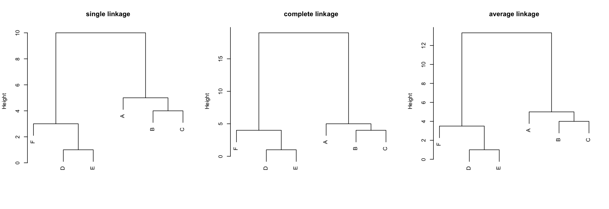
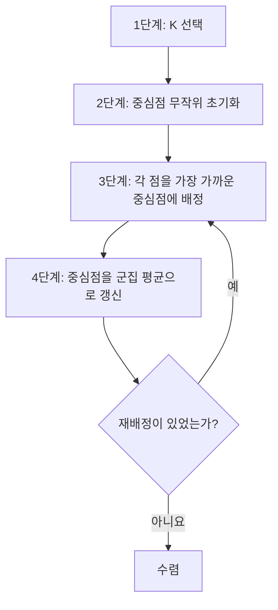
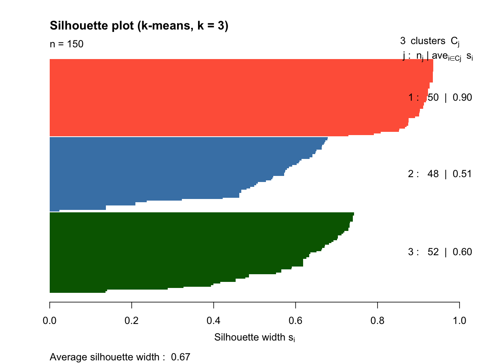

# 3장 — 비지도 학습

[레포지토리 안내](../../README.ko.md) | [English](Concepts_Lecture.md) | [한국어](Concepts_Lecture.ko.md)

> **최종 수정일:** 2026-11-19

> **학습 목표:**
> 1. 지도 학습과 비지도 학습, 군집화와 분류의 차이를 설명할 수 있다
> 2. 맨해튼 거리, 유클리드 거리, 상관관계 기반 거리를 비교하고 이상치와 스케일의 영향을 설명할 수 있다
> 3. 군집화 알고리즘(계층적 군집화, K-means)을 적용할 수 있다
> 4. 군집 수를 정하는 방법(덴드로그램의 절단 높이, K-means의 $K$)과 결과 평가의 필요성을 설명할 수 있다
> 5. Minkowski 거리를 계산하고 K-means의 목적 함수가 반복마다 줄어드는 이유를 설명할 수 있다
> 6. 실루엣 폭, 순도, Rand 지수로 군집화 결과를 평가할 수 있다

---

## 목차

- [1. 군집화 vs. 분류](#1-군집화-vs-분류)
  - [1.1 군집화(Clustering)의 개념](#11-군집화clustering의-개념)
  - [1.2 군집화 vs. 분류](#12-군집화-vs-분류)
  - [1.3 군집 수의 모호성](#13-군집-수의-모호성)
- [2. 유사도와 거리](#2-유사도와-거리)
  - [2.1 유사도 지수(Similarity Index)](#21-유사도-지수similarity-index)
  - [2.2 비유사도 지수(Dissimilarity Index)](#22-비유사도-지수dissimilarity-index)
- [3. 거리 척도](#3-거리-척도)
  - [3.1 Manhattan Distance (맨해튼 거리, L1 Norm)](#31-manhattan-distance-맨해튼-거리-l1-norm)
  - [3.2 Euclidean Distance (유클리드 거리, L2 Norm)](#32-euclidean-distance-유클리드-거리-l2-norm)
  - [3.3 L1 vs. L2 비교](#33-l1-vs-l2-비교)
  - [3.4 Minkowski 거리](#34-minkowski-거리)
  - [3.5 거리의 공리](#35-거리의-공리)
- [4. 거리 행렬, 이상치 영향, 정규화](#4-거리-행렬-이상치-영향-정규화)
  - [4.1 거리 행렬(Distance Matrix)](#41-거리-행렬distance-matrix)
  - [4.2 이상치가 거리 행렬에 미치는 영향](#42-이상치가-거리-행렬에-미치는-영향)
  - [4.3 정규화 (Z-scoring)](#43-정규화-z-scoring)
  - [4.4 정규화의 계산 예](#44-정규화의-계산-예)
- [5. 상관관계 기반 거리](#5-상관관계-기반-거리)
  - [5.1 공분산(Covariance)](#51-공분산covariance)
  - [5.2 Pearson 상관계수 (Pearson's Correlation)](#52-pearson-상관계수-pearsons-correlation)
  - [5.3 Spearman 상관계수 (Spearman's Correlation)](#53-spearman-상관계수-spearmans-correlation)
  - [5.4 Pearson vs. Spearman: 구체적 예제](#54-pearson-vs-spearman-구체적-예제)
  - [5.5 상관관계 기반 거리 척도(Correlation-Based Distance Metric)](#55-상관관계-기반-거리-척도correlation-based-distance-metric)
  - [5.6 Norm 기반 vs. 상관관계 기반 거리](#56-norm-기반-vs-상관관계-기반-거리)
- [6. 군집화 알고리즘 개요](#6-군집화-알고리즘-개요)
  - [6.1 분류](#61-분류)
  - [6.2 분할 방법의 특징](#62-분할-방법의-특징)
- [7. Hierarchical Clustering (계층적 군집화)](#7-hierarchical-clustering-계층적-군집화)
  - [7.1 개요](#71-개요)
  - [7.2 HCA 4단계](#72-hca-4단계)
  - [7.3 병합적 HC 알고리즘](#73-병합적-hc-알고리즘)
  - [7.4 덴드로그램 특성](#74-덴드로그램-특성)
  - [7.5 연결법(Linkage Methods)](#75-연결법linkage-methods)
  - [7.6 HC 풀이 예제: 6개 포인트 (A~F), 3가지 연결법 모두](#76-hc-풀이-예제-6개-포인트-af-3가지-연결법-모두)
  - [7.7 군집 레이블(Cluster Labels)](#77-군집-레이블cluster-labels)
  - [7.8 장단점](#78-장단점)
  - [7.9 단계별 병합의 진행](#79-단계별-병합의-진행)
  - [7.10 R로 확인하는 계층적 군집화](#710-r로-확인하는-계층적-군집화)
  - [7.11 연결법에 따른 군집의 모양](#711-연결법에-따른-군집의-모양)
- [8. K-Means Clustering (K-평균 군집화)](#8-k-means-clustering-k-평균-군집화)
  - [8.1 개요](#81-개요)
  - [8.2 알고리즘](#82-알고리즘)
  - [8.3 수학적 정의](#83-수학적-정의)
  - [8.4 문제점 및 한계](#84-문제점-및-한계)
  - [8.5 목적 함수와 수렴](#85-목적-함수와-수렴)
  - [8.6 K-means의 손계산 예](#86-k-means의-손계산-예)
  - [8.7 R의 kmeans()와 생명과학 자료](#87-r의-kmeans와-생명과학-자료)
- [9. 군집화 결과의 평가](#9-군집화-결과의-평가)
  - [9.1 평가 기준의 분류](#91-평가-기준의-분류)
  - [9.2 실루엣 폭 (Silhouette Width)](#92-실루엣-폭-silhouette-width)
  - [9.3 평균 실루엣 폭으로 K 정하기](#93-평균-실루엣-폭으로-k-정하기)
  - [9.4 순도 (Purity)](#94-순도-purity)
  - [9.5 Rand 지수 (Rand Index)](#95-rand-지수-rand-index)
  - [9.6 올바른 군집 수의 문제](#96-올바른-군집-수의-문제)
- [10. 투영 방법과 군집화 방법의 비교](#10-투영-방법과-군집화-방법의-비교)
  - [10.1 투영 방법](#101-투영-방법)
  - [10.2 군집화 방법의 장단점](#102-군집화-방법의-장단점)
  - [10.3 흔한 실수](#103-흔한-실수)
- [요약](#요약)
- [점검 문제](#점검-문제)

---

<br>

## 1. 군집화 vs. 분류

### 1.1 군집화(Clustering)의 개념

군집 분석(clustering analysis)은 객체들(실험 대상 또는 그 특성)의 집합을 **군집(cluster)** 이라 불리는 부분집합으로 그룹화하는 과정이다. 이는 사전에 정의된 레이블 없이 원시 데이터로부터 학습하는 **비지도 학습(Unsupervised Learning)** 의 가장 대표적인 형태이다.

- 군집화는 객체 간의 **유사도(Similarity)** 에 기반한다.
- 좋은 군집화는 군집 내 유사도가 높고 군집 간 유사도가 낮다.
- 군집화는 구조 탐색과 시각화, 이상치 식별, 결측값의 전역 패턴 탐지에 활용된다.

### 1.2 군집화 vs. 분류

| 측면 | 군집화(Clustering) | 분류(Classification) |
|--------|-----------|----------------|
| 학습 유형 | 비지도(Unsupervised) | 지도(Supervised) |
| 클래스 | 사전에 알 수 없음 | 미리 정의됨 |
| 목표 | 클래스 발견 (새로운/미지의 클래스 식별) | 클래스 예측 (새 사례를 알려진 클래스에 배정) |
| 접근 방식 | 탐색적 분석 | 학습 데이터로부터 분류기 탐색 |

*표 1. 군집화와 분류의 비교*

> **핵심:** 군집화에서는 클래스 정보가 없기 때문에 여러 유효한 답이 존재할 수 있다. 군집의 수는 분석 관점과 선택된 방법에 따라 달라진다.

### 1.3 군집 수의 모호성

2차원 산점도에 점들이 흩어져 있을 때 사람은 덩어리가 몇 개인지 직관적으로 알아본다. 그러나 같은 점들을 두고도 답은 하나가 아니다. 위쪽과 아래쪽 두 무리로 나누면 군집이 2개이고, 각 무리를 다시 모양이 비슷한 세 묶음씩으로 나누면 군집이 6개이다. 클래스 정보가 없으므로 어느 쪽이 맞다고 판정할 기준이 데이터 안에 없다.

반대로 각 점에 그 점의 수치 특성에 따라 정해지는 특성값(예: 질병 유무)이 붙어 있고 그 값을 수치 특성으로 예측하려 한다면, 그것은 분류 분석이다. 이때 특성값이 6장에서 다루는 **클래스(class)** 이며, 클래스가 정답의 역할을 하므로 답이 하나로 정해진다. 사람의 직관적인 묶음을 컴퓨터가 할 수 있도록 형식화하려면, 먼저 두 객체가 얼마나 비슷한지를 수로 정의해야 한다. 그것이 2절의 유사도와 거리이다.

---

<br>

## 2. 유사도와 거리

### 2.1 유사도 지수(Similarity Index)

서로 다른 객체들이 얼마나 **유사한지**를 나타내는 수치 값이다.

- 범위는 `0 <= Similarity <= 1`이다.
- 값이 높을수록 유사도가 크다.

### 2.2 비유사도 지수(Dissimilarity Index)

객체들이 얼마나 **다른지**를 나타내는 수치 값이다.

- `Distance = 1 - Similarity = Dissimilarity`로 정의한다.
- 객체 간 유사도가 높을수록 비유사도는 낮아진다.

> **핵심:** 유사도 측정 방식은 사용되는 군집화 알고리즘보다 더 중요한 경우가 많다. 유사도 또는 거리 척도의 선택이 군집화 결과를 근본적으로 결정한다.

---

<br>

## 3. 거리 척도

### 3.1 Manhattan Distance (맨해튼 거리, L1 Norm)

```math
d_1(\mathbf{p}, \mathbf{q}) = \|\mathbf{p} - \mathbf{q}\|_1 = \sum_{i=1}^{n} |p_i - q_i|
```

**특성:**
- 이상치에 강건(robust)하다.
- 계산적으로 효율적이다.
- 항상 최적해를 찾을 수 있는 것은 아니다(3.3절).
- 격자형 경로를 따라 재는 시가지 거리(city block distance)를 측정한다.

### 3.2 Euclidean Distance (유클리드 거리, L2 Norm)

$$d_{euc}(\mathbf{x}, \mathbf{y}) = \sqrt{\sum_{i=1}^{n} (x_i - y_i)^2}$$

**특성:**
- 수학적 최적화를 통해 최적해를 찾을 수 있다.
- 이상치에 민감하다.
- 두 점 사이의 직선 거리를 측정한다.

### 3.3 L1 vs. L2 비교

| 특성 | L1 (Manhattan) | L2 (Euclidean) |
|----------|---------------|----------------|
| 이상치 강건성 | 강건 | 민감 |
| 계산 | 효율적 (계산적 방법) | 보다 수학적 |
| 최적해 | 항상 보장되지는 않음 | 최적해 탐색 가능 |
| 사용 사례 | 희소 데이터, 강건한 분석 | 범용 |

*표 2. L1 거리와 L2 거리의 비교*

**경사 기반 최적화에서 L2는 전역 최적해를 찾을 수 있지만 L1은 그렇지 못한 이유:**
- 두 척도 모두 부호(+/-)를 제거하는 방법을 사용한다. 거리는 음수가 될 수 없기 때문이다. 거리의 범위는 $[0, \infty)$이다.
- L2는 차이를 제곱하므로, 제곱한 L2 거리는 원점 (0, 0)을 포함한 모든 곳에서 매끄러운(미분 가능한) 표면을 만든다. 이를 통해 경사 기반 최적화가 전역해를 찾을 수 있다.
- L1은 절댓값을 사용하는데, 절댓값은 (0, 0)에서 미분할 수 없는 점을 만든다. 도함수의 부호가 그 점에서 급격히 바뀌므로, 경사 기반 방법으로는 전역 최적해를 안정적으로 찾을 수 없다.

> **참고:** **L1 기준 최적화의 전역 최적해.** 절댓값의 합도 볼록 함수이므로, L1 기준의 최적화 문제는 선형 계획법이나 부분 기울기(subgradient) 방법으로 전역 최적해를 구할 수 있다. 따라서 위의 차이는 전역 최적해의 존재가 아니라 매끄러운 경사 기반 최적화를 바로 쓸 수 있는지의 차이이다. 또 L1 기준의 최적해는 하나로 정해지지 않을 수 있다(예: 짝수 개 값의 중앙값).

> **핵심:** L1 기반 방법은 일반적으로 L2 기반 방법보다 이상치에 더 강건하다. 단 하나의 이상치가 L2 기반 거리 행렬을 크게 왜곡할 수 있다.

### 3.4 Minkowski 거리

맨해튼 거리와 유클리드 거리는 하나의 거리 가족에 속한다. 차수 $`p \ge 1`$에 대해 **Minkowski 거리(Minkowski distance)** 는 다음과 같다.

```math
d_p(\mathbf{x}, \mathbf{y}) = \left( \sum_{i=1}^{n} |x_i - y_i|^p \right)^{1/p}
```

> **용어 정의:** **Minkowski 거리(Minkowski distance)** 는 좌표 차이의 절댓값을 p제곱해 더한 뒤 1/p제곱한 거리로, p = 1이면 맨해튼 거리, p = 2이면 유클리드 거리이고, p가 커질수록 가장 큰 좌표 차이에 가까워진다.

p가 무한대로 가면 가장 큰 좌표 차이만 남는 **체비쇼프 거리(Chebyshev distance)** $`d_\infty(\mathbf{x}, \mathbf{y}) = \max_i |x_i - y_i|`$가 된다. 유전자 세 개의 발현값으로 나타낸 두 표본 $`\mathbf{x} = (2, 7, 4)`$와 $`\mathbf{y} = (5, 3, 4)`$로 계산하면, 좌표 차이의 절댓값은 3, 4, 0이다.

| p | 계산 | 거리 |
|:--|:--|--:|
| 1 (맨해튼) | $`3 + 4 + 0`$ | 7 |
| 2 (유클리드) | $`(3^2 + 4^2 + 0^2)^{1/2} = \sqrt{25}`$ | 5 |
| 3 | $`(3^3 + 4^3 + 0^3)^{1/3} = 91^{1/3}`$ | 4.498 |
| ∞ (체비쇼프) | $`\max(3, 4, 0)`$ | 4 |

*표 3. 같은 두 점의 Minkowski 거리를 p에 따라 계산한 값*

같은 두 점이어도 p가 커질수록 거리는 줄어들어 가장 큰 차이 4에 다가간다. p가 크면 큰 좌표 차이의 비중이 커지므로, 3.3절에서 L2가 L1보다 이상치에 민감했던 것과 같은 이유로 p가 클수록 이상치에 더 민감하다. R의 `dist()`로 확인하면 다음과 같다.

```r
X <- rbind(x = c(2, 7, 4), y = c(5, 3, 4))
dist(X, method = "manhattan")
dist(X, method = "euclidean")
dist(X, method = "minkowski", p = 3)
dist(X, method = "maximum")
```

```text
  x
y 7
  x
y 5
         x
y 4.497941
  x
y 4
```

`dist()`는 행렬의 각 행을 객체로 보고 행 사이의 거리를 4.1절의 거리 행렬의 아래 삼각 부분으로 출력한다. 객체가 둘뿐이라 값이 하나씩 나온다. `method = "maximum"`이 체비쇼프 거리이다.

### 3.5 거리의 공리

수학에서 함수 $`d`$가 **거리(metric)** 이려면 모든 점 $`\mathbf{x}, \mathbf{y}, \mathbf{z}`$에 대해 다음 네 조건을 만족해야 한다.

1. **비음수성:** $`d(\mathbf{x}, \mathbf{y}) \ge 0`$
2. **동일성:** $`d(\mathbf{x}, \mathbf{y}) = 0`$일 필요충분조건은 $`\mathbf{x} = \mathbf{y}`$
3. **대칭성:** $`d(\mathbf{x}, \mathbf{y}) = d(\mathbf{y}, \mathbf{x})`$
4. **삼각 부등식:** $`d(\mathbf{x}, \mathbf{z}) \le d(\mathbf{x}, \mathbf{y}) + d(\mathbf{y}, \mathbf{z})`$

4.1절에서 거리 행렬이 대칭이고 대각 원소가 0이며 값의 범위가 $`[0, \infty)`$라고 한 것은 앞의 세 조건이다. Minkowski 거리는 $`p \ge 1`$일 때 네 조건을 모두 만족한다. $`p < 1`$이면 삼각 부등식이 깨진다. 예를 들어 $`p = 0.5`$로 점 (0, 0), (1, 0), (1, 1)을 보면, $`d((0,0),(1,1)) = (1^{0.5} + 1^{0.5})^2 = 4`$이지만 (1, 0)을 거쳐 가는 두 거리의 합은 $`1 + 1 = 2`$이다. 직접 가는 거리가 돌아가는 거리보다 길어지므로 거리라 할 수 없다.

5.5절의 상관관계 기반 거리 $`1 - |\text{cor}|`$는 비음수성과 대칭성을 만족하지만, 서로 다른 두 변수의 상관계수가 1이면 거리가 0이 되어 동일성을 만족하지 않는다. 이런 척도는 엄밀히는 거리가 아니라 비유사도이지만, 군집화 알고리즘은 대개 비유사도 행렬만 있으면 동작하므로 실제로 널리 쓰인다.

---

<br>

## 4. 거리 행렬, 이상치 영향, 정규화

### 4.1 거리 행렬(Distance Matrix)

$N \times P$ 데이터 행렬($N$개 표본, $P$개 특성)이 주어지면 두 가지 거리 행렬을 만들 수 있다.
- **표본 거리 행렬**은 표본 간 거리를 담은 $N \times N$ 행렬이다.
- **특성 거리 행렬**은 특성 간 거리를 담은 $P \times P$ 행렬이다.

**거리 행렬의 특성:**
- 항상 **대칭 행렬**이다($`d(A,B) = d(B,A)`$).
- 대각 원소는 항상 **0**이다($d(A,A) = 0$).
- 거리의 범위는 $[0, \infty)$이다.

유클리드 거리 행렬의 예는 다음과 같다.

| | Ind1 | Ind2 | Ind3 | Ind4 |
|------|------|------|------|------|
| Ind1 | 0 | 2.828 | 3.162 | 5.099 |
| Ind2 | 2.828 | 0 | 1.414 | 3.162 |
| Ind3 | 3.162 | 1.414 | 0 | 2 |
| Ind4 | 5.099 | 3.162 | 2 | 0 |

*표 4. 네 개체 사이의 유클리드 거리 행렬*

### 4.2 이상치가 거리 행렬에 미치는 영향

단 하나의 이상치가 전체 거리 행렬을 깨뜨릴 수 있다. 이 현상은 차이를 제곱하는 L2 기반 계산(제곱 거리, 분산)에서 특히 두드러진다.

**예제:** 학생 5명이 특성 (나이, 키, 성별)을 가진다. Student5의 키가 300,000으로 잘못 기록된 이상치이다(본래 약 220이어야 한다).

**이상치가 없는 경우** (L2 표본 거리 행렬):

| | St1 | St2 | St3 | St4 | St5 |
|-----|------|------|------|------|------|
| St1 | 0 | | | | |
| St2 | 1.97 | 0 | | | |
| St3 | 5.76 | 7.17 | 0 | | |
| St4 | 12.37 | 13.85 | 6.68 | 0 | |
| St5 | 50.46 | 52.09 | 44.94 | 38.31 | 0 |

*표 5. 이상치가 없을 때의 L2 표본 거리 행렬*

**이상치가 있는 경우** (Student5의 키 = 300,000, L2):

| | St1 | St2 | St3 | St4 | St5 |
|-----|------|------|------|------|--------|
| St1 | 0 | | | | |
| St2 | 1.97 | 0 | | | |
| St3 | 5.76 | 7.17 | 0 | | |
| St4 | 12.37 | 13.85 | 6.68 | 0 | |
| St5 | 299,829 | 299,831 | 299,824 | 299,817 | 0 |

*표 6. Student5의 키가 이상치일 때의 L2 표본 거리 행렬*

- St5와 관련된 거리가 약 50에서 299,000 이상으로 폭증한다.
- St5와의 L1 거리도 약 299,818까지 증가하여 거의 같은 영향을 받는다. 한 특성의 차이가 압도적으로 크면 L1 거리와 L2 거리가 모두 그 차이와 거의 같아지기 때문이다.
- 이 예는 **거리 행렬을 계산하기 전에 이상치 탐지가 중요한 이유**를 보여 준다.

### 4.3 정규화 (Z-scoring)

거리를 계산하기 전에, 비교 가능성을 확보하기 위해 특성을 정규화해야 하는 경우가 많다.

- **Z-score 정규화**는 각 특성별로 평균을 빼고 표준편차로 나눈다($z = (x - \bar{x})/s$).
- 정규화는 스케일이 큰 특성이 거리 계산을 지배하는 것을 막는다.

> **핵심:** 정규화 없이는 크기가 큰 특성이 거리 계산에 불균형적으로 큰 영향을 미치게 된다.

### 4.4 정규화의 계산 예

4.2절의 학생 자료로 정규화의 효과를 확인한다. 4.2절의 L2 거리 행렬은 나이와 키 두 특성으로 계산한 것이다. 나이는 23세부터 27세까지 1세 간격이고, 키는 다른 네 학생과 크게 떨어진 Student5의 값 220.4를 포함한다.

```r
st <- data.frame(Age = 23:27,
                 Height = c(170.1, 168.4, 175.5, 182.1, 220.4),
                 row.names = paste0("St", 1:5))
round(dist(st), 2)
z <- scale(st)
round(z, 3)
round(dist(z), 2)
```

```text
      St1   St2   St3   St4
St2  1.97
St3  5.76  7.17
St4 12.37 13.85  6.68
St5 50.46 52.09 44.94 38.31
       Age Height
St1 -1.265 -0.616
St2 -0.632 -0.696
St3  0.000 -0.364
St4  0.632 -0.056
St5  1.265  1.732
attr(,"scaled:center")
   Age Height
  25.0  183.3
attr(,"scaled:scale")
      Age    Height
 1.581139 21.418100
     St1  St2  St3  St4
St2 0.64
St3 1.29 0.71
St4 1.98 1.42 0.70
St5 3.45 3.08 2.45 1.90
```

- 첫 거리 행렬은 4.2절의 표 5와 같다. 나이 차이는 많아야 4이지만 키 차이는 50 가까이 되므로 거리는 사실상 키 차이로 정해진다.
- `scale()`은 열마다 평균을 빼고 표준편차로 나눈다. 나이의 평균은 25, 표준편차는 1.581이므로 St1의 나이 23은 $`(23 - 25)/1.581 = -1.265`$가 된다. 키의 평균은 183.3, 표준편차는 21.418이다.
- 정규화한 뒤에는 두 특성이 같은 척도에 놓여, 나이 차이도 거리에 비슷한 비중으로 기여한다.

정규화가 이상치 문제를 없애지는 않는다는 점에도 주의해야 한다. 다른 값들과 크게 떨어진 220.4가 키의 평균과 표준편차를 크게 부풀려, 나머지 네 학생의 키 차이(최대 13.7 cm)가 정규화 뒤에는 0.64 표준편차 안으로 눌린다. 그래서 정규화 전에 이상치를 먼저 찾아 고치거나, 평균과 표준편차 대신 중앙값과 사분위 범위로 정규화하는 강건한 방법을 쓴다.

---

<br>

## 5. 상관관계 기반 거리

### 5.1 공분산(Covariance)

$$Cov(X, Y) = E[(X - E[X])(Y - E[Y])]$$

- 공분산은 두 변수가 각자의 평균에서 벗어난 편차를 곱한 값의 기댓값으로, 두 변수의 결합 변동성을 정량화한다.
- 공분산은 **스케일 의존적**이다. 어느 한 변수의 단위를 바꾸면 공분산의 크기도 변한다.
- 공분산을 두 표준편차의 곱으로 나누면 스케일 불변인 **Pearson 상관계수**가 된다.

> **[확률및통계]** 기댓값 $E[X]$는 확률변수 $X$가 취할 수 있는 값을 각각의 확률로 가중해 평균한 값이며, 이산형과 연속형의 공식은 4장의 8.1절에 있다. 공분산과 Pearson 상관계수는 이 기댓값으로 정의되고, 표본 데이터에서는 기댓값 대신 표본 평균을 써서 계산한다.

### 5.2 Pearson 상관계수 (Pearson's Correlation)

$$r_{xy} = \frac{Cov(x, y)}{\sigma_x \cdot \sigma_y} = \frac{S_{xy}}{\sqrt{S_{xx} S_{yy}}}$$

- L2 Norm에 기반한 수학적 방법이다.
- **선형(Linear)** 관계를 측정한다.
- 범위는 $[-1, 1]$이다.
- 이상치에 민감하다.
- $\lvert r \rvert = 1$은 완벽한 선형 관계에서만 성립한다.

### 5.3 Spearman 상관계수 (Spearman's Correlation)

$$r_s = \rho_{\text{rg}_X, \text{rg}_Y} = \frac{\text{cov}(\text{rg}_X, \text{rg}_Y)}{\sigma_{\text{rg}_X} \cdot \sigma_{\text{rg}_Y}}$$

- 순위(rank)에 기반한 계산적 방법으로, L1 개념에 가깝다.
- **단조(Monotonic)** 관계를 포착한다. 선형 관계뿐 아니라 $y = x^3$처럼 단조 증가하는 관계도 포착한다.
- 순위가 극단값을 흡수하므로 이상치에 강건하다.

### 5.4 Pearson vs. Spearman: 구체적 예제

**예제 1: 이상치가 없는 데이터 (직원 4명)**

| 직원 | 월 근무 시간 (HW) | 완료 작업 수 (TC) | 만족도 (S) |
|----------|----------------------|-----------------|--------------|
| A | 20 | 10 | 5.0 |
| B | 30 | 15 | 8.0 |
| C | 40 | 20 | 9.0 |
| D | 50 | 25 | 9.5 |

*표 7. 이상치가 없는 직원 데이터*

Pearson 상관계수:

| | HW | TC | S |
|-----|------|------|------|
| HW | 1.0 | | |
| TC | 1.0 | 1.0 | |
| S | 0.93 | 0.93 | 1.0 |

*표 8. 예제 1의 Pearson 상관계수*

Spearman 상관계수:

| | HW | TC | S |
|-----|------|------|------|
| HW | 1.0 | | |
| TC | 1.0 | 1.0 | |
| S | 1.0 | 1.0 | 1.0 |

*표 9. 예제 1의 Spearman 상관계수*

- HW와 TC는 완벽한 선형 관계(TC = HW / 2)이므로, 두 방법 모두 1.0을 정확히 측정한다.
- HW와 S는 단조 증가하지만 완벽한 선형은 아니다. Pearson은 0.93으로 과소평가하는 반면, Spearman은 완벽한 단조 추세를 1.0으로 정확히 포착한다.

**예제 2: 이상치가 있는 데이터 (직원 D의 완료 작업 수 = 5)**

| 직원 | 월 근무 시간 (HW) | 완료 작업 수 (TC) | 만족도 (S) |
|----------|----------------------|-----------------|--------------|
| A | 20 | 10 | 5.0 |
| B | 30 | 15 | 8.0 |
| C | 40 | 20 | 9.0 |
| D | 50 | **5** | 9.5 |

*표 10. 직원 D의 완료 작업 수가 이상치인 데이터*

Pearson 상관계수:

| | HW | TC | S |
|-----|-------|-------|------|
| HW | 1.0 | | |
| TC | **-0.20** | 1.0 | |
| S | 0.93 | **0.10** | 1.0 |

*표 11. 예제 2의 Pearson 상관계수*

Spearman 상관계수:

| | HW | TC | S |
|-----|------|------|------|
| HW | 1.0 | | |
| TC | **-0.20** | 1.0 | |
| S | 1.0 | **-0.20** | 1.0 |

*표 12. 예제 2의 Spearman 상관계수*

- 단 하나의 이상치로 인해 Pearson HW-TC가 **1.0에서 -0.20으로** 떨어졌다. 부호가 뒤바뀌어 근본적인 양의 추세를 잘못 표현한다.
- 이 예에서는 D의 완료 작업 수가 가장 큰 값에서 가장 작은 값으로 바뀌어 순위가 크게 변하므로, Spearman HW-TC도 **1.0에서 -0.20으로** 떨어진다. 관측이 4개뿐이면 한 관측의 순위 변화도 상관계수를 크게 바꾼다.
- 두 방법의 차이는 이상치의 크기에서 드러난다. D의 값이 0과 9 사이 어디에 있든 순위는 같으므로 Spearman은 -0.20으로 변하지 않지만, Pearson은 D = 0이면 -0.38, D = 9이면 0.05로 크게 달라진다.
- 이는 값의 크기를 그대로 쓰는 Pearson의 극단적인 이상치 민감도와, 순위만 쓰는 Spearman의 강건성을 보여 준다.

### 5.5 상관관계 기반 거리 척도(Correlation-Based Distance Metric)

$$D(X, Y) = 1 - |cor(X, Y)|$$

- 범위는 $[0, 1]$이다.

**이 변환이 필요한 이유:**
- 상관계수의 범위는 $[-1, 1]$이지만, 거리의 범위는 $[0, \infty)$여야 한다.
- 상관계수는 **음수**일 수 있으므로 그대로 거리로 사용할 수 없다.
- 변환 $D = 1 - \lvert \text{cor} \rvert$는 값을 $[0, 1]$로 옮기므로 거리의 요건을 충족한다.
- **한계:** 방향 정보가 손실된다. 변환된 값만으로는 원래 상관계수가 양수인지 음수인지 판단할 수 없다.

**상관관계 기반 거리의 장점:**
- 상관계수는 **스케일 불변**이므로 정규화가 필요 없다.
- 데이터 형태를 왜곡할 수 있는 정규화가 필요한 L1, L2 거리와 달리, 상관관계는 원본 데이터에 직접 적용할 수 있다.

### 5.6 Norm 기반 vs. 상관관계 기반 거리

| 특성 | Norm 기반 (L1/L2) | 상관관계 기반 |
|----------|-------------------|-------------------|
| 범위 | $[0, \infty)$ | $[0, 1]$ (변환 후) |
| 측정 대상 | 크기 차이 | 패턴 유사성 |
| 스케일 민감도 | 스케일 및 이상치에 매우 민감 | 스케일 불변 |
| 정규화 | 대개 필요 (데이터 왜곡 가능) | 불필요 |
| 방향 정보 | 방향 개념 없음 | 절댓값 사용 시 손실 |
| 사용 대상 | 절댓값 차이 | 데이터의 추세/형태 |
| 한계 | 높은 스케일 민감도 | 비단조 관계를 놓칠 수 있음 |

*표 13. Norm 기반 거리와 상관관계 기반 거리의 비교*

> **핵심:** Pearson 상관계수는 선형 관계를 포착하며 이상치에 민감한 반면, Spearman 상관계수는 단조 관계를 포착하며 이상치에 강건하다.

---

<br>

## 6. 군집화 알고리즘 개요

### 6.1 분류

- **상향식 병합 방법 (Bottom-up Agglomerative Methods)**
  - Hierarchical Clustering (HCL) (Eisen et al. 1998)

- **하향식 분할 방법 (Top-down Partitioning Methods)** (조합 최적화 문제)
  - K-means (Herwig et al. 1999)
  - K-medians
  - Self-Organizing Map (SOM) (Tamayo et al. 1999)

- **투영 방법 (Projection Methods)**
  - Principal Component Analysis (PCA) (Raychaudhuri et al., 2000)
  - Multi-Dimensional Scaling (MDS)

### 6.2 분할 방법의 특징

K-means, K-medians, SOM 같은 하향식 분할 방법은 **조합 최적화(combinatorial optimization)** 문제를 푼다. 객체를 K개의 그룹으로 나누는 모든 방법 가운데 군집 안의 흩어짐(분산 같은 척도)이 가장 작은 분할을 찾는 것이다. 군집 수 K는 미리 정하는 조정 매개변수이며, 알고리즘은 어떤 기준을 만족할 때까지 객체를 군집 사이에서 반복해 재배치한다.

N개의 객체를 K개의 빈 그룹이 없는 군집으로 나누는 방법의 수는 매우 빠르게 늘어난다. 예를 들어 객체 10개를 군집 2개로 나누는 방법만 해도 $`(2^{10} - 2)/2 = 511`$가지이고, 객체가 수백 개면 모든 분할을 비교할 수 없다. 그래서 분할 방법은 반복적인 개선으로 좋은 해를 찾되, 전역 최적해를 찾는다는 보장은 없다. 또 결과가 군집 소속만 알려 줄 뿐 군집 안에서 어느 객체끼리 더 비슷한지는 알려 주지 않는다. 이 두 약점은 8.4절에서 K-means의 한계로 다시 나온다.

---

<br>

## 7. Hierarchical Clustering (계층적 군집화)

### 7.1 개요

HC는 여러 수준의 세분도(granularity)에서 데이터를 그룹화하는 **덴드로그램(Dendrogram)** 이라 불리는 이진 트리 구조를 생성한다.

- **병합적 (Agglomerative, 상향식)** 방법은 각 객체를 하나의 군집으로 두고 시작하여 가장 가까운 쌍을 차례로 병합한다.
- **분할적 (Divisive, 하향식)** 방법은 모든 객체를 하나의 군집으로 두고 시작하여 재귀적으로 분할한다.
- 병합적 방법이 가장 일반적으로 사용된다.

### 7.2 HCA 4단계

계층적 군집 분석(Hierarchical Clustering Analysis)을 수행하는 과정은 네 가지 주요 단계로 나눌 수 있다.

1. **거리 행렬 생성**
2. **덴드로그램 생성** (연결법을 사용)
3. **덴드로그램에서 그룹 정보 추출** (선택한 높이에서 자르기)
4. **군집화 결과 평가**

### 7.3 병합적 HC 알고리즘

1. $N$개의 객체가 $N$개의 군집을 이루게 한다(각 객체가 하나의 군집이다).
2. 거리가 가장 작은 두 군집을 병합한다(군집 수 = $N - 1$).
3. 모든 군집이 하나의 계층적 트리(덴드로그램)로 연결될 때까지 반복한다.

### 7.4 덴드로그램 특성

- 최종 군집이 **루트(Root)** 이고 각 데이터 항목이 **리프(Leaf)** 이다.
- 막대의 **높이**는 항목들이 얼마나 가까운지를 나타낸다. 낮은 높이에서 병합된 항목일수록 가깝다.
- 원하는 높이에서 덴드로그램을 잘라 군집의 수를 정한다.

### 7.5 연결법(Linkage Methods)

연결법은 군집 $G$와 $H$ 사이의 거리를 측정하는 방법을 정한다. 아래 식에서 $n_G$와 $n_H$는 두 군집의 구성원 수이다.

| 연결법 | 공식 | 설명 |
|---------|---------|-------------|
| **Single** | $d_S(G,H) = \min_{i \in G, j \in H} d(z_i, z_j)$ | 최소 거리 (최근접 이웃) |
| **Complete** | $d_C(G,H) = \max_{i \in G, j \in H} d(z_i, z_j)$ | 최대 거리 (최원접 이웃) |
| **Average** | $d_A(G,H) = \frac{1}{n_G n_H} \sum_{i \in G} \sum_{j \in H} d(z_i, z_j)$ | 모든 쌍별 거리의 평균 |

*표 14. 세 가지 연결법의 군집 간 거리 정의*

### 7.6 HC 풀이 예제: 6개 포인트 (A~F), 3가지 연결법 모두

**주어진 조건:** 2차원 공간에 데이터 포인트 6개(A~F)가 있다. 초기 **L1 (Manhattan) 거리 행렬**은 다음과 같다.

| L1 | A | B | C | D | E | F |
|----|-----|-----|-----|-----|-----|-----|
| A | 0 | | | | | |
| B | 5 | 0 | | | | |
| C | 5 | 4 | 0 | | | |
| D | 15 | 10 | 10 | 0 | | |
| E | 16 | 11 | 11 | 1 | 0 | |
| F | 19 | 14 | 14 | 4 | 3 | 0 |

*표 15. 여섯 점의 초기 L1 거리 행렬*

가장 작은 거리는 $d(D,E) = 1$이므로, 세 가지 방법 모두 {D, E}를 병합하는 것으로 시작한다.

---

#### 7.6.1 Single Linkage (최근접 이웃법)

**갱신 규칙:** $d(G \cup H, X) = \min[d(G, X), d(H, X)]$이다. 즉 병합된 군집과 $X$ 사이의 거리는 각 구성원과 $X$ 사이 거리의 최솟값이다.

**단계 1:** {D, E}를 병합한다(거리 = 1). min을 사용하여 거리를 갱신한다.
- $d(DE, A) = \min[d(D,A), d(E,A)] = \min[15, 16] = 15$
- $d(DE, B) = \min[d(D,B), d(E,B)] = \min[10, 11] = 10$
- $d(DE, C) = \min[d(D,C), d(E,C)] = \min[10, 11] = 10$
- $d(DE, F) = \min[d(D,F), d(E,F)] = \min[4, 3] = 3$

| 단계 1 | A | B | C | DE | F |
|--------|-----|-----|-----|------|-----|
| A | 0 | | | | |
| B | 5 | 0 | | | |
| C | 5 | 4 | 0 | | |
| DE | 15 | 10 | 10 | 0 | |
| F | 19 | 14 | 14 | **3** | 0 |

*표 16. Single Linkage 단계 1 이후의 거리 행렬*

**단계 2:** {F, DE}를 병합한다(거리 = 3). min을 사용하여 거리를 갱신한다.
- $d(DEF, A) = \min[d(D,A), d(E,A), d(F,A)] = \min[15, 16, 19] = 15$
- $d(DEF, B) = \min[d(D,B), d(E,B), d(F,B)] = \min[10, 11, 14] = 10$
- $d(DEF, C) = \min[d(D,C), d(E,C), d(F,C)] = \min[10, 11, 14] = 10$

| 단계 2 | A | B | C | DEF |
|--------|-----|-----|-----|------|
| A | 0 | | | |
| B | 5 | 0 | | |
| C | 5 | **4** | 0 | |
| DEF | 15 | 10 | 10 | 0 |

*표 17. Single Linkage 단계 2 이후의 거리 행렬*

**단계 3:** {B, C}를 병합한다(거리 = 4).
- $d(BC, A) = \min[d(B,A), d(C,A)] = \min[5, 5] = 5$
- $d(BC, DEF) = \min[d(B,DEF), d(C,DEF)] = \min[10, 10] = 10$

| 단계 3 | A | BC | DEF |
|--------|-----|------|------|
| A | 0 | | |
| BC | **5** | 0 | |
| DEF | 15 | 10 | 0 |

*표 18. Single Linkage 단계 3 이후의 거리 행렬*

**단계 4:** {A, BC}를 병합한다(거리 = 5).
- $d(ABC, DEF) = \min[d(A,DEF), d(BC,DEF)] = \min[15, 10] = 10$

| 단계 4 | ABC | DEF |
|--------|------|------|
| ABC | 0 | |
| DEF | **10** | 0 |

*표 19. Single Linkage 단계 4 이후의 거리 행렬*

**Single Linkage 병합 순서:** {D, E} (높이 1) → {F, DE} (높이 3) → {B, C} (높이 4) → {A, BC} (높이 5) → {ABC, DEF} (높이 10)

---

#### 7.6.2 Complete Linkage (최원접 이웃법)

**갱신 규칙:** $d(G \cup H, X) = \max[d(G, X), d(H, X)]$이다. 즉 병합된 군집과 $X$ 사이의 거리는 각 구성원과 $X$ 사이 거리의 최댓값이다.

**단계 1:** {D, E}를 병합한다(거리 = 1). max를 사용하여 거리를 갱신한다.
- $d(DE, A) = \max[d(D,A), d(E,A)] = \max[15, 16] = 16$
- $d(DE, B) = \max[d(D,B), d(E,B)] = \max[10, 11] = 11$
- $d(DE, C) = \max[d(D,C), d(E,C)] = \max[10, 11] = 11$
- $d(DE, F) = \max[d(D,F), d(E,F)] = \max[4, 3] = 4$

| 단계 1 | A | B | C | DE | F |
|--------|-----|-----|-----|------|-----|
| A | 0 | | | | |
| B | 5 | 0 | | | |
| C | 5 | **4** | 0 | | |
| DE | 16 | 11 | 11 | 0 | |
| F | 19 | 14 | 14 | 4 | 0 |

*표 20. Complete Linkage 단계 1 이후의 거리 행렬*

**단계 2:** {B, C}를 병합한다(거리 = 4). 거리가 4인 쌍은 {B, C}와 {DE, F} 두 개이며, 두 쌍은 겹치지 않으므로 어느 쪽을 먼저 병합해도 덴드로그램은 같다. max를 사용하여 거리를 갱신한다.
- $d(BC, A) = \max[d(B,A), d(C,A)] = \max[5, 5] = 5$
- $d(BC, DE) = \max[d(B,DE), d(C,DE)] = \max[11, 11] = 11$
- $d(BC, F) = \max[d(B,F), d(C,F)] = \max[14, 14] = 14$

| 단계 2 | A | BC | DE | F |
|--------|-----|------|------|-----|
| A | 0 | | | |
| BC | **5** | 0 | | |
| DE | 16 | 11 | 0 | |
| F | 19 | 14 | 4 | 0 |

*표 21. Complete Linkage 단계 2 이후의 거리 행렬*

**단계 3:** {DE, F}를 병합한다(거리 = 4).
- $d(DEF, A) = \max[d(DE,A), d(F,A)] = \max[16, 19] = 19$
- $d(DEF, BC) = \max[d(DE,BC), d(F,BC)] = \max[11, 14] = 14$

| 단계 3 | A | BC | DEF |
|--------|-----|------|------|
| A | 0 | | |
| BC | 5 | 0 | |
| DEF | 19 | **14** | 0 |

*표 22. Complete Linkage 단계 3 이후의 거리 행렬*

**단계 4:** {A, BC}를 병합한다(거리 = 5).
- $d(ABC, DEF) = \max[d(A,DEF), d(BC,DEF)] = \max[19, 14] = 19$

| 단계 4 | ABC | DEF |
|--------|------|------|
| ABC | 0 | |
| DEF | **19** | 0 |

*표 23. Complete Linkage 단계 4 이후의 거리 행렬*

**Complete Linkage 병합 순서:** {D, E} (높이 1) → {B, C} (높이 4) → {DE, F} (높이 4) → {A, BC} (높이 5) → {ABC, DEF} (높이 19)

---

#### 7.6.3 Average Linkage (평균 연결법)

**갱신 규칙:** 병합된 군집과 $X$ 사이의 거리는 병합된 군집의 각 구성원과 $X$의 각 구성원 사이 모든 쌍별 거리의 평균이다. 병합 전 군집의 거리로 쓰면 $d(G \cup H, X) = \frac{n_G d(G, X) + n_H d(H, X)}{n_G + n_H}$이다.

**단계 1:** {D, E}를 병합한다(거리 = 1). 평균을 사용하여 거리를 갱신한다.
- $d(DE, A) = \mathrm{avg}[d(D,A), d(E,A)] = \mathrm{avg}[15, 16] = 15.5$
- $d(DE, B) = \mathrm{avg}[d(D,B), d(E,B)] = \mathrm{avg}[10, 11] = 10.5$
- $d(DE, C) = \mathrm{avg}[d(D,C), d(E,C)] = \mathrm{avg}[10, 11] = 10.5$
- $d(DE, F) = \mathrm{avg}[d(D,F), d(E,F)] = \mathrm{avg}[4, 3] = 3.5$

| 단계 1 | A | B | C | DE | F |
|--------|------|-----|-----|------|-----|
| A | 0 | | | | |
| B | 5 | 0 | | | |
| C | 5 | 4 | 0 | | |
| DE | 15.5 | 10.5 | 10.5 | 0 | |
| F | 19 | 14 | 14 | **3.5** | 0 |

*표 24. Average Linkage 단계 1 이후의 거리 행렬*

**단계 2:** {F, DE}를 병합한다(거리 = 3.5). 평균을 사용하여 거리를 갱신한다(현재 구성원 3개: D, E, F).
- $d(DEF, A) = \mathrm{avg}[d(D,A), d(E,A), d(F,A)] = \mathrm{avg}[15, 16, 19] = 16.67$
- $d(DEF, B) = \mathrm{avg}[d(D,B), d(E,B), d(F,B)] = \mathrm{avg}[10, 11, 14] = 11.67$
- $d(DEF, C) = \mathrm{avg}[d(D,C), d(E,C), d(F,C)] = \mathrm{avg}[10, 11, 14] = 11.67$

| 단계 2 | A | B | C | DEF |
|--------|------|-----|-----|-------|
| A | 0 | | | |
| B | 5 | 0 | | |
| C | 5 | **4** | 0 | |
| DEF | 16.67 | 11.67 | 11.67 | 0 |

*표 25. Average Linkage 단계 2 이후의 거리 행렬*

> **주의:** 병합된 군집의 거리를 이전 거리의 단순 평균으로 구하면 안 된다. $d(DEF, A)$를 $\mathrm{avg}[d(DE, A), d(F, A)] = \mathrm{avg}[15.5, 19] = 17.25$로 계산하면 틀리며, 구성원 수로 가중한 $(2 \times 15.5 + 1 \times 19)/3 = 16.67$이 맞다.

**단계 3:** {B, C}를 병합한다(거리 = 4).
- $d(BC, A) = \mathrm{avg}[d(B,A), d(C,A)] = \mathrm{avg}[5, 5] = 5$
- $d(BC, DEF) = \mathrm{avg}[d(B,DEF), d(C,DEF)] = \mathrm{avg}[11.67, 11.67] = 11.67$

| 단계 3 | A | BC | DEF |
|--------|-----|------|-------|
| A | 0 | | |
| BC | **5** | 0 | |
| DEF | 16.67 | 11.67 | 0 |

*표 26. Average Linkage 단계 3 이후의 거리 행렬*

**단계 4:** {A, BC}를 병합한다(거리 = 5).
- $d(ABC, DEF)$ = 모든 $3 \times 3$ 쌍별 거리의 평균 = $(15 + 16 + 19 + 10 + 11 + 14 + 10 + 11 + 14)/9 = 120/9 = 13.33$

| 단계 4 | ABC | DEF |
|--------|------|-------|
| ABC | 0 | |
| DEF | **13.33** | 0 |

*표 27. Average Linkage 단계 4 이후의 거리 행렬*

**Average Linkage 병합 순서:** {D, E} (높이 1) → {F, DE} (높이 3.5) → {B, C} (높이 4) → {A, BC} (높이 5) → {ABC, DEF} (높이 13.33)

---

#### 7.6.4 덴드로그램 자르기 예제

**Average Linkage** 덴드로그램(그림 1)을 **높이 = 8**에서 자르면 두 개의 군집이 생긴다.

```text
height
13.33 ┤           ┌────────────┴─────────────┐
      │           │                          │
 8.00 ┼-----------│--------------------------│-----  cut (h = 8)
      │           │                          │
 5.00 ┤           │                   ┌──────┴──────┐
 4.00 ┤           │                   │          ┌──┴──┐
 3.50 ┤      ┌────┴────┐              │          │     │
 1.00 ┤   ┌──┴──┐      │              │          │     │
 0.00 ┼   D     E      F              A          B     C
```

*그림 1. Average Linkage 덴드로그램과 높이 8의 절단선*

- **군집 1:** {F, D, E}는 높이 1과 3.5에서 병합되었으며, 두 높이 모두 8보다 낮다.
- **군집 2:** {A, B, C}는 높이 4와 5에서 병합되었으며, 두 높이 모두 8보다 낮다.

군집 간 병합은 13.33에서 이루어지며 이는 절단선 위에 있으므로, 두 그룹은 분리된 상태로 남는다.

어디에서 자를지에 대한 단 하나의 정답은 없다. 선택은 분석 목표에 따라 달라지며, 평가 지표가 결정을 도울 수 있다.

### 7.7 군집 레이블(Cluster Labels)

군집 레이블은 임의의 이름을 가진 **명목형 범주 변수(Nominal Categorical Variables)** 이다. 레이블 자체에는 고유한 의미가 없으며, 그룹화만이 중요하다. 예를 들어 [A, A, B]는 [B, B, A]와 같은 군집화이다.

### 7.8 장단점

| 장점 | 단점 |
|------|------|
| 모든 수준의 세분도 탐색 가능 (1~$`N`$개 군집) | $O(N^2)$ 계산 비용 |
| 군집 수를 사전 지정할 필요 없음 | 저장 요구량: $(N^2 - N)/2$ |
| 해석 가능한 덴드로그램 생성 | 노이즈와 이상치에 민감 |

*표 28. 계층적 군집화의 장단점*

> **참고:** **계산 비용.** 거리 행렬을 계산하고 저장하는 데 이미 $O(N^2)$가 든다. 매 단계 가장 가까운 쌍을 전체 행렬에서 찾는 단순한 구현은 병합을 $N - 1$번 하므로 $O(N^3)$ 시간이 걸리며, 효율적인 알고리즘은 Single, Complete, Average 연결법에서 $O(N^2)$ 시간에 동작한다.

> **핵심:** HC는 여러 세분도 수준에서 데이터 구조를 탐색하는 데 이상적이지만, $O(N^2)$ 비용과 $(N^2 - N)/2$ 크기의 거리 행렬을 저장해야 하는 부담 때문에 대규모 데이터셋에서는 계산 비용이 높아진다.

### 7.9 단계별 병합의 진행

유전자 8개(g1~g8)의 병합적 계층적 군집화가 진행되는 과정을 따라가면 다음과 같다.

1. 처음에는 g1부터 g8까지 각 유전자가 하나의 군집이다.
2. g1이 g8과 가장 비슷하므로 둘을 병합한다. 덴드로그램에서 g1과 g8을 이웃에 놓고 낮은 높이에서 잇는다.
3. g4가 군집 {g1, g8}과 가장 비슷하므로 g4를 그 군집에 병합한다. 개체와 군집 사이의 거리가 필요한 첫 단계이다.
4. g5가 g7과 가장 비슷하므로 둘을 병합한다.
5. {g5, g7}이 {g1, g4, g8}과 가장 비슷하므로 두 군집을 병합한다. 이번에는 군집과 군집 사이의 거리가 필요하다.
6. 같은 과정을 모든 유전자가 하나의 트리로 이어질 때까지 반복한다. 최종 잎의 순서는 g1, g8, g4, g5, g7, g2, g3, g6처럼 병합된 것끼리 이웃하도록 바뀐다.

3단계에서 새 군집 {g1, g8}과 g4의 거리를 구하려면 군집을 대표하는 값을 정해야 한다. g1의 값을 쓸지, g8의 값을 쓸지, 두 값의 평균을 쓸지에 따라 결과가 달라진다. 데이터 항목 하나는 원소가 하나인 군집으로 보면 되므로, 결국 군집과 군집 사이의 거리를 정하는 규칙 하나만 있으면 된다. 그 규칙이 7.5절의 연결법이며, 선택지는 많다.

### 7.10 R로 확인하는 계층적 군집화

7.6절의 손계산을 R로 확인한다. 좌표가 아니라 거리 행렬이 주어졌으므로 `as.dist()`로 거리 객체를 만들고 `hclust()`에 넘긴다.

```r
labs <- c("A", "B", "C", "D", "E", "F")
D <- matrix(0, 6, 6, dimnames = list(labs, labs))
D[lower.tri(D)] <- c(5, 5, 15, 16, 19, 4, 10, 11, 14, 10, 11, 14, 1, 4, 3)
D <- D + t(D)
d <- as.dist(D)
for (m in c("single", "complete", "average")) {
  h <- hclust(d, method = m)
  cat(m, ": heights =", round(h$height, 2), "\n")
  print(cutree(h, h = 8))
}
```

```text
single : heights = 1 3 4 5 10
A B C D E F
1 1 1 2 2 2
complete : heights = 1 4 4 5 19
A B C D E F
1 1 1 2 2 2
average : heights = 1 3.5 4 5 13.33
A B C D E F
1 1 1 2 2 2
```

- `lower.tri(D)`는 대각선 아래 칸을 가리키는 논리 행렬이고, 행렬은 열 우선으로 채워지므로 값은 (B, A), (C, A), ..., (F, A), (C, B), ... 순서로 들어간다. `D + t(D)`로 위 삼각 부분까지 채워 대칭 행렬을 만든다.
- `hclust()`의 `method`가 연결법이다. `h$height`는 병합이 일어난 높이를 차례로 담고 있으며, 세 연결법의 높이가 7.6.1~7.6.3절의 병합 순서와 정확히 같다.
- `cutree(h, h = 8)`은 높이 8에서 덴드로그램을 잘라 각 점의 군집 번호를 돌려준다. 이 자료에서는 세 연결법 모두 {A, B, C}와 {D, E, F}로 나뉜다. 군집 번호 1과 2는 7.7절대로 이름일 뿐이다.

세 덴드로그램을 그리면 그림 2와 같다.



*그림 2. 여섯 점 A~F의 Single, Complete, Average 연결법 덴드로그램*

세 그림에서 병합의 순서와 두 큰 군집의 구성은 같지만 높이가 다르다. 마지막 병합 높이는 Single이 10, Average가 13.33, Complete가 19이다. 이 자료에서는 마지막에 합쳐지는 두 군집이 세 연결법 모두 {A, B, C}와 {D, E, F}로 같으므로, 같은 두 군집 사이의 거리를 최솟값, 평균, 최댓값으로 잰 값이 이 순서로 나온다.

### 7.11 연결법에 따른 군집의 모양

연결법은 덴드로그램의 높이뿐 아니라 찾아내는 군집의 모양도 바꾼다.

- **Single 연결법**은 두 군집에서 가장 가까운 한 쌍만 보므로, 점들이 사슬처럼 이어져 있으면 멀리 떨어진 점들까지 한 군집으로 묶는 **사슬 효과(chaining effect)** 가 생긴다. 길쭉하거나 구부러진 군집을 찾는 데는 유리하지만, 두 군집 사이에 잡음 점 몇 개만 있어도 둘이 합쳐진다.
- **Complete 연결법**은 가장 먼 쌍을 보므로 지름이 작고 조밀한 군집을 만든다. 크기가 비슷한 둥근 군집에 잘 맞지만, 큰 군집을 여러 조각으로 쪼개는 경향이 있고 이상치에 민감하다.
- **Average 연결법**은 모든 쌍의 평균을 보므로 두 연결법의 중간 성질을 가진다. 유전자 발현 자료의 군집화에서 흔히 쓰인다.

어느 연결법이 맞는지는 데이터가 아니라 찾으려는 군집의 모양이 정한다. 연결법을 바꿔 가며 결과가 얼마나 안정적인지 보는 것도 좋은 점검 방법이다. 유전자 발현 자료의 계층적 군집화와 히트맵은 11장에서 다룬다.

---

<br>

## 8. K-Means Clustering (K-평균 군집화)

### 8.1 개요

K-means는 군집 내 분산을 최소화하여 데이터를 $K$개의 그룹으로 나누는 **하향식 분할(Top-down Partitioning)** 방법이다. **EM (Expectation-Maximization) 알고리즘**의 대표적인 예로, 배정 단계가 E 단계에, 중심점 갱신 단계가 M 단계에 해당한다.

### 8.2 알고리즘

1. 군집의 수 $K$를 **선택**한다.
2. 군집 중심점(centroid)을 무작위로 **초기화**한다.
3. 각 데이터 포인트를 가장 가까운 중심점에 **배정**한다.
4. 각 군집에 속한 모든 점의 평균으로 중심점을 **갱신**한다.
5. 수렴할 때까지(새로운 재배정이 없을 때까지) 3~4단계를 **반복**한다.



*그림 3. K-means 알고리즘의 반복 과정*

### 8.3 수학적 정의

$m_k(t)$를 단계 $t$에서 $k$번째 군집의 중심점, $C_i(t)$를 단계 $t$에서 $i$번째 객체의 군집 배정이라 하자.

**배정 단계:**

```math
C_i(t) = \underset{1 \leq k \leq K}{\text{argmin}} \; d(z_i, m_k(t))
```

**수렴 기준** (총 군집 내 분산):

$$V(t) = \sum_{k=1}^{K} \sum_{i: C_i(t)=k} \lVert z_i - m_k(t) \rVert^2$$

$V(t)$는 반복할 때마다 증가하지 않으며, 더 이상 줄지 않으면(재배정이 없으면) 알고리즘이 수렴한다.

### 8.4 문제점 및 한계

- **무작위 초기화**: 실행마다 다른 군집이 나올 수 있다.
- **경성 배정(Hard Assignment)**: 각 데이터 포인트는 정확히 하나의 군집에만 속한다.
- **형태 가정**: 암묵적으로 대략 구형인 군집을 가정한다.
- **$K$를 지정해야 함**: 군집의 수를 사전에 선택해야 한다.
- **지역 최적해(Local Optimum)**: 전역 최적해를 보장하지 않으며, 지역 최솟값에 수렴할 수 있다.
- **군집 내 유사도 정보 없음**: HC와 달리 K-means는 군집의 내부 구조에 대한 정보를 제공하지 않는다.

> **핵심:** K-means는 대규모 데이터셋에 효율적이지만, $K$를 사전에 지정해야 하며 초기화에 따라 다른 해로 수렴할 수 있다. 이를 완화하려면 무작위 시작을 여러 번 사용한다.

### 8.5 목적 함수와 수렴

K-means가 줄이려는 양은 8.3절의 총 군집 내 분산(군집 내 제곱합)이다.

```math
V(C, m) = \sum_{k=1}^{K} \sum_{i:\, C_i = k} \lVert z_i - m_k \rVert^2
```

여기서 $`C`$는 배정(각 객체가 속한 군집), $`m = (m_1, \ldots, m_K)`$는 중심점이다. K-means는 두 변수를 번갈아 고정하며 $`V`$를 줄인다.

1. **배정 단계:** 중심점 $`m`$을 고정하고 각 객체를 가장 가까운 중심점에 배정한다. 각 객체의 항 $`\lVert z_i - m_{C_i} \rVert^2`$이 가능한 가장 작은 값으로 바뀌므로 $`V`$는 늘지 않는다.
2. **갱신 단계:** 배정 $`C`$를 고정하고 각 중심점을 군집 평균으로 바꾼다. 점들 $`z_1, \ldots, z_n`$까지의 제곱 거리 합 $`\sum_i \lVert z_i - m \rVert^2`$을 $`m`$으로 미분해 0으로 놓으면 $`-2 \sum_i (z_i - m) = 0`$, 즉 $`m = \bar{z}`$이므로, 평균이 제곱 거리 합을 가장 작게 만드는 점이다. 따라서 이 단계에서도 $`V`$는 늘지 않는다.

$`V`$는 0 이상이고 단계마다 늘지 않으며, N개의 객체를 K개로 나누는 배정의 수는 유한하다. 따라서 같은 배정이 되풀이되는 순간, 즉 재배정이 없는 순간이 반드시 오고 알고리즘은 유한 번의 반복 뒤에 멈춘다. 다만 멈춘 곳은 그 근처에서 더 줄일 수 없는 지역 최적해일 뿐, 모든 분할 가운데 가장 작은 $`V`$라는 보장은 없다. 서로 다른 초깃값으로 여러 번 실행해 $`V`$가 가장 작은 결과를 고르는 이유가 여기에 있다.

> **참고:** **초깃값을 고르는 방법.** 초기 중심점은 데이터 점 K개를 골라 정하거나, 모든 점을 군집에 무작위로 배정한 뒤 군집 평균으로 정한다. 첫 중심점을 무작위로 고르고 그다음 중심점은 이미 고른 중심점에서 먼 점일수록 높은 확률로 고르는 k-means++ 초기화를 쓰면, 나쁜 지역 최적해에 빠질 가능성이 줄어든다.

### 8.6 K-means의 손계산 예

2차원의 점 여섯 개 A(1, 1), B(2, 1), C(1, 3), D(5, 4), E(6, 6), F(4, 6)에 $`K = 2`$를 적용한다. 일부러 나쁜 초깃값으로 서로 붙어 있는 A와 B를 초기 중심점 $`m_1 = (1, 1)`$, $`m_2 = (2, 1)`$로 고른다.

**반복 1 배정:** 각 점에서 두 중심점까지의 거리를 비교한다. A는 $`m_1`$까지 0, B는 $`m_2`$까지 0이다. C는 $`m_1`$까지 2, $`m_2`$까지 $`\sqrt{5} \approx 2.236`$이므로 군집 1이다. D, E, F는 $`m_2`$가 더 가까워 군집 2이다. 배정은 {A, C}, {B, D, E, F}이고, 이때 $`V = 0 + 4 + 0 + 18 + 41 + 29 = 92`$이다.

**반복 1 갱신:** $`m_1 = ((1 + 1)/2, (1 + 3)/2) = (1, 2)`$, $`m_2 = ((2 + 5 + 6 + 4)/4, (1 + 4 + 6 + 6)/4) = (4.25, 4.25)`$이다. 같은 배정에서 $`V`$는 27.5로 줄어든다.

**반복 2 배정:** B는 $`m_1`$까지 $`\sqrt{2} \approx 1.414`$, $`m_2`$까지 3.953이므로 군집 1로 옮긴다. 나머지는 그대로이다. 배정은 {A, B, C}, {D, E, F}이고 $`V = 13.875`$이다.

**반복 2 갱신:** $`m_1 = (4/3, 5/3) \approx (1.333, 1.667)`$, $`m_2 = (5, 16/3) \approx (5, 5.333)`$이고 $`V = 8`$이다.

**반복 3 배정:** 모든 점이 같은 군집에 남으므로 재배정이 없고 알고리즘이 수렴한다.

| 단계 | 군집 1 | 군집 2 | $`m_1`$ | $`m_2`$ | $`V`$ |
|:--|:--|:--|:--|:--|--:|
| 반복 1 배정 | A, C | B, D, E, F | (1, 1) | (2, 1) | 92 |
| 반복 1 갱신 | A, C | B, D, E, F | (1, 2) | (4.25, 4.25) | 27.5 |
| 반복 2 배정 | A, B, C | D, E, F | (1, 2) | (4.25, 4.25) | 13.875 |
| 반복 2 갱신 | A, B, C | D, E, F | (1.333, 1.667) | (5, 5.333) | 8 |

*표 29. K-means 반복에 따른 배정, 중심점, 총 군집 내 분산*

$`V`$가 92, 27.5, 13.875, 8로 단계마다 줄어드는 것이 8.5절의 성질이다. 나쁜 초깃값에서 시작했지만 이 자료는 두 무리가 뚜렷이 떨어져 있어 두 번의 반복 만에 자연스러운 해에 도달했다. R의 `kmeans()`에 같은 초깃값과 고전적인 Lloyd 알고리즘을 주면 같은 결과가 나온다.

```r
P <- matrix(c(1, 1, 2, 1, 1, 3, 5, 4, 6, 6, 4, 6), ncol = 2, byrow = TRUE,
            dimnames = list(c("A", "B", "C", "D", "E", "F"), c("x", "y")))
km <- kmeans(P, centers = P[c("A", "B"), ], algorithm = "Lloyd")
km$cluster
km$centers
km$tot.withinss
```

```text
A B C D E F
1 1 1 2 2 2
         x        y
1 1.333333 1.666667
2 5.000000 5.333333
[1] 8
```

`centers`에 행렬을 주면 그 행들을 초기 중심점으로 쓰고, 수를 주면 그 수만큼의 데이터 점을 무작위로 골라 초기 중심점으로 쓴다. `tot.withinss`가 총 군집 내 제곱합 $`V`$이다.

### 8.7 R의 kmeans()와 생명과학 자료

붓꽃 150송이의 꽃잎 길이와 꽃잎 너비로 K-means를 실행하고, 군집을 실제 종과 비교한다. 두 특성의 단위는 같지만 범위가 다르므로 4.3절대로 먼저 정규화한다.

```r
pet <- scale(iris[, c("Petal.Length", "Petal.Width")])
set.seed(42)
km3 <- kmeans(pet, centers = 3, nstart = 25)
table(cluster = km3$cluster, species = iris$Species)
```

```text
       species
cluster setosa versicolor virginica
      1     50          0         0
      2      0          2        46
      3      0         48         4
```

- `nstart = 25`는 무작위 초깃값 25개로 K-means를 각각 실행해 $`V`$가 가장 작은 결과를 고른다. 8.5절의 지역 최적해 문제를 줄이는 가장 간단한 방법이다.
- `table()`은 군집 번호와 실제 종의 교차표를 만든다. 군집화에는 종 정보를 쓰지 않았지만, setosa 50송이는 모두 군집 1에 모이고, versicolor 48송이와 virginica 46송이가 각각 한 군집을 이룬다.
- 군집 2와 3에 섞인 6송이(versicolor 2, virginica 4)는 두 종의 꽃잎 크기가 겹치는 경계에 있는 꽃이다.

군집 번호는 임의의 이름이므로(7.7절) 번호와 종을 맞추는 일은 사람이 한다. 이처럼 정답 레이블을 알고 있을 때 군집화 결과가 그 레이블과 얼마나 일치하는지 재는 방법이 9.4~9.5절의 외부 평가 지표이다.

---

<br>

## 9. 군집화 결과의 평가

### 9.1 평가 기준의 분류

군집화가 끝나면 두 가지 질문이 남는다. 군집이 몇 개인 것이 좋은가, 그리고 얻은 군집은 얼마나 믿을 만한가이다. 군집 수를 정하는 방법으로는 Tibshirani 등의 갭 통계량(gap statistic), Kaufman과 Rousseeuw의 평균 실루엣 폭(average silhouette width), Dudoit와 Fridlyand의 Clest가 있다. 결과의 신뢰도를 재는 방법으로는 Kaufman과 Rousseeuw의 실루엣, Rand 지수, Fowlkes와 Mallows의 지수가 있으며, 이 가운데 실루엣과 Rand 지수가 가장 흔히 쓰인다.

평가 기준은 정답 정보를 쓰는지에 따라 둘로 나뉜다.

- **내부 기준(internal criterion):** 데이터와 군집 결과만으로 평가한다. 좋은 군집화는 군집 안의 유사도가 높고 군집 사이의 유사도가 낮은 고품질 군집을 만든다. 측정된 품질은 데이터의 표현 방식과 쓴 유사도 척도에 따라 달라진다. 실루엣 폭이 대표적이다.
- **외부 기준(external criterion):** 정답 클래스가 있는 금 표준(gold standard) 데이터에서 군집화가 숨은 패턴이나 잠재 클래스를 얼마나 찾아내는지로 평가한다. 레이블이 있는 데이터(클래스 정보)가 필요하므로 반지도(semi-supervised) 방법이라고도 부른다. 순도와 Rand 지수가 대표적이다.

### 9.2 실루엣 폭 (Silhouette Width)

**실루엣 폭(silhouette width)** 은 각 객체가 자기 군집에 얼마나 잘 들어맞는지를 나타내는 군집 타당성 척도이다. 객체 i가 군집 $`C_i`$에 속할 때 다음 두 양을 정의한다. 아래 식의 $`d(i, j)`$는 객체 i와 j 사이의 거리이다.

```math
a(i) = \frac{1}{|C_i| - 1} \sum_{j \in C_i,\, j \ne i} d(i, j), \qquad b(i) = \min_{k \ne i} \frac{1}{|C_k|} \sum_{j \in C_k} d(i, j)
```

$`a(i)`$는 같은 군집의 다른 객체까지의 평균 거리(군집 안의 거리)이고, $`b(i)`$는 다른 군집 각각까지의 평균 거리 가운데 가장 작은 값, 즉 가장 가까운 이웃 군집까지의 평균 거리(군집 사이의 거리)이다. $`b(i)`$의 최솟값은 자기 군집을 뺀 군집들에서 구한다. 실루엣 폭은 다음과 같다.

```math
s(i) = \frac{b(i) - a(i)}{\max\{a(i), b(i)\}}, \qquad s(i) = 0 \;\text{ if }\; |C_i| = 1
```

> **용어 정의:** **실루엣 폭(silhouette width)** 은 객체가 가장 가까운 이웃 군집까지의 평균 거리 b(i)와 자기 군집 안의 평균 거리 a(i)의 차이를 둘 중 큰 값으로 나눈 값으로, -1부터 1 사이에 있으며 1에 가까울수록 그 객체가 잘 군집되어 있다.

$`-1 \le s(i) \le 1`$이며, $`s(i)`$가 1에 가까우려면 $`a(i)`$는 작고 $`b(i)`$는 커야 한다. 실루엣 폭이 큰 객체는 잘 군집된 것이고, 0에 가까운 객체는 두 군집의 경계에 있으며, 음수인 객체는 이웃 군집에 더 가까우므로 잘못 배정되었을 가능성이 크다. 실루엣 폭은 정답 없이 어떤 조건이나 제약도 없이 계산할 수 있어, 비지도 학습의 결과를 평가하는 데 널리 쓰인다.

1차원 자료 1, 2, 3, 8, 9, 10을 {1, 2, 3}과 {8, 9, 10}으로 나눈 군집화의 실루엣 폭을 손으로 계산한다.

| 객체 | $`a(i)`$ | $`b(i)`$ | $`s(i)`$ |
|:--|:--|:--|--:|
| 1 | $`(1 + 2)/2 = 1.5`$ | $`(7 + 8 + 9)/3 = 8`$ | $`(8 - 1.5)/8 = 0.8125`$ |
| 2 | $`(1 + 1)/2 = 1`$ | $`(6 + 7 + 8)/3 = 7`$ | $`(7 - 1)/7 = 0.8571`$ |
| 3 | $`(2 + 1)/2 = 1.5`$ | $`(5 + 6 + 7)/3 = 6`$ | $`(6 - 1.5)/6 = 0.75`$ |

*표 30. 군집 {1, 2, 3}에 속한 객체의 실루엣 폭 계산*

대칭성 때문에 8, 9, 10의 실루엣 폭은 각각 0.75, 0.8571, 0.8125이고, 여섯 값의 평균인 **평균 실루엣 폭**은 0.8065이다. 3을 둘째 군집으로 옮긴 나쁜 군집화 {1, 2}, {3, 8, 9, 10}에서 객체 3은 $`a(3) = (5 + 6 + 7)/3 = 6`$, $`b(3) = (2 + 1)/2 = 1.5`$이므로 $`s(3) = (1.5 - 6)/6 = -0.75`$로 음수가 된다. R의 `cluster` 패키지로 확인하면 다음과 같다.

```r
library(cluster)
x <- c(1, 2, 3, 8, 9, 10)
s1 <- silhouette(c(1, 1, 1, 2, 2, 2), dist(x))
round(s1[, "sil_width"], 4); round(mean(s1[, "sil_width"]), 4)
s2 <- silhouette(c(1, 1, 2, 2, 2, 2), dist(x))
round(s2[, "sil_width"], 4); round(mean(s2[, "sil_width"]), 4)
```

```text
[1] 0.8125 0.8571 0.7500 0.7500 0.8571 0.8125
[1] 0.8065
[1]  0.8462  0.8182 -0.7500  0.5897  0.6444  0.6078
[1] 0.4594
```

`silhouette()`는 군집 번호 벡터와 거리 객체를 받아 객체마다 $`s(i)`$를 계산한다. 나쁜 군집화에서는 객체 3의 값이 -0.75이고, 군집이 넓어진 8, 9, 10의 값도 함께 줄어 평균 실루엣 폭이 0.4594로 떨어진다. 객체마다의 실루엣 폭과 그 평균인 평균 실루엣 폭은 다른 값이므로 구분해야 한다.

### 9.3 평균 실루엣 폭으로 K 정하기

평균 실루엣 폭을 K마다 계산해 가장 큰 K를 고르면 군집 수를 정할 수 있다. 같은 K에서 군집화 방법이나 거리 척도를 바꿔 가며 평균 실루엣 폭을 비교하면 방법 사이의 비교도 된다. 예를 들어 같은 자료에 K-means와 PAM(partitioning around medoids, K-medoids)을 각각 유클리드 거리와 맨해튼 거리로 적용해 네 결과의 평균 실루엣 폭을 비교하고, 값이 가장 큰 조합을 고르는 식이다.

8.7절의 붓꽃 꽃잎 자료에 K = 2부터 6까지 K-means를 적용해 평균 실루엣 폭을 구한다.

```r
set.seed(42)
avg_sil <- sapply(2:6, function(k) {
  km <- kmeans(pet, centers = k, nstart = 25)
  mean(silhouette(km$cluster, dist(pet))[, "sil_width"])
})
names(avg_sil) <- 2:6
round(avg_sil, 3)
```

```text
    2     3     4     5     6
0.743 0.674 0.599 0.571 0.591
```

평균 실루엣 폭은 K = 2에서 0.743으로 가장 크다. 붓꽃에는 세 종이 있지만, 꽃잎 크기로는 setosa가 나머지 두 종과 뚜렷이 떨어져 있고 versicolor와 virginica는 경계가 겹치기 때문이다. 실루엣이 고른 K는 데이터에서 가장 뚜렷하게 분리되는 구조를 가리킬 뿐, 생물학적으로 의미 있는 범주의 수와 같다는 보장은 없다. K = 3의 실루엣 그림은 그림 4와 같다.



*그림 4. 붓꽃 꽃잎 자료에 K-means(K = 3)를 적용한 실루엣 그림*

실루엣 그림은 군집마다 객체의 실루엣 폭을 큰 순서로 가로 막대로 그린다. 오른쪽의 `1 : 50 | 0.90`은 군집 1에 객체가 50개 있고 그 평균 실루엣 폭이 0.90이라는 뜻이다. setosa로 이루어진 군집 1은 거의 모든 막대가 0.9 가까이 길지만, 경계가 겹치는 군집 2와 3에는 0에 가까운 짧은 막대가 섞여 있다. 아래의 Average silhouette width 0.67이 전체 평균이다.

### 9.4 순도 (Purity)

외부 기준의 가장 간단한 척도는 **순도(purity)** 이다. 정답 클래스가 C개이고 군집화가 군집 $`\omega_1, \ldots, \omega_K`$를 만들었으며 군집 $`\omega_i`$에 $`n_i`$개의 객체가 있다고 하자. 군집 $`\omega_i`$에서 클래스 j에 속한 객체 수를 $`n_{ij}`$라 하면, 군집의 순도는 그 군집에서 가장 많은 클래스의 비율이다.

```math
\text{Purity}(\omega_i) = \frac{1}{n_i} \max_{j} n_{ij}
```

객체 17개가 세 군집으로 나뉜 예를 본다. 군집 I은 빨강 5개, 파랑 1개, 군집 II는 빨강 1개, 파랑 4개, 초록 1개, 군집 III은 빨강 2개, 초록 3개이다.

- 군집 I: $`\frac{1}{6}\max(5, 1, 0) = 5/6`$
- 군집 II: $`\frac{1}{6}\max(1, 4, 1) = 4/6`$
- 군집 III: $`\frac{1}{5}\max(2, 0, 3) = 3/5`$

전체 순도는 군집마다의 최다 클래스 개수를 모두 더해 전체 객체 수로 나눈 $`(5 + 4 + 3)/17 \approx 0.706`$이다. 순도는 계산이 간단하지만 편향되어 있다. 객체마다 군집을 하나씩 주면(군집 n개) 모든 군집의 순도가 1이 되어 순도가 최대가 되기 때문이다. 그래서 군집 수가 다른 결과를 순도로 비교하면 안 되며, 클래스와 군집 사이의 엔트로피나 상호 정보량 같은 다른 척도를 함께 쓴다.

### 9.5 Rand 지수 (Rand Index)

**Rand 지수(Rand index)** 는 객체를 하나씩 보지 않고 객체 쌍으로 평가한다. 객체 n개에서 만들 수 있는 $`\binom{n}{2}`$개의 쌍 각각에 대해, 군집화가 두 객체를 같은 군집에 넣었는지와 정답에서 두 객체가 같은 클래스인지를 비교한다.

| 쌍의 수 | 군집화에서 같은 군집 | 군집화에서 다른 군집 |
|:--|--:|--:|
| 정답에서 같은 클래스 | TP | FN |
| 정답에서 다른 클래스 | FP | TN |

*표 31. Rand 지수의 쌍 분류*

같은 클래스의 쌍을 같은 군집에 넣거나(TP) 다른 클래스의 쌍을 다른 군집에 넣으면(TN) 옳은 결정이다. Rand 지수는 옳은 결정의 비율, 즉 쌍에 대한 정확도이다.

```math
RI = \frac{TP + TN}{TP + FP + FN + TN}
```

> **용어 정의:** **Rand 지수(Rand index)** 는 모든 객체 쌍 가운데 군집화와 정답이 같은 판단(같은 군집이면서 같은 클래스, 또는 다른 군집이면서 다른 클래스)을 내린 쌍의 비율이다.

9.4절의 17개 객체로 네 칸을 손으로 센다. 전체 쌍은 $`\binom{17}{2} = 136`$개이다.

1. **같은 군집의 쌍(TP + FP):** 군집 크기가 6, 6, 5이므로 $`\binom{6}{2} + \binom{6}{2} + \binom{5}{2} = 15 + 15 + 10 = 40`$이다.
2. **TP:** 같은 군집 안에서 같은 클래스인 쌍이다. 군집 I은 빨강 5개에서 $`\binom{5}{2} = 10`$, 군집 II는 파랑 4개에서 $`\binom{4}{2} = 6`$, 군집 III은 빨강 2개에서 $`\binom{2}{2} = 1`$과 초록 3개에서 $`\binom{3}{2} = 3`$이므로 TP = 10 + 6 + 1 + 3 = 20이고, FP = 40 - 20 = 20이다.
3. **같은 클래스의 쌍(TP + FN):** 클래스 크기는 빨강 8, 파랑 5, 초록 4이므로 $`\binom{8}{2} + \binom{5}{2} + \binom{4}{2} = 28 + 10 + 6 = 44`$이고, FN = 44 - 20 = 24이다.
4. **TN:** 나머지 136 - 20 - 20 - 24 = 72이다.

따라서 $`RI = (20 + 72)/136 \approx 0.676`$, 즉 67.6%이다. R로 같은 계산을 하면 다음과 같다.

```r
cls <- c(rep("red", 5), "blue", "red", rep("blue", 4), "green",
         rep("red", 2), rep("green", 3))
clu <- rep(1:3, c(6, 6, 5))
tab <- table(cluster = clu, class = cls)
sum(apply(tab, 1, max)) / sum(tab)
pairs <- function(v) sum(choose(table(v), 2))
TP <- sum(choose(tab, 2))
FP <- pairs(clu) - TP
FN <- pairs(cls) - TP
TN <- choose(length(cls), 2) - TP - FP - FN
c(TP = TP, FP = FP, FN = FN, TN = TN)
(TP + TN) / (TP + FP + FN + TN)
```

```text
[1] 0.7058824
TP FP FN TN
20 20 24 72
[1] 0.6764706
```

- `table(cluster = clu, class = cls)`는 군집과 클래스의 교차표(분할표)이고, `apply(tab, 1, max)`는 군집마다 가장 많은 클래스의 개수(5, 4, 3)이므로 첫 결과가 9.4절의 순도이다.
- `choose(n, 2)`는 $`\binom{n}{2}`$이다. 교차표의 각 칸에 적용해 더하면 TP, 군집 크기에 적용해 더하면 TP + FP, 클래스 크기에 적용해 더하면 TP + FN이다.

Rand 지수는 0부터 1 사이에 있지만, 군집이 많은 경우 대부분의 쌍이 "다른 군집이면서 다른 클래스"(TN)가 되어 무작위 군집화도 높은 값을 받는 경향이 있다. 이를 보정해 무작위 군집화의 기댓값이 0이 되도록 만든 수정 Rand 지수(adjusted Rand index)가 실제로 더 많이 쓰이며, 이 예의 수정 Rand 지수는 약 0.243이다. Fowlkes와 Mallows의 지수 $`FM = TP / \sqrt{(TP + FP)(TP + FN)} = 20/\sqrt{40 \times 44} \approx 0.477`$은 TN을 쓰지 않는 다른 쌍 기반 척도이다.

### 9.6 올바른 군집 수의 문제

군집 품질의 척도 Q를 정하고 K를 바꿔 가며 Q가 가장 좋은 K를 고르고 싶지만, 군집화는 비지도 학습이므로 모든 경우에 맞는 올바른 Q 하나를 기대할 수 없다. 실루엣, 갭 통계량, 군집 내 제곱합의 팔꿈치(4장의 스크리 도표와 같은 원리) 등 Q의 선택지는 여럿이며, 어떤 비유사도 척도를 쓰는지와 어떤 모양의 군집을 원하는지에 따라 결정이 달라진다. 9.3절의 붓꽃 예처럼 지표가 고른 K와 연구 질문이 요구하는 K가 다를 수 있으므로, 지표는 결정을 돕는 근거로 쓰고 최종 판단에는 도메인 지식을 함께 쓴다.

---

<br>

## 10. 투영 방법과 군집화 방법의 비교

### 10.1 투영 방법

6.1절의 세 번째 범주인 투영 방법도 군집 분석에 쓸 수 있다. 대표적인 방법으로 주성분 분석(PCA, Raychaudhuri 등), 유전자 면도(gene shaving, Tibshirani 등), 다차원 척도법(MDS), 독립 성분 분석(ICA, Liebermeister)이 있다. 상향식과 하향식 방법 가운데서는 K-means가 자주 쓰이지만, 투영 방법까지 포함하면 투영 방법이 가장 널리 쓰인다고 할 수 있다. 고차원 자료를 2차원이나 3차원으로 투영해 그리면, 군집을 찾는 데 뛰어난 사람의 눈이 직접 덩어리를 알아볼 수 있기 때문이다.

PCA는 자료의 변동을 가능한 한 많이 유지하면서 변수의 차원을 줄인다. 주성분은 원래 변수의 선형 결합인 새 변수이며, (i + 1)번째 주성분은 앞의 i개 주성분과 직교하는 방향 가운데 분산이 가장 큰 방향이다. 다차원 공간에 구름처럼 퍼진 점들을 세 주성분 축으로 나타내면, 원래 공간에서는 섞여 보이던 무리들이 축을 따라 분리되어 보인다. 유럽 여러 나라 사람들의 유전자형 자료에 PCA를 적용하면 첫째와 둘째 주성분 평면에 놓인 개인들의 배치가 유럽 지도와 닮는데, 비슷해 보이는 집단에도 유전적 구조가 있음을 보여 주는 예이다. PCA의 이론과 계산은 4장에서 자세히 다룬다.

### 10.2 군집화 방법의 장단점

| 방법 | 장점 | 단점 |
|:--|:--|:--|
| 계층적 군집화 | 계산이 빠르다(병합적 방법). 모든 수준의 군집을 덴드로그램으로 보여 준다 | 경직되어 있어 앞 단계의 잘못된 병합을 되돌릴 수 없다 |
| 분할 방법 (K-means 등) | 최적성 기준을 근사적으로 만족하는 군집을 준다 | 조정 매개변수(K)를 정하기 어렵다. 계산 시간이 길다. 결과가 유일하지 않다 |
| 투영 방법 (PCA, MDS 등) | 차원을 줄여 시각화와 이후 분석을 쉽게 한다 | 인공적으로 만든 축(벡터)을 해석하기 어렵다 |

*표 32. 군집화 방법의 장단점*

표 32에서 계층적 군집화의 장점으로 든 빠른 계산은 한 번의 실행으로 모든 K의 결과를 얻는다는 뜻이며, 7.8절처럼 거리 행렬 때문에 객체 수의 제곱에 비례하는 비용이 든다는 사실과 함께 이해해야 한다. 분할 방법의 단점으로 든 결과의 비유일성은 초깃값에 따라 다른 지역 최적해에 도달한다는 8.5절의 성질이다.

### 10.3 흔한 실수

1. **정규화 없이 거리 계산하기:** 단위나 범위가 큰 특성이 거리를 지배한다. 다만 정규화도 이상치를 없애지는 않는다(4.4절).
2. **K-means를 한 번만 실행하기:** 초깃값에 따라 다른 지역 최적해에 도달하므로 `nstart`로 여러 번 실행한다(8.5절, 8.7절).
3. **평균 연결법을 단순 평균으로 갱신하기:** 병합된 군집의 거리는 구성원 수로 가중한 평균이다(7.6.3절의 주의 상자).
4. **군집 번호에 의미를 부여하기:** 군집 1과 군집 2는 이름일 뿐이며, 실행마다 번호가 바뀔 수 있다(7.7절).
5. **객체의 실루엣 폭과 평균 실루엣 폭의 혼동:** 하나는 객체마다, 다른 하나는 전체 평균이다(9.2절).
6. **군집 수가 다른 결과를 순도로 비교하기:** 군집을 늘리기만 해도 순도는 올라간다(9.4절).
7. **지표가 고른 K를 그대로 정답으로 받아들이기:** 지표는 가장 뚜렷한 분리를 가리킬 뿐, 연구 질문이 요구하는 범주의 수와 다를 수 있다(9.3절, 9.6절).
8. **K-means를 비구형 군집에 쓰기:** K-means는 대략 구형이고 크기가 비슷한 군집을 가정하므로, 길쭉하거나 구부러진 군집에는 Single 연결법이나 다른 방법을 고려한다(7.11절, 8.4절).

---

<br>

## 요약

| 개념 | 핵심 요약 |
|---------|-----------|
| 군집화 vs. 분류 | 군집화는 레이블 없이 학습하는 비지도 학습이고, 분류는 미리 정의된 레이블로 학습하는 지도 학습이다. |
| 유사도와 거리 | Distance = 1 - Similarity로 정의하며, 척도의 선택이 중요하고 거리의 범위는 $[0, \infty)$이다. |
| L1 (Manhattan) | 이상치에 강건하고 계산이 효율적이지만 (0, 0)에서 미분할 수 없다. |
| L2 (Euclidean) | 이상치에 민감하지만 제곱한 거리가 모든 곳에서 미분 가능하여 경사 기반 최적화로 전역 최적해를 찾을 수 있다. |
| 거리 행렬 | 대각 원소가 0인 대칭 행렬이며 저장량은 $(N^2 - N)/2$이다. |
| 이상치 영향 | 단일 이상치가 L2 거리를 약 300,000으로 폭증시켜 거리 행렬을 깨뜨릴 수 있으며, L1 거리도 영향을 받는다. |
| 공분산 | $Cov(X,Y) = E[(X-E[X])(Y-E[Y])]$로 정의하며, 스케일에 의존하고 표준편차로 정규화하면 Pearson 상관계수가 된다. |
| Pearson 상관계수 | 선형 관계를 측정하며, 이상치에 민감하여 이상치 하나로 부호가 뒤바뀔 수 있다. |
| Spearman 상관계수 | 순위를 사용하여 단조 관계를 측정하며 이상치에 강건하다. |
| 상관관계 기반 거리 | $D = 1 - \lvert \text{cor} \rvert$로 정의하며, 범위가 $[-1, 1]$인 상관계수를 그대로 거리로 쓸 수 없어서 필요하지만 방향 정보를 잃는다. |
| HCA 4단계 | (1) 거리 행렬 생성, (2) 덴드로그램 생성, (3) 그룹 추출, (4) 결과 평가의 순서로 진행한다. |
| 계층적 군집화 | 상향식 병합으로 덴드로그램을 만들며, 거리 행렬에 $O(N^2)$의 계산이 들고 저장량은 $(N^2 - N)/2$이다. |
| 연결법 | Single(최솟값), Complete(최댓값), Average(모든 쌍의 평균)는 같은 데이터에서도 서로 다른 덴드로그램을 만든다. |
| K-Means | 조합 최적화 문제를 푸는 하향식 분할 방법으로, $K$를 지정해야 하고 초기화에 민감하다. |
| Minkowski 거리 | $`(\sum \lvert x_i - y_i \rvert^p)^{1/p}`$이며 p = 1이 맨해튼, p = 2가 유클리드, p가 무한대이면 체비쇼프 거리이고, $`p \ge 1`$이면 거리의 공리를 만족한다. |
| 정규화의 한계 | Z-점수 정규화는 척도를 맞추지만 이상치가 평균과 표준편차를 부풀리므로 이상치 처리를 대신하지 못한다. |
| K-means의 수렴 | 배정 단계와 갱신 단계가 모두 총 군집 내 분산을 늘리지 않으므로 유한 번 안에 수렴하지만, 지역 최적해일 수 있다. |
| 실루엣 폭 | $`s(i) = (b(i) - a(i))/\max\{a(i), b(i)\}`$로 -1부터 1 사이이며, 평균 실루엣 폭이 가장 큰 K를 고를 수 있다. |
| 순도 | 군집마다 가장 많은 클래스의 비율이며, 군집 수를 늘리면 커지므로 군집 수가 다른 결과의 비교에는 쓰지 않는다. |
| Rand 지수 | 모든 객체 쌍 가운데 군집화와 정답이 같은 판단을 내린 쌍의 비율 (TP + TN)/(전체 쌍)이다. |
| 투영 방법 | PCA, MDS 같은 방법으로 차원을 줄여 사람이 군집을 직접 보게 하지만, 새 축의 해석이 어렵다. |

---

<br>

## 점검 문제

1. **거리 계산:** 두 점 $p = (1, 2)$와 $q = (4, 6)$ 사이의 맨해튼 거리와 유클리드 거리를 구하라.

   <details>
   <summary>정답</summary>

   좌표 차이의 절댓값은 $\lvert 1 - 4 \rvert = 3$, $\lvert 2 - 6 \rvert = 4$이다. 맨해튼 거리는 $3 + 4 = 7$이고, 유클리드 거리는 $\sqrt{3^2 + 4^2} = \sqrt{25} = 5$이다. 유클리드 거리는 맨해튼 거리보다 클 수 없다.

   </details>

2. **상관관계 기반 거리:** 두 특성의 상관계수가 $0.8$인 경우와 $-0.8$인 경우의 거리 $D = 1 - \lvert \text{cor} \rvert$를 각각 구하고, 이 결과가 보여 주는 한계를 설명하라.

   <details>
   <summary>정답</summary>

   두 경우 모두 $D = 1 - 0.8 = 0.2$이다. 강한 양의 상관과 강한 음의 상관이 같은 거리로 바뀌므로, 거리만으로는 원래 관계의 방향을 알 수 없다. 이것이 5.5절에서 말한 방향 정보의 손실이다.

   </details>

3. **Pearson과 Spearman:** $x = 1, 2, 3, 4, 5$이고 $y = x^3$일 때 Spearman 상관계수를 구하고, Pearson 상관계수가 1보다 작은 이유를 설명하라.

   <details>
   <summary>정답</summary>

   $y$ = 1, 8, 27, 64, 125는 $x$와 순위가 완전히 같으므로 Spearman 상관계수는 1이다. Pearson 상관계수는 약 0.94이다. 관계가 단조 증가하지만 직선이 아니므로 선형 관계의 정도를 재는 Pearson 상관계수는 1보다 작다.

   </details>

4. **덴드로그램 자르기:** 7.6.1절의 Single Linkage 덴드로그램을 높이 4.5에서 자르면 군집이 몇 개 생기고, 각 군집의 구성원은 무엇인가?

   <details>
   <summary>정답</summary>

   병합 높이 1, 3, 4는 4.5보다 낮고 5와 10은 높다. 따라서 높이 4까지의 병합만 남아 {D, E, F}, {B, C}, {A}의 세 군집이 생긴다.

   </details>

5. **K-means 반복:** 1차원 데이터 1, 2, 3, 8, 9, 10에 $K = 2$, 초기 중심점 2와 3으로 K-means를 적용하라. 각 반복의 배정과 중심점, 수렴했을 때의 총 군집 내 분산 $V$를 구하라.

   <details>
   <summary>정답</summary>

   반복 1에서 1과 2는 중심점 2에, 3, 8, 9, 10은 중심점 3에 배정되고, 중심점은 $1.5$와 $(3 + 8 + 9 + 10)/4 = 7.5$로 갱신된다. 반복 2에서 3은 1.5와의 거리가 1.5, 7.5와의 거리가 4.5이므로 첫 군집으로 옮겨 가고, 배정은 {1, 2, 3}과 {8, 9, 10}이 되며 중심점은 2와 9로 갱신된다. 반복 3에서는 배정이 바뀌지 않으므로 수렴한다. 이때 $V = (1 + 0 + 1) + (1 + 0 + 1) = 4$이다.

   </details>

6. **Minkowski 거리:** 두 점 (0, 0, 0)과 (1, 2, 2) 사이의 Minkowski 거리를 p = 1, 2, ∞일 때 각각 구하라.

   <details>
   <summary>정답</summary>

   좌표 차이의 절댓값은 1, 2, 2이다. p = 1이면 $`1 + 2 + 2 = 5`$, p = 2이면 $`\sqrt{1 + 4 + 4} = 3`$, p = ∞이면 가장 큰 차이인 2이다. p가 커질수록 거리가 줄어들어 가장 큰 좌표 차이에 다가간다.

   </details>

7. **실루엣 폭:** 1차원 자료 1, 2, 3, 8, 9, 10을 {1, 2, 3}과 {8, 9, 10}으로 나눌 때 객체 2의 $`a(2)`$, $`b(2)`$, $`s(2)`$를 구하라. 또 이 객체를 둘째 군집으로 옮기면 실루엣 폭의 부호가 어떻게 되는지 설명하라.

   <details>
   <summary>정답</summary>

   같은 군집의 1과 3까지의 평균 거리는 $`a(2) = (1 + 1)/2 = 1`$이고, 다른 군집의 8, 9, 10까지의 평균 거리는 $`b(2) = (6 + 7 + 8)/3 = 7`$이므로 $`s(2) = (7 - 1)/7 \approx 0.857`$이다. 2를 둘째 군집으로 옮기면 $`a(2) = (6 + 7 + 8)/3 = 7`$, $`b(2) = (1 + 1)/2 = 1`$이 되어 $`s(2) = (1 - 7)/7 \approx -0.857`$로 음수가 된다. 음수의 실루엣 폭은 그 객체가 이웃 군집에 더 가깝다는 뜻이다.

   </details>

8. **Rand 지수:** 객체 4개의 정답 클래스가 (가, 가, 나, 나)이고 군집화 결과가 (1, 1, 1, 2)이다. TP, FP, FN, TN과 Rand 지수를 구하라.

   <details>
   <summary>정답</summary>

   쌍은 $`\binom{4}{2} = 6`$개이다. (1, 2)는 같은 클래스이고 같은 군집이므로 TP, (3, 4)는 같은 클래스인데 다른 군집이므로 FN이다. (1, 3)과 (2, 3)은 다른 클래스인데 같은 군집이므로 FP, (1, 4)와 (2, 4)는 다른 클래스이고 다른 군집이므로 TN이다. 따라서 TP = 1, FP = 2, FN = 1, TN = 2이고 $`RI = (1 + 2)/6 = 0.5`$이다.

   </details>
