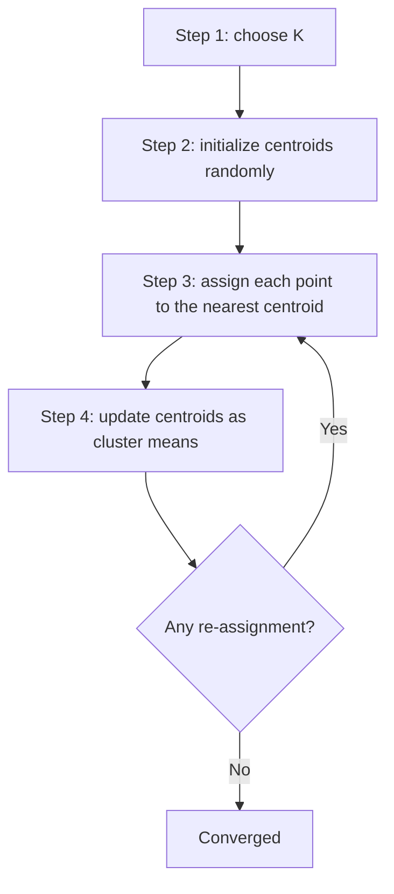

# Chapter 3 — Unsupervised Learning

[Repository Guide](../../README.md) | [English](Concepts_Lecture.md) | [한국어](Concepts_Lecture.ko.md)

> **Last Updated:** 2026-10-26

> **Learning Objectives:**
> 1. Explain the difference between supervised and unsupervised learning and between clustering and classification
> 2. Compare the Manhattan, Euclidean, and correlation-based distances and explain the effects of outliers and scale
> 3. Apply clustering algorithms (hierarchical clustering, K-means)
> 4. Explain how the number of clusters is chosen (the cut height of a dendrogram, the $K$ of K-means) and why the result must be evaluated

---

## Table of Contents

- [1. Clustering vs. Classification](#1-clustering-vs-classification)
  - [1.1 What is Clustering?](#11-what-is-clustering)
  - [1.2 Clustering vs. Classification](#12-clustering-vs-classification)
- [2. Similarity and Distance](#2-similarity-and-distance)
  - [2.1 Similarity Index](#21-similarity-index)
  - [2.2 Dissimilarity Index](#22-dissimilarity-index)
- [3. Distance Metrics](#3-distance-metrics)
  - [3.1 Manhattan Distance (L1 Norm)](#31-manhattan-distance-l1-norm)
  - [3.2 Euclidean Distance (L2 Norm)](#32-euclidean-distance-l2-norm)
  - [3.3 L1 vs. L2 Comparison](#33-l1-vs-l2-comparison)
- [4. Distance Matrix, Outlier Impact, and Normalization](#4-distance-matrix-outlier-impact-and-normalization)
  - [4.1 Distance Matrix](#41-distance-matrix)
  - [4.2 Outlier Impact on Distance Matrix](#42-outlier-impact-on-distance-matrix)
  - [4.3 Normalization (Z-scoring)](#43-normalization-z-scoring)
- [5. Correlation-Based Distance](#5-correlation-based-distance)
  - [5.1 Covariance](#51-covariance)
  - [5.2 Pearson's Correlation](#52-pearsons-correlation)
  - [5.3 Spearman's Correlation](#53-spearmans-correlation)
  - [5.4 Pearson vs. Spearman: Concrete Examples](#54-pearson-vs-spearman-concrete-examples)
  - [5.5 Correlation-Based Distance Metric](#55-correlation-based-distance-metric)
  - [5.6 Norm-Based vs. Correlation-Based Distance](#56-norm-based-vs-correlation-based-distance)
- [6. Clustering Algorithms Overview](#6-clustering-algorithms-overview)
  - [6.1 Categories](#61-categories)
- [7. Hierarchical Clustering (HC)](#7-hierarchical-clustering-hc)
  - [7.1 Overview](#71-overview)
  - [7.2 HCA Four Steps](#72-hca-four-steps)
  - [7.3 Agglomerative HC Algorithm](#73-agglomerative-hc-algorithm)
  - [7.4 Dendrogram Properties](#74-dendrogram-properties)
  - [7.5 Linkage Methods](#75-linkage-methods)
  - [7.6 HC Worked Example: 6 Points (A-F) with All Three Linkage Methods](#76-hc-worked-example-6-points-a-f-with-all-three-linkage-methods)
  - [7.7 Cluster Labels](#77-cluster-labels)
  - [7.8 Pros and Cons](#78-pros-and-cons)
- [8. K-Means Clustering](#8-k-means-clustering)
  - [8.1 Overview](#81-overview)
  - [8.2 Algorithm](#82-algorithm)
  - [8.3 Formal Definition](#83-formal-definition)
  - [8.4 Issues and Limitations](#84-issues-and-limitations)
- [Summary](#summary)
- [Self-Check Questions](#self-check-questions)

---

<br>

## 1. Clustering vs. Classification

### 1.1 What is Clustering?

Clustering analysis is the process of grouping a set of objects (experimental subjects or their features) into subsets called **clusters**. It is the most common form of **unsupervised learning**, which learns from raw data without predefined labels.

- Clustering is based on the **similarity** between objects.
- A good clustering has high similarity within clusters and low similarity between clusters.
- Clustering is used for finding and visualizing structures, identifying outliers, and detecting global patterns of missing values.

### 1.2 Clustering vs. Classification

| Aspect | Clustering | Classification |
|--------|-----------|----------------|
| Learning type | Unsupervised | Supervised |
| Classes | Unknown a priori | Predefined |
| Goal | Class discovery (identify new/unknown classes) | Class prediction (assign new cases into known classes) |
| Approach | Exploratory analysis | Find a classifier from training data |

*Table 1. Comparison of clustering and classification*

> **Key Point:** In clustering, there can be numerous valid answers since there is no class information. The number of clusters depends on the analysis perspective and method chosen.

---

<br>

## 2. Similarity and Distance

### 2.1 Similarity Index

A numeric value that indicates how **similar** different objects are.

- The range is `0 <= Similarity <= 1`.
- A higher value indicates greater similarity.

### 2.2 Dissimilarity Index

A numeric value that indicates how **different** objects are.

- It is defined as `Distance = 1 - Similarity = Dissimilarity`.
- Higher similarity between objects leads to lower dissimilarity.

> **Key Point:** The similarity measure is often more important than the clustering algorithm used. The choice of similarity or distance measure fundamentally shapes the clustering result.

---

<br>

## 3. Distance Metrics

### 3.1 Manhattan Distance (L1 Norm)

$$d_1(\mathbf{p}, \mathbf{q}) = \|\mathbf{p} - \mathbf{q}\|_1 = \sum_{i=1}^{n} |p_i - q_i|$$

**Properties:**
- It is robust to outliers.
- It is computationally efficient.
- It cannot always find the optimal solution (Section 3.3).
- It measures the city block distance along grid-like paths.

### 3.2 Euclidean Distance (L2 Norm)

$$d_{euc}(\mathbf{x}, \mathbf{y}) = \sqrt{\sum_{i=1}^{n} (x_i - y_i)^2}$$

**Properties:**
- It can find optimal solutions via mathematical optimization.
- It is sensitive to outliers.
- It measures the straight-line distance between two points.

### 3.3 L1 vs. L2 Comparison

| Property | L1 (Manhattan) | L2 (Euclidean) |
|----------|---------------|----------------|
| Outlier robustness | Robust | Sensitive |
| Computation | Efficient (computational method) | More mathematical |
| Optimal solution | Not always guaranteed | Can find optimal |
| Use case | Sparse data, robust analysis | General-purpose |

*Table 2. Comparison of the L1 and L2 distances*

**Why L2 can find the global optimum in gradient-based optimization but L1 cannot:**
- Both metrics use methods to remove signs (+/-), since distance cannot be negative. The range of distance is $[0, \infty)$.
- L2 squares the differences, so the squared L2 distance produces a smooth (differentiable) surface everywhere, including at the origin (0, 0). This allows gradient-based optimization to find the global solution.
- L1 uses absolute values, which create a non-differentiable point at (0, 0). The derivative's sign changes abruptly at that point, so gradient-based methods cannot reliably find the global optimum.

> **Note:** **Global optimum of L1-based optimization.** A sum of absolute values is also a convex function, so an L1-based optimization problem can be solved to its global optimum by linear programming or subgradient methods. The difference above is therefore not whether a global optimum exists but whether smooth gradient-based optimization can be applied directly. An L1-based optimum may also not be unique (e.g., the median of an even number of values).

> **Key Point:** L1-based methods are generally more robust to outliers than L2-based methods. A single outlier can significantly distort an L2-based distance matrix.

---

<br>

## 4. Distance Matrix, Outlier Impact, and Normalization

### 4.1 Distance Matrix

Given an $N \times P$ data matrix ($N$ samples, $P$ features), two distance matrices can be built.
- The **sample distance matrix** is an $N \times N$ matrix of distances between samples.
- The **feature distance matrix** is a $P \times P$ matrix of distances between features.

**Properties of a distance matrix:**
- It is always a **symmetric matrix** ($d(A,B) = d(B,A)$).
- Its diagonal values are always **zero** ($d(A,A) = 0$).
- The range of distance is $[0, \infty)$.

An example of a Euclidean distance matrix is shown below.

| | Ind1 | Ind2 | Ind3 | Ind4 |
|------|------|------|------|------|
| Ind1 | 0 | 2.828 | 3.162 | 5.099 |
| Ind2 | 2.828 | 0 | 1.414 | 3.162 |
| Ind3 | 3.162 | 1.414 | 0 | 2 |
| Ind4 | 5.099 | 3.162 | 2 | 0 |

*Table 3. Euclidean distance matrix of four individuals*

### 4.2 Outlier Impact on Distance Matrix

A single outlier can break the entire distance matrix. This phenomenon is particularly pronounced in L2-based computations that square the differences (squared distances, variances).

**Example:** Five students have the features (Age, Height, Gender). Student5 has a recording error, Height = 300,000 (an outlier; it should be about 220).

**Without outlier** (L2 sample distance matrix):

| | St1 | St2 | St3 | St4 | St5 |
|-----|------|------|------|------|------|
| St1 | 0 | | | | |
| St2 | 1.97 | 0 | | | |
| St3 | 5.76 | 7.17 | 0 | | |
| St4 | 12.37 | 13.85 | 6.68 | 0 | |
| St5 | 50.46 | 52.09 | 44.94 | 38.31 | 0 |

*Table 4. L2 sample distance matrix without the outlier*

**With outlier** (Student5 Height = 300,000, L2):

| | St1 | St2 | St3 | St4 | St5 |
|-----|------|------|------|------|--------|
| St1 | 0 | | | | |
| St2 | 1.97 | 0 | | | |
| St3 | 5.76 | 7.17 | 0 | | |
| St4 | 12.37 | 13.85 | 6.68 | 0 | |
| St5 | 299,829 | 299,831 | 299,824 | 299,817 | 0 |

*Table 5. L2 sample distance matrix with the outlying height of Student5*

- Distances involving St5 explode from about 50 to over 299,000.
- The L1 distances to St5 also jump to about 299,818, so L1 is affected almost equally. When the difference in one feature dominates, both the L1 and L2 distances become almost equal to that difference.
- This demonstrates why **outlier detection is critical before computing distance matrices**.

### 4.3 Normalization (Z-scoring)

Before computing distances, features should often be normalized to ensure comparability.

- **Z-score normalization** subtracts the mean and divides by the standard deviation, per feature ($z = (x - \bar{x})/s$).
- Normalization prevents features with larger scales from dominating the distance calculation.

> **Key Point:** Without normalization, features with larger magnitudes will disproportionately influence distance calculations.

---

<br>

## 5. Correlation-Based Distance

### 5.1 Covariance

$$Cov(X, Y) = E[(X - E[X])(Y - E[Y])]$$

- Covariance is the expected product of two variables' deviations from their means, quantifying their joint variability.
- Covariance is **scale-dependent**. Its magnitude changes if either variable is rescaled.
- Dividing covariance by the product of the two standard deviations yields **Pearson's correlation**, which is scale-invariant.

> **[Probability and Statistics]** The expected value $E[X]$ is the average of the values a random variable $X$ can take, weighted by their probabilities, and the formulas for the discrete and continuous cases are in Section 8.1 of Chapter 4. Covariance and Pearson's correlation are defined with this expected value, and on sample data they are computed with sample means in place of expected values.

### 5.2 Pearson's Correlation

$$r_{xy} = \frac{Cov(x, y)}{\sigma_x \cdot \sigma_y} = \frac{S_{xy}}{\sqrt{S_{xx} S_{yy}}}$$

- It is a mathematical method based on the L2 norm.
- It measures **linear** relationships.
- Its range is $[-1, 1]$.
- It is sensitive to outliers.
- $\lvert r \rvert = 1$ holds only under perfect linear relationships.

### 5.3 Spearman's Correlation

$$r_s = \rho_{\text{rg}_X, \text{rg}_Y} = \frac{\text{cov}(\text{rg}_X, \text{rg}_Y)}{\sigma_{\text{rg}_X} \cdot \sigma_{\text{rg}_Y}}$$

- It is a computational method based on ranks, close to the L1 concept.
- It captures **monotonic** relationships. It captures not just linear relationships but also monotonically increasing ones such as $y = x^3$.
- It is robust to outliers, since ranks absorb extreme values.

### 5.4 Pearson vs. Spearman: Concrete Examples

**Example 1: Data without outliers (4 employees)**

| Employee | Hrs. Worked (Monthly, HW) | Tasks Completed (TC) | Satisfaction (S) |
|----------|----------------------|-----------------|--------------|
| A | 20 | 10 | 5.0 |
| B | 30 | 15 | 8.0 |
| C | 40 | 20 | 9.0 |
| D | 50 | 25 | 9.5 |

*Table 6. Employee data without outliers*

Pearson correlations:

| | HW | TC | S |
|-----|------|------|------|
| HW | 1.0 | | |
| TC | 1.0 | 1.0 | |
| S | 0.93 | 0.93 | 1.0 |

*Table 7. Pearson correlations of Example 1*

Spearman correlations:

| | HW | TC | S |
|-----|------|------|------|
| HW | 1.0 | | |
| TC | 1.0 | 1.0 | |
| S | 1.0 | 1.0 | 1.0 |

*Table 8. Spearman correlations of Example 1*

- HW and TC are perfectly linear (TC = HW / 2), so both methods correctly measure 1.0.
- HW and S increase monotonically but not perfectly linearly. Pearson underestimates at 0.93, while Spearman correctly captures the perfect monotonic trend as 1.0.

**Example 2: Data with an outlier (Employee D: Tasks Completed = 5)**

| Employee | Hrs. Worked (Monthly, HW) | Tasks Completed (TC) | Satisfaction (S) |
|----------|----------------------|-----------------|--------------|
| A | 20 | 10 | 5.0 |
| B | 30 | 15 | 8.0 |
| C | 40 | 20 | 9.0 |
| D | 50 | **5** | 9.5 |

*Table 9. Employee data with an outlying task count for Employee D*

Pearson correlations:

| | HW | TC | S |
|-----|-------|-------|------|
| HW | 1.0 | | |
| TC | **-0.20** | 1.0 | |
| S | 0.93 | **0.10** | 1.0 |

*Table 10. Pearson correlations of Example 2*

Spearman correlations:

| | HW | TC | S |
|-----|------|------|------|
| HW | 1.0 | | |
| TC | **-0.20** | 1.0 | |
| S | 1.0 | **-0.20** | 1.0 |

*Table 11. Spearman correlations of Example 2*

- The single outlier caused Pearson HW-TC to drop from **1.0 to -0.20**. The sign is reversed, misrepresenting the underlying positive trend.
- In this example, D's task count moves from the largest value to the smallest, a large change in rank, so Spearman HW-TC also drops from **1.0 to -0.20**. With only four observations, a rank change of one observation changes the correlation substantially.
- The difference between the two methods shows in the magnitude of the outlier. Wherever D's value lies between 0 and 9, the ranks stay the same, so Spearman stays at -0.20, while Pearson changes considerably, from -0.38 at D = 0 to 0.05 at D = 9.
- This demonstrates the extreme outlier sensitivity of Pearson, which uses the values themselves, and the robustness of Spearman, which uses only ranks.

### 5.5 Correlation-Based Distance Metric

$$D(X, Y) = 1 - |cor(X, Y)|$$

- The range is $[0, 1]$.

**Why this transformation is needed:**
- The range of correlation is $[-1, 1]$, but the range of distance must be $[0, \infty)$.
- Correlation can be **negative**, so it cannot be used directly as a distance.
- The transformation $D = 1 - \lvert \text{cor} \rvert$ maps values to $[0, 1]$, which satisfies the distance requirements.
- **Limitation:** Directional information is lost. From the transformed value alone, one cannot determine whether the original correlation was positive or negative.

**Advantages of correlation-based distance:**
- Correlation is **scale-invariant**, so no normalization is needed.
- Unlike the L1 and L2 distances, which may require normalization that can distort the data shape, correlation works directly on the original data.

### 5.6 Norm-Based vs. Correlation-Based Distance

| Property | Norm-Based (L1/L2) | Correlation-Based |
|----------|-------------------|-------------------|
| Range | $[0, \infty)$ | $[0, 1]$ (after transformation) |
| Measures | Magnitude difference | Pattern similarity |
| Scale sensitivity | Highly sensitive to scale and outliers | Scale-invariant |
| Normalization | Often required (can distort data) | Not required |
| Direction information | No direction concept | Lost when using absolute value |
| Usage | Absolute value differences | Trend/shape of data |
| Limitation | High scale sensitivity | May miss non-monotonic relationships |

*Table 12. Comparison of norm-based and correlation-based distances*

> **Key Point:** Pearson's correlation captures linear relationships and is sensitive to outliers, while Spearman's captures monotonic relationships and is robust to outliers.

---

<br>

## 6. Clustering Algorithms Overview

### 6.1 Categories

- **Bottom-up agglomerative methods**
  - Hierarchical Clustering (HCL) (Eisen et al. 1998)

- **Top-down partitioning methods** (combinatorial optimization problem)
  - K-means (Herwig et al. 1999)
  - K-medians
  - Self-Organizing Map (SOM) (Tamayo et al. 1999)

- **Projection methods**
  - Principal Component Analysis (PCA) (Raychaudhuri et al., 2000)
  - Multi-Dimensional Scaling (MDS)

---

<br>

## 7. Hierarchical Clustering (HC)

### 7.1 Overview

HC produces a binary tree structure called a **dendrogram** that groups data at multiple levels of granularity.

- The **agglomerative** (bottom-up) approach starts with each object as its own cluster and merges the closest pairs one by one.
- The **divisive** (top-down) approach starts with all objects in one cluster and splits it recursively.
- The agglomerative approach is the most commonly used.

### 7.2 HCA Four Steps

The process of performing Hierarchical Clustering Analysis can be broken down into four main steps.

1. **Create a Distance Matrix**
2. **Generate a Dendrogram** (using a linkage method)
3. **Extract Group Information from Dendrogram** (by cutting at a chosen height)
4. **Evaluate Clustering Results**

### 7.3 Agglomerative HC Algorithm

1. Let $N$ objects form $N$ clusters (each object is its own cluster).
2. Join the two clusters that have the smallest distance (number of clusters = $N - 1$).
3. Iterate until all clusters are connected in one hierarchical tree (dendrogram).

### 7.4 Dendrogram Properties

- The final cluster is the **root** and each data item is a **leaf**.
- The **height** of the bars indicates how close the items are. Items merged at a lower height are closer.
- Cutting the dendrogram at a desired height determines the number of clusters.

### 7.5 Linkage Methods

The linkage method determines how distance is measured between clusters $G$ and $H$. In the formulas below, $n_G$ and $n_H$ are the numbers of members of the two clusters.

| Linkage | Formula | Description |
|---------|---------|-------------|
| **Single** | $d_S(G,H) = \min_{i \in G, j \in H} d(z_i, z_j)$ | Minimum distance (nearest neighbor) |
| **Complete** | $d_C(G,H) = \max_{i \in G, j \in H} d(z_i, z_j)$ | Maximum distance (furthest neighbor) |
| **Average** | $d_A(G,H) = \frac{1}{n_G n_H} \sum_{i \in G} \sum_{j \in H} d(z_i, z_j)$ | Average of all pairwise distances |

*Table 13. Inter-cluster distance definitions of the three linkage methods*

### 7.6 HC Worked Example: 6 Points (A-F) with All Three Linkage Methods

**Given:** There are 6 data points (A-F) in 2D space. The initial **L1 (Manhattan) distance matrix** is shown below.

| L1 | A | B | C | D | E | F |
|----|-----|-----|-----|-----|-----|-----|
| A | 0 | | | | | |
| B | 5 | 0 | | | | |
| C | 5 | 4 | 0 | | | |
| D | 15 | 10 | 10 | 0 | | |
| E | 16 | 11 | 11 | 1 | 0 | |
| F | 19 | 14 | 14 | 4 | 3 | 0 |

*Table 14. Initial L1 distance matrix of the six points*

The smallest distance is $d(D,E) = 1$, so all three methods begin by merging {D, E}.

---

#### 7.6.1 Single Linkage (Nearest Neighbor)

**Update rule:** $d(G \cup H, X) = \min[d(G, X), d(H, X)]$. That is, the distance between the merged cluster and $X$ is the minimum of the distances between each member and $X$.

**Step 1:** Merge {D, E} (distance = 1). Update distances using min.
- $d(DE, A) = \min[d(D,A), d(E,A)] = \min[15, 16] = 15$
- $d(DE, B) = \min[d(D,B), d(E,B)] = \min[10, 11] = 10$
- $d(DE, C) = \min[d(D,C), d(E,C)] = \min[10, 11] = 10$
- $d(DE, F) = \min[d(D,F), d(E,F)] = \min[4, 3] = 3$

| Step 1 | A | B | C | DE | F |
|--------|-----|-----|-----|------|-----|
| A | 0 | | | | |
| B | 5 | 0 | | | |
| C | 5 | 4 | 0 | | |
| DE | 15 | 10 | 10 | 0 | |
| F | 19 | 14 | 14 | **3** | 0 |

*Table 15. Distance matrix after Step 1 of Single Linkage*

**Step 2:** Merge {F, DE} (distance = 3). Update distances using min.
- $d(DEF, A) = \min[d(D,A), d(E,A), d(F,A)] = \min[15, 16, 19] = 15$
- $d(DEF, B) = \min[d(D,B), d(E,B), d(F,B)] = \min[10, 11, 14] = 10$
- $d(DEF, C) = \min[d(D,C), d(E,C), d(F,C)] = \min[10, 11, 14] = 10$

| Step 2 | A | B | C | DEF |
|--------|-----|-----|-----|------|
| A | 0 | | | |
| B | 5 | 0 | | |
| C | 5 | **4** | 0 | |
| DEF | 15 | 10 | 10 | 0 |

*Table 16. Distance matrix after Step 2 of Single Linkage*

**Step 3:** Merge {B, C} (distance = 4).
- $d(BC, A) = \min[d(B,A), d(C,A)] = \min[5, 5] = 5$
- $d(BC, DEF) = \min[d(B,DEF), d(C,DEF)] = \min[10, 10] = 10$

| Step 3 | A | BC | DEF |
|--------|-----|------|------|
| A | 0 | | |
| BC | **5** | 0 | |
| DEF | 15 | 10 | 0 |

*Table 17. Distance matrix after Step 3 of Single Linkage*

**Step 4:** Merge {A, BC} (distance = 5).
- $d(ABC, DEF) = \min[d(A,DEF), d(BC,DEF)] = \min[15, 10] = 10$

| Step 4 | ABC | DEF |
|--------|------|------|
| ABC | 0 | |
| DEF | **10** | 0 |

*Table 18. Distance matrix after Step 4 of Single Linkage*

**Single Linkage merge order:** {D, E} (height 1) → {F, DE} (height 3) → {B, C} (height 4) → {A, BC} (height 5) → {ABC, DEF} (height 10)

---

#### 7.6.2 Complete Linkage (Furthest Neighbor)

**Update rule:** $d(G \cup H, X) = \max[d(G, X), d(H, X)]$. That is, the distance between the merged cluster and $X$ is the maximum of the distances between each member and $X$.

**Step 1:** Merge {D, E} (distance = 1). Update distances using max.
- $d(DE, A) = \max[d(D,A), d(E,A)] = \max[15, 16] = 16$
- $d(DE, B) = \max[d(D,B), d(E,B)] = \max[10, 11] = 11$
- $d(DE, C) = \max[d(D,C), d(E,C)] = \max[10, 11] = 11$
- $d(DE, F) = \max[d(D,F), d(E,F)] = \max[4, 3] = 4$

| Step 1 | A | B | C | DE | F |
|--------|-----|-----|-----|------|-----|
| A | 0 | | | | |
| B | 5 | 0 | | | |
| C | 5 | **4** | 0 | | |
| DE | 16 | 11 | 11 | 0 | |
| F | 19 | 14 | 14 | 4 | 0 |

*Table 19. Distance matrix after Step 1 of Complete Linkage*

**Step 2:** Merge {B, C} (distance = 4). Two pairs, {B, C} and {DE, F}, have distance 4, and since they do not overlap, the dendrogram is the same whichever is merged first. Update distances using max.
- $d(BC, A) = \max[d(B,A), d(C,A)] = \max[5, 5] = 5$
- $d(BC, DE) = \max[d(B,DE), d(C,DE)] = \max[11, 11] = 11$
- $d(BC, F) = \max[d(B,F), d(C,F)] = \max[14, 14] = 14$

| Step 2 | A | BC | DE | F |
|--------|-----|------|------|-----|
| A | 0 | | | |
| BC | **5** | 0 | | |
| DE | 16 | 11 | 0 | |
| F | 19 | 14 | 4 | 0 |

*Table 20. Distance matrix after Step 2 of Complete Linkage*

**Step 3:** Merge {DE, F} (distance = 4).
- $d(DEF, A) = \max[d(DE,A), d(F,A)] = \max[16, 19] = 19$
- $d(DEF, BC) = \max[d(DE,BC), d(F,BC)] = \max[11, 14] = 14$

| Step 3 | A | BC | DEF |
|--------|-----|------|------|
| A | 0 | | |
| BC | 5 | 0 | |
| DEF | 19 | **14** | 0 |

*Table 21. Distance matrix after Step 3 of Complete Linkage*

**Step 4:** Merge {A, BC} (distance = 5).
- $d(ABC, DEF) = \max[d(A,DEF), d(BC,DEF)] = \max[19, 14] = 19$

| Step 4 | ABC | DEF |
|--------|------|------|
| ABC | 0 | |
| DEF | **19** | 0 |

*Table 22. Distance matrix after Step 4 of Complete Linkage*

**Complete Linkage merge order:** {D, E} (height 1) → {B, C} (height 4) → {DE, F} (height 4) → {A, BC} (height 5) → {ABC, DEF} (height 19)

---

#### 7.6.3 Average Linkage

**Update rule:** The distance between the merged cluster and $X$ is the average of all pairwise distances between each member of the merged cluster and each member of $X$. In terms of the distances before the merge, $d(G \cup H, X) = \frac{n_G d(G, X) + n_H d(H, X)}{n_G + n_H}$.

**Step 1:** Merge {D, E} (distance = 1). Update distances using the average.
- $d(DE, A) = \operatorname{avg}[d(D,A), d(E,A)] = \operatorname{avg}[15, 16] = 15.5$
- $d(DE, B) = \operatorname{avg}[d(D,B), d(E,B)] = \operatorname{avg}[10, 11] = 10.5$
- $d(DE, C) = \operatorname{avg}[d(D,C), d(E,C)] = \operatorname{avg}[10, 11] = 10.5$
- $d(DE, F) = \operatorname{avg}[d(D,F), d(E,F)] = \operatorname{avg}[4, 3] = 3.5$

| Step 1 | A | B | C | DE | F |
|--------|------|-----|-----|------|-----|
| A | 0 | | | | |
| B | 5 | 0 | | | |
| C | 5 | 4 | 0 | | |
| DE | 15.5 | 10.5 | 10.5 | 0 | |
| F | 19 | 14 | 14 | **3.5** | 0 |

*Table 23. Distance matrix after Step 1 of Average Linkage*

**Step 2:** Merge {F, DE} (distance = 3.5). Update distances using the average (now 3 members: D, E, F).
- $d(DEF, A) = \operatorname{avg}[d(D,A), d(E,A), d(F,A)] = \operatorname{avg}[15, 16, 19] = 16.67$
- $d(DEF, B) = \operatorname{avg}[d(D,B), d(E,B), d(F,B)] = \operatorname{avg}[10, 11, 14] = 11.67$
- $d(DEF, C) = \operatorname{avg}[d(D,C), d(E,C), d(F,C)] = \operatorname{avg}[10, 11, 14] = 11.67$

| Step 2 | A | B | C | DEF |
|--------|------|-----|-----|-------|
| A | 0 | | | |
| B | 5 | 0 | | |
| C | 5 | **4** | 0 | |
| DEF | 16.67 | 11.67 | 11.67 | 0 |

*Table 24. Distance matrix after Step 2 of Average Linkage*

> **Caution:** The distance of a merged cluster must not be computed as a simple average of the previous distances. Computing $d(DEF, A)$ as $\operatorname{avg}[d(DE, A), d(F, A)] = \operatorname{avg}[15.5, 19] = 17.25$ is wrong; the average weighted by the numbers of members, $(2 \times 15.5 + 1 \times 19)/3 = 16.67$, is correct.

**Step 3:** Merge {B, C} (distance = 4).
- $d(BC, A) = \operatorname{avg}[d(B,A), d(C,A)] = \operatorname{avg}[5, 5] = 5$
- $d(BC, DEF) = \operatorname{avg}[d(B,DEF), d(C,DEF)] = \operatorname{avg}[11.67, 11.67] = 11.67$

| Step 3 | A | BC | DEF |
|--------|-----|------|-------|
| A | 0 | | |
| BC | **5** | 0 | |
| DEF | 16.67 | 11.67 | 0 |

*Table 25. Distance matrix after Step 3 of Average Linkage*

**Step 4:** Merge {A, BC} (distance = 5).
- $d(ABC, DEF)$ = average of all $3 \times 3$ pairwise distances = $(15 + 16 + 19 + 10 + 11 + 14 + 10 + 11 + 14)/9 = 120/9 = 13.33$

| Step 4 | ABC | DEF |
|--------|------|-------|
| ABC | 0 | |
| DEF | **13.33** | 0 |

*Table 26. Distance matrix after Step 4 of Average Linkage*

**Average Linkage merge order:** {D, E} (height 1) → {F, DE} (height 3.5) → {B, C} (height 4) → {A, BC} (height 5) → {ABC, DEF} (height 13.33)

---

#### 7.6.4 Dendrogram Cutting Example

Cutting the **Average Linkage** dendrogram (Figure 1) at **height = 8** produces two clusters.

```text
height
13.33 ┤           ┌────────────┴─────────────┐
      │           │                          │
 8.00 ┼-----------│--------------------------│-----  cut (h = 8)
      │           │                          │
 5.00 ┤           │                   ┌──────┴──────┐
 4.00 ┤           │                   │          ┌──┴──┐
 3.50 ┤      ┌────┴────┐              │          │     │
 1.00 ┤   ┌──┴──┐      │              │          │     │
 0.00 ┼   D     E      F              A          B     C
```

*Figure 1. Average Linkage dendrogram with the cut line at height 8*

- **Cluster 1:** {F, D, E} was merged at heights 1 and 3.5, both below 8.
- **Cluster 2:** {A, B, C} was merged at heights 4 and 5, both below 8.

The inter-cluster merge at 13.33 is above the cut line, so the two groups remain separated.

There is no single correct answer for where to cut. The choice depends on the analysis goals, and evaluation metrics can help guide the decision.

### 7.7 Cluster Labels

Cluster labels are **nominal categorical variables** with arbitrary names. The label itself carries no inherent meaning; only the grouping matters. For example, [A, A, B] is the same clustering as [B, B, A].

### 7.8 Pros and Cons

| Pros | Cons |
|------|------|
| Explores all levels of granularity (1 to $N$ clusters) | $O(N^2)$ computational cost |
| No need to pre-specify number of clusters | Storage requirement: $(N^2 - N)/2$ |
| Produces interpretable dendrogram | Sensitive to noise and outliers |

*Table 27. Pros and cons of hierarchical clustering*

> **Note:** **Computational cost.** Computing and storing the distance matrix already costs $O(N^2)$. A simple implementation that searches the whole matrix for the closest pair at each step performs $N - 1$ merges and takes $O(N^3)$ time, while efficient algorithms run in $O(N^2)$ time for Single, Complete, and Average Linkage.

> **Key Point:** HC is ideal for exploring data structure at multiple granularity levels, but becomes computationally expensive for large datasets due to the $O(N^2)$ cost and the need to store a distance matrix of size $(N^2 - N)/2$.

---

<br>

## 8. K-Means Clustering

### 8.1 Overview

K-means is a **top-down partitioning** method that divides data into $K$ groups by minimizing within-cluster dispersion. It is a representative example of the **EM (Expectation-Maximization) algorithm**, where the assignment step corresponds to the E step and the centroid update step to the M step.

### 8.2 Algorithm

1. **Choose** the number of clusters $K$.
2. **Initialize** the cluster centers (centroids) randomly.
3. **Assign** each data point to the nearest centroid.
4. **Update** each centroid as the mean of all points in its cluster.
5. **Repeat** steps 3-4 until convergence (no new re-assignments).



*Figure 2. Iterative process of the K-means algorithm*

### 8.3 Formal Definition

Let $m_k(t)$ be the centroid of the $k$-th cluster at step $t$, and $C_i(t)$ the cluster assignment of the $i$-th object at step $t$.

**Assignment step:**

$$C_i(t) = \underset{1 \leq k \leq K}{\text{argmin}} \; d(z_i, m_k(t))$$

**Convergence criterion** (total intra-cluster variance):

$$V(t) = \sum_{k=1}^{K} \sum_{i: C_i(t)=k} \lVert z_i - m_k(t) \rVert^2$$

$V(t)$ never increases from one iteration to the next, and the algorithm converges when it stops decreasing (no re-assignments).

### 8.4 Issues and Limitations

- **Random initialization**: Different runs may produce different clusters.
- **Hard assignment**: Each data point belongs to exactly one cluster.
- **Shape assumption**: It implicitly assumes roughly spherical clusters.
- **$K$ must be specified**: The number of clusters must be chosen in advance.
- **Local optimum**: The global optimum is not guaranteed, and the algorithm may converge to a local minimum.
- **No within-cluster similarity information**: Unlike HC, K-means does not provide information about the internal structure of clusters.

> **Key Point:** K-means is efficient for large datasets but requires pre-specifying $K$ and may converge to different solutions depending on initialization. Multiple random starts are used to mitigate this.

---

<br>

## Summary

| Concept | Key Summary |
|---------|-----------|
| Clustering vs. Classification | Clustering is unsupervised learning without labels, and classification is supervised learning with predefined labels. |
| Similarity and Distance | Distance is defined as 1 - Similarity, the choice of measure is critical, and the range of distance is $[0, \infty)$. |
| L1 (Manhattan) | It is robust to outliers and computationally efficient but non-differentiable at (0, 0). |
| L2 (Euclidean) | It is sensitive to outliers, but its squared form is differentiable everywhere, so gradient-based optimization can find the global optimum. |
| Distance Matrix | It is a symmetric matrix with a zero diagonal, and its storage is $(N^2 - N)/2$. |
| Outlier Impact | A single outlier can break a distance matrix by making L2 distances explode to about 300,000, and L1 distances are also affected. |
| Covariance | It is defined as $Cov(X,Y) = E[(X-E[X])(Y-E[Y])]$, is scale-dependent, and becomes Pearson's correlation when normalized by the standard deviations. |
| Pearson's Correlation | It measures linear relationships and is sensitive to outliers, so a single outlier can flip its sign. |
| Spearman's Correlation | It measures monotonic relationships using ranks and is robust to outliers. |
| Correlation-Based Distance | It is defined as $D = 1 - \lvert \text{cor} \rvert$, is needed because a correlation in $[-1, 1]$ cannot be used directly as a distance, and loses direction. |
| HCA Four Steps | It proceeds in the order (1) create the distance matrix, (2) generate the dendrogram, (3) extract groups, and (4) evaluate the results. |
| Hierarchical Clustering | It builds a dendrogram by bottom-up agglomeration, its distance matrix costs $O(N^2)$ to compute, and its storage is $(N^2 - N)/2$. |
| Linkage Methods | Single (min), Complete (max), and Average (mean of all pairs) produce different dendrograms even from the same data. |
| K-Means | It is a top-down partitioning method for a combinatorial optimization problem that requires $K$ and is sensitive to initialization. |

---

<br>

## Self-Check Questions

1. **Distance computation:** Find the Manhattan and Euclidean distances between the points $p = (1, 2)$ and $q = (4, 6)$.

   <details>
   <summary>Answer</summary>

   The absolute coordinate differences are $\lvert 1 - 4 \rvert = 3$ and $\lvert 2 - 6 \rvert = 4$. The Manhattan distance is $3 + 4 = 7$, and the Euclidean distance is $\sqrt{3^2 + 4^2} = \sqrt{25} = 5$. The Euclidean distance can never exceed the Manhattan distance.

   </details>

2. **Correlation-based distance:** Compute the distance $D = 1 - \lvert \text{cor} \rvert$ when the correlation of two features is $0.8$ and when it is $-0.8$, and explain the limitation this result shows.

   <details>
   <summary>Answer</summary>

   In both cases, $D = 1 - 0.8 = 0.2$. A strong positive correlation and a strong negative correlation become the same distance, so the distance alone cannot tell the direction of the original relationship. This is the loss of directional information described in Section 5.5.

   </details>

3. **Pearson and Spearman:** For $x = 1, 2, 3, 4, 5$ and $y = x^3$, find Spearman's correlation and explain why Pearson's correlation is less than 1.

   <details>
   <summary>Answer</summary>

   $y$ = 1, 8, 27, 64, 125 has exactly the same ranks as $x$, so Spearman's correlation is 1. Pearson's correlation is about 0.94. The relationship increases monotonically but is not a straight line, so Pearson's correlation, which measures the degree of linearity, is less than 1.

   </details>

4. **Cutting a dendrogram:** If the Single Linkage dendrogram of Section 7.6.1 is cut at height 4.5, how many clusters are formed, and what are their members?

   <details>
   <summary>Answer</summary>

   The merge heights 1, 3, and 4 are below 4.5, and 5 and 10 are above it. Only the merges up to height 4 remain, so three clusters are formed: {D, E, F}, {B, C}, and {A}.

   </details>

5. **K-means iterations:** Apply K-means to the 1D data 1, 2, 3, 8, 9, 10 with $K = 2$ and initial centroids 2 and 3. Give the assignments and centroids of each iteration and the total intra-cluster variance $V$ at convergence.

   <details>
   <summary>Answer</summary>

   In iteration 1, 1 and 2 are assigned to centroid 2 and 3, 8, 9, 10 to centroid 3, and the centroids are updated to $1.5$ and $(3 + 8 + 9 + 10)/4 = 7.5$. In iteration 2, point 3 is 1.5 away from 1.5 and 4.5 away from 7.5, so it moves to the first cluster; the assignments become {1, 2, 3} and {8, 9, 10}, and the centroids are updated to 2 and 9. In iteration 3, no assignment changes, so the algorithm converges. Then $V = (1 + 0 + 1) + (1 + 0 + 1) = 4$.

   </details>
