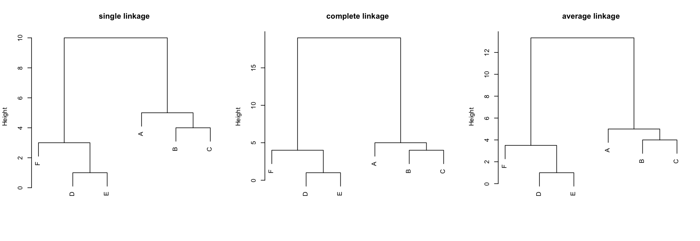
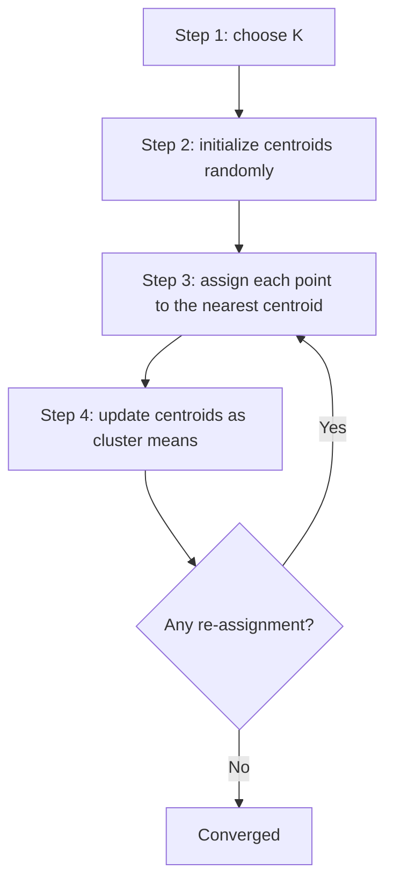
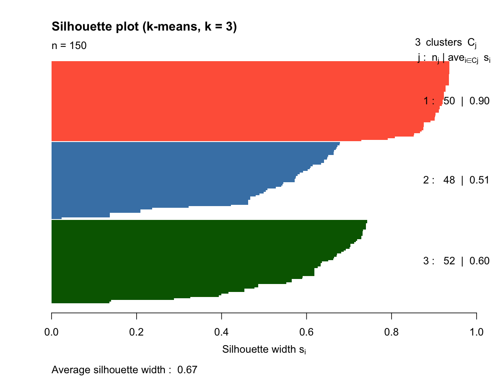

# Chapter 3 — Unsupervised Learning

[Repository Guide](../../README.md) | [English](Concepts_Lecture.md) | [한국어](Concepts_Lecture.ko.md)

> **Last Updated:** 2026-11-19

> **Learning Objectives:**
> 1. Explain the difference between supervised and unsupervised learning and between clustering and classification
> 2. Compare the Manhattan, Euclidean, and correlation-based distances and explain the effects of outliers and scale
> 3. Apply clustering algorithms (hierarchical clustering, K-means)
> 4. Explain how the number of clusters is chosen (the cut height of a dendrogram, the $K$ of K-means) and why the result must be evaluated
> 5. Compute Minkowski distances and explain why the objective function of K-means does not increase between iterations
> 6. Evaluate clustering results with the silhouette width, purity, and the Rand index

---

## Table of Contents

- [1. Clustering vs. Classification](#1-clustering-vs-classification)
  - [1.1 The Concept of Clustering](#11-the-concept-of-clustering)
  - [1.2 Clustering vs. Classification](#12-clustering-vs-classification)
  - [1.3 Ambiguity of the Number of Clusters](#13-ambiguity-of-the-number-of-clusters)
- [2. Similarity and Distance](#2-similarity-and-distance)
  - [2.1 Similarity Index](#21-similarity-index)
  - [2.2 Dissimilarity Index](#22-dissimilarity-index)
- [3. Distance Metrics](#3-distance-metrics)
  - [3.1 Manhattan Distance (L1 Norm)](#31-manhattan-distance-l1-norm)
  - [3.2 Euclidean Distance (L2 Norm)](#32-euclidean-distance-l2-norm)
  - [3.3 L1 vs. L2 Comparison](#33-l1-vs-l2-comparison)
  - [3.4 Minkowski Distance](#34-minkowski-distance)
  - [3.5 Axioms of a Metric](#35-axioms-of-a-metric)
- [4. Distance Matrix, Outlier Impact, and Normalization](#4-distance-matrix-outlier-impact-and-normalization)
  - [4.1 Distance Matrix](#41-distance-matrix)
  - [4.2 Outlier Impact on Distance Matrix](#42-outlier-impact-on-distance-matrix)
  - [4.3 Normalization (Z-scoring)](#43-normalization-z-scoring)
  - [4.4 A Worked Example of Normalization](#44-a-worked-example-of-normalization)
- [5. Correlation-Based Distance](#5-correlation-based-distance)
  - [5.1 Covariance](#51-covariance)
  - [5.2 Pearson's Correlation](#52-pearsons-correlation)
  - [5.3 Spearman's Correlation](#53-spearmans-correlation)
  - [5.4 Pearson vs. Spearman: Concrete Examples](#54-pearson-vs-spearman-concrete-examples)
  - [5.5 Correlation-Based Distance Metric](#55-correlation-based-distance-metric)
  - [5.6 Norm-Based vs. Correlation-Based Distance](#56-norm-based-vs-correlation-based-distance)
- [6. Clustering Algorithms Overview](#6-clustering-algorithms-overview)
  - [6.1 Categories](#61-categories)
  - [6.2 Characteristics of Partitioning Methods](#62-characteristics-of-partitioning-methods)
- [7. Hierarchical Clustering (HC)](#7-hierarchical-clustering-hc)
  - [7.1 Overview](#71-overview)
  - [7.2 HCA Four Steps](#72-hca-four-steps)
  - [7.3 Agglomerative HC Algorithm](#73-agglomerative-hc-algorithm)
  - [7.4 Dendrogram Properties](#74-dendrogram-properties)
  - [7.5 Linkage Methods](#75-linkage-methods)
  - [7.6 HC Worked Example: 6 Points (A-F) with All Three Linkage Methods](#76-hc-worked-example-6-points-a-f-with-all-three-linkage-methods)
  - [7.7 Cluster Labels](#77-cluster-labels)
  - [7.8 Pros and Cons](#78-pros-and-cons)
  - [7.9 Step-by-Step Progress of Merging](#79-step-by-step-progress-of-merging)
  - [7.10 Hierarchical Clustering in R](#710-hierarchical-clustering-in-r)
  - [7.11 Cluster Shapes Under Different Linkages](#711-cluster-shapes-under-different-linkages)
- [8. K-Means Clustering](#8-k-means-clustering)
  - [8.1 Overview](#81-overview)
  - [8.2 Algorithm](#82-algorithm)
  - [8.3 Formal Definition](#83-formal-definition)
  - [8.4 Issues and Limitations](#84-issues-and-limitations)
  - [8.5 Objective Function and Convergence](#85-objective-function-and-convergence)
  - [8.6 A Hand-Worked K-Means Example](#86-a-hand-worked-k-means-example)
  - [8.7 R's kmeans() and Life-Science Data](#87-rs-kmeans-and-life-science-data)
- [9. Evaluating Clustering Results](#9-evaluating-clustering-results)
  - [9.1 Categories of Evaluation Criteria](#91-categories-of-evaluation-criteria)
  - [9.2 Silhouette Width](#92-silhouette-width)
  - [9.3 Choosing K by the Average Silhouette Width](#93-choosing-k-by-the-average-silhouette-width)
  - [9.4 Purity](#94-purity)
  - [9.5 Rand Index](#95-rand-index)
  - [9.6 The Problem of the Correct Number of Clusters](#96-the-problem-of-the-correct-number-of-clusters)
- [10. Projection Methods and a Comparison of Clustering Methods](#10-projection-methods-and-a-comparison-of-clustering-methods)
  - [10.1 Projection Methods](#101-projection-methods)
  - [10.2 Pros and Cons of Clustering Methods](#102-pros-and-cons-of-clustering-methods)
  - [10.3 Common Mistakes](#103-common-mistakes)
- [Summary](#summary)
- [Self-Check Questions](#self-check-questions)

---

<br>

## 1. Clustering vs. Classification

### 1.1 The Concept of Clustering

Clustering analysis is the process of grouping a set of objects (experimental subjects or their features) into subsets called **clusters**. It is the most common form of **unsupervised learning**, which learns from raw data without predefined labels.

- Clustering is based on the **similarity** between objects.
- A good clustering has high similarity within clusters and low similarity between clusters.
- Clustering is used for finding and visualizing structures, identifying outliers, and detecting global patterns of missing values.

### 1.2 Clustering vs. Classification

| Aspect | Clustering | Classification |
|--------|-----------|----------------|
| Learning type | Unsupervised | Supervised |
| Classes | Unknown a priori | Predefined |
| Goal | Class discovery (identify new/unknown classes) | Class prediction (assign new cases into known classes) |
| Approach | Exploratory analysis | Find a classifier from training data |

*Table 1. Comparison of clustering and classification*

> **Key Point:** In clustering, there can be numerous valid answers since there is no class information. The number of clusters depends on the analysis perspective and method chosen.

### 1.3 Ambiguity of the Number of Clusters

When points are scattered on a two-dimensional scatter plot, people intuitively see how many clumps there are. Yet the same points do not have a single answer. Dividing them into an upper and a lower group gives 2 clusters, and dividing each group again into three bunches of similar shape gives 6 clusters. Without class information, the data contain no criterion for judging which answer is right.

If instead each point carries a characteristic value that depends on its numeric features (for example, presence of a disease) and the goal is to predict that value from the numeric features, the task is classification analysis. The characteristic value is then the **class** treated in Chapter 6, and because the class acts as the answer, the answer is unique. To formalize the intuitive grouping of people so that a computer can do it, one must first define in numbers how similar two objects are. That is the similarity and distance of Section 2.

---

<br>

## 2. Similarity and Distance

### 2.1 Similarity Index

A numeric value that indicates how **similar** different objects are.

- The range is `0 <= Similarity <= 1`.
- A higher value indicates greater similarity.

### 2.2 Dissimilarity Index

A numeric value that indicates how **different** objects are.

- It is defined as `Distance = 1 - Similarity = Dissimilarity`.
- Higher similarity between objects leads to lower dissimilarity.

> **Key Point:** The similarity measure is often more important than the clustering algorithm used. The choice of similarity or distance measure fundamentally shapes the clustering result.

---

<br>

## 3. Distance Metrics

### 3.1 Manhattan Distance (L1 Norm)

```math
d_1(\mathbf{p}, \mathbf{q}) = \|\mathbf{p} - \mathbf{q}\|_1 = \sum_{i=1}^{n} |p_i - q_i|
```

**Properties:**
- It is robust to outliers.
- It is computationally efficient.
- It cannot always find the optimal solution (Section 3.3).
- It measures the city block distance along grid-like paths.

### 3.2 Euclidean Distance (L2 Norm)

$$d_{euc}(\mathbf{x}, \mathbf{y}) = \sqrt{\sum_{i=1}^{n} (x_i - y_i)^2}$$

**Properties:**
- It can find optimal solutions via mathematical optimization.
- It is sensitive to outliers.
- It measures the straight-line distance between two points.

### 3.3 L1 vs. L2 Comparison

| Property | L1 (Manhattan) | L2 (Euclidean) |
|----------|---------------|----------------|
| Outlier robustness | Robust | Sensitive |
| Computation | Efficient (computational method) | More mathematical |
| Optimal solution | Not always guaranteed | Can find optimal |
| Use case | Sparse data, robust analysis | General-purpose |

*Table 2. Comparison of the L1 and L2 distances*

**Why L2 can find the global optimum in gradient-based optimization but L1 cannot:**
- Both metrics use methods to remove signs (+/-), since distance cannot be negative. The range of distance is $[0, \infty)$.
- L2 squares the differences, so the squared L2 distance produces a smooth (differentiable) surface everywhere, including at the origin (0, 0). This allows gradient-based optimization to find the global solution.
- L1 uses absolute values, which create a non-differentiable point at (0, 0). The derivative's sign changes abruptly at that point, so gradient-based methods cannot reliably find the global optimum.

> **Note:** **Global optimum of L1-based optimization.** A sum of absolute values is also a convex function, so an L1-based optimization problem can be solved to its global optimum by linear programming or subgradient methods. The difference above is therefore not whether a global optimum exists but whether smooth gradient-based optimization can be applied directly. An L1-based optimum may also not be unique (e.g., the median of an even number of values).

> **Key Point:** L1-based methods are generally more robust to outliers than L2-based methods. A single outlier can significantly distort an L2-based distance matrix.

### 3.4 Minkowski Distance

The Manhattan and Euclidean distances belong to one family of distances. For an order $`p \ge 1`$, the **Minkowski distance** is as follows.

```math
d_p(\mathbf{x}, \mathbf{y}) = \left( \sum_{i=1}^{n} |x_i - y_i|^p \right)^{1/p}
```

> **Definition:** The **Minkowski distance** raises the absolute coordinate differences to the power p, sums them, and takes the 1/p-th power; it is the Manhattan distance for p = 1 and the Euclidean distance for p = 2, and it approaches the largest coordinate difference as p grows.

As p goes to infinity only the largest coordinate difference remains, giving the **Chebyshev distance** $`d_\infty(\mathbf{x}, \mathbf{y}) = \max_i |x_i - y_i|`$. Computing with two samples represented by the expression values of three genes, $`\mathbf{x} = (2, 7, 4)`$ and $`\mathbf{y} = (5, 3, 4)`$, the absolute coordinate differences are 3, 4, and 0.

| p | Computation | Distance |
|:--|:--|--:|
| 1 (Manhattan) | $`3 + 4 + 0`$ | 7 |
| 2 (Euclidean) | $`(3^2 + 4^2 + 0^2)^{1/2} = \sqrt{25}`$ | 5 |
| 3 | $`(3^3 + 4^3 + 0^3)^{1/3} = 91^{1/3}`$ | 4.498 |
| ∞ (Chebyshev) | $`\max(3, 4, 0)`$ | 4 |

*Table 3. Minkowski distances between the same two points for different p*

For the same two points, the distance shrinks as p grows and approaches the largest difference, 4. A larger p gives more weight to large coordinate differences, so for the same reason that L2 was more sensitive to outliers than L1 in Section 3.3, a larger p is more sensitive to outliers. Checking with R's `dist()` gives the following.

```r
X <- rbind(x = c(2, 7, 4), y = c(5, 3, 4))
dist(X, method = "manhattan")
dist(X, method = "euclidean")
dist(X, method = "minkowski", p = 3)
dist(X, method = "maximum")
```

```text
  x
y 7
  x
y 5
         x
y 4.497941
  x
y 4
```

`dist()` treats each row of a matrix as an object and prints the distances between rows as the lower triangle of the distance matrix of Section 4.1. With only two objects, one value appears each time. `method = "maximum"` is the Chebyshev distance.

### 3.5 Axioms of a Metric

In mathematics, a function $`d`$ is a **metric** if it satisfies the following four conditions for all points $`\mathbf{x}, \mathbf{y}, \mathbf{z}`$.

1. **Non-negativity:** $`d(\mathbf{x}, \mathbf{y}) \ge 0`$
2. **Identity:** $`d(\mathbf{x}, \mathbf{y}) = 0`$ if and only if $`\mathbf{x} = \mathbf{y}`$
3. **Symmetry:** $`d(\mathbf{x}, \mathbf{y}) = d(\mathbf{y}, \mathbf{x})`$
4. **Triangle inequality:** $`d(\mathbf{x}, \mathbf{z}) \le d(\mathbf{x}, \mathbf{y}) + d(\mathbf{y}, \mathbf{z})`$

The statement in Section 4.1 that a distance matrix is symmetric with zero diagonal and values in $`[0, \infty)`$ reflects the first three conditions. The Minkowski distance satisfies all four when $`p \ge 1`$. For $`p < 1`$ the triangle inequality fails. For example, with $`p = 0.5`$ and the points (0, 0), (1, 0), (1, 1), $`d((0,0),(1,1)) = (1^{0.5} + 1^{0.5})^2 = 4`$, while the two distances through (1, 0) add up to $`1 + 1 = 2`$. The direct route is longer than the detour, so the function is not a metric.

The correlation-based distance $`1 - |\text{cor}|`$ of Section 5.5 satisfies non-negativity and symmetry, but two different variables with correlation 1 are at distance 0, so identity fails. Strictly speaking such a measure is a dissimilarity rather than a metric, but clustering algorithms usually need only a dissimilarity matrix, so it is widely used in practice.

---

<br>

## 4. Distance Matrix, Outlier Impact, and Normalization

### 4.1 Distance Matrix

Given an $N \times P$ data matrix ($N$ samples, $P$ features), two distance matrices can be built.
- The **sample distance matrix** is an $N \times N$ matrix of distances between samples.
- The **feature distance matrix** is a $P \times P$ matrix of distances between features.

**Properties of a distance matrix:**
- It is always a **symmetric matrix** ($`d(A,B) = d(B,A)`$).
- Its diagonal values are always **zero** ($d(A,A) = 0$).
- The range of distance is $[0, \infty)$.

An example of a Euclidean distance matrix is shown below.

| | Ind1 | Ind2 | Ind3 | Ind4 |
|------|------|------|------|------|
| Ind1 | 0 | 2.828 | 3.162 | 5.099 |
| Ind2 | 2.828 | 0 | 1.414 | 3.162 |
| Ind3 | 3.162 | 1.414 | 0 | 2 |
| Ind4 | 5.099 | 3.162 | 2 | 0 |

*Table 4. Euclidean distance matrix of four individuals*

### 4.2 Outlier Impact on Distance Matrix

A single outlier can break the entire distance matrix. This phenomenon is particularly pronounced in L2-based computations that square the differences (squared distances, variances).

**Example:** Five students have the features (Age, Height, Gender). Student5 has a recording error, Height = 300,000 (an outlier; it should be about 220).

**Without outlier** (L2 sample distance matrix):

| | St1 | St2 | St3 | St4 | St5 |
|-----|------|------|------|------|------|
| St1 | 0 | | | | |
| St2 | 1.97 | 0 | | | |
| St3 | 5.76 | 7.17 | 0 | | |
| St4 | 12.37 | 13.85 | 6.68 | 0 | |
| St5 | 50.46 | 52.09 | 44.94 | 38.31 | 0 |

*Table 5. L2 sample distance matrix without the outlier*

**With outlier** (Student5 Height = 300,000, L2):

| | St1 | St2 | St3 | St4 | St5 |
|-----|------|------|------|------|--------|
| St1 | 0 | | | | |
| St2 | 1.97 | 0 | | | |
| St3 | 5.76 | 7.17 | 0 | | |
| St4 | 12.37 | 13.85 | 6.68 | 0 | |
| St5 | 299,829 | 299,831 | 299,824 | 299,817 | 0 |

*Table 6. L2 sample distance matrix with the outlying height of Student5*

- Distances involving St5 explode from about 50 to over 299,000.
- The L1 distances to St5 also jump to about 299,818, so L1 is affected almost equally. When the difference in one feature dominates, both the L1 and L2 distances become almost equal to that difference.
- This demonstrates why **outlier detection is critical before computing distance matrices**.

### 4.3 Normalization (Z-scoring)

Before computing distances, features should often be normalized to ensure comparability.

- **Z-score normalization** subtracts the mean and divides by the standard deviation, per feature ($z = (x - \bar{x})/s$).
- Normalization prevents features with larger scales from dominating the distance calculation.

> **Key Point:** Without normalization, features with larger magnitudes will disproportionately influence distance calculations.

### 4.4 A Worked Example of Normalization

The student data of Section 4.2 show the effect of normalization. The L2 distance matrix of Section 4.2 was computed from the two features age and height. Age runs from 23 to 27 in steps of one year, and height includes the value 220.4 of Student5, which lies far from the other four students.

```r
st <- data.frame(Age = 23:27,
                 Height = c(170.1, 168.4, 175.5, 182.1, 220.4),
                 row.names = paste0("St", 1:5))
round(dist(st), 2)
z <- scale(st)
round(z, 3)
round(dist(z), 2)
```

```text
      St1   St2   St3   St4
St2  1.97
St3  5.76  7.17
St4 12.37 13.85  6.68
St5 50.46 52.09 44.94 38.31
       Age Height
St1 -1.265 -0.616
St2 -0.632 -0.696
St3  0.000 -0.364
St4  0.632 -0.056
St5  1.265  1.732
attr(,"scaled:center")
   Age Height
  25.0  183.3
attr(,"scaled:scale")
      Age    Height
 1.581139 21.418100
     St1  St2  St3  St4
St2 0.64
St3 1.29 0.71
St4 1.98 1.42 0.70
St5 3.45 3.08 2.45 1.90
```

- The first distance matrix equals Table 5 of Section 4.2. Age differences are at most 4 while height differences reach nearly 50, so the distances are determined almost entirely by height.
- `scale()` subtracts the mean and divides by the standard deviation in each column. The mean age is 25 and its standard deviation 1.581, so St1's age 23 becomes $`(23 - 25)/1.581 = -1.265`$. Height has mean 183.3 and standard deviation 21.418.
- After normalization the two features are on the same scale, and age differences contribute to the distance with comparable weight.

Note also that normalization does not remove the outlier problem. The value 220.4, far from the others, inflates the mean and standard deviation of height, so the height differences among the other four students (at most 13.7 cm) are squeezed within 0.64 standard deviations after normalization. Outliers are therefore found and corrected before normalization, or robust normalization with the median and interquartile range is used instead of the mean and standard deviation.

---

<br>

## 5. Correlation-Based Distance

### 5.1 Covariance

$$Cov(X, Y) = E[(X - E[X])(Y - E[Y])]$$

- Covariance is the expected product of two variables' deviations from their means, quantifying their joint variability.
- Covariance is **scale-dependent**. Its magnitude changes if either variable is rescaled.
- Dividing covariance by the product of the two standard deviations yields **Pearson's correlation**, which is scale-invariant.

> **[Probability and Statistics]** The expected value $E[X]$ is the average of the values a random variable $X$ can take, weighted by their probabilities, and the formulas for the discrete and continuous cases are in Section 8.1 of Chapter 4. Covariance and Pearson's correlation are defined with this expected value, and on sample data they are computed with sample means in place of expected values.

### 5.2 Pearson's Correlation

$$r_{xy} = \frac{Cov(x, y)}{\sigma_x \cdot \sigma_y} = \frac{S_{xy}}{\sqrt{S_{xx} S_{yy}}}$$

- It is a mathematical method based on the L2 norm.
- It measures **linear** relationships.
- Its range is $[-1, 1]$.
- It is sensitive to outliers.
- $\lvert r \rvert = 1$ holds only under perfect linear relationships.

### 5.3 Spearman's Correlation

$$r_s = \rho_{\text{rg}_X, \text{rg}_Y} = \frac{\text{cov}(\text{rg}_X, \text{rg}_Y)}{\sigma_{\text{rg}_X} \cdot \sigma_{\text{rg}_Y}}$$

- It is a computational method based on ranks, close to the L1 concept.
- It captures **monotonic** relationships. It captures not just linear relationships but also monotonically increasing ones such as $y = x^3$.
- It is robust to outliers, since ranks absorb extreme values.

### 5.4 Pearson vs. Spearman: Concrete Examples

**Example 1: Data without outliers (4 employees)**

| Employee | Hrs. Worked (Monthly, HW) | Tasks Completed (TC) | Satisfaction (S) |
|----------|----------------------|-----------------|--------------|
| A | 20 | 10 | 5.0 |
| B | 30 | 15 | 8.0 |
| C | 40 | 20 | 9.0 |
| D | 50 | 25 | 9.5 |

*Table 7. Employee data without outliers*

Pearson correlations:

| | HW | TC | S |
|-----|------|------|------|
| HW | 1.0 | | |
| TC | 1.0 | 1.0 | |
| S | 0.93 | 0.93 | 1.0 |

*Table 8. Pearson correlations of Example 1*

Spearman correlations:

| | HW | TC | S |
|-----|------|------|------|
| HW | 1.0 | | |
| TC | 1.0 | 1.0 | |
| S | 1.0 | 1.0 | 1.0 |

*Table 9. Spearman correlations of Example 1*

- HW and TC are perfectly linear (TC = HW / 2), so both methods correctly measure 1.0.
- HW and S increase monotonically but not perfectly linearly. Pearson underestimates at 0.93, while Spearman correctly captures the perfect monotonic trend as 1.0.

**Example 2: Data with an outlier (Employee D: Tasks Completed = 5)**

| Employee | Hrs. Worked (Monthly, HW) | Tasks Completed (TC) | Satisfaction (S) |
|----------|----------------------|-----------------|--------------|
| A | 20 | 10 | 5.0 |
| B | 30 | 15 | 8.0 |
| C | 40 | 20 | 9.0 |
| D | 50 | **5** | 9.5 |

*Table 10. Employee data with an outlying task count for Employee D*

Pearson correlations:

| | HW | TC | S |
|-----|-------|-------|------|
| HW | 1.0 | | |
| TC | **-0.20** | 1.0 | |
| S | 0.93 | **0.10** | 1.0 |

*Table 11. Pearson correlations of Example 2*

Spearman correlations:

| | HW | TC | S |
|-----|------|------|------|
| HW | 1.0 | | |
| TC | **-0.20** | 1.0 | |
| S | 1.0 | **-0.20** | 1.0 |

*Table 12. Spearman correlations of Example 2*

- The single outlier caused Pearson HW-TC to drop from **1.0 to -0.20**. The sign is reversed, misrepresenting the underlying positive trend.
- In this example, D's task count moves from the largest value to the smallest, a large change in rank, so Spearman HW-TC also drops from **1.0 to -0.20**. With only four observations, a rank change of one observation changes the correlation substantially.
- The difference between the two methods shows in the magnitude of the outlier. Wherever D's value lies between 0 and 9, the ranks stay the same, so Spearman stays at -0.20, while Pearson changes considerably, from -0.38 at D = 0 to 0.05 at D = 9.
- This demonstrates the extreme outlier sensitivity of Pearson, which uses the values themselves, and the robustness of Spearman, which uses only ranks.

### 5.5 Correlation-Based Distance Metric

$$D(X, Y) = 1 - |cor(X, Y)|$$

- The range is $[0, 1]$.

**Why this transformation is needed:**
- The range of correlation is $[-1, 1]$, but the range of distance must be $[0, \infty)$.
- Correlation can be **negative**, so it cannot be used directly as a distance.
- The transformation $D = 1 - \lvert \text{cor} \rvert$ maps values to $[0, 1]$, which satisfies the distance requirements.
- **Limitation:** Directional information is lost. From the transformed value alone, one cannot determine whether the original correlation was positive or negative.

**Advantages of correlation-based distance:**
- Correlation is **scale-invariant**, so no normalization is needed.
- Unlike the L1 and L2 distances, which may require normalization that can distort the data shape, correlation works directly on the original data.

### 5.6 Norm-Based vs. Correlation-Based Distance

| Property | Norm-Based (L1/L2) | Correlation-Based |
|----------|-------------------|-------------------|
| Range | $[0, \infty)$ | $[0, 1]$ (after transformation) |
| Measures | Magnitude difference | Pattern similarity |
| Scale sensitivity | Highly sensitive to scale and outliers | Scale-invariant |
| Normalization | Often required (can distort data) | Not required |
| Direction information | No direction concept | Lost when using absolute value |
| Usage | Absolute value differences | Trend/shape of data |
| Limitation | High scale sensitivity | May miss non-monotonic relationships |

*Table 13. Comparison of norm-based and correlation-based distances*

> **Key Point:** Pearson's correlation captures linear relationships and is sensitive to outliers, while Spearman's captures monotonic relationships and is robust to outliers.

---

<br>

## 6. Clustering Algorithms Overview

### 6.1 Categories

- **Bottom-up agglomerative methods**
  - Hierarchical Clustering (HCL) (Eisen et al. 1998)

- **Top-down partitioning methods** (combinatorial optimization problem)
  - K-means (Herwig et al. 1999)
  - K-medians
  - Self-Organizing Map (SOM) (Tamayo et al. 1999)

- **Projection methods**
  - Principal Component Analysis (PCA) (Raychaudhuri et al., 2000)
  - Multi-Dimensional Scaling (MDS)

### 6.2 Characteristics of Partitioning Methods

Top-down partitioning methods such as K-means, K-medians, and SOM solve a **combinatorial optimization** problem: among all ways of dividing the objects into K groups, find the partition with the smallest within-cluster dispersion (a measure such as variance). The number of clusters K is a tuning parameter specified in advance, and the algorithm repeatedly reallocates objects between clusters until some criterion is met.

The number of ways to divide N objects into K non-empty clusters grows very quickly. For example, there are already $`(2^{10} - 2)/2 = 511`$ ways to divide 10 objects into 2 clusters, and with hundreds of objects all partitions cannot be compared. Partitioning methods therefore search for a good solution by iterative improvement, with no guarantee of finding the global optimum. Moreover, the result only gives cluster membership and does not tell which objects within a cluster are more similar. These two weaknesses reappear as limitations of K-means in Section 8.4.

---

<br>

## 7. Hierarchical Clustering (HC)

### 7.1 Overview

HC produces a binary tree structure called a **dendrogram** that groups data at multiple levels of granularity.

- The **agglomerative** (bottom-up) approach starts with each object as its own cluster and merges the closest pairs one by one.
- The **divisive** (top-down) approach starts with all objects in one cluster and splits it recursively.
- The agglomerative approach is the most commonly used.

### 7.2 HCA Four Steps

The process of performing Hierarchical Clustering Analysis can be broken down into four main steps.

1. **Create a Distance Matrix**
2. **Generate a Dendrogram** (using a linkage method)
3. **Extract Group Information from Dendrogram** (by cutting at a chosen height)
4. **Evaluate Clustering Results**

### 7.3 Agglomerative HC Algorithm

1. Let $N$ objects form $N$ clusters (each object is its own cluster).
2. Join the two clusters that have the smallest distance (number of clusters = $N - 1$).
3. Iterate until all clusters are connected in one hierarchical tree (dendrogram).

### 7.4 Dendrogram Properties

- The final cluster is the **root** and each data item is a **leaf**.
- The **height** of the bars indicates how close the items are. Items merged at a lower height are closer.
- Cutting the dendrogram at a desired height determines the number of clusters.

### 7.5 Linkage Methods

The linkage method determines how distance is measured between clusters $G$ and $H$. In the formulas below, $n_G$ and $n_H$ are the numbers of members of the two clusters.

| Linkage | Formula | Description |
|---------|---------|-------------|
| **Single** | $d_S(G,H) = \min_{i \in G, j \in H} d(z_i, z_j)$ | Minimum distance (nearest neighbor) |
| **Complete** | $d_C(G,H) = \max_{i \in G, j \in H} d(z_i, z_j)$ | Maximum distance (furthest neighbor) |
| **Average** | $d_A(G,H) = \frac{1}{n_G n_H} \sum_{i \in G} \sum_{j \in H} d(z_i, z_j)$ | Average of all pairwise distances |

*Table 14. Inter-cluster distance definitions of the three linkage methods*

### 7.6 HC Worked Example: 6 Points (A-F) with All Three Linkage Methods

**Given:** There are 6 data points (A-F) in 2D space. The initial **L1 (Manhattan) distance matrix** is shown below.

| L1 | A | B | C | D | E | F |
|----|-----|-----|-----|-----|-----|-----|
| A | 0 | | | | | |
| B | 5 | 0 | | | | |
| C | 5 | 4 | 0 | | | |
| D | 15 | 10 | 10 | 0 | | |
| E | 16 | 11 | 11 | 1 | 0 | |
| F | 19 | 14 | 14 | 4 | 3 | 0 |

*Table 15. Initial L1 distance matrix of the six points*

The smallest distance is $d(D,E) = 1$, so all three methods begin by merging {D, E}.

---

#### 7.6.1 Single Linkage (Nearest Neighbor)

**Update rule:** $d(G \cup H, X) = \min[d(G, X), d(H, X)]$. That is, the distance between the merged cluster and $X$ is the minimum of the distances between each member and $X$.

**Step 1:** Merge {D, E} (distance = 1). Update distances using min.
- $d(DE, A) = \min[d(D,A), d(E,A)] = \min[15, 16] = 15$
- $d(DE, B) = \min[d(D,B), d(E,B)] = \min[10, 11] = 10$
- $d(DE, C) = \min[d(D,C), d(E,C)] = \min[10, 11] = 10$
- $d(DE, F) = \min[d(D,F), d(E,F)] = \min[4, 3] = 3$

| Step 1 | A | B | C | DE | F |
|--------|-----|-----|-----|------|-----|
| A | 0 | | | | |
| B | 5 | 0 | | | |
| C | 5 | 4 | 0 | | |
| DE | 15 | 10 | 10 | 0 | |
| F | 19 | 14 | 14 | **3** | 0 |

*Table 16. Distance matrix after Step 1 of Single Linkage*

**Step 2:** Merge {F, DE} (distance = 3). Update distances using min.
- $d(DEF, A) = \min[d(D,A), d(E,A), d(F,A)] = \min[15, 16, 19] = 15$
- $d(DEF, B) = \min[d(D,B), d(E,B), d(F,B)] = \min[10, 11, 14] = 10$
- $d(DEF, C) = \min[d(D,C), d(E,C), d(F,C)] = \min[10, 11, 14] = 10$

| Step 2 | A | B | C | DEF |
|--------|-----|-----|-----|------|
| A | 0 | | | |
| B | 5 | 0 | | |
| C | 5 | **4** | 0 | |
| DEF | 15 | 10 | 10 | 0 |

*Table 17. Distance matrix after Step 2 of Single Linkage*

**Step 3:** Merge {B, C} (distance = 4).
- $d(BC, A) = \min[d(B,A), d(C,A)] = \min[5, 5] = 5$
- $d(BC, DEF) = \min[d(B,DEF), d(C,DEF)] = \min[10, 10] = 10$

| Step 3 | A | BC | DEF |
|--------|-----|------|------|
| A | 0 | | |
| BC | **5** | 0 | |
| DEF | 15 | 10 | 0 |

*Table 18. Distance matrix after Step 3 of Single Linkage*

**Step 4:** Merge {A, BC} (distance = 5).
- $d(ABC, DEF) = \min[d(A,DEF), d(BC,DEF)] = \min[15, 10] = 10$

| Step 4 | ABC | DEF |
|--------|------|------|
| ABC | 0 | |
| DEF | **10** | 0 |

*Table 19. Distance matrix after Step 4 of Single Linkage*

**Single Linkage merge order:** {D, E} (height 1) → {F, DE} (height 3) → {B, C} (height 4) → {A, BC} (height 5) → {ABC, DEF} (height 10)

---

#### 7.6.2 Complete Linkage (Furthest Neighbor)

**Update rule:** $d(G \cup H, X) = \max[d(G, X), d(H, X)]$. That is, the distance between the merged cluster and $X$ is the maximum of the distances between each member and $X$.

**Step 1:** Merge {D, E} (distance = 1). Update distances using max.
- $d(DE, A) = \max[d(D,A), d(E,A)] = \max[15, 16] = 16$
- $d(DE, B) = \max[d(D,B), d(E,B)] = \max[10, 11] = 11$
- $d(DE, C) = \max[d(D,C), d(E,C)] = \max[10, 11] = 11$
- $d(DE, F) = \max[d(D,F), d(E,F)] = \max[4, 3] = 4$

| Step 1 | A | B | C | DE | F |
|--------|-----|-----|-----|------|-----|
| A | 0 | | | | |
| B | 5 | 0 | | | |
| C | 5 | **4** | 0 | | |
| DE | 16 | 11 | 11 | 0 | |
| F | 19 | 14 | 14 | 4 | 0 |

*Table 20. Distance matrix after Step 1 of Complete Linkage*

**Step 2:** Merge {B, C} (distance = 4). Two pairs, {B, C} and {DE, F}, have distance 4, and since they do not overlap, the dendrogram is the same whichever is merged first. Update distances using max.
- $d(BC, A) = \max[d(B,A), d(C,A)] = \max[5, 5] = 5$
- $d(BC, DE) = \max[d(B,DE), d(C,DE)] = \max[11, 11] = 11$
- $d(BC, F) = \max[d(B,F), d(C,F)] = \max[14, 14] = 14$

| Step 2 | A | BC | DE | F |
|--------|-----|------|------|-----|
| A | 0 | | | |
| BC | **5** | 0 | | |
| DE | 16 | 11 | 0 | |
| F | 19 | 14 | 4 | 0 |

*Table 21. Distance matrix after Step 2 of Complete Linkage*

**Step 3:** Merge {DE, F} (distance = 4).
- $d(DEF, A) = \max[d(DE,A), d(F,A)] = \max[16, 19] = 19$
- $d(DEF, BC) = \max[d(DE,BC), d(F,BC)] = \max[11, 14] = 14$

| Step 3 | A | BC | DEF |
|--------|-----|------|------|
| A | 0 | | |
| BC | 5 | 0 | |
| DEF | 19 | **14** | 0 |

*Table 22. Distance matrix after Step 3 of Complete Linkage*

**Step 4:** Merge {A, BC} (distance = 5).
- $d(ABC, DEF) = \max[d(A,DEF), d(BC,DEF)] = \max[19, 14] = 19$

| Step 4 | ABC | DEF |
|--------|------|------|
| ABC | 0 | |
| DEF | **19** | 0 |

*Table 23. Distance matrix after Step 4 of Complete Linkage*

**Complete Linkage merge order:** {D, E} (height 1) → {B, C} (height 4) → {DE, F} (height 4) → {A, BC} (height 5) → {ABC, DEF} (height 19)

---

#### 7.6.3 Average Linkage

**Update rule:** The distance between the merged cluster and $X$ is the average of all pairwise distances between each member of the merged cluster and each member of $X$. In terms of the distances before the merge, $d(G \cup H, X) = \frac{n_G d(G, X) + n_H d(H, X)}{n_G + n_H}$.

**Step 1:** Merge {D, E} (distance = 1). Update distances using the average.
- $d(DE, A) = \mathrm{avg}[d(D,A), d(E,A)] = \mathrm{avg}[15, 16] = 15.5$
- $d(DE, B) = \mathrm{avg}[d(D,B), d(E,B)] = \mathrm{avg}[10, 11] = 10.5$
- $d(DE, C) = \mathrm{avg}[d(D,C), d(E,C)] = \mathrm{avg}[10, 11] = 10.5$
- $d(DE, F) = \mathrm{avg}[d(D,F), d(E,F)] = \mathrm{avg}[4, 3] = 3.5$

| Step 1 | A | B | C | DE | F |
|--------|------|-----|-----|------|-----|
| A | 0 | | | | |
| B | 5 | 0 | | | |
| C | 5 | 4 | 0 | | |
| DE | 15.5 | 10.5 | 10.5 | 0 | |
| F | 19 | 14 | 14 | **3.5** | 0 |

*Table 24. Distance matrix after Step 1 of Average Linkage*

**Step 2:** Merge {F, DE} (distance = 3.5). Update distances using the average (now 3 members: D, E, F).
- $d(DEF, A) = \mathrm{avg}[d(D,A), d(E,A), d(F,A)] = \mathrm{avg}[15, 16, 19] = 16.67$
- $d(DEF, B) = \mathrm{avg}[d(D,B), d(E,B), d(F,B)] = \mathrm{avg}[10, 11, 14] = 11.67$
- $d(DEF, C) = \mathrm{avg}[d(D,C), d(E,C), d(F,C)] = \mathrm{avg}[10, 11, 14] = 11.67$

| Step 2 | A | B | C | DEF |
|--------|------|-----|-----|-------|
| A | 0 | | | |
| B | 5 | 0 | | |
| C | 5 | **4** | 0 | |
| DEF | 16.67 | 11.67 | 11.67 | 0 |

*Table 25. Distance matrix after Step 2 of Average Linkage*

> **Caution:** The distance of a merged cluster must not be computed as a simple average of the previous distances. Computing $d(DEF, A)$ as $\mathrm{avg}[d(DE, A), d(F, A)] = \mathrm{avg}[15.5, 19] = 17.25$ is wrong; the average weighted by the numbers of members, $(2 \times 15.5 + 1 \times 19)/3 = 16.67$, is correct.

**Step 3:** Merge {B, C} (distance = 4).
- $d(BC, A) = \mathrm{avg}[d(B,A), d(C,A)] = \mathrm{avg}[5, 5] = 5$
- $d(BC, DEF) = \mathrm{avg}[d(B,DEF), d(C,DEF)] = \mathrm{avg}[11.67, 11.67] = 11.67$

| Step 3 | A | BC | DEF |
|--------|-----|------|-------|
| A | 0 | | |
| BC | **5** | 0 | |
| DEF | 16.67 | 11.67 | 0 |

*Table 26. Distance matrix after Step 3 of Average Linkage*

**Step 4:** Merge {A, BC} (distance = 5).
- $d(ABC, DEF)$ = average of all $3 \times 3$ pairwise distances = $(15 + 16 + 19 + 10 + 11 + 14 + 10 + 11 + 14)/9 = 120/9 = 13.33$

| Step 4 | ABC | DEF |
|--------|------|-------|
| ABC | 0 | |
| DEF | **13.33** | 0 |

*Table 27. Distance matrix after Step 4 of Average Linkage*

**Average Linkage merge order:** {D, E} (height 1) → {F, DE} (height 3.5) → {B, C} (height 4) → {A, BC} (height 5) → {ABC, DEF} (height 13.33)

---

#### 7.6.4 Dendrogram Cutting Example

Cutting the **Average Linkage** dendrogram (Figure 1) at **height = 8** produces two clusters.

```text
height
13.33 ┤           ┌────────────┴─────────────┐
      │           │                          │
 8.00 ┼-----------│--------------------------│-----  cut (h = 8)
      │           │                          │
 5.00 ┤           │                   ┌──────┴──────┐
 4.00 ┤           │                   │          ┌──┴──┐
 3.50 ┤      ┌────┴────┐              │          │     │
 1.00 ┤   ┌──┴──┐      │              │          │     │
 0.00 ┼   D     E      F              A          B     C
```

*Figure 1. Average Linkage dendrogram with the cut line at height 8*

- **Cluster 1:** {F, D, E} was merged at heights 1 and 3.5, both below 8.
- **Cluster 2:** {A, B, C} was merged at heights 4 and 5, both below 8.

The inter-cluster merge at 13.33 is above the cut line, so the two groups remain separated.

There is no single correct answer for where to cut. The choice depends on the analysis goals, and evaluation metrics can help guide the decision.

### 7.7 Cluster Labels

Cluster labels are **nominal categorical variables** with arbitrary names. The label itself carries no inherent meaning; only the grouping matters. For example, [A, A, B] is the same clustering as [B, B, A].

### 7.8 Pros and Cons

| Pros | Cons |
|------|------|
| Explores all levels of granularity (1 to $N$ clusters) | $O(N^2)$ computational cost |
| No need to pre-specify number of clusters | Storage requirement: $(N^2 - N)/2$ |
| Produces interpretable dendrogram | Sensitive to noise and outliers |

*Table 28. Pros and cons of hierarchical clustering*

> **Note:** **Computational cost.** Computing and storing the distance matrix already costs $O(N^2)$. A simple implementation that searches the whole matrix for the closest pair at each step performs $N - 1$ merges and takes $O(N^3)$ time, while efficient algorithms run in $O(N^2)$ time for Single, Complete, and Average Linkage.

> **Key Point:** HC is ideal for exploring data structure at multiple granularity levels, but becomes computationally expensive for large datasets due to the $O(N^2)$ cost and the need to store a distance matrix of size $(N^2 - N)/2$.

### 7.9 Step-by-Step Progress of Merging

Following agglomerative hierarchical clustering of eight genes (g1-g8) step by step gives the following.

1. At first each gene from g1 to g8 is its own cluster.
2. g1 is most like g8, so the two are merged. In the dendrogram g1 and g8 are placed next to each other and joined at a low height.
3. g4 is most like the cluster {g1, g8}, so g4 is merged into that cluster. This is the first step that needs a distance between an item and a cluster.
4. g5 is most like g7, so the two are merged.
5. {g5, g7} is most like {g1, g4, g8}, so the two clusters are merged. This time a distance between two clusters is needed.
6. The same process repeats until all genes are connected in one tree. The final leaf order changes so that merged items are neighbors, as in g1, g8, g4, g5, g7, g2, g3, g6.

To compute the distance between the new cluster {g1, g8} and g4 in step 3, a value representing the cluster must be chosen. The result depends on whether the value of g1, the value of g8, or their average is used. A single data item can be treated as a cluster with one element, so in the end only one rule is needed: the distance between two clusters. That rule is the linkage method of Section 7.5, and there are many choices.

### 7.10 Hierarchical Clustering in R

The hand computation of Section 7.6 is checked in R. A distance matrix, not coordinates, is given, so `as.dist()` creates a distance object that is passed to `hclust()`.

```r
labs <- c("A", "B", "C", "D", "E", "F")
D <- matrix(0, 6, 6, dimnames = list(labs, labs))
D[lower.tri(D)] <- c(5, 5, 15, 16, 19, 4, 10, 11, 14, 10, 11, 14, 1, 4, 3)
D <- D + t(D)
d <- as.dist(D)
for (m in c("single", "complete", "average")) {
  h <- hclust(d, method = m)
  cat(m, ": heights =", round(h$height, 2), "\n")
  print(cutree(h, h = 8))
}
```

```text
single : heights = 1 3 4 5 10
A B C D E F
1 1 1 2 2 2
complete : heights = 1 4 4 5 19
A B C D E F
1 1 1 2 2 2
average : heights = 1 3.5 4 5 13.33
A B C D E F
1 1 1 2 2 2
```

- `lower.tri(D)` is a logical matrix pointing to the cells below the diagonal, and since a matrix is filled column-major, the values go in the order (B, A), (C, A), ..., (F, A), (C, B), and so on. `D + t(D)` fills the upper triangle as well to make a symmetric matrix.
- The `method` of `hclust()` is the linkage. `h$height` holds the heights at which merges occurred, in order, and the heights for the three linkages match the merge orders of Sections 7.6.1-7.6.3 exactly.
- `cutree(h, h = 8)` cuts the dendrogram at height 8 and returns the cluster number of each point. For these data all three linkages split the points into {A, B, C} and {D, E, F}. The cluster numbers 1 and 2 are only names, as in Section 7.7.

Plotting the three dendrograms gives Figure 2.



*Figure 2. Single, complete, and average linkage dendrograms of the six points A-F*

The three plots share the merge order and the composition of the two large clusters but differ in height. The height of the last merge is 10 for single, 13.33 for average, and 19 for complete linkage. In these data the two clusters joined last are {A, B, C} and {D, E, F} under all three linkages, so measuring the distance between the same two clusters by the minimum, the average, and the maximum gives the values in this order.

### 7.11 Cluster Shapes Under Different Linkages

The linkage changes not only the heights of the dendrogram but also the shape of the clusters it finds.

- **Single linkage** looks only at the closest pair between two clusters, so when points are connected like a chain it groups even distant points into one cluster, a phenomenon called the **chaining effect**. It is good at finding elongated or curved clusters, but a few noise points between two clusters are enough to merge them.
- **Complete linkage** looks at the farthest pair, so it forms compact clusters of small diameter. It suits round clusters of similar size but tends to split large clusters into pieces and is sensitive to outliers.
- **Average linkage** looks at the average over all pairs and has properties between the other two. It is commonly used for clustering gene expression data.

Which linkage is right is decided not by the data but by the shape of the clusters sought. Changing the linkage and checking how stable the result is also makes a good check. Hierarchical clustering of gene expression data and heatmaps are covered in Chapter 11.

---

<br>

## 8. K-Means Clustering

### 8.1 Overview

K-means is a **top-down partitioning** method that divides data into $K$ groups by minimizing within-cluster dispersion. It is a representative example of the **EM (Expectation-Maximization) algorithm**, where the assignment step corresponds to the E step and the centroid update step to the M step.

### 8.2 Algorithm

1. **Choose** the number of clusters $K$.
2. **Initialize** the cluster centers (centroids) randomly.
3. **Assign** each data point to the nearest centroid.
4. **Update** each centroid as the mean of all points in its cluster.
5. **Repeat** steps 3-4 until convergence (no new re-assignments).



*Figure 3. Iterative process of the K-means algorithm*

### 8.3 Formal Definition

Let $m_k(t)$ be the centroid of the $k$-th cluster at step $t$, and $C_i(t)$ the cluster assignment of the $i$-th object at step $t$.

**Assignment step:**

```math
C_i(t) = \underset{1 \leq k \leq K}{\text{argmin}} \; d(z_i, m_k(t))
```

**Convergence criterion** (total intra-cluster variance):

$$V(t) = \sum_{k=1}^{K} \sum_{i: C_i(t)=k} \lVert z_i - m_k(t) \rVert^2$$

$V(t)$ never increases from one iteration to the next, and the algorithm converges when it stops decreasing (no re-assignments).

### 8.4 Issues and Limitations

- **Random initialization**: Different runs may produce different clusters.
- **Hard assignment**: Each data point belongs to exactly one cluster.
- **Shape assumption**: It implicitly assumes roughly spherical clusters.
- **$K$ must be specified**: The number of clusters must be chosen in advance.
- **Local optimum**: The global optimum is not guaranteed, and the algorithm may converge to a local minimum.
- **No within-cluster similarity information**: Unlike HC, K-means does not provide information about the internal structure of clusters.

> **Key Point:** K-means is efficient for large datasets but requires pre-specifying $K$ and may converge to different solutions depending on initialization. Multiple random starts are used to mitigate this.

### 8.5 Objective Function and Convergence

The quantity K-means reduces is the total within-cluster variance (within-cluster sum of squares) of Section 8.3.

```math
V(C, m) = \sum_{k=1}^{K} \sum_{i:\, C_i = k} \lVert z_i - m_k \rVert^2
```

Here $`C`$ is the assignment (the cluster of each object) and $`m = (m_1, \ldots, m_K)`$ are the centroids. K-means reduces $`V`$ by fixing the two variables alternately.

1. **Assignment step:** Fix the centroids $`m`$ and assign each object to the nearest centroid. Each object's term $`\lVert z_i - m_{C_i} \rVert^2`$ becomes the smallest possible value, so $`V`$ does not increase.
2. **Update step:** Fix the assignment $`C`$ and replace each centroid with the cluster mean. Differentiating the sum of squared distances to points $`z_1, \ldots, z_n`$, $`\sum_i \lVert z_i - m \rVert^2`$, with respect to $`m`$ and setting it to 0 gives $`-2 \sum_i (z_i - m) = 0`$, that is, $`m = \bar{z}`$, so the mean is the point that minimizes the sum of squared distances. $`V`$ therefore does not increase in this step either.

$`V`$ is non-negative and does not increase at any step, and the number of ways to assign N objects to K clusters is finite. A moment must therefore come when the same assignment repeats, that is, when no reassignment occurs, and the algorithm stops after finitely many iterations. The stopping point, however, is only a local optimum that cannot be improved nearby; there is no guarantee that it has the smallest $`V`$ among all partitions. This is why K-means is run several times from different initial values and the result with the smallest $`V`$ is chosen.

> **Note:** **Choosing initial values.** The initial centroids can be set by picking K data points, or by assigning all points to clusters at random and taking the cluster means. The k-means++ initialization, which picks the first centroid at random and then picks each next centroid with higher probability the farther a point is from the centroids already chosen, reduces the chance of falling into a poor local optimum.

### 8.6 A Hand-Worked K-Means Example

$`K = 2`$ is applied to six points in two dimensions: A(1, 1), B(2, 1), C(1, 3), D(5, 4), E(6, 6), F(4, 6). As deliberately poor initial values, the adjacent points A and B are chosen as the initial centroids $`m_1 = (1, 1)`$ and $`m_2 = (2, 1)`$.

**Iteration 1, assignment:** Compare the distances from each point to the two centroids. A is at distance 0 from $`m_1`$, and B at distance 0 from $`m_2`$. C is at distance 2 from $`m_1`$ and $`\sqrt{5} \approx 2.236`$ from $`m_2`$, so it goes to cluster 1. D, E, and F are closer to $`m_2`$ and go to cluster 2. The assignment is {A, C}, {B, D, E, F}, with $`V = 0 + 4 + 0 + 18 + 41 + 29 = 92`$.

**Iteration 1, update:** $`m_1 = ((1 + 1)/2, (1 + 3)/2) = (1, 2)`$ and $`m_2 = ((2 + 5 + 6 + 4)/4, (1 + 4 + 6 + 6)/4) = (4.25, 4.25)`$. With the same assignment, $`V`$ drops to 27.5.

**Iteration 2, assignment:** B is at distance $`\sqrt{2} \approx 1.414`$ from $`m_1`$ and 3.953 from $`m_2`$, so it moves to cluster 1. The rest stay. The assignment is {A, B, C}, {D, E, F}, with $`V = 13.875`$.

**Iteration 2, update:** $`m_1 = (4/3, 5/3) \approx (1.333, 1.667)`$ and $`m_2 = (5, 16/3) \approx (5, 5.333)`$, with $`V = 8`$.

**Iteration 3, assignment:** Every point stays in the same cluster, so there is no reassignment and the algorithm has converged.

| Step | Cluster 1 | Cluster 2 | $`m_1`$ | $`m_2`$ | $`V`$ |
|:--|:--|:--|:--|:--|--:|
| Iteration 1, assignment | A, C | B, D, E, F | (1, 1) | (2, 1) | 92 |
| Iteration 1, update | A, C | B, D, E, F | (1, 2) | (4.25, 4.25) | 27.5 |
| Iteration 2, assignment | A, B, C | D, E, F | (1, 2) | (4.25, 4.25) | 13.875 |
| Iteration 2, update | A, B, C | D, E, F | (1.333, 1.667) | (5, 5.333) | 8 |

*Table 29. Assignments, centroids, and total within-cluster variance over K-means iterations*

That $`V`$ decreases at every step, 92, 27.5, 13.875, 8, is the property of Section 8.5. Although the run started from poor initial values, the two groups in these data are clearly separated, so the natural solution was reached in two iterations. Giving R's `kmeans()` the same initial values and the classical Lloyd algorithm produces the same result.

```r
P <- matrix(c(1, 1, 2, 1, 1, 3, 5, 4, 6, 6, 4, 6), ncol = 2, byrow = TRUE,
            dimnames = list(c("A", "B", "C", "D", "E", "F"), c("x", "y")))
km <- kmeans(P, centers = P[c("A", "B"), ], algorithm = "Lloyd")
km$cluster
km$centers
km$tot.withinss
```

```text
A B C D E F
1 1 1 2 2 2
         x        y
1 1.333333 1.666667
2 5.000000 5.333333
[1] 8
```

When `centers` is a matrix its rows are used as the initial centroids; when it is a number, that many data points are chosen at random as initial centroids. `tot.withinss` is the total within-cluster sum of squares $`V`$.

### 8.7 R's kmeans() and Life-Science Data

K-means is run on the petal length and petal width of 150 iris flowers, and the clusters are compared with the actual species. The two features share a unit but differ in range, so they are normalized first as in Section 4.3.

```r
pet <- scale(iris[, c("Petal.Length", "Petal.Width")])
set.seed(42)
km3 <- kmeans(pet, centers = 3, nstart = 25)
table(cluster = km3$cluster, species = iris$Species)
```

```text
       species
cluster setosa versicolor virginica
      1     50          0         0
      2      0          2        46
      3      0         48         4
```

- `nstart = 25` runs K-means from 25 random initial values and keeps the result with the smallest $`V`$. It is the simplest way to reduce the local optimum problem of Section 8.5.
- `table()` builds a cross-tabulation of cluster numbers and actual species. The clustering did not use the species, yet all 50 setosa flowers gather in cluster 1, and 48 versicolor and 46 virginica flowers each form a cluster.
- The six flowers mixed into clusters 2 and 3 (2 versicolor, 4 virginica) lie on the border where the petal sizes of the two species overlap.

Cluster numbers are arbitrary names (Section 7.7), so matching numbers to species is done by a person. When the true labels are known, the external evaluation measures of Sections 9.4-9.5 quantify how well a clustering agrees with them.

---

<br>

## 9. Evaluating Clustering Results

### 9.1 Categories of Evaluation Criteria

After clustering, two questions remain: how many clusters are best, and how reliable are the clusters obtained. Methods for choosing the number of clusters include the gap statistic of Tibshirani and colleagues, the average silhouette width of Kaufman and Rousseeuw, and Clest of Dudoit and Fridlyand. Methods for measuring reliability include the silhouette of Kaufman and Rousseeuw, the Rand index, and the index of Fowlkes and Mallows; of these, the silhouette and the Rand index are the most common.

Evaluation criteria divide into two by whether they use answer information.

- **Internal criterion:** Evaluates using only the data and the clustering result. A good clustering produces high-quality clusters with high similarity within clusters and low similarity between clusters. The measured quality depends on the data representation and the similarity measure used. The silhouette width is the representative example.
- **External criterion:** Evaluates how well the clustering discovers hidden patterns or latent classes in gold standard data with answer classes. Because it requires labeled data (class information), it is also called a semi-supervised method. Purity and the Rand index are representative examples.

### 9.2 Silhouette Width

The **silhouette width** is a measure of cluster validity that indicates how well each object fits its own cluster. For an object i in cluster $`C_i`$, two quantities are defined; $`d(i, j)`$ below is the distance between objects i and j.

```math
a(i) = \frac{1}{|C_i| - 1} \sum_{j \in C_i,\, j \ne i} d(i, j), \qquad b(i) = \min_{k \ne i} \frac{1}{|C_k|} \sum_{j \in C_k} d(i, j)
```

$`a(i)`$ is the average distance to the other objects of the same cluster (distance within the cluster), and $`b(i)`$ is the smallest of the average distances to each other cluster, that is, the average distance to the nearest neighboring cluster (distance between clusters). The minimum for $`b(i)`$ is taken over the clusters other than the object's own. The silhouette width is as follows.

```math
s(i) = \frac{b(i) - a(i)}{\max\{a(i), b(i)\}}, \qquad s(i) = 0 \;\text{ if }\; |C_i| = 1
```

> **Definition:** The **silhouette width** of an object is the difference between its average distance to the nearest neighboring cluster b(i) and its average distance within its own cluster a(i), divided by the larger of the two; it lies between -1 and 1, and values near 1 mean that the object is well clustered.

$`-1 \le s(i) \le 1`$, and for $`s(i)`$ to be close to 1, $`a(i)`$ must be small and $`b(i)`$ large. Objects with a large silhouette width are well clustered, objects near 0 lie on the border between two clusters, and objects with negative values are closer to a neighboring cluster and are likely misassigned. The silhouette width can be computed without answers and without any conditions or constraints, so it is widely used to evaluate the results of unsupervised learning.

The silhouette widths of the clustering that divides the one-dimensional data 1, 2, 3, 8, 9, 10 into {1, 2, 3} and {8, 9, 10} are computed by hand.

| Object | $`a(i)`$ | $`b(i)`$ | $`s(i)`$ |
|:--|:--|:--|--:|
| 1 | $`(1 + 2)/2 = 1.5`$ | $`(7 + 8 + 9)/3 = 8`$ | $`(8 - 1.5)/8 = 0.8125`$ |
| 2 | $`(1 + 1)/2 = 1`$ | $`(6 + 7 + 8)/3 = 7`$ | $`(7 - 1)/7 = 0.8571`$ |
| 3 | $`(2 + 1)/2 = 1.5`$ | $`(5 + 6 + 7)/3 = 6`$ | $`(6 - 1.5)/6 = 0.75`$ |

*Table 30. Silhouette width computation for the objects of cluster {1, 2, 3}*

By symmetry the silhouette widths of 8, 9, 10 are 0.75, 0.8571, 0.8125, and the mean of the six values, the **average silhouette width**, is 0.8065. In the poor clustering {1, 2}, {3, 8, 9, 10}, which moves 3 to the second cluster, object 3 has $`a(3) = (5 + 6 + 7)/3 = 6`$ and $`b(3) = (2 + 1)/2 = 1.5`$, so $`s(3) = (1.5 - 6)/6 = -0.75`$ is negative. Checking with R's `cluster` package gives the following.

```r
library(cluster)
x <- c(1, 2, 3, 8, 9, 10)
s1 <- silhouette(c(1, 1, 1, 2, 2, 2), dist(x))
round(s1[, "sil_width"], 4); round(mean(s1[, "sil_width"]), 4)
s2 <- silhouette(c(1, 1, 2, 2, 2, 2), dist(x))
round(s2[, "sil_width"], 4); round(mean(s2[, "sil_width"]), 4)
```

```text
[1] 0.8125 0.8571 0.7500 0.7500 0.8571 0.8125
[1] 0.8065
[1]  0.8462  0.8182 -0.7500  0.5897  0.6444  0.6078
[1] 0.4594
```

`silhouette()` takes a vector of cluster numbers and a distance object and computes $`s(i)`$ for each object. In the poor clustering, object 3 has the value -0.75, and the values of 8, 9, 10, whose cluster has widened, also drop, so the average silhouette width falls to 0.4594. The silhouette width of each object and its mean, the average silhouette width, are different values and must be kept apart.

### 9.3 Choosing K by the Average Silhouette Width

Computing the average silhouette width for each K and choosing the K with the largest value determines the number of clusters. Comparing average silhouette widths for the same K while changing the clustering method or distance measure also compares the methods. For example, K-means and PAM (partitioning around medoids, K-medoids) can each be applied to the same data with Euclidean and Manhattan distances, and the combination with the largest of the four average silhouette widths is chosen.

K-means with K = 2 through 6 is applied to the iris petal data of Section 8.7, and the average silhouette widths are computed.

```r
set.seed(42)
avg_sil <- sapply(2:6, function(k) {
  km <- kmeans(pet, centers = k, nstart = 25)
  mean(silhouette(km$cluster, dist(pet))[, "sil_width"])
})
names(avg_sil) <- 2:6
round(avg_sil, 3)
```

```text
    2     3     4     5     6
0.743 0.674 0.599 0.571 0.591
```

The average silhouette width is largest at K = 2, with 0.743. Iris has three species, but by petal size setosa is clearly separated from the other two, while versicolor and virginica overlap at the border. The K chosen by the silhouette points to the most clearly separated structure in the data; there is no guarantee that it equals the number of biologically meaningful categories. The silhouette plot for K = 3 is Figure 4.



*Figure 4. Silhouette plot of K-means (K = 3) on the iris petal data*

A silhouette plot draws horizontal bars of the objects' silhouette widths in decreasing order within each cluster. The `1 : 50 | 0.90` on the right means that cluster 1 has 50 objects with average silhouette width 0.90. Cluster 1, made of setosa, has bars nearly all close to 0.9, while clusters 2 and 3, whose border overlaps, contain short bars near 0. The Average silhouette width 0.67 at the bottom is the overall mean.

### 9.4 Purity

The simplest measure of an external criterion is **purity**. Suppose there are C answer classes, the clustering produced clusters $`\omega_1, \ldots, \omega_K`$, and cluster $`\omega_i`$ has $`n_i`$ objects. With $`n_{ij}`$ the number of objects of class j in cluster $`\omega_i`$, the purity of a cluster is the proportion of its most common class.

```math
\text{Purity}(\omega_i) = \frac{1}{n_i} \max_{j} n_{ij}
```

Consider 17 objects divided into three clusters. Cluster I has 5 red and 1 blue, cluster II has 1 red, 4 blue, and 1 green, and cluster III has 2 red and 3 green.

- Cluster I: $`\frac{1}{6}\max(5, 1, 0) = 5/6`$
- Cluster II: $`\frac{1}{6}\max(1, 4, 1) = 4/6`$
- Cluster III: $`\frac{1}{5}\max(2, 0, 3) = 3/5`$

The overall purity adds the counts of the most common class in every cluster and divides by the total number of objects: $`(5 + 4 + 3)/17 \approx 0.706`$. Purity is simple to compute but biased: giving each object its own cluster (n clusters) makes the purity of every cluster 1, maximizing purity. Results with different numbers of clusters therefore must not be compared by purity, and other measures such as the entropy of classes in clusters or the mutual information between classes and clusters are used alongside it.

### 9.5 Rand Index

The **Rand index** evaluates object pairs rather than single objects. For each of the $`\binom{n}{2}`$ pairs that can be formed from n objects, it compares whether the clustering put the two objects in the same cluster with whether the two objects have the same class in the answer.

| Number of pairs | Same cluster in clustering | Different clusters in clustering |
|:--|--:|--:|
| Same class in ground truth | TP | FN |
| Different classes in ground truth | FP | TN |

*Table 31. Pair classification for the Rand index*

Putting a pair of the same class in the same cluster (TP) or a pair of different classes in different clusters (TN) is a correct decision. The Rand index is the proportion of correct decisions, that is, the accuracy over pairs.

```math
RI = \frac{TP + TN}{TP + FP + FN + TN}
```

> **Definition:** The **Rand index** is the proportion of all object pairs on which the clustering and the answer make the same judgment (same cluster and same class, or different clusters and different classes).

The four cells are counted by hand for the 17 objects of Section 9.4. There are $`\binom{17}{2} = 136`$ pairs in total.

1. **Pairs in the same cluster (TP + FP):** The cluster sizes are 6, 6, 5, so $`\binom{6}{2} + \binom{6}{2} + \binom{5}{2} = 15 + 15 + 10 = 40`$.
2. **TP:** Pairs of the same class within the same cluster. Cluster I gives $`\binom{5}{2} = 10`$ from its 5 red, cluster II gives $`\binom{4}{2} = 6`$ from its 4 blue, and cluster III gives $`\binom{2}{2} = 1`$ from its 2 red and $`\binom{3}{2} = 3`$ from its 3 green, so TP = 10 + 6 + 1 + 3 = 20 and FP = 40 - 20 = 20.
3. **Pairs of the same class (TP + FN):** The class sizes are 8 red, 5 blue, 4 green, so $`\binom{8}{2} + \binom{5}{2} + \binom{4}{2} = 28 + 10 + 6 = 44`$ and FN = 44 - 20 = 24.
4. **TN:** The remainder, 136 - 20 - 20 - 24 = 72.

Therefore $`RI = (20 + 72)/136 \approx 0.676`$, or 67.6%. The same computation in R is as follows.

```r
cls <- c(rep("red", 5), "blue", "red", rep("blue", 4), "green",
         rep("red", 2), rep("green", 3))
clu <- rep(1:3, c(6, 6, 5))
tab <- table(cluster = clu, class = cls)
sum(apply(tab, 1, max)) / sum(tab)
pairs <- function(v) sum(choose(table(v), 2))
TP <- sum(choose(tab, 2))
FP <- pairs(clu) - TP
FN <- pairs(cls) - TP
TN <- choose(length(cls), 2) - TP - FP - FN
c(TP = TP, FP = FP, FN = FN, TN = TN)
(TP + TN) / (TP + FP + FN + TN)
```

```text
[1] 0.7058824
TP FP FN TN
20 20 24 72
[1] 0.6764706
```

- `table(cluster = clu, class = cls)` is the cross-tabulation (contingency table) of clusters and classes, and `apply(tab, 1, max)` gives the count of the most common class in each cluster (5, 4, 3), so the first result is the purity of Section 9.4.
- `choose(n, 2)` is $`\binom{n}{2}`$. Applied to each cell of the cross-tabulation and summed, it gives TP; applied to the cluster sizes, TP + FP; and applied to the class sizes, TP + FN.

The Rand index lies between 0 and 1, but with many clusters most pairs become "different clusters and different classes" (TN), so even random clusterings tend to score high. The adjusted Rand index, corrected so that the expected value of a random clustering is 0, is more widely used in practice; for this example the adjusted Rand index is about 0.243. The Fowlkes and Mallows index $`FM = TP / \sqrt{(TP + FP)(TP + FN)} = 20/\sqrt{40 \times 44} \approx 0.477`$ is another pair-based measure that does not use TN.

### 9.6 The Problem of the Correct Number of Clusters

One would like to define a measure of cluster quality Q and try different values of K until Q is optimal, but since clustering is unsupervised learning, one cannot expect a single correct Q that fits every case. There are several choices of Q, such as the silhouette, the gap statistic, and the elbow of the within-cluster sum of squares (the same principle as the scree plot of Chapter 4), and the decision depends on the dissimilarity measure used and the shape of the clusters wanted. As the iris example of Section 9.3 shows, the K chosen by a measure can differ from the K that the research question requires, so measures serve as evidence for the decision, and domain knowledge is used together with them for the final judgment.

---

<br>

## 10. Projection Methods and a Comparison of Clustering Methods

### 10.1 Projection Methods

Projection methods, the third category of Section 6.1, can also be used for clustering analysis. Representative methods are principal component analysis (PCA, Raychaudhuri and colleagues), gene shaving (Tibshirani and colleagues), multidimensional scaling (MDS), and independent component analysis (ICA, Liebermeister). Among bottom-up and top-down methods K-means is used often, but including projection methods, projection methods can be said to be the most widely used. Projecting high-dimensional data into two or three dimensions and plotting them lets the human eye, which excels at finding clusters, recognize clumps directly.

PCA reduces the dimension of the variables while retaining as much of the variation in the data as possible. Principal components are new variables that are linear combinations of the original variables, and the (i + 1)-th principal component is the direction of maximal variance among those orthogonal to the first i principal components. When a cloud of points in a multidimensional space is shown on three principal component axes, groups that looked mixed in the original space appear separated along the axes. Applying PCA to genotype data of people from many European countries places the individuals on the plane of the first and second principal components in an arrangement that resembles a map of Europe, an example showing that even a seemingly homogeneous population has genetic structure. The theory and computation of PCA are covered in detail in Chapter 4.

### 10.2 Pros and Cons of Clustering Methods

| Method | Pros | Cons |
|:--|:--|:--|
| Hierarchical clustering | Fast computation (agglomerative methods). Shows clusters at every level in a dendrogram | Rigid; unable to correct earlier bad merges |
| Partitioning methods (K-means, etc.) | Give clusters that approximately satisfy an optimality criterion | Hard to specify the tuning parameter (K). Long computing time. Results are not unique |
| Projection methods (PCA, MDS, etc.) | Reduce dimension, easing visualization and later analysis | Hard to interpret the artificially generated axes (vectors) |

*Table 32. Pros and cons of clustering methods*

The fast computation listed as a strength of hierarchical clustering in Table 32 means that a single run gives the results for every K, and it must be understood together with the fact in Section 7.8 that the distance matrix costs time proportional to the square of the number of objects. The non-uniqueness of results listed as a weakness of partitioning methods is the property of Section 8.5 that different initial values lead to different local optima.

### 10.3 Common Mistakes

1. **Computing distances without normalization:** Features with large units or ranges dominate the distance. Normalization, however, does not remove outliers either (Section 4.4).
2. **Running K-means only once:** Different initial values lead to different local optima, so run it several times with `nstart` (Sections 8.5 and 8.7).
3. **Updating average linkage with a simple average:** The distance of a merged cluster is the average weighted by the number of members (the caution box of Section 7.6.3).
4. **Giving meaning to cluster numbers:** Cluster 1 and cluster 2 are only names, and the numbers can change from run to run (Section 7.7).
5. **Confusing an object's silhouette width with the average silhouette width:** One is per object, the other the overall mean (Section 9.2).
6. **Comparing results with different numbers of clusters by purity:** Merely adding clusters raises purity (Section 9.4).
7. **Accepting the K chosen by a measure as the answer:** A measure points only to the clearest separation, which can differ from the number of categories the research question requires (Sections 9.3 and 9.6).
8. **Using K-means for non-spherical clusters:** K-means assumes roughly spherical clusters of similar size, so for elongated or curved clusters consider single linkage or other methods (Sections 7.11 and 8.4).

---

<br>

## Summary

| Concept | Key Summary |
|---------|-----------|
| Clustering vs. Classification | Clustering is unsupervised learning without labels, and classification is supervised learning with predefined labels. |
| Similarity and Distance | Distance is defined as 1 - Similarity, the choice of measure is critical, and the range of distance is $[0, \infty)$. |
| L1 (Manhattan) | It is robust to outliers and computationally efficient but non-differentiable at (0, 0). |
| L2 (Euclidean) | It is sensitive to outliers, but its squared form is differentiable everywhere, so gradient-based optimization can find the global optimum. |
| Distance Matrix | It is a symmetric matrix with a zero diagonal, and its storage is $(N^2 - N)/2$. |
| Outlier Impact | A single outlier can break a distance matrix by making L2 distances explode to about 300,000, and L1 distances are also affected. |
| Covariance | It is defined as $Cov(X,Y) = E[(X-E[X])(Y-E[Y])]$, is scale-dependent, and becomes Pearson's correlation when normalized by the standard deviations. |
| Pearson's Correlation | It measures linear relationships and is sensitive to outliers, so a single outlier can flip its sign. |
| Spearman's Correlation | It measures monotonic relationships using ranks and is robust to outliers. |
| Correlation-Based Distance | It is defined as $D = 1 - \lvert \text{cor} \rvert$, is needed because a correlation in $[-1, 1]$ cannot be used directly as a distance, and loses direction. |
| HCA Four Steps | It proceeds in the order (1) create the distance matrix, (2) generate the dendrogram, (3) extract groups, and (4) evaluate the results. |
| Hierarchical Clustering | It builds a dendrogram by bottom-up agglomeration, its distance matrix costs $O(N^2)$ to compute, and its storage is $(N^2 - N)/2$. |
| Linkage Methods | Single (min), Complete (max), and Average (mean of all pairs) produce different dendrograms even from the same data. |
| K-Means | It is a top-down partitioning method for a combinatorial optimization problem that requires $K$ and is sensitive to initialization. |
| Minkowski distance | $`(\sum \lvert x_i - y_i \rvert^p)^{1/p}`$; p = 1 is Manhattan, p = 2 Euclidean, and p at infinity the Chebyshev distance, and it satisfies the metric axioms for $`p \ge 1`$. |
| Limits of normalization | Z-score normalization equalizes scales, but outliers inflate the mean and standard deviation, so it does not replace outlier handling. |
| Convergence of K-means | Neither the assignment step nor the update step increases the total within-cluster variance, so it converges in finitely many steps, possibly to a local optimum. |
| Silhouette width | $`s(i) = (b(i) - a(i))/\max\{a(i), b(i)\}`$ lies between -1 and 1, and the K with the largest average silhouette width can be chosen. |
| Purity | The proportion of the most common class in each cluster; it grows with the number of clusters, so it is not used to compare results with different numbers of clusters. |
| Rand index | The proportion of all object pairs on which the clustering and the answer agree, (TP + TN)/(all pairs). |
| Projection methods | Methods such as PCA and MDS reduce dimension so that people can see clusters directly, but the new axes are hard to interpret. |

---

<br>

## Self-Check Questions

1. **Distance computation:** Find the Manhattan and Euclidean distances between the points $p = (1, 2)$ and $q = (4, 6)$.

   <details>
   <summary>Answer</summary>

   The absolute coordinate differences are $\lvert 1 - 4 \rvert = 3$ and $\lvert 2 - 6 \rvert = 4$. The Manhattan distance is $3 + 4 = 7$, and the Euclidean distance is $\sqrt{3^2 + 4^2} = \sqrt{25} = 5$. The Euclidean distance can never exceed the Manhattan distance.

   </details>

2. **Correlation-based distance:** Compute the distance $D = 1 - \lvert \text{cor} \rvert$ when the correlation of two features is $0.8$ and when it is $-0.8$, and explain the limitation this result shows.

   <details>
   <summary>Answer</summary>

   In both cases, $D = 1 - 0.8 = 0.2$. A strong positive correlation and a strong negative correlation become the same distance, so the distance alone cannot tell the direction of the original relationship. This is the loss of directional information described in Section 5.5.

   </details>

3. **Pearson and Spearman:** For $x = 1, 2, 3, 4, 5$ and $y = x^3$, find Spearman's correlation and explain why Pearson's correlation is less than 1.

   <details>
   <summary>Answer</summary>

   $y$ = 1, 8, 27, 64, 125 has exactly the same ranks as $x$, so Spearman's correlation is 1. Pearson's correlation is about 0.94. The relationship increases monotonically but is not a straight line, so Pearson's correlation, which measures the degree of linearity, is less than 1.

   </details>

4. **Cutting a dendrogram:** If the Single Linkage dendrogram of Section 7.6.1 is cut at height 4.5, how many clusters are formed, and what are their members?

   <details>
   <summary>Answer</summary>

   The merge heights 1, 3, and 4 are below 4.5, and 5 and 10 are above it. Only the merges up to height 4 remain, so three clusters are formed: {D, E, F}, {B, C}, and {A}.

   </details>

5. **K-means iterations:** Apply K-means to the 1D data 1, 2, 3, 8, 9, 10 with $K = 2$ and initial centroids 2 and 3. Give the assignments and centroids of each iteration and the total intra-cluster variance $V$ at convergence.

   <details>
   <summary>Answer</summary>

   In iteration 1, 1 and 2 are assigned to centroid 2 and 3, 8, 9, 10 to centroid 3, and the centroids are updated to $1.5$ and $(3 + 8 + 9 + 10)/4 = 7.5$. In iteration 2, point 3 is 1.5 away from 1.5 and 4.5 away from 7.5, so it moves to the first cluster; the assignments become {1, 2, 3} and {8, 9, 10}, and the centroids are updated to 2 and 9. In iteration 3, no assignment changes, so the algorithm converges. Then $V = (1 + 0 + 1) + (1 + 0 + 1) = 4$.

   </details>

6. **Minkowski distance:** Compute the Minkowski distance between the points (0, 0, 0) and (1, 2, 2) for p = 1, 2, and ∞.

   <details>
   <summary>Answer</summary>

   The absolute coordinate differences are 1, 2, 2. For p = 1 the distance is $`1 + 2 + 2 = 5`$, for p = 2 it is $`\sqrt{1 + 4 + 4} = 3`$, and for p = ∞ it is the largest difference, 2. As p grows, the distance shrinks toward the largest coordinate difference.

   </details>

7. **Silhouette width:** When the one-dimensional data 1, 2, 3, 8, 9, 10 are divided into {1, 2, 3} and {8, 9, 10}, compute $`a(2)`$, $`b(2)`$, and $`s(2)`$ for object 2. Also explain what happens to the sign of its silhouette width if this object is moved to the second cluster.

   <details>
   <summary>Answer</summary>

   The average distance to 1 and 3 in the same cluster is $`a(2) = (1 + 1)/2 = 1`$, and the average distance to 8, 9, 10 in the other cluster is $`b(2) = (6 + 7 + 8)/3 = 7`$, so $`s(2) = (7 - 1)/7 \approx 0.857`$. Moving 2 to the second cluster makes $`a(2) = (6 + 7 + 8)/3 = 7`$ and $`b(2) = (1 + 1)/2 = 1`$, so $`s(2) = (1 - 7)/7 \approx -0.857`$ becomes negative. A negative silhouette width means that the object is closer to a neighboring cluster.

   </details>

8. **Rand index:** The answer classes of four objects are (a, a, b, b), and the clustering result is (1, 1, 1, 2). Compute TP, FP, FN, TN and the Rand index.

   <details>
   <summary>Answer</summary>

   There are $`\binom{4}{2} = 6`$ pairs. (1, 2) has the same class and the same cluster, so it is TP; (3, 4) has the same class but different clusters, so it is FN. (1, 3) and (2, 3) have different classes but the same cluster, so they are FP; (1, 4) and (2, 4) have different classes and different clusters, so they are TN. Therefore TP = 1, FP = 2, FN = 1, TN = 2, and $`RI = (1 + 2)/6 = 0.5`$.

   </details>
