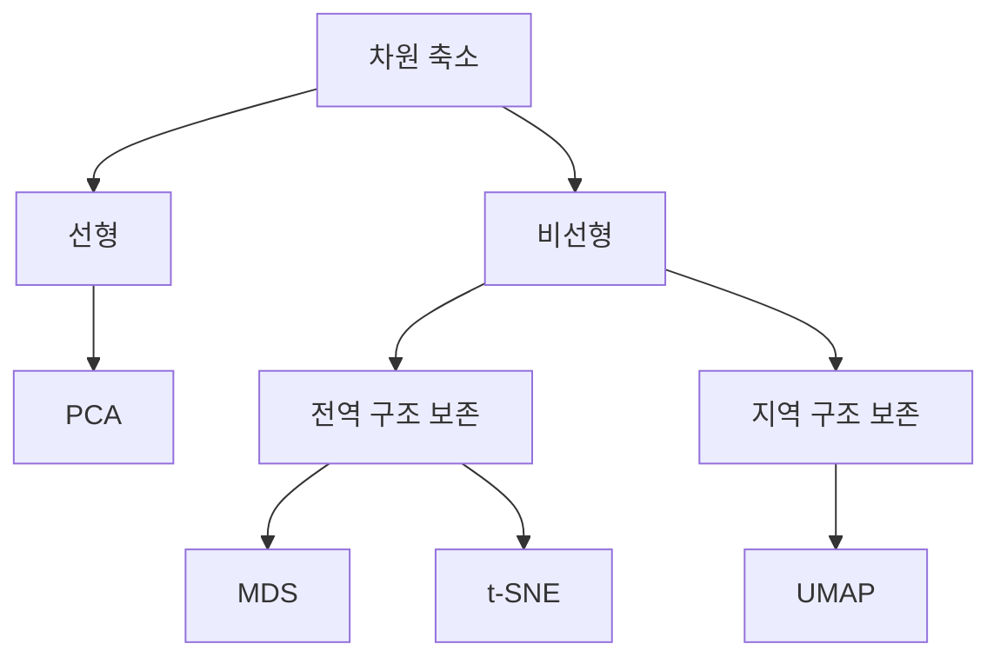
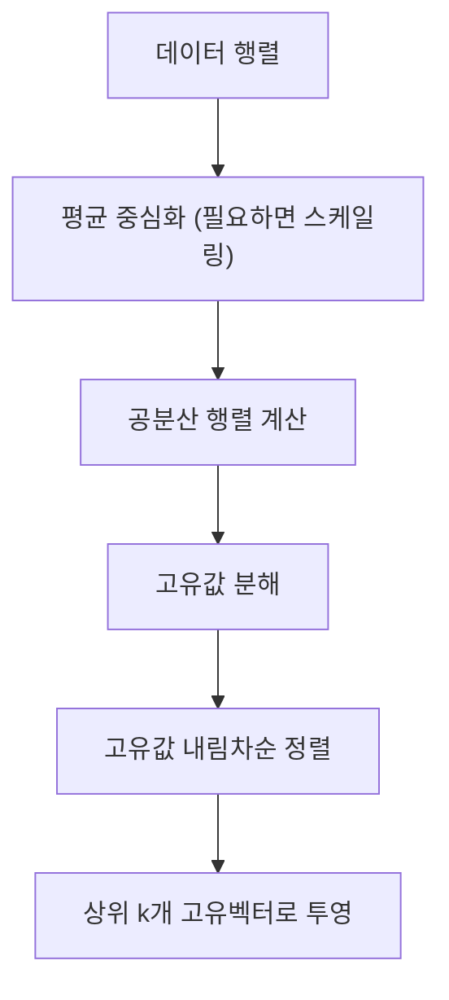
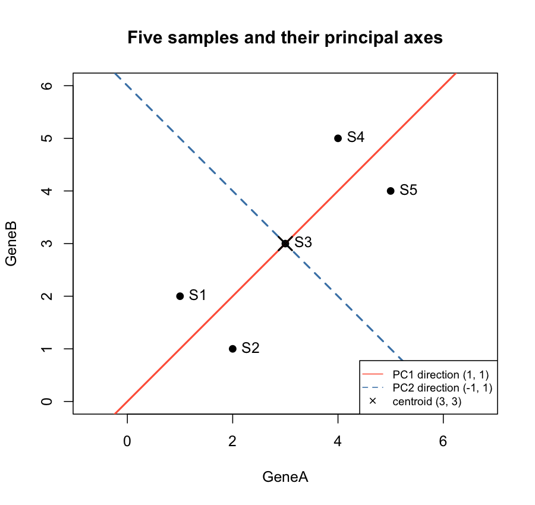
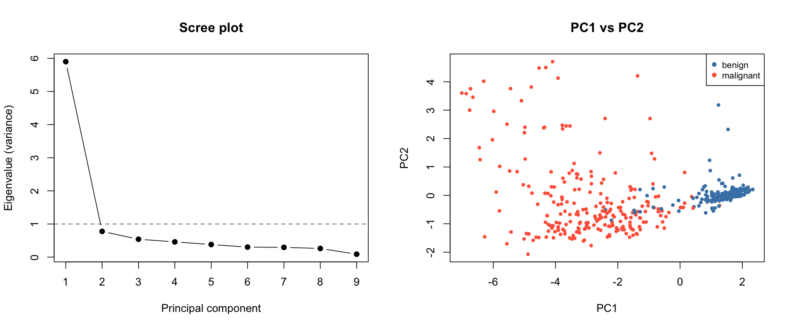

# 4장 — 차원 축소와 PCA

[레포지토리 안내](../../README.ko.md) | [English](Concepts_Lecture.md) | [한국어](Concepts_Lecture.ko.md)

> **최종 수정일:** 2026-11-27

> **학습 목표:**
> 1. 차원 축소의 동기와 차원의 저주를 설명할 수 있다
> 2. 특성 선택과 특성 추출(차원 축소)을 구분할 수 있다
> 3. 공분산 행렬의 고유값 분해로 주성분 분석(PCA)을 유도하고 수행할 수 있다
> 4. 주성분과 설명 분산 비율을 해석하여 유지할 성분 수를 정할 수 있다
> 5. PCA, MDS, t-SNE, UMAP의 특징을 비교할 수 있다
> 6. 손계산 크기의 자료로 PCA를 직접 계산하고 R의 `prcomp()` 결과와 대조할 수 있다

---

## 목차

- [1. 차원 축소](#1-차원-축소)
  - [1.1 정의](#11-정의)
  - [1.2 차원 축소가 필요한 이유](#12-차원-축소가-필요한-이유)
  - [1.3 차원의 저주(Curse of Dimensionality)](#13-차원의-저주curse-of-dimensionality)
  - [1.4 응용 분야](#14-응용-분야)
- [2. 특성 선택 vs. 차원 축소](#2-특성-선택-vs-차원-축소)
  - [2.1 특성 선택(Feature Selection)](#21-특성-선택feature-selection)
  - [2.2 차원 축소 (특성 추출, Feature Extraction)](#22-차원-축소-특성-추출-feature-extraction)
- [3. 두 가지 주요 접근법](#3-두-가지-주요-접근법)
  - [3.1 투영(Projection)](#31-투영projection)
  - [3.2 매니폴드 학습(Manifold Learning)](#32-매니폴드-학습manifold-learning)
  - [3.3 방법 분류](#33-방법-분류)
- [4. 선형대수 사전 지식](#4-선형대수-사전-지식)
  - [4.1 벡터(Vectors)](#41-벡터vectors)
  - [4.2 선형 결합(Linear Combination)](#42-선형-결합linear-combination)
  - [4.3 선형 변환(Linear Transformation)](#43-선형-변환linear-transformation)
  - [4.4 PCA와의 연결](#44-pca와의-연결)
- [5. 주성분 분석(Principal Component Analysis, PCA)](#5-주성분-분석principal-component-analysis-pca)
  - [5.1 개요](#51-개요)
  - [5.2 PCA의 목표](#52-pca의-목표)
  - [5.3 PCA는 데이터를 투영한다](#53-pca는-데이터를-투영한다)
  - [5.4 혈액 검사 자료와 PCA의 동기](#54-혈액-검사-자료와-pca의-동기)
- [6. PCA 이론 및 유도](#6-pca-이론-및-유도)
  - [6.1 수학적 설정](#61-수학적-설정)
  - [6.2 재구성 오차(Reconstruction Error)](#62-재구성-오차reconstruction-error)
  - [6.3 Lagrange 승수법을 통한 유도](#63-lagrange-승수법을-통한-유도)
  - [6.4 고유값 해석](#64-고유값-해석)
  - [6.5 공분산 행렬 계산](#65-공분산-행렬-계산)
  - [6.6 공분산 행렬의 기하학적 해석](#66-공분산-행렬의-기하학적-해석)
- [7. PCA의 기하학적 근거](#7-pca의-기하학적-근거)
  - [7.1 기하학적 관점](#71-기하학적-관점)
  - [7.2 공분산 행렬에서의 고유값과 고유벡터](#72-공분산-행렬에서의-고유값과-고유벡터)
  - [7.3 간단한 예제 (2x2 행렬)](#73-간단한-예제-2x2-행렬)
  - [7.4 공분산과 주축의 회전](#74-공분산과-주축의-회전)
  - [7.5 2차원 예제의 PCA 대수](#75-2차원-예제의-pca-대수)
  - [7.6 p차원으로의 일반화와 최적 적합](#76-p차원으로의-일반화와-최적-적합)
  - [7.7 공분산 행렬과 상관 행렬](#77-공분산-행렬과-상관-행렬)
  - [7.8 행렬 연산 복습](#78-행렬-연산-복습)
- [8. 평균, 분산, 공분산](#8-평균-분산-공분산)
  - [8.1 평균 (기댓값, Expectation)](#81-평균-기댓값-expectation)
  - [8.2 분산(Variance)](#82-분산variance)
  - [8.3 공분산(Covariance)](#83-공분산covariance)
  - [8.4 상관계수(Correlation)](#84-상관계수correlation)
  - [8.5 공분산과 상관계수의 계산 예](#85-공분산과-상관계수의-계산-예)
- [9. 기타 차원 축소 방법](#9-기타-차원-축소-방법)
  - [9.1 MDS (Multi-Dimensional Scaling, 다차원 척도법)](#91-mds-multi-dimensional-scaling-다차원-척도법)
  - [9.2 t-SNE (t-distributed Stochastic Neighbor Embedding)](#92-t-sne-t-distributed-stochastic-neighbor-embedding)
  - [9.3 UMAP (Uniform Manifold Approximation and Projection)](#93-umap-uniform-manifold-approximation-and-projection)
  - [9.4 비교](#94-비교)
  - [9.5 MDS의 거리 계산 예](#95-mds의-거리-계산-예)
  - [9.6 t-SNE의 유사도 계산 예](#96-t-sne의-유사도-계산-예)
  - [9.7 UMAP의 균일 분포 가정](#97-umap의-균일-분포-가정)
- [10. 실용적 고려사항](#10-실용적-고려사항)
  - [10.1 Scree Plot](#101-scree-plot)
  - [10.2 설명 분산 비율(Explained Variance Ratio)](#102-설명-분산-비율explained-variance-ratio)
  - [10.3 상황별 방법 선택](#103-상황별-방법-선택)
  - [10.4 고유값과 고유벡터의 해석](#104-고유값과-고유벡터의-해석)
  - [10.5 유지할 축의 개수와 PCA의 가정](#105-유지할-축의-개수와-pca의-가정)
  - [10.6 PCA 알고리즘 요약](#106-pca-알고리즘-요약)
  - [10.7 응용: 고유얼굴과 계산 복잡도](#107-응용-고유얼굴과-계산-복잡도)
- [11. 손으로 푸는 PCA와 생명과학 자료](#11-손으로-푸는-pca와-생명과학-자료)
  - [11.1 다섯 표본, 두 유전자의 PCA](#111-다섯-표본-두-유전자의-pca)
  - [11.2 R로 확인하기](#112-r로-확인하기)
  - [11.3 유방 종양 세포 자료의 PCA](#113-유방-종양-세포-자료의-pca)
  - [11.4 흔한 실수](#114-흔한-실수)
- [요약](#요약)
- [점검 문제](#점검-문제)
- [참고 문헌](#참고-문헌)

---

<br>

## 1. 차원 축소

### 1.1 정의

차원 축소(Dimensionality Reduction)는 수천 또는 수백만 개의 저수준 특성에서 가장 관련성 높은 정보를 담은 적은 수의 특성을 고르거나 만들어 **더 좋고(Better)**, **더 빠르며(Faster)**, **더 이해하기 쉬운(Easier to understand)** 학습 모델을 구축하는 과정이다. 넓은 의미의 차원 축소는 2절의 특성 선택과 특성 추출을 모두 포함한다.

### 1.2 차원 축소가 필요한 이유

- **학습 알고리즘 속도 향상**: 고차원에서는 핵심이 아닌 변수가 성능 저하를 초래하거나 처리해야 할 데이터 양이 극도로 커질 수 있다.
- **더 단순하고 안정적인 모델**: 너무 많은 차원으로 학습된 모델은 과적합(overfitting)되기 쉬우며, 차원을 줄이면 모델이 더 강건해진다.
- **더 나은 시각화**: 차원이 낮으면 데이터 구조를 시각화하기 쉽다.

### 1.3 차원의 저주(Curse of Dimensionality)

차원 수가 증가하면 공간은 기하급수적으로 커지고, 같은 양의 데이터의 밀도는 희박해진다. 각 축을 10칸으로 나눈 공간에 데이터 8개가 있을 때의 밀도는 표 1과 같다.

| 차원 | 공간 (칸 수) | 데이터 수 | 밀도 |
|-----------|-------|-------------|---------|
| 1 | 10 | 8 | 80% |
| 2 | 100 | 8 | 8% |
| 3 | 1000 | 8 | 0.8% |

*표 1. 차원 수에 따른 공간 크기와 데이터 밀도*

### 1.4 응용 분야

차원 축소는 다양한 분야에서 널리 사용된다.
- 생물정보학(Bioinformatics)
- 머신 비전(Machine Vision)
- 텍스트 분류(Text Categorization)
- 시장 분석(Market Analysis)
- 품질 관리(Quality Control)
- OCR, 필기 인식(Handwriting Recognition)

> **핵심:** 오컴의 면도날(Occam's Razor)이 적용된다. 이 원칙은 "동등하게 좋은 두 가설에 직면했을 때, 항상 더 단순한 것을 선택하라"는 것이다. 차원을 줄이면 종종 더 단순하고 일반화 가능한 모델이 만들어진다.

---

<br>

## 2. 특성 선택 vs. 차원 축소

### 2.1 특성 선택(Feature Selection)

- 새로운 특성은 원래 특성의 **부분집합**이다.
- 분류를 위해 소수의 특성만 계산하면 된다.
- 원래 특성의 해석 가능성이 보존된다.

### 2.2 차원 축소 (특성 추출, Feature Extraction)

- 새로운 특성은 원래 특성의 **조합**이다(PCA와 선형 판별 분석(LDA)의 경우 선형 조합).
- 합성된 복합 변수를 만든다.
- 해석은 어려워지지만, 더 적은 차원에 더 많은 정보를 담을 수 있다.

> **핵심:** 특성 선택은 원래 특성을 유지하므로 해석하기 쉽다. 차원 축소는 새로운 결합 특성을 만들므로 더 압축적이지만 해석하기 어렵다.

---

<br>

## 3. 두 가지 주요 접근법

### 3.1 투영(Projection)

고차원 데이터를 가능한 한 많은 정보를 보존하면서 저차원 부분공간에 투영한다. 예를 들어 3차원 데이터를 2차원 평면에 투영한다.

### 3.2 매니폴드 학습(Manifold Learning)

- **매니폴드(Manifold)** 는 국소적으로 Euclidean 공간처럼 보이는 공간으로, 고차원 공간에서 데이터가 실제로 놓여 있는 저차원 곡면을 가리킨다.
- **매니폴드 학습**은 고차원 데이터에 내재된 저차원 구조를 발견한다.
- 매니폴드 학습은 (1) 데이터 구조를 그래프로 표현하고, (2) 저차원 임베딩을 계산한 뒤, (3) 기계학습(ML) 방법을 적용하는 단계로 진행된다.

**동기 부여 예제:**

- **스위스 롤(Swiss Roll)**: 데이터가 3차원으로 말린 2차원 표면 위에 놓여 있다. 점 A1과 A2는 Euclidean 거리(롤을 관통하는 직선)로는 멀리 떨어져 있을 수 있지만, 매니폴드 표면을 따라가면 가깝다. 주변 공간에서의 Euclidean 거리는 매니폴드 위의 실제 근접성을 포착하지 못한다.
- **골프 스윙(Golf Swing)**: 골프 스윙의 순차적 프레임들은 고차원 픽셀 공간에서 매니폴드를 형성한다. Euclidean 거리를 사용하면 특정 프레임의 최근접 이웃에 시각적으로 다른 자세가 포함될 수 있다. 매니폴드를 발견한 후에는 의미적으로 가까운 데이터(시간적으로 인접한 스윙 위치)가 올바르게 이웃으로 식별된다.

### 3.3 방법 분류



*그림 1. 차원 축소 방법의 분류*

t-SNE와 UMAP이 보존하는 구조에 관한 일반적인 견해는 9.3절의 참고 상자에서 다룬다.

> **핵심:** PCA와 같은 선형 방법은 데이터가 선형 부분공간 근처에 있을 때 잘 작동한다. 비선형 방법(MDS, t-SNE, UMAP)은 더 복잡한 구조를 포착한다.

---

<br>

## 4. 선형대수 사전 지식

### 4.1 벡터(Vectors)

- 데이터는 벡터로 기술할 수 있다(물리학, 컴퓨터 과학, 수학의 관점).
- **벡터의 상수배**는 스칼라를 곱해 벡터를 늘리거나 줄인다.
- **벡터의 합**은 두 벡터를 성분별로 더한다.
- **행 벡터와 열 벡터**: 행렬 곱의 각 원소는 행 벡터와 열 벡터의 내적이다.

### 4.2 선형 결합(Linear Combination)

선형 결합은 벡터의 상수배와 합을 결합한 것으로, 두 가지(또는 그 이상의) 특성을 동시에 결합하여 벡터를 기술한다.

### 4.3 선형 변환(Linear Transformation)

- 선형 변환은 **선형 결합을 보존하는** 두 벡터 공간 사이의 함수이다.
- **행렬은 곧 선형 변환**이다. 행렬 $A$를 벡터 $\mathbf{x}$에 적용하면 다른 벡터 $A\mathbf{x}$가 생성된다.
- 고유벡터와 고유값은 여기서 나온다. $A\mathbf{x} = \lambda \mathbf{x}$는 행렬이 고유벡터 방향으로는 벡터를 ($\lambda$배로) 늘리거나 줄이기만 한다는 뜻이다.

### 4.4 PCA와의 연결

데이터가 고차원 벡터 공간에서 표현될 때, 공분산 행렬은 선형 변환으로 작용한다. 그 고유벡터를 찾으면 데이터가 가장 넓게 퍼진 방향(주성분)이 드러난다.

> **[선형대수학]** 선형대수학의 스펙트럼 정리에 따르면 실수 대칭 행렬은 고유값이 모두 실수이고, 서로 직교하는 단위 고유벡터로 이루어진 직교 행렬로 대각화된다. 공분산 행렬은 대칭 행렬이므로 이 정리가 적용되며, PCA의 주성분이 서로 직교하는 것은 이 성질에서 나온다.

---

<br>

## 5. 주성분 분석(Principal Component Analysis, PCA)

### 5.1 개요

PCA는 표준적인 다변량 방법 중 가장 널리 사용되고 잘 알려진 방법일 것이다. Pearson(1901)과 Hotelling(1933)이 고안했으며, Goodall(1954)이 인자 분석(factor analysis)이라는 이름으로 생태학에 처음 적용했다.

PCA는 상관관계가 있을 수 있는 $n \times p$ 데이터 행렬($n$개 객체, $p$개 변수)을 받아, 원래 $p$개 변수의 선형 결합인 **비상관 축(주성분)** 으로 요약한다.

### 5.2 PCA의 목표

고차원 공간에서 원본 데이터에 대한 정보를 최대한 보존하는 가장 작은 부분공간을 찾는 것이다.

- 많은($p$개) 변수를 가진 데이터를 더 적은($k$개) 파생 변수로 요약한다.
- **첫 $k$개 성분**은 객체 간 변동을 가능한 한 많이 나타낸다.
- 표현의 명확성과 지나친 단순화(정보 손실) 사이의 균형을 맞춘다.
- 잔차 변동(residual variation)은 축소된 표현에 남지 않은 정보이다.

### 5.3 PCA는 데이터를 투영한다

PCA는 원본 데이터의 구조를 유지하면서 벡터에 데이터를 투영하여 차원을 축소한다. **가장 큰 분산**을 가진 축에 먼저 데이터를 투영한다.

> **핵심:** PCA의 결과는 공분산 행렬에 의해서만 결정된다. PCA는 데이터에서 분산이 최대인 방향을 찾아 그 방향으로 데이터를 투영한다.

### 5.4 혈액 검사 자료와 PCA의 동기

표 2는 피험자 9명(A1~A9)의 혈액 검사 결과로, 백혈구 수(WBC), 적혈구 수(RBC), 혈색소(Hgb), 적혈구 용적률(Hct), 평균 적혈구 용적(MCV), 평균 적혈구 혈색소량(MCH), 평균 적혈구 혈색소 농도(MCHC)의 7가지 특성이 있다.

| 피험자 | H-WBC | H-RBC | H-Hgb | H-Hct | H-MCV | H-MCH | H-MCHC |
|:--|--:|--:|--:|--:|--:|--:|--:|
| A1 | 8.0 | 4.82 | 14.1 | 41 | 85 | 29 | 34 |
| A2 | 7.3 | 5.02 | 14.7 | 43 | 86 | 29 | 34 |
| A3 | 4.3 | 4.48 | 14.1 | 41 | 91 | 32 | 35 |
| A4 | 7.5 | 4.47 | 14.9 | 45 | 101 | 33 | 33 |
| A5 | 7.3 | 5.52 | 15.4 | 46 | 84 | 28 | 33 |
| A6 | 6.9 | 4.86 | 16.0 | 47 | 97 | 33 | 34 |
| A7 | 7.8 | 4.68 | 14.7 | 43 | 92 | 31 | 34 |
| A8 | 8.6 | 4.82 | 15.8 | 42 | 88 | 33 | 37 |
| A9 | 5.1 | 4.71 | 14.0 | 43 | 92 | 30 | 32 |

*표 2. 피험자 9명의 혈액 검사 자료*

특성이 두 개면 산점도로, 세 개면 3차원 산점도로 자료를 볼 수 있지만, 나머지 특성까지 한꺼번에 시각화할 방법은 없다. 4차원 이상의 공간은 직접 볼 수 없기 때문이다. 이 상황에서 다음과 같은 질문이 생긴다.

- 원래 좌표축보다 더 나은 표현이 있는가?
- 모든 고차원을 보여 주어야만 하는가?
- 특성들 사이에 강한 상관이 있다면 어떻게 되는가? 예를 들어 혈색소, 적혈구 용적률, 적혈구 수는 모두 혈액 속 적혈구의 양을 반영하므로 함께 움직인다.
- 원래 자료의 정보를 가장 많이 유지하는 고차원 공간의 가장 작은 부분공간을 어떻게 찾는가?

이 질문에 대한 답 하나가 PCA이다. 상관된 특성들은 같은 정보를 여러 번 담고 있으므로, 그 정보를 소수의 합성 변수로 모으면 차원을 줄이면서 정보는 대부분 유지할 수 있다.

---

<br>

## 6. PCA 이론 및 유도

### 6.1 수학적 설정

$\mathbf{X} = [\mathbf{x}_1, \dots, \mathbf{x}_m]$을 $N \times m$ 데이터 행렬($N$차원, $m$개 인스턴스)이라 하자. 각 열 $\mathbf{x}_j$가 하나의 인스턴스이며, 평균을 빼서 중심화되어 있다고 가정한다.

$\mathbf{U}$를 $N \times N$ 직교 행렬이라 하자. 여기서 $\mathbf{U}\mathbf{U}^T = \mathbf{I}_N$이고, $\mathbf{U}$의 $i$번째 행을 $\mathbf{u}_i^T$로 쓴다.

- 변환은 $\mathbf{y} = \mathbf{U}\mathbf{x}$이다.
- 역변환은 $\mathbf{x} = \mathbf{U}^T \mathbf{y}$이다.
- $M$개 기저 벡터를 사용한 근사($M \le N$)는 $\hat{\mathbf{x}} = \sum_{i=1}^{M} \mathbf{u}_i y_i$이다.

### 6.2 재구성 오차(Reconstruction Error)

```math
\varepsilon^2 = \mathbb{E}\{\|\mathbf{x} - \hat{\mathbf{x}}\|^2\} = \frac{1}{m} \sum_{j=1}^{m} \|\mathbf{x}_j - \hat{\mathbf{x}}_j\|^2
```

**목표:** 재구성 오차를 최소화한다.

$$\arg \min_{\mathbf{U}} \varepsilon^2, \quad \text{s.t.} \quad \mathbf{U}^T \mathbf{U} = \mathbf{I}_N$$

### 6.3 Lagrange 승수법을 통한 유도

오차는 다음과 같이 표현할 수 있다.

$$\varepsilon^2 = \sum_{i=M+1}^{N} \mathbf{u}_i^T \boldsymbol{\Sigma} \mathbf{u}_i$$

여기서 $\boldsymbol{\Sigma}$는 공분산 행렬이다($\mathbf{x}$가 중심화되었으므로 $\mathbb{E}[\mathbf{x}\mathbf{x}^T] = \boldsymbol{\Sigma}$).

직교성 제약 중 단위 길이 조건 $\mathbf{u}_i^T \mathbf{u}_i = 1$에 Lagrange 승수 $\lambda_i$를 붙인다.

$$L = \sum_{i=M+1}^{N} \mathbf{u}_i^T \boldsymbol{\Sigma} \mathbf{u}_i - \sum_{i=M+1}^{N} \lambda_i(\mathbf{u}_i^T \mathbf{u}_i - 1)$$

도함수를 0으로 놓으면 다음을 얻는다.

$$\frac{\partial L}{\partial \mathbf{u}_i} = 2\boldsymbol{\Sigma}\mathbf{u}_i - 2\lambda_i\mathbf{u}_i = 0 \implies \boldsymbol{\Sigma}\mathbf{u}_i = \lambda_i\mathbf{u}_i$$

> **[미적분학]** Lagrange 승수법은 제약 조건 $g(\mathbf{u}) = 0$ 아래에서 함수 $f(\mathbf{u})$의 극값을 찾는 방법으로, $L = f - \lambda g$의 편미분을 0으로 놓은 연립방정식을 푼다. 여기서는 $f$가 재구성 오차, $g$가 단위 길이 조건 $\mathbf{u}_i^T \mathbf{u}_i - 1$이므로, 이 연립방정식이 곧 고유값 방정식 $\boldsymbol{\Sigma}\mathbf{u}_i = \lambda_i\mathbf{u}_i$이다.

### 6.4 고유값 해석

방정식 $\boldsymbol{\Sigma}\mathbf{u}_i = \lambda_i \mathbf{u}_i$는 다음을 보여 준다.
- $\mathbf{u}_i$는 공분산 행렬 $\boldsymbol{\Sigma}$의 **고유벡터(Eigenvectors)** 이다.
- $\lambda_i$는 대응하는 **고유값(Eigenvalues)** 이다.

$\mathbf{u}_i^T \boldsymbol{\Sigma} \mathbf{u}_i = \lambda_i \mathbf{u}_i^T \mathbf{u}_i = \lambda_i$이므로 재구성 오차는 다음이 된다.

$$\varepsilon^2 = \sum_{i=M+1}^{N} \lambda_i$$

오차는 $\lambda_{M+1}, \dots, \lambda_N$이 **가장 작은** 고유값일 때 **최소**가 된다. 따라서 **가장 큰** 고유값 $M$개에 대응하는 고유벡터를 주성분으로 유지한다.

### 6.5 공분산 행렬 계산

$$\boldsymbol{\Sigma} = \frac{1}{n} \mathbf{X}^T \mathbf{X}$$

여기서 $\mathbf{X}$는 행이 관측인 $n \times p$ 평균 중심화 데이터 행렬이다. $\mathbf{X}^T \mathbf{X}$의 $(i, j)$ 원소는 $i$번째와 $j$번째 특성 열의 내적이다. 6.1절처럼 열이 인스턴스인 $N \times m$ 행렬로 쓰면 같은 공분산 행렬은 $\frac{1}{m}\mathbf{X}\mathbf{X}^T$이다.

### 6.6 공분산 행렬의 기하학적 해석

2차원 공분산 행렬은 다음과 같다.

```math
\boldsymbol{\Sigma} = \begin{bmatrix} \sigma_x^2 & \text{Cov}(X,Y) \\ \text{Cov}(X,Y) & \sigma_y^2 \end{bmatrix}
```

- **대각 원소**($\sigma_x^2$, $\sigma_y^2$)는 **각 축을 따른 퍼짐(분산)** 으로, 데이터가 $X$와 $Y$를 따라 각각 얼마나 늘어나 있는지를 나타낸다.
- **비대각 원소**($`\text{Cov}(X,Y)`$)는 변수 간의 **결합 퍼짐**으로, $X$와 $Y$가 함께 어떻게 변하는지를 나타낸다.

**$\mathbf{X}^T \mathbf{X}$가 공분산을 포착하는 이유:**

$\mathbf{X}^T \mathbf{X}$는 **특성 열 간의 내적 행렬**을 생성한다. 각 원소 $\mathbf{X}_i^T \mathbf{X}_j$($i$번째와 $j$번째 특성 열의 내적)는 모든 관측에 걸쳐 특성 $i$와 특성 $j$가 얼마나 같은 방향으로 움직이는지를 측정한다. $n$으로 나누면 이것이 공분산으로 정규화된다. 이것이 $\mathbf{X}$가 평균 중심화되었을 때 $\boldsymbol{\Sigma} = \frac{1}{n}\mathbf{X}^T\mathbf{X}$인 이유이다.

공분산 행렬이 데이터에 대한 선형 변환으로 사용될 때, 데이터를 가장 큰 분산의 방향으로 늘린다. 이 변환의 고유벡터는 그 방향(주성분)을 드러내고, 고유값은 얼마나 많은 늘림이 발생하는지(분산의 양)를 드러낸다.

지금까지의 내용을 PCA의 계산 절차로 정리하면 그림 2와 같다.



*그림 2. PCA의 계산 절차*

> **핵심:** 주성분은 공분산 행렬의 고유벡터이며, 고유값 크기 순으로 정렬된다. 고유값은 각 성분이 설명하는 분산의 양을 나타낸다.

---

<br>

## 7. PCA의 기하학적 근거

### 7.1 기하학적 관점

- 객체는 $p$개 변수 각각에 대한 축을 가진 다차원 공간에서 $n$개 점의 구름으로 표현된다.
- 점들의 **중심(Centroid)** 은 각 변수의 평균으로 정의된다.
- 각 변수의 **분산(Variance)** 은 평균 주위의 $n$개 값의 평균 제곱 편차이다.

$$V_i = \frac{1}{n-1} \sum_{m=1}^{n} (X_{im} - \bar{X}_i)^2$$

이 표본 분산은 $n - 1$로 나누고 6.5절의 공분산 행렬은 $n$으로 나눈다. 나누는 수는 모든 고유값을 같은 비율로 바꿀 뿐이므로 고유벡터(주성분 방향)와 설명 분산 비율은 달라지지 않는다.

### 7.2 공분산 행렬에서의 고유값과 고유벡터

| | 원래 의미 | 공분산 행렬에서의 의미 |
|---|---|---|
| **고유벡터** | 행렬을 곱해도 방향이 바뀌지 않는 주축의 방향을 나타낸다 | 데이터가 분포된 방향을 나타낸다 |
| **고유값** | 고유벡터 방향으로 벡터가 늘어나거나 줄어드는 배율 | 그 방향으로 데이터가 퍼진 정도 (분산의 양) |

*표 3. 고유벡터와 고유값의 원래 의미와 공분산 행렬에서의 의미*

### 7.3 간단한 예제 (2x2 행렬)

다음 행렬 $A$의 고유값과 고유벡터를 구한다.

```math
A = \begin{bmatrix} 4 & 2 \\ 3 & 5 \end{bmatrix}
```

1. 특성 방정식 $\det(A - \lambda I) = 0$을 푼다.
2. $(4 - \lambda)(5 - \lambda) - 2 \cdot 3 = \lambda^2 - 9\lambda + 14 = (\lambda - 7)(\lambda - 2) = 0$이므로 $\lambda = 7, 2$이다.
3. $\lambda = 7$일 때 $(A - 7I)\mathbf{x} = \mathbf{0}$에서 $-3x_1 + 2x_2 = 0$이므로 고유벡터는 $c(2, 3)$이다.
4. $\lambda = 2$일 때 $(A - 2I)\mathbf{x} = \mathbf{0}$에서 $2x_1 + 2x_2 = 0$이므로 고유벡터는 $c(-1, 1)$이다.

> **참고:** 이 행렬은 대칭이 아니므로 공분산 행렬의 예는 아니며, 두 고유벡터 $(2, 3)$과 $(-1, 1)$도 직교하지 않는다(내적 $= -2 + 3 = 1$). 공분산 행렬은 대칭 행렬이므로 고유값이 모두 실수이고 서로 다른 고유값에 대응하는 고유벡터는 직교하며, 양의 준정부호(positive semidefinite) 행렬이므로 고유값이 음수가 아니다.

> **핵심:** 고유값은 각 고유벡터 방향을 따라 포착되는 분산의 양을 결정한다. 더 큰 고유값은 더 중요한 주성분에 대응한다.

### 7.4 공분산과 주축의 회전

변수들이 선형으로 상관된 정도는 공분산으로 나타낸다. 객체 n개에서 변수 i와 j의 표본 공분산은 다음과 같다.

```math
C_{ij} = \frac{1}{n - 1} \sum_{m=1}^{n} \left( X_{im} - \bar{X}_i \right)\left( X_{jm} - \bar{X}_j \right)
```

$`X_{im}`$은 객체 m에서 변수 i의 값, $`\bar{X}_i`$는 변수 i의 평균이며, 합은 n개 객체 전체에 대해 구한다. $`i = j`$이면 7.1절의 분산 $`V_i`$가 된다.

PCA의 목적은 p차원 공간의 좌표축을 **강체 회전(rigid rotation)** 시켜, 다음 성질을 갖는 새 위치의 축(주축)을 찾는 것이다.

- 주축 1의 분산이 가장 크고, 주축 2의 분산이 그다음으로 크며, 이런 식으로 주축 p의 분산이 가장 작도록 순서가 매겨진다.
- 모든 주축 쌍 사이의 공분산이 0이다. 즉 주축들은 서로 비상관이다.

강체 회전은 점들 사이의 거리와 각도를 바꾸지 않고 좌표축만 돌리는 변환이다. 그래서 회전 뒤에도 자료의 모양과 총분산은 그대로이고, 분산이 각 축에 나뉘는 방식만 달라진다.

### 7.5 2차원 예제의 PCA 대수

두 변수 $`X_1`$과 $`X_2`$가 양의 공분산을 가지고 분산이 비슷한 2차원 자료를 본다. 점들의 중심은 $`\bar{X}_1 = 8.35`$, $`\bar{X}_2 = 4.91`$이다.

**1단계: 중심화.** 각 변수에서 평균을 빼 평균을 0으로 맞춘다. 점 구름의 모양은 그대로이고 중심만 원점으로 옮겨 간다.

**2단계: 분산-공분산 행렬.** 모든 변수 쌍 사이의 분산과 공분산(또는 상관계수)을 담은 교차곱 행렬을 계산한다. 이 행렬은 정사각 대칭 행렬이고, 대각 원소는 분산, 비대각 원소는 공분산이다.

```math
\mathbf{S} = \begin{bmatrix} 6.6707 & 3.4170 \\ 3.4170 & 6.2384 \end{bmatrix}
```

행렬 표기로는 $`\mathbf{S} = \mathbf{X}'\mathbf{X}/(n - 1)`$이며, $`\mathbf{X}`$는 각 변수를 중심화한(상관계수를 쓸 때는 표준편차로도 나눈) $`n \times p`$ 자료 행렬이다. 분산-공분산 행렬의 대각 원소의 합을 **대각합(trace)** 이라 하며, 자료의 총분산이다. 대각합은 각 객체와 p차원 공간의 중심 사이의 평균 제곱 Euclidean 거리이기도 하다. 이 예의 대각합은 $`6.6707 + 6.2384 = 12.9091`$이다.

**3단계: 고유값.** 주축을 찾는 것은 교차곱 행렬 $`\mathbf{S}`$의 고유 분석이다. 고유값(잠재근, latent root)은 특성 방정식 $`|\mathbf{S} - \lambda \mathbf{I}| = 0`$의 해이다. 2x2 행렬에서는 이 방정식이 $`\lambda^2 - (\text{대각합})\lambda + (\text{행렬식}) = 0`$이 된다.

```math
\lambda^2 - 12.9091\,\lambda + (6.6707 \times 6.2384 - 3.4170^2) = \lambda^2 - 12.9091\,\lambda + 29.9386 = 0
```

근의 공식으로 $`\lambda = (12.9091 \pm \sqrt{12.9091^2 - 4 \times 29.9386})/2 = (12.9091 \pm 6.8477)/2`$이므로 $`\lambda_1 \approx 9.878`$, $`\lambda_2 \approx 3.031`$이다. 고유값 $`\lambda_1, \lambda_2, \ldots, \lambda_p`$는 각 주성분 축 위 좌표의 분산이며, 모든 고유값의 합은 $`\mathbf{S}`$의 대각합(원래 변수들의 분산의 합)과 같다. 실제로 $`9.878 + 3.031 = 12.909`$이다.

**4단계: 고유벡터.** $`\lambda_1`$에 대해 $`(\mathbf{S} - \lambda_1 \mathbf{I})\mathbf{u} = \mathbf{0}`$의 첫 행은 $`(6.6707 - 9.8784)u_1 + 3.4170\,u_2 = 0`$이므로 $`u_2 = 0.9387\,u_1`$이다. 길이가 1이 되도록 정규화하면 $`u_1 = 1/\sqrt{1 + 0.9387^2} = 0.7291`$, $`u_2 = 0.6844`$이다. 같은 방법으로 $`\lambda_2`$의 고유벡터는 $`(-0.6844, 0.7291)`$이다.

| 변수 | $`\mathbf{u}_1`$ | $`\mathbf{u}_2`$ |
|:--|--:|--:|
| $`X_1`$ | 0.7291 | -0.6844 |
| $`X_2`$ | 0.6844 | 0.7291 |

*표 4. 2차원 예제의 고유벡터*

각 고유벡터는 p개의 값으로 이루어지며, 각 값은 그 변수가 주성분 축에 기여하는 정도를 나타낸다. 두 고유벡터는 서로 직교한다. 즉 교차곱이 0이다: $`0.7291 \times (-0.6844) + 0.6844 \times 0.7291 = 0`$.

**5단계: 주성분 점수.** 객체 i의 k번째 주축 위 좌표를 **주성분 점수(PC score)** 라 하며 다음과 같이 계산한다.

```math
z_{ki} = u_{1k} x_{1i} + u_{2k} x_{2i} + \cdots + u_{pk} x_{pi}
```

행렬로 쓰면 $`\mathbf{Z} = \mathbf{X}\mathbf{U}`$이며, $`\mathbf{Z}`$는 $`n \times k`$ 주성분 점수 행렬, $`\mathbf{X}`$는 $`n \times p`$ 중심화된 자료 행렬, $`\mathbf{U}`$는 $`p \times k`$ 고유벡터 행렬이다.

주성분 점수에는 중요한 성질이 있다. 각 주성분 축 위 점수의 분산은 그 축의 고유값과 같다. 고유값은 k번째 축이 보여 주는(설명하는, 추출하는) 분산이며, 처음 k개 고유값의 합이 k차원 배치가 설명하는 분산이다. 주축들 사이의 분산-공분산 행렬은 비대각 원소가 모두 0(주축은 서로 비상관)이고 대각 원소가 고유값인 단순한 형태가 된다.

```math
\begin{bmatrix} 9.878 & 0 \\ 0 & 3.031 \end{bmatrix}
```

PC1은 총분산의 $`9.878/12.909 \approx 76.5\%`$를 보여 준다(설명한다). PC1 하나만 남기면 두 변수를 하나로 줄이면서 정보의 4분의 3 이상을 유지하는 것이다. R의 `eigen()`으로 확인하면 다음과 같다.

```r
S <- matrix(c(6.6707, 3.4170, 3.4170, 6.2384), 2, 2)
e <- eigen(S)
e$values
e$vectors
e$values[1] / sum(e$values)
```

```text
[1] 9.87838 3.03072
           [,1]       [,2]
[1,] -0.7290854  0.6844227
[2,] -0.6844227 -0.7290854
[1] 0.7652261
```

R이 돌려준 고유벡터는 손계산과 부호가 반대이다. $`\mathbf{u}`$가 고유벡터이면 $`-\mathbf{u}`$도 같은 고유값의 고유벡터이므로, 고유벡터의 부호는 정해지지 않는다. 주성분의 방향을 해석할 때는 부호가 아니라 원소 사이의 상대적인 크기와 부호의 패턴을 본다.

### 7.6 p차원으로의 일반화와 최적 적합

실제로 변수 두 개에 PCA를 쓰는 경우는 드물며, 주축을 찾는 대수는 p개 변수로 그대로 일반화된다.

- PC 1은 p차원 점 구름에서 분산이 가장 큰 방향이다.
- PC 2는 PC 1과 공분산이 0이라는 제약 아래에서 분산이 그다음으로 큰 방향이다.
- PC 3은 PC 1, PC 2와 모두 공분산이 0이라는 제약 아래에서 분산이 그다음으로 큰 방향이다.
- 이런 식으로 PC p까지 이어진다.

각 주축은 원래 변수의 선형 결합 $`\text{PC}_i = a_{i1}Y_1 + a_{i2}Y_2 + \cdots + a_{ip}Y_p`$이며, $`a_{ij}`$는 주성분 i의 계수로 변수 j의 측정값에 곱한다. 주축은 원래 변수 축을 강체 회전한 것이다.

PC 1은 분산이 최대인 방향인 동시에, 점들에서 PC 1까지의 수직 제곱 거리의 합을 최소로 만드는 최소제곱 의미의 **최적 적합선(line of best fit)** 이다. 피타고라스 정리에 따라 각 점에서 중심까지의 제곱 거리는 축 위로 투영한 길이의 제곱과 축까지의 수직 거리의 제곱의 합이므로, 투영의 분산을 최대로 하는 것과 수직 거리의 제곱 합을 최소로 하는 것은 같은 문제이다. 5장의 회귀선이 y 방향의 수직 거리(잔차)만 최소로 하는 것과 다르다.

처음 k개 주성분은 점 구름에 가장 잘 맞는 k차원 초평면(hyperplane of best fit)을 정한다. p개 변수의 총분산 가운데 PC 1부터 PC k까지는 k차원에서 보여 줄 수 있는 최대 비율을 나타낸다. 즉 PC 1부터 PC k까지의 좌표로 계산한 점들 사이의 제곱 Euclidean 거리는 p차원 전체에서의 제곱 Euclidean 거리를 k차원에서 가장 잘 나타낸다. PCA가 객체 사이의 비유사도로 p개 변수로 계산한 Euclidean 거리를 쓰며, 그 거리의 가장 좋은 k차원 표현(k < p)을 끌어낸다고 하는 것이 이 뜻이다. 9.1절에서 Euclidean 거리를 쓴 MDS(PCoA)가 PCA와 같은 결과를 내는 것도 이 때문이다.

### 7.7 공분산 행렬과 상관 행렬

변수들을 표준화(평균을 빼고 표준편차로 나눔)하면 표준화된 변수 사이의 공분산이 곧 상관계수이다. 표준화 뒤에는 각 변수의 분산이 1이 된다. 상관계수는 분산과 공분산으로도 계산할 수 있다.

```math
r_{ij} = \frac{C_{ij}}{\sqrt{V_i V_j}}
```

$`C_{ij}`$는 변수 i와 j의 공분산, $`V_i`$와 $`V_j`$는 각 변수의 분산이다. 따라서 PCA는 공분산 행렬로 할 수도, 상관 행렬로 할 수도 있다.

- **공분산 행렬:** 변수들의 단위와 척도가 같고 분산의 차이 자체가 의미 있을 때 쓴다(예: 같은 기기로 잰 유전자 발현값).
- **상관 행렬:** 단위나 척도가 서로 다를 때 쓴다. 표 2의 혈액 자료에서 MCV는 80\~100 근처, RBC는 4\~6 근처이므로, 공분산 행렬로 PCA를 하면 분산이 큰 MCV가 주성분을 지배한다.

상관 행렬의 대각합은 변수의 수 p와 같으므로, 상관 행렬 PCA의 고유값은 평균이 1이다. 10.5절의 "고유값 1보다 큰 축" 규칙은 이 성질에서 나온다. R의 `prcomp()`는 기본으로 공분산 행렬을 쓰고, `scale. = TRUE`를 주면 상관 행렬을 쓴다.

### 7.8 행렬 연산 복습

전치(transpose)는 행을 열로, 열을 행으로 바꾼다. 예를 들어 2x3 행렬을 전치하면 3x2 행렬이 된다.

```math
\mathbf{X} = \begin{bmatrix} 10 & 0 & 4 \\ 7 & 1 & 2 \end{bmatrix}, \qquad \mathbf{X}' = \begin{bmatrix} 10 & 7 \\ 0 & 1 \\ 4 & 2 \end{bmatrix}
```

두 행렬을 곱하려면 앞의 행렬(피승수)의 열 수와 뒤의 행렬(승수)의 행 수가 같아야 한다. 결과의 (i, j) 원소는 앞 행렬의 i번째 행과 뒤 행렬의 j번째 열의 내적이다. 위의 2x3 행렬 $`\mathbf{X}`$와 3x2 행렬 $`\mathbf{X}'`$의 곱 $`\mathbf{X}\mathbf{X}'`$는 2x2 행렬이며, (1, 1) 원소는 $`10 \times 10 + 0 \times 0 + 4 \times 4 = 116`$, (1, 2) 원소는 $`10 \times 7 + 0 \times 1 + 4 \times 2 = 78`$, (2, 2) 원소는 $`7^2 + 1^2 + 2^2 = 54`$이다. 공분산 행렬 $`\mathbf{S} = \mathbf{X}'\mathbf{X}/(n - 1)`$은 중심화된 $`n \times p`$ 자료 행렬로 이 곱을 계산한 $`p \times p`$ 행렬이다. 행이 관측인 자료에서는 $`\mathbf{X}'\mathbf{X}`$가, 6.1절처럼 열이 관측인 자료에서는 $`\mathbf{X}\mathbf{X}'`$가 공분산 행렬을 만든다.

---

<br>

## 8. 평균, 분산, 공분산

### 8.1 평균 (기댓값, Expectation)

|  | 이산형 (PMF) | 연속형 (PDF) |
|--|----------------|-----------------|
| **공식** | $E(X) = \sum_i p_i x_i$ | $E(X) = \int x f(x) dx$ |

*표 5. 이산형과 연속형 확률변수의 평균*

### 8.2 분산(Variance)

|  | 이산형 (PMF) | 연속형 (PDF) |
|--|----------------|-----------------|
| **공식** | $V(X) = \sum_i (x_i - m)^2 p_i = E(X^2) - m^2$ | $\text{Var}[X] = \int (x - E[X])^2 f(x) dx = E[X^2] - E[X]^2$ |

*표 6. 이산형과 연속형 확률변수의 분산*

여기서 $m = E(X)$이다. 표준편차는 $\sigma(X) = \sqrt{V(X)}$이다.

### 8.3 공분산(Covariance)

확률변수 $X$와 $Y$에 대해 $E(X) = \mu$, $E(Y) = \nu$일 때 공분산은 다음과 같다.

$$\text{Cov}(X, Y) = E((X - \mu)(Y - \nu)) = E(XY) - \mu\nu = E(XY) - E(X)E(Y)$$

**$X$와 $Y$가 독립이면** $E(XY) = E(X)E(Y) = \mu\nu$이므로 **공분산이 0**이다($\text{Cov}(X, Y) = 0$).

PCA의 주성분은 서로 공분산이 0인 **비상관(Uncorrelated)** 변수이다. 공분산 행렬의 고유벡터는 서로 직교하고, 데이터를 이 축들로 투영한 성분의 공분산 행렬은 고유값을 대각 원소로 하는 대각 행렬이 되기 때문이다. 위 성질의 역은 성립하지 않으므로, 공분산이 0인 주성분이 서로 독립이라는 보장은 없다.

### 8.4 상관계수(Correlation)

공분산은 변수의 절대적 스케일에 영향을 받으므로 다음과 같이 정규화한다.

$$\rho = \frac{\text{Cov}(X, Y)}{\sqrt{\text{Var}(X) \cdot \text{Var}(Y)}}, \quad -1 \leq \rho \leq 1$$

### 8.5 공분산과 상관계수의 계산 예

공분산을 상관계수로 정규화해야 하는 이유는 변수의 단위 때문이다. 단위가 100 단위인 두 변수는 관계가 없어도 공분산이 클 수 있고, 단위가 10 단위인 두 변수는 약한 관계가 있어도 공분산이 작을 수 있다. 공분산의 크기는 관계의 강도와 단위의 크기를 함께 반영하므로, 단위를 없앤 상관계수로 비교해야 한다.

관측 4개인 두 변수 $`X = (1, 2, 3, 4)`$, $`Y = (4, 3, 2, 1)`$로 계산한다. 중심화하기 전의 내적은 $`(1 \times 4) + (2 \times 3) + (3 \times 2) + (4 \times 1) = 20`$이지만, 공분산은 중심화한 값으로 계산해야 한다. 두 평균은 모두 2.5이므로 편차는 $`X - 2.5 = (-1.5, -0.5, 0.5, 1.5)`$, $`Y - 2.5 = (1.5, 0.5, -0.5, -1.5)`$이다. 편차곱의 합은 $`-2.25 - 0.25 - 0.25 - 2.25 = -5`$이므로 표본 공분산은 $`-5/3 \approx -1.667`$이다. 두 변수의 표본분산은 모두 $`5/3`$이므로 상관계수는 $`(-5/3)/\sqrt{(5/3)(5/3)} = -1`$로, 완전한 음의 선형 관계이다.

변수가 셋(X, Y, Z)이면 공분산 행렬은 3x3이고, 대각에는 X, Y, Z의 분산이, 비대각의 (1, 2)와 (2, 1) 자리에는 X와 Y의 공분산이 같은 값으로 놓인다. 6.6절에서 본 대로 이 행렬의 각 원소는 중심화된 특성 열 두 개의 내적을 n - 1(또는 n)로 나눈 값이다.

---

<br>

## 9. 기타 차원 축소 방법

### 9.1 MDS (Multi-Dimensional Scaling, 다차원 척도법)

- **비선형** 방법으로 **전역 구조(Global Structure)** 를 보존한다.
- 저차원 공간에서 데이터 포인트 간의 쌍별 거리를 보존하려고 한다.
- 두 가지 변형으로 **Metric MDS**(= Principal Coordinate Analysis, PCoA)와 **Non-Metric MDS**가 있다.
- **PCA vs. PCoA**: PCA는 공분산에 기반하여 차원을 축소하고, PCoA(Metric MDS)는 거리에 기반하여 차원을 축소한다.
- Euclidean 거리를 사용하면 PCoA(MDS)와 PCA는 **동일한** 차원 축소 결과를 낸다. 거리 보존을 기준으로 한 축소와 공분산(분산 최대화)을 기준으로 한 축소가 같아지기 때문이며, 이 경우의 MDS는 선형 방법과 같다.
- 거리 척도에는 (1) **Euclidean 거리**(피타고라스 정리)와 (2) **로그 배수 변화의 절댓값**이 있다. 후자는 비대칭인 배수 차이를 로그로 대칭으로 만든 뒤, 두 표본 사이에서 특성별 절댓값의 평균을 거리로 쓴다.

### 9.2 t-SNE (t-distributed Stochastic Neighbor Embedding)

- **비선형** 벡터 시각화 알고리즘으로 **전역 구조(Global Structure)** 를 보존한다(9.3절의 참고 상자 참고).
- 고차원에서의 점 간 **유사성**을 임베딩 공간에서도 보존하도록 차원을 축소한다.
- **단순 투영만으로는 안 되는 이유**: 1차원으로의 단순 투영은 군집 분리를 파괴할 수 있다. 예를 들어 2차원에서 잘 분리된 두 군집도 하나의 축에 투영하면 겹칠 수 있다.

**알고리즘 개요:**

1. 각 관심 점 $x_i$에 대해 다른 모든 점 $x_j$까지의 거리를 계산한다.
2. 거리를 점마다 다른 Gaussian 폭 $\sigma_i$로 나눈다. $\sigma_i$는 각 점의 조건부 분포가 사용자가 정한 perplexity(실질적인 이웃 수를 조절하여 안정성을 더하는 매개변수)를 갖도록 정해진다.
3. 음의 지수 함수를 적용하여 조건부 확률 $p_{j|i} = \frac{\exp(-\lVert x_i - x_j \rVert^2 / 2\sigma_i^2)}{\sum_{k \ne i} \exp(-\lVert x_i - x_k \rVert^2 / 2\sigma_i^2)}$를 구한다. 가까운 점일수록 확률이 높다.
4. 대칭화한다: $p_{ij} = (p_{j|i} + p_{i|j}) / 2n$.
5. 임베딩 공간에서는 Gaussian이 아닌 **t-분포**로 유사도를 계산한다: $q_{ij} = \frac{(1 + \lVert y_i - y_j \rVert^2)^{-1}}{\sum_{k \ne l} (1 + \lVert y_k - y_l \rVert^2)^{-1}}$.
6. 임베딩 위치를 조정하여 $p_{ij}$와 $q_{ij}$ 사이의 KL 발산(KL divergence)을 최소화한다.

**t-분포를 사용하는 이유:** t-분포는 정규분포보다 꼬리가 더 두꺼워(heavier tails) 평균에서 더 넓게 퍼져 있다. 이 때문에 먼 점들이 임베딩에서 더 넓게 퍼질 여유가 생겨 군집 분리가 좋아진다.

**핵심 특성:** 무작위 초기화와 비볼록 최적화 때문에 실행할 때마다 결과가 달라진다. 시각화에는 유용하지만 결정적(deterministic)이지 않으며, 같은 결과를 얻으려면 난수 시드를 고정해야 한다.

### 9.3 UMAP (Uniform Manifold Approximation and Projection)

- **비선형** 방법으로 **지역 구조(Local Structure)** 를 보존한다.
- **위상적 데이터 분석(Topological Data Analysis)** 과 **매니폴드 학습(Manifold Learning)** 에 기반한다.
- 위상수학의 개념인 단체(simplices: 0-simplex = 점, 1-simplex = 변, 2-simplex = 삼각형, 3-simplex = 사면체), 단체 복합체(simplicial complexes), 신경 정리(nerve theorem)를 사용한다.
- 다양한 반경의 원으로 데이터를 덮고 단체 복합체를 구축하여 데이터의 중요한 위상을 포착한다.

**UMAP vs. t-SNE:**

| UMAP | t-SNE |
|------|-------|
| 임베딩 차원의 크기에 제한 없음 | 임베딩이 2차원 또는 3차원에서만 가능 |
| **지역 이웃 그래프(Local Neighbor Graph)** 구조를 더 잘 보존 | **전체(Overall)** 구조를 더 잘 보존 |
| t-SNE보다 **빠름** | 시간이 perplexity라는 하이퍼파라미터에 의해 결정됨 |

*표 7. UMAP과 t-SNE의 비교*

> **참고:** **t-SNE와 UMAP의 보존 대상.** 위 표와 그림 1의 구분은 일반적인 견해와 다르다. t-SNE의 제안 논문은 t-SNE가 지역 구조를 잘 포착하면서 여러 규모의 군집 같은 전역 구조도 드러낸다고 설명하고 [1], UMAP의 제안 논문은 UMAP이 t-SNE보다 전역 구조를 더 많이 보존한다고 보고한다 [2]. 두 방법이 전역 구조를 얼마나 보존하는지는 초기화 방법에 따라서도 크게 달라진다 [3]. 또 t-SNE는 원리상 3차원보다 높은 차원으로도 임베딩할 수 있지만 주로 2~3차원 시각화에 쓰인다 [1].

### 9.4 비교

| 방법 | 유형 | 보존 대상 | 속도 | 사용 사례 |
|--------|------|-----------|-------|----------|
| PCA | 선형 | 전역 분산 | 빠름 | 일반 축소, 전처리 |
| MDS | 비선형 | 전역 거리 | 보통 | 거리 행렬이 있을 때 |
| t-SNE | 비선형 | 전역 구조 | 느림 | 군집의 시각화 |
| UMAP | 비선형 | 지역 구조 | 빠름 | 시각화, 위상 보존 |

*표 8. 차원 축소 방법의 비교*

> **핵심:** PCA는 선형 데이터와 전처리에 가장 적합하다. 복잡한 구조를 가진 고차원 데이터의 시각화에는 t-SNE와 UMAP이 선호된다.

### 9.5 MDS의 거리 계산 예

Metric MDS(PCoA)는 먼저 특성 사이의 거리를 모두 정해야 한다. 표본 7개에서 잰 두 특성(feature 1, feature 2)의 값이 표본 1에서 4와 0.5, 표본 2에서 2.1과 0.4, 표본 3에서 1과 2.2이고, 마지막 표본 7에서 2.4와 2.8이라 하자.

1. **Euclidean 거리:** 표본마다 두 특성의 차이를 피타고라스 정리로 합친다. 표본 1의 차이는 $`4 - 0.5 = 3.5`$, 표본 2의 차이는 $`2.1 - 0.4 = 1.7`$이므로, 두 표본만 쓰면 거리는 $`\sqrt{3.5^2 + 1.7^2}`$이다. 표본 7개를 모두 쓰면 다음과 같다.

```math
d(\text{feature 1}, \text{feature 2}) = \sqrt{(4 - 0.5)^2 + (2.1 - 0.4)^2 + (1 - 2.2)^2 + \cdots + (2.4 - 2.8)^2}
```

2. **로그 배수 변화의 절댓값:** 1단계로 표본마다 두 값의 비에 밑이 2인 로그를 씌운다. 표본 1은 $`\log_2(4/0.5) = \log_2 8 = 3`$, 표본 2는 $`\log_2(2.1/0.4) \approx 2.39`$, 표본 7은 $`\log_2(2.4/2.8) \approx -0.22`$이다. 2단계로 절댓값을 취해 3, 2.39, ..., 0.22를 얻고, 3단계로 그 평균을 두 특성 사이의 거리로 쓴다.

로그를 쓰는 이유는 배수 변화의 비대칭 때문이다. 8은 1보다 8배 크고 1/8은 1보다 8배 작으므로 같은 크기만큼 변한 것이지만, 원래 척도에서는 1에서 8까지의 거리가 7, 1에서 1/8까지의 거리가 0.875로 비대칭이다. 밑이 2인 로그를 씌우면 $`\log_2 8 = 3`$, $`\log_2 (1/8) = -3`$이 되어 0을 중심으로 대칭이 되고, 절댓값을 취하면 둘 다 거리 3이다. 즉 로그는 값의 차이를 배수의 정도에 따라 같은 거리로 바꾼다.

### 9.6 t-SNE의 유사도 계산 예

t-SNE는 관심 점 하나를 골라, 그 점에서 다른 점들까지의 거리를 구하고 관심 점을 중심으로 분포 곡선을 그린 뒤, 각 점의 거리에 해당하는 곡선의 높이를 그 점의 **척도화하지 않은 유사도 점수(unscaled similarity score)** 로 쓴다. 가까운 점일수록 높이가 높아 점수가 크다.

이 점수에는 문제가 있다. 분포의 폭이 관심 점 주변의 밀도에 따라 정해지므로, 점 1을 관심 점으로 했을 때 점 2와의 유사도와 점 2를 관심 점으로 했을 때 점 1과의 유사도가 다를 수 있다. 그래서 먼저 점수를 그 관심 점에 대한 점수의 합으로 나누어 척도화한다. 관심 점 1에서 점 2의 점수가 0.35, 점 3의 점수가 0.15이면, 척도화한 유사도는 다음과 같다.

```math
\frac{0.35}{0.35 + 0.15} = 0.7, \qquad \frac{0.15}{0.35 + 0.15} = 0.3
```

척도화한 유사도의 합은 1이므로 확률처럼 해석할 수 있으며, 이것이 9.2절의 조건부 확률 $`p_{j|i}`$이다. $`p_{j|i}`$는 점 $`x_i`$에 있을 때 분포에 따라 점 $`x_j`$로 옮겨 갈 확률로 해석할 수 있다(확률적 모형화). 각 점의 폭 $`\sigma_i`$는 perplexity에 맞추어 점마다 다르게 정해지므로 $`p_{j|i}`$와 $`p_{i|j}`$는 대개 다르고, 그래서 두 값을 모두 고려해 $`p_{ij} = (p_{j|i} + p_{i|j})/2n`$으로 대칭화한다. 임베딩 공간의 $`q_{ij}`$는 모든 점에 같은 t-분포를 쓰므로 perplexity를 고려할 필요가 없어, 거리에 1을 더해 역수를 취한 값을 전체 합으로 나누는 척도화만 한다. t-SNE는 $`p_{ij}`$를 보며 $`q_{ij}`$가 그에 가까워지도록 $`y_i`$와 $`y_j`$의 위치를 옮기고, 그 결과 비슷한 점들이 서로 모여든다.

### 9.7 UMAP의 균일 분포 가정

UMAP의 위상적 데이터 분석은 가상의 매니폴드 위에 놓인 데이터를 반지름이 일정한 원으로 덮는 것에서 시작한다. 원이 충분히 덮지 못하면 틈(gap)이 생기고, 원끼리 겹치는 점들을 변과 삼각형으로 이어 단체 복합체를 만들면 그 모양이 데이터의 중요한 위상(구멍, 연결 상태)을 포함하는지가 결정된다.

데이터가 매니폴드 위에 균일하게 분포하면 반지름이 일정한 원으로 중요한 위상을 가장 잘 담을 수 있다. 그러나 실제 데이터가 그렇게 균일하게 분포하는 일은 거의 없다. UMAP은 "데이터가 매니폴드 위에 균일하게 분포한다"는 가정을 먼저 두고, 이 가정이 참이 되도록 리만 계량(Riemannian metric)으로 점마다 거리의 척도를 국소적으로 바꾸며, 그렇게 생긴 서로 다른 척도들을 퍼지 집합(fuzzy set) 이론으로 합친다. 밀도가 높은 곳에서는 거리를 늘리고 낮은 곳에서는 줄여 모든 곳이 균일해 보이게 만드는 것이다. 그 뒤 단체를 써서 서로 가까운 점들을 연결하면 군집을 찾을 수 있다.

---

<br>

## 10. 실용적 고려사항

### 10.1 Scree Plot

scree plot은 고유값(또는 설명 분산 비율)을 내림차순으로 표시한다. 유지할 성분 수를 정하는 데 도움이 된다.
- 곡선이 평탄해지는 elbow 지점을 찾는다.
- elbow 이전의 성분들이 가장 의미 있는 분산을 포착한다.

**고유값 분해와의 연결:** scree plot에 그려지는 값은 PCA 고유값 분해($\boldsymbol{\Sigma}\mathbf{u}_i = \lambda_i \mathbf{u}_i$)에서 나온 고유값 **그 자체**이다. 각 고유값 $\lambda_i$는 $i$번째 주성분이 포착하는 분산을 나타낸다. scree plot은 이 고유값들을 내림차순으로 배열하여, 성분을 더 추가할수록 얻는 분산이 줄어드는 수확 체감(diminishing returns)을 시각화한다.

### 10.2 설명 분산 비율(Explained Variance Ratio)

$k$번째 성분이 설명하는 전체 분산의 비율은 다음과 같다.

$$\text{Explained Variance Ratio}_k = \frac{\lambda_k}{\sum_{i=1}^{N} \lambda_i}$$

일반적인 경험 법칙은 전체 분산의 80~95%를 설명하기에 충분한 성분을 유지하는 것이다.

### 10.3 상황별 방법 선택

| 시나리오 | 권장 방법 |
|----------|--------------------|
| 선형 관계, 전처리 | PCA |
| 해석 가능한 특성이 필요 | 특성 선택(Feature Selection) |
| 군집의 2D/3D 시각화 | t-SNE 또는 UMAP |
| 쌍별 거리 보존 | MDS |
| 대규모 데이터셋, 빠른 시각화 | UMAP |

*표 9. 상황별 권장 차원 축소 방법*

> **핵심:** PCA를 적용하기 전에 항상 데이터를 중심화(center)해야 하며, 대개 스케일링도 해야 한다. 방법 간의 선택은 데이터 구조가 선형인지 비선형인지, 목표가 분석인지 시각화인지에 따라 달라진다.

### 10.4 고유값과 고유벡터의 해석

변수 16개의 상관 행렬로 PCA를 한 결과를 예로 든다. 표 10은 처음 10개 축의 고유값과 분산 비율이다.

| 축 | 고유값 | 분산 비율 (%) | 누적 비율 (%) |
|:--|--:|--:|--:|
| 1 | 5.855 | 36.60 | 36.60 |
| 2 | 3.420 | 21.38 | 57.97 |
| 3 | 1.122 | 7.01 | 64.98 |
| 4 | 1.116 | 6.97 | 71.95 |
| 5 | 0.982 | 6.14 | 78.09 |
| 6 | 0.725 | 4.53 | 82.62 |
| 7 | 0.563 | 3.52 | 86.14 |
| 8 | 0.529 | 3.31 | 89.45 |
| 9 | 0.476 | 2.98 | 92.42 |
| 10 | 0.375 | 2.35 | 94.77 |

*표 10. 변수 16개의 PCA에서 처음 10개 축의 고유값*

상관 행렬의 대각합은 변수의 수 16이므로, 축 1의 분산 비율은 $`5.855/16 = 36.6\%`$이다. 처음 두 축이 총분산의 약 58%를, 처음 다섯 축이 약 78%를 설명한다. 10.2절의 기준을 쓰면 80%에는 6개, 90%에는 9개의 축이 필요하며, 95%에는 표의 10개 축(누적 94.77%)으로도 조금 모자란다.

표 11은 같은 자료의 고유벡터를 처음 세 축에 대해 보인 것이다. 변수는 고도(Altitude), pH, 전기 전도도(Cond), 수면 온도(TempSurf), 지형 기복(Relief) 등 서식지의 환경 변수이다.

| 변수 | 1 | 2 | 3 |
|:--|--:|--:|--:|
| Altitude | 0.3842 | 0.0659 | -0.1177 |
| pH | -0.1159 | 0.1696 | -0.5578 |
| Cond | -0.2729 | -0.1200 | 0.3636 |
| TempSurf | 0.0538 | -0.2800 | 0.2621 |
| Relief | -0.0765 | 0.3855 | -0.1462 |
| maxERht | 0.0248 | 0.4879 | 0.2426 |
| avERht | 0.0599 | 0.4568 | 0.2497 |
| %ER | 0.0789 | 0.4223 | 0.2278 |
| %VEG | 0.3305 | -0.2087 | -0.0276 |
| %LIT | -0.3053 | 0.1226 | 0.1145 |
| %LOG | -0.3144 | 0.0402 | -0.1067 |
| %W | -0.0886 | -0.0654 | -0.1171 |
| H1Moss | 0.1364 | -0.1262 | 0.4761 |
| DistSWH | -0.3787 | 0.0101 | 0.0042 |
| DistSW | -0.3494 | -0.1283 | 0.1166 |
| DistMF | 0.3899 | 0.0586 | -0.0175 |

*표 11. 처음 세 주축의 고유벡터 원소*

고유벡터의 각 원소는 그 변수가 해당 주성분에 기여하는 정도를 나타낸다. 축 1에서는 Altitude(0.38), DistMF(0.39), %VEG(0.33)가 양의 큰 값을, DistSWH(-0.38), DistSW(-0.35), %LOG(-0.31), %LIT(-0.31)가 음의 큰 값을 가지므로, 축 1은 이 두 무리의 변수가 반대로 움직이는 환경의 경사를 나타낸다. 축 2는 maxERht(0.49), avERht(0.46), %ER(0.42), Relief(0.39)가 크므로 지형 기복과 관련된 변수들의 축이다. 이처럼 원소의 절댓값이 큰 변수들을 묶어 각 축에 이름을 붙이는 것이 주성분 해석의 기본이다.

변수와 주축 사이의 상관계수를 **적재값(loading)** 이라 한다. 상관 행렬 PCA에서 적재값은 고유벡터 원소에 그 축의 고유값의 제곱근을 곱한 값이므로, 같은 축 안에서는 고유벡터 원소와 순서가 같다. 예를 들어 축 1에서 Altitude의 적재값은 $`0.3842 \times \sqrt{5.855} \approx 0.93`$이다. 문헌에 따라 고유벡터 원소 자체를 적재값이라 부르기도 하므로, 표의 값이 어느 쪽인지 확인해야 한다.

### 10.5 유지할 축의 개수와 PCA의 가정

(k + 1)번째 주축이 우연으로 기대되는 것보다 많은 분산을 나타내는지를 판단하는 여러 검정과 규칙이 제안되어 있다. 상관 행렬로 PCA를 했을 때 흔히 쓰는 경험 규칙은 **고유값이 1보다 큰 축만 해석할 가치가 있다**는 것이다. 7.7절대로 상관 행렬 PCA의 고유값 평균은 1이므로, 고유값이 1보다 작은 축은 원래 변수 하나보다도 적은 분산을 담는다. 표 10에 이 규칙을 적용하면 축 1~4(고유값 1.116까지)를 남긴다. 10.1절의 scree plot도 함께 쓰는 기준이다.

PCA는 변수들 사이의 관계가 **선형**이라고 가정한다. p차원 공간의 점 구름이 주축으로 효과적으로 요약될 수 있는 선형의 차원을 가진다는 가정이다. 데이터의 구조가 비선형이어서 점 구름이 p차원 공간에서 비틀리고 휘어 있으면(3.2절의 스위스 롤), 주축은 효율적이고 유익한 요약이 되지 못한다. PCA는 비선형 구조를 포착할 수 없으며, 이런 데이터에는 9절의 비선형 방법을 쓴다.

### 10.6 PCA 알고리즘 요약

6.1절의 표기(열이 인스턴스인 $`N \times m`$ 자료 행렬)로 PCA 알고리즘을 정리하면 다음과 같다.

```text
PCA algorithm(X, k): top k eigenvalues/eigenvectors
  % X = N x m data matrix, each data point x_i = column vector, i = 1..m
  X  <- subtract mean vector x_bar from each column vector x_i in X
  S  <- X X^T                        % covariance matrix of X (up to 1/m)
  {lambda_i, u_i}, i = 1..N  <- eigenvalues/eigenvectors of S,
                                sorted so that lambda_1 >= lambda_2 >= ... >= lambda_N
  return {lambda_i, u_i}, i = 1..k   % top k principal components
```

1. 각 인스턴스(열 벡터)에서 평균 벡터를 빼 중심화한다.
2. 중심화된 자료로 공분산 행렬 $`\mathbf{S} = \mathbf{X}\mathbf{X}^T`$를 만든다(1/m은 고유벡터를 바꾸지 않으므로 생략할 수 있다).
3. $`\mathbf{S}`$의 고유값과 고유벡터를 구하고 고유값을 내림차순으로 정렬한다.
4. 가장 큰 k개 고유값과 그 고유벡터를 주성분으로 돌려준다.

이 절차는 6.6절의 그림 2와 같은 흐름이다.

### 10.7 응용: 고유얼굴과 계산 복잡도

PCA의 고전적인 응용은 얼굴 영상으로 특정 인물을 식별하는 얼굴 인식이며, 안경이나 조명 변화에도 강건해야 한다. 두 가지 방법이 있다.

- **방법 A:** 인물마다 PCA 부분공간을 만들고, 시험 영상을 가장 잘 재구성하는 부분공간이 어느 인물의 것인지 확인한다.
- **방법 B:** 자료 전체로 PCA 데이터베이스를 하나 만들고, 각 영상을 주성분에 투영한 가중치로 분류한다. Turk와 Pentland, Sirovich와 Kirby의 고유얼굴(eigenface) 방법이 이 방식이다.

얼굴 영상 한 장이 256x256 픽셀(각 위치의 밝기)이면, 영상 하나는 $`256 \times 256 = 65{,}536`$차원(약 64K차원)의 벡터이다. 얼굴 m장을 열로 모은 중심화 자료 행렬 $`\mathbf{X} = [\mathbf{x}_1, \ldots, \mathbf{x}_m]`$으로 $`\mathbf{S} = \mathbf{X}\mathbf{X}^T`$를 계산하면, $`\mathbf{S}`$는 64K x 64K의 거대한 행렬이 된다.

크기 N인 인스턴스가 m개일 때(고유얼굴에서는 m = 500장, N = 64K), N x N 공분산 행렬 $`\mathbf{S}`$의 고유벡터와 고유값을 모두 구하는 데는 $`O(N^3)`$, 처음 k개만 구하는 데도 $`O(kN^2)`$의 계산이 든다. N = 64K이면 매우 비싸다.

여기서 $`m \ll N`$이라는 점을 이용한다. $`\mathbf{S} = \mathbf{X}\mathbf{X}^T`$ 대신 $`m \times m`$ 행렬 $`\mathbf{L} = \mathbf{X}^T\mathbf{X}`$를 쓴다. $`\mathbf{v}`$가 $`\mathbf{L}`$의 고유벡터이면 $`\mathbf{X}\mathbf{v}`$가 $`\mathbf{S}`$의 고유벡터이다.

```math
\mathbf{L}\mathbf{v} = \lambda \mathbf{v} \;\Rightarrow\; \mathbf{X}^T\mathbf{X}\mathbf{v} = \lambda \mathbf{v} \;\Rightarrow\; \mathbf{X}(\mathbf{X}^T\mathbf{X}\mathbf{v}) = \lambda \mathbf{X}\mathbf{v} \;\Rightarrow\; (\mathbf{X}\mathbf{X}^T)(\mathbf{X}\mathbf{v}) = \lambda (\mathbf{X}\mathbf{v}) \;\Rightarrow\; \mathbf{S}(\mathbf{X}\mathbf{v}) = \lambda (\mathbf{X}\mathbf{v})
```

셋째 단계는 양변의 왼쪽에 $`\mathbf{X}`$를 곱한 것이고, 넷째 단계는 행렬 곱의 결합 법칙으로 괄호를 다시 묶은 것이다. 따라서 500 x 500 행렬의 고유 분석만으로 64K차원 공간의 주성분(고유얼굴)을 얻으며, 두 행렬의 0이 아닌 고유값은 같다. $`\mathbf{X}\mathbf{v}`$의 길이는 1이 아니므로 정규화해서 쓴다. 각 얼굴은 소수의 고유얼굴의 가중합으로 근사된다. 고유얼굴 세 개로 표정을 인식하는 예에서, 놀람, 행복, 혐오 표정의 얼굴 영상을 세 고유얼굴에 투영하면 세 가중치의 크기 패턴이 표정마다 다르게 나타나며, 방법 B는 이 가중치 패턴으로 표정을 분류한다.

---

<br>

## 11. 손으로 푸는 PCA와 생명과학 자료

### 11.1 다섯 표본, 두 유전자의 PCA

표본 5개에서 유전자 두 개(GeneA, GeneB)의 발현값을 쟀다: S1(1, 2), S2(2, 1), S3(3, 3), S4(4, 5), S5(5, 4). 손으로 PCA의 모든 단계를 계산한다.

**1단계: 중심화.** 두 유전자의 평균은 모두 3이므로 중심화한 값은 S1(-2, -1), S2(-1, -2), S3(0, 0), S4(1, 2), S5(2, 1)이다.

**2단계: 공분산 행렬.** 편차 제곱합은 GeneA가 $`4 + 1 + 0 + 1 + 4 = 10`$, GeneB도 10이고, 편차곱의 합은 $`(-2)(-1) + (-1)(-2) + 0 + (1)(2) + (2)(1) = 8`$이다. n - 1 = 4로 나누면 다음과 같다.

```math
\mathbf{S} = \frac{1}{4}\begin{bmatrix} 10 & 8 \\ 8 & 10 \end{bmatrix} = \begin{bmatrix} 2.5 & 2 \\ 2 & 2.5 \end{bmatrix}
```

**3단계: 고유값.** 특성 방정식은 $`(2.5 - \lambda)^2 - 2^2 = 0`$이므로 $`2.5 - \lambda = \pm 2`$, 즉 $`\lambda_1 = 4.5`$, $`\lambda_2 = 0.5`$이다. 고유값의 합 5는 대각합 $`2.5 + 2.5`$와 같다.

**4단계: 고유벡터.** $`\lambda_1 = 4.5`$이면 $`(2.5 - 4.5)u_1 + 2u_2 = 0`$에서 $`u_1 = u_2`$이므로 단위 고유벡터는 $`\mathbf{u}_1 = (1, 1)/\sqrt{2} \approx (0.707, 0.707)`$이다. $`\lambda_2 = 0.5`$이면 $`2u_1 + 2u_2 = 0`$에서 $`\mathbf{u}_2 = (-1, 1)/\sqrt{2}`$이다. 두 벡터의 내적은 0이다.

**5단계: 점수와 설명 분산.** PC1 점수는 $`(x_A + x_B)/\sqrt{2}`$이므로 S1부터 $`-3/\sqrt{2}, -3/\sqrt{2}, 0, 3/\sqrt{2}, 3/\sqrt{2}`$, 즉 약 -2.121, -2.121, 0, 2.121, 2.121이다. PC2 점수는 $`(-x_A + x_B)/\sqrt{2}`$이므로 약 0.707, -0.707, 0, 0.707, -0.707이다. PC1 점수의 분산은 $`(4.5 + 4.5 + 0 + 4.5 + 4.5)/4 = 4.5 = \lambda_1`$이고, PC2 점수의 분산은 $`0.5 = \lambda_2`$로, 7.5절의 성질이 그대로 확인된다. PC1의 설명 분산 비율은 $`4.5/5 = 90\%`$이다.



*그림 3. 다섯 표본의 산점도와 두 주축*

그림 3에서 PC1(실선)은 중심 (3, 3)을 지나는 대각선 방향이다. 두 유전자가 함께 높거나 함께 낮은 정도, 즉 두 유전자의 전체 발현 수준을 나타내는 축이다. PC2(점선)는 그와 직교하며, 두 유전자 가운데 어느 쪽이 상대적으로 더 높은지를 나타낸다. 점들이 PC1 방향으로 길게 퍼져 있으므로 PC1 하나로 두 차원을 요약해도 정보의 90%가 남는다. PC1만으로 재구성하면 각 점을 PC1 위의 투영점으로 옮기게 되며, 버린 PC2 방향의 제곱 거리 합은 $`4 \times 0.5 = 2`$(분모 n - 1을 곱해 되돌린 값)로, 6.4절의 재구성 오차가 버린 고유값으로 정해진다는 성질과 같다.

### 11.2 R로 확인하기

```r
X <- matrix(c(1, 2, 2, 1, 3, 3, 4, 5, 5, 4), ncol = 2, byrow = TRUE,
            dimnames = list(paste0("S", 1:5), c("GeneA", "GeneB")))
Xc <- scale(X, center = TRUE, scale = FALSE)
C <- crossprod(Xc) / (nrow(X) - 1)
C
eigen(C)$values
p <- prcomp(X)
summary(p)
p$rotation
p$x
```

```text
      GeneA GeneB
GeneA   2.5   2.0
GeneB   2.0   2.5
[1] 4.5 0.5
Importance of components:
                         PC1    PC2
Standard deviation     2.121 0.7071
Proportion of Variance 0.900 0.1000
Cumulative Proportion  0.900 1.0000
            PC1        PC2
GeneA 0.7071068 -0.7071068
GeneB 0.7071068  0.7071068
        PC1        PC2
S1 -2.12132  0.7071068
S2 -2.12132 -0.7071068
S3  0.00000  0.0000000
S4  2.12132  0.7071068
S5  2.12132 -0.7071068
```

- `scale(X, center = TRUE, scale = FALSE)`는 평균만 빼는 중심화이고, `crossprod(Xc)`는 $`\mathbf{X}'\mathbf{X}`$를 계산한다. n - 1로 나눈 `C`는 손으로 구한 공분산 행렬과 같다.
- `prcomp()`는 고유값 분해 대신 수치적으로 더 안정적인 특이값 분해로 PCA를 한다. `Standard deviation`은 주성분 점수의 표준편차, 즉 고유값의 제곱근 $`\sqrt{4.5} = 2.121`$과 $`\sqrt{0.5} = 0.707`$이고, `Proportion of Variance`가 설명 분산 비율 90%와 10%이다.
- `p$rotation`은 고유벡터를 열로 담은 회전 행렬(R은 이를 loadings라고도 부른다), `p$x`는 주성분 점수이다. 둘 다 손계산과 같으며, 다른 자료나 다른 R 버전에서는 7.5절대로 열의 부호가 반대로 나올 수 있다.

### 11.3 유방 종양 세포 자료의 PCA

생명과학 자료에 PCA를 적용한다. R의 `MASS` 패키지에 들어 있는 `biopsy` 데이터는 유방 종양 환자 699명의 조직 검사에서 세포의 형태적 특성 9가지(덩어리 두께, 세포 크기의 균일성, 세포 모양의 균일성 등)를 1부터 10까지의 점수로 매기고 양성(benign)과 악성(malignant)을 기록한 자료이다. 결측값이 있는 행을 뺀 683건에 대해, 점수의 범위는 같지만 변동이 서로 다르므로 상관 행렬로 PCA를 한다.

```r
library(MASS)
bp <- na.omit(biopsy)
table(bp$class)
pc <- prcomp(bp[, 2:10], scale. = TRUE)
round(pc$sdev^2, 3)
summary(pc)$importance[, 1:3]
round(pc$rotation[, 1], 3)
```

```text
   benign malignant
      444       239
[1] 5.899 0.776 0.539 0.460 0.380 0.302 0.294 0.261 0.088
                            PC1       PC2      PC3
Standard deviation     2.428889 0.8808785 0.734338
Proportion of Variance 0.655500 0.0862200 0.059920
Cumulative Proportion  0.655500 0.7417200 0.801630
    V1     V2     V3     V4     V5     V6     V7     V8     V9
-0.302 -0.381 -0.378 -0.333 -0.336 -0.335 -0.346 -0.336 -0.230
```

- `na.omit()`은 결측값이 있는 16건을 빼고, `table()`은 남은 683건 가운데 양성 444건, 악성 239건을 보여 준다.
- `bp[, 2:10]`은 첫 열(검체 ID)과 마지막 열(class)을 뺀 9개 특성이고, `scale. = TRUE`가 상관 행렬 PCA를 지정한다.
- `pc$sdev^2`는 고유값이다. 9개 고유값의 합은 변수의 수 9와 같고, PC1의 고유값 5.899 하나가 총분산의 65.6%를 설명한다. 고유값이 1보다 큰 축은 PC1뿐이다.
- PC1의 고유벡터 원소는 9개 특성 모두에서 같은 부호이고 크기도 비슷하다(V9만 다소 작다). 따라서 PC1은 특정 특성이 아니라 세포 이상의 전반적인 정도를 나타내는 축이며, 부호가 음수인 것은 7.5절의 부호 불확정성 때문이다.



*그림 4. 유방 종양 세포 자료의 scree plot과 PC1, PC2 산점도*

왼쪽의 scree plot에서 고유값은 PC1에서 PC2로 크게 떨어진 뒤 평탄해지므로 elbow가 PC2에 있고, 점선(고유값 1)을 넘는 축도 PC1 하나이다. 오른쪽의 산점도에서 양성 검체는 PC1이 양수인 오른쪽에 좁게 모이고, 악성 검체는 PC1이 음수인 왼쪽에 넓게 퍼진다. PC1 평균은 양성이 1.60, 악성이 -2.97이다. PCA는 클래스 정보를 쓰지 않았는데도 PC1 하나가 양성과 악성을 상당히 잘 가르는 것은, 아홉 가지 세포 특성이 모두 악성일수록 함께 커지는 강한 상관 구조를 가지기 때문이다. 이 자료로 악성 여부를 예측하는 분류는 6장에서 다룬다. 고차원 유전자 자료에서 특성을 골라내는 방법은 10장에서 다룬다.

### 11.4 흔한 실수

1. **중심화하지 않기:** 평균을 빼지 않으면 첫 주성분이 분산이 큰 방향 대신 원점에서 자료의 중심으로 향하는 방향에 끌려가며, 평균이 퍼짐에 비해 클수록 심하다. `prcomp()`는 기본으로 중심화한다.
2. **척도가 다른 변수를 공분산 행렬로 분석하기:** 분산이 큰 변수가 주성분을 지배하므로, 단위나 척도가 다르면 상관 행렬(`scale. = TRUE`)을 쓴다(7.7절).
3. **고유벡터의 부호를 해석하기:** 부호는 임의로 정해지므로 원소들 사이의 상대적인 부호 패턴과 크기만 해석한다(7.5절).
4. **주성분을 특성 선택으로 착각하기:** 주성분은 모든 원래 변수의 선형 결합이므로, PCA로 차원을 줄여도 원래 변수를 모두 측정해야 한다(2절).
5. **고유벡터 원소와 적재값의 혼동:** 상관 행렬 PCA에서 적재값은 고유벡터 원소에 고유값의 제곱근을 곱한 값이다(10.4절).
6. **비선형 구조에 PCA만 쓰기:** 휘어진 매니폴드 위의 데이터는 주축으로 요약되지 않는다(10.5절).
7. **t-SNE 그림의 거리와 군집 크기를 해석하기:** t-SNE는 국소적인 이웃 관계를 맞추도록 점을 옮기므로, 군집 사이의 거리나 군집의 크기는 원래 공간의 거리를 그대로 반영하지 않으며 실행마다 달라진다(9.2절, 9.6절).

---

<br>

## 요약

| 개념 | 핵심 요약 |
|---------|-----------|
| 차원 축소 | 더 좋고 빠르며 단순한 모델을 구축하기 위해 특성의 수를 줄인다. |
| 차원의 저주 | 차원이 증가하면 데이터 밀도가 기하급수적으로 감소한다. |
| 특성 선택 vs. 추출 | 선택은 원래 특성을 유지하고, 추출은 원래 특성의 새로운 조합을 만든다. |
| PCA | 공분산 행렬의 고유벡터를 주성분으로 찾는 선형 방법이다. |
| 공분산 행렬 | 평균 중심화된 $\mathbf{X}$에 대해 $\boldsymbol{\Sigma} = \frac{1}{n}\mathbf{X}^T\mathbf{X}$이며, 특성 간의 분산과 공분산을 담는다. |
| 고유값 | 각 주성분이 포착하는 분산의 양을 나타낸다. |
| 고유벡터 | 각 주성분의 방향을 정한다. |
| 재구성 오차 | 버린 성분의 고유값의 합과 같으므로, 고유값이 가장 큰 성분을 유지하면 최소가 된다. |
| t-SNE | 시각화에 뛰어난 비선형 방법이며 전역 구조를 보존하는 방법으로 분류되지만, 이 구분에는 다른 견해가 있다(9.3절). |
| UMAP | 빠른 비선형 방법이며 지역 구조를 보존하는 방법으로 분류된다. |
| MDS | 쌍별 거리를 보존하는 비선형 방법이다. |
| scree plot | 고유값을 내림차순으로 그려 유지할 최적 성분 수를 정하는 데 사용한다. |
| 주축의 회전 | 주축은 원래 좌표축을 강체 회전한 것으로, 분산 크기 순서로 정렬되고 서로 비상관이며 총분산은 바뀌지 않는다. |
| 대각합 | 공분산 행렬의 대각 원소의 합으로 총분산이며, 모든 고유값의 합과 같다. |
| 주성분 점수 | $`\mathbf{Z} = \mathbf{X}\mathbf{U}`$로 계산하며, 각 주성분 점수의 분산은 그 축의 고유값이다. |
| 최적 적합 | PC1은 수직 제곱 거리의 합을 최소로 하는 최적 적합선이고, 처음 k개 주성분은 최적 적합 k차원 초평면을 정한다. |
| 공분산 행렬과 상관 행렬 | 단위나 척도가 다르면 상관 행렬로 PCA를 하며, 이때 고유값의 평균은 1이다. |
| 적재값 | 변수와 주축 사이의 상관계수로, 상관 행렬 PCA에서는 고유벡터 원소에 고유값의 제곱근을 곱한 값이다. |
| 고유값 1 규칙 | 상관 행렬 PCA에서 고유값이 1보다 큰 축만 해석할 가치가 있다는 경험 규칙이다. |
| 고유얼굴의 계산 | 차원 N이 표본 수 m보다 훨씬 크면 $`\mathbf{X}^T\mathbf{X}`$의 고유벡터 $`\mathbf{v}`$로 $`\mathbf{X}\mathbf{v}`$를 구해 계산량을 줄인다. |

---

<br>

## 점검 문제

1. **고유값 분해와 설명 분산:** 2차원 공분산 행렬 $\boldsymbol{\Sigma}$의 대각 원소가 모두 2이고 비대각 원소가 1이다. 고유값과 단위 고유벡터를 구하고, 첫 번째 주성분의 설명 분산 비율을 구하라.

   <details>
   <summary>정답</summary>

   특성 방정식 $(2 - \lambda)^2 - 1 = 0$에서 $\lambda = 3, 1$이다. $\lambda = 3$의 단위 고유벡터는 $(1, 1)/\sqrt{2}$이고, $\lambda = 1$의 단위 고유벡터는 $(1, -1)/\sqrt{2}$이며, 두 벡터는 직교한다. 첫 번째 주성분의 설명 분산 비율은 $3/(3 + 1) = 0.75$, 즉 75%이다.

   </details>

2. **성분 수와 재구성 오차:** 고유값이 5, 3, 1.5, 0.5인 PCA에서 각 성분의 설명 분산 비율과 누적 비율을 구하라. 전체 분산의 80% 이상을 설명하려면 성분이 몇 개 필요하며, 그때의 재구성 오차는 얼마인가?

   <details>
   <summary>정답</summary>

   고유값의 합은 10이므로 설명 분산 비율은 50%, 30%, 15%, 5%이고, 누적 비율은 50%, 80%, 95%, 100%이다. 80% 이상을 설명하려면 성분 2개가 필요하다. 재구성 오차는 버린 성분의 고유값의 합인 $1.5 + 0.5 = 2$이며, 이는 전체 분산의 20%이다.

   </details>

3. **차원의 저주:** 1.3절처럼 각 축을 10칸으로 나눈 공간에 데이터 8개가 있다. 4차원에서의 밀도를 구하고, 3차원의 밀도 0.8%를 4차원에서 유지하려면 데이터가 몇 개 필요한지 구하라.

   <details>
   <summary>정답</summary>

   4차원 공간은 $10^4$ = 10,000칸이므로 밀도는 8 / 10,000 = 0.08%이다. 밀도 0.8%를 유지하려면 0.008 × 10,000 = 80개가 필요하다. 차원이 하나 늘 때마다 같은 밀도에 필요한 데이터가 10배씩 늘어난다.

   </details>

4. **특성 선택과 특성 추출:** 유전자 10,000개의 발현 데이터에서 (a) 분산이 큰 유전자 100개를 고르는 방법과 (b) PCA로 주성분 100개를 만드는 방법을 비교하라. 각 방법에서 새 특성은 어떻게 해석할 수 있는가?

   <details>
   <summary>정답</summary>

   (a)는 특성 선택이다. 새 특성이 원래 유전자의 부분집합이므로 각 특성을 그 유전자 그대로 해석할 수 있다. (b)는 특성 추출(차원 축소)이다. 각 주성분이 10,000개 유전자의 선형 결합이므로 같은 100차원에서 어떤 100개 유전자를 고를 때보다 적지 않은 분산을 담지만, 개별 특성의 의미를 해석하기는 어렵다.

   </details>

5. **t-SNE의 성질:** 같은 데이터에 t-SNE를 두 번 실행했더니 결과 그림이 달랐다. 그 이유와 결과를 재현하는 방법을 쓰고, 임베딩 공간에서 Gaussian 대신 t-분포를 쓰는 이유를 설명하라.

   <details>
   <summary>정답</summary>

   t-SNE는 임베딩 위치를 무작위로 초기화하고 비볼록인 KL 발산을 반복적으로 최소화하므로, 실행할 때마다 서로 다른 지역 최적해에 도달할 수 있다. 난수 시드를 고정하면 같은 결과를 재현할 수 있다. t-분포는 정규분포보다 꼬리가 두꺼워서 고차원에서 적당히 떨어진 점들이 임베딩에서 더 멀리 놓일 수 있으므로, 군집이 서로 뭉개지지 않고 분리된다.

   </details>

6. **2x2 PCA의 손계산:** 중심화한 두 변수의 공분산 행렬이 대각 원소 5, 5와 비대각 원소 3을 가진다. 고유값, 단위 고유벡터, PC1의 설명 분산 비율을 구하라.

   <details>
   <summary>정답</summary>

   특성 방정식 $`(5 - \lambda)^2 - 9 = 0`$에서 $`5 - \lambda = \pm 3`$이므로 $`\lambda_1 = 8`$, $`\lambda_2 = 2`$이다. $`\lambda_1 = 8`$이면 $`-3u_1 + 3u_2 = 0`$에서 $`\mathbf{u}_1 = (1, 1)/\sqrt{2}`$이고, $`\lambda_2 = 2`$이면 $`\mathbf{u}_2 = (-1, 1)/\sqrt{2}`$이다. 대각합은 10이므로 PC1의 설명 분산 비율은 $`8/10 = 80\%`$이다.

   </details>

7. **고유값 1 규칙과 적재값:** 변수 6개의 상관 행렬 PCA에서 고유값이 3.0, 1.5, 0.8, 0.4, 0.2, 0.1이다. 고유값 1 규칙으로 남길 축의 수와 그 축들의 누적 설명 분산 비율을 구하라. 또 PC1의 고유벡터에서 어떤 변수의 원소가 0.5이면 그 변수와 PC1의 적재값(상관계수)은 얼마인가?

   <details>
   <summary>정답</summary>

   고유값의 합은 변수의 수 6과 같다. 1보다 큰 고유값은 3.0과 1.5이므로 축 2개를 남기며, 누적 설명 분산 비율은 $`(3.0 + 1.5)/6 = 75\%`$이다. 적재값은 고유벡터 원소에 고유값의 제곱근을 곱한 $`0.5 \times \sqrt{3.0} \approx 0.866`$이다.

   </details>

8. **고유얼굴의 계산:** 100x100 픽셀 얼굴 영상 200장으로 PCA를 하려 한다. $`\mathbf{S} = \mathbf{X}\mathbf{X}^T`$와 $`\mathbf{L} = \mathbf{X}^T\mathbf{X}`$의 크기를 각각 쓰고, $`\mathbf{L}`$의 고유벡터로 $`\mathbf{S}`$의 고유벡터를 얻는 방법을 설명하라.

   <details>
   <summary>정답</summary>

   영상 한 장은 $`100 \times 100 = 10{,}000`$차원 벡터이므로 열이 영상인 $`\mathbf{X}`$는 10,000 x 200이다. $`\mathbf{S}`$는 10,000 x 10,000, $`\mathbf{L}`$은 200 x 200이다. $`\mathbf{L}\mathbf{v} = \lambda\mathbf{v}`$의 양변 왼쪽에 $`\mathbf{X}`$를 곱하면 $`\mathbf{S}(\mathbf{X}\mathbf{v}) = \lambda(\mathbf{X}\mathbf{v})`$이므로, 200 x 200 행렬의 고유벡터 $`\mathbf{v}`$를 구한 뒤 $`\mathbf{X}\mathbf{v}`$를 계산하고 길이가 1이 되도록 정규화하면 $`\mathbf{S}`$의 고유벡터가 된다.

   </details>

---

<br>

## 참고 문헌

1. L. van der Maaten and G. Hinton, "Visualizing data using t-SNE," *Journal of Machine Learning Research*, vol. 9, pp. 2579-2605, 2008.
2. L. McInnes, J. Healy, and J. Melville, "UMAP: Uniform manifold approximation and projection for dimension reduction," arXiv:1802.03426, 2018.
3. D. Kobak and G. C. Linderman, "Initialization is critical for preserving global data structure in both t-SNE and UMAP," *Nature Biotechnology*, vol. 39, no. 2, pp. 156-157, 2021.
