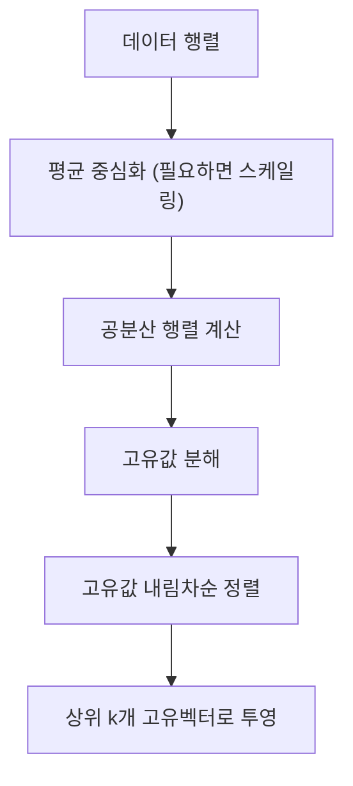

# 4장 — 차원 축소와 PCA

[레포지토리 안내](../../README.ko.md) | [English](Concepts_Lecture.md) | [한국어](Concepts_Lecture.ko.md)

> **최종 수정일:** 2026-10-18

> **학습 목표:**
> 1. 차원 축소의 동기와 차원의 저주를 설명할 수 있다
> 2. 특성 선택과 특성 추출(차원 축소)을 구분할 수 있다
> 3. 공분산 행렬의 고유값 분해로 주성분 분석(PCA)을 유도하고 수행할 수 있다
> 4. 주성분과 설명 분산 비율을 해석하여 유지할 성분 수를 정할 수 있다
> 5. PCA, MDS, t-SNE, UMAP의 특징을 비교할 수 있다

---

## 목차

- [1. 차원 축소](#1-차원-축소)
  - [1.1 정의](#11-정의)
  - [1.2 차원 축소가 필요한 이유](#12-차원-축소가-필요한-이유)
  - [1.3 차원의 저주(Curse of Dimensionality)](#13-차원의-저주curse-of-dimensionality)
  - [1.4 응용 분야](#14-응용-분야)
- [2. 특성 선택 vs. 차원 축소](#2-특성-선택-vs-차원-축소)
  - [2.1 특성 선택(Feature Selection)](#21-특성-선택feature-selection)
  - [2.2 차원 축소 (특성 추출, Feature Extraction)](#22-차원-축소-특성-추출-feature-extraction)
- [3. 두 가지 주요 접근법](#3-두-가지-주요-접근법)
  - [3.1 투영(Projection)](#31-투영projection)
  - [3.2 매니폴드 학습(Manifold Learning)](#32-매니폴드-학습manifold-learning)
  - [3.3 방법 분류](#33-방법-분류)
- [4. 선형대수 사전 지식](#4-선형대수-사전-지식)
  - [4.1 벡터(Vectors)](#41-벡터vectors)
  - [4.2 선형 결합(Linear Combination)](#42-선형-결합linear-combination)
  - [4.3 선형 변환(Linear Transformation)](#43-선형-변환linear-transformation)
  - [4.4 PCA와의 연결](#44-pca와의-연결)
- [5. Principal Component Analysis (PCA, 주성분 분석)](#5-principal-component-analysis-pca-주성분-분석)
  - [5.1 개요](#51-개요)
  - [5.2 PCA의 목표](#52-pca의-목표)
  - [5.3 PCA는 데이터를 투영한다](#53-pca는-데이터를-투영한다)
- [6. PCA 이론 및 유도](#6-pca-이론-및-유도)
  - [6.1 수학적 설정](#61-수학적-설정)
  - [6.2 재구성 오차(Reconstruction Error)](#62-재구성-오차reconstruction-error)
  - [6.3 라그랑주 승수법을 통한 유도](#63-라그랑주-승수법을-통한-유도)
  - [6.4 고유값 해석](#64-고유값-해석)
  - [6.5 공분산 행렬 계산](#65-공분산-행렬-계산)
  - [6.6 공분산 행렬의 기하학적 해석](#66-공분산-행렬의-기하학적-해석)
- [7. PCA의 기하학적 근거](#7-pca의-기하학적-근거)
  - [7.1 기하학적 관점](#71-기하학적-관점)
  - [7.2 공분산 행렬에서의 고유값과 고유벡터](#72-공분산-행렬에서의-고유값과-고유벡터)
  - [7.3 간단한 예제 (2x2 행렬)](#73-간단한-예제-2x2-행렬)
- [8. 평균, 분산, 공분산](#8-평균-분산-공분산)
  - [8.1 평균 (기대값, Expectation)](#81-평균-기대값-expectation)
  - [8.2 분산(Variance)](#82-분산variance)
  - [8.3 공분산(Covariance)](#83-공분산covariance)
  - [8.4 상관계수(Correlation)](#84-상관계수correlation)
- [9. 기타 차원 축소 방법](#9-기타-차원-축소-방법)
  - [9.1 MDS (Multi-Dimensional Scaling, 다차원 척도법)](#91-mds-multi-dimensional-scaling-다차원-척도법)
  - [9.2 t-SNE (t-distributed Stochastic Neighbor Embedding)](#92-t-sne-t-distributed-stochastic-neighbor-embedding)
  - [9.3 UMAP (Uniform Manifold Approximation and Projection)](#93-umap-uniform-manifold-approximation-and-projection)
  - [9.4 비교](#94-비교)
- [10. 실용적 고려사항](#10-실용적-고려사항)
  - [10.1 스크리 도표(Scree Plot)](#101-스크리-도표scree-plot)
  - [10.2 설명 분산 비율(Explained Variance Ratio)](#102-설명-분산-비율explained-variance-ratio)
  - [10.3 언제 어떤 방법을 사용할 것인가](#103-언제-어떤-방법을-사용할-것인가)
- [요약](#요약)
- [점검 문제](#점검-문제)
- [참고 문헌](#참고-문헌)

---

<br>

## 1. 차원 축소

### 1.1 정의

차원 축소(Dimensionality Reduction)는 수천 또는 수백만 개의 저수준 특성에서 가장 관련성 높은 정보를 담은 적은 수의 특성을 고르거나 만들어 **더 좋고(Better)**, **더 빠르며(Faster)**, **더 이해하기 쉬운(Easier to understand)** 학습 모델을 구축하는 과정이다. 넓은 의미의 차원 축소는 2절의 특성 선택과 특성 추출을 모두 포함한다.

### 1.2 차원 축소가 필요한 이유

- **학습 알고리즘 속도 향상**: 고차원에서는 핵심이 아닌 변수가 성능 저하를 초래하거나 처리해야 할 데이터 양이 극도로 커질 수 있다.
- **더 단순하고 안정적인 모델**: 너무 많은 차원으로 학습된 모델은 과적합(overfitting)되기 쉬우며, 차원을 줄이면 모델이 더 강건해진다.
- **더 나은 시각화**: 차원이 낮으면 데이터 구조를 시각화하기 쉽다.

### 1.3 차원의 저주(Curse of Dimensionality)

차원 수가 증가하면 공간은 기하급수적으로 커지고, 같은 양의 데이터의 밀도는 희박해진다. 각 축을 10칸으로 나눈 공간에 데이터 8개가 있을 때의 밀도는 표 1과 같다.

| 차원 | 공간 (칸 수) | 데이터 수 | 밀도 |
|-----------|-------|-------------|---------|
| 1 | 10 | 8 | 80% |
| 2 | 100 | 8 | 8% |
| 3 | 1000 | 8 | 0.8% |

*표 1. 차원 수에 따른 공간 크기와 데이터 밀도*

### 1.4 응용 분야

차원 축소는 다양한 분야에서 널리 사용된다.
- 생물정보학(Bioinformatics)
- 머신 비전(Machine Vision)
- 텍스트 분류(Text Categorization)
- 시장 분석(Market Analysis)
- 품질 관리(Quality Control)
- OCR, 필기 인식(Handwriting Recognition)

> **핵심:** 오컴의 면도날(Occam's Razor)이 적용된다. 이 원칙은 "동등하게 좋은 두 가설에 직면했을 때, 항상 더 단순한 것을 선택하라"는 것이다. 차원을 줄이면 종종 더 단순하고 일반화 가능한 모델이 만들어진다.

---

<br>

## 2. 특성 선택 vs. 차원 축소

### 2.1 특성 선택(Feature Selection)

- 새로운 특성은 원래 특성의 **부분집합**이다.
- 분류를 위해 소수의 특성만 계산하면 된다.
- 원래 특성의 해석 가능성이 보존된다.

### 2.2 차원 축소 (특성 추출, Feature Extraction)

- 새로운 특성은 원래 특성의 **조합**이다(PCA와 LDA의 경우 선형 조합).
- 합성된 복합 변수를 만든다.
- 해석은 어려워지지만, 더 적은 차원에 더 많은 정보를 담을 수 있다.

> **핵심:** 특성 선택은 원래 특성을 유지하므로 해석하기 쉽다. 차원 축소는 새로운 결합 특성을 만들므로 더 압축적이지만 해석하기 어렵다.

---

<br>

## 3. 두 가지 주요 접근법

### 3.1 투영(Projection)

고차원 데이터를 가능한 한 많은 정보를 보존하면서 저차원 부분공간에 투영한다. 예를 들어 3차원 데이터를 2차원 평면에 투영한다.

### 3.2 매니폴드 학습(Manifold Learning)

- **매니폴드(Manifold)** 는 국소적으로 유클리드 공간처럼 보이는 공간으로, 고차원 공간에서 데이터가 실제로 놓여 있는 저차원 곡면을 가리킨다.
- **매니폴드 학습**은 고차원 데이터에 내재된 저차원 구조를 발견한다.
- 매니폴드 학습은 (1) 데이터 구조를 그래프로 표현하고, (2) 저차원 임베딩을 계산한 뒤, (3) 기계학습(ML) 방법을 적용하는 단계로 진행된다.

**동기 부여 예제:**

- **스위스 롤(Swiss Roll)**: 데이터가 3차원으로 말린 2차원 표면 위에 놓여 있다. 점 A1과 A2는 유클리드 거리(롤을 관통하는 직선)로는 멀리 떨어져 있을 수 있지만, 매니폴드 표면을 따라가면 가깝다. 주변 공간에서의 유클리드 거리는 매니폴드 위의 실제 근접성을 포착하지 못한다.
- **골프 스윙(Golf Swing)**: 골프 스윙의 순차적 프레임들은 고차원 픽셀 공간에서 매니폴드를 형성한다. 유클리드 거리를 사용하면 특정 프레임의 최근접 이웃에 시각적으로 다른 자세가 포함될 수 있다. 매니폴드를 발견한 후에는 의미적으로 가까운 데이터(시간적으로 인접한 스윙 위치)가 올바르게 이웃으로 식별된다.

### 3.3 방법 분류

```text
Dimensionality Reduction
├── Linear
│   └── PCA
└── Non-linear
    ├── Preserve global structure
    │   ├── MDS
    │   └── t-SNE
    └── Preserve local structure
        └── UMAP
```

*그림 1. 차원 축소 방법의 분류*

t-SNE와 UMAP이 보존하는 구조에 관한 일반적인 견해는 9.3절의 참고 상자에서 다룬다.

> **핵심:** PCA와 같은 선형 방법은 데이터가 선형 부분공간 근처에 있을 때 잘 작동한다. 비선형 방법(MDS, t-SNE, UMAP)은 더 복잡한 구조를 포착한다.

---

<br>

## 4. 선형대수 사전 지식

### 4.1 벡터(Vectors)

- 데이터는 벡터로 기술할 수 있다(물리학, 컴퓨터 과학, 수학의 관점).
- **벡터의 상수배**는 스칼라를 곱해 벡터를 늘리거나 줄인다.
- **벡터의 합**은 두 벡터를 성분별로 더한다.
- **행 벡터와 열 벡터**: 행렬 곱의 각 원소는 행 벡터와 열 벡터의 내적이다.

### 4.2 선형 결합(Linear Combination)

선형 결합은 벡터의 상수배와 합을 결합한 것으로, 두 가지(또는 그 이상의) 특성을 동시에 결합하여 벡터를 기술한다.

### 4.3 선형 변환(Linear Transformation)

- 선형 변환은 **선형 결합을 보존하는** 두 벡터 공간 사이의 함수이다.
- **행렬은 곧 선형 변환**이다. 행렬 $A$를 벡터 $\mathbf{x}$에 적용하면 다른 벡터 $A\mathbf{x}$가 생성된다.
- 고유벡터와 고유값은 여기서 나온다. $A\mathbf{x} = \lambda \mathbf{x}$는 행렬이 고유벡터 방향으로는 벡터를 ($\lambda$배로) 늘리거나 줄이기만 한다는 뜻이다.

### 4.4 PCA와의 연결

데이터가 고차원 벡터 공간에서 표현될 때, 공분산 행렬은 선형 변환으로 작용한다. 그 고유벡터를 찾으면 데이터가 가장 넓게 퍼진 방향(주성분)이 드러난다.

---

<br>

## 5. Principal Component Analysis (PCA, 주성분 분석)

### 5.1 개요

PCA는 표준적인 다변량 방법 중 가장 널리 사용되고 잘 알려진 방법일 것이다. Pearson(1901)과 Hotelling(1933)이 고안했으며, Goodall(1954)이 인자 분석(factor analysis)이라는 이름으로 생태학에 처음 적용했다.

PCA는 상관관계가 있을 수 있는 $n \times p$ 데이터 행렬($n$개 객체, $p$개 변수)을 받아, 원래 $p$개 변수의 선형 결합인 **비상관 축(주성분)** 으로 요약한다.

### 5.2 PCA의 목표

고차원 공간에서 원본 데이터에 대한 정보를 최대한 보존하는 가장 작은 부분공간을 찾는 것이다.

- 많은($p$개) 변수를 가진 데이터를 더 적은($k$개) 파생 변수로 요약한다.
- **첫 $k$개 성분**은 객체 간 변동을 가능한 한 많이 나타낸다.
- 표현의 명확성과 지나친 단순화(정보 손실) 사이의 균형을 맞춘다.
- 잔차 변동(residual variation)은 축소된 표현에 남지 않은 정보이다.

### 5.3 PCA는 데이터를 투영한다

PCA는 원본 데이터의 구조를 유지하면서 벡터에 데이터를 투영하여 차원을 축소한다. **가장 큰 분산**을 가진 축에 먼저 데이터를 투영한다.

> **핵심:** PCA의 결과는 공분산 행렬에 의해서만 결정된다. PCA는 데이터에서 분산이 최대인 방향을 찾아 그 방향으로 데이터를 투영한다.

---

<br>

## 6. PCA 이론 및 유도

### 6.1 수학적 설정

$\mathbf{X} = [\mathbf{x}_1, \dots, \mathbf{x}_m]$을 $N \times m$ 데이터 행렬($N$차원, $m$개 인스턴스)이라 하자. 각 열 $\mathbf{x}_j$가 하나의 인스턴스이며, 평균을 빼서 중심화되어 있다고 가정한다.

$\mathbf{U}$를 $N \times N$ 직교 행렬이라 하자. 여기서 $\mathbf{U}\mathbf{U}^T = \mathbf{I}_N$이고, $\mathbf{U}$의 $i$번째 행을 $\mathbf{u}_i^T$로 쓴다.

- 변환은 $\mathbf{y} = \mathbf{U}\mathbf{x}$이다.
- 역변환은 $\mathbf{x} = \mathbf{U}^T \mathbf{y}$이다.
- $M$개 기저 벡터를 사용한 근사($M \le N$)는 $\hat{\mathbf{x}} = \sum_{i=1}^{M} \mathbf{u}_i y_i$이다.

### 6.2 재구성 오차(Reconstruction Error)

$$\varepsilon^2 = \mathbb{E}\{\|\mathbf{x} - \hat{\mathbf{x}}\|^2\} = \frac{1}{m} \sum_{j=1}^{m} \|\mathbf{x}_j - \hat{\mathbf{x}}_j\|^2$$

**목표:** 재구성 오차를 최소화한다.

$$\arg \min_{\mathbf{U}} \varepsilon^2, \quad \text{s.t.} \quad \mathbf{U}^T \mathbf{U} = \mathbf{I}_N$$

### 6.3 라그랑주 승수법을 통한 유도

오차는 다음과 같이 표현할 수 있다.

$$\varepsilon^2 = \sum_{i=M+1}^{N} \mathbf{u}_i^T \boldsymbol{\Sigma} \mathbf{u}_i$$

여기서 $\boldsymbol{\Sigma}$는 공분산 행렬이다($\mathbf{x}$가 중심화되었으므로 $\mathbb{E}[\mathbf{x}\mathbf{x}^T] = \boldsymbol{\Sigma}$).

직교성 제약 중 단위 길이 조건 $\mathbf{u}_i^T \mathbf{u}_i = 1$에 라그랑주 승수 $\lambda_i$를 붙인다.

$$L = \sum_{i=M+1}^{N} \mathbf{u}_i^T \boldsymbol{\Sigma} \mathbf{u}_i - \sum_{i=M+1}^{N} \lambda_i(\mathbf{u}_i^T \mathbf{u}_i - 1)$$

도함수를 0으로 놓으면 다음을 얻는다.

$$\frac{\partial L}{\partial \mathbf{u}_i} = 2\boldsymbol{\Sigma}\mathbf{u}_i - 2\lambda_i\mathbf{u}_i = 0 \implies \boldsymbol{\Sigma}\mathbf{u}_i = \lambda_i\mathbf{u}_i$$

### 6.4 고유값 해석

방정식 $\boldsymbol{\Sigma}\mathbf{u}_i = \lambda_i \mathbf{u}_i$는 다음을 보여 준다.
- $\mathbf{u}_i$는 공분산 행렬 $\boldsymbol{\Sigma}$의 **고유벡터(Eigenvectors)** 이다.
- $\lambda_i$는 대응하는 **고유값(Eigenvalues)** 이다.

$\mathbf{u}_i^T \boldsymbol{\Sigma} \mathbf{u}_i = \lambda_i \mathbf{u}_i^T \mathbf{u}_i = \lambda_i$이므로 재구성 오차는 다음이 된다.

$$\varepsilon^2 = \sum_{i=M+1}^{N} \lambda_i$$

오차는 $\lambda_{M+1}, \dots, \lambda_N$이 **가장 작은** 고유값일 때 **최소**가 된다. 따라서 **가장 큰** 고유값 $M$개에 대응하는 고유벡터를 주성분으로 유지한다.

### 6.5 공분산 행렬 계산

$$\boldsymbol{\Sigma} = \frac{1}{n} \mathbf{X}^T \mathbf{X}$$

여기서 $\mathbf{X}$는 행이 관측인 $n \times p$ 평균 중심화 데이터 행렬이다. $\mathbf{X}^T \mathbf{X}$의 $(i, j)$ 원소는 $i$번째와 $j$번째 특성 열의 내적이다. 6.1절처럼 열이 인스턴스인 $N \times m$ 행렬로 쓰면 같은 공분산 행렬은 $\frac{1}{m}\mathbf{X}\mathbf{X}^T$이다.

### 6.6 공분산 행렬의 기하학적 해석

2차원 공분산 행렬은 다음과 같다.

$$\boldsymbol{\Sigma} = \begin{bmatrix} \sigma_x^2 & \text{Cov}(X,Y) \\ \text{Cov}(X,Y) & \sigma_y^2 \end{bmatrix}$$

- **대각 원소**($\sigma_x^2$, $\sigma_y^2$)는 **각 축을 따른 퍼짐(분산)** 으로, 데이터가 $X$와 $Y$를 따라 각각 얼마나 늘어나 있는지를 나타낸다.
- **비대각 원소**($\text{Cov}(X,Y)$)는 변수 간의 **결합 퍼짐**으로, $X$와 $Y$가 함께 어떻게 변하는지를 나타낸다.

**$\mathbf{X}^T \mathbf{X}$가 공분산을 포착하는 이유:**

$\mathbf{X}^T \mathbf{X}$는 **특성 열 간의 내적 행렬**을 생성한다. 각 원소 $\mathbf{X}_i^T \mathbf{X}_j$($i$번째와 $j$번째 특성 열의 내적)는 모든 관측에 걸쳐 특성 $i$와 특성 $j$가 얼마나 같은 방향으로 움직이는지를 측정한다. $n$으로 나누면 이것이 공분산으로 정규화된다. 이것이 $\mathbf{X}$가 평균 중심화되었을 때 $\boldsymbol{\Sigma} = \frac{1}{n}\mathbf{X}^T\mathbf{X}$인 이유이다.

공분산 행렬이 데이터에 대한 선형 변환으로 사용될 때, 데이터를 가장 큰 분산의 방향으로 늘린다. 이 변환의 고유벡터는 그 방향(주성분)을 드러내고, 고유값은 얼마나 많은 늘림이 발생하는지(분산의 양)를 드러낸다.

지금까지의 내용을 PCA의 계산 절차로 정리하면 그림 2와 같다.



*그림 2. PCA의 계산 절차*

> **핵심:** 주성분은 공분산 행렬의 고유벡터이며, 고유값 크기 순으로 정렬된다. 고유값은 각 성분이 설명하는 분산의 양을 나타낸다.

---

<br>

## 7. PCA의 기하학적 근거

### 7.1 기하학적 관점

- 객체는 $p$개 변수 각각에 대한 축을 가진 다차원 공간에서 $n$개 점의 구름으로 표현된다.
- 점들의 **중심(Centroid)** 은 각 변수의 평균으로 정의된다.
- 각 변수의 **분산(Variance)** 은 평균 주위의 $n$개 값의 평균 제곱 편차이다.

$$V_i = \frac{1}{n-1} \sum_{m=1}^{n} (X_{im} - \bar{X}_i)^2$$

이 표본 분산은 $n - 1$로 나누고 6.5절의 공분산 행렬은 $n$으로 나눈다. 나누는 수는 모든 고유값을 같은 비율로 바꿀 뿐이므로 고유벡터(주성분 방향)와 설명 분산 비율은 달라지지 않는다.

### 7.2 공분산 행렬에서의 고유값과 고유벡터

| | 원래 의미 | 공분산 행렬에서의 의미 |
|---|---|---|
| **고유벡터** | 행렬을 곱해도 방향이 바뀌지 않는 주축의 방향을 나타낸다 | 데이터가 분포된 방향을 나타낸다 |
| **고유값** | 고유벡터 방향으로 벡터가 늘어나거나 줄어드는 배율 | 그 방향으로 데이터가 퍼진 정도 (분산의 양) |

*표 2. 고유벡터와 고유값의 원래 의미와 공분산 행렬에서의 의미*

### 7.3 간단한 예제 (2x2 행렬)

다음 행렬 $A$의 고유값과 고유벡터를 구한다.

$$A = \begin{bmatrix} 4 & 2 \\ 3 & 5 \end{bmatrix}$$

1. 특성 방정식 $\det(A - \lambda I) = 0$을 푼다.
2. $(4 - \lambda)(5 - \lambda) - 2 \cdot 3 = \lambda^2 - 9\lambda + 14 = (\lambda - 7)(\lambda - 2) = 0$이므로 $\lambda = 7, 2$이다.
3. $\lambda = 7$일 때 $(A - 7I)\mathbf{x} = \mathbf{0}$에서 $-3x_1 + 2x_2 = 0$이므로 고유벡터는 $c(2, 3)$이다.
4. $\lambda = 2$일 때 $(A - 2I)\mathbf{x} = \mathbf{0}$에서 $2x_1 + 2x_2 = 0$이므로 고유벡터는 $c(-1, 1)$이다.

> **참고:** 이 행렬은 대칭이 아니므로 공분산 행렬의 예는 아니며, 두 고유벡터 $(2, 3)$과 $(-1, 1)$도 직교하지 않는다(내적 $= -2 + 3 = 1$). 공분산 행렬은 대칭 행렬이므로 고유값이 모두 음이 아닌 실수이고, 서로 다른 고유값에 대응하는 고유벡터는 직교한다.

> **핵심:** 고유값은 각 고유벡터 방향을 따라 포착되는 분산의 양을 결정한다. 더 큰 고유값은 더 중요한 주성분에 대응한다.

---

<br>

## 8. 평균, 분산, 공분산

### 8.1 평균 (기대값, Expectation)

|  | 이산형 (PMF) | 연속형 (PDF) |
|--|----------------|-----------------|
| **공식** | $E(X) = \sum_i p_i x_i$ | $E(X) = \int x f(x) dx$ |

*표 3. 이산형과 연속형 확률 변수의 평균*

### 8.2 분산(Variance)

|  | 이산형 (PMF) | 연속형 (PDF) |
|--|----------------|-----------------|
| **공식** | $V(X) = \sum_i (x_i - m)^2 p_i = E(X^2) - m^2$ | $\text{Var}[X] = \int (x - E[X])^2 f(x) dx = E[X^2] - E[X]^2$ |

*표 4. 이산형과 연속형 확률 변수의 분산*

여기서 $m = E(X)$이다. 표준편차는 $\sigma(X) = \sqrt{V(X)}$이다.

### 8.3 공분산(Covariance)

확률 변수 $X$와 $Y$에 대해 $E(X) = \mu$, $E(Y) = \nu$일 때 공분산은 다음과 같다.

$$\text{Cov}(X, Y) = E((X - \mu)(Y - \nu)) = E(XY) - \mu\nu = E(XY) - E(X)E(Y)$$

**$X$와 $Y$가 독립이면** $E(XY) = E(X)E(Y) = \mu\nu$이므로 **공분산이 0**이다($\text{Cov}(X, Y) = 0$).

PCA의 주성분은 서로 공분산이 0인 **비상관(Uncorrelated)** 변수이다. 공분산 행렬의 고유벡터는 서로 직교하고, 데이터를 이 축들로 투영한 성분의 공분산 행렬은 고유값을 대각 원소로 하는 대각 행렬이 되기 때문이다. 위 성질의 역은 성립하지 않으므로, 공분산이 0인 주성분이 서로 독립이라는 보장은 없다.

### 8.4 상관계수(Correlation)

공분산은 변수의 절대적 스케일에 영향을 받으므로 다음과 같이 정규화한다.

$$\rho = \frac{\text{Cov}(X, Y)}{\sqrt{\text{Var}(X) \cdot \text{Var}(Y)}}, \quad -1 \leq \rho \leq 1$$

---

<br>

## 9. 기타 차원 축소 방법

### 9.1 MDS (Multi-Dimensional Scaling, 다차원 척도법)

- **비선형** 방법으로 **전역 구조(Global Structure)** 를 보존한다.
- 저차원 공간에서 데이터 포인트 간의 쌍별 거리를 보존하려고 한다.
- 두 가지 변형으로 **Metric MDS**(= Principal Coordinate Analysis, PCoA)와 **Non-Metric MDS**가 있다.
- **PCA vs. PCoA**: PCA는 공분산에 기반하여 차원을 축소하고, PCoA(Metric MDS)는 거리에 기반하여 차원을 축소한다.
- 유클리드 거리를 사용하면 PCoA(MDS)와 PCA는 **동일한** 차원 축소 결과를 낸다. 거리 보존을 기준으로 한 축소와 공분산(분산 최대화)을 기준으로 한 축소가 같아지기 때문이며, 이 경우의 MDS는 선형 방법과 같다.
- 거리 척도에는 (1) **유클리드 거리**(피타고라스 정리)와 (2) **로그 배수 변화의 절댓값**이 있다. 후자는 비대칭인 배수 차이를 로그로 대칭으로 만든 뒤, 두 표본 사이에서 특성별 절댓값의 평균을 거리로 쓴다.

### 9.2 t-SNE (t-distributed Stochastic Neighbor Embedding)

- **비선형** 벡터 시각화 알고리즘으로 **전역 구조(Global Structure)** 를 보존한다(9.3절의 참고 상자 참고).
- 고차원에서의 점 간 **유사성**을 임베딩 공간에서도 보존하도록 차원을 축소한다.
- **단순 투영만으로는 안 되는 이유**: 1차원으로의 단순 투영은 군집 분리를 파괴할 수 있다. 예를 들어 2차원에서 잘 분리된 두 군집도 하나의 축에 투영하면 겹칠 수 있다.

**알고리즘 개요:**

1. 각 관심 점 $x_i$에 대해 다른 모든 점 $x_j$까지의 거리를 계산한다.
2. 거리를 점마다 다른 가우시안 폭 $\sigma_i$로 나눈다. $\sigma_i$는 각 점의 조건부 분포가 사용자가 정한 perplexity(실질적인 이웃 수를 조절하여 안정성을 더하는 매개변수)를 갖도록 정해진다.
3. 음의 지수 함수를 적용하여 조건부 확률 $p_{j|i} = \frac{\exp(-\lVert x_i - x_j \rVert^2 / 2\sigma_i^2)}{\sum_{k \ne i} \exp(-\lVert x_i - x_k \rVert^2 / 2\sigma_i^2)}$를 구한다. 가까운 점일수록 확률이 높다.
4. 대칭화한다: $p_{ij} = (p_{j|i} + p_{i|j}) / 2n$.
5. 임베딩 공간에서는 가우시안이 아닌 **t-분포**로 유사도를 계산한다: $q_{ij} = \frac{(1 + \lVert y_i - y_j \rVert^2)^{-1}}{\sum_{k \ne l} (1 + \lVert y_k - y_l \rVert^2)^{-1}}$.
6. 임베딩 위치를 조정하여 $p_{ij}$와 $q_{ij}$ 사이의 KL 발산(KL divergence)을 최소화한다.

**t-분포를 사용하는 이유:** t-분포는 정규분포보다 꼬리가 더 두꺼워(heavier tails) 평균에서 더 넓게 퍼져 있다. 이 때문에 먼 점들이 임베딩에서 더 넓게 퍼질 여유가 생겨 군집 분리가 좋아진다.

**핵심 특성:** 무작위 초기화와 비볼록 최적화 때문에 실행할 때마다 결과가 달라진다. 시각화에는 유용하지만 결정적(deterministic)이지 않으며, 같은 결과를 얻으려면 난수 시드를 고정해야 한다.

### 9.3 UMAP (Uniform Manifold Approximation and Projection)

- **비선형** 방법으로 **지역 구조(Local Structure)** 를 보존한다.
- **위상적 데이터 분석(Topological Data Analysis)** 과 **매니폴드 학습(Manifold Learning)** 에 기반한다.
- 위상수학의 개념인 단체(simplices: 0-simplex = 점, 1-simplex = 변, 2-simplex = 삼각형, 3-simplex = 사면체), 단체 복합체(simplicial complexes), 신경 정리(nerve theorem)를 사용한다.
- 다양한 반경의 원으로 데이터를 덮고 단체 복합체를 구축하여 데이터의 중요한 위상을 포착한다.

**UMAP vs. t-SNE:**

| UMAP | t-SNE |
|------|-------|
| 임베딩 차원의 크기에 제한 없음 | 임베딩이 2차원 또는 3차원에서만 가능 |
| **지역 이웃 그래프(Local Neighbor Graph)** 구조를 더 잘 보존 | **전체(Overall)** 구조를 더 잘 보존 |
| t-SNE보다 **빠름** | 시간이 perplexity라는 하이퍼파라미터에 의해 결정됨 |

*표 5. UMAP과 t-SNE의 비교*

> **참고:** **t-SNE와 UMAP의 보존 대상.** 위 표와 그림 1의 구분은 일반적인 견해와 다르다. t-SNE의 제안 논문은 t-SNE가 지역 구조를 잘 포착하면서 여러 규모의 군집 같은 전역 구조도 드러낸다고 설명하고 [1], UMAP의 제안 논문은 UMAP이 t-SNE보다 전역 구조를 더 많이 보존한다고 보고한다 [2]. 두 방법이 전역 구조를 얼마나 보존하는지는 초기화 방법에 따라서도 크게 달라진다 [3]. 또 t-SNE는 원리상 3차원보다 높은 차원으로도 임베딩할 수 있지만 주로 2~3차원 시각화에 쓰인다 [1].

### 9.4 비교

| 방법 | 유형 | 보존 대상 | 속도 | 사용 사례 |
|--------|------|-----------|-------|----------|
| PCA | 선형 | 전역 분산 | 빠름 | 일반 축소, 전처리 |
| MDS | 비선형 | 전역 거리 | 보통 | 거리 행렬이 있을 때 |
| t-SNE | 비선형 | 전역 구조 | 느림 | 군집의 시각화 |
| UMAP | 비선형 | 지역 구조 | 빠름 | 시각화, 위상 보존 |

*표 6. 차원 축소 방법의 비교*

> **핵심:** PCA는 선형 데이터와 전처리에 가장 적합하다. 복잡한 구조를 가진 고차원 데이터의 시각화에는 t-SNE와 UMAP이 선호된다.

---

<br>

## 10. 실용적 고려사항

### 10.1 스크리 도표(Scree Plot)

스크리 도표는 고유값(또는 설명 분산 비율)을 내림차순으로 표시한다. 유지할 성분 수를 정하는 데 도움이 된다.
- 곡선이 평탄해지는 팔꿈치(elbow) 지점을 찾는다.
- 팔꿈치 이전의 성분들이 가장 의미 있는 분산을 포착한다.

**고유값 분해와의 연결:** 스크리 도표에 그려지는 값은 PCA 고유값 분해($\boldsymbol{\Sigma}\mathbf{u}_i = \lambda_i \mathbf{u}_i$)에서 나온 고유값 **그 자체**이다. 각 고유값 $\lambda_i$는 $i$번째 주성분이 포착하는 분산을 나타낸다. 스크리 도표는 이 고유값들을 내림차순으로 배열하여, 성분을 더 추가할수록 얻는 분산이 줄어드는 수확 체감(diminishing returns)을 시각화한다.

### 10.2 설명 분산 비율(Explained Variance Ratio)

$k$번째 성분이 설명하는 전체 분산의 비율은 다음과 같다.

$$\text{Explained Variance Ratio}_k = \frac{\lambda_k}{\sum_{i=1}^{N} \lambda_i}$$

일반적인 경험 법칙은 전체 분산의 80~95%를 설명하기에 충분한 성분을 유지하는 것이다.

### 10.3 언제 어떤 방법을 사용할 것인가

| 시나리오 | 권장 방법 |
|----------|--------------------|
| 선형 관계, 전처리 | PCA |
| 해석 가능한 특성이 필요 | 특성 선택(Feature Selection) |
| 군집의 2D/3D 시각화 | t-SNE 또는 UMAP |
| 쌍별 거리 보존 | MDS |
| 대규모 데이터셋, 빠른 시각화 | UMAP |

*표 7. 상황별 권장 차원 축소 방법*

> **핵심:** PCA를 적용하기 전에 항상 데이터를 중심화(center)해야 하며, 대개 스케일링도 해야 한다. 방법 간의 선택은 데이터 구조가 선형인지 비선형인지, 목표가 분석인지 시각화인지에 따라 달라진다.

---

<br>

## 요약

| 개념 | 핵심 요약 |
|---------|-----------|
| 차원 축소 | 더 좋고 빠르며 단순한 모델을 구축하기 위해 특성의 수를 줄인다. |
| 차원의 저주 | 차원이 증가하면 데이터 밀도가 기하급수적으로 감소한다. |
| 특성 선택 vs. 추출 | 선택은 원래 특성을 유지하고, 추출은 원래 특성의 새로운 조합을 만든다. |
| PCA | 공분산 행렬의 고유벡터를 주성분으로 찾는 선형 방법이다. |
| 공분산 행렬 | 평균 중심화된 $\mathbf{X}$에 대해 $\boldsymbol{\Sigma} = \frac{1}{n}\mathbf{X}^T\mathbf{X}$이며, 특성 간의 분산과 공분산을 담는다. |
| 고유값 | 각 주성분이 포착하는 분산의 양을 나타낸다. |
| 고유벡터 | 각 주성분의 방향을 정한다. |
| 재구성 오차 | 버린 성분의 고유값의 합과 같으므로, 고유값이 가장 큰 성분을 유지하면 최소가 된다. |
| t-SNE | 시각화에 뛰어난 비선형 방법이며 전역 구조를 보존하는 방법으로 분류되지만, 이 구분에는 다른 견해가 있다(9.3절). |
| UMAP | 빠른 비선형 방법이며 지역 구조를 보존하는 방법으로 분류된다. |
| MDS | 쌍별 거리를 보존하는 비선형 방법이다. |
| 스크리 도표 | 고유값을 내림차순으로 그려 유지할 최적 성분 수를 정하는 데 사용한다. |

---

<br>

## 점검 문제

1. **고유값 분해와 설명 분산:** 2차원 공분산 행렬 $\boldsymbol{\Sigma}$의 대각 원소가 모두 2이고 비대각 원소가 1이다. 고유값과 단위 고유벡터를 구하고, 첫 번째 주성분의 설명 분산 비율을 구하라.

   <details>
   <summary>정답</summary>

   특성 방정식 $(2 - \lambda)^2 - 1 = 0$에서 $\lambda = 3, 1$이다. $\lambda = 3$의 단위 고유벡터는 $(1, 1)/\sqrt{2}$이고, $\lambda = 1$의 단위 고유벡터는 $(1, -1)/\sqrt{2}$이며, 두 벡터는 직교한다. 첫 번째 주성분의 설명 분산 비율은 $3/(3 + 1) = 0.75$, 즉 75%이다.

   </details>

2. **성분 수와 재구성 오차:** 고유값이 5, 3, 1.5, 0.5인 PCA에서 각 성분의 설명 분산 비율과 누적 비율을 구하라. 전체 분산의 80% 이상을 설명하려면 성분이 몇 개 필요하며, 그때의 재구성 오차는 얼마인가?

   <details>
   <summary>정답</summary>

   고유값의 합은 10이므로 설명 분산 비율은 50%, 30%, 15%, 5%이고, 누적 비율은 50%, 80%, 95%, 100%이다. 80% 이상을 설명하려면 성분 2개가 필요하다. 재구성 오차는 버린 성분의 고유값의 합인 $1.5 + 0.5 = 2$이며, 이는 전체 분산의 20%이다.

   </details>

3. **차원의 저주:** 1.3절처럼 각 축을 10칸으로 나눈 공간에 데이터 8개가 있다. 4차원에서의 밀도를 구하고, 3차원의 밀도 0.8%를 4차원에서 유지하려면 데이터가 몇 개 필요한지 구하라.

   <details>
   <summary>정답</summary>

   4차원 공간은 $10^4$ = 10,000칸이므로 밀도는 8 / 10,000 = 0.08%이다. 밀도 0.8%를 유지하려면 0.008 × 10,000 = 80개가 필요하다. 차원이 하나 늘 때마다 같은 밀도에 필요한 데이터가 10배씩 늘어난다.

   </details>

4. **특성 선택과 특성 추출:** 유전자 10,000개의 발현 데이터에서 (a) 분산이 큰 유전자 100개를 고르는 방법과 (b) PCA로 주성분 100개를 만드는 방법을 비교하라. 각 방법에서 새 특성은 어떻게 해석할 수 있는가?

   <details>
   <summary>정답</summary>

   (a)는 특성 선택이다. 새 특성이 원래 유전자의 부분집합이므로 각 특성을 그 유전자 그대로 해석할 수 있다. (b)는 특성 추출(차원 축소)이다. 각 주성분이 10,000개 유전자의 선형 결합이므로 같은 100차원에서 어떤 100개 유전자를 고를 때보다 적지 않은 분산을 담지만, 개별 특성의 의미를 해석하기는 어렵다.

   </details>

5. **t-SNE의 성질:** 같은 데이터에 t-SNE를 두 번 실행했더니 결과 그림이 달랐다. 그 이유와 결과를 재현하는 방법을 쓰고, 임베딩 공간에서 가우시안 대신 t-분포를 쓰는 이유를 설명하라.

   <details>
   <summary>정답</summary>

   t-SNE는 임베딩 위치를 무작위로 초기화하고 비볼록인 KL 발산을 반복적으로 최소화하므로, 실행할 때마다 서로 다른 지역 최적해에 도달할 수 있다. 난수 시드를 고정하면 같은 결과를 재현할 수 있다. t-분포는 정규분포보다 꼬리가 두꺼워서 고차원에서 적당히 떨어진 점들이 임베딩에서 더 멀리 놓일 수 있으므로, 군집이 서로 뭉개지지 않고 분리된다.

   </details>

---

<br>

## 참고 문헌

1. L. van der Maaten and G. Hinton, "Visualizing data using t-SNE," *Journal of Machine Learning Research*, vol. 9, pp. 2579-2605, 2008.
2. L. McInnes, J. Healy, and J. Melville, "UMAP: Uniform manifold approximation and projection for dimension reduction," arXiv:1802.03426, 2018.
3. D. Kobak and G. C. Linderman, "Initialization is critical for preserving global data structure in both t-SNE and UMAP," *Nature Biotechnology*, vol. 39, no. 2, pp. 156-157, 2021.
