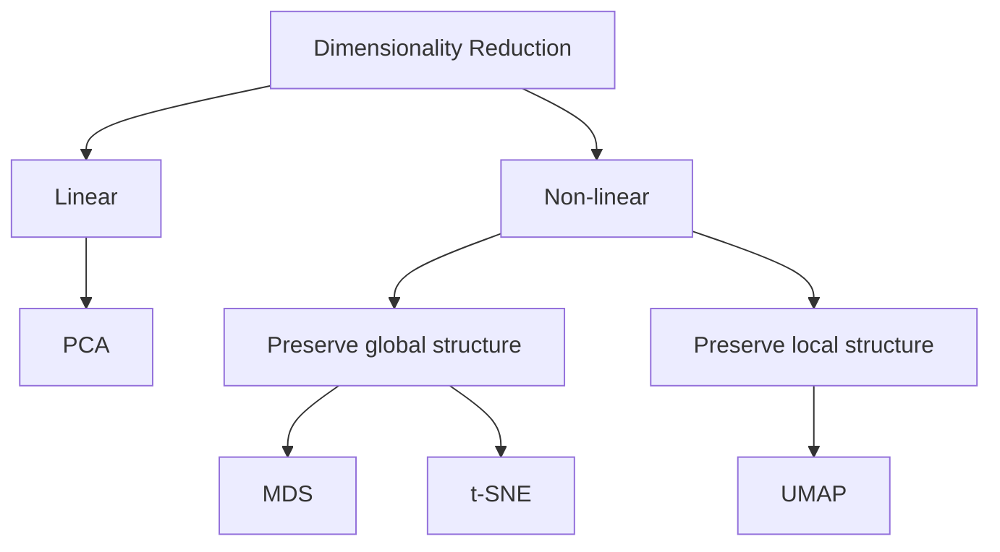
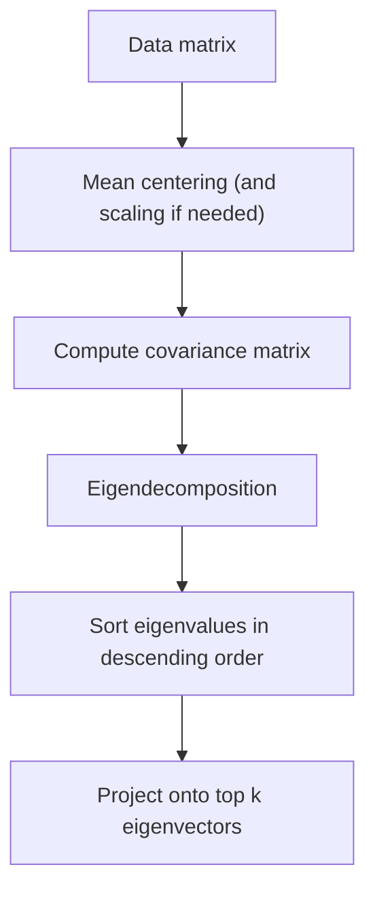
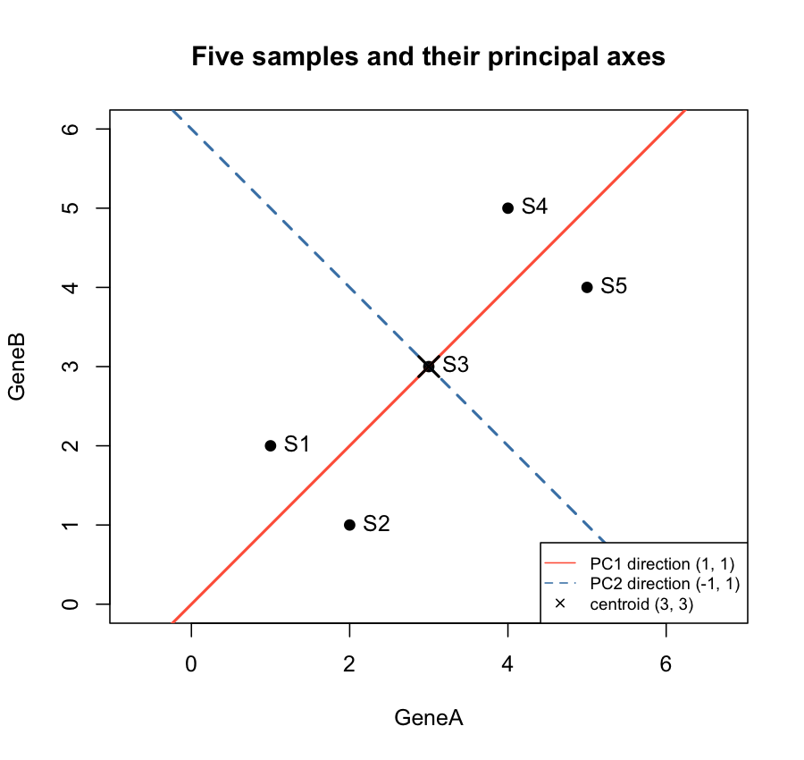
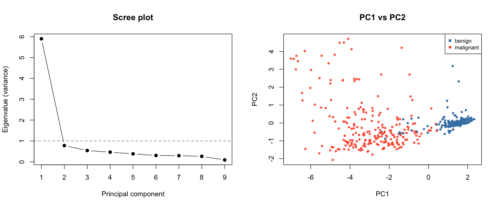

# Chapter 4 — Dimension Reduction and PCA

[Repository Guide](../../README.md) | [English](Concepts_Lecture.md) | [한국어](Concepts_Lecture.ko.md)

> **Last Updated:** 2026-11-19

> **Learning Objectives:**
> 1. Explain the motivation for dimensionality reduction and the curse of dimensionality
> 2. Distinguish feature selection from feature extraction (dimensionality reduction)
> 3. Derive and perform Principal Component Analysis (PCA) through the eigendecomposition of the covariance matrix
> 4. Interpret principal components and explained variance ratios to decide how many components to retain
> 5. Compare the characteristics of PCA, MDS, t-SNE, and UMAP
> 6. Compute PCA by hand on a small data set and check it against R's `prcomp()`

---

## Table of Contents

- [1. Dimensionality Reduction](#1-dimensionality-reduction)
  - [1.1 Definition](#11-definition)
  - [1.2 The Need for Dimensionality Reduction](#12-the-need-for-dimensionality-reduction)
  - [1.3 Curse of Dimensionality](#13-curse-of-dimensionality)
  - [1.4 Applications](#14-applications)
- [2. Feature Selection vs. Dimensionality Reduction](#2-feature-selection-vs-dimensionality-reduction)
  - [2.1 Feature Selection](#21-feature-selection)
  - [2.2 Dimensionality Reduction (Feature Extraction)](#22-dimensionality-reduction-feature-extraction)
- [3. Two Main Approaches](#3-two-main-approaches)
  - [3.1 Projection](#31-projection)
  - [3.2 Manifold Learning](#32-manifold-learning)
  - [3.3 Classification of Methods](#33-classification-of-methods)
- [4. Linear Algebra Prerequisites](#4-linear-algebra-prerequisites)
  - [4.1 Vectors](#41-vectors)
  - [4.2 Linear Combination](#42-linear-combination)
  - [4.3 Linear Transformation](#43-linear-transformation)
  - [4.4 Connection to PCA](#44-connection-to-pca)
- [5. Principal Component Analysis (PCA)](#5-principal-component-analysis-pca)
  - [5.1 Overview](#51-overview)
  - [5.2 Goal of PCA](#52-goal-of-pca)
  - [5.3 PCA Projects Data](#53-pca-projects-data)
  - [5.4 Blood Test Data and the Motivation for PCA](#54-blood-test-data-and-the-motivation-for-pca)
- [6. PCA Theory and Derivation](#6-pca-theory-and-derivation)
  - [6.1 Mathematical Setup](#61-mathematical-setup)
  - [6.2 Reconstruction Error](#62-reconstruction-error)
  - [6.3 Derivation via Lagrange Multipliers](#63-derivation-via-lagrange-multipliers)
  - [6.4 Eigenvalue Interpretation](#64-eigenvalue-interpretation)
  - [6.5 Computing the Covariance Matrix](#65-computing-the-covariance-matrix)
  - [6.6 Covariance Matrix Geometric Interpretation](#66-covariance-matrix-geometric-interpretation)
- [7. Geometric Rationale of PCA](#7-geometric-rationale-of-pca)
  - [7.1 Geometric View](#71-geometric-view)
  - [7.2 Eigenvalues and Eigenvectors in Covariance Matrix](#72-eigenvalues-and-eigenvectors-in-covariance-matrix)
  - [7.3 Toy Example (2x2 Matrix)](#73-toy-example-2x2-matrix)
  - [7.4 Covariance and Rotation of the Principal Axes](#74-covariance-and-rotation-of-the-principal-axes)
  - [7.5 The Algebra of PCA in a Two-Dimensional Example](#75-the-algebra-of-pca-in-a-two-dimensional-example)
  - [7.6 Generalization to p Dimensions and Best Fit](#76-generalization-to-p-dimensions-and-best-fit)
  - [7.7 Covariance Matrix and Correlation Matrix](#77-covariance-matrix-and-correlation-matrix)
  - [7.8 Review of Matrix Operations](#78-review-of-matrix-operations)
- [8. Mean, Variance, and Covariance](#8-mean-variance-and-covariance)
  - [8.1 Mean (Expectation)](#81-mean-expectation)
  - [8.2 Variance](#82-variance)
  - [8.3 Covariance](#83-covariance)
  - [8.4 Correlation](#84-correlation)
  - [8.5 Worked Example of Covariance and Correlation](#85-worked-example-of-covariance-and-correlation)
- [9. Other Dimensionality Reduction Methods](#9-other-dimensionality-reduction-methods)
  - [9.1 MDS (Multi-Dimensional Scaling)](#91-mds-multi-dimensional-scaling)
  - [9.2 t-SNE (t-distributed Stochastic Neighbor Embedding)](#92-t-sne-t-distributed-stochastic-neighbor-embedding)
  - [9.3 UMAP (Uniform Manifold Approximation and Projection)](#93-umap-uniform-manifold-approximation-and-projection)
  - [9.4 Comparison](#94-comparison)
  - [9.5 Worked Example of MDS Distances](#95-worked-example-of-mds-distances)
  - [9.6 Worked Example of t-SNE Similarities](#96-worked-example-of-t-sne-similarities)
  - [9.7 The Uniform Distribution Assumption of UMAP](#97-the-uniform-distribution-assumption-of-umap)
- [10. Practical Considerations](#10-practical-considerations)
  - [10.1 Scree Plot](#101-scree-plot)
  - [10.2 Explained Variance Ratio](#102-explained-variance-ratio)
  - [10.3 Choosing a Method by Situation](#103-choosing-a-method-by-situation)
  - [10.4 Interpreting Eigenvalues and Eigenvectors](#104-interpreting-eigenvalues-and-eigenvectors)
  - [10.5 Number of Axes to Keep and the Assumptions of PCA](#105-number-of-axes-to-keep-and-the-assumptions-of-pca)
  - [10.6 Summary of the PCA Algorithm](#106-summary-of-the-pca-algorithm)
  - [10.7 Application: Eigenfaces and Computational Complexity](#107-application-eigenfaces-and-computational-complexity)
- [11. PCA by Hand and on Life-Science Data](#11-pca-by-hand-and-on-life-science-data)
  - [11.1 PCA of Five Samples and Two Genes](#111-pca-of-five-samples-and-two-genes)
  - [11.2 Checking with R](#112-checking-with-r)
  - [11.3 PCA of Breast Tumor Cell Data](#113-pca-of-breast-tumor-cell-data)
  - [11.4 Common Mistakes](#114-common-mistakes)
- [Summary](#summary)
- [Self-Check Questions](#self-check-questions)
- [References](#references)

---

<br>

## 1. Dimensionality Reduction

### 1.1 Definition

Dimensionality reduction is the process of choosing or constructing a small number of features that carry the most relevant information from thousands or millions of low-level features, in order to build **better**, **faster**, and **easier to understand** learning models. Dimensionality reduction in the broad sense includes both feature selection and feature extraction of Section 2.

### 1.2 The Need for Dimensionality Reduction

- **Speed up training algorithms**: In high dimensions, non-critical variables can lead to poor performance, or the amount of data to process can become extremely large.
- **Simpler and more stable models**: Models trained with too many dimensions are easy to overfit, and reducing dimensions makes them more robust.
- **Better visualization**: Lower dimensions make it easier to visualize data structures.

### 1.3 Curse of Dimensionality

As the number of dimensions increases, the space grows exponentially and the density of the same amount of data becomes sparse. Table 1 shows the density when 8 data points lie in a space whose axes are each divided into 10 cells.

| Dimensions | Space (Cells) | Data Points | Density |
|-----------|-------|-------------|---------|
| 1 | 10 | 8 | 80% |
| 2 | 100 | 8 | 8% |
| 3 | 1000 | 8 | 0.8% |

*Table 1. Space size and data density by number of dimensions*

### 1.4 Applications

Dimensionality reduction is widely used in many fields.
- Bioinformatics
- Machine vision
- Text categorization
- Market analysis
- Quality control
- OCR, handwriting recognition

> **Key Point:** Occam's Razor applies. The principle states, "When faced with two equally good hypotheses, always choose the simpler." Reducing dimensions often leads to simpler, more generalizable models.

---

<br>

## 2. Feature Selection vs. Dimensionality Reduction

### 2.1 Feature Selection

- The new features are a **subset** of the original features.
- Only a small number of features need to be computed for classification.
- The interpretability of the original features is preserved.

### 2.2 Dimensionality Reduction (Feature Extraction)

- The new features are **combinations** of the original features (linear combinations for PCA and linear discriminant analysis (LDA)).
- It creates synthetic, composite variables.
- The features are harder to interpret, but more information can be captured in fewer dimensions.

> **Key Point:** Feature selection keeps the original features, so they are easy to interpret. Dimensionality reduction creates new combined features, which are more compact but harder to interpret.

---

<br>

## 3. Two Main Approaches

### 3.1 Projection

Project high-dimensional data onto a lower-dimensional subspace while preserving as much information as possible. For example, 3D data can be projected onto a 2D plane.

### 3.2 Manifold Learning

- A **manifold** is a space that locally looks like Euclidean space; here it refers to the low-dimensional surface on which the data actually lies in the high-dimensional space.
- **Manifold learning** discovers the intrinsically low-dimensional structure in high-dimensional data.
- Manifold learning proceeds in steps: (1) represent the data structure as a graph, (2) compute a low-dimensional embedding, and (3) apply machine learning (ML) methods.

**Motivating Examples:**

- **Swiss roll**: Data lies on a 2D surface rolled into 3D. Points A1 and A2 may be far apart in Euclidean distance (straight line through the roll), but close along the manifold surface. Euclidean distance in the ambient space fails to capture true proximity on the manifold.
- **Golf swing**: Sequential frames of a golf swing form a manifold in high-dimensional pixel space. Using Euclidean distance, the nearest neighbors of a given frame may include visually dissimilar poses. After discovering the manifold, semantically close data (temporally adjacent swing positions) are correctly identified as neighbors.

### 3.3 Classification of Methods



*Figure 1. Classification of dimensionality reduction methods*

The common view of which structure t-SNE and UMAP preserve is discussed in the note box of Section 9.3.

> **Key Point:** Linear methods like PCA work well when the data lies near a linear subspace. Non-linear methods (MDS, t-SNE, UMAP) capture more complex structures.

---

<br>

## 4. Linear Algebra Prerequisites

### 4.1 Vectors

- Data can be described with vectors (perspectives from physics, computer science, and mathematics).
- A **constant multiple of a vector** scales the vector by a scalar.
- The **sum of vectors** adds two vectors component-wise.
- **Row vector and column vector**: Each entry of a matrix product is the dot product of a row vector and a column vector.

### 4.2 Linear Combination

A linear combination combines constant multiples and sums of vectors; it describes a vector by combining two (or more) characteristics at once.

### 4.3 Linear Transformation

- A linear transformation is a function between two vector spaces that **preserves linear combinations**.
- **A matrix is a linear transformation**. Applying a matrix $A$ to a vector $\mathbf{x}$ produces another vector $A\mathbf{x}$.
- Eigenvectors and eigenvalues arise from this. $A\mathbf{x} = \lambda \mathbf{x}$ means that along an eigenvector direction the matrix only scales the vector (by $\lambda$).

### 4.4 Connection to PCA

When data is represented in a high-dimensional vector space, the covariance matrix acts as a linear transformation. Finding its eigenvectors reveals the directions in which the data is most spread out (principal components).

> **[Linear Algebra]** By the spectral theorem of linear algebra, a real symmetric matrix has only real eigenvalues and is diagonalized by an orthogonal matrix made of mutually orthogonal unit eigenvectors. A covariance matrix is symmetric, so the theorem applies, and the principal components of PCA are mutually orthogonal because of this property.

---

<br>

## 5. Principal Component Analysis (PCA)

### 5.1 Overview

PCA is probably the most widely used and well-known of the standard multivariate methods. It was invented by Pearson (1901) and Hotelling (1933), and first applied in ecology by Goodall (1954) under the name factor analysis.

PCA takes an $n \times p$ data matrix ($n$ objects, $p$ variables), whose variables may be correlated, and summarizes it by **uncorrelated axes (principal components)** that are linear combinations of the original $p$ variables.

### 5.2 Goal of PCA

Find the smallest subspace of the high-dimensional space that keeps the most information about the original data.

- It summarizes data with many ($p$) variables by a smaller set of ($k$) derived variables.
- **The first $k$ components** display as much as possible of the variation among objects.
- It balances clarity of representation against oversimplification (loss of information).
- Residual variation is the information not retained in the reduced representation.

### 5.3 PCA Projects Data

PCA maintains the structure of the original data and reduces dimensions by projecting data onto vectors. It projects data first onto the axis with the **largest variance**.

> **Key Point:** The result of PCA is determined only by the covariance matrix. PCA finds the directions of maximum variance in the data and projects the data onto those directions.

### 5.4 Blood Test Data and the Motivation for PCA

Table 2 holds the blood test results of nine subjects (A1-A9) with seven features: white blood cell count (WBC), red blood cell count (RBC), hemoglobin (Hgb), hematocrit (Hct), mean corpuscular volume (MCV), mean corpuscular hemoglobin (MCH), and mean corpuscular hemoglobin concentration (MCHC).

| Subject | H-WBC | H-RBC | H-Hgb | H-Hct | H-MCV | H-MCH | H-MCHC |
|:--|--:|--:|--:|--:|--:|--:|--:|
| A1 | 8.0 | 4.82 | 14.1 | 41 | 85 | 29 | 34 |
| A2 | 7.3 | 5.02 | 14.7 | 43 | 86 | 29 | 34 |
| A3 | 4.3 | 4.48 | 14.1 | 41 | 91 | 32 | 35 |
| A4 | 7.5 | 4.47 | 14.9 | 45 | 101 | 33 | 33 |
| A5 | 7.3 | 5.52 | 15.4 | 46 | 84 | 28 | 33 |
| A6 | 6.9 | 4.86 | 16.0 | 47 | 97 | 33 | 34 |
| A7 | 7.8 | 4.68 | 14.7 | 43 | 92 | 31 | 34 |
| A8 | 8.6 | 4.82 | 15.8 | 42 | 88 | 33 | 37 |
| A9 | 5.1 | 4.71 | 14.0 | 43 | 92 | 30 | 32 |

*Table 2. Blood test data of nine subjects*

With two features the data can be viewed as a scatter plot and with three as a three-dimensional scatter plot, but there is no way to visualize the remaining features at once, because spaces of four or more dimensions cannot be seen directly. This situation raises the following questions.

- Is there a representation better than the original coordinate axes?
- Is it necessary to show all the high dimensions?
- What if there are strong correlations between the features? For example, hemoglobin, hematocrit, and red blood cell count all reflect the amount of red cells in the blood and move together.
- How can the smallest subspace of the high-dimensional space that keeps the most information about the original data be found?

One answer to these questions is PCA. Correlated features hold the same information several times, so gathering that information into a few composite variables reduces the dimension while keeping most of the information.

---

<br>

## 6. PCA Theory and Derivation

### 6.1 Mathematical Setup

Let $\mathbf{X} = [\mathbf{x}_1, \dots, \mathbf{x}_m]$ be an $N \times m$ data matrix ($N$ dimensions, $m$ instances). Each column $\mathbf{x}_j$ is one instance, and the data is assumed to be centered by subtracting the mean.

Let $\mathbf{U}$ be an $N \times N$ orthogonal matrix. Here $\mathbf{U}\mathbf{U}^T = \mathbf{I}_N$, and the $i$-th row of $\mathbf{U}$ is written $\mathbf{u}_i^T$.

- The transform is $\mathbf{y} = \mathbf{U}\mathbf{x}$.
- The inverse is $\mathbf{x} = \mathbf{U}^T \mathbf{y}$.
- The approximation using $M$ basis vectors ($M \le N$) is $\hat{\mathbf{x}} = \sum_{i=1}^{M} \mathbf{u}_i y_i$.

### 6.2 Reconstruction Error

```math
\varepsilon^2 = \mathbb{E}\{\|\mathbf{x} - \hat{\mathbf{x}}\|^2\} = \frac{1}{m} \sum_{j=1}^{m} \|\mathbf{x}_j - \hat{\mathbf{x}}_j\|^2
```

**Goal:** Minimize the reconstruction error.

$$\arg \min_{\mathbf{U}} \varepsilon^2, \quad \text{s.t.} \quad \mathbf{U}^T \mathbf{U} = \mathbf{I}_N$$

### 6.3 Derivation via Lagrange Multipliers

The error can be expressed as follows.

$$\varepsilon^2 = \sum_{i=M+1}^{N} \mathbf{u}_i^T \boldsymbol{\Sigma} \mathbf{u}_i$$

Here $\boldsymbol{\Sigma}$ is the covariance matrix (since $\mathbf{x}$ is centered, $\mathbb{E}[\mathbf{x}\mathbf{x}^T] = \boldsymbol{\Sigma}$).

A Lagrange multiplier $\lambda_i$ is attached to the unit-length condition $\mathbf{u}_i^T \mathbf{u}_i = 1$ of the orthogonality constraint.

$$L = \sum_{i=M+1}^{N} \mathbf{u}_i^T \boldsymbol{\Sigma} \mathbf{u}_i - \sum_{i=M+1}^{N} \lambda_i(\mathbf{u}_i^T \mathbf{u}_i - 1)$$

Setting the derivative to zero gives the following.

$$\frac{\partial L}{\partial \mathbf{u}_i} = 2\boldsymbol{\Sigma}\mathbf{u}_i - 2\lambda_i\mathbf{u}_i = 0 \implies \boldsymbol{\Sigma}\mathbf{u}_i = \lambda_i\mathbf{u}_i$$

> **[Calculus]** The method of Lagrange multipliers finds the extrema of a function $f(\mathbf{u})$ subject to a constraint $g(\mathbf{u}) = 0$ by setting the partial derivatives of $L = f - \lambda g$ to zero and solving the resulting equations. Here $f$ is the reconstruction error and $g$ is the unit-length condition $\mathbf{u}_i^T \mathbf{u}_i - 1$, so these equations are exactly the eigenvalue equation $\boldsymbol{\Sigma}\mathbf{u}_i = \lambda_i\mathbf{u}_i$.

### 6.4 Eigenvalue Interpretation

The equation $\boldsymbol{\Sigma}\mathbf{u}_i = \lambda_i \mathbf{u}_i$ shows the following.
- $\mathbf{u}_i$ are **eigenvectors** of the covariance matrix $\boldsymbol{\Sigma}$.
- $\lambda_i$ are the corresponding **eigenvalues**.

Since $\mathbf{u}_i^T \boldsymbol{\Sigma} \mathbf{u}_i = \lambda_i \mathbf{u}_i^T \mathbf{u}_i = \lambda_i$, the reconstruction error becomes the following.

$$\varepsilon^2 = \sum_{i=M+1}^{N} \lambda_i$$

The error is **minimal** when $\lambda_{M+1}, \dots, \lambda_N$ are the **smallest** eigenvalues. Therefore the eigenvectors corresponding to the $M$ **largest** eigenvalues are kept as the principal components.

### 6.5 Computing the Covariance Matrix

$$\boldsymbol{\Sigma} = \frac{1}{n} \mathbf{X}^T \mathbf{X}$$

Here $\mathbf{X}$ is an $n \times p$ mean-centered data matrix whose rows are observations. The $(i, j)$ entry of $\mathbf{X}^T \mathbf{X}$ is the dot product of the $i$-th and $j$-th feature columns. If the data is written as an $N \times m$ matrix whose columns are instances, as in Section 6.1, the same covariance matrix is $\frac{1}{m}\mathbf{X}\mathbf{X}^T$.

### 6.6 Covariance Matrix Geometric Interpretation

A 2D covariance matrix is as follows.

```math
\boldsymbol{\Sigma} = \begin{bmatrix} \sigma_x^2 & \text{Cov}(X,Y) \\ \text{Cov}(X,Y) & \sigma_y^2 \end{bmatrix}
```

- The **diagonal entries** ($\sigma_x^2$, $\sigma_y^2$) are the **spread (variance) along each axis**, showing how much the data stretches along $X$ and $Y$ individually.
- The **off-diagonal entries** ($`\text{Cov}(X,Y)`$) are the **joint spread** between the variables, showing how $X$ and $Y$ move together.

**Why $\mathbf{X}^T \mathbf{X}$ captures covariance:**

$\mathbf{X}^T \mathbf{X}$ produces a **matrix of dot products between feature columns**. Each entry $\mathbf{X}_i^T \mathbf{X}_j$ (the dot product of the $i$-th and $j$-th feature columns) measures how much feature $i$ and feature $j$ move in the same direction across all observations. Dividing by $n$ normalizes this into the covariance. This is why $\boldsymbol{\Sigma} = \frac{1}{n}\mathbf{X}^T\mathbf{X}$ when $\mathbf{X}$ is mean-centered.

When the covariance matrix is used as a linear transformation on data, it stretches data along the directions of greatest variance. The eigenvectors of this transformation reveal those directions (principal components), and the eigenvalues reveal how much stretching occurs (amount of variance).

Figure 2 summarizes the discussion so far as the computational procedure of PCA.



*Figure 2. Computational procedure of PCA*

> **Key Point:** The principal components are the eigenvectors of the covariance matrix, ordered by eigenvalue magnitude. The eigenvalues represent the amount of variance explained by each component.

---

<br>

## 7. Geometric Rationale of PCA

### 7.1 Geometric View

- Objects are represented as a cloud of $n$ points in a multidimensional space with an axis for each of the $p$ variables.
- The **centroid** of the points is defined by the mean of each variable.
- The **variance** of each variable is the average squared deviation of its $n$ values around the mean.

$$V_i = \frac{1}{n-1} \sum_{m=1}^{n} (X_{im} - \bar{X}_i)^2$$

This sample variance divides by $n - 1$, while the covariance matrix of Section 6.5 divides by $n$. The divisor only scales all eigenvalues by the same factor, so the eigenvectors (principal component directions) and the explained variance ratios do not change.

### 7.2 Eigenvalues and Eigenvectors in Covariance Matrix

| | Original Meaning | Meaning in Covariance Matrix |
|---|---|---|
| **Eigenvectors** | Express the direction of a main axis whose direction does not change when multiplied by the matrix | Express the direction in which the data is distributed |
| **Eigenvalues** | Factor by which a vector along the eigenvector is stretched or shrunk | Degree to which the data spreads in that direction (amount of variance) |

*Table 3. Original meaning of eigenvectors and eigenvalues and their meaning in a covariance matrix*

### 7.3 Toy Example (2x2 Matrix)

Find the eigenvalues and eigenvectors of the following matrix $A$.

```math
A = \begin{bmatrix} 4 & 2 \\ 3 & 5 \end{bmatrix}
```

1. Solve the characteristic equation $\det(A - \lambda I) = 0$.
2. $(4 - \lambda)(5 - \lambda) - 2 \cdot 3 = \lambda^2 - 9\lambda + 14 = (\lambda - 7)(\lambda - 2) = 0$, so $\lambda = 7, 2$.
3. For $\lambda = 7$, $(A - 7I)\mathbf{x} = \mathbf{0}$ gives $-3x_1 + 2x_2 = 0$, so the eigenvector is $c(2, 3)$.
4. For $\lambda = 2$, $(A - 2I)\mathbf{x} = \mathbf{0}$ gives $2x_1 + 2x_2 = 0$, so the eigenvector is $c(-1, 1)$.

> **Note:** This matrix is not symmetric, so it is not an example of a covariance matrix, and its two eigenvectors $(2, 3)$ and $(-1, 1)$ are not orthogonal (dot product $= -2 + 3 = 1$). A covariance matrix is symmetric, so all its eigenvalues are real and eigenvectors corresponding to distinct eigenvalues are orthogonal; it is also positive semidefinite, so its eigenvalues are non-negative.

> **Key Point:** Eigenvalues determine how much variance is captured along each eigenvector direction. Larger eigenvalues correspond to more important principal components.

### 7.4 Covariance and Rotation of the Principal Axes

The degree to which variables are linearly correlated is represented by their covariances. The sample covariance of variables i and j over n objects is as follows.

```math
C_{ij} = \frac{1}{n - 1} \sum_{m=1}^{n} \left( X_{im} - \bar{X}_i \right)\left( X_{jm} - \bar{X}_j \right)
```

$`X_{im}`$ is the value of variable i in object m, $`\bar{X}_i`$ is the mean of variable i, and the sum runs over all n objects. For $`i = j`$ it becomes the variance $`V_i`$ of Section 7.1.

The objective of PCA is to **rigidly rotate** the coordinate axes of the p-dimensional space to new positions (the principal axes) that have the following properties.

- They are ordered so that principal axis 1 has the highest variance, axis 2 the next highest, and so on, with axis p having the lowest variance.
- The covariance between every pair of principal axes is zero; that is, the principal axes are uncorrelated.

A rigid rotation turns only the coordinate axes without changing distances or angles between points. After the rotation, the shape of the data and the total variance therefore remain the same; only the way the variance is distributed over the axes changes.

### 7.5 The Algebra of PCA in a Two-Dimensional Example

Consider two-dimensional data in which variables $`X_1`$ and $`X_2`$ have positive covariance and similar variances. The center of the points is $`\bar{X}_1 = 8.35`$, $`\bar{X}_2 = 4.91`$.

**Step 1: Centering.** The mean is subtracted from each variable so that the mean becomes 0. The shape of the point cloud stays the same; only its center moves to the origin.

**Step 2: Variance-covariance matrix.** The cross-products matrix of variances and covariances (or correlations) between every pair of variables is computed. This matrix is square and symmetric, with variances on the diagonal and covariances off the diagonal.

```math
\mathbf{S} = \begin{bmatrix} 6.6707 & 3.4170 \\ 3.4170 & 6.2384 \end{bmatrix}
```

In matrix notation $`\mathbf{S} = \mathbf{X}'\mathbf{X}/(n - 1)`$, where $`\mathbf{X}`$ is the $`n \times p`$ data matrix with each variable centered (and also divided by its standard deviation when correlations are used). The sum of the diagonal elements of the variance-covariance matrix is called the **trace**, and it is the total variance of the data. The trace is also the mean squared Euclidean distance between each object and the centroid in p-dimensional space. In this example the trace is $`6.6707 + 6.2384 = 12.9091`$.

**Step 3: Eigenvalues.** Finding the principal axes is an eigenanalysis of the cross-products matrix $`\mathbf{S}`$. The eigenvalues (latent roots) are the solutions of the characteristic equation $`|\mathbf{S} - \lambda \mathbf{I}| = 0`$. For a 2x2 matrix this equation becomes $`\lambda^2 - (\text{trace})\lambda + (\text{determinant}) = 0`$.

```math
\lambda^2 - 12.9091\,\lambda + (6.6707 \times 6.2384 - 3.4170^2) = \lambda^2 - 12.9091\,\lambda + 29.9386 = 0
```

By the quadratic formula $`\lambda = (12.9091 \pm \sqrt{12.9091^2 - 4 \times 29.9386})/2 = (12.9091 \pm 6.8477)/2`$, so $`\lambda_1 \approx 9.878`$ and $`\lambda_2 \approx 3.031`$. The eigenvalues $`\lambda_1, \lambda_2, \ldots, \lambda_p`$ are the variances of the coordinates on each principal component axis, and the sum of all eigenvalues equals the trace of $`\mathbf{S}`$ (the sum of the variances of the original variables). Indeed, $`9.878 + 3.031 = 12.909`$.

**Step 4: Eigenvectors.** For $`\lambda_1`$, the first row of $`(\mathbf{S} - \lambda_1 \mathbf{I})\mathbf{u} = \mathbf{0}`$ is $`(6.6707 - 9.8784)u_1 + 3.4170\,u_2 = 0`$, so $`u_2 = 0.9387\,u_1`$. Normalizing to length 1 gives $`u_1 = 1/\sqrt{1 + 0.9387^2} = 0.7291`$ and $`u_2 = 0.6844`$. In the same way the eigenvector of $`\lambda_2`$ is $`(-0.6844, 0.7291)`$.

| Variable | $`\mathbf{u}_1`$ | $`\mathbf{u}_2`$ |
|:--|--:|--:|
| $`X_1`$ | 0.7291 | -0.6844 |
| $`X_2`$ | 0.6844 | 0.7291 |

*Table 4. Eigenvectors of the two-dimensional example*

Each eigenvector consists of p values, each representing the contribution of that variable to the principal component axis. The two eigenvectors are orthogonal; that is, their cross-product is zero: $`0.7291 \times (-0.6844) + 0.6844 \times 0.7291 = 0`$.

**Step 5: Principal component scores.** The coordinate of object i on the k-th principal axis is called its **PC score** and is computed as follows.

```math
z_{ki} = u_{1k} x_{1i} + u_{2k} x_{2i} + \cdots + u_{pk} x_{pi}
```

In matrix form $`\mathbf{Z} = \mathbf{X}\mathbf{U}`$, where $`\mathbf{Z}`$ is the $`n \times k`$ matrix of PC scores, $`\mathbf{X}`$ the $`n \times p`$ centered data matrix, and $`\mathbf{U}`$ the $`p \times k`$ matrix of eigenvectors.

PC scores have important properties. The variance of the scores on each principal axis equals the eigenvalue of that axis. The eigenvalue is the variance displayed (explained, extracted) by the k-th axis, and the sum of the first k eigenvalues is the variance explained by the k-dimensional ordination. The variance-covariance matrix among the principal axes has a simple form: all off-diagonal values are 0 (the principal axes are uncorrelated), and the diagonal values are the eigenvalues.

```math
\begin{bmatrix} 9.878 & 0 \\ 0 & 3.031 \end{bmatrix}
```

PC1 displays (explains) $`9.878/12.909 \approx 76.5\%`$ of the total variance. Keeping PC1 alone reduces two variables to one while retaining more than three quarters of the information. Checking with R's `eigen()` gives the following.

```r
S <- matrix(c(6.6707, 3.4170, 3.4170, 6.2384), 2, 2)
e <- eigen(S)
e$values
e$vectors
e$values[1] / sum(e$values)
```

```text
[1] 9.87838 3.03072
           [,1]       [,2]
[1,] -0.7290854  0.6844227
[2,] -0.6844227 -0.7290854
[1] 0.7652261
```

The eigenvectors returned by R have the opposite sign from the hand computation. If $`\mathbf{u}`$ is an eigenvector, $`-\mathbf{u}`$ is also an eigenvector for the same eigenvalue, so the sign of an eigenvector is not determined. When interpreting the direction of a principal component, look at the relative sizes of the elements and the pattern of their signs, not at the overall sign.

### 7.6 Generalization to p Dimensions and Best Fit

In practice PCA is rarely used with only two variables, and the algebra for finding the principal axes generalizes directly to p variables.

- PC 1 is the direction of maximum variance in the p-dimensional cloud of points.
- PC 2 is the direction of the next highest variance, subject to the constraint that it has zero covariance with PC 1.
- PC 3 is the direction of the next highest variance, subject to the constraint that it has zero covariance with both PC 1 and PC 2.
- And so on up to PC p.

Each principal axis is a linear combination of the original variables, $`\text{PC}_i = a_{i1}Y_1 + a_{i2}Y_2 + \cdots + a_{ip}Y_p`$, where $`a_{ij}`$ is the coefficient of principal component i multiplied by the measured value of variable j. The principal axes are a rigid rotation of the original variable axes.

PC 1 is simultaneously the direction of maximum variance and the least-squares **line of best fit**, which minimizes the sum of squared perpendicular distances from the points to PC 1. By the Pythagorean theorem, the squared distance from each point to the center is the squared length of its projection on the axis plus the squared perpendicular distance to the axis, so maximizing the variance of the projections and minimizing the sum of squared perpendicular distances are the same problem. This differs from the regression line of Chapter 5, which minimizes only the vertical distances in the y direction (residuals).

The first k principal components define the k-dimensional hyperplane of best fit to the point cloud. Of the total variance of all p variables, PCs 1 to k represent the maximum proportion that can be displayed in k dimensions; that is, the squared Euclidean distances among points computed from their coordinates on PCs 1 to k are the best possible k-dimensional representation of their squared Euclidean distances in the full p dimensions. This is what is meant by saying that PCA uses the Euclidean distance computed from the p variables as the dissimilarity among objects and derives the best possible k-dimensional (k < p) representation of those distances. It is also why MDS (PCoA) with Euclidean distances gives the same result as PCA in Section 9.1.

### 7.7 Covariance Matrix and Correlation Matrix

When variables are standardized (mean subtracted and divided by the standard deviation), the covariances between the standardized variables are correlations. After standardization each variable has a variance of 1. Correlations can also be computed from the variances and covariances.

```math
r_{ij} = \frac{C_{ij}}{\sqrt{V_i V_j}}
```

$`C_{ij}`$ is the covariance of variables i and j, and $`V_i`$ and $`V_j`$ are their variances. PCA can therefore be done on the covariance matrix or on the correlation matrix.

- **Covariance matrix:** Used when the variables share units and scale and the differences in variance are themselves meaningful (for example, gene expression values measured on the same instrument).
- **Correlation matrix:** Used when units or scales differ. In the blood data of Table 2, MCV is around 80-100 and RBC around 4-6, so PCA on the covariance matrix would let MCV, with its large variance, dominate the principal components.

The trace of a correlation matrix equals the number of variables p, so the eigenvalues of a correlation-matrix PCA average 1. The rule of "axes with eigenvalues greater than 1" in Section 10.5 comes from this property. R's `prcomp()` uses the covariance matrix by default and the correlation matrix with `scale. = TRUE`.

### 7.8 Review of Matrix Operations

Transposing changes rows into columns and columns into rows. For example, transposing a 2x3 matrix gives a 3x2 matrix.

```math
\mathbf{X} = \begin{bmatrix} 10 & 0 & 4 \\ 7 & 1 & 2 \end{bmatrix}, \qquad \mathbf{X}' = \begin{bmatrix} 10 & 7 \\ 0 & 1 \\ 4 & 2 \end{bmatrix}
```

Multiplying two matrices requires the number of columns of the first matrix (the premultiplicand) to equal the number of rows of the second (the postmultiplicand). The (i, j) element of the result is the inner product of row i of the first matrix and column j of the second. The product $`\mathbf{X}\mathbf{X}'`$ of the 2x3 matrix $`\mathbf{X}`$ and the 3x2 matrix $`\mathbf{X}'`$ above is a 2x2 matrix whose (1, 1) element is $`10 \times 10 + 0 \times 0 + 4 \times 4 = 116`$, (1, 2) element is $`10 \times 7 + 0 \times 1 + 4 \times 2 = 78`$, and (2, 2) element is $`7^2 + 1^2 + 2^2 = 54`$. The covariance matrix $`\mathbf{S} = \mathbf{X}'\mathbf{X}/(n - 1)`$ is the $`p \times p`$ matrix obtained from this product with the centered $`n \times p`$ data matrix. For data with observations in rows, $`\mathbf{X}'\mathbf{X}`$ gives the covariance matrix; for data with observations in columns, as in Section 6.1, $`\mathbf{X}\mathbf{X}'`$ does.

---

<br>

## 8. Mean, Variance, and Covariance

### 8.1 Mean (Expectation)

|  | Discrete (PMF) | Continuous (PDF) |
|--|----------------|-----------------|
| **Formula** | $E(X) = \sum_i p_i x_i$ | $E(X) = \int x f(x) dx$ |

*Table 5. Mean of discrete and continuous random variables*

### 8.2 Variance

|  | Discrete (PMF) | Continuous (PDF) |
|--|----------------|-----------------|
| **Formula** | $V(X) = \sum_i (x_i - m)^2 p_i = E(X^2) - m^2$ | $\text{Var}[X] = \int (x - E[X])^2 f(x) dx = E[X^2] - E[X]^2$ |

*Table 6. Variance of discrete and continuous random variables*

Here $m = E(X)$. The standard deviation is $\sigma(X) = \sqrt{V(X)}$.

### 8.3 Covariance

For random variables $X$ and $Y$ with $E(X) = \mu$ and $E(Y) = \nu$, the covariance is as follows.

$$\text{Cov}(X, Y) = E((X - \mu)(Y - \nu)) = E(XY) - \mu\nu = E(XY) - E(X)E(Y)$$

**If $X$ and $Y$ are independent**, then $E(XY) = E(X)E(Y) = \mu\nu$, so **the covariance is zero** ($\text{Cov}(X, Y) = 0$).

The principal components of PCA are **uncorrelated** variables whose pairwise covariances are zero. This is because the eigenvectors of the covariance matrix are orthogonal, and the covariance matrix of the components obtained by projecting the data onto these axes is a diagonal matrix with the eigenvalues on its diagonal. The converse of the property above does not hold, so principal components with zero covariance are not guaranteed to be independent.

### 8.4 Correlation

Because covariance is affected by the absolute scale of variables, it is normalized as follows.

$$\rho = \frac{\text{Cov}(X, Y)}{\sqrt{\text{Var}(X) \cdot \text{Var}(Y)}}, \quad -1 \leq \rho \leq 1$$

### 8.5 Worked Example of Covariance and Correlation

Covariance must be normalized into correlation because of the units of the variables. Two variables measured in units of 100 can have a large covariance even with no relationship, and two variables measured in units of 10 can have a small covariance even with a slight relationship. The size of a covariance reflects both the strength of the relationship and the size of the units, so comparisons must use the unitless correlation coefficient.

Compute with two variables of four observations, $`X = (1, 2, 3, 4)`$ and $`Y = (4, 3, 2, 1)`$. The inner product before centering is $`(1 \times 4) + (2 \times 3) + (3 \times 2) + (4 \times 1) = 20`$, but the covariance must be computed from centered values. Both means are 2.5, so the deviations are $`X - 2.5 = (-1.5, -0.5, 0.5, 1.5)`$ and $`Y - 2.5 = (1.5, 0.5, -0.5, -1.5)`$. The sum of the products of deviations is $`-2.25 - 0.25 - 0.25 - 2.25 = -5`$, so the sample covariance is $`-5/3 \approx -1.667`$. The sample variances of the two variables are both $`5/3`$, so the correlation coefficient is $`(-5/3)/\sqrt{(5/3)(5/3)} = -1`$, a perfect negative linear relationship.

With three variables (X, Y, Z) the covariance matrix is 3x3, with the variances of X, Y, Z on the diagonal and the covariance of X and Y in both the (1, 2) and (2, 1) positions. As seen in Section 6.6, each element of this matrix is the inner product of two centered feature columns divided by n - 1 (or n).

---

<br>

## 9. Other Dimensionality Reduction Methods

### 9.1 MDS (Multi-Dimensional Scaling)

- It is a **non-linear** method that preserves **global structure**.
- It attempts to preserve pairwise distances between data points in the lower-dimensional space.
- It has two variants: **Metric MDS** (= Principal Coordinate Analysis, PCoA) and **Non-Metric MDS**.
- **PCA vs. PCoA**: PCA reduces dimensions based on covariance, while PCoA (Metric MDS) reduces dimensions based on distance.
- When Euclidean distance is used, PCoA (MDS) and PCA produce **the same** dimensionally reduced result. This is because reduction that preserves distances and reduction based on covariance (variance maximization) coincide, and MDS in this case is equivalent to a linear method.
- Distance metrics include (1) **Euclidean distance** (Pythagorean theorem) and (2) **absolute value of log fold change**. The latter makes asymmetric fold differences symmetric with a logarithm and then uses, as the distance between two samples, the average of the absolute values over the features.

### 9.2 t-SNE (t-distributed Stochastic Neighbor Embedding)

- It is a **non-linear** vector visualization algorithm that preserves **global structure** (see the note box of Section 9.3).
- It reduces dimensions so that the **similarity** between points in high dimensions is preserved in the embedding space.
- **Reason simple projection is not enough**: Simple projection to 1D can destroy cluster separation. For example, two well-separated clusters in 2D may overlap when projected onto a single axis.

**Algorithm outline:**

1. For each point of interest $x_i$, compute distances to all other points $x_j$.
2. Divide the distances by a Gaussian width $\sigma_i$ that differs for each point. $\sigma_i$ is set so that the conditional distribution of each point has the user-specified perplexity (a parameter that adds stability by controlling the effective number of neighbors).
3. Apply the negative exponential function to get the conditional probability $p_{j|i} = \frac{\exp(-\lVert x_i - x_j \rVert^2 / 2\sigma_i^2)}{\sum_{k \ne i} \exp(-\lVert x_i - x_k \rVert^2 / 2\sigma_i^2)}$. Closer points get higher probability.
4. Symmetrize: $p_{ij} = (p_{j|i} + p_{i|j}) / 2n$.
5. In the embedding space, compute the similarity with a **t-distribution** instead of a Gaussian: $q_{ij} = \frac{(1 + \lVert y_i - y_j \rVert^2)^{-1}}{\sum_{k \ne l} (1 + \lVert y_k - y_l \rVert^2)^{-1}}$.
6. Minimize the KL divergence between $p_{ij}$ and $q_{ij}$ by adjusting the embedding positions.

**Why the t-distribution:** The t-distribution has heavier tails than the normal distribution, meaning it is more widely spread from the mean. This gives distant points more room to spread out in the embedding, improving cluster separation.

**Key property:** Because of random initialization and non-convex optimization, results change every run. It is useful for visualization but not deterministic, and the random seed must be fixed to obtain the same result.

### 9.3 UMAP (Uniform Manifold Approximation and Projection)

- It is a **non-linear** method that preserves **local structure**.
- It is based on **topological data analysis** and **manifold learning**.
- It uses concepts from topology: simplices (0-simplex = point, 1-simplex = edge, 2-simplex = triangle, 3-simplex = tetrahedron), simplicial complexes, and the nerve theorem.
- It covers the data with circles of varying radius and builds simplicial complexes to capture the important topology of the data.

**UMAP vs. t-SNE:**

| UMAP | t-SNE |
|------|-------|
| No limit to the size of the embedding dimension | Embedding is only possible in two or three dimensions |
| Better preserves **the local neighbor graph** structure | Better preserves the **overall** structure |
| **Faster** than t-SNE | Time is determined by a hyperparameter called perplexity |

*Table 7. Comparison of UMAP and t-SNE*

> **Note:** **What t-SNE and UMAP preserve.** The distinction in the table above and in Figure 1 differs from the common view. The paper that proposed t-SNE describes it as capturing local structure well while also revealing global structure such as clusters at several scales [1], and the paper that proposed UMAP reports that UMAP preserves more global structure than t-SNE [2]. How much global structure either method preserves also depends strongly on the initialization [3]. In addition, t-SNE can in principle embed into more than three dimensions, but it is mainly used for 2D or 3D visualization [1].

### 9.4 Comparison

| Method | Type | Preserves | Speed | Use Case |
|--------|------|-----------|-------|----------|
| PCA | Linear | Global variance | Fast | General reduction, preprocessing |
| MDS | Non-linear | Global distances | Moderate | When distance matrix is available |
| t-SNE | Non-linear | Global structure | Slow | Visualization of clusters |
| UMAP | Non-linear | Local structure | Fast | Visualization, preserving topology |

*Table 8. Comparison of dimensionality reduction methods*

> **Key Point:** PCA is best for linear data and preprocessing. For visualization of high-dimensional data with complex structures, t-SNE and UMAP are preferred.

### 9.5 Worked Example of MDS Distances

Metric MDS (PCoA) first requires all distances between features. Suppose two features (feature 1, feature 2) measured in seven samples take the values 4 and 0.5 in sample 1, 2.1 and 0.4 in sample 2, 1 and 2.2 in sample 3, and 2.4 and 2.8 in the last sample, sample 7.

1. **Euclidean distance:** The differences between the two features in each sample are combined by the Pythagorean theorem. The difference in sample 1 is $`4 - 0.5 = 3.5`$ and in sample 2 is $`2.1 - 0.4 = 1.7`$, so using these two samples alone the distance is $`\sqrt{3.5^2 + 1.7^2}`$. Using all seven samples gives the following.

```math
d(\text{feature 1}, \text{feature 2}) = \sqrt{(4 - 0.5)^2 + (2.1 - 0.4)^2 + (1 - 2.2)^2 + \cdots + (2.4 - 2.8)^2}
```

2. **Absolute value of log fold change:** In step 1, the base-2 logarithm is applied to the ratio of the two values in each sample. Sample 1 gives $`\log_2(4/0.5) = \log_2 8 = 3`$, sample 2 gives $`\log_2(2.1/0.4) \approx 2.39`$, and sample 7 gives $`\log_2(2.4/2.8) \approx -0.22`$. In step 2 the absolute values 3, 2.39, ..., 0.22 are taken, and in step 3 their mean is used as the distance between the two features.

The logarithm is used because fold changes are asymmetric. 8 is eight times more than 1 and 1/8 is eight times less than 1, so both changed by the same size, but on the original scale the distance from 1 to 8 is 7 while the distance from 1 to 1/8 is 0.875. Applying the base-2 logarithm gives $`\log_2 8 = 3`$ and $`\log_2 (1/8) = -3`$, symmetric about 0, and taking absolute values gives a distance of 3 for both. The logarithm thus converts differences in value into equal distances according to the degree of the fold change.

### 9.6 Worked Example of t-SNE Similarities

t-SNE picks a point of interest, finds the distances from it to the other points, draws a distribution curve centered at the point of interest, and uses the height of the curve at each point's distance as that point's **unscaled similarity score**. The closer a point, the higher the curve and the larger the score.

This score has a problem. The width of the distribution depends on the density of the points around the point of interest, so the similarity to point 2 when point 1 is the point of interest can differ from the similarity to point 1 when point 2 is the point of interest. The scores are therefore first scaled by dividing by the sum of the scores for that point of interest. If, from point of interest 1, point 2 has score 0.35 and point 3 has score 0.15, the scaled similarities are as follows.

```math
\frac{0.35}{0.35 + 0.15} = 0.7, \qquad \frac{0.15}{0.35 + 0.15} = 0.3
```

The scaled similarities sum to 1 and can be interpreted as probabilities; this is the conditional probability $`p_{j|i}`$ of Section 9.2. $`p_{j|i}`$ can be read as the probability of moving to point $`x_j`$ when currently at point $`x_i`$, according to the distribution (stochastic modeling). The width $`\sigma_i`$ of each point is set differently for each point to match the perplexity, so $`p_{j|i}`$ and $`p_{i|j}`$ usually differ, and both are taken into account by symmetrizing as $`p_{ij} = (p_{j|i} + p_{i|j})/2n`$. The $`q_{ij}`$ of the embedding space uses the same t-distribution for all points and need not consider the perplexity, so it only scales: it adds 1 to the squared distance, takes the reciprocal, and divides by the total. t-SNE looks at $`p_{ij}`$ and shifts the positions of $`y_i`$ and $`y_j`$ so that $`q_{ij}`$ approaches it, and as a result similar points gather together.

### 9.7 The Uniform Distribution Assumption of UMAP

The topological data analysis of UMAP starts by covering data lying on a hypothetical manifold with circles of fixed radius. If the circles do not cover enough, gaps appear, and when points whose circles overlap are joined by edges and triangles to build a simplicial complex, its shape decides whether the important topology of the data (holes, connectivity) is captured.

If the data were uniformly distributed on the manifold, circles of fixed radius would capture the important topology best. Real data, however, are almost never distributed so uniformly. UMAP first makes the assumption that "the data are uniformly distributed on the manifold", and to make this assumption true it changes the scale of distance locally at each point with a Riemannian metric and combines the resulting different scales with fuzzy set theory. It stretches distances where the density is high and shrinks them where it is low, so that the data look uniform everywhere. Connecting nearby points with simplices then makes it possible to find clusters.

---

<br>

## 10. Practical Considerations

### 10.1 Scree Plot

A scree plot displays eigenvalues (or explained variance ratios) in descending order. It helps determine the number of components to retain.
- Look for an elbow where the curve flattens.
- The components before the elbow capture the most meaningful variance.

**Connection to eigenvalue decomposition:** The values plotted on a scree plot **are** the eigenvalues from the PCA eigenvalue decomposition ($\boldsymbol{\Sigma}\mathbf{u}_i = \lambda_i \mathbf{u}_i$). Each eigenvalue $\lambda_i$ represents the variance captured by the $i$-th principal component. The scree plot arranges these eigenvalues in descending order to visualize the diminishing returns, the shrinking variance gained by adding more components.

### 10.2 Explained Variance Ratio

The proportion of total variance explained by the $k$-th component is as follows.

$$\text{Explained Variance Ratio}_k = \frac{\lambda_k}{\sum_{i=1}^{N} \lambda_i}$$

A common rule of thumb is to retain enough components to explain 80-95% of the total variance.

### 10.3 Choosing a Method by Situation

| Scenario | Recommended Method |
|----------|--------------------|
| Linear relationships, preprocessing | PCA |
| Need interpretable features | Feature Selection |
| 2D/3D visualization of clusters | t-SNE or UMAP |
| Preserve pairwise distances | MDS |
| Large dataset, fast visualization | UMAP |

*Table 9. Recommended dimensionality reduction methods by scenario*

> **Key Point:** Always center the data before applying PCA, and usually scale it as well. The choice between methods depends on whether the data structure is linear or non-linear and whether the goal is analysis or visualization.

### 10.4 Interpreting Eigenvalues and Eigenvectors

Take as an example the result of PCA on the correlation matrix of 16 variables. Table 10 gives the eigenvalues and variance proportions of the first 10 axes.

| Axis | Eigenvalue | % of variance | Cumulative % |
|:--|--:|--:|--:|
| 1 | 5.855 | 36.60 | 36.60 |
| 2 | 3.420 | 21.38 | 57.97 |
| 3 | 1.122 | 7.01 | 64.98 |
| 4 | 1.116 | 6.97 | 71.95 |
| 5 | 0.982 | 6.14 | 78.09 |
| 6 | 0.725 | 4.53 | 82.62 |
| 7 | 0.563 | 3.52 | 86.14 |
| 8 | 0.529 | 3.31 | 89.45 |
| 9 | 0.476 | 2.98 | 92.42 |
| 10 | 0.375 | 2.35 | 94.77 |

*Table 10. Eigenvalues of the first 10 axes in a PCA of 16 variables*

The trace of the correlation matrix is the number of variables, 16, so the variance proportion of axis 1 is $`5.855/16 = 36.6\%`$. The first two axes explain about 58% of the total variance and the first five about 78%. Under the rule of Section 10.2, six axes are needed for 80% and nine for 90%, while even the ten axes of the table (94.77% cumulative) fall slightly short of 95%.

Table 11 shows the eigenvectors of the same data for the first three axes. The variables are environmental variables of a habitat, such as altitude (Altitude), pH, electrical conductivity (Cond), surface temperature (TempSurf), and relief (Relief).

| Variable | 1 | 2 | 3 |
|:--|--:|--:|--:|
| Altitude | 0.3842 | 0.0659 | -0.1177 |
| pH | -0.1159 | 0.1696 | -0.5578 |
| Cond | -0.2729 | -0.1200 | 0.3636 |
| TempSurf | 0.0538 | -0.2800 | 0.2621 |
| Relief | -0.0765 | 0.3855 | -0.1462 |
| maxERht | 0.0248 | 0.4879 | 0.2426 |
| avERht | 0.0599 | 0.4568 | 0.2497 |
| %ER | 0.0789 | 0.4223 | 0.2278 |
| %VEG | 0.3305 | -0.2087 | -0.0276 |
| %LIT | -0.3053 | 0.1226 | 0.1145 |
| %LOG | -0.3144 | 0.0402 | -0.1067 |
| %W | -0.0886 | -0.0654 | -0.1171 |
| H1Moss | 0.1364 | -0.1262 | 0.4761 |
| DistSWH | -0.3787 | 0.0101 | 0.0042 |
| DistSW | -0.3494 | -0.1283 | 0.1166 |
| DistMF | 0.3899 | 0.0586 | -0.0175 |

*Table 11. Eigenvector elements of the first three principal axes*

Each element of an eigenvector represents the contribution of that variable to the component. On axis 1, Altitude (0.38), DistMF (0.39), and %VEG (0.33) have large positive values, and DistSWH (-0.38), DistSW (-0.35), %LOG (-0.31), and %LIT (-0.31) have large negative values, so axis 1 represents an environmental gradient along which these two groups of variables move in opposite directions. On axis 2, maxERht (0.49), avERht (0.46), %ER (0.42), and Relief (0.39) are large, so it is an axis of variables related to relief. Grouping the variables with large absolute elements in this way to name each axis is the basis of interpreting principal components.

The correlations between the variables and the principal axes are called **loadings**. In a correlation-matrix PCA, a loading is the eigenvector element multiplied by the square root of the axis's eigenvalue, so within one axis loadings follow the same order as the eigenvector elements. For example, the loading of Altitude on axis 1 is $`0.3842 \times \sqrt{5.855} \approx 0.93`$. Some texts call the eigenvector elements themselves loadings, so one must check which a table shows.

### 10.5 Number of Axes to Keep and the Assumptions of PCA

Several tests and rules have been proposed for judging whether the (k + 1)-th principal axis represents more variance than would be expected by chance. A common rule of thumb when PCA is based on correlations is that **only axes with eigenvalues greater than 1 are worth interpreting**. As Section 7.7 showed, the eigenvalues of a correlation-matrix PCA average 1, so an axis with an eigenvalue below 1 holds less variance than a single original variable. Applying this rule to Table 10 keeps axes 1-4 (down to eigenvalue 1.116). The scree plot of Section 10.1 is used alongside it.

PCA assumes that the relationships among variables are **linear**: that the point cloud in p-dimensional space has linear dimensions that the principal axes can summarize effectively. If the structure of the data is nonlinear, so that the point cloud twists and curves its way through p-dimensional space (the Swiss roll of Section 3.2), the principal axes are not an efficient and informative summary. PCA cannot capture nonlinear structure, and for such data the nonlinear methods of Section 9 are used.

### 10.6 Summary of the PCA Algorithm

In the notation of Section 6.1 (an $`N \times m`$ data matrix with instances in columns), the PCA algorithm is summarized as follows.

```text
PCA algorithm(X, k): top k eigenvalues/eigenvectors
  % X = N x m data matrix, each data point x_i = column vector, i = 1..m
  X  <- subtract mean vector x_bar from each column vector x_i in X
  S  <- X X^T                        % covariance matrix of X (up to 1/m)
  {lambda_i, u_i}, i = 1..N  <- eigenvalues/eigenvectors of S,
                                sorted so that lambda_1 >= lambda_2 >= ... >= lambda_N
  return {lambda_i, u_i}, i = 1..k   % top k principal components
```

1. Center each instance (column vector) by subtracting the mean vector.
2. Build the covariance matrix $`\mathbf{S} = \mathbf{X}\mathbf{X}^T`$ from the centered data (the factor 1/m can be omitted because it does not change the eigenvectors).
3. Compute the eigenvalues and eigenvectors of $`\mathbf{S}`$ and sort the eigenvalues in decreasing order.
4. Return the k largest eigenvalues and their eigenvectors as the principal components.

This procedure follows the same flow as Figure 2 of Section 6.6.

### 10.7 Application: Eigenfaces and Computational Complexity

A classic application of PCA is face recognition, identifying a specific person from a facial image, which must be robust to glasses and changes in lighting. There are two methods.

- **Method A:** Build a PCA subspace for each person and check which person's subspace reconstructs the test image best.
- **Method B:** Build one PCA database for the whole data set and classify each image by the weights of its projection onto the principal components. The eigenface approach of Turk and Pentland and of Sirovich and Kirby works this way.

If a face image is 256x256 pixels (the luminance at each location), one image is a vector of $`256 \times 256 = 65{,}536`$ dimensions (about 64K dimensions). Computing $`\mathbf{S} = \mathbf{X}\mathbf{X}^T`$ from the centered data matrix $`\mathbf{X} = [\mathbf{x}_1, \ldots, \mathbf{x}_m]`$, whose columns are m faces, makes $`\mathbf{S}`$ a huge 64K x 64K matrix.

With m instances of size N (m = 500 faces and N = 64K for eigenfaces), computing all eigenvectors and eigenvalues of the N x N covariance matrix $`\mathbf{S}`$ takes $`O(N^3)`$ time, and even the first k takes $`O(kN^2)`$. With N = 64K this is very expensive.

The fact that $`m \ll N`$ is exploited here. Instead of $`\mathbf{S} = \mathbf{X}\mathbf{X}^T`$, the $`m \times m`$ matrix $`\mathbf{L} = \mathbf{X}^T\mathbf{X}`$ is used. If $`\mathbf{v}`$ is an eigenvector of $`\mathbf{L}`$, then $`\mathbf{X}\mathbf{v}`$ is an eigenvector of $`\mathbf{S}`$.

```math
\mathbf{L}\mathbf{v} = \lambda \mathbf{v} \;\Rightarrow\; \mathbf{X}^T\mathbf{X}\mathbf{v} = \lambda \mathbf{v} \;\Rightarrow\; \mathbf{X}(\mathbf{X}^T\mathbf{X}\mathbf{v}) = \lambda \mathbf{X}\mathbf{v} \;\Rightarrow\; (\mathbf{X}\mathbf{X}^T)(\mathbf{X}\mathbf{v}) = \lambda (\mathbf{X}\mathbf{v}) \;\Rightarrow\; \mathbf{S}(\mathbf{X}\mathbf{v}) = \lambda (\mathbf{X}\mathbf{v})
```

The third step multiplies both sides by $`\mathbf{X}`$ on the left, and the fourth regroups the parentheses by the associativity of matrix multiplication. An eigenanalysis of a 500 x 500 matrix alone thus yields the principal components (eigenfaces) of the 64K-dimensional space, and the nonzero eigenvalues of the two matrices are the same. $`\mathbf{X}\mathbf{v}`$ does not have length 1, so it is normalized before use. Each face is approximated by a weighted sum of a few eigenfaces. In an example that recognizes facial expressions with three eigenfaces, projecting face images showing surprise, happiness, and disgust onto the three eigenfaces gives a different pattern of the three weights for each expression, and Method B classifies the expression by this weight pattern.

---

<br>

## 11. PCA by Hand and on Life-Science Data

### 11.1 PCA of Five Samples and Two Genes

The expression values of two genes (GeneA, GeneB) were measured in five samples: S1(1, 2), S2(2, 1), S3(3, 3), S4(4, 5), S5(5, 4). Every step of PCA is computed by hand.

**Step 1: Centering.** Both genes have mean 3, so the centered values are S1(-2, -1), S2(-1, -2), S3(0, 0), S4(1, 2), S5(2, 1).

**Step 2: Covariance matrix.** The sum of squared deviations is $`4 + 1 + 0 + 1 + 4 = 10`$ for GeneA and also 10 for GeneB, and the sum of the products of deviations is $`(-2)(-1) + (-1)(-2) + 0 + (1)(2) + (2)(1) = 8`$. Dividing by n - 1 = 4 gives the following.

```math
\mathbf{S} = \frac{1}{4}\begin{bmatrix} 10 & 8 \\ 8 & 10 \end{bmatrix} = \begin{bmatrix} 2.5 & 2 \\ 2 & 2.5 \end{bmatrix}
```

**Step 3: Eigenvalues.** The characteristic equation is $`(2.5 - \lambda)^2 - 2^2 = 0`$, so $`2.5 - \lambda = \pm 2`$, that is, $`\lambda_1 = 4.5`$ and $`\lambda_2 = 0.5`$. The sum of the eigenvalues, 5, equals the trace $`2.5 + 2.5`$.

**Step 4: Eigenvectors.** For $`\lambda_1 = 4.5`$, $`(2.5 - 4.5)u_1 + 2u_2 = 0`$ gives $`u_1 = u_2`$, so the unit eigenvector is $`\mathbf{u}_1 = (1, 1)/\sqrt{2} \approx (0.707, 0.707)`$. For $`\lambda_2 = 0.5`$, $`2u_1 + 2u_2 = 0`$ gives $`\mathbf{u}_2 = (-1, 1)/\sqrt{2}`$. The inner product of the two vectors is 0.

**Step 5: Scores and explained variance.** The PC1 score is $`(x_A + x_B)/\sqrt{2}`$, so from S1 on the scores are $`-3/\sqrt{2}, -3/\sqrt{2}, 0, 3/\sqrt{2}, 3/\sqrt{2}`$, about -2.121, -2.121, 0, 2.121, 2.121. The PC2 score is $`(-x_A + x_B)/\sqrt{2}`$, about 0.707, -0.707, 0, 0.707, -0.707. The variance of the PC1 scores is $`(4.5 + 4.5 + 0 + 4.5 + 4.5)/4 = 4.5 = \lambda_1`$, and that of the PC2 scores is $`0.5 = \lambda_2`$, confirming the property of Section 7.5. The explained variance ratio of PC1 is $`4.5/5 = 90\%`$.



*Figure 3. Scatter plot of the five samples and the two principal axes*

In Figure 3, PC1 (solid line) runs diagonally through the centroid (3, 3). It is the axis of how high or low the two genes are together, that is, the overall expression level of the two genes. PC2 (dashed line) is orthogonal to it and indicates which of the two genes is relatively higher. The points spread along PC1, so summarizing the two dimensions by PC1 alone keeps 90% of the information. Reconstructing from PC1 alone moves each point to its projection on PC1, and the sum of squared distances in the discarded PC2 direction is $`4 \times 0.5 = 2`$ (scaled back by the denominator n - 1), matching the property of Section 6.4 that the reconstruction error is determined by the discarded eigenvalues.

### 11.2 Checking with R

```r
X <- matrix(c(1, 2, 2, 1, 3, 3, 4, 5, 5, 4), ncol = 2, byrow = TRUE,
            dimnames = list(paste0("S", 1:5), c("GeneA", "GeneB")))
Xc <- scale(X, center = TRUE, scale = FALSE)
C <- crossprod(Xc) / (nrow(X) - 1)
C
eigen(C)$values
p <- prcomp(X)
summary(p)
p$rotation
p$x
```

```text
      GeneA GeneB
GeneA   2.5   2.0
GeneB   2.0   2.5
[1] 4.5 0.5
Importance of components:
                         PC1    PC2
Standard deviation     2.121 0.7071
Proportion of Variance 0.900 0.1000
Cumulative Proportion  0.900 1.0000
            PC1        PC2
GeneA 0.7071068 -0.7071068
GeneB 0.7071068  0.7071068
        PC1        PC2
S1 -2.12132  0.7071068
S2 -2.12132 -0.7071068
S3  0.00000  0.0000000
S4  2.12132  0.7071068
S5  2.12132 -0.7071068
```

- `scale(X, center = TRUE, scale = FALSE)` centers by subtracting the means only, and `crossprod(Xc)` computes $`\mathbf{X}'\mathbf{X}`$. `C`, divided by n - 1, equals the covariance matrix computed by hand.
- `prcomp()` performs PCA through the singular value decomposition, which is numerically more stable than an eigendecomposition. `Standard deviation` is the standard deviation of the PC scores, the square root of each eigenvalue, $`\sqrt{4.5} = 2.121`$ and $`\sqrt{0.5} = 0.707`$, and `Proportion of Variance` is the explained variance ratio, 90% and 10%.
- `p$rotation` is the rotation matrix holding the eigenvectors as columns (R also calls these loadings), and `p$x` holds the PC scores. Both agree with the hand computation, although with other data or other versions of R the signs of the columns can come out reversed, as in Section 7.5.

### 11.3 PCA of Breast Tumor Cell Data

PCA is applied to life-science data. The `biopsy` data in R's `MASS` package come from tissue biopsies of the breast tumors of 699 patients, in which nine morphological features of the cells (clump thickness, uniformity of cell size, uniformity of cell shape, and so on) were scored from 1 to 10 and the outcome, benign or malignant, was recorded. For the 683 cases left after removing rows with missing values, PCA is done on the correlation matrix because the scores share a range but differ in variation.

```r
library(MASS)
bp <- na.omit(biopsy)
table(bp$class)
pc <- prcomp(bp[, 2:10], scale. = TRUE)
round(pc$sdev^2, 3)
summary(pc)$importance[, 1:3]
round(pc$rotation[, 1], 3)
```

```text
   benign malignant
      444       239
[1] 5.899 0.776 0.539 0.460 0.380 0.302 0.294 0.261 0.088
                            PC1       PC2      PC3
Standard deviation     2.428889 0.8808785 0.734338
Proportion of Variance 0.655500 0.0862200 0.059920
Cumulative Proportion  0.655500 0.7417200 0.801630
    V1     V2     V3     V4     V5     V6     V7     V8     V9
-0.302 -0.381 -0.378 -0.333 -0.336 -0.335 -0.346 -0.336 -0.230
```

- `na.omit()` removes the 16 cases with missing values, and `table()` shows that of the remaining 683 cases, 444 are benign and 239 malignant.
- `bp[, 2:10]` holds the nine features, leaving out the first column (sample ID) and the last (class), and `scale. = TRUE` specifies a correlation-matrix PCA.
- `pc$sdev^2` gives the eigenvalues. The nine eigenvalues sum to the number of variables, 9, and the eigenvalue of PC1, 5.899, alone explains 65.6% of the total variance. PC1 is the only axis with an eigenvalue greater than 1.
- The eigenvector elements of PC1 have the same sign and similar sizes for all nine features (only V9 is somewhat smaller). PC1 is therefore not an axis of any particular feature but of the overall degree of cell abnormality, and its negative sign is due to the sign indeterminacy of Section 7.5.



*Figure 4. Scree plot and PC1-PC2 scatter plot of the breast tumor cell data*

In the scree plot on the left, the eigenvalues drop sharply from PC1 to PC2 and then level off, so the elbow is at PC2, and only PC1 exceeds the dashed line (eigenvalue 1). In the scatter plot on the right, benign samples gather tightly on the right where PC1 is positive, while malignant samples spread widely on the left where PC1 is negative. The mean PC1 score is 1.60 for benign and -2.97 for malignant samples. PCA did not use the class information, yet PC1 alone separates benign from malignant fairly well, because the nine cell features have a strong correlation structure in which they all grow together as malignancy increases. Classification that predicts malignancy from these data is covered in Chapter 6. Methods for selecting features from high-dimensional genetic data are covered in Chapter 10.

### 11.4 Common Mistakes

1. **Not centering:** Without subtracting the means, the first principal component is pulled toward the direction from the origin to the center of the data instead of the direction of largest variance, the more so the larger the means are relative to the spread. `prcomp()` centers by default.
2. **Analyzing variables of different scales with the covariance matrix:** Variables with large variance dominate the principal components, so with different units or scales use the correlation matrix (`scale. = TRUE`) (Section 7.7).
3. **Interpreting the sign of an eigenvector:** The sign is arbitrary, so interpret only the relative sign pattern and sizes of the elements (Section 7.5).
4. **Mistaking principal components for feature selection:** A principal component is a linear combination of all original variables, so reducing dimension with PCA still requires measuring every original variable (Section 2).
5. **Confusing eigenvector elements with loadings:** In a correlation-matrix PCA, a loading is the eigenvector element multiplied by the square root of the eigenvalue (Section 10.4).
6. **Using only PCA on nonlinear structure:** Data on a curved manifold are not summarized by principal axes (Section 10.5).
7. **Interpreting distances and cluster sizes in a t-SNE plot:** t-SNE moves points to match local neighbor relationships, so distances between clusters and cluster sizes do not faithfully reflect distances in the original space and change from run to run (Sections 9.2 and 9.6).

---

<br>

## Summary

| Concept | Key Summary |
|---------|-----------|
| Dimensionality Reduction | It reduces the number of features to build better, faster, simpler models. |
| Curse of Dimensionality | Data density decreases exponentially as dimensions increase. |
| Feature Selection vs. Extraction | Selection keeps the original features, and extraction creates new combinations of them. |
| PCA | It is a linear method that finds the eigenvectors of the covariance matrix as principal components. |
| Covariance Matrix | For a mean-centered $\mathbf{X}$, $\boldsymbol{\Sigma} = \frac{1}{n}\mathbf{X}^T\mathbf{X}$, which encodes the variances and covariances between features. |
| Eigenvalues | They represent the amount of variance captured by each principal component. |
| Eigenvectors | They define the direction of each principal component. |
| Reconstruction Error | It equals the sum of the eigenvalues of the discarded components, so it is minimized by keeping the components with the largest eigenvalues. |
| t-SNE | It is a non-linear method excellent for visualization and is classified as preserving global structure, although there are other views on this distinction (Section 9.3). |
| UMAP | It is a fast non-linear method classified as preserving local structure. |
| MDS | It is a non-linear method that preserves pairwise distances. |
| Scree Plot | It plots the eigenvalues in descending order and is used to determine the optimal number of components to retain. |
| Rotation of principal axes | The principal axes are a rigid rotation of the original coordinate axes, ordered by variance and uncorrelated, leaving the total variance unchanged. |
| Trace | The sum of the diagonal elements of the covariance matrix, which is the total variance and equals the sum of all eigenvalues. |
| PC scores | Computed as $`\mathbf{Z} = \mathbf{X}\mathbf{U}`$, and the variance of each PC's scores is that axis's eigenvalue. |
| Best fit | PC1 is the line of best fit minimizing the sum of squared perpendicular distances, and the first k PCs define the best-fitting k-dimensional hyperplane. |
| Covariance and correlation matrices | With different units or scales PCA uses the correlation matrix, whose eigenvalues then average 1. |
| Loadings | Correlations between variables and principal axes; in a correlation-matrix PCA they are eigenvector elements multiplied by the square root of the eigenvalue. |
| Eigenvalue-one rule | The rule of thumb that in a correlation-matrix PCA only axes with eigenvalues greater than 1 are worth interpreting. |
| Computing eigenfaces | When the dimension N far exceeds the sample count m, eigenvectors $`\mathbf{v}`$ of $`\mathbf{X}^T\mathbf{X}`$ give $`\mathbf{X}\mathbf{v}`$, reducing the computation. |

---

<br>

## Self-Check Questions

1. **Eigendecomposition and explained variance:** A 2D covariance matrix $\boldsymbol{\Sigma}$ has both diagonal entries equal to 2 and off-diagonal entries equal to 1. Find its eigenvalues and unit eigenvectors, and the explained variance ratio of the first principal component.

   <details>
   <summary>Answer</summary>

   The characteristic equation $(2 - \lambda)^2 - 1 = 0$ gives $\lambda = 3, 1$. The unit eigenvector for $\lambda = 3$ is $(1, 1)/\sqrt{2}$, and the unit eigenvector for $\lambda = 1$ is $(1, -1)/\sqrt{2}$; the two vectors are orthogonal. The explained variance ratio of the first principal component is $3/(3 + 1) = 0.75$, that is, 75%.

   </details>

2. **Number of components and reconstruction error:** For a PCA with eigenvalues 5, 3, 1.5, and 0.5, find the explained variance ratio of each component and the cumulative ratios. How many components are needed to explain at least 80% of the total variance, and what is the reconstruction error then?

   <details>
   <summary>Answer</summary>

   The eigenvalues sum to 10, so the explained variance ratios are 50%, 30%, 15%, and 5%, and the cumulative ratios are 50%, 80%, 95%, and 100%. Two components are needed to explain at least 80%. The reconstruction error is the sum of the eigenvalues of the discarded components, $1.5 + 0.5 = 2$, which is 20% of the total variance.

   </details>

3. **Curse of dimensionality:** As in Section 1.3, 8 data points lie in a space whose axes are each divided into 10 cells. Find the density in 4 dimensions, and find how many data points are needed in 4 dimensions to keep the 3D density of 0.8%.

   <details>
   <summary>Answer</summary>

   A 4D space has $10^4$ = 10,000 cells, so the density is 8 / 10,000 = 0.08%. Keeping a density of 0.8% requires 0.008 × 10,000 = 80 data points. Each additional dimension multiplies the data needed for the same density by 10.

   </details>

4. **Feature selection and feature extraction:** For expression data of 10,000 genes, compare (a) choosing the 100 genes with the largest variance and (b) constructing 100 principal components with PCA. How can the new features be interpreted in each method?

   <details>
   <summary>Answer</summary>

   (a) is feature selection. The new features are a subset of the original genes, so each feature can be interpreted as that gene itself. (b) is feature extraction (dimensionality reduction). Each principal component is a linear combination of the 10,000 genes, so in the same 100 dimensions it captures no less variance than any choice of 100 genes, but the meaning of individual features is hard to interpret.

   </details>

5. **Properties of t-SNE:** Running t-SNE twice on the same data produced different plots. Give the reason and how to reproduce a result, and explain why a t-distribution is used instead of a Gaussian in the embedding space.

   <details>
   <summary>Answer</summary>

   t-SNE initializes the embedding positions randomly and iteratively minimizes a non-convex KL divergence, so each run may reach a different local optimum. Fixing the random seed reproduces the same result. The t-distribution has heavier tails than the normal distribution, so points that are moderately far apart in high dimensions can be placed farther apart in the embedding, which keeps clusters separated instead of crushed together.

   </details>

6. **Hand computation of a 2x2 PCA:** The covariance matrix of two centered variables has diagonal elements 5, 5 and off-diagonal element 3. Find the eigenvalues, the unit eigenvectors, and the explained variance ratio of PC1.

   <details>
   <summary>Answer</summary>

   The characteristic equation $`(5 - \lambda)^2 - 9 = 0`$ gives $`5 - \lambda = \pm 3`$, so $`\lambda_1 = 8`$ and $`\lambda_2 = 2`$. For $`\lambda_1 = 8`$, $`-3u_1 + 3u_2 = 0`$ gives $`\mathbf{u}_1 = (1, 1)/\sqrt{2}`$, and for $`\lambda_2 = 2`$, $`\mathbf{u}_2 = (-1, 1)/\sqrt{2}`$. The trace is 10, so the explained variance ratio of PC1 is $`8/10 = 80\%`$.

   </details>

7. **Eigenvalue-one rule and loadings:** In a correlation-matrix PCA of six variables the eigenvalues are 3.0, 1.5, 0.8, 0.4, 0.2, 0.1. Find the number of axes kept by the eigenvalue-one rule and their cumulative explained variance ratio. Also, if an element of PC1's eigenvector is 0.5 for some variable, what is the loading (correlation) between that variable and PC1?

   <details>
   <summary>Answer</summary>

   The eigenvalues sum to the number of variables, 6. The eigenvalues greater than 1 are 3.0 and 1.5, so two axes are kept, with cumulative explained variance ratio $`(3.0 + 1.5)/6 = 75\%`$. The loading is the eigenvector element multiplied by the square root of the eigenvalue, $`0.5 \times \sqrt{3.0} \approx 0.866`$.

   </details>

8. **Computing eigenfaces:** PCA is to be done on 200 face images of 100x100 pixels. Give the sizes of $`\mathbf{S} = \mathbf{X}\mathbf{X}^T`$ and $`\mathbf{L} = \mathbf{X}^T\mathbf{X}`$, and explain how eigenvectors of $`\mathbf{S}`$ are obtained from eigenvectors of $`\mathbf{L}`$.

   <details>
   <summary>Answer</summary>

   One image is a vector of $`100 \times 100 = 10{,}000`$ dimensions, so $`\mathbf{X}`$, with images in columns, is 10,000 x 200. $`\mathbf{S}`$ is 10,000 x 10,000 and $`\mathbf{L}`$ is 200 x 200. Multiplying both sides of $`\mathbf{L}\mathbf{v} = \lambda\mathbf{v}`$ by $`\mathbf{X}`$ on the left gives $`\mathbf{S}(\mathbf{X}\mathbf{v}) = \lambda(\mathbf{X}\mathbf{v})`$, so computing an eigenvector $`\mathbf{v}`$ of the 200 x 200 matrix, then $`\mathbf{X}\mathbf{v}`$, and normalizing it to length 1 gives an eigenvector of $`\mathbf{S}`$.

   </details>

---

<br>

## References

1. L. van der Maaten and G. Hinton, "Visualizing data using t-SNE," *Journal of Machine Learning Research*, vol. 9, pp. 2579-2605, 2008.
2. L. McInnes, J. Healy, and J. Melville, "UMAP: Uniform manifold approximation and projection for dimension reduction," arXiv:1802.03426, 2018.
3. D. Kobak and G. C. Linderman, "Initialization is critical for preserving global data structure in both t-SNE and UMAP," *Nature Biotechnology*, vol. 39, no. 2, pp. 156-157, 2021.
