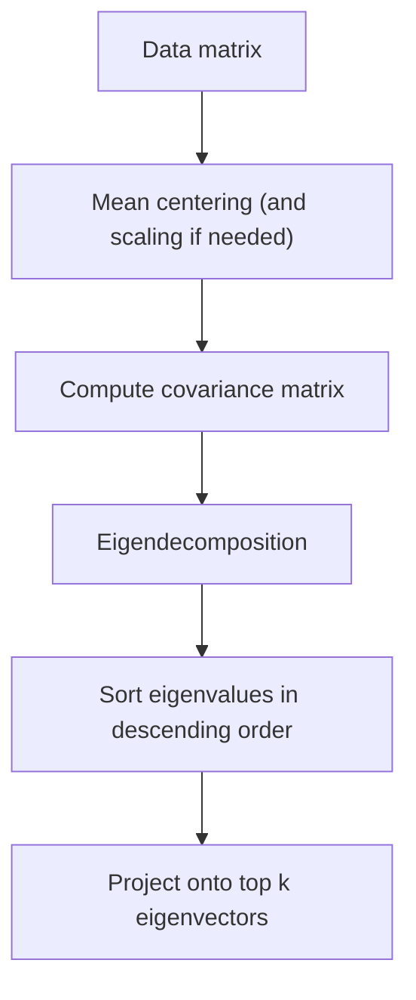

# Chapter 4 — Dimension Reduction and PCA

[Repository Guide](../../README.md) | [English](Concepts_Lecture.md) | [한국어](Concepts_Lecture.ko.md)

> **Last Updated:** 2026-10-18

> **Learning Objectives:**
> 1. Explain the motivation for dimensionality reduction and the curse of dimensionality
> 2. Distinguish feature selection from feature extraction (dimensionality reduction)
> 3. Derive and perform Principal Component Analysis (PCA) through the eigendecomposition of the covariance matrix
> 4. Interpret principal components and explained variance ratios to decide how many components to retain
> 5. Compare the characteristics of PCA, MDS, t-SNE, and UMAP

---

## Table of Contents

- [1. Dimensionality Reduction](#1-dimensionality-reduction)
  - [1.1 Definition](#11-definition)
  - [1.2 Why Dimensionality Reduction?](#12-why-dimensionality-reduction)
  - [1.3 Curse of Dimensionality](#13-curse-of-dimensionality)
  - [1.4 Applications](#14-applications)
- [2. Feature Selection vs. Dimensionality Reduction](#2-feature-selection-vs-dimensionality-reduction)
  - [2.1 Feature Selection](#21-feature-selection)
  - [2.2 Dimensionality Reduction (Feature Extraction)](#22-dimensionality-reduction-feature-extraction)
- [3. Two Main Approaches](#3-two-main-approaches)
  - [3.1 Projection](#31-projection)
  - [3.2 Manifold Learning](#32-manifold-learning)
  - [3.3 Classification of Methods](#33-classification-of-methods)
- [4. Linear Algebra Prerequisites](#4-linear-algebra-prerequisites)
  - [4.1 Vectors](#41-vectors)
  - [4.2 Linear Combination](#42-linear-combination)
  - [4.3 Linear Transformation](#43-linear-transformation)
  - [4.4 Connection to PCA](#44-connection-to-pca)
- [5. Principal Component Analysis (PCA)](#5-principal-component-analysis-pca)
  - [5.1 Overview](#51-overview)
  - [5.2 Goal of PCA](#52-goal-of-pca)
  - [5.3 PCA Projects Data](#53-pca-projects-data)
- [6. PCA Theory and Derivation](#6-pca-theory-and-derivation)
  - [6.1 Mathematical Setup](#61-mathematical-setup)
  - [6.2 Reconstruction Error](#62-reconstruction-error)
  - [6.3 Derivation via Lagrange Multipliers](#63-derivation-via-lagrange-multipliers)
  - [6.4 Eigenvalue Interpretation](#64-eigenvalue-interpretation)
  - [6.5 Computing the Covariance Matrix](#65-computing-the-covariance-matrix)
  - [6.6 Covariance Matrix Geometric Interpretation](#66-covariance-matrix-geometric-interpretation)
- [7. Geometric Rationale of PCA](#7-geometric-rationale-of-pca)
  - [7.1 Geometric View](#71-geometric-view)
  - [7.2 Eigenvalues and Eigenvectors in Covariance Matrix](#72-eigenvalues-and-eigenvectors-in-covariance-matrix)
  - [7.3 Toy Example (2x2 Matrix)](#73-toy-example-2x2-matrix)
- [8. Mean, Variance, and Covariance](#8-mean-variance-and-covariance)
  - [8.1 Mean (Expectation)](#81-mean-expectation)
  - [8.2 Variance](#82-variance)
  - [8.3 Covariance](#83-covariance)
  - [8.4 Correlation](#84-correlation)
- [9. Other Dimensionality Reduction Methods](#9-other-dimensionality-reduction-methods)
  - [9.1 MDS (Multi-Dimensional Scaling)](#91-mds-multi-dimensional-scaling)
  - [9.2 t-SNE (t-distributed Stochastic Neighbor Embedding)](#92-t-sne-t-distributed-stochastic-neighbor-embedding)
  - [9.3 UMAP (Uniform Manifold Approximation and Projection)](#93-umap-uniform-manifold-approximation-and-projection)
  - [9.4 Comparison](#94-comparison)
- [10. Practical Considerations](#10-practical-considerations)
  - [10.1 Scree Plot](#101-scree-plot)
  - [10.2 Explained Variance Ratio](#102-explained-variance-ratio)
  - [10.3 When to Use What](#103-when-to-use-what)
- [Summary](#summary)
- [Self-Check Questions](#self-check-questions)
- [References](#references)

---

<br>

## 1. Dimensionality Reduction

### 1.1 Definition

Dimensionality reduction is the process of choosing or constructing a small number of features that carry the most relevant information from thousands or millions of low-level features, in order to build **better**, **faster**, and **easier to understand** learning models. Dimensionality reduction in the broad sense includes both feature selection and feature extraction of Section 2.

### 1.2 Why Dimensionality Reduction?

- **Speed up training algorithms**: In high dimensions, non-critical variables can lead to poor performance, or the amount of data to process can become extremely large.
- **Simpler and more stable models**: Models trained with too many dimensions are easy to overfit, and reducing dimensions makes them more robust.
- **Better visualization**: Lower dimensions make it easier to visualize data structures.

### 1.3 Curse of Dimensionality

As the number of dimensions increases, the space grows exponentially and the density of the same amount of data becomes sparse. Table 1 shows the density when 8 data points lie in a space whose axes are each divided into 10 cells.

| Dimensions | Space (Cells) | Data Points | Density |
|-----------|-------|-------------|---------|
| 1 | 10 | 8 | 80% |
| 2 | 100 | 8 | 8% |
| 3 | 1000 | 8 | 0.8% |

*Table 1. Space size and data density by number of dimensions*

### 1.4 Applications

Dimensionality reduction is widely used in many fields.
- Bioinformatics
- Machine vision
- Text categorization
- Market analysis
- Quality control
- OCR, handwriting recognition

> **Key Point:** Occam's Razor applies. The principle states, "When faced with two equally good hypotheses, always choose the simpler." Reducing dimensions often leads to simpler, more generalizable models.

---

<br>

## 2. Feature Selection vs. Dimensionality Reduction

### 2.1 Feature Selection

- The new features are a **subset** of the original features.
- Only a small number of features need to be computed for classification.
- The interpretability of the original features is preserved.

### 2.2 Dimensionality Reduction (Feature Extraction)

- The new features are **combinations** of the original features (linear combinations for PCA and LDA).
- It creates synthetic, composite variables.
- The features are harder to interpret, but more information can be captured in fewer dimensions.

> **Key Point:** Feature selection keeps the original features, so they are easy to interpret. Dimensionality reduction creates new combined features, which are more compact but harder to interpret.

---

<br>

## 3. Two Main Approaches

### 3.1 Projection

Project high-dimensional data onto a lower-dimensional subspace while preserving as much information as possible. For example, 3D data can be projected onto a 2D plane.

### 3.2 Manifold Learning

- A **manifold** is a space that locally looks like Euclidean space; here it refers to the low-dimensional surface on which the data actually lies in the high-dimensional space.
- **Manifold learning** discovers the intrinsically low-dimensional structure in high-dimensional data.
- Manifold learning proceeds in steps: (1) represent the data structure as a graph, (2) compute a low-dimensional embedding, and (3) apply machine learning (ML) methods.

**Motivating Examples:**

- **Swiss roll**: Data lies on a 2D surface rolled into 3D. Points A1 and A2 may be far apart in Euclidean distance (straight line through the roll), but close along the manifold surface. Euclidean distance in the ambient space fails to capture true proximity on the manifold.
- **Golf swing**: Sequential frames of a golf swing form a manifold in high-dimensional pixel space. Using Euclidean distance, the nearest neighbors of a given frame may include visually dissimilar poses. After discovering the manifold, semantically close data (temporally adjacent swing positions) are correctly identified as neighbors.

### 3.3 Classification of Methods

```text
Dimensionality Reduction
├── Linear
│   └── PCA
└── Non-linear
    ├── Preserve global structure
    │   ├── MDS
    │   └── t-SNE
    └── Preserve local structure
        └── UMAP
```

*Figure 1. Classification of dimensionality reduction methods*

The common view of which structure t-SNE and UMAP preserve is discussed in the note box of Section 9.3.

> **Key Point:** Linear methods like PCA work well when the data lies near a linear subspace. Non-linear methods (MDS, t-SNE, UMAP) capture more complex structures.

---

<br>

## 4. Linear Algebra Prerequisites

### 4.1 Vectors

- Data can be described with vectors (perspectives from physics, computer science, and mathematics).
- A **constant multiple of a vector** scales the vector by a scalar.
- The **sum of vectors** adds two vectors component-wise.
- **Row vector and column vector**: Each entry of a matrix product is the dot product of a row vector and a column vector.

### 4.2 Linear Combination

A linear combination combines constant multiples and sums of vectors; it describes a vector by combining two (or more) characteristics at once.

### 4.3 Linear Transformation

- A linear transformation is a function between two vector spaces that **preserves linear combinations**.
- **A matrix is a linear transformation**. Applying a matrix $A$ to a vector $\mathbf{x}$ produces another vector $A\mathbf{x}$.
- Eigenvectors and eigenvalues arise from this. $A\mathbf{x} = \lambda \mathbf{x}$ means that along an eigenvector direction the matrix only scales the vector (by $\lambda$).

### 4.4 Connection to PCA

When data is represented in a high-dimensional vector space, the covariance matrix acts as a linear transformation. Finding its eigenvectors reveals the directions in which the data is most spread out (principal components).

---

<br>

## 5. Principal Component Analysis (PCA)

### 5.1 Overview

PCA is probably the most widely used and well-known of the standard multivariate methods. It was invented by Pearson (1901) and Hotelling (1933), and first applied in ecology by Goodall (1954) under the name factor analysis.

PCA takes an $n \times p$ data matrix ($n$ objects, $p$ variables), whose variables may be correlated, and summarizes it by **uncorrelated axes (principal components)** that are linear combinations of the original $p$ variables.

### 5.2 Goal of PCA

Find the smallest subspace of the high-dimensional space that keeps the most information about the original data.

- It summarizes data with many ($p$) variables by a smaller set of ($k$) derived variables.
- **The first $k$ components** display as much as possible of the variation among objects.
- It balances clarity of representation against oversimplification (loss of information).
- Residual variation is the information not retained in the reduced representation.

### 5.3 PCA Projects Data

PCA maintains the structure of the original data and reduces dimensions by projecting data onto vectors. It projects data first onto the axis with the **largest variance**.

> **Key Point:** The result of PCA is determined only by the covariance matrix. PCA finds the directions of maximum variance in the data and projects the data onto those directions.

---

<br>

## 6. PCA Theory and Derivation

### 6.1 Mathematical Setup

Let $\mathbf{X} = [\mathbf{x}_1, \dots, \mathbf{x}_m]$ be an $N \times m$ data matrix ($N$ dimensions, $m$ instances). Each column $\mathbf{x}_j$ is one instance, and the data is assumed to be centered by subtracting the mean.

Let $\mathbf{U}$ be an $N \times N$ orthogonal matrix. Here $\mathbf{U}\mathbf{U}^T = \mathbf{I}_N$, and the $i$-th row of $\mathbf{U}$ is written $\mathbf{u}_i^T$.

- The transform is $\mathbf{y} = \mathbf{U}\mathbf{x}$.
- The inverse is $\mathbf{x} = \mathbf{U}^T \mathbf{y}$.
- The approximation using $M$ basis vectors ($M \le N$) is $\hat{\mathbf{x}} = \sum_{i=1}^{M} \mathbf{u}_i y_i$.

### 6.2 Reconstruction Error

$$\varepsilon^2 = \mathbb{E}\{\|\mathbf{x} - \hat{\mathbf{x}}\|^2\} = \frac{1}{m} \sum_{j=1}^{m} \|\mathbf{x}_j - \hat{\mathbf{x}}_j\|^2$$

**Goal:** Minimize the reconstruction error.

$$\arg \min_{\mathbf{U}} \varepsilon^2, \quad \text{s.t.} \quad \mathbf{U}^T \mathbf{U} = \mathbf{I}_N$$

### 6.3 Derivation via Lagrange Multipliers

The error can be expressed as follows.

$$\varepsilon^2 = \sum_{i=M+1}^{N} \mathbf{u}_i^T \boldsymbol{\Sigma} \mathbf{u}_i$$

Here $\boldsymbol{\Sigma}$ is the covariance matrix (since $\mathbf{x}$ is centered, $\mathbb{E}[\mathbf{x}\mathbf{x}^T] = \boldsymbol{\Sigma}$).

A Lagrange multiplier $\lambda_i$ is attached to the unit-length condition $\mathbf{u}_i^T \mathbf{u}_i = 1$ of the orthogonality constraint.

$$L = \sum_{i=M+1}^{N} \mathbf{u}_i^T \boldsymbol{\Sigma} \mathbf{u}_i - \sum_{i=M+1}^{N} \lambda_i(\mathbf{u}_i^T \mathbf{u}_i - 1)$$

Setting the derivative to zero gives the following.

$$\frac{\partial L}{\partial \mathbf{u}_i} = 2\boldsymbol{\Sigma}\mathbf{u}_i - 2\lambda_i\mathbf{u}_i = 0 \implies \boldsymbol{\Sigma}\mathbf{u}_i = \lambda_i\mathbf{u}_i$$

### 6.4 Eigenvalue Interpretation

The equation $\boldsymbol{\Sigma}\mathbf{u}_i = \lambda_i \mathbf{u}_i$ shows the following.
- $\mathbf{u}_i$ are **eigenvectors** of the covariance matrix $\boldsymbol{\Sigma}$.
- $\lambda_i$ are the corresponding **eigenvalues**.

Since $\mathbf{u}_i^T \boldsymbol{\Sigma} \mathbf{u}_i = \lambda_i \mathbf{u}_i^T \mathbf{u}_i = \lambda_i$, the reconstruction error becomes the following.

$$\varepsilon^2 = \sum_{i=M+1}^{N} \lambda_i$$

The error is **minimal** when $\lambda_{M+1}, \dots, \lambda_N$ are the **smallest** eigenvalues. Therefore the eigenvectors corresponding to the $M$ **largest** eigenvalues are kept as the principal components.

### 6.5 Computing the Covariance Matrix

$$\boldsymbol{\Sigma} = \frac{1}{n} \mathbf{X}^T \mathbf{X}$$

Here $\mathbf{X}$ is an $n \times p$ mean-centered data matrix whose rows are observations. The $(i, j)$ entry of $\mathbf{X}^T \mathbf{X}$ is the dot product of the $i$-th and $j$-th feature columns. If the data is written as an $N \times m$ matrix whose columns are instances, as in Section 6.1, the same covariance matrix is $\frac{1}{m}\mathbf{X}\mathbf{X}^T$.

### 6.6 Covariance Matrix Geometric Interpretation

A 2D covariance matrix is as follows.

$$\boldsymbol{\Sigma} = \begin{bmatrix} \sigma_x^2 & \text{Cov}(X,Y) \\ \text{Cov}(X,Y) & \sigma_y^2 \end{bmatrix}$$

- The **diagonal entries** ($\sigma_x^2$, $\sigma_y^2$) are the **spread (variance) along each axis**, showing how much the data stretches along $X$ and $Y$ individually.
- The **off-diagonal entries** ($\text{Cov}(X,Y)$) are the **joint spread** between the variables, showing how $X$ and $Y$ move together.

**Why $\mathbf{X}^T \mathbf{X}$ captures covariance:**

$\mathbf{X}^T \mathbf{X}$ produces a **matrix of dot products between feature columns**. Each entry $\mathbf{X}_i^T \mathbf{X}_j$ (the dot product of the $i$-th and $j$-th feature columns) measures how much feature $i$ and feature $j$ move in the same direction across all observations. Dividing by $n$ normalizes this into the covariance. This is why $\boldsymbol{\Sigma} = \frac{1}{n}\mathbf{X}^T\mathbf{X}$ when $\mathbf{X}$ is mean-centered.

When the covariance matrix is used as a linear transformation on data, it stretches data along the directions of greatest variance. The eigenvectors of this transformation reveal those directions (principal components), and the eigenvalues reveal how much stretching occurs (amount of variance).

Figure 2 summarizes the discussion so far as the computational procedure of PCA.



*Figure 2. Computational procedure of PCA*

> **Key Point:** The principal components are the eigenvectors of the covariance matrix, ordered by eigenvalue magnitude. The eigenvalues represent the amount of variance explained by each component.

---

<br>

## 7. Geometric Rationale of PCA

### 7.1 Geometric View

- Objects are represented as a cloud of $n$ points in a multidimensional space with an axis for each of the $p$ variables.
- The **centroid** of the points is defined by the mean of each variable.
- The **variance** of each variable is the average squared deviation of its $n$ values around the mean.

$$V_i = \frac{1}{n-1} \sum_{m=1}^{n} (X_{im} - \bar{X}_i)^2$$

This sample variance divides by $n - 1$, while the covariance matrix of Section 6.5 divides by $n$. The divisor only scales all eigenvalues by the same factor, so the eigenvectors (principal component directions) and the explained variance ratios do not change.

### 7.2 Eigenvalues and Eigenvectors in Covariance Matrix

| | Original Meaning | Meaning in Covariance Matrix |
|---|---|---|
| **Eigenvectors** | Express the direction of a main axis whose direction does not change when multiplied by the matrix | Express the direction in which the data is distributed |
| **Eigenvalues** | Factor by which a vector along the eigenvector is stretched or shrunk | Degree to which the data spreads in that direction (amount of variance) |

*Table 2. Original meaning of eigenvectors and eigenvalues and their meaning in a covariance matrix*

### 7.3 Toy Example (2x2 Matrix)

Find the eigenvalues and eigenvectors of the following matrix $A$.

$$A = \begin{bmatrix} 4 & 2 \\ 3 & 5 \end{bmatrix}$$

1. Solve the characteristic equation $\det(A - \lambda I) = 0$.
2. $(4 - \lambda)(5 - \lambda) - 2 \cdot 3 = \lambda^2 - 9\lambda + 14 = (\lambda - 7)(\lambda - 2) = 0$, so $\lambda = 7, 2$.
3. For $\lambda = 7$, $(A - 7I)\mathbf{x} = \mathbf{0}$ gives $-3x_1 + 2x_2 = 0$, so the eigenvector is $c(2, 3)$.
4. For $\lambda = 2$, $(A - 2I)\mathbf{x} = \mathbf{0}$ gives $2x_1 + 2x_2 = 0$, so the eigenvector is $c(-1, 1)$.

> **Note:** This matrix is not symmetric, so it is not an example of a covariance matrix, and its two eigenvectors $(2, 3)$ and $(-1, 1)$ are not orthogonal (dot product $= -2 + 3 = 1$). A covariance matrix is symmetric, so all its eigenvalues are non-negative real numbers, and eigenvectors corresponding to distinct eigenvalues are orthogonal.

> **Key Point:** Eigenvalues determine how much variance is captured along each eigenvector direction. Larger eigenvalues correspond to more important principal components.

---

<br>

## 8. Mean, Variance, and Covariance

### 8.1 Mean (Expectation)

|  | Discrete (PMF) | Continuous (PDF) |
|--|----------------|-----------------|
| **Formula** | $E(X) = \sum_i p_i x_i$ | $E(X) = \int x f(x) dx$ |

*Table 3. Mean of discrete and continuous random variables*

### 8.2 Variance

|  | Discrete (PMF) | Continuous (PDF) |
|--|----------------|-----------------|
| **Formula** | $V(X) = \sum_i (x_i - m)^2 p_i = E(X^2) - m^2$ | $\text{Var}[X] = \int (x - E[X])^2 f(x) dx = E[X^2] - E[X]^2$ |

*Table 4. Variance of discrete and continuous random variables*

Here $m = E(X)$. The standard deviation is $\sigma(X) = \sqrt{V(X)}$.

### 8.3 Covariance

For random variables $X$ and $Y$ with $E(X) = \mu$ and $E(Y) = \nu$, the covariance is as follows.

$$\text{Cov}(X, Y) = E((X - \mu)(Y - \nu)) = E(XY) - \mu\nu = E(XY) - E(X)E(Y)$$

**If $X$ and $Y$ are independent**, then $E(XY) = E(X)E(Y) = \mu\nu$, so **the covariance is zero** ($\text{Cov}(X, Y) = 0$).

The principal components of PCA are **uncorrelated** variables whose pairwise covariances are zero. This is because the eigenvectors of the covariance matrix are orthogonal, and the covariance matrix of the components obtained by projecting the data onto these axes is a diagonal matrix with the eigenvalues on its diagonal. The converse of the property above does not hold, so principal components with zero covariance are not guaranteed to be independent.

### 8.4 Correlation

Because covariance is affected by the absolute scale of variables, it is normalized as follows.

$$\rho = \frac{\text{Cov}(X, Y)}{\sqrt{\text{Var}(X) \cdot \text{Var}(Y)}}, \quad -1 \leq \rho \leq 1$$

---

<br>

## 9. Other Dimensionality Reduction Methods

### 9.1 MDS (Multi-Dimensional Scaling)

- It is a **non-linear** method that preserves **global structure**.
- It attempts to preserve pairwise distances between data points in the lower-dimensional space.
- It has two variants: **Metric MDS** (= Principal Coordinate Analysis, PCoA) and **Non-Metric MDS**.
- **PCA vs. PCoA**: PCA reduces dimensions based on covariance, while PCoA (Metric MDS) reduces dimensions based on distance.
- When Euclidean distance is used, PCoA (MDS) and PCA produce **the same** dimensionally reduced result. This is because reduction that preserves distances and reduction based on covariance (variance maximization) coincide, and MDS in this case is equivalent to a linear method.
- Distance metrics include (1) **Euclidean distance** (Pythagorean theorem) and (2) **absolute value of log fold change**. The latter makes asymmetric fold differences symmetric with a logarithm and then uses, as the distance between two samples, the average of the absolute values over the features.

### 9.2 t-SNE (t-distributed Stochastic Neighbor Embedding)

- It is a **non-linear** vector visualization algorithm that preserves **global structure** (see the note box of Section 9.3).
- It reduces dimensions so that the **similarity** between points in high dimensions is preserved in the embedding space.
- **Why not just project?** Simple projection to 1D can destroy cluster separation. For example, two well-separated clusters in 2D may overlap when projected onto a single axis.

**Algorithm outline:**

1. For each point of interest $x_i$, compute distances to all other points $x_j$.
2. Divide the distances by a Gaussian width $\sigma_i$ that differs for each point. $\sigma_i$ is set so that the conditional distribution of each point has the user-specified perplexity (a parameter that adds stability by controlling the effective number of neighbors).
3. Apply the negative exponential function to get the conditional probability $p_{j|i} = \frac{\exp(-\lVert x_i - x_j \rVert^2 / 2\sigma_i^2)}{\sum_{k \ne i} \exp(-\lVert x_i - x_k \rVert^2 / 2\sigma_i^2)}$. Closer points get higher probability.
4. Symmetrize: $p_{ij} = (p_{j|i} + p_{i|j}) / 2n$.
5. In the embedding space, compute the similarity with a **t-distribution** instead of a Gaussian: $q_{ij} = \frac{(1 + \lVert y_i - y_j \rVert^2)^{-1}}{\sum_{k \ne l} (1 + \lVert y_k - y_l \rVert^2)^{-1}}$.
6. Minimize the KL divergence between $p_{ij}$ and $q_{ij}$ by adjusting the embedding positions.

**Why the t-distribution:** The t-distribution has heavier tails than the normal distribution, meaning it is more widely spread from the mean. This gives distant points more room to spread out in the embedding, improving cluster separation.

**Key property:** Because of random initialization and non-convex optimization, results change every run. It is useful for visualization but not deterministic, and the random seed must be fixed to obtain the same result.

### 9.3 UMAP (Uniform Manifold Approximation and Projection)

- It is a **non-linear** method that preserves **local structure**.
- It is based on **topological data analysis** and **manifold learning**.
- It uses concepts from topology: simplices (0-simplex = point, 1-simplex = edge, 2-simplex = triangle, 3-simplex = tetrahedron), simplicial complexes, and the nerve theorem.
- It covers the data with circles of varying radius and builds simplicial complexes to capture the important topology of the data.

**UMAP vs. t-SNE:**

| UMAP | t-SNE |
|------|-------|
| No limit to the size of the embedding dimension | Embedding is only possible in two or three dimensions |
| Better preserves **the local neighbor graph** structure | Better preserves the **overall** structure |
| **Faster** than t-SNE | Time is determined by a hyperparameter called perplexity |

*Table 5. Comparison of UMAP and t-SNE*

> **Note:** **What t-SNE and UMAP preserve.** The distinction in the table above and in Figure 1 differs from the common view. The paper that proposed t-SNE describes it as capturing local structure well while also revealing global structure such as clusters at several scales [1], and the paper that proposed UMAP reports that UMAP preserves more global structure than t-SNE [2]. How much global structure either method preserves also depends strongly on the initialization [3]. In addition, t-SNE can in principle embed into more than three dimensions, but it is mainly used for 2D or 3D visualization [1].

### 9.4 Comparison

| Method | Type | Preserves | Speed | Use Case |
|--------|------|-----------|-------|----------|
| PCA | Linear | Global variance | Fast | General reduction, preprocessing |
| MDS | Non-linear | Global distances | Moderate | When distance matrix is available |
| t-SNE | Non-linear | Global structure | Slow | Visualization of clusters |
| UMAP | Non-linear | Local structure | Fast | Visualization, preserving topology |

*Table 6. Comparison of dimensionality reduction methods*

> **Key Point:** PCA is best for linear data and preprocessing. For visualization of high-dimensional data with complex structures, t-SNE and UMAP are preferred.

---

<br>

## 10. Practical Considerations

### 10.1 Scree Plot

A scree plot displays eigenvalues (or explained variance ratios) in descending order. It helps determine the number of components to retain.
- Look for an elbow where the curve flattens.
- The components before the elbow capture the most meaningful variance.

**Connection to eigenvalue decomposition:** The values plotted on a scree plot **are** the eigenvalues from the PCA eigenvalue decomposition ($\boldsymbol{\Sigma}\mathbf{u}_i = \lambda_i \mathbf{u}_i$). Each eigenvalue $\lambda_i$ represents the variance captured by the $i$-th principal component. The scree plot arranges these eigenvalues in descending order to visualize the diminishing returns, the shrinking variance gained by adding more components.

### 10.2 Explained Variance Ratio

The proportion of total variance explained by the $k$-th component is as follows.

$$\text{Explained Variance Ratio}_k = \frac{\lambda_k}{\sum_{i=1}^{N} \lambda_i}$$

A common rule of thumb is to retain enough components to explain 80-95% of the total variance.

### 10.3 When to Use What

| Scenario | Recommended Method |
|----------|--------------------|
| Linear relationships, preprocessing | PCA |
| Need interpretable features | Feature Selection |
| 2D/3D visualization of clusters | t-SNE or UMAP |
| Preserve pairwise distances | MDS |
| Large dataset, fast visualization | UMAP |

*Table 7. Recommended dimensionality reduction methods by scenario*

> **Key Point:** Always center the data before applying PCA, and usually scale it as well. The choice between methods depends on whether the data structure is linear or non-linear and whether the goal is analysis or visualization.

---

<br>

## Summary

| Concept | Key Summary |
|---------|-----------|
| Dimensionality Reduction | It reduces the number of features to build better, faster, simpler models. |
| Curse of Dimensionality | Data density decreases exponentially as dimensions increase. |
| Feature Selection vs. Extraction | Selection keeps the original features, and extraction creates new combinations of them. |
| PCA | It is a linear method that finds the eigenvectors of the covariance matrix as principal components. |
| Covariance Matrix | For a mean-centered $\mathbf{X}$, $\boldsymbol{\Sigma} = \frac{1}{n}\mathbf{X}^T\mathbf{X}$, which encodes the variances and covariances between features. |
| Eigenvalues | They represent the amount of variance captured by each principal component. |
| Eigenvectors | They define the direction of each principal component. |
| Reconstruction Error | It equals the sum of the eigenvalues of the discarded components, so it is minimized by keeping the components with the largest eigenvalues. |
| t-SNE | It is a non-linear method excellent for visualization and is classified as preserving global structure, although there are other views on this distinction (Section 9.3). |
| UMAP | It is a fast non-linear method classified as preserving local structure. |
| MDS | It is a non-linear method that preserves pairwise distances. |
| Scree Plot | It plots the eigenvalues in descending order and is used to determine the optimal number of components to retain. |

---

<br>

## Self-Check Questions

1. **Eigendecomposition and explained variance:** A 2D covariance matrix $\boldsymbol{\Sigma}$ has both diagonal entries equal to 2 and off-diagonal entries equal to 1. Find its eigenvalues and unit eigenvectors, and the explained variance ratio of the first principal component.

   <details>
   <summary>Answer</summary>

   The characteristic equation $(2 - \lambda)^2 - 1 = 0$ gives $\lambda = 3, 1$. The unit eigenvector for $\lambda = 3$ is $(1, 1)/\sqrt{2}$, and the unit eigenvector for $\lambda = 1$ is $(1, -1)/\sqrt{2}$; the two vectors are orthogonal. The explained variance ratio of the first principal component is $3/(3 + 1) = 0.75$, that is, 75%.

   </details>

2. **Number of components and reconstruction error:** For a PCA with eigenvalues 5, 3, 1.5, and 0.5, find the explained variance ratio of each component and the cumulative ratios. How many components are needed to explain at least 80% of the total variance, and what is the reconstruction error then?

   <details>
   <summary>Answer</summary>

   The eigenvalues sum to 10, so the explained variance ratios are 50%, 30%, 15%, and 5%, and the cumulative ratios are 50%, 80%, 95%, and 100%. Two components are needed to explain at least 80%. The reconstruction error is the sum of the eigenvalues of the discarded components, $1.5 + 0.5 = 2$, which is 20% of the total variance.

   </details>

3. **Curse of dimensionality:** As in Section 1.3, 8 data points lie in a space whose axes are each divided into 10 cells. Find the density in 4 dimensions, and find how many data points are needed in 4 dimensions to keep the 3D density of 0.8%.

   <details>
   <summary>Answer</summary>

   A 4D space has $10^4$ = 10,000 cells, so the density is 8 / 10,000 = 0.08%. Keeping a density of 0.8% requires 0.008 × 10,000 = 80 data points. Each additional dimension multiplies the data needed for the same density by 10.

   </details>

4. **Feature selection and feature extraction:** For expression data of 10,000 genes, compare (a) choosing the 100 genes with the largest variance and (b) constructing 100 principal components with PCA. How can the new features be interpreted in each method?

   <details>
   <summary>Answer</summary>

   (a) is feature selection. The new features are a subset of the original genes, so each feature can be interpreted as that gene itself. (b) is feature extraction (dimensionality reduction). Each principal component is a linear combination of the 10,000 genes, so in the same 100 dimensions it captures no less variance than any choice of 100 genes, but the meaning of individual features is hard to interpret.

   </details>

5. **Properties of t-SNE:** Running t-SNE twice on the same data produced different plots. Give the reason and how to reproduce a result, and explain why a t-distribution is used instead of a Gaussian in the embedding space.

   <details>
   <summary>Answer</summary>

   t-SNE initializes the embedding positions randomly and iteratively minimizes a non-convex KL divergence, so each run may reach a different local optimum. Fixing the random seed reproduces the same result. The t-distribution has heavier tails than the normal distribution, so points that are moderately far apart in high dimensions can be placed farther apart in the embedding, which keeps clusters separated instead of crushed together.

   </details>

---

<br>

## References

1. L. van der Maaten and G. Hinton, "Visualizing data using t-SNE," *Journal of Machine Learning Research*, vol. 9, pp. 2579-2605, 2008.
2. L. McInnes, J. Healy, and J. Melville, "UMAP: Uniform manifold approximation and projection for dimension reduction," arXiv:1802.03426, 2018.
3. D. Kobak and G. C. Linderman, "Initialization is critical for preserving global data structure in both t-SNE and UMAP," *Nature Biotechnology*, vol. 39, no. 2, pp. 156-157, 2021.
