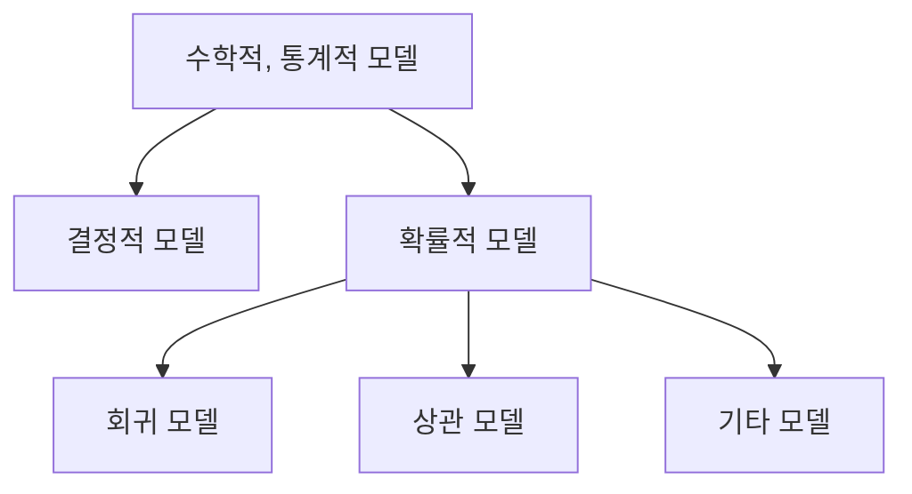

# 5장 — 모델링

[레포지토리 안내](../../README.ko.md) | [English](Concepts_Lecture.md) | [한국어](Concepts_Lecture.ko.md)

> **최종 수정일:** 2026-10-18

> **학습 목표:**
> 1. 결정적 모델과 확률적 모델을 구분할 수 있다
> 2. 회귀 모델을 설명변수의 수와 선형성에 따라 분류할 수 있다
> 3. 최소제곱법으로 단순 선형 회귀의 OLS 추정량을 유도할 수 있다
> 4. 상관분석과 회귀분석의 차이를 설명하고, 결과 변수와 관측의 구조에 맞는 분석 방법을 고를 수 있다
> 5. 회귀 모델로 실제 데이터의 미래 값을 예측하는 과정을 설명할 수 있다

---

## 목차

- [1. 모델의 정의](#1-모델의-정의)
- [2. 수학적 모델과 통계적 모델](#2-수학적-모델과-통계적-모델)
  - [2.1 결정적 모델 (Deterministic Models)](#21-결정적-모델-deterministic-models)
  - [2.2 확률적 모델 (Probabilistic Models)](#22-확률적-모델-probabilistic-models)
- [3. 확률적 모델의 유형](#3-확률적-모델의-유형)
- [4. 회귀 모델](#4-회귀-모델)
  - [4.1 정의](#41-정의)
  - [4.2 변수의 유형](#42-변수의-유형)
  - [4.3 회귀 모델의 유형](#43-회귀-모델의-유형)
- [5. 선형 회귀](#5-선형-회귀)
  - [5.1 일차 방정식 복습](#51-일차-방정식-복습)
  - [5.2 모집단 선형 회귀 모델 (Population Linear Regression Model)](#52-모집단-선형-회귀-모델-population-linear-regression-model)
  - [5.3 오차 분포 가정](#53-오차-분포-가정)
  - [5.4 모집단 vs. 표본](#54-모집단-vs-표본)
- [6. 최소제곱 추정](#6-최소제곱-추정)
  - [6.1 회귀 모델의 목표](#61-회귀-모델의-목표)
  - [6.2 적합의 시각적 직관](#62-적합의-시각적-직관)
  - [6.3 최소제곱법 (Least Squares Method)](#63-최소제곱법-least-squares-method)
  - [6.4 OLS 추정량 유도](#64-ols-추정량-유도)
  - [6.5 OLS 공식](#65-ols-공식)
  - [6.6 OLS 유도 중간 과정](#66-ols-유도-중간-과정)
  - [6.7 다중 선형 회귀 (Multiple Linear Regression, 행렬 형태)](#67-다중-선형-회귀-multiple-linear-regression-행렬-형태)
- [7. 상관분석 vs. 회귀분석](#7-상관분석-vs-회귀분석)
- [8. 분석 방법 지도](#8-분석-방법-지도)
- [9. 실전 예측 사례: 다이어트 여정](#9-실전-예측-사례-다이어트-여정)
- [요약](#요약)
- [점검 문제](#점검-문제)

---

 

## 1. 모델의 정의

모델(Model)이란 **실제 현상을 묘사하는 대표적(인공적) 표현**이다.

모델 또는 모델링(Modeling)이라는 말은 다음을 가리킬 수 있다.

- **개념 모델 (Conceptual model)**: 일반적인 규칙과 개념을 사용하여 시스템을 표현한 것이다.
- **과학 모델 (Scientific model)**: 물리적 시스템을 단순화하고 이상화하여 이해한 것이다.
- **물리 모델 (Physical model)**: 지구본이나 모형 비행기처럼 대상을 3차원으로 물리적으로 표현한 것이다.

> **핵심:** 이 장에서는 방정식과 확률을 사용하여 변수 간의 관계를 서술하는 수학적 모델과 통계적 모델에 초점을 둔다.

---

 

## 2. 수학적 모델과 통계적 모델

수학적 모델과 통계적 모델은 흔히 **변수 간의 관계**를 기술한다.

### 2.1 결정적 모델 (Deterministic Models)

- **정확한 관계**를 가정하며 무작위성이 없다.
- 예측 오차를 무시할 수 있을 때 적합하다.
- 예시로 체질량지수(BMI)가 있다.

$$BMI = \frac{Weight\ (kg)}{Height\ (m)^2}$$

### 2.2 확률적 모델 (Probabilistic Models)

- **결정적 성분**과 **확률적 오차**의 두 요소를 가정한다.
- 예시로 신생아의 수축기 혈압(SBP)이 있다. 아래 식의 $age(d)$는 일 단위로 센 나이이다.

$$SBP = 6 \times age(d) + \varepsilon$$

- 확률적 오차는 일수 외의 환경적 요인(예: 출생 체중) 때문에 발생할 수 있다.

> **핵심:** 결정적 모델은 무작위성 없이 정확한 관계를 가정하는 반면, 확률적 모델은 설명되지 않는 변동성을 설명하기 위해 확률적 오차항을 포함한다.

---

 

## 3. 확률적 모델의 유형

확률적 모델은 세 가지 유형으로 분류할 수 있다.

*그림 1. 수학적, 통계적 모델의 분류*

| 유형 | 설명 |
|------|------|
| **회귀 모델 (Regression Models)** | 방정식을 사용하여 종속변수와 독립변수 사이의 관계를 모델링한다 |
| **상관 모델 (Correlation Models)** | 두 변수 간의 선형성 강도를 분석한다 |
| **기타 모델 (Other Models)** | 그 밖의 확률적 모델링 접근법이다 |

*표 1. 확률적 모델의 세 가지 유형*

---

 

## 4. 회귀 모델

### 4.1 정의

- 회귀 모델은 **하나의 종속변수와 설명변수(들) 사이의 관계**를 기술한다.
- 방정식을 이용하여 관계를 설정한다.
- 주로 **예측과 추정**에 사용한다.

### 4.2 변수의 유형

**종속변수 (Dependent variable, Y)**:
- 관심 있는 특정 현상을 나타낸다.
- 동의어로 반응변수(Response variable)와 결과변수(Outcome variable)가 있다.
- 보통 $Y$로 표기한다.

**독립변수 (Independent variable, X)**:
- 종속변수에 영향을 줄 수 있는 변수이다.
- 동의어로 설명변수(Explanatory variable)와 예측변수(Predictor)가 있다.
- 보통 $X_1, \ldots, X_k$로 표기한다.

### 4.3 회귀 모델의 유형

회귀 모델은 두 가지 차원으로 분류된다.

|  | 단순 (설명변수 1개) | 다중 (설명변수 2개 이상) |
|--|---|----|
| **선형 (Linear)** | 단순 선형 회귀 (Simple Linear Regression) | 다중 선형 회귀 (Multiple Linear Regression) |
| **비선형 (Non-Linear)** | 단순 비선형 회귀 (Simple Non-Linear Regression) | 다중 비선형 회귀 (Multiple Non-Linear Regression) |

*표 2. 설명변수의 수와 선형성에 따른 회귀 모델의 분류*

> **참고:** **선형의 의미.** 회귀 모델에서 선형은 모수(회귀 계수)에 대한 선형성을 뜻한다. 예를 들어 $Y = \beta_0 + \beta_1 X + \beta_2 X^2 + \varepsilon$은 $X$에 대해서는 2차식이지만 모수에 대해 선형이므로 최소제곱법으로 추정하는 선형 회귀 모델이다.

> **핵심:** 이 장에서 다루는 회귀 모델은 수치형 종속(반응) 변수와 하나 이상의 수치형 또는 범주형 독립(설명) 변수를 필요로 한다.

---

 

## 5. 선형 회귀

### 5.1 일차 방정식 복습

기본적인 일차 방정식은 다음과 같다.

$$Y = mX + b$$

여기서 각 기호의 뜻은 다음과 같다.
- $m$은 기울기(Y의 변화량 / X의 변화량)이다.
- $b$는 Y절편이다.

### 5.2 모집단 선형 회귀 모델 (Population Linear Regression Model)

변수 간의 관계가 선형 함수라고 가정한다.

$$Y_i = \beta_0 + \beta_1 X_i + \varepsilon_i$$

| 구성 요소 | 의미 |
|-----------|------|
| $Y_i$ | 종속(반응) 변수 |
| $\beta_0$ | 모집단 Y절편 |
| $\beta_1$ | 모집단 기울기 |
| $X_i$ | 독립(설명) 변수 |
| $\varepsilon_i$ | 확률적 오차 |

*표 3. 모집단 선형 회귀 모델의 구성 요소*

### 5.3 오차 분포 가정

확률적 오차항은 서로 독립이며 정규분포를 따른다고 가정한다.

$$\varepsilon_i \sim N(0, \sigma^2)$$

이는 다음을 의미한다.
- 오차의 **평균이 0**이다. 즉, 평균적으로 모델이 올바르다.
- 오차의 **분산이 일정**하여 모든 관측에서 $\sigma^2$이다(등분산성, Homoscedasticity).
- 오차가 회귀선 주위에 **정규분포** 형태로 분포한다.

이 가정은 회귀 계수에 대한 통계적 추론(가설 검정, 신뢰 구간)에 필수적이다. 모델을 검증할 때 잔차(관측된 오차)가 이 가정에 부합하는지 확인해야 한다.

### 5.4 모집단 vs. 표본

- **모집단 (Population)**: 알려지지 않은 관계 $Y_i = \beta_0 + \beta_1 X_i + \varepsilon_i$이다.
- **표본 (Sample)**: 추정된 관계 $Y_i = \hat{\beta}_0 + \hat{\beta}_1 X_i + \hat{\varepsilon}_i$이다.
- 표본 데이터를 사용하여 알려지지 않은 모집단 모수를 추정한다.

> **핵심:** 모집단 모델은 참(미지의) 모수를 포함하고, 표본 모델은 관측된 데이터로부터 도출된 추정 모수(hat 표기)를 사용한다.

---

 

## 6. 최소제곱 추정

### 6.1 회귀 모델의 목표

기울기와 절편의 최적값을 결정하여 데이터에 **가장 잘 적합하는** 직선을 찾는 것이 목표이다.

### 6.2 적합의 시각적 직관

- **절편($\beta_0$) 조정**: $\beta_0$의 여러 값을 시도하는 것은 산점도 위에서 **직선을 위아래로 이동**하는 것과 같다. 기울기는 일정하게 유지되면서 직선 전체가 수직으로 이동한다.
- **기울기($\beta_1$) 조정**: $\beta_0$을 일정하게 유지하면서 $\beta_1$의 여러 값을 시도하는 것은 직선의 **기울기(경사도)를 바꾸는** 것과 같다. 직선은 Y절편을 중심으로 회전한다.

### 6.3 최소제곱법 (Least Squares Method)

"가장 잘 적합"이란 실제 Y값과 예측 Y값 사이의 차이가 최소화됨을 의미한다. 양의 차이와 음의 차이가 상쇄되므로 **제곱 오차**를 사용한다.

$$SSE = \sum_{i=1}^{n} (Y_i - \hat{Y}_i)^2 = \sum_{i=1}^{n} \hat{\varepsilon}_i^2$$

최소제곱법은 잔차제곱합 (Sum of Squared Errors, SSE)을 최소화한다.

### 6.4 OLS 추정량 유도

최소화 문제는 다음과 같다.

$$\min_{\hat{\beta}_0, \hat{\beta}_1} \sum_{i=1}^{n} (y_i - \hat{\beta}_0 - \hat{\beta}_1 x_i)^2$$

이 목적 함수를 $W$라 하고 두 편미분을 0으로 놓으면 다음을 얻는다.

$$\frac{\partial W}{\partial \hat{\beta}_0} = \sum_{i=1}^{n} -2(y_i - \hat{\beta}_0 - \hat{\beta}_1 x_i) = 0$$

$$\frac{\partial W}{\partial \hat{\beta}_1} = \sum_{i=1}^{n} -2x_i(y_i - \hat{\beta}_0 - \hat{\beta}_1 x_i) = 0$$

### 6.5 OLS 공식

편미분을 0으로 놓은 두 방정식(정규 방정식)을 풀면 다음을 얻는다.

$$\hat{\beta}_0 = \bar{y} - \hat{\beta}_1 \bar{x}$$

$$\hat{\beta}_1 = \frac{\sum_{i=1}^{n}(x_i - \bar{x})(y_i - \bar{y})}{\sum_{i=1}^{n}(x_i - \bar{x})^2}$$

### 6.6 OLS 유도 중간 과정

**1단계: 첫 번째 방정식에서 $\hat{\beta}_0$을 구한다.**

$$\frac{\partial W}{\partial \hat{\beta}_0} = \sum_{i=1}^{n} -2(y_i - \hat{\beta}_0 - \hat{\beta}_1 x_i) = 0 \implies \sum y_i - n\hat{\beta}_0 - \hat{\beta}_1 \sum x_i = 0 \implies \hat{\beta}_0 = \bar{y} - \hat{\beta}_1 \bar{x}$$

**2단계: $\hat{\beta}_0$을 두 번째 방정식에 대입한다.**

$$\frac{\partial W}{\partial \hat{\beta}_1} = \sum_{i=1}^{n} -2x_i(y_i - \hat{\beta}_0 - \hat{\beta}_1 x_i) = 0$$

$\hat{\beta}_0 = \bar{y} - \hat{\beta}_1 \bar{x}$를 대입하면 다음과 같다.

$$\sum_{i=1}^{n} \left[ x_i y_i - (\bar{y} - \hat{\beta}_1 \bar{x}) x_i - \hat{\beta}_1 x_i^2 \right] = 0$$

**3단계: 합산을 분배하고 $\hat{\beta}_1$을 구한다.**

$$\sum x_i y_i - \bar{y} \sum x_i + \hat{\beta}_1 \bar{x} \sum x_i - \hat{\beta}_1 \sum x_i^2 = 0 \implies \hat{\beta}_1 = \frac{\sum x_i y_i - \bar{y} \sum x_i}{\sum x_i^2 - \bar{x} \sum x_i}$$

분자와 분모에 항등식 $\sum x_i y_i - \bar{y} \sum x_i = \sum (x_i - \bar{x})(y_i - \bar{y})$와 $\sum x_i^2 - \bar{x} \sum x_i = \sum (x_i - \bar{x})^2$을 적용하면 다음을 얻는다.

$$\hat{\beta}_1 = \frac{\sum_{i=1}^{n}(x_i - \bar{x})(y_i - \bar{y})}{\sum_{i=1}^{n}(x_i - \bar{x})^2}$$

> **참고:** 이 공식은 상관계수(Correlation coefficient) 공식과 유사한 구조를 가진다. 표본 상관계수를 $r$, $x$와 $y$의 표본 표준편차를 $s_x$, $s_y$라 하면 $\hat{\beta}_1 = r \, s_y / s_x$이다.

### 6.7 다중 선형 회귀 (Multiple Linear Regression, 행렬 형태)

설명변수가 여러 개인 경우, 행렬 구성 요소를 다음과 같이 정의한다.

$$\mathbf{y} = \begin{bmatrix} y_1 \\ y_2 \\ \vdots \\ y_n \end{bmatrix}, \quad \mathbf{X} = \begin{bmatrix} 1 & x_{11} & x_{12} & \cdots & x_{1k} \\ 1 & x_{21} & x_{22} & \cdots & x_{2k} \\ \vdots & \vdots & \vdots & \ddots & \vdots \\ 1 & x_{n1} & x_{n2} & \cdots & x_{nk} \end{bmatrix}, \quad \boldsymbol{\beta} = \begin{bmatrix} \beta_0 \\ \beta_1 \\ \vdots \\ \beta_k \end{bmatrix}, \quad \boldsymbol{\epsilon} = \begin{bmatrix} \epsilon_1 \\ \epsilon_2 \\ \vdots \\ \epsilon_n \end{bmatrix}$$

행렬 형태의 모델은 $\mathbf{y} = \mathbf{X}\boldsymbol{\beta} + \boldsymbol{\epsilon}$이다.

**정규 방정식 유도:**

$$\sum \epsilon_i^2 = \boldsymbol{\epsilon}'\boldsymbol{\epsilon} = (\mathbf{y} - \mathbf{X}\boldsymbol{\beta})'(\mathbf{y} - \mathbf{X}\boldsymbol{\beta})$$

전개하면 다음과 같다.

$$= \mathbf{y}'\mathbf{y} - \hat{\boldsymbol{\beta}}'\mathbf{X}'\mathbf{y} - \mathbf{y}'\mathbf{X}\hat{\boldsymbol{\beta}} + \hat{\boldsymbol{\beta}}'\mathbf{X}'\mathbf{X}\hat{\boldsymbol{\beta}} = \mathbf{y}'\mathbf{y} - 2\hat{\boldsymbol{\beta}}'\mathbf{X}'\mathbf{y} + \hat{\boldsymbol{\beta}}'\mathbf{X}'\mathbf{X}\hat{\boldsymbol{\beta}}$$

미분하여 0으로 놓으면 다음과 같다.

$$\frac{\partial \boldsymbol{\epsilon}'\boldsymbol{\epsilon}}{\partial \hat{\boldsymbol{\beta}}} = -2\mathbf{X}'\mathbf{y} + 2\mathbf{X}'\mathbf{X}\hat{\boldsymbol{\beta}} = 0$$

$$\implies (\mathbf{X}'\mathbf{X})\hat{\boldsymbol{\beta}} = \mathbf{X}'\mathbf{y}$$

$\mathbf{X}$의 열이 일차 독립이면 $\mathbf{X}'\mathbf{X}$가 가역 행렬이므로 $\hat{\boldsymbol{\beta}} = (\mathbf{X}'\mathbf{X})^{-1}\mathbf{X}'\mathbf{y}$이다.

> **핵심:** $\beta_1$의 OLS 추정량 $\hat{\beta}_1$은 상관계수 공식과 유사한 구조를 가진다. 유도 과정(편미분 사용)을 이해하는 것이 공식을 단순 암기하는 것보다 더 가치 있다.

---

 

## 7. 상관분석 vs. 회귀분석

| 측면 | 상관분석 (Correlation Analysis) | 회귀분석 (Regression Analysis) |
|------|-------------------------------|-------------------------------|
| 목적 | 두 변수 간의 **선형성의 강도** | 다양한 변수 간의 **함수적 관계** |
| 변수 | 두 변수(X와 Y)를 동등하게 취급 | 종속변수와 독립변수의 구분 |
| 측정 | 상관계수만 | 선형 또는 비선형 관계 |
| 범위 | 두 변수만 | 단순 또는 다중 변수 |

*표 4. 상관분석과 회귀분석의 비교*

---

 

## 8. 분석 방법 지도

적절한 분석 방법은 결과 변수의 유형과 관측치가 독립적인지 상관되어 있는지에 따라 달라진다.

| 결과 변수 | 독립 관측 | 상관 관측 | 비모수 대안 |
|-----------|----------|----------|------------|
| **연속형** (예: 통증 척도, 인지 기능) | **T-검정 (T-test)**: 두 독립 그룹 간의 평균 비교 | **대응 t-검정 (Paired t-test)**: 두 관련 그룹 간의 평균 비교 (예: 동일 대상의 전과 후) | **Wilcoxon 부호 순위 검정 (Wilcoxon sign-rank test)**: 대응 t-검정의 비모수 대안 |
| | **분산분석 (ANOVA)**: 셋 이상의 독립 그룹 간의 평균 비교 | **반복측정 분산분석 (Repeated-measures ANOVA)**: 두 개 이상의 그룹에서 시간에 따른 평균 변화 비교 (반복 측정) | **Wilcoxon 순위합 검정 (Wilcoxon sum-rank test)** (= Mann-Whitney U 검정): t-검정의 비모수 대안 |
| | **Pearson 상관계수 (Pearson's correlation coefficient)** (선형 상관): 두 연속 변수 간의 선형 상관을 나타냄 | **혼합 모델 / GEE 모델 (Mixed models / GEE modeling)**: 두 개 이상의 그룹에서 시간에 따른 변화를 비교하는 다변량 회귀 기법; 시간에 따른 변화율 제공 | **Kruskal-Wallis 검정 (Kruskal-Wallis test)**: ANOVA의 비모수 대안 |
| | **선형 회귀 (Linear regression)**: 결과가 연속형일 때 사용하는 다변량 회귀 기법; 기울기 제공 | | **Spearman 순위 상관계수 (Spearman rank correlation coefficient)**: Pearson 상관계수의 비모수 대안 |

*표 5. 결과 변수가 연속형일 때 관측 구조에 따른 분석 방법*

---

 

## 9. 실전 예측 사례: 다이어트 여정

교수자 본인의 다이어트 사례는 회귀분석이 실제 예측에 어떻게 활용되는지를 보여 준다.

- **배경**: 2017년에 72kg이던 체중이 2018년에 91kg까지 증가했고, 2019년 현재 81kg이다.
- **질문**: "지금 81kg에서 다이어트를 시작하면 목표 체중 74kg에 도달하기까지 며칠이 걸릴까?"
- **접근법**: 과거의 체중 조절 기록(체중 측정의 시계열)으로 회귀 모델을 구축하고, 적합된 직선을 사용하여 체중이 목표에 도달하는 시점을 예측한다.
- **데이터**: 2016년부터 2019년까지 시간에 따라 기록한 체중 측정값이며, 체중 변화의 궤적을 보여 준다.
- **적용**: 회귀선을 현재 체중(81kg)에서 앞으로 외삽하여 목표 체중(74kg)에 도달하는 시점을 예측한다.

이 사례는 회귀분석이 단순한 추상 수학이 아니라, 실제 데이터를 사용하여 "언제"와 "얼마나" 같은 실질적인 질문에 답할 수 있음을 보여 준다.

> **주의:** 외삽은 관측한 범위 밖에서도 같은 선형 추세가 이어진다고 가정한다. 체중처럼 시간이 지나면 변화 속도가 달라질 수 있는 현상에서는 예측 시점이 관측 범위에서 멀어질수록 예측 오차가 커질 수 있다.

---

 

## 요약

| 개념 | 핵심 요약 |
|------|------|
| 모델 (Model) | 실제 현상을 묘사하는 대표적(인공적) 표현이다. |
| 결정적 모델 (Deterministic model) | 무작위성이 없는 정확한 관계를 가정하며, BMI 공식이 그 예이다. |
| 확률적 모델 (Probabilistic model) | 결정적 성분과 확률적 오차로 이루어지며, $SBP = 6 \times age(d) + \varepsilon$이 그 예이다. |
| 회귀 모델 (Regression model) | 예측과 추정을 위해 종속변수와 설명변수 사이의 관계를 방정식으로 기술한다. |
| 선형 회귀 (Linear regression) | 변수 간의 관계를 $Y_i = \beta_0 + \beta_1 X_i + \varepsilon_i$ 형태의 선형 함수로 가정한다. |
| 최소제곱법 (Least squares) | SSE를 최소화하여 최적의 $\beta_0$과 $\beta_1$의 추정값을 찾는다. |
| OLS 공식 (OLS formulas) | $\hat{\beta}_0 = \bar{y} - \hat{\beta}_1 \bar{x}$이고 $\hat{\beta}_1 = \sum (x_i - \bar{x})(y_i - \bar{y}) / \sum (x_i - \bar{x})^2$이다. |
| 정규 방정식 (Normal equations) | 다중 선형 회귀에서는 $(\mathbf{X}'\mathbf{X})\hat{\boldsymbol{\beta}} = \mathbf{X}'\mathbf{y}$를 풀어 회귀 계수를 추정한다. |
| 상관분석 vs. 회귀분석 (Correlation vs. Regression) | 상관분석은 두 변수 사이 선형성의 강도를 측정하고, 회귀분석은 변수 사이의 함수적 관계를 분석한다. |

---

 

## 점검 문제

1. **결정적 모델과 확률적 모델:** BMI 식과 신생아 수축기 혈압 식 $SBP = 6 \times age(d) + \varepsilon$이 각각 어떤 모델에 속하는지 쓰고, 두 번째 식에 $\varepsilon$이 필요한 이유를 설명하라.

   

   
정답

   BMI 식은 몸무게와 키가 정해지면 값이 정확히 하나로 정해지므로 결정적 모델이다. SBP 식은 결정적 성분 $6 \times age(d)$에 확률적 오차 $\varepsilon$을 더한 확률적 모델이다. 일수가 같은 신생아라도 출생 체중 같은 다른 요인 때문에 혈압이 달라지므로, 나이로 설명되지 않는 이 변동을 $\varepsilon$이 나타낸다.

   

2. **최소제곱 추정 계산:** 다섯 쌍의 자료 $(x, y)$ = (1, 2), (2, 4), (3, 5), (4, 4), (5, 5)에 단순 선형 회귀를 적합할 때 $\hat{\beta}_1$, $\hat{\beta}_0$과 $x = 6$에서의 예측값을 구하라.

   

   
정답

   $\bar{x} = 3$, $\bar{y} = 4$이다. 편차곱의 합은 $(-2)(-2) + (-1)(0) + (0)(1) + (1)(0) + (2)(1) = 6$이고, $x$의 편차 제곱합은 $4 + 1 + 0 + 1 + 4 = 10$이다. 따라서 $\hat{\beta}_1 = 6 / 10 = 0.6$이고 $\hat{\beta}_0 = 4 - 0.6 \times 3 = 2.2$이다. $x = 6$에서의 예측값은 $2.2 + 0.6 \times 6 = 5.8$이다.

   

3. **제곱 오차를 쓰는 이유:** 최소제곱법이 잔차의 단순 합 대신 잔차제곱합(SSE)을 최소화하는 이유를 설명하라.

   

   
정답

   잔차에는 양수와 음수가 섞여 있어 단순히 더하면 서로 상쇄된다. 예를 들어 두 잔차가 +3과 -3이면 합은 0이지만 적합이 좋은 것은 아니다. 제곱하면 모든 항이 0 이상이 되어 상쇄가 사라지고, 큰 잔차일수록 더 큰 벌점을 받는다. 또 SSE는 $\hat{\beta}_0$, $\hat{\beta}_1$에 대해 미분 가능한 2차 함수이므로 편미분을 0으로 놓아 OLS 공식이라는 닫힌 형태의 해를 얻을 수 있다.

   

4. **상관분석과 회귀분석:** 상관분석과 회귀분석을 변수를 다루는 방식과 분석 결과의 측면에서 비교하라.

   

   
정답

   상관분석은 두 변수 X와 Y를 동등하게 취급하고, 두 변수 사이 선형성의 강도를 상관계수 하나로 나타낸다. 회귀분석은 종속변수와 독립변수를 구분하고, 하나 이상의 독립변수와 종속변수 사이의 함수적 관계(선형 또는 비선형)를 방정식으로 추정하여 예측과 추정에 사용한다.

   

5. **분석 방법 선택:** 같은 환자들의 치료 전과 치료 후 통증 척도(연속형)를 비교하려 한다. 정규성 가정을 둘 수 있을 때와 둘 수 없을 때 각각 어떤 방법을 쓰는가?

   

   
정답

   같은 대상을 두 번 측정했으므로 두 관측은 상관되어 있다. 정규성을 가정할 수 있으면 대응 t-검정(Paired t-test)을 쓰고, 가정할 수 없으면 그 비모수 대안인 Wilcoxon 부호 순위 검정(Wilcoxon sign-rank test)을 쓴다.

   

