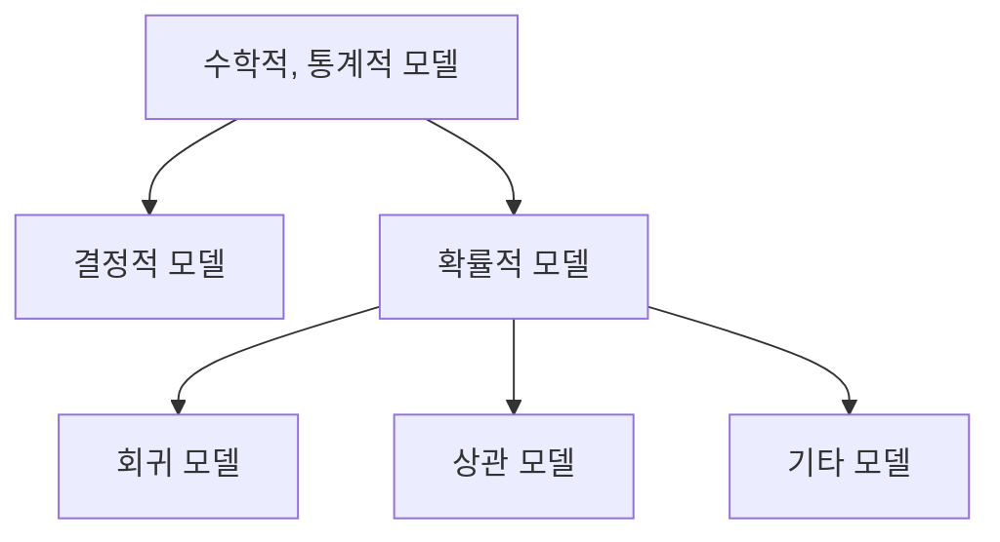
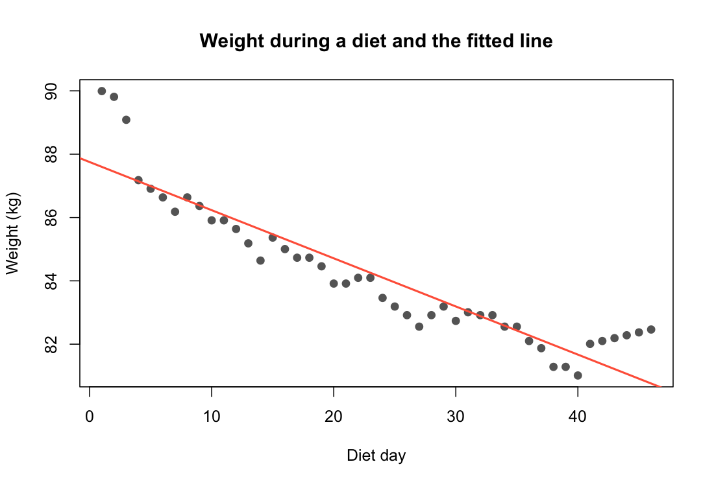
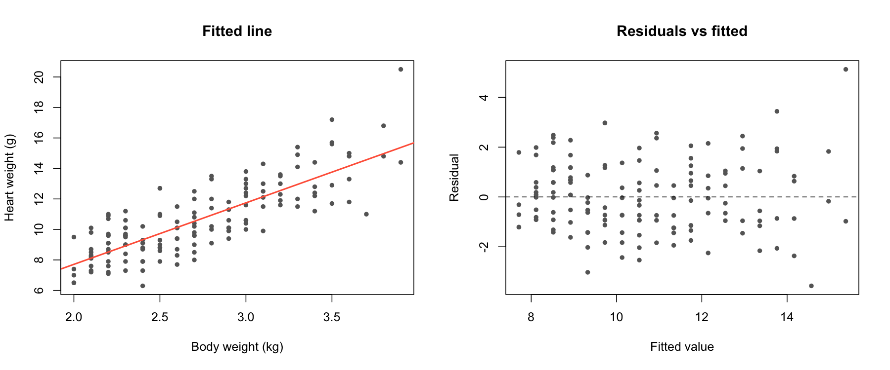

# 5장 — 모델링

[레포지토리 안내](../../README.ko.md) | [English](Concepts_Lecture.md) | [한국어](Concepts_Lecture.ko.md)

> **최종 수정일:** 2026-11-27

> **학습 목표:**
> 1. 결정적 모델과 확률적 모델을 구분할 수 있다
> 2. 회귀 모델을 설명변수의 수와 선형성에 따라 분류할 수 있다
> 3. 최소제곱법으로 단순 선형 회귀의 OLS 추정량을 유도할 수 있다
> 4. 상관분석과 회귀분석의 차이를 설명하고, 결과 변수와 관측의 구조에 맞는 분석 방법을 고를 수 있다
> 5. 회귀 모델로 실제 데이터의 미래 값을 예측하는 과정을 설명할 수 있다
> 6. 결정계수, MSE, RMSE, MAE로 회귀 모델을 평가하고 기울기를 검정할 수 있다

---

## 목차

- [1. 모델의 정의](#1-모델의-정의)
- [2. 수학적 모델과 통계적 모델](#2-수학적-모델과-통계적-모델)
  - [2.1 결정적 모델 (Deterministic Models)](#21-결정적-모델-deterministic-models)
  - [2.2 확률적 모델 (Probabilistic Models)](#22-확률적-모델-probabilistic-models)
  - [2.3 두 모델의 계산 예](#23-두-모델의-계산-예)
- [3. 확률적 모델의 유형](#3-확률적-모델의-유형)
- [4. 회귀 모델](#4-회귀-모델)
  - [4.1 정의](#41-정의)
  - [4.2 변수의 유형](#42-변수의-유형)
  - [4.3 회귀 모델의 유형](#43-회귀-모델의-유형)
- [5. 선형 회귀](#5-선형-회귀)
  - [5.1 일차 방정식 복습](#51-일차-방정식-복습)
  - [5.2 모집단 선형 회귀 모델 (Population Linear Regression Model)](#52-모집단-선형-회귀-모델-population-linear-regression-model)
  - [5.3 오차 분포 가정](#53-오차-분포-가정)
  - [5.4 모집단 vs. 표본](#54-모집단-vs-표본)
  - [5.5 모집단 회귀선과 표본 회귀선](#55-모집단-회귀선과-표본-회귀선)
  - [5.6 회귀 계수의 해석](#56-회귀-계수의-해석)
- [6. 최소제곱 추정](#6-최소제곱-추정)
  - [6.1 회귀 모델의 목표](#61-회귀-모델의-목표)
  - [6.2 적합의 시각적 직관](#62-적합의-시각적-직관)
  - [6.3 최소제곱법 (Least Squares Method)](#63-최소제곱법-least-squares-method)
  - [6.4 OLS 추정량 유도](#64-ols-추정량-유도)
  - [6.5 OLS 공식](#65-ols-공식)
  - [6.6 OLS 유도 중간 과정](#66-ols-유도-중간-과정)
  - [6.7 다중 선형 회귀 (Multiple Linear Regression, 행렬 형태)](#67-다중-선형-회귀-multiple-linear-regression-행렬-형태)
  - [6.8 손으로 푸는 최소제곱 예제](#68-손으로-푸는-최소제곱-예제)
  - [6.9 유전형과 형질의 회귀](#69-유전형과-형질의-회귀)
  - [6.10 최소제곱 추정량의 성질](#610-최소제곱-추정량의-성질)
- [7. 상관분석 vs. 회귀분석](#7-상관분석-vs-회귀분석)
  - [7.1 회귀의 방향과 상관계수](#71-회귀의-방향과-상관계수)
- [8. 분석 방법 지도](#8-분석-방법-지도)
  - [8.1 분석 방법의 선택 예](#81-분석-방법의-선택-예)
- [9. 실전 예측 사례: 다이어트 여정](#9-실전-예측-사례-다이어트-여정)
  - [9.1 다이어트 기록으로 하는 회귀 예측](#91-다이어트-기록으로-하는-회귀-예측)
- [10. 회귀 모델의 평가와 추론](#10-회귀-모델의-평가와-추론)
  - [10.1 제곱합 분해와 결정계수](#101-제곱합-분해와-결정계수)
  - [10.2 회귀 오차 지표](#102-회귀-오차-지표)
  - [10.3 기울기의 검정과 구간 추정](#103-기울기의-검정과-구간-추정)
  - [10.4 잔차 진단](#104-잔차-진단)
  - [10.5 변환으로 선형화하기](#105-변환으로-선형화하기)
- [11. R로 하는 회귀 분석](#11-r로-하는-회귀-분석)
  - [11.1 lm()으로 손계산 확인하기](#111-lm으로-손계산-확인하기)
  - [11.2 고양이의 몸무게와 심장 무게](#112-고양이의-몸무게와-심장-무게)
  - [11.3 다중 선형 회귀와 정규 방정식](#113-다중-선형-회귀와-정규-방정식)
  - [11.4 흔한 실수](#114-흔한-실수)
- [요약](#요약)
- [점검 문제](#점검-문제)

---

<br>

## 1. 모델의 정의

모델(Model)이란 **실제 현상을 묘사하는 대표적(인공적) 표현**이다.

모델 또는 모델링(Modeling)이라는 말은 다음을 가리킬 수 있다.

- **개념 모델(conceptual model)**: 일반적인 규칙과 개념을 사용하여 시스템을 표현한 것이다.
- **과학 모델(scientific model)**: 물리적 시스템을 단순화하고 이상화하여 이해한 것이다.
- **물리 모델(physical model)**: 지구본이나 모형 비행기처럼 대상을 3차원으로 물리적으로 표현한 것이다.
- **모델 (예술)**: 시각 예술가의 창작 과정에서 자세를 취해 주는 사람이다. 이 경우에도 모델은 작품 속 인물이라는 실제 대상을 대신하는 존재이다.

> **핵심:** 이 장에서는 방정식과 확률을 사용하여 변수 간의 관계를 서술하는 수학적 모델과 통계적 모델에 초점을 둔다.

---

<br>

## 2. 수학적 모델과 통계적 모델

수학적 모델과 통계적 모델은 흔히 **변수 간의 관계**를 기술한다.

### 2.1 결정적 모델 (Deterministic Models)

- **정확한 관계**를 가정하며 무작위성이 없다.
- 예측 오차를 무시할 수 있을 때 적합하다.
- 예시로 체질량지수(BMI)가 있다.

$$BMI = \frac{Weight\ (kg)}{Height\ (m)^2}$$

### 2.2 확률적 모델 (Probabilistic Models)

- **결정적 성분**과 **확률적 오차**의 두 요소를 가정한다.
- 예시로 신생아의 수축기 혈압(SBP)이 있다. 아래 식의 $age(d)$는 일 단위로 센 나이이다.

$$SBP = 6 \times age(d) + \varepsilon$$

- 확률적 오차는 일수 외의 환경적 요인(예: 출생 체중) 때문에 발생할 수 있다.

> **핵심:** 결정적 모델은 무작위성 없이 정확한 관계를 가정하는 반면, 확률적 모델은 설명되지 않는 변동성을 설명하기 위해 확률적 오차항을 포함한다.

### 2.3 두 모델의 계산 예

결정적 모델인 BMI 식에 몸무게 70 kg, 키 1.75 m를 넣으면 $`70/1.75^2 \approx 22.9`$이다. 같은 몸무게와 키를 넣으면 누가 계산하든 언제나 22.9가 나오며, 식이 BMI의 정의 자체이므로 예측 오차라는 개념이 없다.

확률적 모델인 신생아 수축기 혈압 식에 나이 10일을 넣으면 결정적 성분은 $`6 \times 10 = 60`$ mmHg이다. 그러나 생후 10일인 신생아 두 명의 혈압을 실제로 재면 57 mmHg와 64 mmHg처럼 서로 다를 수 있다. 두 아기의 결정적 성분은 60으로 같고, 차이 -3과 +4는 출생 체중 같은 다른 요인과 측정 오차가 만든 확률적 오차 $`\varepsilon`$의 실현값이다. 확률적 모델은 개별 값을 정확히 맞히는 것이 아니라, 같은 조건에서 값들이 평균적으로 어디에 놓이고 얼마나 흩어지는지를 기술한다. 오차의 분포에 관한 가정은 5.3절에서 다룬다.

같은 현상도 목적에 따라 두 모델 가운데 하나로 다룰 수 있다. 예측 오차가 무시할 만큼 작으면 결정적 모델로 충분하지만, 생물학적 측정처럼 개체 사이의 변동이 크면 그 변동을 오차항으로 명시하는 확률적 모델이 필요하다. 이 장의 회귀 모델은 모두 확률적 모델이다.

---

<br>

## 3. 확률적 모델의 유형

확률적 모델은 세 가지 유형으로 분류할 수 있다.



*그림 1. 수학적, 통계적 모델의 분류*

| 유형 | 설명 |
|------|------|
| **회귀 모델(regression models)** | 방정식을 사용하여 종속변수와 독립변수 사이의 관계를 모델링한다 |
| **상관 모델(correlation models)** | 두 변수 간의 선형성 강도를 분석한다 |
| **기타 모델(other models)** | 그 밖의 확률적 모델링 접근법이다 |

*표 1. 확률적 모델의 세 가지 유형*

---

<br>

## 4. 회귀 모델

### 4.1 정의

- 회귀 모델은 **하나의 종속변수와 설명변수(들) 사이의 관계**를 기술한다.
- 방정식을 이용하여 관계를 설정한다.
- 주로 **예측과 추정**에 사용한다.

### 4.2 변수의 유형

**종속변수(dependent variable, Y)**:
- 관심 있는 특정 현상을 나타낸다.
- 동의어로 반응변수(Response variable)와 결과변수(Outcome variable)가 있다.
- 보통 $Y$로 표기한다.

**독립변수(independent variable, X)**:
- 종속변수에 영향을 줄 수 있는 변수이다.
- 동의어로 설명변수(Explanatory variable)와 예측변수(Predictor)가 있다.
- 보통 $X_1, \ldots, X_k$로 표기한다.

### 4.3 회귀 모델의 유형

회귀 모델은 두 가지 차원으로 분류된다.

|  | 단순 (설명변수 1개) | 다중 (설명변수 2개 이상) |
|--|---|----|
| **선형(linear)** | 단순 선형 회귀 (Simple Linear Regression) | 다중 선형 회귀 (Multiple Linear Regression) |
| **비선형(non-linear)** | 단순 비선형 회귀 (Simple Non-Linear Regression) | 다중 비선형 회귀 (Multiple Non-Linear Regression) |

*표 2. 설명변수의 수와 선형성에 따른 회귀 모델의 분류*

> **참고:** **선형의 의미.** 회귀 모델에서 선형은 모수(회귀 계수)에 대한 선형성을 뜻한다. 예를 들어 $Y = \beta_0 + \beta_1 X + \beta_2 X^2 + \varepsilon$은 $X$에 대해서는 2차식이지만 모수에 대해 선형이므로 최소제곱법으로 추정하는 선형 회귀 모델이다.

> **핵심:** 이 장에서 다루는 회귀 모델은 수치형 종속(반응) 변수와 하나 이상의 수치형 또는 범주형 독립(설명) 변수를 필요로 한다.

---

<br>

## 5. 선형 회귀

### 5.1 일차 방정식 복습

기본적인 일차 방정식은 다음과 같다.

$$Y = mX + b$$

여기서 각 기호의 뜻은 다음과 같다.
- $m$은 기울기(Y의 변화량 / X의 변화량)이다.
- $b$는 Y절편이다.

### 5.2 모집단 선형 회귀 모델 (Population Linear Regression Model)

변수 간의 관계가 선형 함수라고 가정한다.

$$Y_i = \beta_0 + \beta_1 X_i + \varepsilon_i$$

| 구성 요소 | 의미 |
|-----------|------|
| $Y_i$ | 종속(반응) 변수 |
| $\beta_0$ | 모집단 Y절편 |
| $\beta_1$ | 모집단 기울기 |
| $X_i$ | 독립(설명) 변수 |
| $\varepsilon_i$ | 확률적 오차 |

*표 3. 모집단 선형 회귀 모델의 구성 요소*

### 5.3 오차 분포 가정

확률적 오차항은 서로 독립이며 정규분포를 따른다고 가정한다.

$$\varepsilon_i \sim N(0, \sigma^2)$$

이는 다음을 의미한다.
- 오차의 **평균이 0**이다. 즉, 평균적으로 모델이 올바르다.
- 오차의 **분산이 일정**하여 모든 관측에서 $\sigma^2$이다(등분산성, Homoscedasticity).
- 오차가 회귀선 주위에 **정규분포** 형태로 분포한다.

이 가정은 회귀 계수에 대한 통계적 추론(가설 검정, 신뢰 구간)에 필수적이다. 모델을 검증할 때 잔차(관측된 오차)가 이 가정에 부합하는지 확인해야 한다.

> **[확률및통계]** 가설 검정은 표본에서 계산한 통계량의 분포를 이용해 모수에 관한 가설(예: $\beta_1 = 0$)을 기각할지 정하는 절차이고, 신뢰 구간은 같은 방법으로 반복해서 구하면 정해진 비율(신뢰 수준)만큼 모수를 포함하는 구간이다. 오차가 서로 독립이고 $N(0, \sigma^2)$을 따르면 $\hat{\beta}_1$의 표본 분포가 정해지므로, 회귀 계수에 이 두 방법을 적용할 수 있다.

### 5.4 모집단 vs. 표본

- **모집단(population)**: 알려지지 않은 관계 $Y_i = \beta_0 + \beta_1 X_i + \varepsilon_i$이다.
- **표본(sample)**: 추정된 관계 $Y_i = \hat{\beta}_0 + \hat{\beta}_1 X_i + \hat{\varepsilon}_i$이다.
- 표본 데이터를 사용하여 알려지지 않은 모집단 모수를 추정한다.

> **핵심:** 모집단 모델은 참(미지의) 모수를 포함하고, 표본 모델은 관측된 데이터로부터 도출된 추정 모수(햇 표기)를 사용한다.

### 5.5 모집단 회귀선과 표본 회귀선

모집단 선형 회귀 모델의 예로, HIV 감염자의 혈청 전환(seroconversion) 뒤 경과 연수 $`X`$와 혈액 속 CD4+ 세포 수 $`Y`$의 관계를 들 수 있다. 혈청 전환 뒤 시간이 지날수록 CD4+ 세포 수가 줄어드는 경향이 있다면, 기울기 $`\beta_1`$은 음수이고 1년마다 CD4+ 세포 수가 평균적으로 얼마나 줄어드는지를 나타낸다.

모집단 회귀 모델에서 각 X값에 대한 Y의 기댓값은 직선 위에 놓인다.

```math
E(Y) = \beta_0 + \beta_1 X_i
```

실제로 관측한 값 $`Y_i`$는 이 직선에서 확률적 오차 $`\varepsilon_i`$만큼 위나 아래로 떨어져 있다. 즉 관측값 = 직선 위의 기댓값 + 오차이다. 모집단 전체를 관측할 수는 없으므로, 무작위 표본의 관측값으로 표본 회귀선을 구한다.

```math
\hat{Y}_i = \hat{\beta}_0 + \hat{\beta}_1 X_i
```

표본 회귀선에서 관측값과 예측값의 차이 $`\hat{\varepsilon}_i = Y_i - \hat{Y}_i`$를 **잔차(residual)** 라 한다. 오차 $`\varepsilon_i`$는 알 수 없는 모집단 직선에서의 거리이고, 잔차 $`\hat{\varepsilon}_i`$는 추정한 표본 직선에서의 거리이므로 둘은 다르다. 표본에 뽑히지 않은 관측(unsampled observation)도 모집단 직선 주위에 흩어져 있으며, 표본 회귀선은 그런 관측까지 포함한 모집단의 관계를 추정하려는 것이다. 표본이 바뀌면 $`\hat{\beta}_0`$와 $`\hat{\beta}_1`$도 바뀌므로, 추정값은 2장의 2.7절에서 말한 통계량이다.

> **용어 정의:** **잔차(residual)** 는 관측값 $`Y_i`$와 표본 회귀선의 예측값 $`\hat{Y}_i`$의 차이로, 모집단 직선에서의 거리인 오차를 표본으로 추정한 값이다.

### 5.6 회귀 계수의 해석

추정한 회귀식 $`\hat{Y} = \hat{\beta}_0 + \hat{\beta}_1 X`$의 계수는 다음과 같이 해석한다.

- **기울기 $`\hat{\beta}_1`$:** X가 한 단위 커질 때 Y의 평균이 $`\hat{\beta}_1`$만큼 변한다. 단위가 결과에 그대로 들어가므로, 기울기를 보고할 때는 반드시 두 변수의 단위를 함께 적는다(예: 체중 1 kg당 심장 무게 4 g).
- **절편 $`\hat{\beta}_0`$:** X = 0일 때 Y의 평균이다. 그러나 X = 0이 관측 범위 밖이거나 의미가 없으면(몸무게 0 kg인 동물) 절편 자체는 해석하지 않고, 직선의 높이를 맞추는 값으로만 본다.
- **예측의 범위:** 회귀식은 관측한 X의 범위 안에서 추정되었으므로, 그 범위 밖의 예측(외삽)은 같은 직선 관계가 계속된다는 가정에 기대며 오차가 커질 수 있다(9절의 주의 상자).

다중 선형 회귀의 계수 $`\hat{\beta}_j`$는 **다른 설명변수를 고정했을 때** $`X_j`$가 한 단위 커지면 Y의 평균이 얼마나 변하는지를 나타낸다. 설명변수끼리 상관되어 있으면 단순 회귀의 기울기와 다중 회귀의 계수가 크게 다를 수 있다.

---

<br>

## 6. 최소제곱 추정

### 6.1 회귀 모델의 목표

기울기와 절편의 최적값을 결정하여 데이터에 **가장 잘 적합하는** 직선을 찾는 것이 목표이다.

### 6.2 적합의 시각적 직관

- **절편($\beta_0$) 조정**: $\beta_0$의 여러 값을 시도하는 것은 산점도 위에서 **직선을 위아래로 이동**하는 것과 같다. 기울기는 일정하게 유지되면서 직선 전체가 수직으로 이동한다.
- **기울기($\beta_1$) 조정**: $\beta_0$을 일정하게 유지하면서 $\beta_1$의 여러 값을 시도하는 것은 직선의 **기울기(경사도)를 바꾸는** 것과 같다. 직선은 Y절편을 중심으로 회전한다.

### 6.3 최소제곱법 (Least Squares Method)

"가장 잘 적합"이란 실제 Y값과 예측 Y값 사이의 차이가 최소화됨을 의미한다. 양의 차이와 음의 차이가 상쇄되므로 **제곱 오차**를 사용한다.

$$SSE = \sum_{i=1}^{n} (Y_i - \hat{Y}_i)^2 = \sum_{i=1}^{n} \hat{\varepsilon}_i^2$$

최소제곱법은 잔차제곱합 (Sum of Squared Errors, SSE)을 최소화한다.

### 6.4 OLS 추정량 유도

최소화 문제는 다음과 같다.

$$\min_{\hat{\beta}_0, \hat{\beta}_1} \sum_{i=1}^{n} (y_i - \hat{\beta}_0 - \hat{\beta}_1 x_i)^2$$

이 목적 함수를 $W$라 하고 두 편미분을 0으로 놓으면 다음을 얻는다.

$$\frac{\partial W}{\partial \hat{\beta}_0} = \sum_{i=1}^{n} -2(y_i - \hat{\beta}_0 - \hat{\beta}_1 x_i) = 0$$

$$\frac{\partial W}{\partial \hat{\beta}_1} = \sum_{i=1}^{n} -2x_i(y_i - \hat{\beta}_0 - \hat{\beta}_1 x_i) = 0$$

### 6.5 OLS 공식

편미분을 0으로 놓은 두 방정식(정규 방정식)을 풀면 다음을 얻는다.

$$\hat{\beta}_0 = \bar{y} - \hat{\beta}_1 \bar{x}$$

$$\hat{\beta}_1 = \frac{\sum_{i=1}^{n}(x_i - \bar{x})(y_i - \bar{y})}{\sum_{i=1}^{n}(x_i - \bar{x})^2}$$

### 6.6 OLS 유도 중간 과정

**1단계: 첫 번째 방정식에서 $\hat{\beta}_0$을 구한다.**

$$\frac{\partial W}{\partial \hat{\beta}_0} = \sum_{i=1}^{n} -2(y_i - \hat{\beta}_0 - \hat{\beta}_1 x_i) = 0 \implies \sum y_i - n\hat{\beta}_0 - \hat{\beta}_1 \sum x_i = 0 \implies \hat{\beta}_0 = \bar{y} - \hat{\beta}_1 \bar{x}$$

**2단계: $\hat{\beta}_0$을 두 번째 방정식에 대입한다.**

$$\frac{\partial W}{\partial \hat{\beta}_1} = \sum_{i=1}^{n} -2x_i(y_i - \hat{\beta}_0 - \hat{\beta}_1 x_i) = 0$$

$\hat{\beta}_0 = \bar{y} - \hat{\beta}_1 \bar{x}$를 대입하면 다음과 같다.

$$\sum_{i=1}^{n} \left[ x_i y_i - (\bar{y} - \hat{\beta}_1 \bar{x}) x_i - \hat{\beta}_1 x_i^2 \right] = 0$$

**3단계: 합산을 분배하고 $\hat{\beta}_1$을 구한다.**

$$\sum x_i y_i - \bar{y} \sum x_i + \hat{\beta}_1 \bar{x} \sum x_i - \hat{\beta}_1 \sum x_i^2 = 0 \implies \hat{\beta}_1 = \frac{\sum x_i y_i - \bar{y} \sum x_i}{\sum x_i^2 - \bar{x} \sum x_i}$$

분자와 분모에 항등식 $\sum x_i y_i - \bar{y} \sum x_i = \sum (x_i - \bar{x})(y_i - \bar{y})$와 $\sum x_i^2 - \bar{x} \sum x_i = \sum (x_i - \bar{x})^2$을 적용하면 다음을 얻는다.

$$\hat{\beta}_1 = \frac{\sum_{i=1}^{n}(x_i - \bar{x})(y_i - \bar{y})}{\sum_{i=1}^{n}(x_i - \bar{x})^2}$$

> **참고:** 이 공식은 상관계수(Correlation coefficient) 공식과 유사한 구조를 가진다. 표본 상관계수를 $r$, $x$와 $y$의 표본 표준편차를 $s_x$, $s_y$라 하면 $`\hat{\beta}_1 = r \, s_y / s_x`$이다.

### 6.7 다중 선형 회귀 (Multiple Linear Regression, 행렬 형태)

설명변수가 여러 개인 경우, 행렬 구성 요소를 다음과 같이 정의한다.

```math
\mathbf{y} = \begin{bmatrix} y_1 \\ y_2 \\ \vdots \\ y_n \end{bmatrix}, \quad \mathbf{X} = \begin{bmatrix} 1 & x_{11} & x_{12} & \cdots & x_{1k} \\ 1 & x_{21} & x_{22} & \cdots & x_{2k} \\ \vdots & \vdots & \vdots & \ddots & \vdots \\ 1 & x_{n1} & x_{n2} & \cdots & x_{nk} \end{bmatrix}, \quad \boldsymbol{\beta} = \begin{bmatrix} \beta_0 \\ \beta_1 \\ \vdots \\ \beta_k \end{bmatrix}, \quad \boldsymbol{\epsilon} = \begin{bmatrix} \epsilon_1 \\ \epsilon_2 \\ \vdots \\ \epsilon_n \end{bmatrix}
```

행렬 형태의 모델은 $\mathbf{y} = \mathbf{X}\boldsymbol{\beta} + \boldsymbol{\epsilon}$이다.

**정규 방정식 유도:**

$$\sum \epsilon_i^2 = \boldsymbol{\epsilon}'\boldsymbol{\epsilon} = (\mathbf{y} - \mathbf{X}\boldsymbol{\beta})'(\mathbf{y} - \mathbf{X}\boldsymbol{\beta})$$

전개하면 다음과 같다.

$$= \mathbf{y}'\mathbf{y} - \hat{\boldsymbol{\beta}}'\mathbf{X}'\mathbf{y} - \mathbf{y}'\mathbf{X}\hat{\boldsymbol{\beta}} + \hat{\boldsymbol{\beta}}'\mathbf{X}'\mathbf{X}\hat{\boldsymbol{\beta}} = \mathbf{y}'\mathbf{y} - 2\hat{\boldsymbol{\beta}}'\mathbf{X}'\mathbf{y} + \hat{\boldsymbol{\beta}}'\mathbf{X}'\mathbf{X}\hat{\boldsymbol{\beta}}$$

미분하여 0으로 놓으면 다음과 같다.

$$\frac{\partial \boldsymbol{\epsilon}'\boldsymbol{\epsilon}}{\partial \hat{\boldsymbol{\beta}}} = -2\mathbf{X}'\mathbf{y} + 2\mathbf{X}'\mathbf{X}\hat{\boldsymbol{\beta}} = 0$$

$$\implies (\mathbf{X}'\mathbf{X})\hat{\boldsymbol{\beta}} = \mathbf{X}'\mathbf{y}$$

$\mathbf{X}$의 열이 일차 독립이면 $\mathbf{X}'\mathbf{X}$가 가역 행렬이므로 $\hat{\boldsymbol{\beta}} = (\mathbf{X}'\mathbf{X})^{-1}\mathbf{X}'\mathbf{y}$이다.

> **핵심:** $\beta_1$의 OLS 추정량 $\hat{\beta}_1$은 상관계수 공식과 유사한 구조를 가진다. 유도 과정(편미분 사용)을 이해하는 것이 공식을 단순 암기하는 것보다 더 가치 있다.

### 6.8 손으로 푸는 최소제곱 예제

다섯 쌍의 자료 (1, 2), (2, 4), (3, 5), (4, 4), (5, 5)로 OLS 공식의 모든 중간값을 계산한다. 평균은 $`\bar{x} = 15/5 = 3`$, $`\bar{y} = 20/5 = 4`$이다.

| $`x_i`$ | $`y_i`$ | $`x_i - \bar{x}`$ | $`y_i - \bar{y}`$ | $`(x_i - \bar{x})(y_i - \bar{y})`$ | $`(x_i - \bar{x})^2`$ | $`\hat{y}_i`$ | $`\hat{\varepsilon}_i`$ |
|--:|--:|--:|--:|--:|--:|--:|--:|
| 1 | 2 | -2 | -2 | 4 | 4 | 2.8 | -0.8 |
| 2 | 4 | -1 | 0 | 0 | 1 | 3.4 | 0.6 |
| 3 | 5 | 0 | 1 | 0 | 0 | 4.0 | 1.0 |
| 4 | 4 | 1 | 0 | 0 | 1 | 4.6 | -0.6 |
| 5 | 5 | 2 | 1 | 2 | 4 | 5.2 | -0.2 |
| 합 | | 0 | 0 | 6 | 10 | | 0 |

*표 4. 단순 선형 회귀의 최소제곱 계산표*

편차곱의 합 $`S_{xy} = 6`$과 x의 편차 제곱합 $`S_{xx} = 10`$으로 $`\hat{\beta}_1 = 6/10 = 0.6`$, $`\hat{\beta}_0 = 4 - 0.6 \times 3 = 2.2`$이다. 예측값은 $`\hat{y}_i = 2.2 + 0.6x_i`$이고, 잔차는 $`y_i - \hat{y}_i`$이다. 잔차 제곱합은 $`SSE = 0.64 + 0.36 + 1.00 + 0.36 + 0.04 = 2.4`$이다.

OLS 적합에는 계산표에서 확인할 수 있는 세 가지 성질이 있다. 이 성질은 6.4절의 두 정규 방정식에서 바로 나온다.

1. **잔차의 합은 0이다:** 첫째 정규 방정식 $`\sum (y_i - \hat{\beta}_0 - \hat{\beta}_1 x_i) = 0`$이 곧 $`\sum \hat{\varepsilon}_i = 0`$이다. 표에서 $`-0.8 + 0.6 + 1.0 - 0.6 - 0.2 = 0`$이다.
2. **잔차와 x의 곱의 합은 0이다:** 둘째 정규 방정식이 곧 $`\sum x_i \hat{\varepsilon}_i = 0`$이다. 표에서 $`-0.8 + 1.2 + 3.0 - 2.4 - 1.0 = 0`$이다.
3. **회귀선은 평균점 $`(\bar{x}, \bar{y})`$를 지난다:** $`\hat{\beta}_0 = \bar{y} - \hat{\beta}_1 \bar{x}`$이므로 $`x = \bar{x}`$에서 예측값이 $`\bar{y}`$이다. 표에서 x = 3의 예측값이 4.0이다.

### 6.9 유전형과 형질의 회귀

회귀 모델의 설명변수는 범주형일 수도 있다. 생물정보학의 대표적인 예는 한 유전자 자리의 유전형(genotype)과 연속형 형질(trait)의 관계를 보는 회귀이다.

```math
\text{Trait}_i = \beta_0 + \beta_1\,\text{Genotype}_i + \varepsilon_i, \qquad \varepsilon_i \sim N(0, \sigma^2)
```

유전형 A인 개체를 0, B인 개체를 1로 부호화하면, A 집단의 예측값은 $`\beta_0`$, B 집단의 예측값은 $`\beta_0 + \beta_1`$이다. 따라서 절편은 A 집단의 형질 평균이고, 기울기는 **두 유전형 집단의 형질 평균의 차이**이다. 산점도에서 x축이 A와 B 두 값뿐이고, 회귀선은 두 집단의 평균을 잇는 선분이 된다. 유전형을 대립유전자 수로 aa = 0, Aa = 1, AA = 2처럼 부호화하면, 기울기는 대립유전자 A 하나가 늘 때마다 형질이 평균적으로 얼마나 변하는지를 나타내는 상가적(additive) 효과가 된다.

이 회귀에서 통계적 검정의 대상은 기울기이다. $`H_0: \beta_1 = 0`$이 기각되면 유전형에 따라 형질 평균이 다르다, 즉 그 유전자 자리가 형질과 관련이 있다고 결론짓는다. 다음 코드는 유전형 집단마다 10개체인 모의 자료로 이를 확인한다.

```r
set.seed(11)
g <- rep(c(0, 1), each = 10)
trait <- 5 + 1.5 * g + rnorm(20, sd = 1)
gfit <- lm(trait ~ g)
round(coef(gfit), 3)
round(tapply(trait, g, mean), 3)
round(summary(gfit)$coefficients, 4)
t.test(trait[g == 1], trait[g == 0], var.equal = TRUE)$statistic
```

```text
(Intercept)           g
      4.770       1.261
    0     1
4.770 6.031
            Estimate Std. Error t value Pr(>|t|)
(Intercept)   4.7699     0.2726 17.5010   0.0000
g             1.2609     0.3854  3.2713   0.0042
       t
3.271346
```

- 셋째 줄은 참값 $`\beta_0 = 5`$, $`\beta_1 = 1.5`$, $`\sigma = 1`$로 형질을 생성한다.
- 추정한 절편 4.770은 유전형 0 집단의 평균과, 절편과 기울기의 합 $`4.770 + 1.261 = 6.031`$은 유전형 1 집단의 평균과 정확히 같다.
- 기울기의 t값 3.27과 p값 0.0042는 등분산을 가정한 두 표본 t-검정의 t값과 같다. 이진 설명변수 하나인 회귀의 기울기 검정은 두 집단 평균 비교와 같은 검정이다(8절의 표 6).

### 6.10 최소제곱 추정량의 성질

OLS 추정량이 널리 쓰이는 데는 이론적 근거가 있다. 오차의 평균이 0이고, 분산이 모든 관측에서 같으며($`\sigma^2`$), 서로 상관이 없다는 가정 아래에서 다음이 성립한다. 정규분포는 이 성질에 필요하지 않다.

- **비편향성:** $`E(\hat{\beta}_0) = \beta_0`$, $`E(\hat{\beta}_1) = \beta_1`$이다. 표본을 무수히 다시 뽑아 추정하면 추정값의 평균이 참값과 같다.
- **분산:** $`\mathrm{Var}(\hat{\beta}_1) = \sigma^2 / S_{xx}`$이다. 10.3절의 표준오차는 이 식의 $`\sigma`$를 표본 추정값 s로 바꾼 것이다.
- **최량성(Gauss-Markov 정리):** $`y_i`$의 선형 결합으로 만든 비편향 추정량 가운데 OLS 추정량의 분산이 가장 작다. 그래서 OLS 추정량을 최량 선형 비편향 추정량(BLUE, best linear unbiased estimator)이라 한다.

여기에 오차가 정규분포를 따른다는 가정(5.3절)을 더하면, OLS 추정량은 최대가능도 추정량과 같아지고, $`\hat{\beta}_1`$ 자체도 정규분포를 따르므로 10.3절의 t 검정과 신뢰 구간이 표본이 작아도 정확하게 성립한다. 반대로 오차의 분산이 관측마다 다르거나(이분산성) 오차끼리 상관되어 있으면 OLS 추정량은 여전히 비편향이지만 더는 분산이 가장 작지 않고, 보통의 표준오차 공식도 틀린다. 10.4절의 잔차 진단이 중요한 이유이다.

---

<br>

## 7. 상관분석 vs. 회귀분석

| 측면 | 상관분석 (Correlation Analysis) | 회귀분석 (Regression Analysis) |
|------|-------------------------------|-------------------------------|
| 목적 | 두 변수 간의 **선형성의 강도** | 다양한 변수 간의 **함수적 관계** |
| 변수 | 두 변수(X와 Y)를 동등하게 취급 | 종속변수와 독립변수의 구분 |
| 측정 | 상관계수만 | 선형 또는 비선형 관계 |
| 범위 | 두 변수만 | 단순 또는 다중 변수 |

*표 5. 상관분석과 회귀분석의 비교*

### 7.1 회귀의 방향과 상관계수

상관분석은 두 변수를 동등하게 다루지만 회귀분석은 그렇지 않다. Y를 X에 회귀한 직선과 X를 Y에 회귀한 직선은 서로 다르다. 앞의 것은 y 방향의 잔차 제곱합을, 뒤의 것은 x 방향의 잔차 제곱합을 최소로 하기 때문이다. 두 기울기와 상관계수 r 사이에는 6.6절의 참고 상자에서 본 관계가 있다.

```math
\hat{\beta}_{Y \mid X} = r\,\frac{s_Y}{s_X}, \qquad \hat{\beta}_{X \mid Y} = r\,\frac{s_X}{s_Y}, \qquad \hat{\beta}_{Y \mid X} \times \hat{\beta}_{X \mid Y} = r^2
```

```r
library(MASS)
r <- cor(cats$Bwt, cats$Hwt)
b_yx <- coef(lm(Hwt ~ Bwt, data = cats))[2]
b_xy <- coef(lm(Bwt ~ Hwt, data = cats))[2]
round(c(r = r, r2 = r^2, b_yx = unname(b_yx), b_xy = unname(b_xy), product = unname(b_yx * b_xy)), 4)
```

```text
      r      r2    b_yx    b_xy product 
 0.8041  0.6466  4.0341  0.1603  0.6466 
```

11.2절의 고양이 자료에서 몸무게와 심장 무게의 상관계수는 0.804이다. 심장 무게를 몸무게에 회귀한 기울기는 4.034 g/kg이고, 몸무게를 심장 무게에 회귀한 기울기는 0.160 kg/g이다. 만약 두 직선이 같다면 둘째 기울기는 첫째의 역수 $`1/4.034 \approx 0.248`$이어야 하지만, 실제로는 그보다 작다. 두 기울기의 곱 0.6466은 $`r^2`$과 같으며, 두 직선은 $`\lvert r \rvert = 1`$일 때만 일치한다.

이 관계는 **평균으로의 회귀(regression toward the mean)** 를 설명한다. 두 변수를 표준화하면 회귀 기울기는 r 자체가 되므로, X가 평균보다 표준편차 1개만큼 크면 Y의 예측값은 평균보다 표준편차 r개만큼만 크다. $`\lvert r \rvert < 1`$이면 예측값은 언제나 X보다 평균에 더 가까이 놓인다. 부모의 키가 매우 큰 집단의 자녀가 평균적으로 부모보다는 평균에 가까운 키를 가지는 현상이 대표적인 예이며, "회귀"라는 이름이 여기서 나왔다. 처치 전에 측정값이 극단적이었던 환자들이 처치 효과와 관계없이 재측정에서 평균 쪽으로 돌아오는 것도 같은 현상이므로, 처치 효과를 판단할 때는 대조군과 비교해야 한다.

---

<br>

## 8. 분석 방법 지도

적절한 분석 방법은 결과 변수의 유형과 관측치가 독립적인지 상관되어 있는지에 따라 달라진다.

| 결과 변수 | 독립 관측 | 상관 관측 | 비모수 대안 |
|-----------|----------|----------|------------|
| **연속형** (예: 통증 척도, 인지 기능) | **t-검정(t-test)**: 두 독립 그룹 간의 평균 비교 | **대응 t-검정(paired t-test)**: 두 관련 그룹 간의 평균 비교 (예: 동일 대상의 전과 후) | **Wilcoxon 부호 순위 검정(Wilcoxon sign-rank test)**: 대응 t-검정의 비모수 대안 |
| | **분산분석(ANOVA)**: 셋 이상의 독립 그룹 간의 평균 비교 | **반복측정 분산분석(repeated-measures ANOVA)**: 두 개 이상의 그룹에서 시간에 따른 평균 변화 비교 (반복 측정) | **Wilcoxon 순위합 검정(Wilcoxon sum-rank test)** (= Mann-Whitney U 검정): t-검정의 비모수 대안 |
| | **Pearson 상관계수(Pearson's correlation coefficient)** (선형 상관): 두 연속 변수 간의 선형 상관을 나타냄 | **혼합 모델 / GEE 모델(mixed models / GEE modeling)**: 두 개 이상의 그룹에서 시간에 따른 변화를 비교하는 다변량 회귀 기법; 시간에 따른 변화율 제공 | **Kruskal-Wallis 검정(Kruskal-Wallis test)**: ANOVA의 비모수 대안 |
| | **선형 회귀(linear regression)**: 결과가 연속형일 때 사용하는 다변량 회귀 기법; 기울기 제공 | | **Spearman 순위 상관계수(Spearman rank correlation coefficient)**: Pearson 상관계수의 비모수 대안 |

*표 6. 결과 변수가 연속형일 때 관측 구조에 따른 분석 방법*

### 8.1 분석 방법의 선택 예

표 6의 지도를 쓰려면 두 가지를 차례로 묻는다. 결과 변수가 연속형인가, 그리고 관측들이 서로 독립인가 상관되어 있는가이다. 같은 대상을 두 번 이상 재거나 쌍을 지어 잰 자료(전과 후, 왼쪽 눈과 오른쪽 눈, 쌍둥이)는 상관된 관측이다. 여기에 정규성 가정이 어긋나고 표본이 작으면 비모수 대안을 고른다.

- **두 독립 집단의 평균 비교(t-검정):** 위약군 6명과 투약군 6명의 혈압 감소량을 비교한다. 정규성을 둘 수 없으면 Wilcoxon 순위합 검정(Mann-Whitney U 검정)을 쓴다.
- **같은 대상의 전과 후 비교(대응 t-검정):** 환자 5명의 치료 전과 치료 후 혈압을 비교한다. 비모수 대안은 Wilcoxon 부호 순위 검정이다.
- **셋 이상의 독립 집단 비교(분산분석):** 식단 세 가지를 무작위로 배정한 세 집단의 체중 변화를 비교한다. 비모수 대안은 Kruskal-Wallis 검정이다.
- **시간에 따른 반복 측정(반복측정 분산분석, 혼합 모델, GEE):** 두 치료군의 환자를 1, 3, 6개월에 반복해서 재어 시간에 따른 변화를 비교한다.
- **두 연속 변수의 관계(Pearson 상관계수, 선형 회귀):** 몸무게와 심장 무게처럼 두 연속 변수의 선형 관계를 재거나(상관), 한 변수로 다른 변수를 설명하고 예측한다(회귀). 이상치가 있거나 관계가 단조이지만 직선이 아니면 Spearman 순위 상관계수를 쓴다(3장의 5.3절).

관측의 구조를 잘못 판단하면 결론이 크게 달라진다. 다음 코드는 같은 혈압 자료를 대응 t-검정과 독립 표본 t-검정으로 각각 분석한다.

```r
before <- c(140, 152, 138, 160, 147)
after  <- c(132, 147, 136, 150, 141)
t.test(before, after, paired = TRUE)$p.value
t.test(before, after)$p.value
```

```text
[1] 0.01025535
[1] 0.2705284
```

대응 t-검정은 환자마다의 차이 8, 5, 2, 10, 6만으로 검정하므로, 환자 사이의 큰 혈압 차이(138부터 160까지)가 검정에서 빠진다. 그래서 p값이 0.010으로 작다. 같은 자료를 독립 표본으로 잘못 다루면 환자 사이의 변동이 그대로 남아 차이가 묻히고 p값이 0.27이 된다. 같은 사람을 두 번 잰 자료에는 대응 검정을 써야 하는 이유이다.

---

<br>

## 9. 실전 예측 사례: 다이어트 여정

한 사람의 다이어트 사례는 회귀분석이 실제 예측에 어떻게 활용되는지를 보여 준다.

- **배경**: 2017년에 72kg이던 체중이 2018년에 91kg까지 증가했고, 2019년 현재 81kg이다.
- **질문**: "지금 81kg에서 다이어트를 시작하면 목표 체중 74kg에 도달하기까지 며칠이 걸릴까?"
- **접근법**: 과거의 체중 조절 기록(체중 측정의 시계열)으로 회귀 모델을 구축하고, 적합된 직선을 사용하여 체중이 목표에 도달하는 시점을 예측한다.
- **데이터**: 2016년부터 2019년까지 시간에 따라 기록한 체중 측정값이며, 체중 변화의 궤적을 보여 준다.
- **적용**: 회귀선을 현재 체중(81kg)에서 앞으로 외삽하여 목표 체중(74kg)에 도달하는 시점을 예측한다.

이 사례는 회귀분석이 단순한 추상 수학이 아니라, 실제 데이터를 사용하여 "언제"와 "얼마나" 같은 실질적인 질문에 답할 수 있음을 보여 준다.

> **주의:** 외삽은 관측한 범위 밖에서도 같은 선형 추세가 이어진다고 가정한다. 체중처럼 시간이 지나면 변화 속도가 달라질 수 있는 현상에서는 예측 시점이 관측 범위에서 멀어질수록 예측 오차가 커질 수 있다.

### 9.1 다이어트 기록으로 하는 회귀 예측

과거 체중 조절 기록 46일 치(첫날 약 90 kg에서 46일째 약 82 kg)로 체중을 다이어트 일수에 회귀한다. 자료 파일 [`DietData_v1.csv`](../../Coursework/Lab05_Modeling/data/DietData_v1.csv)는 체중(`Kg`)과 다이어트 일수(`Diet day`)의 두 열로 이루어져 있으며, 아래 코드는 이 파일을 작업 디렉토리(1장의 1.7절)에 둔 상태에서 읽는다. `check.names = FALSE`는 열 이름의 공백을 그대로 두게 하고, 둘째 줄은 두 열의 이름을 `Kg`와 `Day`로 바꾼다.

```r
d <- read.csv("DietData_v1.csv", check.names = FALSE)
names(d) <- c("Kg", "Day")
dfit <- lm(Kg ~ Day, data = d)
round(coef(dfit), 4)
round(summary(dfit)$r.squared, 3)
(81 - 74) / -coef(dfit)["Day"]
```

```text
(Intercept)         Day
    87.7528     -0.1520
[1] 0.857
     Day
46.03902
```

적합한 직선은 $`\widehat{\text{Kg}} = 87.75 - 0.152 \times \text{Day}`$이다. 기울기는 하루에 평균 0.152 kg씩 줄었다는 뜻이고, 결정계수 0.857은 체중 변동의 약 86%가 일수의 직선 관계로 설명된다는 뜻이다(10.1절). 같은 속도가 이어진다고 가정하면, 현재 81 kg에서 목표 74 kg까지 7 kg을 줄이는 데 $`7/0.152 \approx 46`$일이 걸린다.



*그림 2. 다이어트 일수에 따른 체중과 적합한 회귀선*

그림 2를 보면 직선이 자료를 고르게 지나지 않는다. 처음 사흘 동안 체중이 직선보다 빠르게 줄고, 40일 무렵부터는 줄지 않고 조금 늘어난다. 잔차가 일수에 따라 체계적인 패턴을 보이므로 선형 가정이 완전히 맞지는 않으며(10.4절), 감량 속도가 시간이 지나며 느려진다면 46일이라는 예측은 실제보다 짧을 수 있다. 회귀 예측은 질문에 수치로 답하게 해 주지만, 그 답은 모델의 가정이 맞는 범위에서만 믿을 수 있다.

---

<br>

## 10. 회귀 모델의 평가와 추론

### 10.1 제곱합 분해와 결정계수

각 관측값이 평균에서 떨어진 정도는 회귀선이 설명하는 부분과 설명하지 못하는 부분으로 나뉜다.

```math
y_i - \bar{y} = (\hat{y}_i - \bar{y}) + (y_i - \hat{y}_i)
```

양변을 제곱해 모든 관측에 대해 더하면, OLS 적합에서는 교차항이 6.8절의 잔차 성질 때문에 0이 되어 다음 **제곱합 분해**가 성립한다.

```math
\underbrace{\sum (y_i - \bar{y})^2}_{SST} = \underbrace{\sum (\hat{y}_i - \bar{y})^2}_{SSR} + \underbrace{\sum (y_i - \hat{y}_i)^2}_{SSE}
```

SST(총제곱합)는 Y의 전체 변동, SSR(회귀제곱합)은 회귀선이 설명하는 변동, SSE(잔차제곱합)는 설명하지 못한 변동이다. **결정계수(coefficient of determination)** 는 전체 변동 가운데 회귀가 설명하는 비율이다.

```math
R^2 = \frac{SSR}{SST} = 1 - \frac{SSE}{SST}
```

> **용어 정의:** **결정계수(coefficient of determination)** 는 반응변수의 총변동 가운데 회귀 모델이 설명하는 변동의 비율 $`R^2 = SSR/SST`$로, 절편이 있는 OLS 회귀에서 0부터 1 사이의 값을 가진다.

6.8절의 자료에서 $`SST = 4 + 0 + 1 + 0 + 1 = 6`$, $`SSE = 2.4`$이므로 $`SSR = 3.6`$이고 $`R^2 = 3.6/6 = 0.6`$이다. 단순 선형 회귀에서는 $`R^2`$가 x와 y의 표본 상관계수의 제곱과 같다. 실제로 $`r = S_{xy}/\sqrt{S_{xx}S_{yy}} = 6/\sqrt{10 \times 6} \approx 0.775`$이고 $`r^2 = 0.6`$이다.

$`R^2`$는 설명변수를 더하기만 해도 줄지 않는다. 쓸모없는 변수를 더해도 SSE가 늘지 않기 때문이다. 그래서 설명변수의 수 k가 다른 모델을 비교할 때는 자유도로 보정한 **수정 결정계수(adjusted R²)** 를 쓴다.

```math
R^2_{\text{adj}} = 1 - (1 - R^2)\,\frac{n - 1}{n - k - 1}
```

6.8절의 자료(n = 5, k = 1)에서는 $`1 - 0.4 \times 4/3 \approx 0.467`$이다. 수정 결정계수는 새 변수가 설명력을 충분히 더하지 못하면 오히려 줄어든다.

### 10.2 회귀 오차 지표

예측값과 실제값의 차이를 하나의 수로 요약하는 지표는 다음과 같다. n은 관측 수이다.

| 지표 | 식 | 6.8절 자료의 값 | 성질 |
|:--|:--|--:|:--|
| MSE (평균 제곱 오차) | $`\frac{1}{n}\sum (y_i - \hat{y}_i)^2`$ | 0.48 | 단위가 Y의 제곱, 큰 오차에 큰 벌점 |
| RMSE (평균 제곱근 오차) | $`\sqrt{MSE}`$ | 0.693 | Y와 같은 단위 |
| MAE (평균 절대 오차) | $`\frac{1}{n}\sum \lvert y_i - \hat{y}_i \rvert`$ | 0.64 | Y와 같은 단위, 이상치에 덜 민감 |

*표 7. 회귀 오차 지표*

MSE는 L2 척도, MAE는 L1 척도이므로, 3장의 3.3절에서 L2가 이상치에 민감하고 L1이 강건했던 것과 같은 차이가 있다. 계산하면 MSE는 $`2.4/5 = 0.48`$, RMSE는 $`\sqrt{0.48} \approx 0.693`$, MAE는 $`(0.8 + 0.6 + 1.0 + 0.6 + 0.2)/5 = 0.64`$이다.

오차 분산 $`\sigma^2`$의 비편향 추정량은 SSE를 n이 아니라 **n - 2**로 나눈 $`s^2 = SSE/(n - 2)`$이다. 표본에서 두 모수 $`\beta_0`$, $`\beta_1`$을 추정하느라 자유도 2개를 썼기 때문이며, 2장의 2.3절에서 표본분산을 n - 1로 나눈 것과 같은 이유이다. 6.8절 자료에서 $`s^2 = 2.4/3 = 0.8`$, $`s \approx 0.894`$이며, R은 이 s를 Residual standard error로 보고한다.

같은 자료로 적합하고 같은 자료로 계산한 오차 지표는 새 자료에 대한 오차를 과소평가한다. 모델이 그 자료의 잡음까지 일부 맞추기 때문이며, 모델의 예측력은 학습에 쓰지 않은 자료로 평가해야 한다. 이 문제와 교차 검증은 6장에서 다룬다.

### 10.3 기울기의 검정과 구간 추정

5.3절의 오차 가정 아래에서 $`\hat{\beta}_1`$의 표준오차는 다음과 같다.

```math
SE(\hat{\beta}_1) = \frac{s}{\sqrt{S_{xx}}} = \frac{s}{\sqrt{\sum (x_i - \bar{x})^2}}
```

x가 넓게 퍼져 있을수록($`S_{xx}`$가 클수록) 기울기를 더 정밀하게 추정한다. 귀무가설 $`H_0: \beta_1 = 0`$(X와 Y 사이에 선형 관계가 없다)을 검정하는 t 통계량은 $`t = \hat{\beta}_1 / SE(\hat{\beta}_1)`$이며, 귀무가설 아래에서 자유도 n - 2인 t분포를 따른다.

6.8절 자료로 계산하면 $`SE(\hat{\beta}_1) = 0.894/\sqrt{10} \approx 0.283`$, $`t = 0.6/0.283 \approx 2.12`$이고, 자유도 3인 t분포에서 양측 p값은 약 0.124이다. 유의수준 0.05에서 귀무가설을 기각하지 못한다. 자료에서는 기울기가 양수로 보이지만, 관측이 5개뿐이라 그 기울기가 우연이 아니라고 말할 근거가 부족하다는 뜻이다.

기울기의 95% 신뢰 구간은 $`\hat{\beta}_1 \pm t_{0.975,\,n-2} \times SE(\hat{\beta}_1)`$이다. $`t_{0.975,\,3} \approx 3.182`$이므로 $`0.6 \pm 3.182 \times 0.283`$, 즉 약 (-0.300, 1.500)이다. 구간이 0을 포함하는 것은 위 검정에서 귀무가설을 기각하지 못한 것과 같은 결론이다.

새로운 x에서의 예측에는 두 종류의 구간이 있다.

- **신뢰 구간(confidence interval):** 그 x에서 Y의 **평균** $`E(Y)`$가 놓일 범위이다. 회귀선 자체의 불확실성만 반영한다.
- **예측 구간(prediction interval):** 그 x에서 관측될 **개별 값** 하나가 놓일 범위이다. 회귀선의 불확실성에 개별 관측의 오차 $`\varepsilon`$이 더해지므로 신뢰 구간보다 항상 넓다.

6.8절 자료에서 x = 6의 예측값 5.8에 대한 95% 신뢰 구간은 약 (2.81, 8.79), 95% 예측 구간은 약 (1.68, 9.92)이다. x = 6은 관측 범위(1~5) 밖이므로 두 구간 모두 넓다.

### 10.4 잔차 진단

5.3절의 가정은 잔차로 점검한다. 가정마다 확인하는 방법은 다음과 같다.

1. **선형성:** 잔차를 예측값(또는 x)에 대해 그린 잔차 그림에 곡선 모양의 패턴이 없어야 한다. 9.1절의 다이어트 자료처럼 잔차가 처음과 끝에서 양수, 가운데서 음수이면 관계가 휘어 있다는 신호이다.
2. **등분산성:** 잔차 그림에서 잔차의 퍼짐이 예측값에 따라 넓어지거나 좁아지지 않아야 한다. 깔때기 모양은 이분산성의 신호이며, Y에 로그를 씌우는 변환이 흔한 대처이다.
3. **정규성:** 잔차의 히스토그램이나 Q-Q 그림이 정규분포에 가까워야 한다. 표본이 크면 기울기의 검정은 정규성이 조금 어긋나도 비교적 견딘다.
4. **독립성:** 시간 순서로 모은 자료에서 이웃한 잔차가 서로 비슷하면(자기상관) 독립 가정이 깨진다. 다이어트 기록처럼 같은 사람을 매일 잰 자료는 이 위험이 크다.

잔차가 특히 큰 관측(이상치)과 x가 다른 관측에서 멀리 떨어져 회귀선을 끌어당기는 관측(높은 레버리지)도 함께 확인한다. 6장의 7.2절에 나오는 레버리지 $`h_i`$가 이 영향의 크기를 나타낸다. R에서 `plot(lm 객체)`는 잔차 그림, Q-Q 그림을 포함한 네 가지 진단 그림을 차례로 그린다.

### 10.5 변환으로 선형화하기

4.3절의 참고 상자에서 말한 대로 선형 회귀의 "선형"은 모수에 대한 선형성이다. 그래서 X와 Y의 관계가 곡선이어도, 변수를 적절히 변환해 모수에 대해 선형인 식으로 바꿀 수 있으면 선형 회귀로 다룰 수 있다. 생명과학에서 가장 흔한 예는 지수적 증가이다.

세균이 일정한 시간마다 두 배로 늘어나면 세균 수는 $`N(t) = N_0 \cdot 2^{t/T_d}`$를 따른다. $`T_d`$는 개체 수가 두 배가 되는 시간(배가 시간)이다. 양변에 밑이 2인 로그를 씌우면 다음과 같다.

```math
\log_2 N(t) = \log_2 N_0 + \frac{1}{T_d}\, t
```

즉 $`\log_2 N`$을 t에 회귀하면 기울기가 $`1/T_d`$이고 절편이 $`\log_2 N_0`$인 직선이 된다. 다음 코드는 배가 시간이 1.5시간인 모의 배양 자료(측정 오차 포함)로 이를 확인한다.

```r
set.seed(5)
time <- 0:8
count <- round(1000 * 2^(time / 1.5) * exp(rnorm(9, sd = 0.1)))
count
gfit <- lm(log2(count) ~ time)
round(coef(gfit), 4)
round(1 / coef(gfit)["time"], 3)
round(summary(gfit)$r.squared, 4)
round(summary(lm(count ~ time))$r.squared, 4)
```

```text
[1]   919  1823  2223  4028  7535  9490 15262 23835 39182
(Intercept)        time 
     9.9791      0.6596 
 time 
1.516 
[1] 0.9937
[1] 0.8054
```

- 셋째 줄은 처음 1,000개에서 시작해 1.5시간마다 두 배가 되는 세균 수에, 곱셈 꼴의 측정 오차 `exp(rnorm(...))`를 곱해 생성한다.
- `lm(log2(count) ~ time)`은 공식 안에서 바로 반응변수를 변환한다. 기울기 0.6596에서 배가 시간을 $`1/0.6596 \approx 1.52`$시간으로 추정하며, 참값 1.5에 가깝다. 절편 9.98은 $`\log_2 N_0`$이므로 $`N_0 \approx 2^{9.98} \approx 1{,}010`$개이다.
- 변환한 모델의 $`R^2`$는 0.994이지만, 세균 수를 그대로 시간에 회귀하면 0.805이고 잔차가 뚜렷한 곡선 패턴을 보인다. 변환으로 선형성과 등분산성(10.4절)이 함께 개선되었다.

로그 변환은 측정 오차가 값의 크기에 비례하는 곱셈 꼴일 때 특히 알맞다. 유전자 발현량처럼 값이 여러 자릿수에 걸치고 오른쪽으로 긴 꼬리를 가지는 자료에 로그를 씌우는 것도 같은 이유이다(1장의 5.8절). 다만 변환한 척도에서 해석해야 한다. 위 모델의 기울기는 시간당 세균 수의 증가량이 아니라 시간당 $`\log_2`$ 증가량, 즉 시간당 두 배가 되는 횟수이다.

---

<br>

## 11. R로 하는 회귀 분석

### 11.1 lm()으로 손계산 확인하기

6.8절과 10.1~10.3절의 손계산을 R의 `lm()`으로 확인한다.

```r
x <- c(1, 2, 3, 4, 5); y <- c(2, 4, 5, 4, 5)
fit <- lm(y ~ x)
summary(fit)
confint(fit)
predict(fit, newdata = data.frame(x = 6), interval = "prediction")
```

```text

Call:
lm(formula = y ~ x)

Residuals:
   1    2    3    4    5
-0.8  0.6  1.0 -0.6 -0.2

Coefficients:
            Estimate Std. Error t value Pr(>|t|)
(Intercept)   2.2000     0.9381   2.345    0.101
x             0.6000     0.2828   2.121    0.124

Residual standard error: 0.8944 on 3 degrees of freedom
Multiple R-squared:    0.6,	Adjusted R-squared:  0.4667
F-statistic:   4.5 on 1 and 3 DF,  p-value: 0.124

                 2.5 %   97.5 %
(Intercept) -0.7853993 5.185399
x           -0.3001317 1.500132
  fit      lwr      upr
1 5.8 1.675078 9.924922
```

- `lm(y ~ x)`의 공식 `y ~ x`는 "y를 x로 설명한다"는 뜻이며, 절편은 자동으로 들어간다.
- `Residuals`는 표 4의 잔차와 같고, `Coefficients`의 `Estimate`는 $`\hat{\beta}_0 = 2.2`$, $`\hat{\beta}_1 = 0.6`$이다.
- `Std. Error`, `t value`, `Pr(>|t|)`는 10.3절의 표준오차 0.283, t값 2.12, p값 0.124이다.
- `Residual standard error: 0.8944 on 3 degrees of freedom`은 $`s = \sqrt{2.4/3}`$이고, `Multiple R-squared`와 `Adjusted R-squared`는 10.1절의 0.6과 0.467이다. `F-statistic`의 p값은 설명변수가 하나일 때 기울기의 t 검정과 같다.
- `confint()`는 계수의 95% 신뢰 구간, `predict(..., interval = "prediction")`은 x = 6에서의 95% 예측 구간이다.

### 11.2 고양이의 몸무게와 심장 무게

생명과학 자료로 단순 선형 회귀를 적용한다. R의 `MASS` 패키지에 들어 있는 `cats` 데이터는 성체 고양이 144마리의 성별(Sex), 몸무게(Bwt, kg), 심장 무게(Hwt, g)를 담고 있다. 몸무게로 심장 무게를 설명한다.

```r
library(MASS)
fit <- lm(Hwt ~ Bwt, data = cats)
print(summary(fit), signif.stars = FALSE)
round(confint(fit), 3)
predict(fit, newdata = data.frame(Bwt = 3), interval = "prediction")
```

```text

Call:
lm(formula = Hwt ~ Bwt, data = cats)

Residuals:
    Min      1Q  Median      3Q     Max
-3.5694 -0.9634 -0.0921  1.0426  5.1238

Coefficients:
            Estimate Std. Error t value Pr(>|t|)
(Intercept)  -0.3567     0.6923  -0.515    0.607
Bwt           4.0341     0.2503  16.119   <2e-16

Residual standard error: 1.452 on 142 degrees of freedom
Multiple R-squared:  0.6466,	Adjusted R-squared:  0.6441
F-statistic: 259.8 on 1 and 142 DF,  p-value: < 2.2e-16

             2.5 % 97.5 %
(Intercept) -1.725  1.012
Bwt          3.539  4.529
       fit      lwr      upr
1 11.74553 8.861263 14.62979
```

- 기울기 4.034는 몸무게가 1 kg 늘 때 심장 무게가 평균 약 4.03 g 늘어난다는 뜻이며, 95% 신뢰 구간은 3.54 g부터 4.53 g이다. t값 16.1, p값 $`2 \times 10^{-16}`$ 미만으로 선형 관계가 매우 뚜렷하다.
- 절편 -0.357은 몸무게 0 kg인 고양이의 심장 무게라는 뜻이 되지만, 관측한 몸무게는 2.0 kg부터 3.9 kg이므로 5.6절대로 해석하지 않는다. 절편의 p값 0.607은 절편이 0과 다르다는 근거가 없다는 뜻일 뿐이다.
- $`R^2 = 0.6466`$이므로 심장 무게 변동의 약 65%가 몸무게로 설명되고, 나머지 35%는 개체 차이 같은 다른 요인의 몫이다.
- 몸무게 3 kg인 고양이 한 마리의 심장 무게는 11.75 g으로 예측되며, 95% 예측 구간은 8.86 g부터 14.63 g이다. 평균이 아니라 한 개체를 예측하므로 구간이 넓다.
- `print(..., signif.stars = FALSE)`는 p값 옆의 별표 표시를 끄는 옵션이다.



*그림 3. 고양이 자료의 적합한 회귀선과 잔차 그림*

오른쪽의 잔차 그림에서 잔차는 0을 중심으로 뚜렷한 곡선 패턴 없이 흩어져 있어 선형성 가정은 대체로 맞는다. 다만 예측값이 클수록 잔차의 퍼짐이 조금 넓어지는 경향이 있어, 10.4절의 등분산 가정을 점검할 필요가 있다.

### 11.3 다중 선형 회귀와 정규 방정식

성별을 설명변수로 더한 다중 선형 회귀를 적합하고, 6.7절의 정규 방정식으로 계수를 직접 계산해 비교한다.

```r
fit2 <- lm(Hwt ~ Bwt + Sex, data = cats)
round(coef(fit2), 4)
X <- model.matrix(~ Bwt + Sex, data = cats)
head(X, 3)
beta <- solve(t(X) %*% X) %*% t(X) %*% cats$Hwt
round(beta, 4)
round(summary(fit2)$adj.r.squared, 4); round(summary(fit)$adj.r.squared, 4)
```

```text
(Intercept)         Bwt        SexM
    -0.4150      4.0758     -0.0821
  (Intercept) Bwt SexM
1           1   2    0
2           1   2    0
3           1   2    0
               [,1]
(Intercept) -0.4150
Bwt          4.0758
SexM        -0.0821
[1] 0.6418
[1] 0.6441
```

- `model.matrix()`는 6.7절의 설계 행렬 $`\mathbf{X}`$를 만든다. 첫 열은 절편을 위한 1, 둘째 열은 몸무게, 셋째 열 `SexM`은 수컷이면 1, 암컷이면 0인 지시 변수(dummy variable)이다. 범주형 변수는 이렇게 0과 1의 열로 바뀌어 회귀에 들어간다.
- `solve(t(X) %*% X) %*% t(X) %*% cats$Hwt`는 $`\hat{\boldsymbol{\beta}} = (\mathbf{X}'\mathbf{X})^{-1}\mathbf{X}'\mathbf{y}`$를 그대로 계산한 것이며, `lm()`의 계수와 같다. `lm()`은 실제로는 수치적으로 더 안정적인 QR 분해로 같은 해를 구한다.
- `SexM`의 계수 -0.082는 몸무게가 같을 때 수컷의 심장 무게가 암컷보다 평균 0.08 g 가볍다는 뜻이지만 매우 작은 차이이다. 수정 결정계수가 0.6441에서 0.6418로 오히려 줄었으므로, 몸무게를 이미 고려하면 성별은 설명력을 더하지 못한다(10.1절).

### 11.4 흔한 실수

1. **상관을 인과로 해석하기:** 기울기가 유의해도 X가 Y의 원인이라는 뜻은 아니다. 두 변수에 함께 영향을 주는 제3의 변수가 있을 수 있다.
2. **관측 범위 밖으로 외삽하기:** 직선 관계는 관측한 범위 안에서만 확인되었다(5.6절, 9.1절).
3. **R²만으로 모델을 판단하기:** R²가 높아도 잔차에 패턴이 있으면 모델이 틀린 것이고, 설명변수 수가 다른 모델은 수정 결정계수로 비교한다(10.1절, 10.4절).
4. **오차와 잔차의 혼동:** 오차는 모집단 직선에서의 알 수 없는 거리, 잔차는 표본 직선에서 계산한 거리이다(5.5절).
5. **오차 분산을 n으로 나누어 추정하기:** 단순 회귀에서는 추정한 모수가 2개이므로 SSE를 n - 2로 나눈다(10.2절).
6. **신뢰 구간과 예측 구간의 혼동:** 개별 관측의 범위를 말할 때는 더 넓은 예측 구간을 쓴다(10.3절).
7. **범주형 변수를 숫자 코드 그대로 넣기:** 세 범주를 1, 2, 3으로 넣으면 범주 사이가 같은 간격이라는 가정이 생긴다. 순서나 간격의 의미가 없으면 팩터로 넣어 지시 변수를 만든다(11.3절).
8. **학습 자료의 오차로 예측력을 평가하기:** 같은 자료로 계산한 MSE는 새 자료의 오차보다 작게 나오므로, 테스트 자료나 교차 검증을 쓴다(10.2절, 6장).

---

<br>

## 요약

| 개념 | 핵심 요약 |
|------|------|
| 모델 (Model) | 실제 현상을 묘사하는 대표적(인공적) 표현이다. |
| 결정적 모델 (Deterministic model) | 무작위성이 없는 정확한 관계를 가정하며, BMI 공식이 그 예이다. |
| 확률적 모델 (Probabilistic model) | 결정적 성분과 확률적 오차로 이루어지며, $SBP = 6 \times age(d) + \varepsilon$이 그 예이다. |
| 회귀 모델 (Regression model) | 예측과 추정을 위해 종속변수와 설명변수 사이의 관계를 방정식으로 기술한다. |
| 선형 회귀 (Linear regression) | 변수 간의 관계를 $Y_i = \beta_0 + \beta_1 X_i + \varepsilon_i$ 형태의 선형 함수로 가정한다. |
| 최소제곱법 (Least squares) | SSE를 최소화하여 최적의 $\beta_0$과 $\beta_1$의 추정값을 찾는다. |
| OLS 공식 (OLS formulas) | $\hat{\beta}_0 = \bar{y} - \hat{\beta}_1 \bar{x}$이고 $\hat{\beta}_1 = \sum (x_i - \bar{x})(y_i - \bar{y}) / \sum (x_i - \bar{x})^2$이다. |
| 정규 방정식 (Normal equations) | 다중 선형 회귀에서는 $(\mathbf{X}'\mathbf{X})\hat{\boldsymbol{\beta}} = \mathbf{X}'\mathbf{y}$를 풀어 회귀 계수를 추정한다. |
| 상관분석 vs. 회귀분석 (Correlation vs. Regression) | 상관분석은 두 변수 사이 선형성의 강도를 측정하고, 회귀분석은 변수 사이의 함수적 관계를 분석한다. |
| 잔차 (Residual) | 관측값과 표본 회귀선의 예측값의 차이이며, OLS 잔차의 합과 x와의 곱의 합은 0이다. |
| 유전형 회귀 (Genotype regression) | 유전형을 0과 1로 부호화하면 절편은 기준 집단의 평균, 기울기는 두 집단 평균의 차이이며, 기울기 검정은 두 표본 t-검정과 같다. |
| 결정계수 (R²) | $`R^2 = SSR/SST = 1 - SSE/SST`$로 회귀가 설명하는 변동의 비율이며, 단순 회귀에서는 상관계수의 제곱과 같다. |
| 수정 결정계수 (Adjusted R²) | 설명변수의 수로 보정한 결정계수로, 설명력이 부족한 변수를 더하면 줄어든다. |
| 회귀 오차 지표 (MSE, RMSE, MAE) | MSE는 제곱 오차의 평균, RMSE는 그 제곱근, MAE는 절대 오차의 평균이며, MAE가 이상치에 가장 덜 민감하다. |
| 기울기의 검정 (Slope test) | $`t = \hat{\beta}_1/SE(\hat{\beta}_1)`$가 자유도 n - 2인 t분포를 따르는 것으로 $`\beta_1 = 0`$을 검정한다. |
| 신뢰 구간과 예측 구간 (Confidence and prediction intervals) | 신뢰 구간은 평균 반응의 범위, 예측 구간은 개별 관측의 범위이며, 예측 구간이 항상 더 넓다. |
| 잔차 진단 (Residual diagnostics) | 잔차 그림, Q-Q 그림, 순서에 따른 잔차로 선형성, 등분산성, 정규성, 독립성을 점검한다. |

---

<br>

## 점검 문제

1. **결정적 모델과 확률적 모델:** BMI 식과 신생아 수축기 혈압 식 $SBP = 6 \times age(d) + \varepsilon$이 각각 어떤 모델에 속하는지 쓰고, 두 번째 식에 $\varepsilon$이 필요한 이유를 설명하라.

   <details>
   <summary>정답</summary>

   BMI 식은 몸무게와 키가 정해지면 값이 정확히 하나로 정해지므로 결정적 모델이다. SBP 식은 결정적 성분 $6 \times age(d)$에 확률적 오차 $\varepsilon$을 더한 확률적 모델이다. 일수가 같은 신생아라도 출생 체중 같은 다른 요인 때문에 혈압이 달라지므로, 나이로 설명되지 않는 이 변동을 $\varepsilon$이 나타낸다.

   </details>

2. **최소제곱 추정 계산:** 다섯 쌍의 자료 $(x, y)$ = (1, 2), (2, 4), (3, 5), (4, 4), (5, 5)에 단순 선형 회귀를 적합할 때 $\hat{\beta}_1$, $\hat{\beta}_0$과 $x = 6$에서의 예측값을 구하라.

   <details>
   <summary>정답</summary>

   $\bar{x} = 3$, $\bar{y} = 4$이다. 편차곱의 합은 $(-2)(-2) + (-1)(0) + (0)(1) + (1)(0) + (2)(1) = 6$이고, $x$의 편차 제곱합은 $4 + 1 + 0 + 1 + 4 = 10$이다. 따라서 $\hat{\beta}_1 = 6 / 10 = 0.6$이고 $\hat{\beta}_0 = 4 - 0.6 \times 3 = 2.2$이다. $x = 6$에서의 예측값은 $2.2 + 0.6 \times 6 = 5.8$이다.

   </details>

3. **제곱 오차를 쓰는 이유:** 최소제곱법이 잔차의 단순 합 대신 잔차제곱합(SSE)을 최소화하는 이유를 설명하라.

   <details>
   <summary>정답</summary>

   잔차에는 양수와 음수가 섞여 있어 단순히 더하면 서로 상쇄된다. 예를 들어 두 잔차가 +3과 -3이면 합은 0이지만 적합이 좋은 것은 아니다. 제곱하면 모든 항이 0 이상이 되어 상쇄가 사라지고, 큰 잔차일수록 더 큰 벌점을 받는다. 또 SSE는 $\hat{\beta}_0$, $\hat{\beta}_1$에 대해 미분 가능한 2차 함수이므로 편미분을 0으로 놓아 OLS 공식이라는 닫힌 형태의 해를 얻을 수 있다.

   </details>

4. **상관분석과 회귀분석:** 상관분석과 회귀분석을 변수를 다루는 방식과 분석 결과의 측면에서 비교하라.

   <details>
   <summary>정답</summary>

   상관분석은 두 변수 X와 Y를 동등하게 취급하고, 두 변수 사이 선형성의 강도를 상관계수 하나로 나타낸다. 회귀분석은 종속변수와 독립변수를 구분하고, 하나 이상의 독립변수와 종속변수 사이의 함수적 관계(선형 또는 비선형)를 방정식으로 추정하여 예측과 추정에 사용한다.

   </details>

5. **분석 방법 선택:** 같은 환자들의 치료 전과 치료 후 통증 척도(연속형)를 비교하려 한다. 정규성 가정을 둘 수 있을 때와 둘 수 없을 때 각각 어떤 방법을 쓰는가?

   <details>
   <summary>정답</summary>

   같은 대상을 두 번 측정했으므로 두 관측은 상관되어 있다. 정규성을 가정할 수 있으면 대응 t-검정(Paired t-test)을 쓰고, 가정할 수 없으면 그 비모수 대안인 Wilcoxon 부호 순위 검정(Wilcoxon sign-rank test)을 쓴다.

   </details>

6. **결정계수와 오차 지표:** 관측값이 3, 5, 7이고 어떤 회귀 모델의 예측값이 4, 5, 6이다. SSE, SST, $`R^2`$, MSE, MAE를 구하라.

   <details>
   <summary>정답</summary>

   잔차는 -1, 0, 1이므로 $`SSE = 1 + 0 + 1 = 2`$이다. 평균은 5이므로 $`SST = 4 + 0 + 4 = 8`$이고 $`R^2 = 1 - 2/8 = 0.75`$이다. $`MSE = 2/3 \approx 0.667`$, $`MAE = (1 + 0 + 1)/3 \approx 0.667`$이다. 이 예에서는 모든 잔차의 절댓값이 0 또는 1이어서 MSE와 MAE가 같지만, 큰 잔차가 섞이면 MSE가 MAE보다 빠르게 커진다.

   </details>

7. **유전형 회귀의 해석:** 유전형 A를 0, B를 1로 부호화한 회귀에서 $`\hat{\beta}_0 = 12.0`$, $`\hat{\beta}_1 = -2.5`$를 얻었다. 두 유전형 집단의 형질 평균을 각각 쓰고, $`H_0: \beta_1 = 0`$이 기각되었을 때의 생물학적 의미를 설명하라.

   <details>
   <summary>정답</summary>

   A 집단의 평균은 절편인 12.0이고, B 집단의 평균은 $`12.0 - 2.5 = 9.5`$이다. 귀무가설이 기각되면 두 유전형 집단의 형질 평균이 통계적으로 다르다는 뜻이므로, 그 유전자 자리(또는 그와 함께 유전되는 근처의 변이)가 형질과 관련되어 있다고 결론짓는다. 다만 이는 연관에 관한 결론이며, 그 변이가 형질의 직접 원인이라는 것까지 보여 주지는 않는다.

   </details>

8. **신뢰 구간과 예측 구간:** 11.2절의 고양이 자료에서 몸무게 3 kg인 고양이 집단의 평균 심장 무게를 추정할 때와 몸무게 3 kg인 고양이 한 마리의 심장 무게를 예측할 때, 어느 구간을 쓰며 어느 쪽이 더 넓은지 이유와 함께 설명하라.

   <details>
   <summary>정답</summary>

   집단의 평균 심장 무게에는 신뢰 구간을, 한 마리의 심장 무게에는 예측 구간을 쓴다. 신뢰 구간은 회귀선을 표본으로 추정한 데서 오는 불확실성만 반영하지만, 예측 구간은 여기에 개체마다 회귀선에서 벗어나는 오차 $`\varepsilon`$의 변동까지 더하므로 항상 더 넓다. 실제로 11.2절의 95% 예측 구간은 8.86 g부터 14.63 g까지 약 5.8 g의 폭을 가진다.

   </details>
