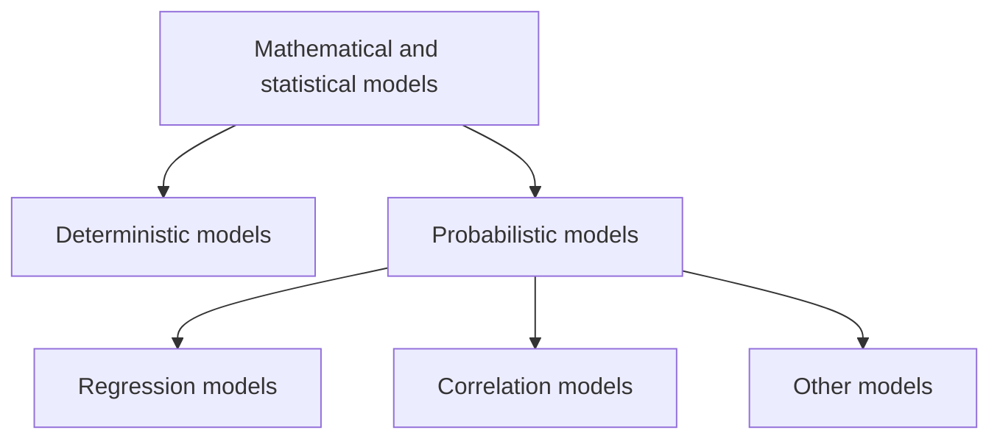

# Chapter 5 — Modeling

[Repository Guide](../../README.md) | [English](Concepts_Lecture.md) | [한국어](Concepts_Lecture.ko.md)

> **Last Updated:** 2026-10-18

> **Learning Objectives:**
> 1. Distinguish deterministic models from probabilistic models
> 2. Classify regression models by the number of explanatory variables and by linearity
> 3. Derive the OLS estimators of simple linear regression with the least squares method
> 4. Explain how correlation analysis differs from regression analysis, and choose an analytical method that fits the outcome variable and the structure of the observations
> 5. Explain how a regression model predicts future values from real data

---

## Table of Contents

- [1. Definition of a Model](#1-definition-of-a-model)
- [2. Mathematical and Statistical Models](#2-mathematical-and-statistical-models)
  - [2.1 Deterministic Models](#21-deterministic-models)
  - [2.2 Probabilistic Models](#22-probabilistic-models)
- [3. Types of Probabilistic Models](#3-types-of-probabilistic-models)
- [4. Regression Models](#4-regression-models)
  - [4.1 Definition](#41-definition)
  - [4.2 Types of Variables](#42-types-of-variables)
  - [4.3 Types of Regression Models](#43-types-of-regression-models)
- [5. Linear Regression](#5-linear-regression)
  - [5.1 Linear Equation Review](#51-linear-equation-review)
  - [5.2 Population Linear Regression Model](#52-population-linear-regression-model)
  - [5.3 Error Distribution Assumption](#53-error-distribution-assumption)
  - [5.4 Population vs. Sample](#54-population-vs-sample)
- [6. Least Squares Estimation](#6-least-squares-estimation)
  - [6.1 Goal of Regression Modeling](#61-goal-of-regression-modeling)
  - [6.2 Visual Intuition for Fitting](#62-visual-intuition-for-fitting)
  - [6.3 Least Squares Method](#63-least-squares-method)
  - [6.4 Deriving the OLS Estimators](#64-deriving-the-ols-estimators)
  - [6.5 OLS Formulas](#65-ols-formulas)
  - [6.6 OLS Derivation Intermediate Steps](#66-ols-derivation-intermediate-steps)
  - [6.7 Multiple Linear Regression (Matrix Form)](#67-multiple-linear-regression-matrix-form)
- [7. Correlation vs. Regression](#7-correlation-vs-regression)
- [8. Map of Analytical Methods](#8-map-of-analytical-methods)
- [9. Practical Prediction Example: Diet Journey](#9-practical-prediction-example-diet-journey)
- [Summary](#summary)
- [Self-Check Questions](#self-check-questions)

---

 

## 1. Definition of a Model

A model is a **representative (artificial) description of real phenomena**.

The terms model and modeling (or modelling) may refer to the following.

- **Conceptual model**: a representation of a system using general rules and concepts.
- **Scientific model**: a simplified and idealized understanding of physical systems.
- **Physical model**: a physical representation in three dimensions of an object, such as a globe or model airplane.

> **Key Point:** This chapter focuses on mathematical and statistical models that describe relationships between variables using equations and probability.

---

 

## 2. Mathematical and Statistical Models

Mathematical and statistical models often describe **relationships between variables**.

### 2.1 Deterministic Models

- They hypothesize **exact relationships** with no randomness.
- They are suitable when prediction error is negligible.
- Example: Body Mass Index (BMI).

$$BMI = \frac{Weight\ (kg)}{Height\ (m)^2}$$

### 2.2 Probabilistic Models

- They hypothesize two components: a **deterministic** component and a **random error**.
- Example: systolic blood pressure (SBP) of newborns. In the equation below, $age(d)$ is the age counted in days.

$$SBP = 6 \times age(d) + \varepsilon$$

- Random error may be due to environmental factors other than age in days (e.g., birthweight).

> **Key Point:** Deterministic models assume exact relationships with no randomness, while probabilistic models include a random error term to account for unexplained variability.

---

 

## 3. Types of Probabilistic Models

Probabilistic models can be categorized into three types.

*Figure 1. Classification of mathematical and statistical models*

| Type | Description |
|------|-------------|
| **Regression Models** | Model the relationship between dependent and independent variables using equations |
| **Correlation Models** | Analyze the strength of linearity between two variables |
| **Other Models** | Additional probabilistic modeling approaches |

*Table 1. Three types of probabilistic models*

---

 

## 4. Regression Models

### 4.1 Definition

- A regression model describes the **relationship between one dependent variable and explanatory variable(s)**.
- It uses equations to set up the relationship.
- It is used mainly for **prediction and estimation**.

### 4.2 Types of Variables

**Dependent variable (Y)**:
- It represents a particular phenomenon of interest.
- Synonyms: response variable, outcome variable.
- Notation: usually denoted as $Y$.

**Independent variable (X)**:
- It is a variable that can affect the dependent variable.
- Synonyms: explanatory variable, predictor.
- Notation: usually denoted as $X_1, \ldots, X_k$.

### 4.3 Types of Regression Models

Regression models are classified along two dimensions.

|  | Simple (1 explanatory variable) | Multiple (2+ explanatory variables) |
|--|---|----|
| **Linear** | Simple Linear Regression | Multiple Linear Regression |
| **Non-Linear** | Simple Non-Linear Regression | Multiple Non-Linear Regression |

*Table 2. Classification of regression models by the number of explanatory variables and by linearity*

> **Note:** **Meaning of linear.** In a regression model, linear means linear in the parameters (the regression coefficients). For example, $Y = \beta_0 + \beta_1 X + \beta_2 X^2 + \varepsilon$ is quadratic in $X$ but linear in the parameters, so it is a linear regression model estimated by least squares.

> **Key Point:** The regression models in this chapter require a numerical dependent (response) variable and one or more numerical or categorical independent (explanatory) variables.

---

 

## 5. Linear Regression

### 5.1 Linear Equation Review

The basic linear equation is as follows.

$$Y = mX + b$$

The symbols mean the following.
- $m$ is the slope (change in Y / change in X).
- $b$ is the Y-intercept.

### 5.2 Population Linear Regression Model

The relationship between variables is assumed to be a linear function.

$$Y_i = \beta_0 + \beta_1 X_i + \varepsilon_i$$

| Component | Meaning |
|-----------|---------|
| $Y_i$ | Dependent (response) variable |
| $\beta_0$ | Population Y-intercept |
| $\beta_1$ | Population slope |
| $X_i$ | Independent (explanatory) variable |
| $\varepsilon_i$ | Random error |

*Table 3. Components of the population linear regression model*

### 5.3 Error Distribution Assumption

The random error terms are assumed to be independent and to follow a normal distribution.

$$\varepsilon_i \sim N(0, \sigma^2)$$

This means the following.
- Errors have **zero mean**. That is, on average, the model is correct.
- Errors have **constant variance**, $\sigma^2$ for every observation (homoscedasticity).
- Errors are **normally distributed** around the regression line.

This assumption is essential for statistical inference (hypothesis tests, confidence intervals) on the regression coefficients. The residuals (observed errors) should be checked against this assumption when validating a model.

### 5.4 Population vs. Sample

- **Population**: the unknown relationship $Y_i = \beta_0 + \beta_1 X_i + \varepsilon_i$.
- **Sample**: the estimated relationship $Y_i = \hat{\beta}_0 + \hat{\beta}_1 X_i + \hat{\varepsilon}_i$.
- We use sample data to estimate the unknown population parameters.

> **Key Point:** The population model contains true (unknown) parameters, while the sample model uses estimated parameters (denoted with hat notation) derived from observed data.

---

 

## 6. Least Squares Estimation

### 6.1 Goal of Regression Modeling

The goal is to find the line that **best fits** the data by determining optimal values for the slope and intercept.

### 6.2 Visual Intuition for Fitting

- **Adjusting the intercept ($\beta_0$)**: Trying different values of $\beta_0$ is equivalent to **shifting the line up and down** the scatter plot. The slope stays constant while the entire line translates vertically.
- **Adjusting the slope ($\beta_1$)**: Trying different values of $\beta_1$ while $\beta_0$ stays constant is equivalent to **changing the slope (steepness)** of the line. The line rotates around the Y-intercept.

### 6.3 Least Squares Method

"Best fit" means the difference between actual Y values and predicted Y values is minimized. Since positive differences offset negative ones, we use **squared errors**.

$$SSE = \sum_{i=1}^{n} (Y_i - \hat{Y}_i)^2 = \sum_{i=1}^{n} \hat{\varepsilon}_i^2$$

The least squares method minimizes the Sum of Squared Errors (SSE).

### 6.4 Deriving the OLS Estimators

The minimization problem is as follows.

$$\min_{\hat{\beta}_0, \hat{\beta}_1} \sum_{i=1}^{n} (y_i - \hat{\beta}_0 - \hat{\beta}_1 x_i)^2$$

Let $W$ denote this objective function. Setting its two partial derivatives equal to zero gives the following.

$$\frac{\partial W}{\partial \hat{\beta}_0} = \sum_{i=1}^{n} -2(y_i - \hat{\beta}_0 - \hat{\beta}_1 x_i) = 0$$

$$\frac{\partial W}{\partial \hat{\beta}_1} = \sum_{i=1}^{n} -2x_i(y_i - \hat{\beta}_0 - \hat{\beta}_1 x_i) = 0$$

### 6.5 OLS Formulas

Solving the two equations obtained by setting the partial derivatives to zero (the normal equations) gives the following.

$$\hat{\beta}_0 = \bar{y} - \hat{\beta}_1 \bar{x}$$

$$\hat{\beta}_1 = \frac{\sum_{i=1}^{n}(x_i - \bar{x})(y_i - \bar{y})}{\sum_{i=1}^{n}(x_i - \bar{x})^2}$$

### 6.6 OLS Derivation Intermediate Steps

**Step 1: Solve for $\hat{\beta}_0$ from the first equation.**

$$\frac{\partial W}{\partial \hat{\beta}_0} = \sum_{i=1}^{n} -2(y_i - \hat{\beta}_0 - \hat{\beta}_1 x_i) = 0 \implies \sum y_i - n\hat{\beta}_0 - \hat{\beta}_1 \sum x_i = 0 \implies \hat{\beta}_0 = \bar{y} - \hat{\beta}_1 \bar{x}$$

**Step 2: Substitute $\hat{\beta}_0$ into the second equation.**

$$\frac{\partial W}{\partial \hat{\beta}_1} = \sum_{i=1}^{n} -2x_i(y_i - \hat{\beta}_0 - \hat{\beta}_1 x_i) = 0$$

Substituting $\hat{\beta}_0 = \bar{y} - \hat{\beta}_1 \bar{x}$ gives the following.

$$\sum_{i=1}^{n} \left[ x_i y_i - (\bar{y} - \hat{\beta}_1 \bar{x}) x_i - \hat{\beta}_1 x_i^2 \right] = 0$$

**Step 3: Distribute the summation and solve for $\hat{\beta}_1$.**

$$\sum x_i y_i - \bar{y} \sum x_i + \hat{\beta}_1 \bar{x} \sum x_i - \hat{\beta}_1 \sum x_i^2 = 0 \implies \hat{\beta}_1 = \frac{\sum x_i y_i - \bar{y} \sum x_i}{\sum x_i^2 - \bar{x} \sum x_i}$$

Applying the identities $\sum x_i y_i - \bar{y} \sum x_i = \sum (x_i - \bar{x})(y_i - \bar{y})$ and $\sum x_i^2 - \bar{x} \sum x_i = \sum (x_i - \bar{x})^2$ to the numerator and denominator gives the following.

$$\hat{\beta}_1 = \frac{\sum_{i=1}^{n}(x_i - \bar{x})(y_i - \bar{y})}{\sum_{i=1}^{n}(x_i - \bar{x})^2}$$

> **Note:** This formula has a structure similar to the correlation coefficient formula. If $r$ is the sample correlation coefficient and $s_x$, $s_y$ are the sample standard deviations of $x$ and $y$, then $\hat{\beta}_1 = r \, s_y / s_x$.

### 6.7 Multiple Linear Regression (Matrix Form)

For multiple explanatory variables, define the matrix components as follows.

$$\mathbf{y} = \begin{bmatrix} y_1 \\ y_2 \\ \vdots \\ y_n \end{bmatrix}, \quad \mathbf{X} = \begin{bmatrix} 1 & x_{11} & x_{12} & \cdots & x_{1k} \\ 1 & x_{21} & x_{22} & \cdots & x_{2k} \\ \vdots & \vdots & \vdots & \ddots & \vdots \\ 1 & x_{n1} & x_{n2} & \cdots & x_{nk} \end{bmatrix}, \quad \boldsymbol{\beta} = \begin{bmatrix} \beta_0 \\ \beta_1 \\ \vdots \\ \beta_k \end{bmatrix}, \quad \boldsymbol{\epsilon} = \begin{bmatrix} \epsilon_1 \\ \epsilon_2 \\ \vdots \\ \epsilon_n \end{bmatrix}$$

The model in matrix form is $\mathbf{y} = \mathbf{X}\boldsymbol{\beta} + \boldsymbol{\epsilon}$.

**Derivation of the normal equations:**

$$\sum \epsilon_i^2 = \boldsymbol{\epsilon}'\boldsymbol{\epsilon} = (\mathbf{y} - \mathbf{X}\boldsymbol{\beta})'(\mathbf{y} - \mathbf{X}\boldsymbol{\beta})$$

Expanding gives the following.

$$= \mathbf{y}'\mathbf{y} - \hat{\boldsymbol{\beta}}'\mathbf{X}'\mathbf{y} - \mathbf{y}'\mathbf{X}\hat{\boldsymbol{\beta}} + \hat{\boldsymbol{\beta}}'\mathbf{X}'\mathbf{X}\hat{\boldsymbol{\beta}} = \mathbf{y}'\mathbf{y} - 2\hat{\boldsymbol{\beta}}'\mathbf{X}'\mathbf{y} + \hat{\boldsymbol{\beta}}'\mathbf{X}'\mathbf{X}\hat{\boldsymbol{\beta}}$$

Taking the derivative and setting it to zero gives the following.

$$\frac{\partial \boldsymbol{\epsilon}'\boldsymbol{\epsilon}}{\partial \hat{\boldsymbol{\beta}}} = -2\mathbf{X}'\mathbf{y} + 2\mathbf{X}'\mathbf{X}\hat{\boldsymbol{\beta}} = 0$$

$$\implies (\mathbf{X}'\mathbf{X})\hat{\boldsymbol{\beta}} = \mathbf{X}'\mathbf{y}$$

If the columns of $\mathbf{X}$ are linearly independent, $\mathbf{X}'\mathbf{X}$ is invertible, so $\hat{\boldsymbol{\beta}} = (\mathbf{X}'\mathbf{X})^{-1}\mathbf{X}'\mathbf{y}$.

> **Key Point:** The OLS estimator $\hat{\beta}_1$ of $\beta_1$ has a structure similar to the correlation coefficient formula. Understanding the derivation process (using partial derivatives) is more valuable than simply memorizing the formulas.

---

 

## 7. Correlation vs. Regression

| Aspect | Correlation Analysis | Regression Analysis |
|--------|---------------------|---------------------|
| Purpose | Strength of **linearity** between two variables | **Functional relationships** between diverse variables |
| Variables | Two variables (X and Y) treated equally | Dependent vs. independent variable distinction |
| Measure | Correlation coefficient only | Linear or non-linear relationships |
| Scope | Only two variables | Simple or multiple variables |

*Table 4. Comparison of correlation analysis and regression analysis*

---

 

## 8. Map of Analytical Methods

The appropriate analytical method depends on the outcome variable type and whether observations are independent or correlated.

| Outcome Variable | Independent Observations | Correlated Observations | Non-parametric Alternatives |
|-----------------|-------------------------|------------------------|---------------------------|
| **Continuous** (e.g., pain scale, cognitive function) | **T-test**: compares means between two independent groups | **Paired t-test**: compares means between two related groups (e.g., same subjects before and after) | **Wilcoxon sign-rank test**: non-parametric alternative to the paired t-test |
| | **ANOVA**: compares means between more than two independent groups | **Repeated-measures ANOVA**: compares changes over time in the means of two or more groups (repeated measurements) | **Wilcoxon sum-rank test** (= Mann-Whitney U test): non-parametric alternative to the t-test |
| | **Pearson's correlation coefficient** (linear correlation): shows linear correlation between two continuous variables | **Mixed models / GEE modeling**: multivariate regression techniques to compare changes over time between two or more groups; gives rate of change over time | **Kruskal-Wallis test**: non-parametric alternative to ANOVA |
| | **Linear regression**: multivariate regression technique used when the outcome is continuous; gives slopes | | **Spearman rank correlation coefficient**: non-parametric alternative to Pearson's correlation coefficient |

*Table 5. Analytical methods by observation structure for a continuous outcome variable*

---

 

## 9. Practical Prediction Example: Diet Journey

The instructor's own diet journey illustrates how regression is used for real prediction.

- **Background**: The weight was 72kg in 2017, rose to 91kg in 2018, and is currently 81kg in 2019.
- **Question**: "How many days will it take to reach a target weight of 74kg if I diet now at 81kg?"
- **Approach**: Build a regression model from past weight control records (time-series of weight measurements) and use the fitted line to predict when weight will reach the target.
- **Data**: Weight measurements recorded over time from 2016 to 2019, showing the trajectory of weight changes.
- **Application**: The regression line extrapolates forward from current weight (81kg) to predict when the target weight (74kg) will be reached.

This example demonstrates that regression is not just abstract mathematics. It can answer practical "when" and "how much" questions using real data.

> **Caution:** Extrapolation assumes that the same linear trend continues outside the observed range. For a phenomenon such as body weight, whose rate of change can shift over time, the prediction error can grow as the predicted time moves farther from the observed range.

---

 

## Summary

| Concept | Key Summary |
|---------|-----------|
| Model | It is a representative (artificial) description of real phenomena. |
| Deterministic model | It assumes exact relationships with no randomness, as in the BMI formula. |
| Probabilistic model | It consists of a deterministic component and a random error, as in $SBP = 6 \times age(d) + \varepsilon$. |
| Regression model | It describes the relationship between dependent and explanatory variables with an equation for prediction and estimation. |
| Linear regression | It assumes the relationship between variables is a linear function of the form $Y_i = \beta_0 + \beta_1 X_i + \varepsilon_i$. |
| Least squares | It minimizes SSE to find the optimal estimates of $\beta_0$ and $\beta_1$. |
| OLS formulas | They are $\hat{\beta}_0 = \bar{y} - \hat{\beta}_1 \bar{x}$ and $\hat{\beta}_1 = \sum (x_i - \bar{x})(y_i - \bar{y}) / \sum (x_i - \bar{x})^2$. |
| Normal equations | In multiple linear regression, solving $(\mathbf{X}'\mathbf{X})\hat{\boldsymbol{\beta}} = \mathbf{X}'\mathbf{y}$ estimates the regression coefficients. |
| Correlation vs. Regression | Correlation measures the strength of linearity between two variables, while regression analyzes functional relationships between variables. |

---

 

## Self-Check Questions

1. **Deterministic and probabilistic models:** State which type of model the BMI formula and the newborn systolic blood pressure equation $SBP = 6 \times age(d) + \varepsilon$ each belong to, and explain why the second equation needs $\varepsilon$.

   

   
Answer

   The BMI formula is a deterministic model because weight and height determine exactly one value. The SBP equation is a probabilistic model that adds a random error $\varepsilon$ to the deterministic component $6 \times age(d)$. Newborns of the same age in days can still have different blood pressure because of other factors such as birthweight, and $\varepsilon$ represents this variation that age does not explain.

   

2. **Least squares calculation:** Fit a simple linear regression to the five pairs $(x, y)$ = (1, 2), (2, 4), (3, 5), (4, 4), (5, 5). Find $\hat{\beta}_1$, $\hat{\beta}_0$, and the predicted value at $x = 6$.

   

   
Answer

   $\bar{x} = 3$ and $\bar{y} = 4$. The sum of cross-deviations is $(-2)(-2) + (-1)(0) + (0)(1) + (1)(0) + (2)(1) = 6$, and the sum of squared deviations of $x$ is $4 + 1 + 0 + 1 + 4 = 10$. Therefore $\hat{\beta}_1 = 6 / 10 = 0.6$ and $\hat{\beta}_0 = 4 - 0.6 \times 3 = 2.2$. The predicted value at $x = 6$ is $2.2 + 0.6 \times 6 = 5.8$.

   

3. **Why squared errors:** Explain why the least squares method minimizes the sum of squared errors (SSE) instead of the plain sum of residuals.

   

   
Answer

   Residuals mix positive and negative values, so a plain sum lets them cancel. For example, two residuals of +3 and -3 sum to 0 even though the fit is not good. Squaring makes every term nonnegative, which removes the cancellation, and penalizes large residuals more heavily. SSE is also a differentiable quadratic function of $\hat{\beta}_0$ and $\hat{\beta}_1$, so setting its partial derivatives to zero yields a closed-form solution, the OLS formulas.

   

4. **Correlation and regression:** Compare correlation analysis and regression analysis in terms of how they treat variables and what they produce.

   

   
Answer

   Correlation analysis treats the two variables X and Y equally and expresses the strength of linearity between them as a single correlation coefficient. Regression analysis distinguishes the dependent variable from the independent variables and estimates the functional relationship (linear or non-linear) between one or more independent variables and the dependent variable as an equation used for prediction and estimation.

   

5. **Choosing a method:** You want to compare a pain scale (continuous) for the same patients before and after treatment. Which method do you use when normality can be assumed, and which when it cannot?

   

   
Answer

   The same subjects are measured twice, so the two observations are correlated. If normality can be assumed, use the paired t-test; if not, use its non-parametric alternative, the Wilcoxon sign-rank test.

   

