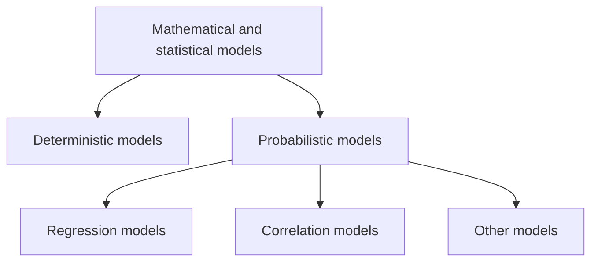
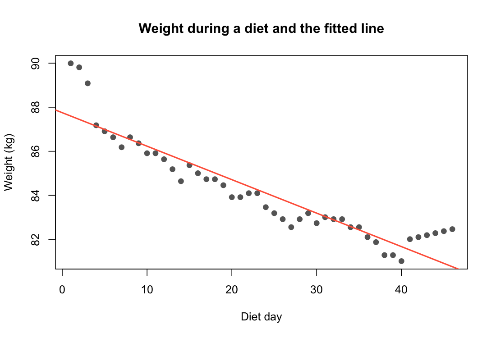
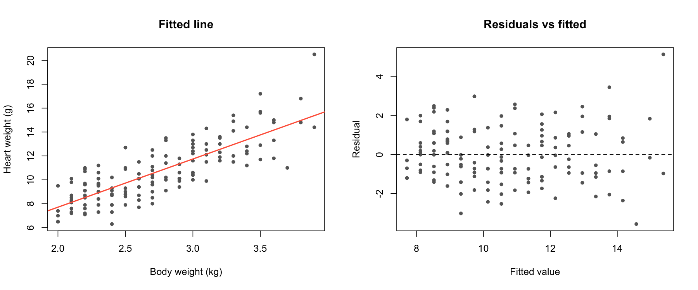

# Chapter 5 — Modeling

[Repository Guide](../../README.md) | [English](Concepts_Lecture.md) | [한국어](Concepts_Lecture.ko.md)

> **Last Updated:** 2026-11-19

> **Learning Objectives:**
> 1. Distinguish deterministic models from probabilistic models
> 2. Classify regression models by the number of explanatory variables and by linearity
> 3. Derive the OLS estimators of simple linear regression with the least squares method
> 4. Explain how correlation analysis differs from regression analysis, and choose an analytical method that fits the outcome variable and the structure of the observations
> 5. Explain how a regression model predicts future values from real data
> 6. Evaluate a regression model with the coefficient of determination, MSE, RMSE, and MAE, and test its slope

---

## Table of Contents

- [1. Definition of a Model](#1-definition-of-a-model)
- [2. Mathematical and Statistical Models](#2-mathematical-and-statistical-models)
  - [2.1 Deterministic Models](#21-deterministic-models)
  - [2.2 Probabilistic Models](#22-probabilistic-models)
  - [2.3 Worked Examples of the Two Models](#23-worked-examples-of-the-two-models)
- [3. Types of Probabilistic Models](#3-types-of-probabilistic-models)
- [4. Regression Models](#4-regression-models)
  - [4.1 Definition](#41-definition)
  - [4.2 Types of Variables](#42-types-of-variables)
  - [4.3 Types of Regression Models](#43-types-of-regression-models)
- [5. Linear Regression](#5-linear-regression)
  - [5.1 Linear Equation Review](#51-linear-equation-review)
  - [5.2 Population Linear Regression Model](#52-population-linear-regression-model)
  - [5.3 Error Distribution Assumption](#53-error-distribution-assumption)
  - [5.4 Population vs. Sample](#54-population-vs-sample)
  - [5.5 Population and Sample Regression Lines](#55-population-and-sample-regression-lines)
  - [5.6 Interpreting Regression Coefficients](#56-interpreting-regression-coefficients)
- [6. Least Squares Estimation](#6-least-squares-estimation)
  - [6.1 Goal of Regression Modeling](#61-goal-of-regression-modeling)
  - [6.2 Visual Intuition for Fitting](#62-visual-intuition-for-fitting)
  - [6.3 Least Squares Method](#63-least-squares-method)
  - [6.4 Deriving the OLS Estimators](#64-deriving-the-ols-estimators)
  - [6.5 OLS Formulas](#65-ols-formulas)
  - [6.6 OLS Derivation Intermediate Steps](#66-ols-derivation-intermediate-steps)
  - [6.7 Multiple Linear Regression (Matrix Form)](#67-multiple-linear-regression-matrix-form)
  - [6.8 A Hand-Worked Least Squares Example](#68-a-hand-worked-least-squares-example)
  - [6.9 Regression of a Trait on Genotype](#69-regression-of-a-trait-on-genotype)
  - [6.10 Properties of the Least Squares Estimators](#610-properties-of-the-least-squares-estimators)
- [7. Correlation vs. Regression](#7-correlation-vs-regression)
  - [7.1 Direction of Regression and the Correlation Coefficient](#71-direction-of-regression-and-the-correlation-coefficient)
- [8. Map of Analytical Methods](#8-map-of-analytical-methods)
  - [8.1 Examples of Choosing an Analysis Method](#81-examples-of-choosing-an-analysis-method)
- [9. Practical Prediction Example: Diet Journey](#9-practical-prediction-example-diet-journey)
  - [9.1 Regression Prediction from a Diet Record](#91-regression-prediction-from-a-diet-record)
- [10. Evaluation and Inference for Regression Models](#10-evaluation-and-inference-for-regression-models)
  - [10.1 Sum of Squares Decomposition and the Coefficient of Determination](#101-sum-of-squares-decomposition-and-the-coefficient-of-determination)
  - [10.2 Regression Error Metrics](#102-regression-error-metrics)
  - [10.3 Testing and Interval Estimation of the Slope](#103-testing-and-interval-estimation-of-the-slope)
  - [10.4 Residual Diagnostics](#104-residual-diagnostics)
  - [10.5 Linearizing by Transformation](#105-linearizing-by-transformation)
- [11. Regression Analysis in R](#11-regression-analysis-in-r)
  - [11.1 Checking the Hand Computation with lm()](#111-checking-the-hand-computation-with-lm)
  - [11.2 Body Weight and Heart Weight of Cats](#112-body-weight-and-heart-weight-of-cats)
  - [11.3 Multiple Linear Regression and the Normal Equations](#113-multiple-linear-regression-and-the-normal-equations)
  - [11.4 Common Mistakes](#114-common-mistakes)
- [Summary](#summary)
- [Self-Check Questions](#self-check-questions)

---

<br>

## 1. Definition of a Model

A model is a **representative (artificial) description of real phenomena**.

The terms model and modeling (or modelling) may refer to the following.

- **Conceptual model**: a representation of a system using general rules and concepts.
- **Scientific model**: a simplified and idealized understanding of physical systems.
- **Physical model**: a physical representation in three dimensions of an object, such as a globe or model airplane.
- **Model (art)**: A person who poses for a visual artist as part of the creative process. Here too the model stands in for a real subject, the figure in the work.

> **Key Point:** This chapter focuses on mathematical and statistical models that describe relationships between variables using equations and probability.

---

<br>

## 2. Mathematical and Statistical Models

Mathematical and statistical models often describe **relationships between variables**.

### 2.1 Deterministic Models

- They hypothesize **exact relationships** with no randomness.
- They are suitable when prediction error is negligible.
- Example: Body Mass Index (BMI).

$$BMI = \frac{Weight\ (kg)}{Height\ (m)^2}$$

### 2.2 Probabilistic Models

- They hypothesize two components: a **deterministic** component and a **random error**.
- Example: systolic blood pressure (SBP) of newborns. In the equation below, $age(d)$ is the age counted in days.

$$SBP = 6 \times age(d) + \varepsilon$$

- Random error may be due to environmental factors other than age in days (e.g., birthweight).

> **Key Point:** Deterministic models assume exact relationships with no randomness, while probabilistic models include a random error term to account for unexplained variability.

### 2.3 Worked Examples of the Two Models

Entering a body weight of 70 kg and a height of 1.75 m into the deterministic BMI formula gives $`70/1.75^2 \approx 22.9`$. The same weight and height always give 22.9, whoever computes it, and since the formula is the definition of BMI itself, there is no notion of prediction error.

Entering an age of 10 days into the probabilistic formula for newborn systolic blood pressure gives a deterministic component of $`6 \times 10 = 60`$ mmHg. Yet actually measuring two 10-day-old newborns can give different pressures, such as 57 mmHg and 64 mmHg. The deterministic component of both babies is the same 60, and the differences -3 and +4 are realizations of the random error $`\varepsilon`$ produced by other factors such as birth weight and by measurement error. A probabilistic model does not hit individual values exactly; it describes where values lie on average under the same conditions and how widely they scatter. The assumptions about the distribution of the error are treated in Section 5.3.

The same phenomenon can be handled by either model depending on the purpose. If the prediction error is negligible, a deterministic model suffices, but when variation between individuals is large, as in biological measurements, a probabilistic model that states that variation explicitly as an error term is needed. The regression models of this chapter are all probabilistic models.

---

<br>

## 3. Types of Probabilistic Models

Probabilistic models can be categorized into three types.



*Figure 1. Classification of mathematical and statistical models*

| Type | Description |
|------|-------------|
| **Regression Models** | Model the relationship between dependent and independent variables using equations |
| **Correlation Models** | Analyze the strength of linearity between two variables |
| **Other Models** | Additional probabilistic modeling approaches |

*Table 1. Three types of probabilistic models*

---

<br>

## 4. Regression Models

### 4.1 Definition

- A regression model describes the **relationship between one dependent variable and explanatory variable(s)**.
- It uses equations to set up the relationship.
- It is used mainly for **prediction and estimation**.

### 4.2 Types of Variables

**Dependent variable (Y)**:
- It represents a particular phenomenon of interest.
- Synonyms: response variable, outcome variable.
- Notation: usually denoted as $Y$.

**Independent variable (X)**:
- It is a variable that can affect the dependent variable.
- Synonyms: explanatory variable, predictor.
- Notation: usually denoted as $X_1, \ldots, X_k$.

### 4.3 Types of Regression Models

Regression models are classified along two dimensions.

|  | Simple (1 explanatory variable) | Multiple (2+ explanatory variables) |
|--|---|----|
| **Linear** | Simple Linear Regression | Multiple Linear Regression |
| **Non-Linear** | Simple Non-Linear Regression | Multiple Non-Linear Regression |

*Table 2. Classification of regression models by the number of explanatory variables and by linearity*

> **Note:** **Meaning of linear.** In a regression model, linear means linear in the parameters (the regression coefficients). For example, $Y = \beta_0 + \beta_1 X + \beta_2 X^2 + \varepsilon$ is quadratic in $X$ but linear in the parameters, so it is a linear regression model estimated by least squares.

> **Key Point:** The regression models in this chapter require a numerical dependent (response) variable and one or more numerical or categorical independent (explanatory) variables.

---

<br>

## 5. Linear Regression

### 5.1 Linear Equation Review

The basic linear equation is as follows.

$$Y = mX + b$$

The symbols mean the following.
- $m$ is the slope (change in Y / change in X).
- $b$ is the Y-intercept.

### 5.2 Population Linear Regression Model

The relationship between variables is assumed to be a linear function.

$$Y_i = \beta_0 + \beta_1 X_i + \varepsilon_i$$

| Component | Meaning |
|-----------|---------|
| $Y_i$ | Dependent (response) variable |
| $\beta_0$ | Population Y-intercept |
| $\beta_1$ | Population slope |
| $X_i$ | Independent (explanatory) variable |
| $\varepsilon_i$ | Random error |

*Table 3. Components of the population linear regression model*

### 5.3 Error Distribution Assumption

The random error terms are assumed to be independent and to follow a normal distribution.

$$\varepsilon_i \sim N(0, \sigma^2)$$

This means the following.
- Errors have **zero mean**. That is, on average, the model is correct.
- Errors have **constant variance**, $\sigma^2$ for every observation (homoscedasticity).
- Errors are **normally distributed** around the regression line.

This assumption is essential for statistical inference (hypothesis tests, confidence intervals) on the regression coefficients. The residuals (observed errors) should be checked against this assumption when validating a model.

> **[Probability and Statistics]** A hypothesis test uses the distribution of a statistic computed from the sample to decide whether to reject a hypothesis about a parameter (e.g., $\beta_1 = 0$), and a confidence interval is an interval that, when constructed repeatedly by the same method, contains the parameter in a set proportion of cases (the confidence level). When the errors are independent and follow $N(0, \sigma^2)$, the sampling distribution of $\hat{\beta}_1$ is determined, so both methods can be applied to the regression coefficients.

### 5.4 Population vs. Sample

- **Population**: the unknown relationship $Y_i = \beta_0 + \beta_1 X_i + \varepsilon_i$.
- **Sample**: the estimated relationship $Y_i = \hat{\beta}_0 + \hat{\beta}_1 X_i + \hat{\varepsilon}_i$.
- We use sample data to estimate the unknown population parameters.

> **Key Point:** The population model contains true (unknown) parameters, while the sample model uses estimated parameters (denoted with hat notation) derived from observed data.

### 5.5 Population and Sample Regression Lines

An example of a population linear regression model is the relationship between the years since seroconversion $`X`$ of people infected with HIV and the CD4+ cell count $`Y`$ in their blood. If the CD4+ cell count tends to fall as time passes after seroconversion, the slope $`\beta_1`$ is negative and gives how much the CD4+ cell count drops on average each year.

In the population regression model, the expected value of Y for each value of X lies on a straight line.

```math
E(Y) = \beta_0 + \beta_1 X_i
```

An actually observed value $`Y_i`$ lies above or below this line by the random error $`\varepsilon_i`$; that is, observed value = expected value on the line + error. Since the whole population cannot be observed, the sample regression line is obtained from the observations of a random sample.

```math
\hat{Y}_i = \hat{\beta}_0 + \hat{\beta}_1 X_i
```

The difference between an observed value and the predicted value on the sample regression line, $`\hat{\varepsilon}_i = Y_i - \hat{Y}_i`$, is called the **residual**. The error $`\varepsilon_i`$ is the distance from the unknown population line, and the residual $`\hat{\varepsilon}_i`$ is the distance from the estimated sample line, so the two differ. Unsampled observations are also scattered around the population line, and the sample regression line tries to estimate the population relationship that includes such observations. When the sample changes, $`\hat{\beta}_0`$ and $`\hat{\beta}_1`$ change too, so the estimates are statistics in the sense of Section 2.7 of Chapter 2.

> **Definition:** A **residual** is the difference between an observed value $`Y_i`$ and the predicted value $`\hat{Y}_i`$ of the sample regression line, a sample estimate of the error, which is the distance from the population line.

### 5.6 Interpreting Regression Coefficients

The coefficients of an estimated regression equation $`\hat{Y} = \hat{\beta}_0 + \hat{\beta}_1 X`$ are interpreted as follows.

- **Slope $`\hat{\beta}_1`$:** When X increases by one unit, the mean of Y changes by $`\hat{\beta}_1`$. The units enter the result directly, so when reporting a slope always state the units of both variables (for example, 4 g of heart weight per kg of body weight).
- **Intercept $`\hat{\beta}_0`$:** The mean of Y when X = 0. If X = 0 lies outside the observed range or has no meaning (an animal weighing 0 kg), the intercept itself is not interpreted and is viewed only as the value that sets the height of the line.
- **Range of prediction:** The regression equation was estimated within the observed range of X, so prediction outside that range (extrapolation) relies on the assumption that the same linear relationship continues, and its error can grow (the caution box of Section 9).

In multiple linear regression, the coefficient $`\hat{\beta}_j`$ gives how much the mean of Y changes when $`X_j`$ increases by one unit **with the other explanatory variables held fixed**. When explanatory variables are correlated, the slope of a simple regression and the coefficient in a multiple regression can differ greatly.

---

<br>

## 6. Least Squares Estimation

### 6.1 Goal of Regression Modeling

The goal is to find the line that **best fits** the data by determining optimal values for the slope and intercept.

### 6.2 Visual Intuition for Fitting

- **Adjusting the intercept ($\beta_0$)**: Trying different values of $\beta_0$ is equivalent to **shifting the line up and down** the scatter plot. The slope stays constant while the entire line translates vertically.
- **Adjusting the slope ($\beta_1$)**: Trying different values of $\beta_1$ while $\beta_0$ stays constant is equivalent to **changing the slope (steepness)** of the line. The line rotates around the Y-intercept.

### 6.3 Least Squares Method

"Best fit" means the difference between actual Y values and predicted Y values is minimized. Since positive differences offset negative ones, we use **squared errors**.

$$SSE = \sum_{i=1}^{n} (Y_i - \hat{Y}_i)^2 = \sum_{i=1}^{n} \hat{\varepsilon}_i^2$$

The least squares method minimizes the Sum of Squared Errors (SSE).

### 6.4 Deriving the OLS Estimators

The minimization problem is as follows.

$$\min_{\hat{\beta}_0, \hat{\beta}_1} \sum_{i=1}^{n} (y_i - \hat{\beta}_0 - \hat{\beta}_1 x_i)^2$$

Let $W$ denote this objective function. Setting its two partial derivatives equal to zero gives the following.

$$\frac{\partial W}{\partial \hat{\beta}_0} = \sum_{i=1}^{n} -2(y_i - \hat{\beta}_0 - \hat{\beta}_1 x_i) = 0$$

$$\frac{\partial W}{\partial \hat{\beta}_1} = \sum_{i=1}^{n} -2x_i(y_i - \hat{\beta}_0 - \hat{\beta}_1 x_i) = 0$$

### 6.5 OLS Formulas

Solving the two equations obtained by setting the partial derivatives to zero (the normal equations) gives the following.

$$\hat{\beta}_0 = \bar{y} - \hat{\beta}_1 \bar{x}$$

$$\hat{\beta}_1 = \frac{\sum_{i=1}^{n}(x_i - \bar{x})(y_i - \bar{y})}{\sum_{i=1}^{n}(x_i - \bar{x})^2}$$

### 6.6 OLS Derivation Intermediate Steps

**Step 1: Solve for $\hat{\beta}_0$ from the first equation.**

$$\frac{\partial W}{\partial \hat{\beta}_0} = \sum_{i=1}^{n} -2(y_i - \hat{\beta}_0 - \hat{\beta}_1 x_i) = 0 \implies \sum y_i - n\hat{\beta}_0 - \hat{\beta}_1 \sum x_i = 0 \implies \hat{\beta}_0 = \bar{y} - \hat{\beta}_1 \bar{x}$$

**Step 2: Substitute $\hat{\beta}_0$ into the second equation.**

$$\frac{\partial W}{\partial \hat{\beta}_1} = \sum_{i=1}^{n} -2x_i(y_i - \hat{\beta}_0 - \hat{\beta}_1 x_i) = 0$$

Substituting $\hat{\beta}_0 = \bar{y} - \hat{\beta}_1 \bar{x}$ gives the following.

$$\sum_{i=1}^{n} \left[ x_i y_i - (\bar{y} - \hat{\beta}_1 \bar{x}) x_i - \hat{\beta}_1 x_i^2 \right] = 0$$

**Step 3: Distribute the summation and solve for $\hat{\beta}_1$.**

$$\sum x_i y_i - \bar{y} \sum x_i + \hat{\beta}_1 \bar{x} \sum x_i - \hat{\beta}_1 \sum x_i^2 = 0 \implies \hat{\beta}_1 = \frac{\sum x_i y_i - \bar{y} \sum x_i}{\sum x_i^2 - \bar{x} \sum x_i}$$

Applying the identities $\sum x_i y_i - \bar{y} \sum x_i = \sum (x_i - \bar{x})(y_i - \bar{y})$ and $\sum x_i^2 - \bar{x} \sum x_i = \sum (x_i - \bar{x})^2$ to the numerator and denominator gives the following.

$$\hat{\beta}_1 = \frac{\sum_{i=1}^{n}(x_i - \bar{x})(y_i - \bar{y})}{\sum_{i=1}^{n}(x_i - \bar{x})^2}$$

> **Note:** This formula has a structure similar to the correlation coefficient formula. If $r$ is the sample correlation coefficient and $s_x$, $s_y$ are the sample standard deviations of $x$ and $y$, then $`\hat{\beta}_1 = r \, s_y / s_x`$.

### 6.7 Multiple Linear Regression (Matrix Form)

For multiple explanatory variables, define the matrix components as follows.

```math
\mathbf{y} = \begin{bmatrix} y_1 \\ y_2 \\ \vdots \\ y_n \end{bmatrix}, \quad \mathbf{X} = \begin{bmatrix} 1 & x_{11} & x_{12} & \cdots & x_{1k} \\ 1 & x_{21} & x_{22} & \cdots & x_{2k} \\ \vdots & \vdots & \vdots & \ddots & \vdots \\ 1 & x_{n1} & x_{n2} & \cdots & x_{nk} \end{bmatrix}, \quad \boldsymbol{\beta} = \begin{bmatrix} \beta_0 \\ \beta_1 \\ \vdots \\ \beta_k \end{bmatrix}, \quad \boldsymbol{\epsilon} = \begin{bmatrix} \epsilon_1 \\ \epsilon_2 \\ \vdots \\ \epsilon_n \end{bmatrix}
```

The model in matrix form is $\mathbf{y} = \mathbf{X}\boldsymbol{\beta} + \boldsymbol{\epsilon}$.

**Derivation of the normal equations:**

$$\sum \epsilon_i^2 = \boldsymbol{\epsilon}'\boldsymbol{\epsilon} = (\mathbf{y} - \mathbf{X}\boldsymbol{\beta})'(\mathbf{y} - \mathbf{X}\boldsymbol{\beta})$$

Expanding gives the following.

$$= \mathbf{y}'\mathbf{y} - \hat{\boldsymbol{\beta}}'\mathbf{X}'\mathbf{y} - \mathbf{y}'\mathbf{X}\hat{\boldsymbol{\beta}} + \hat{\boldsymbol{\beta}}'\mathbf{X}'\mathbf{X}\hat{\boldsymbol{\beta}} = \mathbf{y}'\mathbf{y} - 2\hat{\boldsymbol{\beta}}'\mathbf{X}'\mathbf{y} + \hat{\boldsymbol{\beta}}'\mathbf{X}'\mathbf{X}\hat{\boldsymbol{\beta}}$$

Taking the derivative and setting it to zero gives the following.

$$\frac{\partial \boldsymbol{\epsilon}'\boldsymbol{\epsilon}}{\partial \hat{\boldsymbol{\beta}}} = -2\mathbf{X}'\mathbf{y} + 2\mathbf{X}'\mathbf{X}\hat{\boldsymbol{\beta}} = 0$$

$$\implies (\mathbf{X}'\mathbf{X})\hat{\boldsymbol{\beta}} = \mathbf{X}'\mathbf{y}$$

If the columns of $\mathbf{X}$ are linearly independent, $\mathbf{X}'\mathbf{X}$ is invertible, so $\hat{\boldsymbol{\beta}} = (\mathbf{X}'\mathbf{X})^{-1}\mathbf{X}'\mathbf{y}$.

> **Key Point:** The OLS estimator $\hat{\beta}_1$ of $\beta_1$ has a structure similar to the correlation coefficient formula. Understanding the derivation process (using partial derivatives) is more valuable than simply memorizing the formulas.

### 6.8 A Hand-Worked Least Squares Example

Every intermediate value of the OLS formulas is computed for the five data pairs (1, 2), (2, 4), (3, 5), (4, 4), (5, 5). The means are $`\bar{x} = 15/5 = 3`$ and $`\bar{y} = 20/5 = 4`$.

| $`x_i`$ | $`y_i`$ | $`x_i - \bar{x}`$ | $`y_i - \bar{y}`$ | $`(x_i - \bar{x})(y_i - \bar{y})`$ | $`(x_i - \bar{x})^2`$ | $`\hat{y}_i`$ | $`\hat{\varepsilon}_i`$ |
|--:|--:|--:|--:|--:|--:|--:|--:|
| 1 | 2 | -2 | -2 | 4 | 4 | 2.8 | -0.8 |
| 2 | 4 | -1 | 0 | 0 | 1 | 3.4 | 0.6 |
| 3 | 5 | 0 | 1 | 0 | 0 | 4.0 | 1.0 |
| 4 | 4 | 1 | 0 | 0 | 1 | 4.6 | -0.6 |
| 5 | 5 | 2 | 1 | 2 | 4 | 5.2 | -0.2 |
| Sum | | 0 | 0 | 6 | 10 | | 0 |

*Table 4. Least squares computation table for simple linear regression*

From the sum of cross-products $`S_{xy} = 6`$ and the sum of squared deviations of x, $`S_{xx} = 10`$, $`\hat{\beta}_1 = 6/10 = 0.6`$ and $`\hat{\beta}_0 = 4 - 0.6 \times 3 = 2.2`$. The predicted values are $`\hat{y}_i = 2.2 + 0.6x_i`$, and the residuals are $`y_i - \hat{y}_i`$. The residual sum of squares is $`SSE = 0.64 + 0.36 + 1.00 + 0.36 + 0.04 = 2.4`$.

An OLS fit has three properties that can be checked in the computation table. They follow directly from the two normal equations of Section 6.4.

1. **The residuals sum to 0:** The first normal equation $`\sum (y_i - \hat{\beta}_0 - \hat{\beta}_1 x_i) = 0`$ is exactly $`\sum \hat{\varepsilon}_i = 0`$. In the table, $`-0.8 + 0.6 + 1.0 - 0.6 - 0.2 = 0`$.
2. **The products of residuals and x sum to 0:** The second normal equation is exactly $`\sum x_i \hat{\varepsilon}_i = 0`$. In the table, $`-0.8 + 1.2 + 3.0 - 2.4 - 1.0 = 0`$.
3. **The regression line passes through the mean point $`(\bar{x}, \bar{y})`$:** Since $`\hat{\beta}_0 = \bar{y} - \hat{\beta}_1 \bar{x}`$, the predicted value at $`x = \bar{x}`$ is $`\bar{y}`$. In the table, the predicted value at x = 3 is 4.0.

### 6.9 Regression of a Trait on Genotype

An explanatory variable of a regression model can also be categorical. A representative example in bioinformatics is the regression relating the genotype at a single locus to a continuous trait.

```math
\text{Trait}_i = \beta_0 + \beta_1\,\text{Genotype}_i + \varepsilon_i, \qquad \varepsilon_i \sim N(0, \sigma^2)
```

Coding individuals with genotype A as 0 and those with genotype B as 1, the predicted value of group A is $`\beta_0`$ and that of group B is $`\beta_0 + \beta_1`$. The intercept is therefore the trait mean of group A, and the slope is **the difference between the trait means of the two genotype groups**. On a scatter plot the x-axis has only the two values A and B, and the regression line becomes the segment joining the means of the two groups. If the genotype is coded by the number of alleles, as aa = 0, Aa = 1, AA = 2, the slope becomes the additive effect: how much the trait changes on average for each additional copy of allele A.

The target of the statistical test in this regression is the slope. If $`H_0: \beta_1 = 0`$ is rejected, the conclusion is that the trait mean differs by genotype, that is, that the locus is associated with the trait. The following code checks this with simulated data of 10 individuals per genotype group.

```r
set.seed(11)
g <- rep(c(0, 1), each = 10)
trait <- 5 + 1.5 * g + rnorm(20, sd = 1)
gfit <- lm(trait ~ g)
round(coef(gfit), 3)
round(tapply(trait, g, mean), 3)
round(summary(gfit)$coefficients, 4)
t.test(trait[g == 1], trait[g == 0], var.equal = TRUE)$statistic
```

```text
(Intercept)           g
      4.770       1.261
    0     1
4.770 6.031
            Estimate Std. Error t value Pr(>|t|)
(Intercept)   4.7699     0.2726 17.5010   0.0000
g             1.2609     0.3854  3.2713   0.0042
       t
3.271346
```

- The third line generates the trait with true values $`\beta_0 = 5`$, $`\beta_1 = 1.5`$, $`\sigma = 1`$.
- The estimated intercept 4.770 equals the mean of genotype group 0 exactly, and the sum of the intercept and slope, $`4.770 + 1.261 = 6.031`$, equals the mean of genotype group 1.
- The slope's t value 3.27 and p value 0.0042 equal the t value of the two-sample t-test assuming equal variances. Testing the slope of a regression with a single binary explanatory variable is the same test as comparing two group means (Table 6 of Section 8).

### 6.10 Properties of the Least Squares Estimators

There is a theoretical basis for the wide use of the OLS estimators. Under the assumptions that the errors have mean 0, the same variance $`\sigma^2`$ for every observation, and no correlation with each other, the following hold. A normal distribution is not needed for these properties.

- **Unbiasedness:** $`E(\hat{\beta}_0) = \beta_0`$ and $`E(\hat{\beta}_1) = \beta_1`$. If samples were drawn and estimated countless times, the average of the estimates would equal the true values.
- **Variance:** $`\mathrm{Var}(\hat{\beta}_1) = \sigma^2 / S_{xx}`$. The standard error of Section 10.3 replaces $`\sigma`$ in this formula with its sample estimate s.
- **Optimality (Gauss-Markov theorem):** Among unbiased estimators that are linear combinations of the $`y_i`$, the OLS estimators have the smallest variance. The OLS estimators are therefore called the best linear unbiased estimators (BLUE).

Adding the assumption that the errors are normally distributed (Section 5.3), the OLS estimators coincide with the maximum likelihood estimators, and since $`\hat{\beta}_1`$ is itself normally distributed, the t test and confidence intervals of Section 10.3 hold exactly even for small samples. Conversely, if the error variance differs between observations (heteroscedasticity) or the errors are correlated with each other, the OLS estimators are still unbiased but no longer have the smallest variance, and the usual standard error formula is also wrong. This is why the residual diagnostics of Section 10.4 matter.

---

<br>

## 7. Correlation vs. Regression

| Aspect | Correlation Analysis | Regression Analysis |
|--------|---------------------|---------------------|
| Purpose | Strength of **linearity** between two variables | **Functional relationships** between diverse variables |
| Variables | Two variables (X and Y) treated equally | Dependent vs. independent variable distinction |
| Measure | Correlation coefficient only | Linear or non-linear relationships |
| Scope | Only two variables | Simple or multiple variables |

*Table 5. Comparison of correlation analysis and regression analysis*

### 7.1 Direction of Regression and the Correlation Coefficient

Correlation analysis treats the two variables equally, but regression analysis does not. The line regressing Y on X and the line regressing X on Y differ, because the first minimizes the sum of squared residuals in the y direction and the second in the x direction. The two slopes and the correlation coefficient r are related as in the note box of Section 6.6.

```math
\hat{\beta}_{Y \mid X} = r\,\frac{s_Y}{s_X}, \qquad \hat{\beta}_{X \mid Y} = r\,\frac{s_X}{s_Y}, \qquad \hat{\beta}_{Y \mid X} \times \hat{\beta}_{X \mid Y} = r^2
```

```r
library(MASS)
r <- cor(cats$Bwt, cats$Hwt)
b_yx <- coef(lm(Hwt ~ Bwt, data = cats))[2]
b_xy <- coef(lm(Bwt ~ Hwt, data = cats))[2]
round(c(r = r, r2 = r^2, b_yx = unname(b_yx), b_xy = unname(b_xy), product = unname(b_yx * b_xy)), 4)
```

```text
      r      r2    b_yx    b_xy product 
 0.8041  0.6466  4.0341  0.1603  0.6466 
```

In the cat data of Section 11.2, the correlation coefficient between body weight and heart weight is 0.804. The slope of heart weight regressed on body weight is 4.034 g/kg, and the slope of body weight regressed on heart weight is 0.160 kg/g. If the two lines were the same, the second slope would be the reciprocal of the first, $`1/4.034 \approx 0.248`$, but it is actually smaller. The product of the two slopes, 0.6466, equals $`r^2`$, and the two lines coincide only when $`\lvert r \rvert = 1`$.

This relationship explains **regression toward the mean**. When both variables are standardized, the regression slope is r itself, so if X is one standard deviation above its mean, the predicted Y is only r standard deviations above its mean. With $`\lvert r \rvert < 1`$, the predicted value always lies closer to the mean than X does. A representative example is that children of a group of very tall parents are, on average, closer to the mean height than their parents, and the name "regression" comes from this. Patients whose measurements were extreme before treatment also drift back toward the mean on remeasurement regardless of any treatment effect, which is the same phenomenon, so judging a treatment effect requires comparison with a control group.

---

<br>

## 8. Map of Analytical Methods

The appropriate analytical method depends on the outcome variable type and whether observations are independent or correlated.

| Outcome Variable | Independent Observations | Correlated Observations | Non-parametric Alternatives |
|-----------------|-------------------------|------------------------|---------------------------|
| **Continuous** (e.g., pain scale, cognitive function) | **T-test**: compares means between two independent groups | **Paired t-test**: compares means between two related groups (e.g., same subjects before and after) | **Wilcoxon sign-rank test**: non-parametric alternative to the paired t-test |
| | **ANOVA**: compares means between more than two independent groups | **Repeated-measures ANOVA**: compares changes over time in the means of two or more groups (repeated measurements) | **Wilcoxon sum-rank test** (= Mann-Whitney U test): non-parametric alternative to the t-test |
| | **Pearson's correlation coefficient** (linear correlation): shows linear correlation between two continuous variables | **Mixed models / GEE modeling**: multivariate regression techniques to compare changes over time between two or more groups; gives rate of change over time | **Kruskal-Wallis test**: non-parametric alternative to ANOVA |
| | **Linear regression**: multivariate regression technique used when the outcome is continuous; gives slopes | | **Spearman rank correlation coefficient**: non-parametric alternative to Pearson's correlation coefficient |

*Table 6. Analytical methods by observation structure for a continuous outcome variable*

### 8.1 Examples of Choosing an Analysis Method

Using the map of Table 6 requires asking two questions in turn: is the outcome variable continuous, and are the observations independent or correlated? Data that measure the same subject two or more times or measure in pairs (before and after, left and right eye, twins) are correlated observations. If in addition the normality assumption fails and the sample is small, a non-parametric alternative is chosen.

- **Comparing the means of two independent groups (t-test):** Compare the reductions in blood pressure of 6 people on placebo and 6 on a drug. If normality cannot be assumed, use the Wilcoxon rank-sum test (Mann-Whitney U test).
- **Comparing the same subjects before and after (paired t-test):** Compare the blood pressure of 5 patients before and after treatment. The non-parametric alternative is the Wilcoxon signed-rank test.
- **Comparing three or more independent groups (ANOVA):** Compare the weight changes of three groups randomly assigned to three diets. The non-parametric alternative is the Kruskal-Wallis test.
- **Repeated measurements over time (repeated-measures ANOVA, mixed models, GEE):** Measure patients in two treatment groups repeatedly at 1, 3, and 6 months and compare the changes over time.
- **Relationship between two continuous variables (Pearson correlation coefficient, linear regression):** Measure the linear relationship between two continuous variables such as body weight and heart weight (correlation), or explain and predict one variable by the other (regression). If there are outliers, or the relationship is monotonic but not straight, use the Spearman rank correlation coefficient (Section 5.3 of Chapter 3).

Misjudging the structure of the observations changes the conclusion greatly. The following code analyzes the same blood pressure data with a paired t-test and with an independent-samples t-test.

```r
before <- c(140, 152, 138, 160, 147)
after  <- c(132, 147, 136, 150, 141)
t.test(before, after, paired = TRUE)$p.value
t.test(before, after)$p.value
```

```text
[1] 0.01025535
[1] 0.2705284
```

The paired t-test uses only each patient's difference, 8, 5, 2, 10, 6, so the large blood pressure differences between patients (from 138 to 160) drop out of the test, and the p value is a small 0.010. Treating the same data wrongly as independent samples leaves the between-patient variation in place, burying the difference and giving a p value of 0.27. This is why data measuring the same people twice require a paired test.

---

<br>

## 9. Practical Prediction Example: Diet Journey

One person's diet journey illustrates how regression is used for real prediction.

- **Background**: The weight was 72kg in 2017, rose to 91kg in 2018, and is currently 81kg in 2019.
- **Question**: "How many days will it take to reach a target weight of 74kg if I diet now at 81kg?"
- **Approach**: Build a regression model from past weight control records (time-series of weight measurements) and use the fitted line to predict when weight will reach the target.
- **Data**: Weight measurements recorded over time from 2016 to 2019, showing the trajectory of weight changes.
- **Application**: The regression line extrapolates forward from current weight (81kg) to predict when the target weight (74kg) will be reached.

This example demonstrates that regression is not just abstract mathematics. It can answer practical "when" and "how much" questions using real data.

> **Caution:** Extrapolation assumes that the same linear trend continues outside the observed range. For a phenomenon such as body weight, whose rate of change can shift over time, the prediction error can grow as the predicted time moves farther from the observed range.

### 9.1 Regression Prediction from a Diet Record

Weight is regressed on diet day using a past weight-control record of 46 days (about 90 kg on the first day and about 82 kg on day 46). The data file [`DietData_v1.csv`](../../Coursework/Lab05_Modeling/data/DietData_v1.csv) has two columns, weight (`Kg`) and diet day (`Diet day`), and the code below reads it with the file placed in the working directory (Section 1.7 of Chapter 1). `check.names = FALSE` keeps the space in the column name, and the second line renames the two columns `Kg` and `Day`.

```r
d <- read.csv("DietData_v1.csv", check.names = FALSE)
names(d) <- c("Kg", "Day")
dfit <- lm(Kg ~ Day, data = d)
round(coef(dfit), 4)
round(summary(dfit)$r.squared, 3)
(81 - 74) / -coef(dfit)["Day"]
```

```text
(Intercept)         Day
    87.7528     -0.1520
[1] 0.857
     Day
46.03902
```

The fitted line is $`\widehat{\text{Kg}} = 87.75 - 0.152 \times \text{Day}`$. The slope means that weight fell by 0.152 kg per day on average, and the coefficient of determination 0.857 means that about 86% of the variation in weight is explained by the linear relationship with days (Section 10.1). Assuming the same rate continues, losing the 7 kg from the current 81 kg to the target 74 kg takes $`7/0.152 \approx 46`$ days.



*Figure 2. Weight by diet day and the fitted regression line*

Figure 2 shows that the line does not pass evenly through the data. During the first three days weight fell faster than the line, and from around day 40 it stopped falling and rose slightly. The residuals show a systematic pattern over days, so the linearity assumption does not fully hold (Section 10.4), and if the rate of loss slows over time, the prediction of 46 days may be shorter than reality. Regression prediction answers questions with numbers, but those answers can be trusted only within the range where the model's assumptions hold.

---

<br>

## 10. Evaluation and Inference for Regression Models

### 10.1 Sum of Squares Decomposition and the Coefficient of Determination

The distance of each observation from the mean splits into a part explained by the regression line and a part it does not explain.

```math
y_i - \bar{y} = (\hat{y}_i - \bar{y}) + (y_i - \hat{y}_i)
```

Squaring both sides and summing over all observations, the cross term vanishes in an OLS fit because of the residual properties of Section 6.8, giving the following **sum of squares decomposition**.

```math
\underbrace{\sum (y_i - \bar{y})^2}_{SST} = \underbrace{\sum (\hat{y}_i - \bar{y})^2}_{SSR} + \underbrace{\sum (y_i - \hat{y}_i)^2}_{SSE}
```

SST (total sum of squares) is the total variation in Y, SSR (regression sum of squares) is the variation explained by the regression line, and SSE (residual sum of squares) is the unexplained variation. The **coefficient of determination** is the proportion of the total variation explained by the regression.

```math
R^2 = \frac{SSR}{SST} = 1 - \frac{SSE}{SST}
```

> **Definition:** The **coefficient of determination** is the proportion of the total variation of the response explained by the regression model, $`R^2 = SSR/SST`$, which lies between 0 and 1 for an OLS regression with an intercept.

For the data of Section 6.8, $`SST = 4 + 0 + 1 + 0 + 1 = 6`$ and $`SSE = 2.4`$, so $`SSR = 3.6`$ and $`R^2 = 3.6/6 = 0.6`$. In simple linear regression, $`R^2`$ equals the square of the sample correlation coefficient of x and y. Indeed $`r = S_{xy}/\sqrt{S_{xx}S_{yy}} = 6/\sqrt{10 \times 6} \approx 0.775`$ and $`r^2 = 0.6`$.

$`R^2`$ never decreases when explanatory variables are added, because even a useless variable does not increase SSE. When comparing models with different numbers of explanatory variables k, the **adjusted R²**, corrected for degrees of freedom, is used.

```math
R^2_{\text{adj}} = 1 - (1 - R^2)\,\frac{n - 1}{n - k - 1}
```

For the data of Section 6.8 (n = 5, k = 1) it is $`1 - 0.4 \times 4/3 \approx 0.467`$. The adjusted coefficient of determination actually decreases when a new variable does not add enough explanatory power.

### 10.2 Regression Error Metrics

The metrics that summarize the differences between predicted and actual values in a single number are as follows. n is the number of observations.

| Metric | Formula | Value for the data of Section 6.8 | Properties |
|:--|:--|--:|:--|
| MSE (mean squared error) | $`\frac{1}{n}\sum (y_i - \hat{y}_i)^2`$ | 0.48 | Unit is the square of Y; large errors penalized heavily |
| RMSE (root mean squared error) | $`\sqrt{MSE}`$ | 0.693 | Same unit as Y |
| MAE (mean absolute error) | $`\frac{1}{n}\sum \lvert y_i - \hat{y}_i \rvert`$ | 0.64 | Same unit as Y; less sensitive to outliers |

*Table 7. Regression error metrics*

MSE is an L2 measure and MAE an L1 measure, so they differ in the same way that L2 was sensitive to outliers and L1 robust in Section 3.3 of Chapter 3. In numbers, MSE is $`2.4/5 = 0.48`$, RMSE is $`\sqrt{0.48} \approx 0.693`$, and MAE is $`(0.8 + 0.6 + 1.0 + 0.6 + 0.2)/5 = 0.64`$.

The unbiased estimator of the error variance $`\sigma^2`$ divides SSE by **n - 2**, not n: $`s^2 = SSE/(n - 2)`$. Two degrees of freedom were used up in estimating the two parameters $`\beta_0`$ and $`\beta_1`$ from the sample, for the same reason that the sample variance was divided by n - 1 in Section 2.3 of Chapter 2. For the data of Section 6.8, $`s^2 = 2.4/3 = 0.8`$ and $`s \approx 0.894`$, and R reports this s as the residual standard error.

Error metrics computed on the same data used for fitting underestimate the error on new data, because the model fits part of the noise in those data. The predictive power of a model must be evaluated on data not used for learning; this problem and cross-validation are covered in Chapter 6.

### 10.3 Testing and Interval Estimation of the Slope

Under the error assumptions of Section 5.3, the standard error of $`\hat{\beta}_1`$ is as follows.

```math
SE(\hat{\beta}_1) = \frac{s}{\sqrt{S_{xx}}} = \frac{s}{\sqrt{\sum (x_i - \bar{x})^2}}
```

The more widely x is spread (the larger $`S_{xx}`$), the more precisely the slope is estimated. The t statistic for the null hypothesis $`H_0: \beta_1 = 0`$ (no linear relationship between X and Y) is $`t = \hat{\beta}_1 / SE(\hat{\beta}_1)`$, which under the null hypothesis follows a t distribution with n - 2 degrees of freedom.

For the data of Section 6.8, $`SE(\hat{\beta}_1) = 0.894/\sqrt{10} \approx 0.283`$ and $`t = 0.6/0.283 \approx 2.12`$, and the two-sided p value from the t distribution with 3 degrees of freedom is about 0.124. At significance level 0.05 the null hypothesis is not rejected. The slope looks positive in the data, but with only five observations there is not enough evidence to say that it is not due to chance.

The 95% confidence interval of the slope is $`\hat{\beta}_1 \pm t_{0.975,\,n-2} \times SE(\hat{\beta}_1)`$. With $`t_{0.975,\,3} \approx 3.182`$ it is $`0.6 \pm 3.182 \times 0.283`$, about (-0.300, 1.500). That the interval contains 0 is the same conclusion as failing to reject the null hypothesis in the test above.

For prediction at a new x there are two kinds of interval.

- **Confidence interval:** The range in which the **mean** of Y at that x, $`E(Y)`$, lies. It reflects only the uncertainty of the regression line itself.
- **Prediction interval:** The range in which a single **individual value** observed at that x lies. It adds the error $`\varepsilon`$ of an individual observation to the uncertainty of the line, so it is always wider than the confidence interval.

For the data of Section 6.8, the 95% confidence interval for the predicted value 5.8 at x = 6 is about (2.81, 8.79), and the 95% prediction interval is about (1.68, 9.92). x = 6 lies outside the observed range (1-5), so both intervals are wide.

### 10.4 Residual Diagnostics

The assumptions of Section 5.3 are checked with residuals. The way to check each assumption is as follows.

1. **Linearity:** A residual plot of the residuals against the predicted values (or x) should show no curved pattern. Residuals that are positive at both ends and negative in the middle, as in the diet data of Section 9.1, signal a curved relationship.
2. **Homoscedasticity:** In the residual plot, the spread of the residuals should not widen or narrow with the predicted value. A funnel shape signals heteroscedasticity, and a transformation such as taking the logarithm of Y is a common remedy.
3. **Normality:** A histogram or Q-Q plot of the residuals should be close to a normal distribution. With large samples, the test of the slope tolerates mild departures from normality fairly well.
4. **Independence:** In data collected in time order, if neighboring residuals resemble each other (autocorrelation), the independence assumption fails. Data in which the same person is measured every day, like the diet record, carry this risk strongly.

Observations with especially large residuals (outliers) and observations whose x lies far from the others and pulls the regression line toward them (high leverage) are also checked. The leverage $`h_i`$ of Section 7.2 of Chapter 6 measures the size of this influence. In R, `plot(lm object)` draws four diagnostic plots in turn, including the residual plot and the Q-Q plot.

### 10.5 Linearizing by Transformation

As the note box of Section 4.3 says, the "linear" of linear regression means linearity in the parameters. Even if the relationship between X and Y is curved, it can be handled by linear regression if a suitable transformation of the variables turns it into an equation linear in the parameters. The most common example in the life sciences is exponential growth.

If bacteria double at a fixed time interval, their number follows $`N(t) = N_0 \cdot 2^{t/T_d}`$, where $`T_d`$ is the time for the population to double (the doubling time). Taking the base-2 logarithm of both sides gives the following.

```math
\log_2 N(t) = \log_2 N_0 + \frac{1}{T_d}\, t
```

Regressing $`\log_2 N`$ on t therefore gives a straight line with slope $`1/T_d`$ and intercept $`\log_2 N_0`$. The following code checks this with simulated culture data (including measurement error) with a doubling time of 1.5 hours.

```r
set.seed(5)
time <- 0:8
count <- round(1000 * 2^(time / 1.5) * exp(rnorm(9, sd = 0.1)))
count
gfit <- lm(log2(count) ~ time)
round(coef(gfit), 4)
round(1 / coef(gfit)["time"], 3)
round(summary(gfit)$r.squared, 4)
round(summary(lm(count ~ time))$r.squared, 4)
```

```text
[1]   919  1823  2223  4028  7535  9490 15262 23835 39182
(Intercept)        time 
     9.9791      0.6596 
 time 
1.516 
[1] 0.9937
[1] 0.8054
```

- The third line generates bacterial counts that start at 1,000 and double every 1.5 hours, multiplied by a multiplicative measurement error `exp(rnorm(...))`.
- `lm(log2(count) ~ time)` transforms the response directly inside the formula. From the slope 0.6596 the doubling time is estimated as $`1/0.6596 \approx 1.52`$ hours, close to the true 1.5. The intercept 9.98 is $`\log_2 N_0`$, so $`N_0 \approx 2^{9.98} \approx 1{,}010`$.
- The transformed model has $`R^2`$ = 0.994, while regressing the raw counts on time gives 0.805 with a clear curved pattern in the residuals. The transformation improved linearity and equal variance (Section 10.4) together.

The log transformation is particularly suitable when the measurement error is multiplicative, proportional to the size of the value. The same reason applies to taking logarithms of data that span several orders of magnitude and have a long right tail, such as gene expression levels (Section 5.8 of Chapter 1). Interpretation, however, must be on the transformed scale: the slope of the model above is not the increase in bacterial count per hour but the increase in $`\log_2`$ per hour, that is, the number of doublings per hour.

---

<br>

## 11. Regression Analysis in R

### 11.1 Checking the Hand Computation with lm()

The hand computations of Sections 6.8 and 10.1-10.3 are checked with R's `lm()`.

```r
x <- c(1, 2, 3, 4, 5); y <- c(2, 4, 5, 4, 5)
fit <- lm(y ~ x)
summary(fit)
confint(fit)
predict(fit, newdata = data.frame(x = 6), interval = "prediction")
```

```text

Call:
lm(formula = y ~ x)

Residuals:
   1    2    3    4    5
-0.8  0.6  1.0 -0.6 -0.2

Coefficients:
            Estimate Std. Error t value Pr(>|t|)
(Intercept)   2.2000     0.9381   2.345    0.101
x             0.6000     0.2828   2.121    0.124

Residual standard error: 0.8944 on 3 degrees of freedom
Multiple R-squared:    0.6,	Adjusted R-squared:  0.4667
F-statistic:   4.5 on 1 and 3 DF,  p-value: 0.124

                 2.5 %   97.5 %
(Intercept) -0.7853993 5.185399
x           -0.3001317 1.500132
  fit      lwr      upr
1 5.8 1.675078 9.924922
```

- The formula `y ~ x` in `lm(y ~ x)` means "y explained by x", and the intercept is included automatically.
- `Residuals` equal the residuals of Table 4, and the `Estimate` column of `Coefficients` gives $`\hat{\beta}_0 = 2.2`$ and $`\hat{\beta}_1 = 0.6`$.
- `Std. Error`, `t value`, and `Pr(>|t|)` are the standard error 0.283, t value 2.12, and p value 0.124 of Section 10.3.
- `Residual standard error: 0.8944 on 3 degrees of freedom` is $`s = \sqrt{2.4/3}`$, and `Multiple R-squared` and `Adjusted R-squared` are the 0.6 and 0.467 of Section 10.1. With a single explanatory variable, the p value of the `F-statistic` equals that of the t test of the slope.
- `confint()` gives 95% confidence intervals of the coefficients, and `predict(..., interval = "prediction")` gives the 95% prediction interval at x = 6.

### 11.2 Body Weight and Heart Weight of Cats

Simple linear regression is applied to life-science data. The `cats` data in R's `MASS` package hold the sex (Sex), body weight (Bwt, kg), and heart weight (Hwt, g) of 144 adult cats. Heart weight is explained by body weight.

```r
library(MASS)
fit <- lm(Hwt ~ Bwt, data = cats)
print(summary(fit), signif.stars = FALSE)
round(confint(fit), 3)
predict(fit, newdata = data.frame(Bwt = 3), interval = "prediction")
```

```text

Call:
lm(formula = Hwt ~ Bwt, data = cats)

Residuals:
    Min      1Q  Median      3Q     Max
-3.5694 -0.9634 -0.0921  1.0426  5.1238

Coefficients:
            Estimate Std. Error t value Pr(>|t|)
(Intercept)  -0.3567     0.6923  -0.515    0.607
Bwt           4.0341     0.2503  16.119   <2e-16

Residual standard error: 1.452 on 142 degrees of freedom
Multiple R-squared:  0.6466,	Adjusted R-squared:  0.6441
F-statistic: 259.8 on 1 and 142 DF,  p-value: < 2.2e-16

             2.5 % 97.5 %
(Intercept) -1.725  1.012
Bwt          3.539  4.529
       fit      lwr      upr
1 11.74553 8.861263 14.62979
```

- The slope 4.034 means that heart weight increases by about 4.03 g on average when body weight increases by 1 kg, with a 95% confidence interval from 3.54 g to 4.53 g. With a t value of 16.1 and a p value below $`2 \times 10^{-16}`$, the linear relationship is very clear.
- The intercept -0.357 would mean the heart weight of a cat weighing 0 kg, but the observed body weights run from 2.0 kg to 3.9 kg, so it is not interpreted, as in Section 5.6. The intercept's p value 0.607 only means that there is no evidence that the intercept differs from 0.
- $`R^2 = 0.6466`$, so about 65% of the variation in heart weight is explained by body weight, and the remaining 35% is due to other factors such as individual differences.
- The heart weight of one cat weighing 3 kg is predicted as 11.75 g, with a 95% prediction interval from 8.86 g to 14.63 g. The interval is wide because it predicts one individual, not the mean.
- `print(..., signif.stars = FALSE)` is the option that turns off the significance stars next to the p values.



*Figure 3. Fitted regression line and residual plot for the cat data*

In the residual plot on the right, the residuals scatter around 0 without a clear curved pattern, so the linearity assumption roughly holds. The spread of the residuals, however, tends to widen slightly for larger predicted values, so the equal-variance assumption of Section 10.4 deserves a check.

### 11.3 Multiple Linear Regression and the Normal Equations

A multiple linear regression with sex added as an explanatory variable is fitted, and its coefficients are compared with those computed directly from the normal equations of Section 6.7.

```r
fit2 <- lm(Hwt ~ Bwt + Sex, data = cats)
round(coef(fit2), 4)
X <- model.matrix(~ Bwt + Sex, data = cats)
head(X, 3)
beta <- solve(t(X) %*% X) %*% t(X) %*% cats$Hwt
round(beta, 4)
round(summary(fit2)$adj.r.squared, 4); round(summary(fit)$adj.r.squared, 4)
```

```text
(Intercept)         Bwt        SexM
    -0.4150      4.0758     -0.0821
  (Intercept) Bwt SexM
1           1   2    0
2           1   2    0
3           1   2    0
               [,1]
(Intercept) -0.4150
Bwt          4.0758
SexM        -0.0821
[1] 0.6418
[1] 0.6441
```

- `model.matrix()` builds the design matrix $`\mathbf{X}`$ of Section 6.7. The first column is the 1 for the intercept, the second is body weight, and the third, `SexM`, is an indicator (dummy) variable equal to 1 for males and 0 for females. Categorical variables enter a regression after being turned into such columns of 0 and 1.
- `solve(t(X) %*% X) %*% t(X) %*% cats$Hwt` computes $`\hat{\boldsymbol{\beta}} = (\mathbf{X}'\mathbf{X})^{-1}\mathbf{X}'\mathbf{y}`$ directly, and it agrees with the coefficients of `lm()`. `lm()` actually finds the same solution through the numerically more stable QR decomposition.
- The coefficient -0.082 of `SexM` means that at the same body weight a male's heart weighs 0.08 g less than a female's on average, a very small difference. The adjusted coefficient of determination actually falls from 0.6441 to 0.6418, so once body weight is taken into account, sex adds no explanatory power (Section 10.1).

### 11.4 Common Mistakes

1. **Interpreting correlation as causation:** A significant slope does not mean that X causes Y. A third variable affecting both may exist.
2. **Extrapolating beyond the observed range:** The linear relationship was confirmed only within the observed range (Sections 5.6 and 9.1).
3. **Judging a model by R² alone:** Even with a high R², a pattern in the residuals means the model is wrong, and models with different numbers of explanatory variables are compared by the adjusted coefficient of determination (Sections 10.1 and 10.4).
4. **Confusing errors and residuals:** An error is the unknown distance from the population line, and a residual is the distance computed from the sample line (Section 5.5).
5. **Estimating the error variance by dividing by n:** In simple regression two parameters are estimated, so SSE is divided by n - 2 (Section 10.2).
6. **Confusing confidence and prediction intervals:** When stating the range of an individual observation, use the wider prediction interval (Section 10.3).
7. **Entering a categorical variable as numeric codes:** Entering three categories as 1, 2, 3 assumes equal spacing between them. If order or spacing has no meaning, enter it as a factor to create indicator variables (Section 11.3).
8. **Evaluating predictive power by the error on the training data:** MSE computed on the same data comes out smaller than the error on new data, so use test data or cross-validation (Section 10.2, Chapter 6).

---

<br>

## Summary

| Concept | Key Summary |
|---------|-----------|
| Model | It is a representative (artificial) description of real phenomena. |
| Deterministic model | It assumes exact relationships with no randomness, as in the BMI formula. |
| Probabilistic model | It consists of a deterministic component and a random error, as in $SBP = 6 \times age(d) + \varepsilon$. |
| Regression model | It describes the relationship between dependent and explanatory variables with an equation for prediction and estimation. |
| Linear regression | It assumes the relationship between variables is a linear function of the form $Y_i = \beta_0 + \beta_1 X_i + \varepsilon_i$. |
| Least squares | It minimizes SSE to find the optimal estimates of $\beta_0$ and $\beta_1$. |
| OLS formulas | They are $\hat{\beta}_0 = \bar{y} - \hat{\beta}_1 \bar{x}$ and $\hat{\beta}_1 = \sum (x_i - \bar{x})(y_i - \bar{y}) / \sum (x_i - \bar{x})^2$. |
| Normal equations | In multiple linear regression, solving $(\mathbf{X}'\mathbf{X})\hat{\boldsymbol{\beta}} = \mathbf{X}'\mathbf{y}$ estimates the regression coefficients. |
| Correlation vs. Regression | Correlation measures the strength of linearity between two variables, while regression analyzes functional relationships between variables. |
| Residual | The difference between an observed value and the predicted value of the sample regression line; OLS residuals sum to 0, and so do their products with x. |
| Genotype regression | Coding genotypes as 0 and 1 makes the intercept the mean of the reference group and the slope the difference between the two group means; the slope test equals the two-sample t-test. |
| Coefficient of determination (R²) | $`R^2 = SSR/SST = 1 - SSE/SST`$ is the proportion of variation explained by the regression, equal to the squared correlation coefficient in simple regression. |
| Adjusted R² | The coefficient of determination corrected for the number of explanatory variables; it decreases when a variable without enough explanatory power is added. |
| Regression error metrics (MSE, RMSE, MAE) | MSE is the mean squared error, RMSE its square root, and MAE the mean absolute error; MAE is the least sensitive to outliers. |
| Slope test | Tests $`\beta_1 = 0`$ using the fact that $`t = \hat{\beta}_1/SE(\hat{\beta}_1)`$ follows a t distribution with n - 2 degrees of freedom. |
| Confidence and prediction intervals | A confidence interval gives the range of the mean response and a prediction interval that of an individual observation; the prediction interval is always wider. |
| Residual diagnostics | Residual plots, Q-Q plots, and residuals in order check linearity, homoscedasticity, normality, and independence. |

---

<br>

## Self-Check Questions

1. **Deterministic and probabilistic models:** State which type of model the BMI formula and the newborn systolic blood pressure equation $SBP = 6 \times age(d) + \varepsilon$ each belong to, and explain why the second equation needs $\varepsilon$.

   <details>
   <summary>Answer</summary>

   The BMI formula is a deterministic model because weight and height determine exactly one value. The SBP equation is a probabilistic model that adds a random error $\varepsilon$ to the deterministic component $6 \times age(d)$. Newborns of the same age in days can still have different blood pressure because of other factors such as birthweight, and $\varepsilon$ represents this variation that age does not explain.

   </details>

2. **Least squares calculation:** Fit a simple linear regression to the five pairs $(x, y)$ = (1, 2), (2, 4), (3, 5), (4, 4), (5, 5). Find $\hat{\beta}_1$, $\hat{\beta}_0$, and the predicted value at $x = 6$.

   <details>
   <summary>Answer</summary>

   $\bar{x} = 3$ and $\bar{y} = 4$. The sum of cross-deviations is $(-2)(-2) + (-1)(0) + (0)(1) + (1)(0) + (2)(1) = 6$, and the sum of squared deviations of $x$ is $4 + 1 + 0 + 1 + 4 = 10$. Therefore $\hat{\beta}_1 = 6 / 10 = 0.6$ and $\hat{\beta}_0 = 4 - 0.6 \times 3 = 2.2$. The predicted value at $x = 6$ is $2.2 + 0.6 \times 6 = 5.8$.

   </details>

3. **Why squared errors:** Explain why the least squares method minimizes the sum of squared errors (SSE) instead of the plain sum of residuals.

   <details>
   <summary>Answer</summary>

   Residuals mix positive and negative values, so a plain sum lets them cancel. For example, two residuals of +3 and -3 sum to 0 even though the fit is not good. Squaring makes every term nonnegative, which removes the cancellation, and penalizes large residuals more heavily. SSE is also a differentiable quadratic function of $\hat{\beta}_0$ and $\hat{\beta}_1$, so setting its partial derivatives to zero yields a closed-form solution, the OLS formulas.

   </details>

4. **Correlation and regression:** Compare correlation analysis and regression analysis in terms of how they treat variables and what they produce.

   <details>
   <summary>Answer</summary>

   Correlation analysis treats the two variables X and Y equally and expresses the strength of linearity between them as a single correlation coefficient. Regression analysis distinguishes the dependent variable from the independent variables and estimates the functional relationship (linear or non-linear) between one or more independent variables and the dependent variable as an equation used for prediction and estimation.

   </details>

5. **Choosing a method:** You want to compare a pain scale (continuous) for the same patients before and after treatment. Which method do you use when normality can be assumed, and which when it cannot?

   <details>
   <summary>Answer</summary>

   The same subjects are measured twice, so the two observations are correlated. If normality can be assumed, use the paired t-test; if not, use its non-parametric alternative, the Wilcoxon sign-rank test.

   </details>

6. **Coefficient of determination and error metrics:** The observed values are 3, 5, 7, and a regression model predicts 4, 5, 6. Compute SSE, SST, $`R^2`$, MSE, and MAE.

   <details>
   <summary>Answer</summary>

   The residuals are -1, 0, 1, so $`SSE = 1 + 0 + 1 = 2`$. The mean is 5, so $`SST = 4 + 0 + 4 = 8`$ and $`R^2 = 1 - 2/8 = 0.75`$. $`MSE = 2/3 \approx 0.667`$ and $`MAE = (1 + 0 + 1)/3 \approx 0.667`$. In this example every residual has absolute value 0 or 1, so MSE and MAE coincide, but when large residuals are mixed in, MSE grows faster than MAE.

   </details>

7. **Interpreting a genotype regression:** A regression coding genotype A as 0 and B as 1 gave $`\hat{\beta}_0 = 12.0`$ and $`\hat{\beta}_1 = -2.5`$. Give the trait mean of each genotype group, and explain the biological meaning when $`H_0: \beta_1 = 0`$ is rejected.

   <details>
   <summary>Answer</summary>

   The mean of group A is the intercept, 12.0, and the mean of group B is $`12.0 - 2.5 = 9.5`$. Rejecting the null hypothesis means that the trait means of the two genotype groups differ statistically, so the conclusion is that the locus (or a nearby variant inherited with it) is associated with the trait. This is, however, a conclusion about association; it does not show that the variant directly causes the trait.

   </details>

8. **Confidence and prediction intervals:** For the cat data of Section 11.2, explain which interval is used, and which is wider, when estimating the mean heart weight of cats weighing 3 kg and when predicting the heart weight of one cat weighing 3 kg.

   <details>
   <summary>Answer</summary>

   The mean heart weight of the group uses a confidence interval, and the heart weight of one cat uses a prediction interval. The confidence interval reflects only the uncertainty from estimating the regression line from a sample, while the prediction interval adds the variation of the error $`\varepsilon`$ by which each individual departs from the line, so it is always wider. Indeed the 95% prediction interval in Section 11.2 runs from 8.86 g to 14.63 g, a width of about 5.8 g.

   </details>
