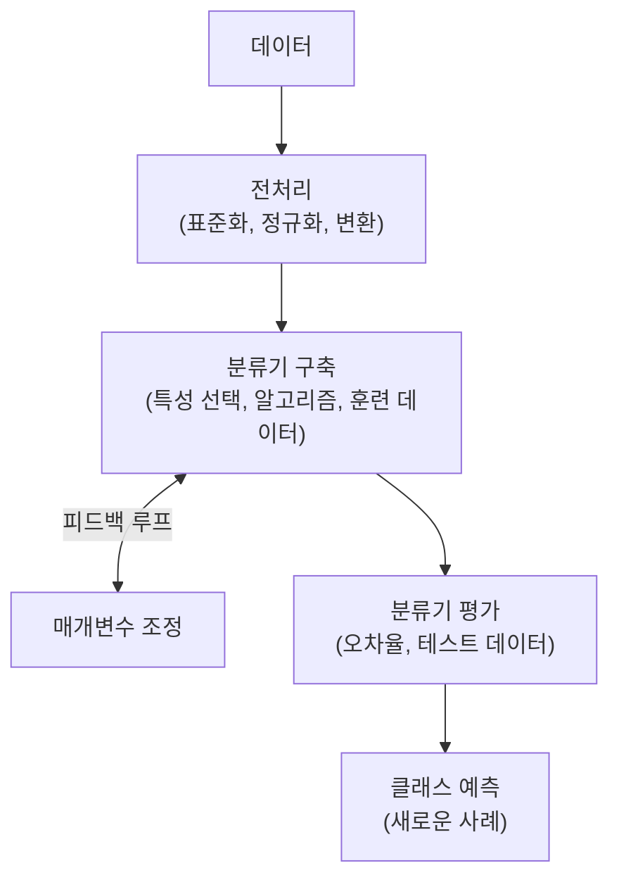
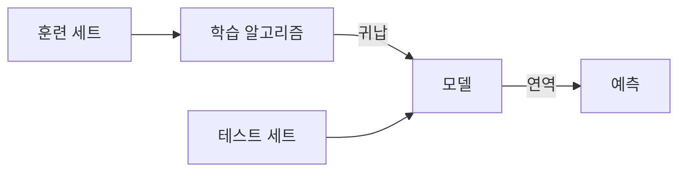
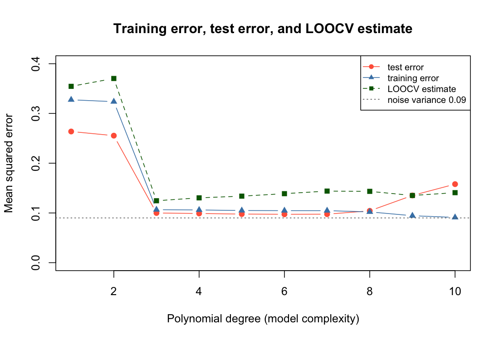
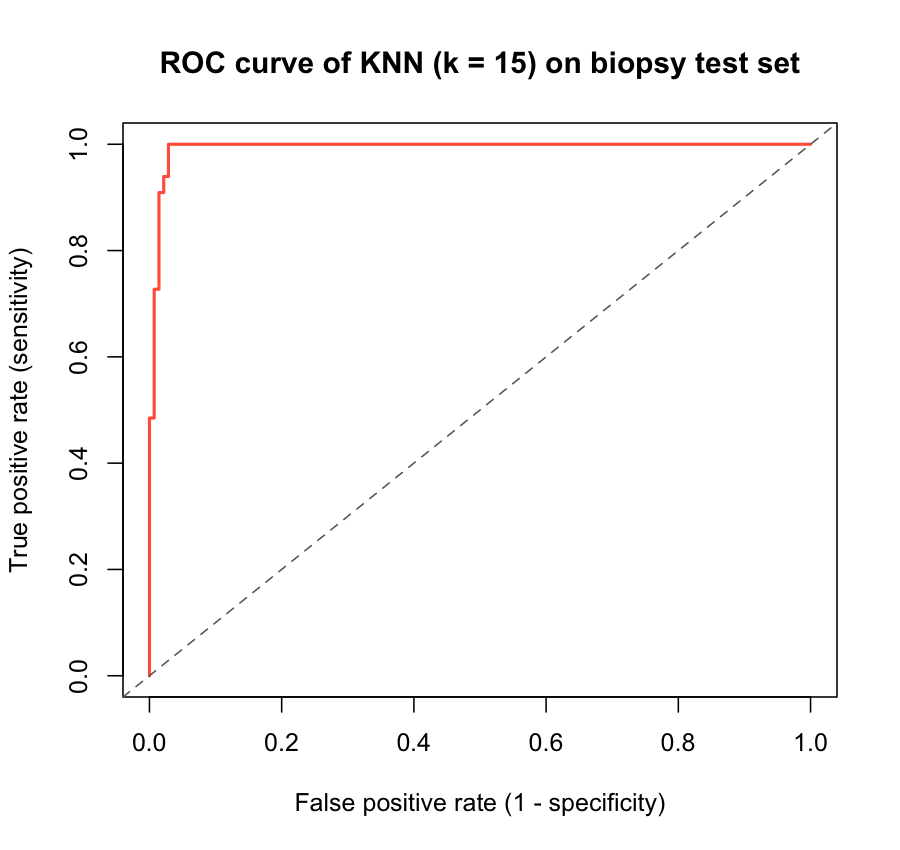

# 6장 — 지도 학습

[레포지토리 안내](../../README.ko.md) | [English](Concepts_Lecture.md) | [한국어](Concepts_Lecture.ko.md)

> **최종 수정일:** 2026-11-27

> **학습 목표:**
> 1. 군집화와 분류, 분류와 예측의 차이를 설명할 수 있다
> 2. 훈련 세트와 테스트 세트를 분리하는 이유를 과적합, 과소적합과 연결하여 설명할 수 있다
> 3. 테스트 세트 방법, LOOCV, K-겹 교차 검증의 장단점을 비교할 수 있다
> 4. 혼동 행렬로 민감도, 특이도, 정밀도, 정확도 같은 성능 지표를 계산할 수 있다
> 5. KNN으로 새 데이터를 분류하고 K의 선택이 결과에 주는 영향을 설명할 수 있다
> 6. 편향-분산 분해를 설명하고 ROC 곡선과 AUC로 분류기를 평가할 수 있다

---

## 목차

- [1. 분류의 정의](#1-분류의-정의)
  - [1.1 군집화 vs. 분류](#11-군집화-vs-분류)
- [2. 분류 vs. 예측](#2-분류-vs-예측)
  - [2.1 분류 (Classification)](#21-분류-classification)
  - [2.2 예측 (Prediction)](#22-예측-prediction)
- [3. 분류 풀이 예제](#3-분류-풀이-예제)
  - [3.1 테스트 데이터로 규칙 평가하기](#31-테스트-데이터로-규칙-평가하기)
- [4. 일반적인 분류 절차](#4-일반적인-분류-절차)
  - [4.1 2단계 프로세스](#41-2단계-프로세스)
  - [4.2 분류 절차의 단계별 내용](#42-분류-절차의-단계별-내용)
- [5. 훈련 세트와 테스트 세트](#5-훈련-세트와-테스트-세트)
  - [5.1 정의](#51-정의)
  - [5.2 귀납과 연역](#52-귀납과-연역)
  - [5.3 훈련 세트와 테스트 세트의 예](#53-훈련-세트와-테스트-세트의-예)
- [6. 과적합](#6-과적합)
  - [6.1 정의](#61-정의)
  - [6.2 과적합이 발생하는 이유](#62-과적합이-발생하는-이유)
  - [6.3 과적합 vs. 과소적합](#63-과적합-vs-과소적합)
  - [6.4 회귀에서의 과적합](#64-회귀에서의-과적합)
  - [6.5 구체적인 MSE 비교 값](#65-구체적인-mse-비교-값)
  - [6.6 과적합의 시각적 특징](#66-과적합의-시각적-특징)
  - [6.7 회귀 문제와 세 가지 적합](#67-회귀-문제와-세-가지-적합)
  - [6.8 편향-분산 분해](#68-편향-분산-분해)
- [7. 검증 방법](#7-검증-방법)
  - [7.1 방법 비교](#71-방법-비교)
  - [7.2 Leave-One-Out 교차 검증 (LOOCV)](#72-leave-one-out-교차-검증-loocv)
  - [7.3 K-겹 교차 검증 (K-Fold Cross-Validation)](#73-k-겹-교차-검증-k-fold-cross-validation)
  - [7.4 편향-분산 트레이드오프 (Bias-Variance Trade-off)](#74-편향-분산-트레이드오프-bias-variance-trade-off)
  - [7.5 R로 하는 교차 검증](#75-r로-하는-교차-검증)
- [8. 모델 성능 측정](#8-모델-성능-측정)
  - [8.1 가설 검정 프레임워크](#81-가설-검정-프레임워크)
  - [8.2 주요 측정 지표](#82-주요-측정-지표)
  - [8.3 오류 측정 지표](#83-오류-측정-지표)
  - [8.4 종합 성능](#84-종합-성능)
  - [8.5 유병률과 양성 예측도](#85-유병률과-양성-예측도)
  - [8.6 ROC 곡선과 AUC](#86-roc-곡선과-auc)
- [9. K-Nearest Neighbors (KNN)](#9-k-nearest-neighbors-knn)
  - [9.1 개요](#91-개요)
  - [9.2 거리 측정 (Distance Metric)](#92-거리-측정-distance-metric)
  - [9.3 시각적 직관](#93-시각적-직관)
  - [9.4 인스턴스 기반 (게으른) 학습](#94-인스턴스-기반-게으른-학습)
  - [9.5 KNN의 결정 규칙과 K의 선택](#95-knn의-결정-규칙과-k의-선택)
  - [9.6 유방 종양 세포의 KNN 분류](#96-유방-종양-세포의-knn-분류)
  - [9.7 흔한 실수](#97-흔한-실수)
- [요약](#요약)
- [점검 문제](#점검-문제)

---

<br>

## 1. 분류의 정의

### 1.1 군집화 vs. 분류

| 측면 | 군집화 (Clustering) | 분류 (Classification) |
|------|-------------------|---------------------|
| 학습 유형 | **비지도(unsupervised)** 학습 | **지도(supervised)** 학습 |
| 클래스 | 사전에 알려지지 않음 | **사전 정의됨** |
| 목표 | 클래스 **발견** (새로운/미지의 클래스 식별) | 클래스 **예측** (알려진 클래스에 할당) |
| 성격 | 탐색적 분석 | 예측적 분석 |

*표 1. 군집화와 분류의 비교*

- **군집화(clustering)** 는 클래스 변수(범주형 반응 변수)를 생성하는 과정이다.
- **분류(classification)** 는 클래스 변수를 가진 모델을 수립하고, 그 모델로부터 클래스 변수를 예측하는 과정이다.

> **핵심:** 군집화는 데이터에서 알려지지 않은 그룹을 발견하고(비지도), 분류는 사전 정의된 그룹에 대한 소속을 예측한다(지도).

---

<br>

## 2. 분류 vs. 예측

### 2.1 분류 (Classification)

- 훈련 세트로 구축한 모델을 기반으로 데이터를 분류한다.
- **범주형 클래스**의 값을 분류 속성으로 사용한다.
- 새로운 데이터를 사전 정의된 범주에 할당한다.

### 2.2 예측 (Prediction)

- 훈련 세트로 구축한 모델을 기반으로 데이터를 예측한다.
- 클래스 변수의 **유형에 관계없이** 작동한다(연속형, 범주형, 생존 시간 등).

> **핵심:** 결과 변수의 유형이 다를 뿐, 분류와 예측은 본질적으로 동일한 과정이다. 분류는 구체적으로 범주형 결과를 지칭하며, 예측은 보다 일반적인 용어이다.

---

<br>

## 3. 분류 풀이 예제

**교수 정년 보장 데이터셋 (Faculty Tenure Dataset):**

| NAME | RANK | YEARS | TENURED |
|------|------|-------|---------|
| Mike | Assistant Prof | 3 | No |
| Mary | Assistant Prof | 7 | Yes |
| Bill | Professor | 2 | Yes |
| Jim | Associate Prof | 7 | Yes |
| Dave | Assistant Prof | 6 | No |
| Anne | Associate Prof | 3 | No |
| Jeff | Professor | 4 | ? |

*표 2. 교수 정년 보장 데이터셋과 분류할 새 인스턴스*

**추출된 규칙:** `IF rank = 'Professor' OR years > 6 THEN tenured = 'Yes'`

**Jeff 분류:** Jeff는 4년 경력의 Professor이다. `rank = 'Professor'`이므로 규칙이 발동되어, Jeff는 **"Yes" (정년 보장)** 로 분류된다.

이 예제는 분류의 전체 파이프라인을 보여 준다. 알려진 레이블이 있는 훈련 데이터에서 규칙(모델)이 생성되고, 이 규칙이 새로운 미지의 인스턴스를 분류하는 데 적용된다.

### 3.1 테스트 데이터로 규칙 평가하기

훈련 데이터에서 얻은 규칙이 실제로 쓸 만한지는 학습에 쓰지 않은 테스트 데이터로 확인한다. 표 3은 정년 여부를 알고 있는 교수 4명의 테스트 데이터이다.

| NAME | RANK | YEARS | TENURED | 규칙의 예측 |
|:--|:--|--:|:--|:--|
| Tom | Assistant Prof | 2 | No | No |
| Merlisa | Associate Prof | 7 | No | Yes |
| George | Professor | 5 | Yes | Yes |
| Joseph | Assistant Prof | 7 | Yes | Yes |

*표 3. 정년 규칙을 평가하는 테스트 데이터*

규칙 `IF rank = 'Professor' OR years > 6 THEN tenured = 'Yes'`를 적용하면 Tom은 두 조건을 모두 만족하지 않아 No, Merlisa는 years = 7 > 6이어서 Yes, George는 Professor여서 Yes, Joseph는 years = 7이어서 Yes로 분류된다. 실제 값과 비교하면 Merlisa 한 명만 틀렸으므로 정확도는 3/4 = 75%이다. "Yes"를 양성으로 보면 TP = 2(George, Joseph), FP = 1(Merlisa), TN = 1(Tom), FN = 0이다(8절). 훈련 데이터에서는 규칙이 6명 모두를 맞혔지만 새 데이터에서는 틀리는 사례가 나오며, 이 차이가 5절과 6절에서 다루는 훈련 오차와 테스트 오차의 차이이다. 규칙을 분류에 쓰기 전에 이렇게 정확도를 추정하고, 정확도가 받아들일 만하면 Jeff처럼 클래스를 모르는 새 데이터에 적용한다.

---

<br>

## 4. 일반적인 분류 절차

분류 분석은 구조화된 파이프라인을 따른다.



*그림 1. 일반적인 분류 절차*

### 4.1 2단계 프로세스

**1단계: 모델 구축(model construction)**
- 사전에 정해진 클래스 집합을 기술한다.
- 각 튜플(샘플)은 클래스 레이블 속성이 정하는 사전 정의된 클래스 중 하나에 속한다고 가정한다.
- 모델 구축에 사용하는 튜플의 집합을 **훈련 세트(training set)** 라고 한다.
- 모델은 분류 규칙, 의사 결정 트리 또는 수학적 공식으로 표현한다.

**2단계: 모델 사용(model usage)**
- 미래의 또는 미지의 객체를 분류하는 데 사용한다.
- 테스트 샘플의 알려진 레이블을 모델의 분류 결과와 비교한다.
- **정확도(accuracy rate)** 는 모델이 올바르게 분류한 테스트 세트 샘플의 비율이다.
- 테스트 세트는 훈련 세트와 **독립적**이어야 한다. 그렇지 않으면 과적합(Overfitting)이 일어나도 평가에서 드러나지 않는다.

> **핵심:** 모델은 먼저 훈련 데이터로부터 구축(귀납)된 다음, 새로운 미지의 데이터를 분류하기 위해 적용(연역)된다. 신뢰성 있는 평가를 위해 훈련 데이터와 테스트 데이터는 반드시 분리되어야 한다.

### 4.2 분류 절차의 단계별 내용

그림 1의 각 단계에서 하는 일은 다음과 같다.

1. **전처리:** 분류기에 넣기 전에 변수의 척도와 분포를 다듬는다. **표준화(standardization)** 는 3장의 Z-점수처럼 평균을 빼고 표준편차로 나누어 평균 0, 표준편차 1로 맞춘다. **정규화(normalization)** 는 흔히 최솟값-최댓값 변환 $`x' = (x - \min)/(\max - \min)`$으로 값을 0과 1 사이로 옮기는 것을 말한다. 예를 들어 값 2, 4, 6, 10을 최솟값-최댓값으로 정규화하면 0, 0.25, 0.5, 1이 되고, 표준화하면(평균 5.5, 표준편차 3.416) -1.025, -0.439, 0.146, 1.317이 된다. **변환(transformation)** 은 오른쪽으로 치우친 분포에 로그를 씌우는 것처럼 분포의 모양을 바꾼다(5장의 10.5절).
2. **분류기 구축:** 특성 선택으로 쓸 변수를 고르고, 분류 알고리즘(규칙, 결정 트리, KNN 등)을 정한 뒤, 훈련 데이터로 모델을 학습시킨다.
3. **매개변수 조정:** KNN의 K처럼 학습으로 정해지지 않는 매개변수를 바꿔 가며 분류기를 다시 구축한다. 그림 1의 양방향 화살표가 이 반복이며, 조정의 기준은 7절의 교차 검증 오차이다.
4. **분류기 평가:** 테스트 데이터에서 오차율(= 1 - 정확도)과 8절의 지표를 계산한다.
5. **클래스 예측:** 평가를 통과한 분류기를 클래스를 모르는 새로운 사례에 적용한다.

표준화와 정규화는 모두 변수 사이의 척도 차이를 없애지만 성질이 다르다. 최솟값-최댓값 정규화는 범위를 정확히 [0, 1]로 맞추는 대신 극단값 하나가 나머지 값을 좁은 구간으로 몰아넣고, 표준화는 범위가 정해지지 않는 대신 극단값의 영향을 덜 받는다. 어느 쪽이든 변환에 쓰는 최솟값, 최댓값, 평균, 표준편차는 훈련 데이터에서 구하고, 같은 값을 테스트 데이터에 적용해야 한다(9.7절).

---

<br>

## 5. 훈련 세트와 테스트 세트

### 5.1 정의

| 세트 | 목적 |
|------|------|
| **훈련 세트(training set)** | 분류 모델(분류기)을 구축하기 위해**만** 사용되는 데이터 |
| **테스트 세트(test set)** (검증 세트, Validation set) | 분류 모델의 성능을 평가하기 위해**만** 사용되는 데이터 |

*표 4. 훈련 세트와 테스트 세트의 용도*

> **참고:** 이 장은 테스트 세트와 검증 세트를 같은 뜻으로 쓴다. 모델 선택이나 매개변수 조정에 쓰는 검증 세트와 최종 성능 평가에만 쓰는 테스트 세트를 따로 두는 경우도 많다.

### 5.2 귀납과 연역

1. **귀납(induction)**: 학습 알고리즘이 훈련 세트를 처리하여 학습하고 모델을 생성한다.
2. **연역(deduction)**: 학습된 모델을 테스트 세트에 적용하여 예측을 수행한다.



*그림 2. 귀납으로 모델을 만들고 연역으로 적용하는 과정*

> **핵심:** 훈련 세트와 테스트 세트를 구분하지 않고 데이터를 사용하면 모델이 과적합(Overfitting)될 가능성이 높다. 이런 모델은 알려진 데이터에서는 잘 작동하지만 새로운 미지의 데이터에서는 성능이 저하된다.

### 5.3 훈련 세트와 테스트 세트의 예

표 5는 레코드 10개로 이루어진 훈련 세트이고, 표 6은 클래스를 모르는 레코드 5개로 이루어진 테스트 세트이다. 속성 Attrib1은 이진 범주형, Attrib2는 세 수준(Large, Medium, Small)의 범주형, Attrib3은 연속형이다.

| Tid | Attrib1 | Attrib2 | Attrib3 | Class |
|:--|:--|:--|--:|:--|
| 1 | Yes | Large | 125K | No |
| 2 | No | Medium | 100K | No |
| 3 | No | Small | 70K | No |
| 4 | Yes | Medium | 120K | No |
| 5 | No | Large | 95K | Yes |
| 6 | No | Medium | 60K | No |
| 7 | Yes | Large | 220K | No |
| 8 | No | Small | 85K | Yes |
| 9 | No | Medium | 75K | No |
| 10 | No | Small | 90K | Yes |

*표 5. 클래스가 알려진 훈련 세트*

| Tid | Attrib1 | Attrib2 | Attrib3 | Class |
|:--|:--|:--|--:|:--|
| 11 | No | Small | 55K | ? |
| 12 | Yes | Medium | 80K | ? |
| 13 | Yes | Large | 110K | ? |
| 14 | No | Small | 95K | ? |
| 15 | No | Large | 67K | ? |

*표 6. 클래스를 예측할 테스트 세트*

학습 알고리즘은 표 5에서 모델을 귀납하고(예: Attrib1이 No이고 Attrib3이 80K보다 크고 100K보다 작으면 Yes), 그 모델을 표 6에 연역적으로 적용해 물음표 자리의 클래스를 예측한다. 이 예의 테스트 세트는 정답이 비어 있어 예측에만 쓸 수 있다. 모델의 성능을 평가하려면 정답을 아는 레코드를 학습에서 떼어 두었다가 테스트 세트로 써야 하며, 이것이 5.1절의 정의이다.

---

<br>

## 6. 과적합

### 6.1 정의

통계학에서 과적합(Overfitting)이란 *"특정 데이터 세트에 너무 가깝거나 정확하게 대응하는 분석을 생성하여, 추가 데이터에 적합하거나 미래 관측을 신뢰성 있게 예측하는 데 실패할 수 있는 것"*이다.

- 과적합된 모델은 데이터로 정당화할 수 있는 것보다 더 많은 모수를 포함한다(**과매개변수화, Overparameterization**).
- 기계학습에서는 이 현상을 **과훈련(overtraining)** 이라고도 한다.

### 6.2 과적합이 발생하는 이유

- 훈련 데이터는 입력에서 출력으로의 매핑에 대한 규칙성 정보를 포함하지만, **노이즈(Noise)** 도 포함한다.
- 목표값 자체를 신뢰할 수 없을 수 있다.
- **표본 오차(sampling error)**: 특정 훈련 사례들이 선택되었기 때문에 우연히 나타나는 규칙성이다.
- 모델을 적합할 때는 어떤 규칙성이 실제이고 어떤 것이 표본 오차에 의한 것인지 구분할 수 없으므로 두 종류를 모두 적합한다.
- 모델이 매우 유연하면 표본 오차까지 매우 잘 모델링하게 되며, 이는 재앙이다.

### 6.3 과적합 vs. 과소적합

| 문제 | 설명 |
|------|------|
| **과적합(overfitting)** | 훈련 세트에 지나치게 적합하여 실제 새 데이터에 대한 예측 성능이 저하된다 |
| **과소적합(underfitting)** | 모델이 너무 단순하여 훈련 오차와 테스트 오차가 모두 크다 |

*표 7. 과적합과 과소적합의 비교*

### 6.4 회귀에서의 과적합

세 가지 적합 방법을 비교하면 다음과 같다.

| 방법 | 훈련 데이터 적합도 | 일반화 (Generalization) |
|------|-------------------|----------------------|
| **선형(linear)** ($y = \beta_0 + \beta_1 x$) | 보통 | 양호 |
| **2차(quadratic)** ($y = \beta_0 + \beta_1 x + \beta_2 x^2$) | 더 좋음 | 더 좋음 |
| **구간별 선형(piecewise linear)** (비모수) | 완벽 | 나쁨 (과적합) |

*표 8. 세 가지 회귀 적합 방법의 훈련 데이터 적합도와 일반화*

- 핵심 질문은 어떤 방법이 데이터에 가장 잘 적합하느냐가 아니라 **"같은 분포에서 추출된 미래 데이터를 얼마나 잘 예측할 것인가?"** 이다.
- 테스트 세트 방법은 데이터의 약 30%를 무작위로 테스트 세트로 고르고, 나머지로 훈련한 뒤, 테스트 세트에서 평균 제곱 오차(MSE)로 평가한다.

### 6.5 구체적인 MSE 비교 값

**테스트 세트 방법:**

| 모델 | MSE |
|-------|-----|
| 선형 | 2.4 |
| 2차 | 0.9 |
| 구간별 선형 | 3.2 |

*표 9. 테스트 세트 방법으로 구한 모델별 MSE*

**LOOCV 방법:**

| 모델 | MSE |
|-------|-----|
| 선형 | 2.12 |
| 2차 | 0.962 |
| 구간별 선형 | 3.33 |

*표 10. LOOCV로 구한 모델별 MSE*

두 방법 모두 **2차 모델(Quadratic model)이 최선**임을 확인한다. 2차 모델은 훈련 데이터를 완벽하게 적합하지 않는데도 가장 낮은 테스트 오차를 달성하는 반면, 구간별 선형 모델은 훈련 데이터를 정확하게 보간하지만 일반화가 가장 나쁘다.

### 6.6 과적합의 시각적 특징

오차와 모델 복잡도의 관계를 그래프로 그리면 과적합의 특징적인 양상이 나타난다.

- **훈련 오차(training error)**: 모델 복잡도가 증가함에 따라 단조 **감소**한다(엄밀히는 증가하지 않는다). 모수를 더한 모델은 원래 모델을 특수한 경우로 포함하므로 훈련 데이터를 같거나 더 잘 적합하기 때문이다.
- **테스트 오차(test error)**: **U자형**이다. 처음에는 모델이 실제 패턴을 포착하면서 감소하고, 이후 모델이 노이즈를 적합하기 시작하면서 증가한다.

```text
 Error
  ^
  |  o
  |  *  o                                o
  |     *  o                          o
  |        *  o                    o
  |           *  o           o  o
  |              *  o  o  o
  |                 *  *
  |                       *  *  *
  |                                *  *  *
  +-----------------------------------------> Model complexity
                       ^
     Underfitting   Optimal        Overfitting

  * Training error    o Test error
```

*그림 3. 모델 복잡도에 따른 훈련 오차와 테스트 오차*

훈련 오차와 테스트 오차 곡선이 **벌어지는** 지점이 과적합의 시작을 나타낸다. 최적의 모델 복잡도는 테스트 오차 곡선의 최솟값에 해당한다.

> **핵심:** 훈련 데이터를 완벽하게 적합하는 모델(구간별 보간 등)은 종종 새로운 데이터에서 성능이 저하된다. 목표는 잘 일반화되는 적절한 수준의 모델 복잡도를 찾는 것이다.

### 6.7 회귀 문제와 세 가지 적합

6.4절의 회귀 문제는 다음과 같이 설정된다. 입력 x와 출력 y가 미지의 함수 f와 잡음으로 이어져 있다.

```math
y = f(x) + \varepsilon
```

목표는 자료로부터 f를 배우는 것이며, 세 가지 방법을 비교한다.

1. **선형 적합:** $`\hat{y} = \beta_0 + \beta_1 x`$. 설계 행렬 $`\mathbf{Z}`$의 각 행을 $`(1, x_i)`$로 두면 계수는 5장의 6.7절과 같은 행렬 식 $`\hat{\boldsymbol{\beta}} = (\mathbf{Z}^T\mathbf{Z})^{-1}\mathbf{Z}^T\mathbf{y}`$로 구한다.
2. **2차 적합:** $`\hat{y} = \beta_0 + \beta_1 x + \beta_2 x^2`$. 설계 행렬의 각 행을 $`(1, x_i, x_i^2)`$로 두면 같은 식 $`\hat{\boldsymbol{\beta}} = (\mathbf{X}^T\mathbf{X})^{-1}\mathbf{X}^T\mathbf{y}`$로 구한다. x에 대해서는 곡선이지만 모수에 대해 선형이므로 선형 회귀이다.
3. **구간별 선형 적합:** 이웃한 자료점을 직선으로 이어 모든 점을 지나게 하는 비모수 회귀이다. 자료를 정확히 지나므로 가장 그럴듯해 보인다.

분류에서도 같은 일이 일어난다. 파란 점과 빨간 점을 가르는 결정 경계를 그릴 때, 완만한 곡선(검은 경계)은 훈련 점 몇 개를 잘못 분류하지만, 모든 훈련 점을 맞히도록 구불구불하게 그린 경계(초록 경계)는 훈련 오차가 0이다. 그러나 새 점을 분류하면 초록 경계는 훈련 자료의 잡음까지 따라간 탓에 검은 경계보다 더 많이 틀린다. 어느 쪽이 나은지는 훈련 자료에 얼마나 잘 맞느냐가 아니라 같은 분포에서 나올 미래 자료를 얼마나 잘 예측하느냐로 판단한다.

### 6.8 편향-분산 분해

6.6절의 U자형 테스트 오차는 수식으로 설명할 수 있다. 훈련 자료로 추정한 모델을 $`\hat{f}`$라 하자. 훈련 자료가 무작위이므로 $`\hat{f}`$도 확률변수이다. 새로운 점 $`x_0`$에서 기대 테스트 오차는 다음 세 항으로 분해된다.

```math
E\left[ \left( y_0 - \hat{f}(x_0) \right)^2 \right] = \underbrace{\mathrm{Var}\left( \hat{f}(x_0) \right)}_{\text{분산}} + \underbrace{\left[ E\,\hat{f}(x_0) - f(x_0) \right]^2}_{\text{편향}^2} + \underbrace{\mathrm{Var}(\varepsilon)}_{\text{줄일 수 없는 오차}}
```

> **용어 정의:** **편향-분산 분해(bias-variance decomposition)** 는 새 관측에 대한 기대 제곱 오차를 모델 예측의 분산, 모델 평균과 참 함수의 차이인 편향의 제곱, 잡음의 분산인 줄일 수 없는 오차의 합으로 나누는 식이다.

- **분산:** 훈련 자료가 바뀔 때 $`\hat{f}(x_0)`$가 얼마나 흔들리는지이다. 유연한 모델일수록 훈련 자료의 잡음을 따라가므로 분산이 크다.
- **편향:** 모델을 무수히 다시 훈련했을 때의 평균 예측이 참값에서 벗어난 정도이다. 단순한 모델은 참 함수의 모양을 표현하지 못해 편향이 크다.
- **줄일 수 없는 오차:** 잡음 $`\varepsilon`$의 분산으로, 어떤 모델로도 줄일 수 없는 테스트 오차의 하한이다.

모델이 복잡해지면 편향은 줄고 분산은 늘어난다. 두 항의 합이 가장 작은 곳이 6.6절 그림 3의 최적 복잡도이며, 과소적합은 편향이 지배하는 쪽, 과적합은 분산이 지배하는 쪽이다. 이 식은 기대 제곱 오차에 관한 것이므로 회귀의 MSE에 바로 적용되고, 분류에서도 같은 방향의 직관이 성립한다.

모의 자료로 이를 확인한다. 참 함수 $`f(x) = \sin(2x)`$에 표준편차 0.3인 잡음을 더한 훈련 자료 60개로 1차부터 10차까지의 다항 회귀를 적합하고, 같은 분포에서 새로 뽑은 2,000개로 테스트 오차를 잰다.

```r
set.seed(2)
f <- function(x) sin(2 * x)
n <- 60
x <- runif(n, 0, 3); y <- f(x) + rnorm(n, sd = 0.3)
xt <- runif(2000, 0, 3); yt <- f(xt) + rnorm(2000, sd = 0.3)
res <- t(sapply(1:10, function(d) {
  fit <- lm(y ~ poly(x, d))
  c(degree = d, train = mean(resid(fit)^2),
    test = mean((yt - predict(fit, data.frame(x = xt)))^2),
    loocv = mean((resid(fit) / (1 - hatvalues(fit)))^2))
}))
round(res, 3)
```

```text
      degree train  test loocv
 [1,]      1 0.328 0.264 0.355
 [2,]      2 0.324 0.255 0.370
 [3,]      3 0.107 0.100 0.125
 [4,]      4 0.106 0.099 0.130
 [5,]      5 0.105 0.098 0.134
 [6,]      6 0.105 0.097 0.139
 [7,]      7 0.105 0.098 0.144
 [8,]      8 0.102 0.104 0.143
 [9,]      9 0.094 0.135 0.135
[10,]     10 0.091 0.158 0.141
```

- `poly(x, d)`는 d차 다항식의 항들을 만들어 `lm()`이 d차 다항 회귀를 적합하게 한다.
- `train`은 훈련 자료의 MSE, `test`는 새 자료 2,000개의 MSE, `loocv`는 7.2절의 축약 공식으로 구한 LOOCV 추정값이다. `hatvalues()`가 레버리지 $`h_i`$이다.
- 훈련 오차는 차수가 오를수록 0.328에서 0.091로 계속 줄어든다(6.6절). 테스트 오차는 1, 2차에서 크다가(편향이 큼) 3차에서 0.100으로 크게 떨어지고, 3~7차에서 잡음 분산 0.09 근처에 머문 뒤 9, 10차에서 다시 커진다(분산이 커짐).



*그림 4. 다항식 차수에 따른 훈련 오차, 테스트 오차, LOOCV 추정값*

그림 4의 점선은 줄일 수 없는 오차 $`0.3^2 = 0.09`$이다. 테스트 오차는 이 아래로 내려가지 않는다. 실제 분석에서는 테스트 오차를 알 수 없으므로, 훈련 자료만으로 계산하는 LOOCV 추정값으로 차수를 고른다. LOOCV는 3차에서 가장 작으며, 이는 테스트 오차가 최솟값 근처에 있는 모델 가운데 가장 단순한 모델이다.

---

<br>

## 7. 검증 방법

### 7.1 방법 비교

아래 표에서 R은 데이터 포인트(레코드)의 수이다.

| 방법 | 단점 | 장점 |
|------|------|------|
| **테스트 세트(test-set)** | 분산: 미래 성능에 대한 불안정한 추정 | 저비용 |
| **Leave-one-out (LOOCV)** | 고비용; 일부 이상한 동작 있음 | 데이터 낭비 없음 |
| **10-겹(10-fold)** | 데이터의 10% 낭비; 테스트 세트보다 10배 비용 | 10%만 낭비; R배가 아닌 10배만 비용 증가 |
| **3-겹(3-fold)** | 10-겹보다 더 낭비; 테스트 세트보다 더 비쌈 | 테스트 세트보다 약간 나음 |
| **R-겹(R-fold)** | Leave-one-out과 동일 | - |

*표 11. 검증 방법별 장단점*

### 7.2 Leave-One-Out 교차 검증 (LOOCV)

알고리즘은 다음과 같다.
1. k = 1부터 R(데이터 포인트 수)까지 다음을 반복한다.
   - $(x_k, y_k)$를 k번째 레코드로 둔다.
   - 데이터셋에서 $(x_k, y_k)$를 임시로 제거한다.
   - 나머지 R-1개 데이터 포인트로 훈련한다.
   - $(x_k, y_k)$에 대한 오차를 기록한다.
2. 평균 오차를 보고한다.

$$CV_{(n)} = \frac{1}{n} \sum_{i=1}^{n} MSE_i$$

여기서 n은 관측치 수(위 알고리즘의 R)이고, $MSE_i$는 i번째 관측치를 뺀 모델로 그 관측치를 예측했을 때의 제곱 오차이다.

특성은 다음과 같다.
- 테스트 세트 방법에 비해 편향이 훨씬 적어 테스트 오차율을 과대 추정하지 않는 경향이 있다.
- 분할에 무작위성이 없으므로 항상 동일한 결과를 낸다.
- 모델을 n번 적합해야 하므로 계산 집약적이다.
- OLS 회귀에는 모델을 한 번만 적합하고도 계산할 수 있는 축약 공식이 있다. 아래 식의 $\hat{Y}_i$는 전체 데이터로 적합한 값이고, $h_i$는 i번째 관측치의 레버리지(leverage)이다.

$$CV_{(n)} = \frac{1}{n} \sum_{i=1}^{n} \left( \frac{Y_i - \hat{Y}_i}{1 - h_i} \right)^2$$

### 7.3 K-겹 교차 검증 (K-Fold Cross-Validation)

- LOOCV가 계산 집약적이므로 그 대안으로 사용한다.
- 데이터 세트를 **K개의 겹(fold)** 으로 무작위 분할한다(일반적으로 K = 5 또는 10).
- 각 겹이 번갈아 검증 세트 역할을 하고, 나머지 K-1개 겹을 훈련 데이터로 사용한다.
- 매번 보류된 겹에서 MSE를 계산한다.
- K개의 추정치를 평균하여 최종 검증 오차율을 얻는다.

```text
          Fold 1   Fold 2   Fold 3   Fold 4   Fold 5
Round 1   [ Val ]  [Train]  [Train]  [Train]  [Train]  ->  MSE_1
Round 2   [Train]  [ Val ]  [Train]  [Train]  [Train]  ->  MSE_2
Round 3   [Train]  [Train]  [ Val ]  [Train]  [Train]  ->  MSE_3
Round 4   [Train]  [Train]  [Train]  [ Val ]  [Train]  ->  MSE_4
Round 5   [Train]  [Train]  [Train]  [Train]  [ Val ]  ->  MSE_5
```

*그림 5. 5-겹 교차 검증에서 회차별 검증 겹의 배치*

$$CV_{(K)} = \sum_{k=1}^{K} \frac{n_k}{n} MSE_k$$

여기서 $n_k$는 k번째 겹의 관측치 수이므로, 겹의 크기가 모두 같으면 $CV_{(K)}$는 K개 MSE의 단순 평균이다.

### 7.4 편향-분산 트레이드오프 (Bias-Variance Trade-off)

- LOOCV는 K-겹 CV보다 계산 집약적이다.
- K < n일 때 LOOCV는 K-겹 CV보다 **편향이 더 적으므로** 편향 감소 관점에서는 LOOCV가 선호된다.
- K < n일 때 LOOCV는 K-겹 CV보다 **분산이 더 높다**. LOOCV의 n개 모델은 거의 같은 훈련 데이터로 적합되어 서로 강하게 상관되어 있으므로 그 평균의 분산이 크다.
- 그래서 보통 **K = 5 또는 K = 10**인 K-겹 CV를 사용하며, 이 값들은 편향과 분산의 균형을 맞춘 테스트 오차율 추정을 산출한다.

> **핵심:** LOOCV는 K = n인 K-겹 교차 검증의 특수한 경우이다. 실제로는 K = 5 또는 K = 10이 좋은 편향-분산 트레이드오프를 제공하며 계산적으로 실현 가능하다.

### 7.5 R로 하는 교차 검증

6.8절의 자료로 7.2절의 LOOCV 축약 공식이 실제로 모델을 n번 적합한 결과와 같은지 확인하고, 5-겹 교차 검증도 계산한다.

```r
manual <- mean(sapply(1:n, function(i) {
  fit <- lm(y ~ poly(x, 3), data = data.frame(x = x[-i], y = y[-i]))
  (y[i] - predict(fit, data.frame(x = x[i])))^2
}))
round(manual, 4)
set.seed(7)
folds <- sample(rep(1:5, length.out = n))
cv5 <- sapply(1:10, function(d) {
  mean(sapply(1:5, function(k) {
    tr <- folds != k
    fit <- lm(y ~ poly(x, d), data = data.frame(x = x[tr], y = y[tr]))
    mean((y[!tr] - predict(fit, data.frame(x = x[!tr])))^2)
  }))
})
round(cv5, 3)
```

```text
[1] 0.1245
 [1] 0.346 0.368 0.127 0.140 0.139 0.145 0.146 0.146 0.135 0.143
```

- 첫 블록은 i번째 관측을 뺀 59개로 3차 모델을 적합하고 빠진 관측의 제곱 오차를 구하는 일을 60번 반복해 평균한다. 결과 0.1245는 축약 공식의 3차 값 0.125와 같다. 축약 공식은 모델을 한 번만 적합하므로 60배 빠르다.
- `sample(rep(1:5, length.out = n))`은 1부터 5까지의 겹 번호를 12개씩 만든 뒤 무작위로 섞어 각 관측에 배정한다.
- 겹 k를 검증 세트로, 나머지 네 겹을 훈련 세트로 쓰는 일을 다섯 번 반복해 평균한 것이 $`CV_{(5)}`$이다(겹의 크기가 같으므로 단순 평균). 5-겹 교차 검증도 3차에서 0.127로 가장 작아 LOOCV와 같은 모델을 고른다.

LOOCV는 분할에 무작위성이 없어 몇 번을 실행해도 같은 오차 곡선이 나오지만, K-겹 교차 검증은 겹을 나누는 방식에 따라 곡선이 조금씩 달라진다. 10-겹 교차 검증을 서로 다른 무작위 분할로 아홉 번 실행해 곡선을 겹쳐 그리면, 곡선들의 높이는 조금씩 다르지만 모양과 최솟값의 위치는 비슷하다. 그래서 K-겹 교차 검증은 여러 번 반복해 평균을 쓰기도 한다(반복 교차 검증).

---

<br>

## 8. 모델 성능 측정

### 8.1 가설 검정 프레임워크

혼동 행렬(Confusion matrix)은 가설 검정에서 유래한다. 통계적 검정의 결과는 귀무가설을 기각하거나 기각하지 못하는 것이다.

- **$H_0$ (신호 부재)**: 귀무가설이며, 효과도 신호도 없다는 가설이다.
- **$H_1$ (신호 존재)**: 대립가설이며, 효과나 신호가 존재한다는 가설이다.

|  | $H_1$: 신호 존재 (Signal Present) | $H_0$: 신호 부재 (Signal Absent) |
|--|-------------------------------|-------------------------------|
| **탐지(detection)** | True Positive (TP) | False Positive (FP), 제1종 오류 (Type I error) |
| **귀무 결과(null result)** | False Negative (FN), 제2종 오류 (Type II error) | True Negative (TN) |

*표 12. 검정의 판정과 실제 상태에 따른 혼동 행렬*

주요 관계는 다음과 같다.
- **TPF (True Positive Fraction) = Sensitivity (민감도) = Power (검정력)** = TP / (TP + FN)이며, 참 신호를 올바르게 탐지할 확률이다.
- **FPF (False Positive Fraction) = 1 - Specificity (특이도)** = FP / (FP + TN)이며, 신호가 없을 때 잘못 탐지할 확률이다.

> **[확률및통계]** 가설 검정에서 제1종 오류는 참인 귀무가설을 기각하는 오류이고, 유의수준 $\alpha$가 그 확률의 상한을 정한다. 제2종 오류는 거짓인 귀무가설을 기각하지 못하는 오류이며, 그 확률을 $\beta$라 하면 검정력은 $1 - \beta$이다. 혼동 행렬의 FPF는 이 $\alpha$에, 민감도(TPF)는 검정력에 대응한다.

### 8.2 주요 측정 지표

| 측정 지표 | 공식 | 다른 명칭 |
|-----------|------|----------|
| **TPR** (True Positive Rate, 참 양성률) | TP / (TP + FN) | Sensitivity (민감도), Power (검정력), Recall (재현율), Hit Rate |
| **TNR** (True Negative Rate, 참 음성률) | TN / (TN + FP) | Specificity (특이도) |
| **PPV** (Positive Predictive Value, 양성 예측도) | TP / (TP + FP) | Precision (정밀도) |
| **NPV** (Negative Predictive Value, 음성 예측도) | TN / (TN + FN) | - |

*표 13. 주요 측정 지표*

### 8.3 오류 측정 지표

| 측정 지표 | 공식 | 관계 |
|-----------|------|------|
| **FNR** (False Negative Rate, 위음성률) | FN / (FN + TP) | = 1 - TPR (Miss Rate) |
| **FPR** (False Positive Rate, 위양성률) | FP / (FP + TN) | = 1 - TNR (Fall-out) |
| **FDR** (False Discovery Rate, 허위 발견률) | FP / (FP + TP) | = 1 - PPV |
| **FOR** (False Omission Rate, 허위 누락률) | FN / (FN + TN) | = 1 - NPV |

*표 14. 오류 측정 지표*

### 8.4 종합 성능

| 측정 지표 | 공식 |
|-----------|------|
| **ACC** (Accuracy, 정확도) | (TP + TN) / (TP + TN + FP + FN) |
| **ERR** (Error Rate, 오류율) | (FP + FN) / (TP + TN + FP + FN) = 1 - ACC |

*표 15. 종합 성능 지표*

> **핵심:** Sensitivity (민감도, TPR)와 Specificity (특이도, TNR)는 통계학과 데이터 사이언스에서 가장 널리 사용되는 측정 지표이다. 혼동 행렬을 이해하는 것은 모든 분류 모델을 평가하는 데 필수적이다.

### 8.5 유병률과 양성 예측도

민감도와 특이도는 실제 클래스를 조건으로 하는 비율이어서 양성의 비율(유병률)에 영향을 받지 않지만, 정밀도(양성 예측도, PPV)는 유병률에 크게 좌우된다. 민감도 90%, 특이도 95%인 선별 검사를 유병률 1%인 집단 10,000명에게 적용해 본다.

1. 환자는 100명, 비환자는 9,900명이다.
2. 환자 가운데 90%인 90명이 양성(TP = 90, FN = 10)이다.
3. 비환자 가운데 5%인 495명이 양성(FP = 495, TN = 9,405)이다.
4. 양성 판정 585명 가운데 실제 환자는 90명이므로 $`PPV = 90/585 \approx 0.154`$이다.

검사가 꽤 정확해 보여도 양성 판정을 받은 사람의 약 85%는 실제로는 환자가 아니다. Bayes 정리로 쓰면 $`PPV = \text{민감도} \times p / [\text{민감도} \times p + (1 - \text{특이도})(1 - p)]`$이며, p는 유병률이다. 같은 검사라도 유병률이 10%이면 PPV는 0.667, 50%이면 0.947이 된다. 드문 질병의 선별 검사에서 양성이 나오면 확진 검사를 다시 하는 이유이다.

> **[확률및통계]** Bayes 정리는 조건부 확률 $`P(A \mid B) = P(B \mid A)P(A)/P(B)`$로, 사전 확률 P(A)를 관측 B에 따라 사후 확률로 갱신한다. PPV는 사전 확률이 유병률이고 관측이 양성 판정인 사후 확률 P(질병 | 양성)이다.

이 예에서 정확도는 $`(90 + 9405)/10000 = 0.9495`$로 높지만, 모든 사람을 음성으로 판정하는 쓸모없는 분류기도 정확도가 0.99이다. 이처럼 클래스가 불균형한 자료에서는 정확도만으로 분류기를 판단하면 안 되며, 민감도와 정밀도를 함께 본다. 두 값을 하나로 묶는 지표가 조화 평균인 **F1 점수**이다.

```math
F_1 = \frac{2 \times \text{Precision} \times \text{Recall}}{\text{Precision} + \text{Recall}}
```

점검 문제 1의 분류기(정밀도 0.667, 재현율 0.8)의 F1 점수는 $`2 \times 0.667 \times 0.8/(0.667 + 0.8) \approx 0.727`$이다. 조화 평균은 두 값 가운데 작은 쪽에 가깝게 끌려가므로, 둘 중 하나만 높은 분류기는 F1 점수가 낮다.

### 8.6 ROC 곡선과 AUC

많은 분류기는 클래스를 바로 내놓지 않고 양성일 가능성을 나타내는 점수(확률)를 내놓으며, 점수가 **임계값(threshold)** 이상이면 양성으로 판정한다. 임계값을 낮추면 양성 판정이 늘어 민감도는 오르지만 위양성도 늘어 특이도가 떨어진다. 임계값마다 (FPR, TPR) 점을 찍어 이은 곡선이 **ROC 곡선(receiver operating characteristic curve)** 이고, 그 아래 넓이가 **AUC(area under the curve)** 이다.

> **용어 정의:** **ROC 곡선(receiver operating characteristic curve)** 은 분류 임계값을 바꿔 가며 가로축에 위양성률(1 - 특이도), 세로축에 참 양성률(민감도)을 그린 곡선으로, 임계값과 관계없이 분류기의 판별력을 보여 준다.

표본 10개(양성 5개, 음성 5개)의 점수가 다음과 같다. 점수가 높은 순서로 늘어놓고, 임계값을 가장 높은 점수부터 하나씩 내린다.

| 임계값 | 실제 클래스 | TP | FP | TPR | FPR |
|--:|:--|--:|--:|--:|--:|
| ∞ | - | 0 | 0 | 0.0 | 0.0 |
| 0.95 | 양성 | 1 | 0 | 0.2 | 0.0 |
| 0.90 | 양성 | 2 | 0 | 0.4 | 0.0 |
| 0.80 | 음성 | 2 | 1 | 0.4 | 0.2 |
| 0.70 | 양성 | 3 | 1 | 0.6 | 0.2 |
| 0.60 | 양성 | 4 | 1 | 0.8 | 0.2 |
| 0.55 | 음성 | 4 | 2 | 0.8 | 0.4 |
| 0.40 | 음성 | 4 | 3 | 0.8 | 0.6 |
| 0.30 | 양성 | 5 | 3 | 1.0 | 0.6 |
| 0.20 | 음성 | 5 | 4 | 1.0 | 0.8 |
| 0.10 | 음성 | 5 | 5 | 1.0 | 1.0 |

*표 16. 임계값에 따른 TP, FP와 ROC 곡선의 점*

임계값을 내릴 때 양성 표본을 만나면 곡선이 위로 0.2(= 1/5), 음성 표본을 만나면 오른쪽으로 0.2 움직인다. 곡선 아래 넓이를 사다리꼴로 구하면, FPR이 0에서 0.2까지 높이 0.4, 0.2에서 0.6까지 높이 0.8, 0.6에서 1까지 높이 1.0이므로 $`AUC = 0.2 \times 0.4 + 0.4 \times 0.8 + 0.4 \times 1.0 = 0.08 + 0.32 + 0.40 = 0.80`$이다.

AUC에는 확률적 해석이 있다. 양성 하나와 음성 하나를 무작위로 골랐을 때 양성의 점수가 음성보다 높을 확률이다. 양성과 음성의 쌍 25개 가운데 양성이 높은 쌍을 세면, 0.95와 0.90은 음성 5개 모두보다 높고(10쌍), 0.70과 0.60은 0.80을 뺀 4개보다 높으며(8쌍), 0.30은 0.20과 0.10보다 높다(2쌍). 합 20쌍이므로 20/25 = 0.80으로 사다리꼴 넓이와 같다. AUC가 1이면 모든 양성의 점수가 모든 음성보다 높은 완벽한 분류기이고, 0.5이면 대각선(무작위 추측)과 같다.

```r
library(pROC)
score <- c(0.95, 0.90, 0.80, 0.70, 0.60, 0.55, 0.40, 0.30, 0.20, 0.10)
label <- c(1, 1, 0, 1, 1, 0, 0, 1, 0, 0)
r <- roc(label, score, quiet = TRUE)
auc(r)
coords(r, "best", best.method = "youden")
```

```text
Area under the curve: 0.8
  threshold specificity sensitivity
1     0.575         0.8         0.8
```

`roc()`는 실제 클래스와 점수로 ROC 곡선을 만들고, `auc()`가 넓이 0.8을 돌려준다. `coords(..., "best")`는 민감도 + 특이도 - 1(Youden 지수)이 가장 큰 임계값을 찾으며, 0.60과 0.55의 중간인 0.575에서 민감도와 특이도가 모두 0.8이다. 실제로 임계값을 정할 때는 위음성과 위양성의 비용을 함께 고려한다. 암 선별처럼 환자를 놓치는 비용이 크면 민감도가 높은 쪽으로 임계값을 낮춘다.

---

<br>

## 9. K-Nearest Neighbors (KNN)

### 9.1 개요

- KNN은 간단한 휴리스틱 분류 알고리즘이다.
- **K개의 최근접 이웃 중 다수결 클래스**를 기반으로 새 데이터 포인트를 분류한다.
- **다중 클래스**를 그대로 고려할 수 있다는 것이 큰 장점이다.
- K의 선택은 모델 복잡도에 영향을 준다.
  - K가 작을수록 모델이 더 유연해지고 과적합(Overfitting) 위험이 커진다.
  - K가 클수록 결정 경계가 더 부드러워지고 과소적합(Underfitting) 위험이 커진다.

### 9.2 거리 측정 (Distance Metric)

KNN은 "최근접"을 거리 측정으로 결정하며, 일반적으로 **Euclidean 거리(Euclidean distance)** 를 사용한다. 아래 식에서 p는 특성(변수)의 수이다.

$$d(\mathbf{x}, \mathbf{y}) = \sqrt{\sum_{i=1}^{p} (x_i - y_i)^2}$$

알고리즘은 새 포인트에서 모든 훈련 포인트까지의 거리를 계산한 다음, 가장 가까운 K개를 선택한다.

> **주의:** 거리는 변수의 척도에 직접 영향을 받는다. 범위가 큰 변수가 거리를 지배하지 않도록, 4절의 전처리 단계에서 변수를 표준화하거나 정규화한 뒤 KNN을 적용하는 것이 일반적이다.

### 9.3 시각적 직관

클래스를 모르는 새 점(녹색 원)을 두 클래스(파란색 사각형, 빨간색 삼각형) 중 하나로 분류하는 경우를 살펴본다. 새 점을 중심으로 가장 가까운 이웃 K개를 포함하는 원을 그리면, K가 클수록 원이 커진다.
- **K = 3** (작은 원): 3개의 최근접 이웃이 빨간색 삼각형 2개와 파란색 사각형 1개라면 삼각형 클래스로 분류된다.
- **K = 7** (큰 원): 7개의 최근접 이웃에 파란색 사각형 4개와 빨간색 삼각형 3개가 들어 있다면 분류가 사각형 클래스로 뒤바뀐다.

K의 선택은 결정 경계를 근본적으로 변화시킨다.

### 9.4 인스턴스 기반 (게으른) 학습

KNN을 **인스턴스 기반(instance-based)** 또는 **게으른 학습(lazy learning)** 이라고 부르는 이유와 그에 따른 비용은 다음과 같다.
- 훈련 중에 **명시적 모델을 구축하지 않고** 단순히 **모든 훈련 데이터를 저장**한다.
- 모든 계산이 분류 시점으로 미뤄진다.
- **계산 비용**: 새 쿼리마다 저장된 모든 훈련 포인트까지의 거리를 계산해야 하므로 예측 시 비용이 높다.
- **메모리 비용**: 전체 훈련 데이터셋을 저장해야 한다.

> **핵심:** KNN은 기저 데이터 분포에 대한 가정을 하지 않는 인스턴스 기반(게으른) 학습 알고리즘이다. 단순히 훈련 데이터를 저장하고 최근접 이웃을 찾아 새 포인트를 분류한다.

### 9.5 KNN의 결정 규칙과 K의 선택

새 점 $`\mathbf{x}`$에 가장 가까운 훈련 점 K개의 집합을 $`N_K(\mathbf{x})`$라 하면, KNN의 결정 규칙은 그 이웃 가운데 가장 많은 클래스를 고르는 것이다.

```math
\hat{y}(\mathbf{x}) = \underset{c}{\text{argmax}} \sum_{i \in N_K(\mathbf{x})} I(y_i = c)
```

$`I(\cdot)`$는 조건이 참이면 1, 거짓이면 0인 지시 함수이다. 클래스 c의 득표 비율 $`\frac{1}{K}\sum_{i \in N_K} I(y_i = c)`$는 그 점이 클래스 c일 확률의 추정값으로 쓸 수 있으며, 8.6절의 ROC 곡선을 그릴 때의 점수가 된다. 결정 규칙을 정할 때 고려할 점은 다음과 같다.

- **동점:** 두 클래스 문제에서 K가 짝수이면 득표가 같을 수 있으므로 보통 K를 홀수로 둔다. 동점이면 무작위로 고르거나 가장 가까운 이웃의 클래스를 따른다.
- **거리 가중:** 가까운 이웃의 표에 거리의 역수 같은 가중치를 주면, 멀리 있는 이웃의 영향이 줄어든다.
- **척도:** 9.2절의 주의 상자처럼 변수를 표준화하지 않으면 범위가 큰 변수가 거리를 정한다.
- **차원:** 변수가 많으면 4장의 차원의 저주 때문에 모든 점이 비슷하게 멀어져 "가장 가까운 이웃"의 의미가 약해지므로, 특성 선택이나 차원 축소를 먼저 한다.
- **K의 선택:** K는 학습으로 정해지지 않는 하이퍼파라미터이므로, 여러 K에 대해 교차 검증 오차를 구해 가장 작은 K를 고른다. K = 1이면 훈련 오차가 0이지만 과적합되기 쉽고, K가 훈련 점의 수와 같으면 언제나 다수 클래스를 예측하는 가장 단순한 모델이 된다.

결정 규칙을 그대로 코드로 옮기면 다음과 같다. 점검 문제 5의 자료로 확인한다.

```r
knn_predict <- function(train_X, train_y, new_x, k) {
  d <- sqrt(colSums((t(train_X) - new_x)^2))
  nn <- order(d)[1:k]
  votes <- table(train_y[nn])
  names(votes)[which.max(votes)]
}
train_X <- matrix(c(1, 2, 2, 4, 3, 1, 4, 3, 5, 5, 3, 6), ncol = 2, byrow = TRUE)
train_y <- c("red", "red", "red", "blue", "blue", "blue")
sapply(c(1, 3, 5), function(k) knn_predict(train_X, train_y, c(3, 3), k))
```

```text
[1] "blue" "red"  "red"
```

- `t(train_X) - new_x`는 훈련 행렬을 전치해 각 열이 훈련 점이 되게 한 뒤, 1장의 4.8절의 재활용 규칙으로 모든 열에서 새 점을 뺀다. `colSums(...^2)`와 `sqrt()`가 훈련 점마다의 Euclidean 거리를 한 번에 계산한다.
- `order(d)[1:k]`는 거리가 가까운 순서의 위치 번호 가운데 앞의 k개, 즉 이웃의 번호이다(1장의 4.12절).
- `table()`은 이웃의 클래스별 득표를 세고, `which.max()`는 득표가 가장 많은 클래스를 고른다(동점이면 먼저 나온 클래스).
- 결과는 K = 1에서 파랑, K = 3과 5에서 빨강으로 점검 문제 5의 손계산과 같다.

### 9.6 유방 종양 세포의 KNN 분류

4장의 11.3절에서 PCA로 살펴본 `MASS::biopsy` 자료로 종양의 양성과 악성을 KNN으로 분류한다. 9가지 세포 특성을 표준화하고, 70%를 훈련 세트, 30%를 테스트 세트로 나눈다. 코드를 간단히 하려고 분할 전에 전체 자료로 표준화했지만, 9.7절의 원칙대로 훈련 세트의 평균과 표준편차로 두 세트를 표준화해도 이 자료의 테스트 혼동 행렬은 아래와 같다.

```r
library(MASS); library(class)
bp <- na.omit(biopsy)
X <- scale(bp[, 2:10]); y <- bp$class
set.seed(123)
idx <- sample(nrow(bp), round(0.7 * nrow(bp)))
pred <- knn(train = X[idx, ], test = X[-idx, ], cl = y[idx], k = 5)
cm <- table(actual = y[-idx], predicted = pred)
cm
TP <- cm["malignant", "malignant"]; FN <- cm["malignant", "benign"]
FP <- cm["benign", "malignant"]; TN <- cm["benign", "benign"]
round(c(accuracy = (TP + TN) / sum(cm), sensitivity = TP / (TP + FN),
        specificity = TN / (TN + FP), precision = TP / (TP + FP)), 3)
```

```text
           predicted
actual      benign malignant
  benign       136         3
  malignant      3        63
   accuracy sensitivity specificity   precision
      0.971       0.955       0.978       0.955
```

- `sample(nrow(bp), round(0.7 * nrow(bp)))`는 683건 가운데 478건의 행 번호를 무작위로 뽑아 훈련 세트로 쓰고, 나머지 205건을 테스트 세트로 쓴다.
- `class` 패키지의 `knn()`은 훈련 자료를 저장해 두었다가 테스트 점마다 가장 가까운 훈련 점 5개의 다수결로 클래스를 예측한다(9.4절의 게으른 학습). 동점은 무작위로 깨므로 시드가 결과에 영향을 준다.
- 악성을 양성 클래스로 보면 혼동 행렬은 TP = 63, FN = 3, FP = 3, TN = 136이다. 정확도는 $`199/205 \approx 0.971`$, 민감도는 $`63/66 \approx 0.955`$, 특이도는 $`136/139 \approx 0.978`$이다. 악성 종양 66건 가운데 3건을 놓친 것이며, 진단 맥락에서는 이 위음성이 가장 비싼 오류이다.

K는 테스트 세트를 보지 않고 훈련 세트만으로 정해야 한다. `knn.cv()`는 훈련 세트에서 LOOCV로 각 점을 나머지 점들로 분류한다.

```r
loocv_err <- sapply(c(1, 3, 5, 7, 9, 15, 25, 51), function(k) {
  set.seed(1)
  mean(knn.cv(X[idx, ], y[idx], k = k) != y[idx])
})
names(loocv_err) <- c(1, 3, 5, 7, 9, 15, 25, 51)
round(loocv_err, 4)
```

```text
     1      3      5      7      9     15     25     51
0.0460 0.0335 0.0293 0.0335 0.0293 0.0293 0.0293 0.0397
```

LOOCV 오분류율은 K = 1에서 4.6%로 가장 크고, K = 5부터 25까지 2.9% 근처에서 평탄하며, K = 51에서 다시 4.0%로 커진다. K가 작으면 분산이, 크면 편향이 커지는 6.8절의 양상이 분류에서도 나타난다. 오분류율이 같으면 더 단순한 경계를 만드는 큰 K를 고르기도 한다.

K = 15일 때 각 테스트 점의 이웃 가운데 악성의 비율을 점수로 써서 ROC 곡선을 그리면 그림 6과 같으며, AUC는 0.992이다.



*그림 6. 유방 종양 자료에서 KNN(K = 15)의 ROC 곡선*

곡선이 왼쪽 위 모서리에 거의 붙어 있어, 위양성률을 거의 늘리지 않고도 민감도를 1 가까이 올릴 수 있다. 점수가 이웃 15개의 득표 비율이므로 가능한 값이 16가지뿐이어서 곡선이 계단 모양이다. 대각선 점선은 AUC 0.5인 무작위 추측이다. 결정 트리, 서포트 벡터 머신 같은 다른 분류기와 질병 예측에의 응용은 12장에서 다룬다.

### 9.7 흔한 실수

1. **테스트 세트로 모델을 고르기:** 테스트 세트의 성능으로 K나 차수를 고르면 테스트 세트를 학습에 쓴 것과 같아져 성능이 낙관적으로 추정된다. 선택은 교차 검증으로 하고 테스트 세트는 마지막 평가에 한 번만 쓴다(9.6절).
2. **분할 전에 전체 자료로 전처리하기:** 표준화의 평균과 표준편차, 특성 선택을 전체 자료로 정하면 테스트 세트의 정보가 훈련에 새어 들어간다(데이터 누수). 엄밀하게는 훈련 세트로 정한 값을 테스트 세트에 적용한다.
3. **불균형 자료에서 정확도만 보기:** 다수 클래스만 예측해도 정확도가 높게 나온다. 민감도, 특이도, 정밀도, F1 점수, AUC를 함께 본다(8.5절).
4. **민감도와 정밀도의 혼동:** 민감도는 실제 양성 가운데 맞힌 비율, 정밀도는 양성 판정 가운데 맞힌 비율이며, 정밀도만 유병률에 좌우된다(8.2절, 8.5절).
5. **훈련 오차로 모델을 평가하기:** 훈련 오차는 복잡도가 오를수록 계속 줄어 과적합을 드러내지 못한다(6.8절).
6. **표준화 없이 KNN 쓰기:** 단위가 큰 변수가 이웃을 정한다(9.2절, 9.5절).
7. **두 클래스 문제에서 짝수 K 쓰기:** 동점이 생겨 결과가 무작위로 정해질 수 있다(9.5절).
8. **LOOCV가 언제나 가장 좋다고 생각하기:** LOOCV는 편향이 작지만 분산이 크고 계산이 비싸다. 대개 K = 5나 10인 K-겹 교차 검증이 좋은 절충이다(7.4절).

---

<br>

## 요약

| 개념 | 핵심 요약 |
|------|------|
| 군집화 vs. 분류 (Clustering vs. Classification) | 군집화는 그룹을 발견하는 비지도 학습이고, 분류는 사전 정의된 그룹을 예측하는 지도 학습이다. |
| 분류 vs. 예측 (Classification vs. Prediction) | 본질적으로 같은 과정이며, 분류는 구체적으로 범주형 결과를 예측하는 경우를 가리킨다. |
| 2단계 프로세스 (Two-step process) | 1단계에서 훈련 세트로 모델을 구축하고, 2단계에서 그 모델을 예측에 사용한다. |
| 훈련 vs. 테스트 세트 (Training vs. Test set) | 훈련 세트는 모델을 구축하고 테스트 세트는 모델을 평가하며, 두 세트는 반드시 독립적이어야 한다. |
| 과적합 (Overfitting) | 모델이 훈련 데이터에 지나치게 적합하여 일반화에 실패하는 현상이며, 과매개변수화가 원인이다. |
| 과소적합 (Underfitting) | 모델이 너무 단순하여 훈련 오차와 테스트 오차가 모두 큰 상태이다. |
| LOOCV | 관측치 하나를 빼고 나머지로 훈련하는 과정을 n번 반복하며, 편향이 낮고 분산이 높다. |
| K-겹 CV (K-Fold CV) | 데이터를 K개의 겹으로 나누어 검증하며, 편향과 분산의 균형을 위해 K = 5 또는 10을 권장한다. |
| 혼동 행렬 (Confusion matrix) | TP, TN, FP, FN이 정확도, 민감도, 특이도, 정밀도의 기초가 된다. |
| KNN | K개의 최근접 이웃의 다수결로 분류하며, 다중 클래스를 지원한다. |
| 편향-분산 분해 | 기대 테스트 오차는 분산, 편향의 제곱, 줄일 수 없는 오차의 합이며, 복잡도가 오르면 편향은 줄고 분산은 는다. |
| 교차 검증의 계산 | OLS에서는 레버리지를 쓴 축약 공식이 n번 적합한 LOOCV와 같은 값을 주며, K-겹 결과는 분할에 따라 조금 달라진다. |
| 양성 예측도와 유병률 | 민감도와 특이도는 유병률과 무관하지만 정밀도(PPV)는 유병률이 낮을수록 작아진다. |
| F1 점수 | 정밀도와 재현율의 조화 평균으로, 불균형 자료에서 정확도 대신 쓴다. |
| ROC 곡선과 AUC | 임계값마다 (FPR, TPR)을 그린 곡선이며, AUC는 무작위로 고른 양성의 점수가 음성보다 높을 확률이다. |
| KNN의 K 선택 | K는 교차 검증으로 정하며, 작은 K는 분산이 크고 큰 K는 편향이 크다. |
| 데이터 누수 | 테스트 세트의 정보가 전처리나 모델 선택에 쓰이면 성능이 낙관적으로 추정된다. |

---

<br>

## 점검 문제

1. **혼동 행렬 계산:** 어떤 분류기를 테스트 샘플 200개에 적용하여 TP = 40, FN = 10, FP = 20, TN = 130을 얻었다. 민감도, 특이도, 정밀도, 정확도를 구하라.

   <details>
   <summary>정답</summary>

   민감도(TPR)는 40 / (40 + 10) = 0.8이다. 특이도(TNR)는 130 / (130 + 20) ≈ 0.867이다. 정밀도(PPV)는 40 / (40 + 20) ≈ 0.667이다. 정확도는 (40 + 130) / 200 = 0.85이다. 정확도는 0.85로 높지만 양성으로 예측한 60개 중 20개(3분의 1)가 위양성이므로, 한 지표만으로 분류기를 판단하면 안 된다.

   </details>

2. **규칙 기반 분류:** 3절의 규칙 `IF rank = 'Professor' OR years > 6 THEN tenured = 'Yes'`로 (a) 경력 8년의 Associate Prof와 (b) 경력 6년의 Assistant Prof를 분류하라.

   <details>
   <summary>정답</summary>

   (a)는 rank가 Professor가 아니지만 years = 8 > 6이므로 조건을 만족하여 Yes로 분류된다. (b)는 rank가 Professor가 아니고 years = 6은 6보다 크지 않으므로 No로 분류된다. 부등호가 >이므로 경계값 6년은 조건에 포함되지 않으며, 훈련 데이터의 Dave(Assistant Prof, 6년, No)도 같은 이유로 규칙과 일치한다.

   </details>

3. **교차 검증의 계산량과 추정치:** 관측치 200개로 5-겹 교차 검증과 LOOCV를 할 때 각각 모델을 몇 번 적합하고, 한 번에 몇 개의 관측치로 훈련하는가? 또 크기가 같은 다섯 겹의 MSE가 2.0, 2.5, 1.5, 3.0, 2.0이면 $CV_{(5)}$는 얼마인가?

   <details>
   <summary>정답</summary>

   5-겹 교차 검증은 모델을 5번 적합하며, 매번 160개로 훈련하고 나머지 40개로 검증한다. LOOCV는 모델을 200번 적합하며, 매번 199개로 훈련하고 1개로 검증한다. 겹의 크기가 같으면 $n_k / n = 1/5$이므로 $CV_{(5)} = (2.0 + 2.5 + 1.5 + 3.0 + 2.0) / 5 = 11.0 / 5 = 2.2$이다.

   </details>

4. **과적합 판단:** 6.5절의 LOOCV 결과(선형 2.12, 2차 0.962, 구간별 선형 3.33)에서 구간별 선형 모델은 훈련 데이터를 완벽하게 적합하는데도 선택되지 않는다. 그 이유를 훈련 오차와 테스트 오차의 관계로 설명하라.

   <details>
   <summary>정답</summary>

   구간별 선형 모델은 모든 훈련 점을 지나므로 훈련 오차가 0이지만, 노이즈와 표본 오차까지 적합한 과적합 상태이다. 그래서 학습에 쓰지 않은 관측치에 대한 오차인 LOOCV의 MSE가 3.33으로 세 모델 중 가장 크다. 모델 선택의 기준은 훈련 데이터 적합도가 아니라 같은 분포에서 나온 새 데이터에 대한 예측 오차이므로, 그 값이 0.962로 가장 작은 2차 모델을 선택한다.

   </details>

5. **KNN 분류:** 훈련 데이터가 빨강 클래스 (1, 2), (2, 4), (3, 1)과 파랑 클래스 (4, 3), (5, 5), (3, 6)이다. 새 점 (3, 3)을 Euclidean 거리로 K = 1, 3, 5일 때 각각 분류하라.

   <details>
   <summary>정답</summary>

   (3, 3)까지의 거리는 (4, 3)이 1, (2, 4)가 $\sqrt{2} \approx 1.41$, (3, 1)이 2, (1, 2)가 $\sqrt{5} \approx 2.24$, (5, 5)가 $\sqrt{8} \approx 2.83$, (3, 6)이 3이다. K = 1이면 가장 가까운 (4, 3)이 파랑이므로 파랑으로 분류된다. K = 3이면 파랑 1개, 빨강 2개이므로 빨강으로 분류된다. K = 5이면 파랑 2개, 빨강 3개이므로 빨강으로 분류된다. 같은 점이라도 K에 따라 분류 결과가 달라진다.

   </details>

6. **양성 예측도:** 민감도 80%, 특이도 90%인 검사를 유병률 5%인 집단 1,000명에게 적용했다. TP, FN, FP, TN과 양성 예측도를 구하라.

   <details>
   <summary>정답</summary>

   환자는 50명, 비환자는 950명이다. TP = 0.8 × 50 = 40, FN = 10이고, FP = 0.1 × 950 = 95, TN = 855이다. 양성 판정 135명 가운데 실제 환자는 40명이므로 $`PPV = 40/135 \approx 0.296`$이다. 민감도와 특이도가 높아 보여도 유병률이 낮으면 양성 판정의 70% 이상이 위양성이다.

   </details>

7. **AUC 계산:** 양성 3개의 점수가 0.9, 0.6, 0.4이고 음성 3개의 점수가 0.7, 0.3, 0.2이다. 쌍의 비교로 AUC를 구하라.

   <details>
   <summary>정답</summary>

   양성과 음성의 쌍은 3 × 3 = 9개이다. 0.9는 음성 3개보다 모두 높고(3쌍), 0.6은 0.3과 0.2보다 높고(2쌍), 0.4도 0.3과 0.2보다 높다(2쌍). 양성이 높은 쌍은 7개이므로 $`AUC = 7/9 \approx 0.778`$이다.

   </details>

8. **편향과 분산:** 6.8절의 표에서 1차 다항 회귀와 10차 다항 회귀의 테스트 오차가 모두 3차보다 큰 이유를 편향-분산 분해로 설명하라.

   <details>
   <summary>정답</summary>

   1차 회귀는 직선으로는 사인 곡선의 모양을 표현할 수 없어 편향의 제곱이 크다. 그래서 훈련 오차(0.328)와 테스트 오차(0.264)가 모두 큰 과소적합이다. 10차 회귀는 훈련 자료의 잡음까지 따라가 훈련 자료가 바뀔 때 예측이 크게 흔들리므로 분산이 크다. 그래서 훈련 오차는 0.091로 가장 작지만 테스트 오차는 0.158로 커진 과적합이다. 3차 회귀는 두 항의 합이 작은 균형점에 가깝다.

   </details>
