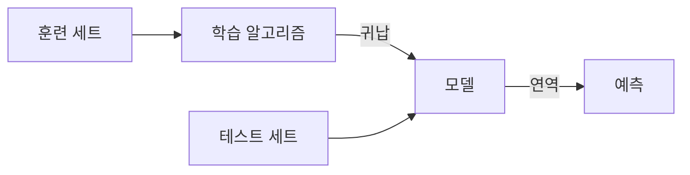

# 6장 — 지도 학습

[레포지토리 안내](../../README.ko.md) | [English](Concepts_Lecture.md) | [한국어](Concepts_Lecture.ko.md)

> **최종 수정일:** 2026-10-18

> **학습 목표:**
> 1. 군집화와 분류, 분류와 예측의 차이를 설명할 수 있다
> 2. 훈련 세트와 테스트 세트를 분리하는 이유를 과적합, 과소적합과 연결하여 설명할 수 있다
> 3. 테스트 세트 방법, LOOCV, K-겹 교차 검증의 장단점을 비교할 수 있다
> 4. 혼동 행렬로 민감도, 특이도, 정밀도, 정확도 같은 성능 지표를 계산할 수 있다
> 5. KNN으로 새 데이터를 분류하고 K의 선택이 결과에 주는 영향을 설명할 수 있다

---

## 목차

- [1. 분류의 정의](#1-분류의-정의)
  - [1.1 군집화 vs. 분류](#11-군집화-vs-분류)
- [2. 분류 vs. 예측](#2-분류-vs-예측)
  - [2.1 분류 (Classification)](#21-분류-classification)
  - [2.2 예측 (Prediction)](#22-예측-prediction)
- [3. 분류 실습 예제](#3-분류-실습-예제)
- [4. 일반적인 분류 절차](#4-일반적인-분류-절차)
  - [4.1 2단계 프로세스](#41-2단계-프로세스)
- [5. 훈련 세트와 테스트 세트](#5-훈련-세트와-테스트-세트)
  - [5.1 정의](#51-정의)
  - [5.2 귀납과 연역](#52-귀납과-연역)
- [6. 과적합](#6-과적합)
  - [6.1 정의](#61-정의)
  - [6.2 과적합이 발생하는 이유](#62-과적합이-발생하는-이유)
  - [6.3 과적합 vs. 과소적합](#63-과적합-vs-과소적합)
  - [6.4 회귀에서의 과적합](#64-회귀에서의-과적합)
  - [6.5 구체적인 MSE 비교 값](#65-구체적인-mse-비교-값)
  - [6.6 과적합의 시각적 특징](#66-과적합의-시각적-특징)
- [7. 검증 방법](#7-검증-방법)
  - [7.1 방법 비교](#71-방법-비교)
  - [7.2 Leave-One-Out 교차 검증 (LOOCV)](#72-leave-one-out-교차-검증-loocv)
  - [7.3 K-겹 교차 검증 (K-Fold Cross-Validation)](#73-k-겹-교차-검증-k-fold-cross-validation)
  - [7.4 편향-분산 트레이드오프 (Bias-Variance Trade-off)](#74-편향-분산-트레이드오프-bias-variance-trade-off)
- [8. 모델 성능 측정](#8-모델-성능-측정)
  - [8.1 가설 검정 프레임워크](#81-가설-검정-프레임워크)
  - [8.2 주요 측정 지표](#82-주요-측정-지표)
  - [8.3 오류 측정 지표](#83-오류-측정-지표)
  - [8.4 종합 성능](#84-종합-성능)
- [9. K-최근접 이웃 (KNN)](#9-k-최근접-이웃-knn)
  - [9.1 개요](#91-개요)
  - [9.2 거리 측정 (Distance Metric)](#92-거리-측정-distance-metric)
  - [9.3 시각적 직관](#93-시각적-직관)
  - [9.4 인스턴스 기반 (게으른) 학습](#94-인스턴스-기반-게으른-학습)
- [요약](#요약)
- [점검 문제](#점검-문제)

---

<br>

## 1. 분류의 정의

### 1.1 군집화 vs. 분류

| 측면 | 군집화 (Clustering) | 분류 (Classification) |
|------|-------------------|---------------------|
| 학습 유형 | **비지도 (Unsupervised)** 학습 | **지도 (Supervised)** 학습 |
| 클래스 | 사전에 알려지지 않음 | **사전 정의됨** |
| 목표 | 클래스 **발견** (새로운/미지의 클래스 식별) | 클래스 **예측** (알려진 클래스에 할당) |
| 성격 | 탐색적 분석 | 예측적 분석 |

*표 1. 군집화와 분류의 비교*

- **군집화 (Clustering)** 는 클래스 변수(범주형 반응 변수)를 생성하는 과정이다.
- **분류 (Classification)** 는 클래스 변수를 가진 모델을 수립하고, 그 모델로부터 클래스 변수를 예측하는 과정이다.

> **핵심:** 군집화는 데이터에서 알려지지 않은 그룹을 발견하고(비지도), 분류는 사전 정의된 그룹에 대한 소속을 예측한다(지도).

---

<br>

## 2. 분류 vs. 예측

### 2.1 분류 (Classification)

- 훈련 세트로 구축한 모델을 기반으로 데이터를 분류한다.
- **범주형 클래스**의 값을 분류 속성으로 사용한다.
- 새로운 데이터를 사전 정의된 범주에 할당한다.

### 2.2 예측 (Prediction)

- 훈련 세트로 구축한 모델을 기반으로 데이터를 예측한다.
- 클래스 변수의 **유형에 관계없이** 작동한다(연속형, 범주형, 생존 시간 등).

> **핵심:** 결과 변수의 유형이 다를 뿐, 분류와 예측은 본질적으로 동일한 과정이다. 분류는 구체적으로 범주형 결과를 지칭하며, 예측은 보다 일반적인 용어이다.

---

<br>

## 3. 분류 실습 예제

**교수 재직 데이터셋 (Faculty Tenure Dataset):**

| NAME | RANK | YEARS | TENURED |
|------|------|-------|---------|
| Mike | Assistant Prof | 3 | No |
| Mary | Associate Prof | 7 | Yes |
| Bill | Professor | 2 | Yes |
| Jim | Assistant Prof | 7 | Yes |
| Dave | Associate Prof | 6 | No |
| Anne | Associate Prof | 3 | No |
| Jeff | Professor | 4 | ? |

*표 2. 교수 재직 데이터셋과 분류할 새 인스턴스*

**추출된 규칙:** `IF rank = 'Professor' OR years > 6 THEN tenured = 'Yes'`

**Jeff 분류:** Jeff는 4년 경력의 Professor이다. `rank = 'Professor'`이므로 규칙이 발동되어, Jeff는 **"Yes" (재직)** 로 분류된다.

이 예제는 분류의 전체 파이프라인을 보여 준다. 알려진 레이블이 있는 훈련 데이터에서 규칙(모델)이 생성되고, 이 규칙이 새로운 미지의 인스턴스를 분류하는 데 적용된다.

---

<br>

## 4. 일반적인 분류 절차

분류 분석은 구조화된 파이프라인을 따른다.

```text
Data
  |
  v
Pre-processing
  - Standardization
  - Normalization
  - Transformation
  |
  v
Classifier Construction  <---->  Tuning Parameters (feedback loop)
  - Feature selection
  - Algorithm
  - Training data
  |
  v
Classifier Evaluation
  - Error rate
  - Testing data
  |
  v
Class Prediction
  - New case
```

*그림 1. 일반적인 분류 절차*

### 4.1 2단계 프로세스

**1단계: 모델 구축 (Model Construction)**
- 사전에 정해진 클래스 집합을 기술한다.
- 각 튜플(샘플)은 클래스 레이블 속성이 정하는 사전 정의된 클래스 중 하나에 속한다고 가정한다.
- 모델 구축에 사용하는 튜플의 집합을 **훈련 세트 (Training set)** 라고 한다.
- 모델은 분류 규칙, 의사 결정 트리 또는 수학적 공식으로 표현한다.

**2단계: 모델 사용 (Model Usage)**
- 미래의 또는 미지의 객체를 분류하는 데 사용한다.
- 테스트 샘플의 알려진 레이블을 모델의 분류 결과와 비교한다.
- **정확도 (Accuracy rate)** 는 모델이 올바르게 분류한 테스트 세트 샘플의 비율이다.
- 테스트 세트는 훈련 세트와 **독립적**이어야 한다. 그렇지 않으면 과적합(Overfitting)이 일어나도 평가에서 드러나지 않는다.

> **핵심:** 모델은 먼저 훈련 데이터로부터 구축(귀납)된 다음, 새로운 미지의 데이터를 분류하기 위해 적용(연역)된다. 신뢰성 있는 평가를 위해 훈련 데이터와 테스트 데이터는 반드시 분리되어야 한다.

---

<br>

## 5. 훈련 세트와 테스트 세트

### 5.1 정의

| 세트 | 목적 |
|------|------|
| **훈련 세트 (Training set)** | 분류 모델(분류기)을 구축하기 위해**만** 사용되는 데이터 |
| **테스트 세트 (Test set)** (검증 세트, Validation set) | 분류 모델의 성능을 평가하기 위해**만** 사용되는 데이터 |

*표 3. 훈련 세트와 테스트 세트의 용도*

> **참고:** 이 장은 테스트 세트와 검증 세트를 같은 뜻으로 쓴다. 모델 선택이나 매개변수 조정에 쓰는 검증 세트와 최종 성능 평가에만 쓰는 테스트 세트를 따로 두는 경우도 많다.

### 5.2 귀납과 연역

1. **귀납 (Induction)**: 학습 알고리즘이 훈련 세트를 처리하여 학습하고 모델을 생성한다.
2. **연역 (Deduction)**: 학습된 모델을 테스트 세트에 적용하여 예측을 수행한다.



*그림 2. 귀납으로 모델을 만들고 연역으로 적용하는 과정*

> **핵심:** 훈련 세트와 테스트 세트를 구분하지 않고 데이터를 사용하면 모델이 과적합(Overfitting)될 가능성이 높다. 이런 모델은 알려진 데이터에서는 잘 작동하지만 새로운 미지의 데이터에서는 성능이 저하된다.

---

<br>

## 6. 과적합

### 6.1 정의

통계학에서 과적합(Overfitting)이란 *"특정 데이터 세트에 너무 가깝거나 정확하게 대응하는 분석을 생성하여, 추가 데이터에 적합하거나 미래 관측을 신뢰성 있게 예측하는 데 실패할 수 있는 것"*이다.

- 과적합된 모델은 데이터로 정당화할 수 있는 것보다 더 많은 모수를 포함한다(**과매개변수화, Overparameterization**).
- 머신러닝에서는 이 현상을 **과훈련 (Overtraining)** 이라고도 한다.

### 6.2 과적합이 발생하는 이유

- 훈련 데이터는 입력에서 출력으로의 매핑에 대한 규칙성 정보를 포함하지만, **노이즈(Noise)** 도 포함한다.
- 목표값 자체를 신뢰할 수 없을 수 있다.
- **표본 오차 (Sampling error)**: 특정 훈련 사례들이 선택되었기 때문에 우연히 나타나는 규칙성이다.
- 모델을 적합할 때는 어떤 규칙성이 실제이고 어떤 것이 표본 오차에 의한 것인지 구분할 수 없으므로 두 종류를 모두 적합한다.
- 모델이 매우 유연하면 표본 오차까지 매우 잘 모델링하게 되며, 이는 재앙이다.

### 6.3 과적합 vs. 과소적합

| 문제 | 설명 |
|------|------|
| **과적합 (Overfitting)** | 훈련 세트에 지나치게 적합하여 실제 새 데이터에 대한 예측 성능이 저하된다 |
| **과소적합 (Underfitting)** | 모델이 너무 단순하여 훈련 오차와 테스트 오차가 모두 크다 |

*표 4. 과적합과 과소적합의 비교*

### 6.4 회귀에서의 과적합

세 가지 적합 방법을 비교하면 다음과 같다.

| 방법 | 훈련 데이터 적합도 | 일반화 (Generalization) |
|------|-------------------|----------------------|
| **선형 (Linear)** ($y = \beta_0 + \beta_1 x$) | 보통 | 양호 |
| **2차 (Quadratic)** ($y = \beta_0 + \beta_1 x + \beta_2 x^2$) | 더 좋음 | 더 좋음 |
| **구간별 선형 (Piecewise linear)** (비모수) | 완벽 | 나쁨 (과적합) |

*표 5. 세 가지 회귀 적합 방법의 훈련 데이터 적합도와 일반화*

- 핵심 질문은 어떤 방법이 데이터에 가장 잘 적합하느냐가 아니라 **"같은 분포에서 추출된 미래 데이터를 얼마나 잘 예측할 것인가?"** 이다.
- 테스트 세트 방법은 데이터의 약 30%를 무작위로 테스트 세트로 고르고, 나머지로 훈련한 뒤, 테스트 세트에서 평균 제곱 오차(MSE)로 평가한다.

### 6.5 구체적인 MSE 비교 값

**테스트 세트 방법:**

| 모델 | MSE |
|-------|-----|
| 선형 | 2.4 |
| 2차 | 0.9 |
| 구간별 선형 | 3.2 |

*표 6. 테스트 세트 방법으로 구한 모델별 MSE*

**LOOCV 방법:**

| 모델 | MSE |
|-------|-----|
| 선형 | 2.12 |
| 2차 | 0.962 |
| 구간별 선형 | 3.33 |

*표 7. LOOCV로 구한 모델별 MSE*

두 방법 모두 **2차 모델(Quadratic model)이 최선**임을 확인한다. 2차 모델은 훈련 데이터를 완벽하게 적합하지 않는데도 가장 낮은 테스트 오차를 달성하는 반면, 구간별 선형 모델은 훈련 데이터를 정확하게 보간하지만 일반화가 가장 나쁘다.

### 6.6 과적합의 시각적 특징

오차와 모델 복잡도의 관계를 그래프로 그리면 과적합의 특징적인 양상이 나타난다.

- **훈련 오차 (Training error)**: 모델 복잡도가 증가함에 따라 단조 **감소**한다(엄밀히는 증가하지 않는다). 모수를 더한 모델은 원래 모델을 특수한 경우로 포함하므로 훈련 데이터를 같거나 더 잘 적합하기 때문이다.
- **테스트 오차 (Test error)**: **U자형**이다. 처음에는 모델이 실제 패턴을 포착하면서 감소하고, 이후 모델이 노이즈를 적합하기 시작하면서 증가한다.

```text
 오차
  ^
  |  o
  |  *  o                                o
  |     *  o                          o
  |        *  o                    o
  |           *  o           o  o
  |              *  o  o  o
  |                 *  *
  |                       *  *  *
  |                                *  *  *
  +-----------------------------------------> 모델 복잡도
                       ^
     과소적합     최적 복잡도      과적합

  * 훈련 오차    o 테스트 오차
```

*그림 3. 모델 복잡도에 따른 훈련 오차와 테스트 오차*

훈련 오차와 테스트 오차 곡선이 **벌어지는** 지점이 과적합의 시작을 나타낸다. 최적의 모델 복잡도는 테스트 오차 곡선의 최솟값에 해당한다.

> **핵심:** 훈련 데이터를 완벽하게 적합하는 모델(구간별 보간 등)은 종종 새로운 데이터에서 성능이 저하된다. 목표는 잘 일반화되는 적절한 수준의 모델 복잡도를 찾는 것이다.

---

<br>

## 7. 검증 방법

### 7.1 방법 비교

아래 표에서 R은 데이터 포인트(레코드)의 수이다.

| 방법 | 단점 | 장점 |
|------|------|------|
| **테스트 세트 (Test-set)** | 분산: 미래 성능에 대한 불안정한 추정 | 저비용 |
| **Leave-one-out (LOOCV)** | 고비용; 일부 이상한 동작 있음 | 데이터 낭비 없음 |
| **10-겹 (10-fold)** | 데이터의 10% 낭비; 테스트 세트보다 10배 비용 | 10%만 낭비; R배가 아닌 10배만 비용 증가 |
| **3-겹 (3-fold)** | 10-겹보다 더 낭비; 테스트 세트보다 더 비쌈 | 테스트 세트보다 약간 나음 |
| **R-겹 (R-fold)** | Leave-one-out과 동일 | - |

*표 8. 검증 방법별 장단점*

### 7.2 Leave-One-Out 교차 검증 (LOOCV)

알고리즘은 다음과 같다.
1. k = 1부터 R(데이터 포인트 수)까지 다음을 반복한다.
   - $(x_k, y_k)$를 k번째 레코드로 둔다.
   - 데이터셋에서 $(x_k, y_k)$를 임시로 제거한다.
   - 나머지 R-1개 데이터 포인트로 훈련한다.
   - $(x_k, y_k)$에 대한 오차를 기록한다.
2. 평균 오차를 보고한다.

$$CV_{(n)} = \frac{1}{n} \sum_{i=1}^{n} MSE_i$$

여기서 n은 관측치 수(위 알고리즘의 R)이고, $MSE_i$는 i번째 관측치를 뺀 모델로 그 관측치를 예측했을 때의 제곱 오차이다.

특성은 다음과 같다.
- 테스트 세트 방법에 비해 편향이 훨씬 적어 테스트 오차율을 과대 추정하지 않는 경향이 있다.
- 분할에 무작위성이 없으므로 항상 동일한 결과를 낸다.
- 모델을 n번 적합해야 하므로 계산 집약적이다.
- OLS 회귀에는 모델을 한 번만 적합하고도 계산할 수 있는 축약 공식이 있다. 아래 식의 $\hat{Y}_i$는 전체 데이터로 적합한 값이고, $h_i$는 i번째 관측치의 레버리지(leverage)이다.

$$CV_{(n)} = \frac{1}{n} \sum_{i=1}^{n} \left( \frac{Y_i - \hat{Y}_i}{1 - h_i} \right)^2$$

### 7.3 K-겹 교차 검증 (K-Fold Cross-Validation)

- LOOCV가 계산 집약적이므로 그 대안으로 사용한다.
- 데이터 세트를 **K개의 겹 (fold)** 으로 무작위 분할한다(일반적으로 K = 5 또는 10).
- 각 겹이 번갈아 검증 세트 역할을 하고, 나머지 K-1개 겹을 훈련 데이터로 사용한다.
- 매번 보류된 겹에서 MSE를 계산한다.
- K개의 추정치를 평균하여 최종 검증 오차율을 얻는다.

```text
          겹 1     겹 2     겹 3     겹 4     겹 5
1회차     [검증]   [훈련]   [훈련]   [훈련]   [훈련]   ->  MSE_1
2회차     [훈련]   [검증]   [훈련]   [훈련]   [훈련]   ->  MSE_2
3회차     [훈련]   [훈련]   [검증]   [훈련]   [훈련]   ->  MSE_3
4회차     [훈련]   [훈련]   [훈련]   [검증]   [훈련]   ->  MSE_4
5회차     [훈련]   [훈련]   [훈련]   [훈련]   [검증]   ->  MSE_5
```

*그림 4. 5-겹 교차 검증에서 회차별 검증 겹의 배치*

$$CV_{(K)} = \sum_{k=1}^{K} \frac{n_k}{n} MSE_k$$

여기서 $n_k$는 k번째 겹의 관측치 수이므로, 겹의 크기가 모두 같으면 $CV_{(K)}$는 K개 MSE의 단순 평균이다.

### 7.4 편향-분산 트레이드오프 (Bias-Variance Trade-off)

- LOOCV는 K-겹 CV보다 계산 집약적이다.
- K < n일 때 LOOCV는 K-겹 CV보다 **편향이 더 적으므로** 편향 감소 관점에서는 LOOCV가 선호된다.
- K < n일 때 LOOCV는 K-겹 CV보다 **분산이 더 높다**. LOOCV의 n개 모델은 거의 같은 훈련 데이터로 적합되어 서로 강하게 상관되어 있으므로 그 평균의 분산이 크다.
- 그래서 보통 **K = 5 또는 K = 10**인 K-겹 CV를 사용하며, 이 값들은 편향과 분산의 균형을 맞춘 테스트 오차율 추정을 산출한다.

> **핵심:** LOOCV는 K = n인 K-겹 교차 검증의 특수한 경우이다. 실제로는 K = 5 또는 K = 10이 좋은 편향-분산 트레이드오프를 제공하며 계산적으로 실현 가능하다.

---

<br>

## 8. 모델 성능 측정

### 8.1 가설 검정 프레임워크

혼동 행렬(Confusion matrix)은 가설 검정에서 유래한다. 통계적 검정의 결과는 귀무가설을 기각하거나 기각하지 못하는 것이다.

- **$H_0$ (신호 부재)**: 귀무가설이며, 효과도 신호도 없다는 가설이다.
- **$H_1$ (신호 존재)**: 대립가설이며, 효과나 신호가 존재한다는 가설이다.

|  | $H_1$: 신호 존재 (Signal Present) | $H_0$: 신호 부재 (Signal Absent) |
|--|-------------------------------|-------------------------------|
| **탐지 (Detection)** | True Positive (TP) | False Positive (FP), 제1종 오류 (Type I error) |
| **귀무 결과 (Null Result)** | False Negative (FN), 제2종 오류 (Type II error) | True Negative (TN) |

*표 9. 검정의 판정과 실제 상태에 따른 혼동 행렬*

주요 관계는 다음과 같다.
- **TPF (True Positive Fraction) = Sensitivity (민감도) = Power (검정력)** = TP / (TP + FN)이며, 참 신호를 올바르게 탐지할 확률이다.
- **FPF (False Positive Fraction) = 1 - Specificity (특이도)** = FP / (FP + TN)이며, 신호가 없을 때 잘못 탐지할 확률이다.

### 8.2 주요 측정 지표

| 측정 지표 | 공식 | 다른 명칭 |
|-----------|------|----------|
| **TPR** (True Positive Rate, 참 양성률) | TP / (TP + FN) | Sensitivity (민감도), Power (검정력), Recall (재현율), Hit Rate |
| **TNR** (True Negative Rate, 참 음성률) | TN / (TN + FP) | Specificity (특이도) |
| **PPV** (Positive Predictive Value, 양성 예측도) | TP / (TP + FP) | Precision (정밀도) |
| **NPV** (Negative Predictive Value, 음성 예측도) | TN / (TN + FN) | - |

*표 10. 주요 측정 지표*

### 8.3 오류 측정 지표

| 측정 지표 | 공식 | 관계 |
|-----------|------|------|
| **FNR** (False Negative Rate, 위음성률) | FN / (FN + TP) | = 1 - TPR (Miss Rate) |
| **FPR** (False Positive Rate, 위양성률) | FP / (FP + TN) | = 1 - TNR (Fall-out) |
| **FDR** (False Discovery Rate, 허위 발견률) | FP / (FP + TP) | = 1 - PPV |
| **FOR** (False Omission Rate, 허위 누락률) | FN / (FN + TN) | = 1 - NPV |

*표 11. 오류 측정 지표*

### 8.4 종합 성능

| 측정 지표 | 공식 |
|-----------|------|
| **ACC** (Accuracy, 정확도) | (TP + TN) / (TP + TN + FP + FN) |
| **ERR** (Error Rate, 오류율) | (FP + FN) / (TP + TN + FP + FN) = 1 - ACC |

*표 12. 종합 성능 지표*

> **핵심:** Sensitivity (민감도, TPR)와 Specificity (특이도, TNR)는 통계학과 데이터 과학에서 가장 널리 사용되는 측정 지표이다. 혼동 행렬을 이해하는 것은 모든 분류 모델을 평가하는 데 필수적이다.

---

<br>

## 9. K-최근접 이웃 (KNN)

### 9.1 개요

- KNN은 간단한 휴리스틱 분류 알고리즘이다.
- **K개의 최근접 이웃 중 다수결 클래스**를 기반으로 새 데이터 포인트를 분류한다.
- **다중 클래스**를 그대로 고려할 수 있다는 것이 큰 장점이다.
- K의 선택은 모델 복잡도에 영향을 준다.
  - K가 작을수록 모델이 더 유연해지고 과적합(Overfitting) 위험이 커진다.
  - K가 클수록 결정 경계가 더 부드러워지고 과소적합(Underfitting) 위험이 커진다.

### 9.2 거리 측정 (Distance Metric)

KNN은 "최근접"을 거리 측정으로 결정하며, 일반적으로 **유클리드 거리 (Euclidean distance)** 를 사용한다. 아래 식에서 p는 특성(변수)의 수이다.

$$d(\mathbf{x}, \mathbf{y}) = \sqrt{\sum_{i=1}^{p} (x_i - y_i)^2}$$

알고리즘은 새 포인트에서 모든 훈련 포인트까지의 거리를 계산한 다음, 가장 가까운 K개를 선택한다.

> **주의:** 거리는 변수의 척도에 직접 영향을 받는다. 범위가 큰 변수가 거리를 지배하지 않도록, 4절의 전처리 단계에서 변수를 표준화하거나 정규화한 뒤 KNN을 적용하는 것이 일반적이다.

### 9.3 시각적 직관

녹색 원(?)을 두 클래스(파란색 사각형, 빨간색 삼각형) 중 하나로 분류하는 경우를 살펴본다.
- **K = 3** (안쪽 원): 3개의 최근접 이웃이 빨간색 삼각형 2개와 파란색 사각형 1개라면 삼각형 클래스로 분류된다.
- **K = 7** (바깥쪽 원): 7개의 최근접 이웃에 파란색 사각형 4개와 빨간색 삼각형 3개가 들어 있다면 분류가 사각형 클래스로 뒤바뀐다.

K의 선택은 결정 경계를 근본적으로 변화시킨다.

### 9.4 인스턴스 기반 (게으른) 학습

KNN을 **인스턴스 기반 (Instance-based)** 또는 **게으른 학습 (Lazy learning)** 이라고 부르는 이유와 그에 따른 비용은 다음과 같다.
- 훈련 중에 **명시적 모델을 구축하지 않고** 단순히 **모든 훈련 데이터를 저장**한다.
- 모든 계산이 분류 시점으로 미뤄진다.
- **계산 비용**: 새 쿼리마다 저장된 모든 훈련 포인트까지의 거리를 계산해야 하므로 예측 시 비용이 높다.
- **메모리 비용**: 전체 훈련 데이터셋을 저장해야 한다.

> **핵심:** KNN은 기저 데이터 분포에 대한 가정을 하지 않는 인스턴스 기반(게으른) 학습 알고리즘이다. 단순히 훈련 데이터를 저장하고 최근접 이웃을 찾아 새 포인트를 분류한다.

---

<br>

## 요약

| 개념 | 핵심 요약 |
|------|------|
| 군집화 vs. 분류 (Clustering vs. Classification) | 군집화는 그룹을 발견하는 비지도 학습이고, 분류는 사전 정의된 그룹을 예측하는 지도 학습이다. |
| 분류 vs. 예측 (Classification vs. Prediction) | 본질적으로 같은 과정이며, 분류는 구체적으로 범주형 결과를 예측하는 경우를 가리킨다. |
| 2단계 프로세스 (Two-step process) | 1단계에서 훈련 세트로 모델을 구축하고, 2단계에서 그 모델을 예측에 사용한다. |
| 훈련 vs. 테스트 세트 (Training vs. Test set) | 훈련 세트는 모델을 구축하고 테스트 세트는 모델을 평가하며, 두 세트는 반드시 독립적이어야 한다. |
| 과적합 (Overfitting) | 모델이 훈련 데이터에 지나치게 적합하여 일반화에 실패하는 현상이며, 과매개변수화가 원인이다. |
| 과소적합 (Underfitting) | 모델이 너무 단순하여 훈련 오차와 테스트 오차가 모두 큰 상태이다. |
| LOOCV | 관측치 하나를 빼고 나머지로 훈련하는 과정을 n번 반복하며, 편향이 낮고 분산이 높다. |
| K-겹 CV (K-Fold CV) | 데이터를 K개의 겹으로 나누어 검증하며, 편향과 분산의 균형을 위해 K = 5 또는 10을 권장한다. |
| 혼동 행렬 (Confusion matrix) | TP, TN, FP, FN이 정확도, 민감도, 특이도, 정밀도의 기초가 된다. |
| KNN | K개의 최근접 이웃의 다수결로 분류하며, 다중 클래스를 지원한다. |

---

<br>

## 점검 문제

1. **혼동 행렬 계산:** 어떤 분류기를 테스트 샘플 200개에 적용하여 TP = 40, FN = 10, FP = 20, TN = 130을 얻었다. 민감도, 특이도, 정밀도, 정확도를 구하라.

   <details>
   <summary>정답</summary>

   민감도(TPR)는 40 / (40 + 10) = 0.8이다. 특이도(TNR)는 130 / (130 + 20) ≈ 0.867이다. 정밀도(PPV)는 40 / (40 + 20) ≈ 0.667이다. 정확도는 (40 + 130) / 200 = 0.85이다. 정확도는 0.85로 높지만 양성으로 예측한 60개 중 20개(3분의 1)가 위양성이므로, 한 지표만으로 분류기를 판단하면 안 된다.

   </details>

2. **규칙 기반 분류:** 3절의 규칙 `IF rank = 'Professor' OR years > 6 THEN tenured = 'Yes'`로 (a) 경력 8년의 Associate Prof와 (b) 경력 6년의 Assistant Prof를 분류하라.

   <details>
   <summary>정답</summary>

   (a)는 rank가 Professor가 아니지만 years = 8 > 6이므로 조건을 만족하여 Yes로 분류된다. (b)는 rank가 Professor가 아니고 years = 6은 6보다 크지 않으므로 No로 분류된다. 부등호가 >이므로 경계값 6년은 조건에 포함되지 않으며, 훈련 데이터의 Dave(Associate Prof, 6년, No)도 같은 이유로 규칙과 일치한다.

   </details>

3. **교차 검증의 계산량과 추정치:** 관측치 200개로 5-겹 교차 검증과 LOOCV를 할 때 각각 모델을 몇 번 적합하고, 한 번에 몇 개의 관측치로 훈련하는가? 또 크기가 같은 다섯 겹의 MSE가 2.0, 2.5, 1.5, 3.0, 2.0이면 $CV_{(5)}$는 얼마인가?

   <details>
   <summary>정답</summary>

   5-겹 교차 검증은 모델을 5번 적합하며, 매번 160개로 훈련하고 나머지 40개로 검증한다. LOOCV는 모델을 200번 적합하며, 매번 199개로 훈련하고 1개로 검증한다. 겹의 크기가 같으면 $n_k / n = 1/5$이므로 $CV_{(5)} = (2.0 + 2.5 + 1.5 + 3.0 + 2.0) / 5 = 11.0 / 5 = 2.2$이다.

   </details>

4. **과적합 판단:** 6.5절의 LOOCV 결과(선형 2.12, 2차 0.962, 구간별 선형 3.33)에서 구간별 선형 모델은 훈련 데이터를 완벽하게 적합하는데도 선택되지 않는다. 그 이유를 훈련 오차와 테스트 오차의 관계로 설명하라.

   <details>
   <summary>정답</summary>

   구간별 선형 모델은 모든 훈련 점을 지나므로 훈련 오차가 0이지만, 노이즈와 표본 오차까지 적합한 과적합 상태이다. 그래서 학습에 쓰지 않은 관측치에 대한 오차인 LOOCV의 MSE가 3.33으로 세 모델 중 가장 크다. 모델 선택의 기준은 훈련 데이터 적합도가 아니라 같은 분포에서 나온 새 데이터에 대한 예측 오차이므로, 그 값이 0.962로 가장 작은 2차 모델을 선택한다.

   </details>

5. **KNN 분류:** 훈련 데이터가 빨강 클래스 (1, 2), (2, 4), (3, 1)과 파랑 클래스 (4, 3), (5, 5), (3, 6)이다. 새 점 (3, 3)을 유클리드 거리로 K = 1, 3, 5일 때 각각 분류하라.

   <details>
   <summary>정답</summary>

   (3, 3)까지의 거리는 (4, 3)이 1, (2, 4)가 $\sqrt{2} \approx 1.41$, (3, 1)이 2, (1, 2)가 $\sqrt{5} \approx 2.24$, (5, 5)가 $\sqrt{8} \approx 2.83$, (3, 6)이 3이다. K = 1이면 가장 가까운 (4, 3)이 파랑이므로 파랑으로 분류된다. K = 3이면 파랑 1개, 빨강 2개이므로 빨강으로 분류된다. K = 5이면 파랑 2개, 빨강 3개이므로 빨강으로 분류된다. 같은 점이라도 K에 따라 분류 결과가 달라진다.

   </details>
