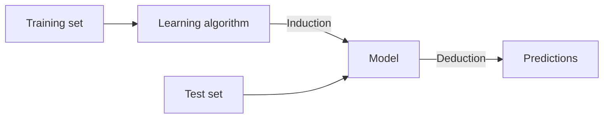

# Chapter 6 — Supervised Learning

[Repository Guide](../../README.md) | [English](Concepts_Lecture.md) | [한국어](Concepts_Lecture.ko.md)

> **Last Updated:** 2026-10-26

> **Learning Objectives:**
> 1. Explain how clustering differs from classification and how classification differs from prediction
> 2. Explain why training and test sets are separated, relating it to overfitting and underfitting
> 3. Compare the strengths and weaknesses of the test-set method, LOOCV, and K-fold cross-validation
> 4. Compute performance measures such as sensitivity, specificity, precision, and accuracy from a confusion matrix
> 5. Classify new data with KNN and explain how the choice of K affects the result

---

## Table of Contents

- [1. Definition of Classification](#1-definition-of-classification)
  - [1.1 Clustering vs. Classification](#11-clustering-vs-classification)
- [2. Classification vs. Prediction](#2-classification-vs-prediction)
  - [2.1 Classification](#21-classification)
  - [2.2 Prediction](#22-prediction)
- [3. Classification Worked Example](#3-classification-worked-example)
- [4. General Classification Process](#4-general-classification-process)
  - [4.1 Two-Step Process](#41-two-step-process)
- [5. Training Set and Test Set](#5-training-set-and-test-set)
  - [5.1 Definitions](#51-definitions)
  - [5.2 Induction and Deduction](#52-induction-and-deduction)
- [6. Overfitting](#6-overfitting)
  - [6.1 Definition](#61-definition)
  - [6.2 Why Overfitting Happens](#62-why-overfitting-happens)
  - [6.3 Overfitting vs. Underfitting](#63-overfitting-vs-underfitting)
  - [6.4 Overfitting in Regression](#64-overfitting-in-regression)
  - [6.5 Specific MSE Comparison Values](#65-specific-mse-comparison-values)
  - [6.6 Overfitting Visual Description](#66-overfitting-visual-description)
- [7. Validation Methods](#7-validation-methods)
  - [7.1 Comparison of Methods](#71-comparison-of-methods)
  - [7.2 Leave-One-Out Cross Validation (LOOCV)](#72-leave-one-out-cross-validation-loocv)
  - [7.3 K-Fold Cross-Validation](#73-k-fold-cross-validation)
  - [7.4 Bias-Variance Trade-off](#74-bias-variance-trade-off)
- [8. Measuring Model Performance](#8-measuring-model-performance)
  - [8.1 Hypothesis Testing Framing](#81-hypothesis-testing-framing)
  - [8.2 Primary Measures](#82-primary-measures)
  - [8.3 Error Measures](#83-error-measures)
  - [8.4 Overall Performance](#84-overall-performance)
- [9. K-Nearest Neighbors (KNN)](#9-k-nearest-neighbors-knn)
  - [9.1 Overview](#91-overview)
  - [9.2 Distance Metric](#92-distance-metric)
  - [9.3 Visual Intuition](#93-visual-intuition)
  - [9.4 Instance-Based (Lazy) Learning](#94-instance-based-lazy-learning)
- [Summary](#summary)
- [Self-Check Questions](#self-check-questions)

---

<br>

## 1. Definition of Classification

### 1.1 Clustering vs. Classification

| Aspect | Clustering | Classification |
|--------|-----------|----------------|
| Learning type | **Unsupervised** learning | **Supervised** learning |
| Classes | Unknown a priori | **Predefined** |
| Goal | Class **discovery** (identification of new/unknown classes) | Class **prediction** (assignment into known classes) |
| Nature | Exploratory analysis | Predictive analysis |

*Table 1. Comparison of clustering and classification*

- **Clustering** is the process of generating class variables (categorical response variables).
- **Classification** is the process of establishing a model with a class variable and predicting the class variable from the model.

> **Key Point:** Clustering discovers unknown groups in data (unsupervised), while classification predicts membership in predefined groups (supervised).

---

<br>

## 2. Classification vs. Prediction

### 2.1 Classification

- It classifies data based on the model constructed from the training set.
- It uses values in a **categorical class** as the classifying attribute.
- It assigns new data into predefined categories.

### 2.2 Prediction

- It predicts data based on the model constructed from the training set.
- It works **regardless of the type of class variable** (continuous, categorical, survival time, etc.).

> **Key Point:** Apart from the type of outcome variable, classification and prediction are essentially the same process. Classification specifically refers to categorical outcomes, while prediction is the more general term.

---

<br>

## 3. Classification Worked Example

**Faculty Tenure Dataset:**

| NAME | RANK | YEARS | TENURED |
|------|------|-------|---------|
| Mike | Assistant Prof | 3 | No |
| Mary | Associate Prof | 7 | Yes |
| Bill | Professor | 2 | Yes |
| Jim | Assistant Prof | 7 | Yes |
| Dave | Associate Prof | 6 | No |
| Anne | Associate Prof | 3 | No |
| Jeff | Professor | 4 | ? |

*Table 2. Faculty tenure dataset and a new instance to classify*

**Extracted Rule:** `IF rank = 'Professor' OR years > 6 THEN tenured = 'Yes'`

**Classify Jeff:** Jeff is a Professor with 4 years. Since `rank = 'Professor'`, the rule fires, and Jeff is classified as **"Yes" (tenured)**.

This example illustrates the full classification pipeline. Training data with known labels produces a rule (model), which is then applied to classify a new, unseen instance.

---

<br>

## 4. General Classification Process

The classification analysis follows a structured pipeline.

```text
Data
  |
  v
Pre-processing
  - Standardization
  - Normalization
  - Transformation
  |
  v
Classifier Construction  <---->  Tuning Parameters (feedback loop)
  - Feature selection
  - Algorithm
  - Training data
  |
  v
Classifier Evaluation
  - Error rate
  - Testing data
  |
  v
Class Prediction
  - New case
```

*Figure 1. General classification process*

### 4.1 Two-Step Process

**Step 1: Model Construction**
- It describes a set of predetermined classes.
- Each tuple (sample) is assumed to belong to one of the predefined classes, as determined by the class label attribute.
- The set of tuples used for model construction is called the **training set**.
- The model is represented as classification rules, decision trees, or mathematical formulae.

**Step 2: Model Usage**
- The model is used for classifying future or unknown objects.
- The known label of each test sample is compared with the classified result from the model.
- **Accuracy rate** is the percentage of test set samples correctly classified by the model.
- The test set must be **independent** of the training set. Otherwise, overfitting goes undetected in the evaluation.

> **Key Point:** The model is first built (induced) from training data, then applied (deduced) to classify new, unseen data. Training and testing data must remain separate to ensure reliable evaluation.

---

<br>

## 5. Training Set and Test Set

### 5.1 Definitions

| Set | Purpose |
|-----|---------|
| **Training set** | Data used **only** for building classification models (classifier) |
| **Test set** (Validation set) | Data used **only** to evaluate the performance of classification models |

*Table 3. Purposes of the training set and the test set*

> **Note:** This chapter uses test set and validation set interchangeably. Many workflows keep them separate: a validation set for model selection or parameter tuning, and a test set used only for the final performance evaluation.

### 5.2 Induction and Deduction

1. **Induction**: A learning algorithm processes the training set to learn and produce a model.
2. **Deduction**: The learned model is applied to the test set to make predictions.



*Figure 2. Building a model by induction and applying it by deduction*

> **Key Point:** If data is used without distinguishing between training and test sets, the model will likely overfit. Such a model performs well on known data but poorly on new, unseen data.

---

<br>

## 6. Overfitting

### 6.1 Definition

In statistics, overfitting is *"the production of an analysis that corresponds too closely or exactly to a particular set of data, and may therefore fail to fit additional data or predict future observations reliably."*

- An overfitted model contains more parameters than can be justified by the data (**overparameterization**).
- In machine learning, this phenomenon is sometimes called **overtraining**.

### 6.2 Why Overfitting Happens

- Training data contains information about regularities in the mapping from input to output, but it also contains **noise**.
- The target values themselves may be unreliable.
- There is **sampling error**: accidental regularities appear just because of the particular training cases chosen.
- When fitting a model, it cannot tell which regularities are real and which are caused by sampling error, so it fits both kinds.
- If the model is very flexible, it can model even the sampling error very well, which is a disaster.

### 6.3 Overfitting vs. Underfitting

| Problem | Description |
|---------|-------------|
| **Overfitting** | Too much fit to the training set, resulting in poor prediction on real new data |
| **Underfitting** | Model is too simple; both training and test errors are large |

*Table 4. Comparison of overfitting and underfitting*

### 6.4 Overfitting in Regression

Three fitting approaches compare as follows.

| Method | Fit to Training Data | Generalization |
|--------|---------------------|----------------|
| **Linear** ($y = \beta_0 + \beta_1 x$) | Moderate | Good |
| **Quadratic** ($y = \beta_0 + \beta_1 x + \beta_2 x^2$) | Better | Better |
| **Piecewise linear** (non-parametric) | Perfect | Poor (overfitting) |

*Table 5. Fit to training data and generalization of three regression fitting approaches*

- The key question is not which method best fits the data, but **"How well are you going to predict future data drawn from the same distribution?"**
- The test set method randomly chooses about 30% of the data as a test set, trains on the remainder, and then evaluates using Mean Squared Error (MSE) on the test set.

### 6.5 Specific MSE Comparison Values

**Test-set method:**

| Model | MSE |
|-------|-----|
| Linear | 2.4 |
| Quadratic | 0.9 |
| Piecewise | 3.2 |

*Table 6. MSE of each model from the test-set method*

**LOOCV method:**

| Model | MSE |
|-------|-----|
| Linear | 2.12 |
| Quadratic | 0.962 |
| Piecewise | 3.33 |

*Table 7. MSE of each model from LOOCV*

Both methods confirm that the **quadratic model is best**. It achieves the lowest test error despite not fitting the training data perfectly, whereas the piecewise model interpolates the training data exactly but generalizes worst.

### 6.6 Overfitting Visual Description

The characteristic signature of overfitting is visible when plotting error vs. model complexity.

- **Training error**: It is monotonically **decreasing** as model complexity increases (strictly, non-increasing). A model with added parameters contains the original model as a special case, so it fits the training data at least as well.
- **Test error**: It is **U-shaped**. It initially decreases as the model captures real patterns, then increases as the model starts fitting noise.

```text
 Error
  ^
  |  o
  |  *  o                                o
  |     *  o                          o
  |        *  o                    o
  |           *  o           o  o
  |              *  o  o  o
  |                 *  *
  |                       *  *  *
  |                                *  *  *
  +-----------------------------------------> Model complexity
                       ^
     Underfitting   Optimal        Overfitting

  * Training error    o Test error
```

*Figure 3. Training error and test error by model complexity*

The point where training and test error curves **diverge** marks the onset of overfitting. The optimal model complexity is at the minimum of the test error curve.

> **Key Point:** A model that fits training data perfectly (like piecewise interpolation) often performs poorly on new data. The goal is to find the right balance of model complexity that generalizes well.

---

<br>

## 7. Validation Methods

### 7.1 Comparison of Methods

In the table below, R is the number of data points (records).

| Method | Downside | Upside |
|--------|----------|--------|
| **Test-set** | Variance: unreliable estimate of future performance | Cheap |
| **Leave-one-out (LOOCV)** | Expensive; has some weird behavior | Does not waste data |
| **10-fold** | Wastes 10% of data; 10 times more expensive than test set | Only wastes 10%; only 10 times more expensive instead of R times |
| **3-fold** | Wastes more data than 10-fold; more expensive than test set | Slightly better than test-set |
| **R-fold** | Identical to Leave-one-out | - |

*Table 8. Strengths and weaknesses of validation methods*

### 7.2 Leave-One-Out Cross Validation (LOOCV)

The algorithm is as follows.
1. For k = 1 to R (number of data points), repeat the following.
   - Let $(x_k, y_k)$ be the k-th record.
   - Temporarily remove $(x_k, y_k)$ from the dataset.
   - Train on the remaining R-1 data points.
   - Note the error for $(x_k, y_k)$.
2. Report the mean error.

$$CV_{(n)} = \frac{1}{n} \sum_{i=1}^{n} MSE_i$$

Here n is the number of observations (R in the algorithm above), and $MSE_i$ is the squared error when the model fit without the i-th observation predicts that observation.

Its properties are as follows.
- Compared with the test-set method, it has far less bias and tends not to overestimate the test error rate as much.
- It always yields the same results because the splits involve no randomness.
- It is computationally intensive because the model must be fit n times.
- For OLS regression, a shortcut formula computes it from a single fit. In the formula below, $\hat{Y}_i$ is the fitted value from the full data and $h_i$ is the leverage of the i-th observation.

$$CV_{(n)} = \frac{1}{n} \sum_{i=1}^{n} \left( \frac{Y_i - \hat{Y}_i}{1 - h_i} \right)^2$$

### 7.3 K-Fold Cross-Validation

- It is used as an alternative because LOOCV is computationally intensive.
- Randomly divide the data set into **K folds** (typically K = 5 or 10).
- Each fold takes a turn as the validation set, while the remaining K-1 folds serve as training data.
- The MSE is computed on the held-out fold each time.
- Average the K estimates to get the final validation error rate.

```text
          Fold 1   Fold 2   Fold 3   Fold 4   Fold 5
Round 1   [ Val ]  [Train]  [Train]  [Train]  [Train]  ->  MSE_1
Round 2   [Train]  [ Val ]  [Train]  [Train]  [Train]  ->  MSE_2
Round 3   [Train]  [Train]  [ Val ]  [Train]  [Train]  ->  MSE_3
Round 4   [Train]  [Train]  [Train]  [ Val ]  [Train]  ->  MSE_4
Round 5   [Train]  [Train]  [Train]  [Train]  [ Val ]  ->  MSE_5
```

*Figure 4. Placement of the validation fold in each round of 5-fold cross-validation*

$$CV_{(K)} = \sum_{k=1}^{K} \frac{n_k}{n} MSE_k$$

Here $n_k$ is the number of observations in the k-th fold, so when all folds have the same size, $CV_{(K)}$ is the simple average of the K MSE values.

### 7.4 Bias-Variance Trade-off

- LOOCV is more computationally intensive than K-fold CV.
- When K < n, LOOCV has **less bias** than K-fold CV, so it is preferred from the bias reduction perspective.
- When K < n, LOOCV has **higher variance** than K-fold CV. The n models of LOOCV are fit on nearly identical training data and are therefore highly correlated, so their average has high variance.
- We therefore tend to use K-fold CV with **K = 5 or K = 10**, as these values yield test error rate estimates that balance bias and variance.

> **Key Point:** LOOCV is a special case of K-fold cross-validation where K = n. In practice, K = 5 or K = 10 provides a good bias-variance trade-off and is computationally feasible.

---

<br>

## 8. Measuring Model Performance

### 8.1 Hypothesis Testing Framing

The confusion matrix originates from hypothesis testing. A statistical test result either rejects or fails to reject the null hypothesis.

- **$H_0$ (signal absent)**: the null hypothesis, which states that there is no effect and no signal.
- **$H_1$ (signal present)**: the alternative hypothesis, which states that an effect or signal exists.

|  | $H_1$: Signal Present | $H_0$: Signal Absent |
|--|---------------------|-------------------|
| **Detection** | True Positive (TP) | False Positive (FP), Type I error |
| **Null Result** | False Negative (FN), Type II error | True Negative (TN) |

*Table 9. Confusion matrix by test decision and true state*

Key connections are as follows.
- **TPF (True Positive Fraction) = Sensitivity = Power** = TP / (TP + FN), the probability of correctly detecting a true signal.
- **FPF (False Positive Fraction) = 1 - Specificity** = FP / (FP + TN), the probability of falsely detecting a signal when none exists.

> **[Probability and Statistics]** In hypothesis testing, a Type I error rejects a true null hypothesis, and the significance level $\alpha$ sets an upper bound on its probability. A Type II error fails to reject a false null hypothesis; if its probability is $\beta$, the power of the test is $1 - \beta$. In the confusion matrix, the FPF corresponds to this $\alpha$ and the sensitivity (TPF) to the power.

### 8.2 Primary Measures

| Measure | Formula | Also Known As |
|---------|---------|---------------|
| **TPR** (True Positive Rate) | TP / (TP + FN) | Sensitivity, Power, Recall, Hit Rate |
| **TNR** (True Negative Rate) | TN / (TN + FP) | Specificity |
| **PPV** (Positive Predictive Value) | TP / (TP + FP) | Precision |
| **NPV** (Negative Predictive Value) | TN / (TN + FN) | - |

*Table 10. Primary measures*

### 8.3 Error Measures

| Measure | Formula | Relationship |
|---------|---------|-------------|
| **FNR** (False Negative Rate) | FN / (FN + TP) | = 1 - TPR (Miss Rate) |
| **FPR** (False Positive Rate) | FP / (FP + TN) | = 1 - TNR (Fall-out) |
| **FDR** (False Discovery Rate) | FP / (FP + TP) | = 1 - PPV |
| **FOR** (False Omission Rate) | FN / (FN + TN) | = 1 - NPV |

*Table 11. Error measures*

### 8.4 Overall Performance

| Measure | Formula |
|---------|---------|
| **ACC** (Accuracy) | (TP + TN) / (TP + TN + FP + FN) |
| **ERR** (Error Rate) | (FP + FN) / (TP + TN + FP + FN) = 1 - ACC |

*Table 12. Overall performance measures*

> **Key Point:** Sensitivity (TPR) and specificity (TNR) are the most widely used measures in statistics and data science. Understanding the confusion matrix is essential for evaluating any classification model.

---

<br>

## 9. K-Nearest Neighbors (KNN)

### 9.1 Overview

- KNN is a simple heuristic classification algorithm.
- It classifies a new data point based on the **majority class among its K nearest neighbors**.
- A huge advantage is that **multiple classes** can be considered directly.
- The choice of K affects model complexity.
  - A small K makes the model more flexible and raises the risk of overfitting.
  - A large K makes the decision boundary smoother and raises the risk of underfitting.

### 9.2 Distance Metric

KNN determines "nearest" using a distance metric, typically **Euclidean distance**. In the formula below, p is the number of features (variables).

$$d(\mathbf{x}, \mathbf{y}) = \sqrt{\sum_{i=1}^{p} (x_i - y_i)^2}$$

The algorithm computes the distance from the new point to every training point, then selects the K closest ones.

> **Caution:** Distances depend directly on the scale of each variable. To keep variables with large ranges from dominating the distance, it is common to standardize or normalize the variables in the pre-processing step of Section 4 before applying KNN.

### 9.3 Visual Intuition

Consider classifying a new point of unknown class (a green circle) into one of two classes: blue squares and red triangles. A circle centered at the new point that contains its K nearest neighbors grows larger as K increases.
- **K = 3** (smaller circle): If the 3 nearest neighbors are 2 red triangles and 1 blue square, the point is classified into the triangle class.
- **K = 7** (larger circle): If the 7 nearest neighbors include 4 blue squares and 3 red triangles, the classification flips to the square class.

The choice of K fundamentally changes the decision boundary.

### 9.4 Instance-Based (Lazy) Learning

KNN is called **instance-based** or **lazy learning** for the following reasons, which also determine its costs.
- It does **not build an explicit model** during training; it simply **stores all training data**.
- All computation is deferred to classification time.
- **Computational cost**: high at prediction time because it must compute distances to all stored training points for every new query.
- **Memory cost**: it must store the entire training dataset.

> **Key Point:** KNN is an instance-based (lazy) learning algorithm that makes no assumptions about the underlying data distribution. It simply stores training data and classifies new points by finding the nearest neighbors.

---

<br>

## Summary

| Concept | Key Summary |
|---------|-----------|
| Clustering vs. Classification | Clustering is unsupervised learning that discovers groups, while classification is supervised learning that predicts predefined groups. |
| Classification vs. Prediction | They are essentially the same process, and classification specifically refers to predicting categorical outcomes. |
| Two-step process | Step 1 constructs a model from the training set, and Step 2 uses the model for prediction. |
| Training vs. Test set | The training set builds the model and the test set evaluates it, and the two sets must be independent. |
| Overfitting | It is the failure to generalize when a model fits the training data too closely, and it is caused by overparameterization. |
| Underfitting | It is the state in which a model is too simple and both training and test errors are large. |
| LOOCV | It leaves one observation out, trains on the rest, and repeats n times, giving low bias and high variance. |
| K-Fold CV | It divides the data into K folds for validation, and K = 5 or 10 is recommended for bias-variance balance. |
| Confusion matrix | Its counts TP, TN, FP, and FN form the basis for accuracy, sensitivity, specificity, and precision. |
| KNN | It classifies by the majority vote of the K nearest neighbors and supports multiple classes. |

---

<br>

## Self-Check Questions

1. **Confusion matrix calculation:** A classifier applied to 200 test samples gives TP = 40, FN = 10, FP = 20, and TN = 130. Find the sensitivity, specificity, precision, and accuracy.

   <details>
   <summary>Answer</summary>

   Sensitivity (TPR) is 40 / (40 + 10) = 0.8. Specificity (TNR) is 130 / (130 + 20) ≈ 0.867. Precision (PPV) is 40 / (40 + 20) ≈ 0.667. Accuracy is (40 + 130) / 200 = 0.85. Accuracy is high at 0.85, but 20 of the 60 positive predictions (one third) are false positives, so a classifier should not be judged by a single measure.

   </details>

2. **Rule-based classification:** Use the rule from Section 3, `IF rank = 'Professor' OR years > 6 THEN tenured = 'Yes'`, to classify (a) an Associate Prof with 8 years and (b) an Assistant Prof with 6 years.

   <details>
   <summary>Answer</summary>

   (a) The rank is not Professor, but years = 8 > 6 satisfies the condition, so it is classified as Yes. (b) The rank is not Professor and years = 6 is not greater than 6, so it is classified as No. Because the inequality is >, the boundary value of 6 years does not satisfy the condition, and Dave (Associate Prof, 6 years, No) in the training data agrees with the rule for the same reason.

   </details>

3. **Cost and estimate of cross-validation:** With 200 observations, how many times is the model fit and how many observations does each fit train on for 5-fold cross-validation and for LOOCV? If five equal-sized folds give MSE values of 2.0, 2.5, 1.5, 3.0, and 2.0, what is $CV_{(5)}$?

   <details>
   <summary>Answer</summary>

   5-fold cross-validation fits the model 5 times, each time training on 160 observations and validating on the remaining 40. LOOCV fits the model 200 times, each time training on 199 observations and validating on 1. With equal-sized folds, $n_k / n = 1/5$, so $CV_{(5)} = (2.0 + 2.5 + 1.5 + 3.0 + 2.0) / 5 = 11.0 / 5 = 2.2$.

   </details>

4. **Judging overfitting:** In the LOOCV results of Section 6.5 (linear 2.12, quadratic 0.962, piecewise linear 3.33), the piecewise linear model is not chosen even though it fits the training data perfectly. Explain why in terms of the relationship between training error and test error.

   <details>
   <summary>Answer</summary>

   The piecewise linear model passes through every training point, so its training error is 0, but it overfits by fitting noise and sampling error as well. As a result, its LOOCV MSE, which measures error on observations not used for training, is 3.33, the largest of the three models. Model selection is based on prediction error on new data from the same distribution rather than on fit to the training data, so the quadratic model, with the smallest value of 0.962, is chosen.

   </details>

5. **KNN classification:** The training data consist of the red class (1, 2), (2, 4), (3, 1) and the blue class (4, 3), (5, 5), (3, 6). Classify the new point (3, 3) with Euclidean distance for K = 1, 3, and 5.

   <details>
   <summary>Answer</summary>

   The distances to (3, 3) are 1 for (4, 3), $\sqrt{2} \approx 1.41$ for (2, 4), 2 for (3, 1), $\sqrt{5} \approx 2.24$ for (1, 2), $\sqrt{8} \approx 2.83$ for (5, 5), and 3 for (3, 6). For K = 1, the nearest point (4, 3) is blue, so the point is classified as blue. For K = 3, there are 1 blue and 2 red neighbors, so it is classified as red. For K = 5, there are 2 blue and 3 red neighbors, so it is classified as red. The same point can receive different classifications depending on K.

   </details>
