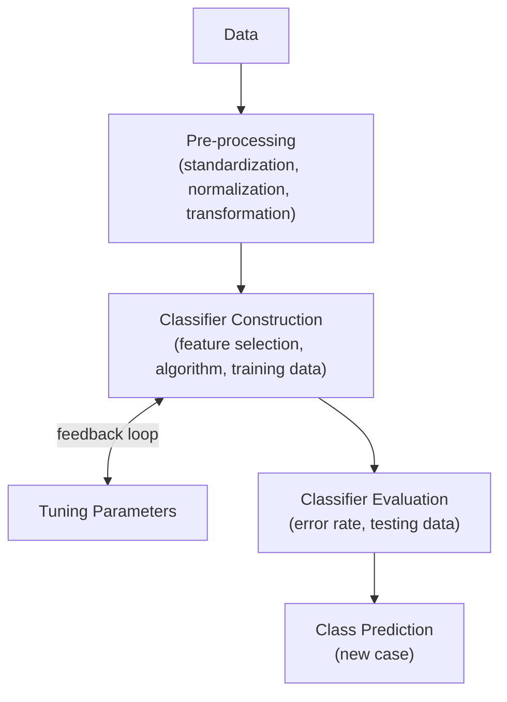
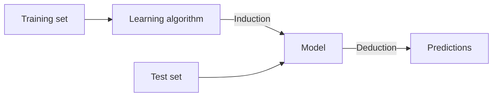
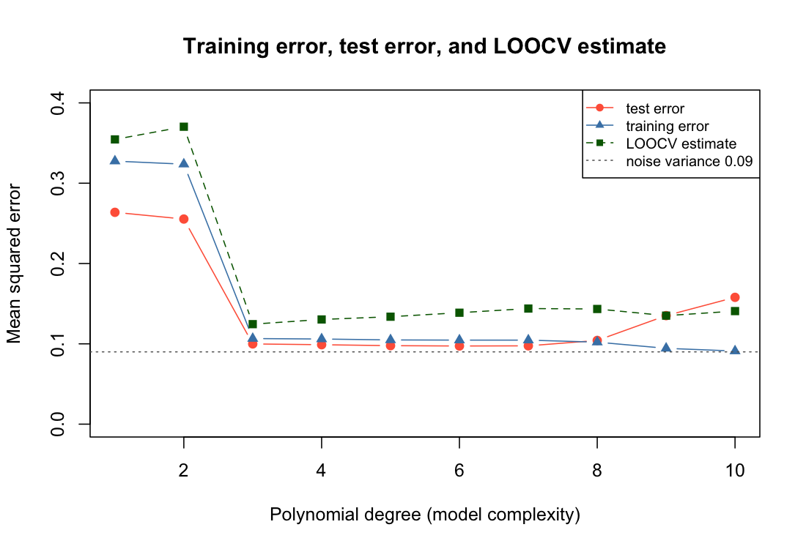
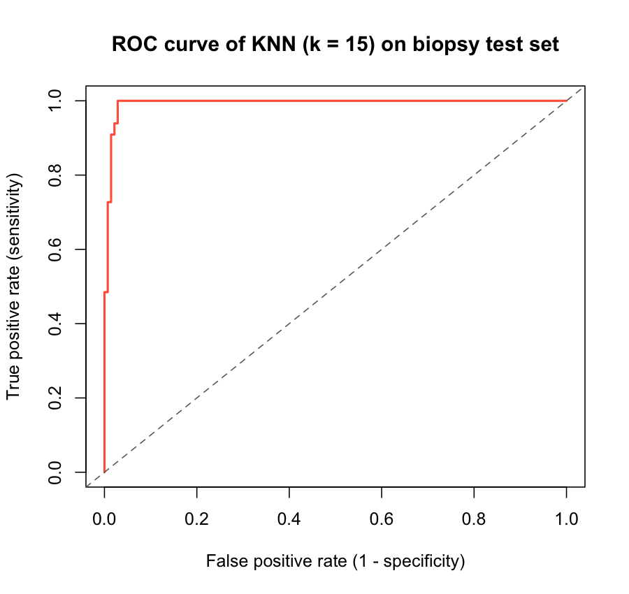

# Chapter 6 — Supervised Learning

[Repository Guide](../../README.md) | [English](Concepts_Lecture.md) | [한국어](Concepts_Lecture.ko.md)

> **Last Updated:** 2026-11-19

> **Learning Objectives:**
> 1. Explain how clustering differs from classification and how classification differs from prediction
> 2. Explain why training and test sets are separated, relating it to overfitting and underfitting
> 3. Compare the strengths and weaknesses of the test-set method, LOOCV, and K-fold cross-validation
> 4. Compute performance measures such as sensitivity, specificity, precision, and accuracy from a confusion matrix
> 5. Classify new data with KNN and explain how the choice of K affects the result
> 6. Explain the bias-variance decomposition and evaluate a classifier with the ROC curve and AUC

---

## Table of Contents

- [1. Definition of Classification](#1-definition-of-classification)
  - [1.1 Clustering vs. Classification](#11-clustering-vs-classification)
- [2. Classification vs. Prediction](#2-classification-vs-prediction)
  - [2.1 Classification](#21-classification)
  - [2.2 Prediction](#22-prediction)
- [3. Classification Worked Example](#3-classification-worked-example)
  - [3.1 Evaluating the Rule on Test Data](#31-evaluating-the-rule-on-test-data)
- [4. General Classification Process](#4-general-classification-process)
  - [4.1 Two-Step Process](#41-two-step-process)
  - [4.2 The Steps of the Classification Process](#42-the-steps-of-the-classification-process)
- [5. Training Set and Test Set](#5-training-set-and-test-set)
  - [5.1 Definitions](#51-definitions)
  - [5.2 Induction and Deduction](#52-induction-and-deduction)
  - [5.3 An Example of a Training Set and a Test Set](#53-an-example-of-a-training-set-and-a-test-set)
- [6. Overfitting](#6-overfitting)
  - [6.1 Definition](#61-definition)
  - [6.2 Why Overfitting Happens](#62-why-overfitting-happens)
  - [6.3 Overfitting vs. Underfitting](#63-overfitting-vs-underfitting)
  - [6.4 Overfitting in Regression](#64-overfitting-in-regression)
  - [6.5 Specific MSE Comparison Values](#65-specific-mse-comparison-values)
  - [6.6 Overfitting Visual Description](#66-overfitting-visual-description)
  - [6.7 The Regression Problem and Three Fits](#67-the-regression-problem-and-three-fits)
  - [6.8 Bias-Variance Decomposition](#68-bias-variance-decomposition)
- [7. Validation Methods](#7-validation-methods)
  - [7.1 Comparison of Methods](#71-comparison-of-methods)
  - [7.2 Leave-One-Out Cross Validation (LOOCV)](#72-leave-one-out-cross-validation-loocv)
  - [7.3 K-Fold Cross-Validation](#73-k-fold-cross-validation)
  - [7.4 Bias-Variance Trade-off](#74-bias-variance-trade-off)
  - [7.5 Cross-Validation in R](#75-cross-validation-in-r)
- [8. Measuring Model Performance](#8-measuring-model-performance)
  - [8.1 Hypothesis Testing Framing](#81-hypothesis-testing-framing)
  - [8.2 Primary Measures](#82-primary-measures)
  - [8.3 Error Measures](#83-error-measures)
  - [8.4 Overall Performance](#84-overall-performance)
  - [8.5 Prevalence and Positive Predictive Value](#85-prevalence-and-positive-predictive-value)
  - [8.6 ROC Curve and AUC](#86-roc-curve-and-auc)
- [9. K-Nearest Neighbors (KNN)](#9-k-nearest-neighbors-knn)
  - [9.1 Overview](#91-overview)
  - [9.2 Distance Metric](#92-distance-metric)
  - [9.3 Visual Intuition](#93-visual-intuition)
  - [9.4 Instance-Based (Lazy) Learning](#94-instance-based-lazy-learning)
  - [9.5 The KNN Decision Rule and the Choice of K](#95-the-knn-decision-rule-and-the-choice-of-k)
  - [9.6 KNN Classification of Breast Tumor Cells](#96-knn-classification-of-breast-tumor-cells)
  - [9.7 Common Mistakes](#97-common-mistakes)
- [Summary](#summary)
- [Self-Check Questions](#self-check-questions)

---

<br>

## 1. Definition of Classification

### 1.1 Clustering vs. Classification

| Aspect | Clustering | Classification |
|--------|-----------|----------------|
| Learning type | **Unsupervised** learning | **Supervised** learning |
| Classes | Unknown a priori | **Predefined** |
| Goal | Class **discovery** (identification of new/unknown classes) | Class **prediction** (assignment into known classes) |
| Nature | Exploratory analysis | Predictive analysis |

*Table 1. Comparison of clustering and classification*

- **Clustering** is the process of generating class variables (categorical response variables).
- **Classification** is the process of establishing a model with a class variable and predicting the class variable from the model.

> **Key Point:** Clustering discovers unknown groups in data (unsupervised), while classification predicts membership in predefined groups (supervised).

---

<br>

## 2. Classification vs. Prediction

### 2.1 Classification

- It classifies data based on the model constructed from the training set.
- It uses values in a **categorical class** as the classifying attribute.
- It assigns new data into predefined categories.

### 2.2 Prediction

- It predicts data based on the model constructed from the training set.
- It works **regardless of the type of class variable** (continuous, categorical, survival time, etc.).

> **Key Point:** Apart from the type of outcome variable, classification and prediction are essentially the same process. Classification specifically refers to categorical outcomes, while prediction is the more general term.

---

<br>

## 3. Classification Worked Example

**Faculty Tenure Dataset:**

| NAME | RANK | YEARS | TENURED |
|------|------|-------|---------|
| Mike | Assistant Prof | 3 | No |
| Mary | Assistant Prof | 7 | Yes |
| Bill | Professor | 2 | Yes |
| Jim | Associate Prof | 7 | Yes |
| Dave | Assistant Prof | 6 | No |
| Anne | Associate Prof | 3 | No |
| Jeff | Professor | 4 | ? |

*Table 2. Faculty tenure dataset and a new instance to classify*

**Extracted Rule:** `IF rank = 'Professor' OR years > 6 THEN tenured = 'Yes'`

**Classify Jeff:** Jeff is a Professor with 4 years. Since `rank = 'Professor'`, the rule fires, and Jeff is classified as **"Yes" (tenured)**.

This example illustrates the full classification pipeline. Training data with known labels produces a rule (model), which is then applied to classify a new, unseen instance.

### 3.1 Evaluating the Rule on Test Data

Whether a rule obtained from training data is actually useful is checked on test data not used for learning. Table 3 is the test data of four faculty members whose tenure status is known.

| NAME | RANK | YEARS | TENURED | Rule's prediction |
|:--|:--|--:|:--|:--|
| Tom | Assistant Prof | 2 | No | No |
| Merlisa | Associate Prof | 7 | No | Yes |
| George | Professor | 5 | Yes | Yes |
| Joseph | Assistant Prof | 7 | Yes | Yes |

*Table 3. Test data for evaluating the tenure rule*

Applying the rule `IF rank = 'Professor' OR years > 6 THEN tenured = 'Yes'`, Tom satisfies neither condition and is classified No, Merlisa is classified Yes because years = 7 > 6, George is classified Yes because he is a Professor, and Joseph is classified Yes because years = 7. Compared with the actual values, only Merlisa is wrong, so the accuracy is 3/4 = 75%. Treating "Yes" as positive, TP = 2 (George, Joseph), FP = 1 (Merlisa), TN = 1 (Tom), and FN = 0 (Section 8). On the training data the rule got all six right, but on new data some cases are wrong; this gap is the difference between training error and test error treated in Sections 5 and 6. Before a rule is used for classification its accuracy is estimated in this way, and if the accuracy is acceptable, the rule is applied to new data with unknown class, such as Jeff.

---

<br>

## 4. General Classification Process

The classification analysis follows a structured pipeline.



*Figure 1. General classification process*

### 4.1 Two-Step Process

**Step 1: Model Construction**
- It describes a set of predetermined classes.
- Each tuple (sample) is assumed to belong to one of the predefined classes, as determined by the class label attribute.
- The set of tuples used for model construction is called the **training set**.
- The model is represented as classification rules, decision trees, or mathematical formulae.

**Step 2: Model Usage**
- The model is used for classifying future or unknown objects.
- The known label of each test sample is compared with the classified result from the model.
- **Accuracy rate** is the percentage of test set samples correctly classified by the model.
- The test set must be **independent** of the training set. Otherwise, overfitting goes undetected in the evaluation.

> **Key Point:** The model is first built (induced) from training data, then applied (deduced) to classify new, unseen data. Training and testing data must remain separate to ensure reliable evaluation.

### 4.2 The Steps of the Classification Process

The work done at each step of Figure 1 is as follows.

1. **Preprocessing:** The scales and distributions of the variables are adjusted before they enter the classifier. **Standardization** subtracts the mean and divides by the standard deviation, like the Z-score of Chapter 3, giving mean 0 and standard deviation 1. **Normalization** usually refers to the min-max transformation $`x' = (x - \min)/(\max - \min)`$, which moves values into the range from 0 to 1. For example, min-max normalization turns the values 2, 4, 6, 10 into 0, 0.25, 0.5, 1, while standardization (mean 5.5, standard deviation 3.416) turns them into -1.025, -0.439, 0.146, 1.317. **Transformation** changes the shape of a distribution, as when a logarithm is applied to a right-skewed distribution (Section 10.5 of Chapter 5).
2. **Classifier construction:** Feature selection picks the variables to use, a classification algorithm (rules, decision trees, KNN, and so on) is chosen, and the model is trained on the training data.
3. **Parameter tuning:** The classifier is rebuilt while changing parameters that are not determined by learning, such as K in KNN. The two-way arrow of Figure 1 is this loop, and the criterion for tuning is the cross-validation error of Section 7.
4. **Classifier evaluation:** The error rate (= 1 - accuracy) and the measures of Section 8 are computed on the test data.
5. **Class prediction:** A classifier that passed evaluation is applied to new cases of unknown class.

Standardization and normalization both remove differences of scale between variables, but they behave differently. Min-max normalization fixes the range exactly to [0, 1], but a single extreme value squeezes the remaining values into a narrow interval; standardization has no fixed range but is less affected by extreme values. Either way, the minimum, maximum, mean, and standard deviation used in the transformation are computed on the training data, and the same values are applied to the test data (Section 9.7).

---

<br>

## 5. Training Set and Test Set

### 5.1 Definitions

| Set | Purpose |
|-----|---------|
| **Training set** | Data used **only** for building classification models (classifier) |
| **Test set** (Validation set) | Data used **only** to evaluate the performance of classification models |

*Table 4. Purposes of the training set and the test set*

> **Note:** This chapter uses test set and validation set interchangeably. Many workflows keep them separate: a validation set for model selection or parameter tuning, and a test set used only for the final performance evaluation.

### 5.2 Induction and Deduction

1. **Induction**: A learning algorithm processes the training set to learn and produce a model.
2. **Deduction**: The learned model is applied to the test set to make predictions.



*Figure 2. Building a model by induction and applying it by deduction*

> **Key Point:** If data is used without distinguishing between training and test sets, the model will likely overfit. Such a model performs well on known data but poorly on new, unseen data.

### 5.3 An Example of a Training Set and a Test Set

Table 5 is a training set of 10 records, and Table 6 is a test set of 5 records with unknown classes. Attribute Attrib1 is binary categorical, Attrib2 is categorical with three levels (Large, Medium, Small), and Attrib3 is continuous.

| Tid | Attrib1 | Attrib2 | Attrib3 | Class |
|:--|:--|:--|--:|:--|
| 1 | Yes | Large | 125K | No |
| 2 | No | Medium | 100K | No |
| 3 | No | Small | 70K | No |
| 4 | Yes | Medium | 120K | No |
| 5 | No | Large | 95K | Yes |
| 6 | No | Medium | 60K | No |
| 7 | Yes | Large | 220K | No |
| 8 | No | Small | 85K | Yes |
| 9 | No | Medium | 75K | No |
| 10 | No | Small | 90K | Yes |

*Table 5. Training set with known classes*

| Tid | Attrib1 | Attrib2 | Attrib3 | Class |
|:--|:--|:--|--:|:--|
| 11 | No | Small | 55K | ? |
| 12 | Yes | Medium | 80K | ? |
| 13 | Yes | Large | 110K | ? |
| 14 | No | Small | 95K | ? |
| 15 | No | Large | 67K | ? |

*Table 6. Test set whose classes are to be predicted*

The learning algorithm induces a model from Table 5 (for example, Yes if Attrib1 is No and Attrib3 is greater than 80K and less than 100K) and applies the model deductively to Table 6 to predict the classes at the question marks. The test set in this example has no answers and can be used only for prediction. To evaluate the performance of a model, records with known answers must be held out from learning and used as the test set, which is the definition of Section 5.1.

---

<br>

## 6. Overfitting

### 6.1 Definition

In statistics, overfitting is *"the production of an analysis that corresponds too closely or exactly to a particular set of data, and may therefore fail to fit additional data or predict future observations reliably."*

- An overfitted model contains more parameters than can be justified by the data (**overparameterization**).
- In machine learning, this phenomenon is sometimes called **overtraining**.

### 6.2 Why Overfitting Happens

- Training data contains information about regularities in the mapping from input to output, but it also contains **noise**.
- The target values themselves may be unreliable.
- There is **sampling error**: accidental regularities appear just because of the particular training cases chosen.
- When fitting a model, it cannot tell which regularities are real and which are caused by sampling error, so it fits both kinds.
- If the model is very flexible, it can model even the sampling error very well, which is a disaster.

### 6.3 Overfitting vs. Underfitting

| Problem | Description |
|---------|-------------|
| **Overfitting** | Too much fit to the training set, resulting in poor prediction on real new data |
| **Underfitting** | Model is too simple; both training and test errors are large |

*Table 7. Comparison of overfitting and underfitting*

### 6.4 Overfitting in Regression

Three fitting approaches compare as follows.

| Method | Fit to Training Data | Generalization |
|--------|---------------------|----------------|
| **Linear** ($y = \beta_0 + \beta_1 x$) | Moderate | Good |
| **Quadratic** ($y = \beta_0 + \beta_1 x + \beta_2 x^2$) | Better | Better |
| **Piecewise linear** (non-parametric) | Perfect | Poor (overfitting) |

*Table 8. Fit to training data and generalization of three regression fitting approaches*

- The key question is not which method best fits the data, but **"How well are you going to predict future data drawn from the same distribution?"**
- The test set method randomly chooses about 30% of the data as a test set, trains on the remainder, and then evaluates using Mean Squared Error (MSE) on the test set.

### 6.5 Specific MSE Comparison Values

**Test-set method:**

| Model | MSE |
|-------|-----|
| Linear | 2.4 |
| Quadratic | 0.9 |
| Piecewise | 3.2 |

*Table 9. MSE of each model from the test-set method*

**LOOCV method:**

| Model | MSE |
|-------|-----|
| Linear | 2.12 |
| Quadratic | 0.962 |
| Piecewise | 3.33 |

*Table 10. MSE of each model from LOOCV*

Both methods confirm that the **quadratic model is best**. It achieves the lowest test error despite not fitting the training data perfectly, whereas the piecewise model interpolates the training data exactly but generalizes worst.

### 6.6 Overfitting Visual Description

The characteristic signature of overfitting is visible when plotting error vs. model complexity.

- **Training error**: It is monotonically **decreasing** as model complexity increases (strictly, non-increasing). A model with added parameters contains the original model as a special case, so it fits the training data at least as well.
- **Test error**: It is **U-shaped**. It initially decreases as the model captures real patterns, then increases as the model starts fitting noise.

```text
 Error
  ^
  |  o
  |  *  o                                o
  |     *  o                          o
  |        *  o                    o
  |           *  o           o  o
  |              *  o  o  o
  |                 *  *
  |                       *  *  *
  |                                *  *  *
  +-----------------------------------------> Model complexity
                       ^
     Underfitting   Optimal        Overfitting

  * Training error    o Test error
```

*Figure 3. Training error and test error by model complexity*

The point where training and test error curves **diverge** marks the onset of overfitting. The optimal model complexity is at the minimum of the test error curve.

> **Key Point:** A model that fits training data perfectly (like piecewise interpolation) often performs poorly on new data. The goal is to find the right balance of model complexity that generalizes well.

### 6.7 The Regression Problem and Three Fits

The regression problem of Section 6.4 is set up as follows. Input x and output y are linked by an unknown function f and noise.

```math
y = f(x) + \varepsilon
```

The goal is to learn f from the data, and three methods are compared.

1. **Linear fit:** $`\hat{y} = \beta_0 + \beta_1 x`$. With each row of the design matrix $`\mathbf{Z}`$ set to $`(1, x_i)`$, the coefficients are found by the same matrix formula as in Section 6.7 of Chapter 5, $`\hat{\boldsymbol{\beta}} = (\mathbf{Z}^T\mathbf{Z})^{-1}\mathbf{Z}^T\mathbf{y}`$.
2. **Quadratic fit:** $`\hat{y} = \beta_0 + \beta_1 x + \beta_2 x^2`$. With each row of the design matrix set to $`(1, x_i, x_i^2)`$, the same formula $`\hat{\boldsymbol{\beta}} = (\mathbf{X}^T\mathbf{X})^{-1}\mathbf{X}^T\mathbf{y}`$ applies. It is curved in x but linear in the parameters, so it is linear regression.
3. **Piecewise linear fit:** A non-parametric regression that joins neighboring data points with straight lines so that it passes through every point. Because it passes exactly through the data, it looks the most convincing.

The same happens in classification. When drawing a decision boundary between blue and red points, a gentle curve (the black boundary) misclassifies a few training points, while a wiggly boundary drawn to get every training point right (the green boundary) has zero training error. On new points, however, the green boundary makes more mistakes than the black one, because it followed even the noise of the training data. Which is better is judged not by how well each fits the training data but by how well it predicts future data drawn from the same distribution.

### 6.8 Bias-Variance Decomposition

The U-shaped test error of Section 6.6 can be explained with a formula. Let $`\hat{f}`$ be the model estimated from the training data. The training data are random, so $`\hat{f}`$ is also a random variable. At a new point $`x_0`$, the expected test error decomposes into three terms.

```math
E\left[ \left( y_0 - \hat{f}(x_0) \right)^2 \right] = \underbrace{\mathrm{Var}\left( \hat{f}(x_0) \right)}_{\text{variance}} + \underbrace{\left[ E\,\hat{f}(x_0) - f(x_0) \right]^2}_{\text{bias}^2} + \underbrace{\mathrm{Var}(\varepsilon)}_{\text{irreducible error}}
```

> **Definition:** The **bias-variance decomposition** is the formula that splits the expected squared error on a new observation into the variance of the model's prediction, the square of the bias (the difference between the model's average and the true function), and the irreducible error (the variance of the noise).

- **Variance:** How much $`\hat{f}(x_0)`$ fluctuates when the training data change. The more flexible the model, the more it follows the noise of the training data and the larger its variance.
- **Bias:** How far the average prediction over countless retrainings departs from the true value. A simple model cannot represent the shape of the true function and has a large bias.
- **Irreducible error:** The variance of the noise $`\varepsilon`$, a lower bound on the test error that no model can reduce.

As a model becomes more complex, bias falls and variance rises. The point where their sum is smallest is the optimal complexity of Figure 3 in Section 6.6; underfitting is the side dominated by bias and overfitting the side dominated by variance. The formula concerns the expected squared error, so it applies directly to the MSE of regression, and the same intuition holds in the same direction for classification.

Simulated data confirm this. Polynomial regressions of degree 1 through 10 are fitted to 60 training points from the true function $`f(x) = \sin(2x)`$ plus noise with standard deviation 0.3, and the test error is measured on 2,000 new points from the same distribution.

```r
set.seed(2)
f <- function(x) sin(2 * x)
n <- 60
x <- runif(n, 0, 3); y <- f(x) + rnorm(n, sd = 0.3)
xt <- runif(2000, 0, 3); yt <- f(xt) + rnorm(2000, sd = 0.3)
res <- t(sapply(1:10, function(d) {
  fit <- lm(y ~ poly(x, d))
  c(degree = d, train = mean(resid(fit)^2),
    test = mean((yt - predict(fit, data.frame(x = xt)))^2),
    loocv = mean((resid(fit) / (1 - hatvalues(fit)))^2))
}))
round(res, 3)
```

```text
      degree train  test loocv
 [1,]      1 0.328 0.264 0.355
 [2,]      2 0.324 0.255 0.370
 [3,]      3 0.107 0.100 0.125
 [4,]      4 0.106 0.099 0.130
 [5,]      5 0.105 0.098 0.134
 [6,]      6 0.105 0.097 0.139
 [7,]      7 0.105 0.098 0.144
 [8,]      8 0.102 0.104 0.143
 [9,]      9 0.094 0.135 0.135
[10,]     10 0.091 0.158 0.141
```

- `poly(x, d)` builds the terms of a degree-d polynomial so that `lm()` fits a degree-d polynomial regression.
- `train` is the MSE on the training data, `test` the MSE on the 2,000 new points, and `loocv` the LOOCV estimate from the shortcut formula of Section 7.2. `hatvalues()` gives the leverages $`h_i`$.
- The training error keeps falling as the degree rises, from 0.328 to 0.091 (Section 6.6). The test error is large at degrees 1 and 2 (large bias), drops sharply to 0.100 at degree 3, stays near the noise variance 0.09 for degrees 3-7, and rises again at degrees 9 and 10 (growing variance).



*Figure 4. Training error, test error, and LOOCV estimate by polynomial degree*

The dotted line in Figure 4 is the irreducible error $`0.3^2 = 0.09`$. The test error does not fall below it. In real analyses the test error is unknown, so the degree is chosen by the LOOCV estimate, which is computed from the training data alone. LOOCV is smallest at degree 3, the simplest of the models whose test error is near its minimum.

---

<br>

## 7. Validation Methods

### 7.1 Comparison of Methods

In the table below, R is the number of data points (records).

| Method | Downside | Upside |
|--------|----------|--------|
| **Test-set** | Variance: unreliable estimate of future performance | Cheap |
| **Leave-one-out (LOOCV)** | Expensive; has some weird behavior | Does not waste data |
| **10-fold** | Wastes 10% of data; 10 times more expensive than test set | Only wastes 10%; only 10 times more expensive instead of R times |
| **3-fold** | Wastes more data than 10-fold; more expensive than test set | Slightly better than test-set |
| **R-fold** | Identical to Leave-one-out | - |

*Table 11. Strengths and weaknesses of validation methods*

### 7.2 Leave-One-Out Cross Validation (LOOCV)

The algorithm is as follows.
1. For k = 1 to R (number of data points), repeat the following.
   - Let $(x_k, y_k)$ be the k-th record.
   - Temporarily remove $(x_k, y_k)$ from the dataset.
   - Train on the remaining R-1 data points.
   - Note the error for $(x_k, y_k)$.
2. Report the mean error.

$$CV_{(n)} = \frac{1}{n} \sum_{i=1}^{n} MSE_i$$

Here n is the number of observations (R in the algorithm above), and $MSE_i$ is the squared error when the model fit without the i-th observation predicts that observation.

Its properties are as follows.
- Compared with the test-set method, it has far less bias and tends not to overestimate the test error rate as much.
- It always yields the same results because the splits involve no randomness.
- It is computationally intensive because the model must be fit n times.
- For OLS regression, a shortcut formula computes it from a single fit. In the formula below, $\hat{Y}_i$ is the fitted value from the full data and $h_i$ is the leverage of the i-th observation.

$$CV_{(n)} = \frac{1}{n} \sum_{i=1}^{n} \left( \frac{Y_i - \hat{Y}_i}{1 - h_i} \right)^2$$

### 7.3 K-Fold Cross-Validation

- It is used as an alternative because LOOCV is computationally intensive.
- Randomly divide the data set into **K folds** (typically K = 5 or 10).
- Each fold takes a turn as the validation set, while the remaining K-1 folds serve as training data.
- The MSE is computed on the held-out fold each time.
- Average the K estimates to get the final validation error rate.

```text
          Fold 1   Fold 2   Fold 3   Fold 4   Fold 5
Round 1   [ Val ]  [Train]  [Train]  [Train]  [Train]  ->  MSE_1
Round 2   [Train]  [ Val ]  [Train]  [Train]  [Train]  ->  MSE_2
Round 3   [Train]  [Train]  [ Val ]  [Train]  [Train]  ->  MSE_3
Round 4   [Train]  [Train]  [Train]  [ Val ]  [Train]  ->  MSE_4
Round 5   [Train]  [Train]  [Train]  [Train]  [ Val ]  ->  MSE_5
```

*Figure 5. Placement of the validation fold in each round of 5-fold cross-validation*

$$CV_{(K)} = \sum_{k=1}^{K} \frac{n_k}{n} MSE_k$$

Here $n_k$ is the number of observations in the k-th fold, so when all folds have the same size, $CV_{(K)}$ is the simple average of the K MSE values.

### 7.4 Bias-Variance Trade-off

- LOOCV is more computationally intensive than K-fold CV.
- When K < n, LOOCV has **less bias** than K-fold CV, so it is preferred from the bias reduction perspective.
- When K < n, LOOCV has **higher variance** than K-fold CV. The n models of LOOCV are fit on nearly identical training data and are therefore highly correlated, so their average has high variance.
- We therefore tend to use K-fold CV with **K = 5 or K = 10**, as these values yield test error rate estimates that balance bias and variance.

> **Key Point:** LOOCV is a special case of K-fold cross-validation where K = n. In practice, K = 5 or K = 10 provides a good bias-variance trade-off and is computationally feasible.

### 7.5 Cross-Validation in R

With the data of Section 6.8, it is checked that the LOOCV shortcut formula of Section 7.2 equals the result of actually fitting the model n times, and 5-fold cross-validation is also computed.

```r
manual <- mean(sapply(1:n, function(i) {
  fit <- lm(y ~ poly(x, 3), data = data.frame(x = x[-i], y = y[-i]))
  (y[i] - predict(fit, data.frame(x = x[i])))^2
}))
round(manual, 4)
set.seed(7)
folds <- sample(rep(1:5, length.out = n))
cv5 <- sapply(1:10, function(d) {
  mean(sapply(1:5, function(k) {
    tr <- folds != k
    fit <- lm(y ~ poly(x, d), data = data.frame(x = x[tr], y = y[tr]))
    mean((y[!tr] - predict(fit, data.frame(x = x[!tr])))^2)
  }))
})
round(cv5, 3)
```

```text
[1] 0.1245
 [1] 0.346 0.368 0.127 0.140 0.139 0.145 0.146 0.146 0.135 0.143
```

- The first block fits the degree-3 model on the 59 points without the i-th observation and computes the squared error of the left-out observation, repeats this 60 times, and averages. The result 0.1245 equals the shortcut value 0.125 for degree 3. The shortcut fits the model only once, so it is 60 times faster.
- `sample(rep(1:5, length.out = n))` makes 12 copies of each fold number from 1 to 5, shuffles them at random, and assigns one to each observation.
- Using fold k as the validation set and the other four folds as the training set, repeated five times and averaged, gives $`CV_{(5)}`$ (a simple average because the folds are of equal size). 5-fold cross-validation is also smallest at degree 3, with 0.127, choosing the same model as LOOCV.

LOOCV has no randomness in its splits, so the same error curve appears however many times it is run, while K-fold cross-validation gives slightly different curves depending on how the folds are split. Running 10-fold cross-validation nine times with different random splits and overlaying the curves shows curves of slightly different heights but similar shapes and minimum locations. K-fold cross-validation is therefore sometimes repeated and averaged (repeated cross-validation).

---

<br>

## 8. Measuring Model Performance

### 8.1 Hypothesis Testing Framing

The confusion matrix originates from hypothesis testing. A statistical test result either rejects or fails to reject the null hypothesis.

- **$H_0$ (signal absent)**: the null hypothesis, which states that there is no effect and no signal.
- **$H_1$ (signal present)**: the alternative hypothesis, which states that an effect or signal exists.

|  | $H_1$: Signal Present | $H_0$: Signal Absent |
|--|---------------------|-------------------|
| **Detection** | True Positive (TP) | False Positive (FP), Type I error |
| **Null Result** | False Negative (FN), Type II error | True Negative (TN) |

*Table 12. Confusion matrix by test decision and true state*

Key connections are as follows.
- **TPF (True Positive Fraction) = Sensitivity = Power** = TP / (TP + FN), the probability of correctly detecting a true signal.
- **FPF (False Positive Fraction) = 1 - Specificity** = FP / (FP + TN), the probability of falsely detecting a signal when none exists.

> **[Probability and Statistics]** In hypothesis testing, a Type I error rejects a true null hypothesis, and the significance level $\alpha$ sets an upper bound on its probability. A Type II error fails to reject a false null hypothesis; if its probability is $\beta$, the power of the test is $1 - \beta$. In the confusion matrix, the FPF corresponds to this $\alpha$ and the sensitivity (TPF) to the power.

### 8.2 Primary Measures

| Measure | Formula | Also Known As |
|---------|---------|---------------|
| **TPR** (True Positive Rate) | TP / (TP + FN) | Sensitivity, Power, Recall, Hit Rate |
| **TNR** (True Negative Rate) | TN / (TN + FP) | Specificity |
| **PPV** (Positive Predictive Value) | TP / (TP + FP) | Precision |
| **NPV** (Negative Predictive Value) | TN / (TN + FN) | - |

*Table 13. Primary measures*

### 8.3 Error Measures

| Measure | Formula | Relationship |
|---------|---------|-------------|
| **FNR** (False Negative Rate) | FN / (FN + TP) | = 1 - TPR (Miss Rate) |
| **FPR** (False Positive Rate) | FP / (FP + TN) | = 1 - TNR (Fall-out) |
| **FDR** (False Discovery Rate) | FP / (FP + TP) | = 1 - PPV |
| **FOR** (False Omission Rate) | FN / (FN + TN) | = 1 - NPV |

*Table 14. Error measures*

### 8.4 Overall Performance

| Measure | Formula |
|---------|---------|
| **ACC** (Accuracy) | (TP + TN) / (TP + TN + FP + FN) |
| **ERR** (Error Rate) | (FP + FN) / (TP + TN + FP + FN) = 1 - ACC |

*Table 15. Overall performance measures*

> **Key Point:** Sensitivity (TPR) and specificity (TNR) are the most widely used measures in statistics and data science. Understanding the confusion matrix is essential for evaluating any classification model.

### 8.5 Prevalence and Positive Predictive Value

Sensitivity and specificity are proportions conditioned on the actual class, so they do not depend on the proportion of positives (the prevalence), but precision (positive predictive value, PPV) depends strongly on prevalence. Consider applying a screening test with 90% sensitivity and 95% specificity to 10,000 people in a group with 1% prevalence.

1. There are 100 patients and 9,900 non-patients.
2. 90% of the patients, 90 people, test positive (TP = 90, FN = 10).
3. 5% of the non-patients, 495 people, test positive (FP = 495, TN = 9,405).
4. Of the 585 positive results, 90 are actual patients, so $`PPV = 90/585 \approx 0.154`$.

Although the test looks fairly accurate, about 85% of the people who test positive are not actually patients. Written with Bayes' theorem, $`PPV = \text{sensitivity} \times p / [\text{sensitivity} \times p + (1 - \text{specificity})(1 - p)]`$, where p is the prevalence. The same test gives a PPV of 0.667 at 10% prevalence and 0.947 at 50%. This is why a positive result in screening for a rare disease is followed by a confirmatory test.

> **[Probability and Statistics]** Bayes' theorem is the conditional probability $`P(A \mid B) = P(B \mid A)P(A)/P(B)`$, which updates the prior probability P(A) to a posterior probability given the observation B. PPV is the posterior probability P(disease | positive), with the prevalence as the prior and the positive result as the observation.

In this example the accuracy is a high $`(90 + 9405)/10000 = 0.9495`$, but a useless classifier that calls everyone negative also has an accuracy of 0.99. With such imbalanced classes, a classifier must not be judged by accuracy alone; sensitivity and precision are examined together. The measure that combines the two into one is their harmonic mean, the **F1 score**.

```math
F_1 = \frac{2 \times \text{Precision} \times \text{Recall}}{\text{Precision} + \text{Recall}}
```

For the classifier of self-check question 1 (precision 0.667, recall 0.8), the F1 score is $`2 \times 0.667 \times 0.8/(0.667 + 0.8) \approx 0.727`$. The harmonic mean is pulled toward the smaller of the two values, so a classifier that is high in only one of them has a low F1 score.

### 8.6 ROC Curve and AUC

Many classifiers do not output a class directly but a score (probability) indicating how likely the case is positive, and they call it positive when the score is at least a **threshold**. Lowering the threshold increases positive calls, raising sensitivity, but also increases false positives, lowering specificity. The curve that joins the (FPR, TPR) points for every threshold is the **ROC curve (receiver operating characteristic curve)**, and the area under it is the **AUC (area under the curve)**.

> **Definition:** The **ROC curve (receiver operating characteristic curve)** plots the false positive rate (1 - specificity) on the horizontal axis against the true positive rate (sensitivity) on the vertical axis as the classification threshold varies, showing a classifier's discriminating power independently of the threshold.

Ten samples (5 positive, 5 negative) have the following scores. They are arranged in decreasing order of score, and the threshold is lowered one score at a time from the highest.

| Threshold | Actual class | TP | FP | TPR | FPR |
|--:|:--|--:|--:|--:|--:|
| ∞ | - | 0 | 0 | 0.0 | 0.0 |
| 0.95 | Positive | 1 | 0 | 0.2 | 0.0 |
| 0.90 | Positive | 2 | 0 | 0.4 | 0.0 |
| 0.80 | Negative | 2 | 1 | 0.4 | 0.2 |
| 0.70 | Positive | 3 | 1 | 0.6 | 0.2 |
| 0.60 | Positive | 4 | 1 | 0.8 | 0.2 |
| 0.55 | Negative | 4 | 2 | 0.8 | 0.4 |
| 0.40 | Negative | 4 | 3 | 0.8 | 0.6 |
| 0.30 | Positive | 5 | 3 | 1.0 | 0.6 |
| 0.20 | Negative | 5 | 4 | 1.0 | 0.8 |
| 0.10 | Negative | 5 | 5 | 1.0 | 1.0 |

*Table 16. TP, FP, and ROC curve points by threshold*

As the threshold is lowered, meeting a positive sample moves the curve up by 0.2 (= 1/5), and meeting a negative sample moves it right by 0.2. Computing the area under the curve with trapezoids, the height is 0.4 for FPR from 0 to 0.2, 0.8 from 0.2 to 0.6, and 1.0 from 0.6 to 1, so $`AUC = 0.2 \times 0.4 + 0.4 \times 0.8 + 0.4 \times 1.0 = 0.08 + 0.32 + 0.40 = 0.80`$.

The AUC has a probabilistic interpretation: it is the probability that a randomly chosen positive has a higher score than a randomly chosen negative. Counting the pairs among the 25 positive-negative pairs in which the positive is higher, 0.95 and 0.90 are higher than all 5 negatives (10 pairs), 0.70 and 0.60 are higher than the 4 negatives other than 0.80 (8 pairs), and 0.30 is higher than 0.20 and 0.10 (2 pairs). The total is 20 pairs, so 20/25 = 0.80, equal to the trapezoid area. An AUC of 1 is a perfect classifier whose positives all score higher than all negatives, and 0.5 equals the diagonal (random guessing).

```r
library(pROC)
score <- c(0.95, 0.90, 0.80, 0.70, 0.60, 0.55, 0.40, 0.30, 0.20, 0.10)
label <- c(1, 1, 0, 1, 1, 0, 0, 1, 0, 0)
r <- roc(label, score, quiet = TRUE)
auc(r)
coords(r, "best", best.method = "youden")
```

```text
Area under the curve: 0.8
  threshold specificity sensitivity
1     0.575         0.8         0.8
```

`roc()` builds the ROC curve from the actual classes and scores, and `auc()` returns the area 0.8. `coords(..., "best")` finds the threshold that maximizes sensitivity + specificity - 1 (the Youden index); at 0.575, halfway between 0.60 and 0.55, sensitivity and specificity are both 0.8. When setting a threshold in practice, the costs of false negatives and false positives are considered together. When missing a patient is costly, as in cancer screening, the threshold is lowered toward higher sensitivity.

---

<br>

## 9. K-Nearest Neighbors (KNN)

### 9.1 Overview

- KNN is a simple heuristic classification algorithm.
- It classifies a new data point based on the **majority class among its K nearest neighbors**.
- A huge advantage is that **multiple classes** can be considered directly.
- The choice of K affects model complexity.
  - A small K makes the model more flexible and raises the risk of overfitting.
  - A large K makes the decision boundary smoother and raises the risk of underfitting.

### 9.2 Distance Metric

KNN determines "nearest" using a distance metric, typically **Euclidean distance**. In the formula below, p is the number of features (variables).

$$d(\mathbf{x}, \mathbf{y}) = \sqrt{\sum_{i=1}^{p} (x_i - y_i)^2}$$

The algorithm computes the distance from the new point to every training point, then selects the K closest ones.

> **Caution:** Distances depend directly on the scale of each variable. To keep variables with large ranges from dominating the distance, it is common to standardize or normalize the variables in the pre-processing step of Section 4 before applying KNN.

### 9.3 Visual Intuition

Consider classifying a new point of unknown class (a green circle) into one of two classes: blue squares and red triangles. A circle centered at the new point that contains its K nearest neighbors grows larger as K increases.
- **K = 3** (smaller circle): If the 3 nearest neighbors are 2 red triangles and 1 blue square, the point is classified into the triangle class.
- **K = 7** (larger circle): If the 7 nearest neighbors include 4 blue squares and 3 red triangles, the classification flips to the square class.

The choice of K fundamentally changes the decision boundary.

### 9.4 Instance-Based (Lazy) Learning

KNN is called **instance-based** or **lazy learning** for the following reasons, which also determine its costs.
- It does **not build an explicit model** during training; it simply **stores all training data**.
- All computation is deferred to classification time.
- **Computational cost**: high at prediction time because it must compute distances to all stored training points for every new query.
- **Memory cost**: it must store the entire training dataset.

> **Key Point:** KNN is an instance-based (lazy) learning algorithm that makes no assumptions about the underlying data distribution. It simply stores training data and classifies new points by finding the nearest neighbors.

### 9.5 The KNN Decision Rule and the Choice of K

With $`N_K(\mathbf{x})`$ the set of the K training points nearest to a new point $`\mathbf{x}`$, the KNN decision rule chooses the most common class among those neighbors.

```math
\hat{y}(\mathbf{x}) = \underset{c}{\text{argmax}} \sum_{i \in N_K(\mathbf{x})} I(y_i = c)
```

$`I(\cdot)`$ is the indicator function, 1 if the condition is true and 0 otherwise. The vote share of class c, $`\frac{1}{K}\sum_{i \in N_K} I(y_i = c)`$, can serve as an estimate of the probability that the point belongs to class c, and it is the score used to draw the ROC curve of Section 8.6. Points to consider when fixing the decision rule are as follows.

- **Ties:** In a two-class problem an even K can produce tied votes, so K is usually odd. Ties are broken at random or by following the class of the nearest neighbor.
- **Distance weighting:** Giving each neighbor's vote a weight such as the reciprocal of its distance reduces the influence of distant neighbors.
- **Scale:** As the caution box of Section 9.2 says, without standardization the variables with large ranges decide the distance.
- **Dimension:** With many variables, the curse of dimensionality of Chapter 4 makes all points roughly equally far apart, weakening the meaning of "nearest neighbor", so feature selection or dimensionality reduction comes first.
- **Choice of K:** K is a hyperparameter that is not determined by learning, so the cross-validation error is computed for several K and the smallest is chosen. With K = 1 the training error is 0 but the model overfits easily, and with K equal to the number of training points the model always predicts the majority class, the simplest possible model.

Translating the decision rule directly into code gives the following, checked with the data of self-check question 5.

```r
knn_predict <- function(train_X, train_y, new_x, k) {
  d <- sqrt(colSums((t(train_X) - new_x)^2))
  nn <- order(d)[1:k]
  votes <- table(train_y[nn])
  names(votes)[which.max(votes)]
}
train_X <- matrix(c(1, 2, 2, 4, 3, 1, 4, 3, 5, 5, 3, 6), ncol = 2, byrow = TRUE)
train_y <- c("red", "red", "red", "blue", "blue", "blue")
sapply(c(1, 3, 5), function(k) knn_predict(train_X, train_y, c(3, 3), k))
```

```text
[1] "blue" "red"  "red"
```

- `t(train_X) - new_x` transposes the training matrix so that each column is a training point and then, by the recycling rule of Section 4.8 of Chapter 1, subtracts the new point from every column. `colSums(...^2)` and `sqrt()` compute the Euclidean distance to every training point at once.
- `order(d)[1:k]` takes the first k of the positions in order of increasing distance, that is, the indices of the neighbors (Section 4.12 of Chapter 1).
- `table()` counts the neighbors' votes by class, and `which.max()` picks the class with the most votes (the first one in case of a tie).
- The result is blue for K = 1 and red for K = 3 and 5, matching the hand computation of self-check question 5.

### 9.6 KNN Classification of Breast Tumor Cells

The `MASS::biopsy` data, examined with PCA in Section 11.3 of Chapter 4, are used to classify tumors as benign or malignant with KNN. The nine cell features are standardized, and 70% of the cases form the training set and 30% the test set. For simplicity the code standardizes the whole data set before the split, but standardizing both sets with the mean and standard deviation of the training set, as Section 9.7 recommends, gives the same test confusion matrix for these data.

```r
library(MASS); library(class)
bp <- na.omit(biopsy)
X <- scale(bp[, 2:10]); y <- bp$class
set.seed(123)
idx <- sample(nrow(bp), round(0.7 * nrow(bp)))
pred <- knn(train = X[idx, ], test = X[-idx, ], cl = y[idx], k = 5)
cm <- table(actual = y[-idx], predicted = pred)
cm
TP <- cm["malignant", "malignant"]; FN <- cm["malignant", "benign"]
FP <- cm["benign", "malignant"]; TN <- cm["benign", "benign"]
round(c(accuracy = (TP + TN) / sum(cm), sensitivity = TP / (TP + FN),
        specificity = TN / (TN + FP), precision = TP / (TP + FP)), 3)
```

```text
           predicted
actual      benign malignant
  benign       136         3
  malignant      3        63
   accuracy sensitivity specificity   precision
      0.971       0.955       0.978       0.955
```

- `sample(nrow(bp), round(0.7 * nrow(bp)))` draws at random the row numbers of 478 of the 683 cases for the training set, and the remaining 205 cases form the test set.
- `knn()` from the `class` package stores the training data and predicts the class of each test point by majority vote of its 5 nearest training points (the lazy learning of Section 9.4). Ties are broken at random, so the seed affects the result.
- Treating malignant as the positive class, the confusion matrix has TP = 63, FN = 3, FP = 3, TN = 136. The accuracy is $`199/205 \approx 0.971`$, the sensitivity $`63/66 \approx 0.955`$, and the specificity $`136/139 \approx 0.978`$. Three of the 66 malignant tumors were missed, and in a diagnostic context these false negatives are the most costly errors.

K must be chosen from the training set alone, without looking at the test set. `knn.cv()` classifies each point of the training set by the other points, which is LOOCV.

```r
loocv_err <- sapply(c(1, 3, 5, 7, 9, 15, 25, 51), function(k) {
  set.seed(1)
  mean(knn.cv(X[idx, ], y[idx], k = k) != y[idx])
})
names(loocv_err) <- c(1, 3, 5, 7, 9, 15, 25, 51)
round(loocv_err, 4)
```

```text
     1      3      5      7      9     15     25     51
0.0460 0.0335 0.0293 0.0335 0.0293 0.0293 0.0293 0.0397
```

The LOOCV misclassification rate is largest at K = 1 with 4.6%, levels off near 2.9% from K = 5 to 25, and rises again to 4.0% at K = 51. The pattern of Section 6.8, with large variance at small K and large bias at large K, appears in classification as well. When misclassification rates are equal, the larger K, which produces a simpler boundary, is sometimes chosen.

Using the proportion of malignant cases among each test point's neighbors at K = 15 as the score gives the ROC curve of Figure 6, with an AUC of 0.992.



*Figure 6. ROC curve of KNN (K = 15) on the breast tumor data*

The curve hugs the top left corner, so sensitivity can be raised close to 1 with almost no increase in the false positive rate. The score is the vote share among 15 neighbors and can take only 16 values, so the curve is a staircase. The dashed diagonal is random guessing with AUC 0.5. Other classifiers such as decision trees and support vector machines, and their application to disease prediction, are covered in Chapter 12.

### 9.7 Common Mistakes

1. **Choosing a model with the test set:** Choosing K or a degree by test-set performance turns the test set into part of learning, so performance is estimated optimistically. Make choices by cross-validation and use the test set only once, for the final evaluation (Section 9.6).
2. **Preprocessing with the full data before splitting:** Fixing the mean and standard deviation for standardization, or the feature selection, from the full data leaks information from the test set into training (data leakage). Strictly, values fixed on the training set are applied to the test set.
3. **Looking only at accuracy with imbalanced data:** Predicting only the majority class already gives high accuracy. Examine sensitivity, specificity, precision, the F1 score, and the AUC together (Section 8.5).
4. **Confusing sensitivity and precision:** Sensitivity is the proportion of actual positives that were caught, precision the proportion of positive calls that were right, and only precision depends on prevalence (Sections 8.2 and 8.5).
5. **Evaluating a model by its training error:** The training error keeps falling as complexity rises and cannot reveal overfitting (Section 6.8).
6. **Using KNN without standardization:** Variables with large units decide the neighbors (Sections 9.2 and 9.5).
7. **Using an even K in a two-class problem:** Ties can occur and decide the result at random (Section 9.5).
8. **Believing LOOCV is always best:** LOOCV has small bias but large variance and is expensive. K-fold cross-validation with K = 5 or 10 is usually a good compromise (Section 7.4).

---

<br>

## Summary

| Concept | Key Summary |
|---------|-----------|
| Clustering vs. Classification | Clustering is unsupervised learning that discovers groups, while classification is supervised learning that predicts predefined groups. |
| Classification vs. Prediction | They are essentially the same process, and classification specifically refers to predicting categorical outcomes. |
| Two-step process | Step 1 constructs a model from the training set, and Step 2 uses the model for prediction. |
| Training vs. Test set | The training set builds the model and the test set evaluates it, and the two sets must be independent. |
| Overfitting | It is the failure to generalize when a model fits the training data too closely, and it is caused by overparameterization. |
| Underfitting | It is the state in which a model is too simple and both training and test errors are large. |
| LOOCV | It leaves one observation out, trains on the rest, and repeats n times, giving low bias and high variance. |
| K-Fold CV | It divides the data into K folds for validation, and K = 5 or 10 is recommended for bias-variance balance. |
| Confusion matrix | Its counts TP, TN, FP, and FN form the basis for accuracy, sensitivity, specificity, and precision. |
| KNN | It classifies by the majority vote of the K nearest neighbors and supports multiple classes. |
| Bias-variance decomposition | The expected test error is the sum of variance, squared bias, and irreducible error; as complexity rises, bias falls and variance rises. |
| Computing cross-validation | For OLS the leverage-based shortcut gives the same value as LOOCV fitted n times, and K-fold results vary slightly with the split. |
| Positive predictive value and prevalence | Sensitivity and specificity do not depend on prevalence, but precision (PPV) shrinks as prevalence falls. |
| F1 score | The harmonic mean of precision and recall, used instead of accuracy for imbalanced data. |
| ROC curve and AUC | A curve of (FPR, TPR) over all thresholds; the AUC is the probability that a random positive scores higher than a random negative. |
| Choosing K in KNN | K is chosen by cross-validation; small K has large variance and large K has large bias. |
| Data leakage | When information from the test set is used in preprocessing or model selection, performance is estimated optimistically. |

---

<br>

## Self-Check Questions

1. **Confusion matrix calculation:** A classifier applied to 200 test samples gives TP = 40, FN = 10, FP = 20, and TN = 130. Find the sensitivity, specificity, precision, and accuracy.

   <details>
   <summary>Answer</summary>

   Sensitivity (TPR) is 40 / (40 + 10) = 0.8. Specificity (TNR) is 130 / (130 + 20) ≈ 0.867. Precision (PPV) is 40 / (40 + 20) ≈ 0.667. Accuracy is (40 + 130) / 200 = 0.85. Accuracy is high at 0.85, but 20 of the 60 positive predictions (one third) are false positives, so a classifier should not be judged by a single measure.

   </details>

2. **Rule-based classification:** Use the rule from Section 3, `IF rank = 'Professor' OR years > 6 THEN tenured = 'Yes'`, to classify (a) an Associate Prof with 8 years and (b) an Assistant Prof with 6 years.

   <details>
   <summary>Answer</summary>

   (a) The rank is not Professor, but years = 8 > 6 satisfies the condition, so it is classified as Yes. (b) The rank is not Professor and years = 6 is not greater than 6, so it is classified as No. Because the inequality is >, the boundary value of 6 years does not satisfy the condition, and Dave (Assistant Prof, 6 years, No) in the training data agrees with the rule for the same reason.

   </details>

3. **Cost and estimate of cross-validation:** With 200 observations, how many times is the model fit and how many observations does each fit train on for 5-fold cross-validation and for LOOCV? If five equal-sized folds give MSE values of 2.0, 2.5, 1.5, 3.0, and 2.0, what is $CV_{(5)}$?

   <details>
   <summary>Answer</summary>

   5-fold cross-validation fits the model 5 times, each time training on 160 observations and validating on the remaining 40. LOOCV fits the model 200 times, each time training on 199 observations and validating on 1. With equal-sized folds, $n_k / n = 1/5$, so $CV_{(5)} = (2.0 + 2.5 + 1.5 + 3.0 + 2.0) / 5 = 11.0 / 5 = 2.2$.

   </details>

4. **Judging overfitting:** In the LOOCV results of Section 6.5 (linear 2.12, quadratic 0.962, piecewise linear 3.33), the piecewise linear model is not chosen even though it fits the training data perfectly. Explain why in terms of the relationship between training error and test error.

   <details>
   <summary>Answer</summary>

   The piecewise linear model passes through every training point, so its training error is 0, but it overfits by fitting noise and sampling error as well. As a result, its LOOCV MSE, which measures error on observations not used for training, is 3.33, the largest of the three models. Model selection is based on prediction error on new data from the same distribution rather than on fit to the training data, so the quadratic model, with the smallest value of 0.962, is chosen.

   </details>

5. **KNN classification:** The training data consist of the red class (1, 2), (2, 4), (3, 1) and the blue class (4, 3), (5, 5), (3, 6). Classify the new point (3, 3) with Euclidean distance for K = 1, 3, and 5.

   <details>
   <summary>Answer</summary>

   The distances to (3, 3) are 1 for (4, 3), $\sqrt{2} \approx 1.41$ for (2, 4), 2 for (3, 1), $\sqrt{5} \approx 2.24$ for (1, 2), $\sqrt{8} \approx 2.83$ for (5, 5), and 3 for (3, 6). For K = 1, the nearest point (4, 3) is blue, so the point is classified as blue. For K = 3, there are 1 blue and 2 red neighbors, so it is classified as red. For K = 5, there are 2 blue and 3 red neighbors, so it is classified as red. The same point can receive different classifications depending on K.

   </details>

6. **Positive predictive value:** A test with 80% sensitivity and 90% specificity is applied to 1,000 people in a group with 5% prevalence. Compute TP, FN, FP, TN and the positive predictive value.

   <details>
   <summary>Answer</summary>

   There are 50 patients and 950 non-patients. TP = 0.8 × 50 = 40 and FN = 10; FP = 0.1 × 950 = 95 and TN = 855. Of the 135 positive results, 40 are actual patients, so $`PPV = 40/135 \approx 0.296`$. Even with seemingly high sensitivity and specificity, more than 70% of the positive results are false positives when prevalence is low.

   </details>

7. **Computing the AUC:** Three positives have scores 0.9, 0.6, 0.4, and three negatives have scores 0.7, 0.3, 0.2. Compute the AUC by comparing pairs.

   <details>
   <summary>Answer</summary>

   There are 3 × 3 = 9 positive-negative pairs. 0.9 is higher than all three negatives (3 pairs), 0.6 is higher than 0.3 and 0.2 (2 pairs), and 0.4 is also higher than 0.3 and 0.2 (2 pairs). The positive is higher in 7 pairs, so $`AUC = 7/9 \approx 0.778`$.

   </details>

8. **Bias and variance:** Using the bias-variance decomposition, explain why the test errors of both the degree-1 and degree-10 polynomial regressions in the table of Section 6.8 are larger than that of degree 3.

   <details>
   <summary>Answer</summary>

   A straight line cannot represent the shape of the sine curve, so the degree-1 regression has a large squared bias; its training error (0.328) and test error (0.264) are both large, which is underfitting. The degree-10 regression follows even the noise of the training data, so its predictions fluctuate greatly when the training data change, giving it a large variance; its training error is the smallest at 0.091, but its test error grows to 0.158, which is overfitting. The degree-3 regression is close to the balance point where the sum of the two terms is small.

   </details>
