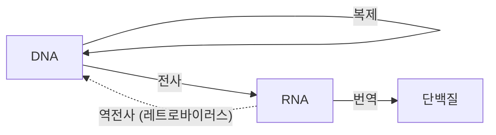
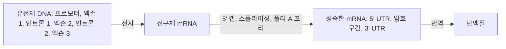
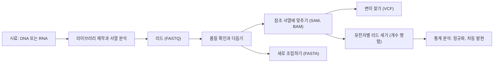
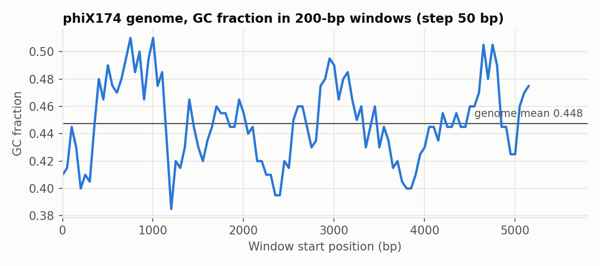

# 7장 — 생물정보학 입문

[레포지토리 안내](../../README.ko.md) | [English](Concepts_Lecture.md) | [한국어](Concepts_Lecture.ko.md)

> **최종 수정일:** 2026-11-27

> **학습 목표:**
> 1. 생물정보학과 계산생물학의 범위를 구분하고 두 분야가 다루는 대표적인 문제를 설명할 수 있다
> 2. DNA, RNA, 단백질의 화학적 구조를 정보학에 필요한 수준에서 설명하고 각 분자를 문자열로 나타낼 수 있다
> 3. 중심 원리와 유전 암호를 이용하여 DNA 서열을 단백질 서열로 번역하고 돌연변이의 효과를 판정할 수 있다
> 4. 유전체, 전사체, 단백질체를 구별하고 염기 서열 분석 기술이 만드는 데이터의 성질을 설명할 수 있다
> 5. FASTA와 FASTQ 형식을 읽고 품질 점수를 오류 확률로 바꿀 수 있으며 주요 데이터베이스의 역할을 설명할 수 있다
> 6. R로 역상보 서열, GC 함량, 번역, k-mer 빈도를 계산할 수 있다

---

## 목차

- [1. 생물정보학과 계산생물학](#1-생물정보학과-계산생물학)
  - [1.1 두 분야의 정의](#11-두-분야의-정의)
  - [1.2 생물학 데이터의 특징](#12-생물학-데이터의-특징)
- [2. 세포와 생체 분자](#2-세포와-생체-분자)
  - [2.1 세포, 원핵생물과 진핵생물](#21-세포-원핵생물과-진핵생물)
  - [2.2 네 종류의 생체 고분자](#22-네-종류의-생체-고분자)
- [3. DNA와 RNA의 화학](#3-dna와-rna의-화학)
  - [3.1 뉴클레오타이드](#31-뉴클레오타이드)
  - [3.2 당-인산 골격과 방향](#32-당-인산-골격과-방향)
  - [3.3 상보적 염기쌍과 이중 나선](#33-상보적-염기쌍과-이중-나선)
  - [3.4 RNA](#34-rna)
  - [3.5 문자열 표현과 IUPAC 부호](#35-문자열-표현과-iupac-부호)
- [4. 단백질의 화학](#4-단백질의-화학)
  - [4.1 아미노산](#41-아미노산)
  - [4.2 펩타이드 결합과 단백질의 방향](#42-펩타이드-결합과-단백질의-방향)
  - [4.3 단백질 구조의 네 단계](#43-단백질-구조의-네-단계)
- [5. 중심 원리](#5-중심-원리)
  - [5.1 복제, 전사, 번역](#51-복제-전사-번역)
  - [5.2 유전 암호](#52-유전-암호)
  - [5.3 읽기 틀과 열린 읽기 틀](#53-읽기-틀과-열린-읽기-틀)
  - [5.4 진핵생물 유전자의 구조](#54-진핵생물-유전자의-구조)
  - [5.5 중심 원리의 확장](#55-중심-원리의-확장)
- [6. 유전체, 전사체, 단백질체](#6-유전체-전사체-단백질체)
  - [6.1 유전자와 유전체](#61-유전자와-유전체)
  - [6.2 전사체와 유전자 발현](#62-전사체와-유전자-발현)
  - [6.3 단백질체](#63-단백질체)
  - [6.4 오믹스 데이터의 모양](#64-오믹스-데이터의-모양)
- [7. 돌연변이와 변이](#7-돌연변이와-변이)
  - [7.1 점 돌연변이](#71-점-돌연변이)
  - [7.2 삽입, 삭제와 틀 이동](#72-삽입-삭제와-틀-이동)
  - [7.3 구조 변이](#73-구조-변이)
  - [7.4 생식 세포 변이와 체세포 변이](#74-생식-세포-변이와-체세포-변이)
  - [7.5 대립 유전자, 유전자형, SNP](#75-대립-유전자-유전자형-snp)
- [8. 염기 서열 분석 기술](#8-염기-서열-분석-기술)
  - [8.1 Sanger 서열 분석](#81-sanger-서열-분석)
  - [8.2 짧은 리드 서열 분석](#82-짧은-리드-서열-분석)
  - [8.3 긴 리드 서열 분석](#83-긴-리드-서열-분석)
  - [8.4 깊이와 커버리지](#84-깊이와-커버리지)
  - [8.5 분석의 흐름](#85-분석의-흐름)
- [9. 데이터 형식](#9-데이터-형식)
  - [9.1 FASTA](#91-fasta)
  - [9.2 FASTQ와 품질 점수](#92-fastq와-품질-점수)
  - [9.3 그 밖의 형식](#93-그-밖의-형식)
- [10. 주요 데이터베이스](#10-주요-데이터베이스)
  - [10.1 INSDC와 GenBank](#101-insdc와-genbank)
  - [10.2 Ensembl](#102-ensembl)
  - [10.3 UniProt](#103-uniprot)
  - [10.4 PDB](#104-pdb)
- [11. R로 다루는 서열](#11-r로-다루는-서열)
  - [11.1 문자열로서의 서열](#111-문자열로서의-서열)
  - [11.2 역상보 서열](#112-역상보-서열)
  - [11.3 GC 함량과 이동 창](#113-gc-함량과-이동-창)
  - [11.4 번역과 돌연변이의 효과](#114-번역과-돌연변이의-효과)
  - [11.5 k-mer 빈도](#115-k-mer-빈도)
  - [11.6 품질 문자열의 해독](#116-품질-문자열의-해독)
  - [11.7 Biostrings 패키지](#117-biostrings-패키지)
- [12. 계산생물학이 다루는 문제](#12-계산생물학이-다루는-문제)
  - [12.1 서열의 문제](#121-서열의-문제)
  - [12.2 발현과 변이의 문제](#122-발현과-변이의-문제)
  - [12.3 구조, 네트워크, 진화의 문제](#123-구조-네트워크-진화의-문제)
- [개념 적용](#개념-적용)
- [요약](#요약)
- [점검 문제](#점검-문제)
- [참고 문헌](#참고-문헌)

---

<br>

## 1. 생물정보학과 계산생물학

### 1.1 두 분야의 정의

2장 5.5절은 생물정보학을 생물학, 컴퓨터과학, 수학, 통계학을 결합하여 생물학적 데이터를 저장, 분석, 해석하는 방법과 소프트웨어 도구를 개발하는 학제 간 분야로 정의하고, 생물학 데이터를 DNA, RNA, 단백질의 세 종류로 나누어 중심 원리로 연결하였다. 이 장은 그 내용을 넓혀 컴퓨터과학 전공자가 알아야 할 생물학의 기초와 생물학 데이터를 다루는 기본 도구를 정리한다. 먼저 생물정보학과 자주 함께 쓰이는 이름인 계산생물학과의 차이를 구분할 필요가 있다.

> **용어 정의:** **계산생물학(computational biology)** 은 수학적 모형, 시뮬레이션, 통계적 추론 같은 계산 방법으로 생물학의 질문에 답하는 분야이다.

두 분야의 경계는 뚜렷하지 않으며 실제로는 거의 같은 뜻으로 쓰이기도 한다. 굳이 나누면 생물정보학은 도구와 데이터 쪽에, 계산생물학은 생물학적 질문과 모형 쪽에 무게가 있다. 예를 들어 방대한 서열 데이터베이스에서 비슷한 서열을 빠르게 찾는 프로그램(8장의 BLAST)을 만드는 일은 생물정보학에 가깝고, 그 프로그램으로 찾은 서열들의 변화를 진화 모형으로 설명하는 일은 계산생물학에 가깝다.

| 구분 | 생물정보학 | 계산생물학 |
|:-----|:-----|:-----|
| 중심 | 데이터, 알고리즘, 소프트웨어, 데이터베이스 | 생물학적 질문, 수학적 모형, 시뮬레이션 |
| 대표 산출물 | 서열 정렬 프로그램, 유전체 데이터베이스, 분석 파이프라인 | 진화 모형, 유전자 조절 네트워크 모형, 집단 유전학 이론 |
| 필요한 배경 | 알고리즘, 자료구조, 통계, 프로그래밍 | 확률론, 미분방정식, 통계적 추론, 생물학 |

*표 1. 생물정보학과 계산생물학의 비교*

### 1.2 생물학 데이터의 특징

생물학 데이터가 계산의 대상이 되는 이유는 크게 세 가지이다.

- **서열은 문자열이다.** DNA는 네 글자, 단백질은 스무 글자의 알파벳으로 쓴 긴 문자열로 나타낼 수 있다. 문자열 비교, 패턴 검색, 압축, 색인 같은 컴퓨터과학의 기법을 거의 그대로 적용할 수 있다.
- **양이 많다.** 한 사람의 유전체는 약 30억 염기쌍이며 [1], 한 번의 서열 분석 실험은 수억 개의 짧은 서열 조각을 만든다. 사람이 눈으로 읽을 수 있는 규모가 아니다.
- **측정에 잡음이 있다.** 서열 분석 기계는 일정한 확률로 글자를 잘못 읽고, 같은 조건의 세포끼리도 유전자 발현량이 다르다. 따라서 결과를 해석하려면 확률 모형과 통계적 검정(9장)이 필요하다.

> **용어 정의:** **유전자(gene)** 는 기능을 가진 산물(단백질이나 기능하는 RNA)을 만드는 데 필요한 정보를 담은 DNA 구간이다.

2장의 분류로 보면 원시 서열은 비정형 데이터이고, 서열에서 길이, 염기 조성, 부분 문자열의 빈도를 세어 표로 만들면 정형 데이터가 된다. 생물정보학의 많은 작업은 이처럼 비정형 서열을 분석할 수 있는 표로 바꾸는 특성 추출이다.

---

<br>

## 2. 세포와 생체 분자

### 2.1 세포, 원핵생물과 진핵생물

모든 생물은 하나 이상의 **세포(cell)** 로 이루어진다. 세포는 막으로 둘러싸인 작은 공간이며, 그 안에서 유전 정보를 보관하고 복사하며 그 정보에 따라 단백질을 만든다. 생물은 세포의 구조에 따라 두 무리로 나뉜다.

> **용어 정의:** **원핵생물(prokaryote)** 은 핵막이 없어 DNA가 세포질에 그대로 있는 생물로, 세균과 고세균이 속하며 DNA는 대개 원형 염색체 하나에 담겨 있다.

> **용어 정의:** **진핵생물(eukaryote)** 은 DNA가 핵막으로 둘러싸인 핵(nucleus) 안에 여러 개의 선형 염색체로 나뉘어 있는 생물로, 효모 같은 균류, 식물, 동물이 속한다. 미토콘드리아 같은 세포 소기관도 있으며, 미토콘드리아는 자신의 작은 DNA를 따로 가진다.

**바이러스(virus)** 는 스스로 증식하지 못하고 숙주 세포의 장치를 빌려 증식하므로 보통 세포로 보지 않는다. 그러나 유전체가 작고 서열이 잘 알려져 있어 생물정보학의 예제로 자주 쓰인다. 11절의 예제에 쓰는 박테리오파지 phiX174는 세균을 감염시키는 바이러스이며, 유전체가 5,386 염기인 단일 가닥 DNA이다.

### 2.2 네 종류의 생체 고분자

세포를 이루는 큰 분자는 네 종류이다. 생물정보학이 주로 다루는 것은 정보를 담는 핵산과, 그 정보로 만들어져 기능을 수행하는 단백질이다.

| 고분자 | 단위체 | 주된 역할 |
|:-----|:-----|:-----|
| 핵산(DNA, RNA) | 뉴클레오타이드 | 유전 정보의 저장과 전달 |
| 단백질 | 아미노산 | 효소 반응, 구조, 신호 전달, 물질 운반 |
| 탄수화물 | 단당류 | 에너지 저장, 세포벽 같은 구조 |
| 지질 | 지방산과 글리세롤 등 | 세포막, 에너지 저장, 신호 전달 |

*표 2. 네 종류의 생체 고분자*

핵산과 단백질은 모두 단위체가 한 줄로 이어진 **중합체(polymer)** 이다. 단위체의 종류가 유한하고 이어지는 순서가 정보를 담으므로, 두 분자는 정확히 유한 알파벳 위의 문자열로 표현된다. 이 사실이 생물정보학의 출발점이다.

---

<br>

## 3. DNA와 RNA의 화학

### 3.1 뉴클레오타이드

> **용어 정의:** **뉴클레오타이드(nucleotide)** 는 다섯 개의 탄소를 가진 당, 인산기, 질소를 포함한 염기가 결합한 분자로, 핵산을 이루는 단위체이다.

DNA의 당은 **디옥시리보스(deoxyribose)** 이고 RNA의 당은 **리보스(ribose)** 이다. 두 당의 차이는 2번 탄소에 붙은 작은 원자단 하나이다. 리보스의 2번 탄소에는 하이드록시기(-OH)가 있고, 디옥시리보스에는 그 자리에 수소만 있다("디옥시"는 산소가 하나 빠졌다는 뜻이다). 이 차이 때문에 RNA는 화학적으로 덜 안정하고 DNA는 오래 보관하기에 알맞다.

염기는 다섯 가지이며, 고리 구조에 따라 두 무리로 나뉜다.

| 염기 | 기호 | 무리 | 고리 | 들어 있는 핵산 |
|:-----|:-----|:-----|:-----|:-----|
| 아데닌(adenine) | A | 퓨린(purine) | 두 개 | DNA, RNA |
| 구아닌(guanine) | G | 퓨린 | 두 개 | DNA, RNA |
| 사이토신(cytosine) | C | 피리미딘(pyrimidine) | 한 개 | DNA, RNA |
| 티민(thymine) | T | 피리미딘 | 한 개 | DNA |
| 우라실(uracil) | U | 피리미딘 | 한 개 | RNA |

*표 3. 핵산의 다섯 염기*

> **용어 정의:** **퓨린(purine)** 은 고리가 두 개인 질소 염기로, 핵산의 염기 가운데 아데닌(A)과 구아닌(G)이 속한다.

> **용어 정의:** **피리미딘(pyrimidine)** 은 고리가 한 개인 질소 염기로, 핵산의 염기 가운데 사이토신(C), 티민(T), 우라실(U)이 속한다.

퓨린과 피리미딘의 구분은 7.1절의 돌연변이 분류(전이와 전환)와 IUPAC 부호(R, Y)에서 다시 쓰인다.

### 3.2 당-인산 골격과 방향

당의 탄소에는 1'부터 5'까지 번호를 붙인다(프라임을 붙여 염기의 원자 번호와 구별한다). 염기는 1' 탄소에, 인산기는 5' 탄소에 붙는다. 이웃한 두 뉴클레오타이드는 인산다이에스터 결합으로 이어진다. 이렇게 당과 인산이 번갈아 이어진 줄을 **당-인산 골격(sugar-phosphate backbone)** 이라 하고, 염기는 이 골격에서 옆으로 튀어나와 있다.

> **용어 정의:** **인산다이에스터 결합(phosphodiester bond)** 은 앞 뉴클레오타이드의 3' 하이드록시기와 뒤 뉴클레오타이드의 5' 인산기를 잇는 결합으로, 핵산 가닥의 뉴클레오타이드를 차례로 이어 준다.

결합이 항상 3'에서 5'로 이어지므로 핵산 가닥에는 방향이 있다. 한쪽 끝에는 자유로운 5' 인산기가, 다른 쪽 끝에는 자유로운 3' 하이드록시기가 남는데, 각각을 **5' 말단**과 **3' 말단**이라 한다. 서열은 관례상 5'에서 3' 방향으로 쓴다. 따라서 `ATGC`라고 쓰면 5'-ATGC-3'을 뜻하며, 이것과 5'-CGTA-3'은 다른 분자이다.

> **주의:** 문자열 `ATGC`를 뒤집은 `CGTA`는 같은 가닥을 3'에서 5' 방향으로 읽은 것일 뿐이지만, 데이터베이스와 파일 형식은 모두 5'에서 3' 방향을 가정하므로 `CGTA`로 저장하면 5'-CGTA-3'이라는 다른 분자를 뜻하게 된다. 방향을 밝히지 않은 채 서열을 뒤집어 저장하면 안 되는 이유이다.

### 3.3 상보적 염기쌍과 이중 나선

세포 안의 DNA는 보통 두 가닥이 꼬인 **이중 나선(double helix)** 이다. 두 가닥은 염기끼리의 수소 결합으로 붙어 있으며, 아데닌은 티민과, 구아닌은 사이토신과만 짝을 짓는다.

> **용어 정의:** **상보적 염기쌍(complementary base pairing)** 은 A와 T(RNA에서는 A와 U), G와 C가 수소 결합으로 짝을 짓는 규칙이다.

A-T 쌍은 수소 결합 두 개, G-C 쌍은 세 개로 이어진다. 그래서 GC 쌍이 많은 DNA일수록 두 가닥을 떼어 내는 데 더 높은 온도가 필요하며, 이것이 서열의 GC 함량을 자주 계산하는 이유 중 하나이다. 퓨린(두 고리)은 항상 피리미딘(한 고리)과 짝을 지으므로 나선의 폭이 일정하게 유지된다.

> **용어 정의:** **GC 함량(GC content)** 은 서열의 염기 가운데 G와 C가 차지하는 비율이다.

> **용어 정의:** **역평행(antiparallel)** 은 이중 나선의 두 가닥이 서로 반대 방향으로 놓인 상태이다.

한 가닥이 왼쪽에서 오른쪽으로 5'에서 3'이면, 짝 가닥은 같은 자리에서 3'에서 5'이다.

```text
5'- A T G G C T T C A -3'
    | | | | | | | | |
3'- T A C C G A A G T -5'

5'- T G A A G C C A T -3'
```

*그림 1. 역평행인 두 가닥과 역상보 서열*

그림 1의 위 두 줄은 서열로 쓰는 가닥과 그 상보 가닥이고, 마지막 줄은 상보 가닥을 관례대로 5'에서 3' 방향으로 다시 쓴 것이다. 이 문자열은 위 가닥의 각 글자를 상보 염기로 바꾸고 순서를 뒤집은 것과 같다.

> **용어 정의:** **역상보 서열(reverse complement)** 은 서열의 각 염기를 상보 염기로 바꾼 뒤 순서를 뒤집어 얻은 서열로, 짝 가닥을 5'에서 3' 방향으로 읽은 것과 같다.

두 가닥 중 어느 쪽에도 유전자가 있을 수 있으므로, DNA 서열에서 무엇을 찾을 때는 주어진 서열과 그 역상보 서열을 모두 살펴야 한다. 상보성에서 바로 나오는 결과로, 이중 가닥 DNA 전체에서는 A의 개수와 T의 개수가 같고 G의 개수와 C의 개수가 같다. 한 가닥만 보면 이 등식은 정확히 성립하지 않지만, 긴 유전체에서는 한 가닥에서도 대략 성립하는 경향이 관찰된다.

### 3.4 RNA

RNA는 DNA와 세 가지가 다르다. 당이 리보스이고, 티민 대신 우라실을 쓰며, 보통 한 가닥으로 존재한다. 한 가닥이지만 자기 서열 안의 상보적인 구간끼리 짝을 지어 머리핀 같은 2차 구조를 만들 수 있고, 이 구조가 기능을 결정하기도 한다. RNA 안에서는 G와 U도 약하게 짝을 지을 수 있다.

| RNA의 종류 | 역할 |
|:-----|:-----|
| 전령 RNA(messenger RNA, mRNA) | 유전자의 정보를 리보솜으로 옮기는 주형 |
| 운반 RNA(transfer RNA, tRNA) | mRNA의 세 염기(코돈, 5.2절)를 읽고 그에 맞는 아미노산을 리보솜으로 가져오는 어댑터 |
| 리보솜 RNA(ribosomal RNA, rRNA) | 리보솜의 구조와 촉매 활성의 핵심 |
| 그 밖의 비암호화 RNA | 마이크로 RNA(miRNA), 긴 비암호화 RNA(lncRNA) 등 유전자 발현의 조절 |

*표 4. 주요 RNA의 종류*

### 3.5 문자열 표현과 IUPAC 부호

정보학의 관점에서 DNA 서열은 알파벳 $`\Sigma_{\mathrm{DNA}} = \lbrace A, C, G, T \rbrace`$ 위의 문자열이고, RNA 서열은 $`\lbrace A, C, G, U \rbrace`$ 위의 문자열이다. 길이가 $`n`$인 DNA 문자열은 $`4^n`$ 가지가 있으므로, 길이 10의 문자열만 해도 약 백만 가지(1,048,576 가지)이다.

실제 데이터에는 어느 염기인지 확정하지 못한 자리가 있다. 이런 자리는 국제적으로 합의된 IUPAC 부호로 적는다.

| 부호 | 뜻 | 부호 | 뜻 |
|:-----|:-----|:-----|:-----|
| R | A 또는 G (퓨린) | Y | C 또는 T (피리미딘) |
| S | G 또는 C (강한 결합) | W | A 또는 T (약한 결합) |
| K | G 또는 T | M | A 또는 C |
| B | A가 아님 (C, G, T) | D | C가 아님 (A, G, T) |
| H | G가 아님 (A, C, T) | V | T가 아님 (A, C, G) |
| N | 아무 염기 | `-` | 정렬의 갭 (8장) |

*표 5. 핵산의 IUPAC 부호*

> **용어 정의:** **IUPAC 부호(IUPAC code)** 는 어느 염기인지 확정하지 못한 자리를 가능한 염기의 조합(예: A 또는 G는 R)으로 나타내는, 국제적으로 합의된 한 글자 기호이다.

시퀀싱 기계가 염기를 결정하지 못한 자리는 보통 `N`으로 기록된다. 서열을 분석하는 코드를 쓸 때는 입력에 A, C, G, T 밖의 글자가 있을 수 있다는 점을 처음부터 고려해야 한다.

---

<br>

## 4. 단백질의 화학

### 4.1 아미노산

> **용어 정의:** **아미노산(amino acid)** 은 하나의 중심 탄소에 아미노기(-NH2), 카복실기(-COOH), 수소 원자, 그리고 종류마다 다른 곁사슬(side chain)이 붙은 분자로, 단백질을 이루는 단위체이다.

생물의 단백질은 주로 스무 가지 표준 아미노산으로 만들어진다. 스무 가지의 차이는 곁사슬에만 있으며, 곁사슬의 크기, 전하, 물과 친한 정도(친수성과 소수성)가 단백질이 접히는 모양과 기능을 정한다. 서열 데이터에서는 아미노산을 한 글자 기호로 쓴다.

| 성질 | 아미노산 (세 글자 기호, 한 글자 기호) |
|:-----|:-----|
| 비극성(소수성) | 글라이신 (Gly, G), 알라닌 (Ala, A), 발린 (Val, V), 류신 (Leu, L), 아이소류신 (Ile, I), 메싸이오닌 (Met, M), 페닐알라닌 (Phe, F), 트립토판 (Trp, W), 프롤린 (Pro, P) |
| 극성, 전하 없음 | 세린 (Ser, S), 트레오닌 (Thr, T), 시스테인 (Cys, C), 타이로신 (Tyr, Y), 아스파라진 (Asn, N), 글루타민 (Gln, Q) |
| 양전하(염기성) | 라이신 (Lys, K), 아르지닌 (Arg, R), 히스티딘 (His, H) |
| 음전하(산성) | 아스파르트산 (Asp, D), 글루탐산 (Glu, E) |

*표 6. 스무 가지 표준 아미노산의 분류*

이 분류는 8장의 치환 행렬을 이해하는 데 쓰인다. 성질이 비슷한 아미노산(예: 류신과 아이소류신)끼리의 치환은 단백질의 기능을 덜 해치므로 진화 과정에서 자주 남고, 성질이 크게 다른 아미노산끼리의 치환은 드물게 남는다. 한 글자 기호 중 B, J, O, U, X, Z는 위 스무 가지 밖의 용도(모호한 아미노산, 드문 아미노산, 알 수 없는 아미노산)로 쓰이고, `*`는 종결 코돈(5.2절)을 나타낸다.

### 4.2 펩타이드 결합과 단백질의 방향

한 아미노산의 카복실기와 다음 아미노산의 아미노기가 물 분자 하나를 내놓으며 결합하는 것을 **펩타이드 결합(peptide bond)** 이라 한다. 아미노산이 이렇게 이어진 사슬을 **폴리펩타이드(polypeptide)** 라 하고, 사슬 안의 각 아미노산을 **잔기(residue)** 라 부른다. 사슬의 한쪽 끝에는 자유로운 아미노기가(**N 말단**), 다른 쪽 끝에는 자유로운 카복실기가(**C 말단**) 남는다. 단백질 서열은 관례상 N 말단에서 C 말단 방향으로 쓰며, 이 방향은 리보솜이 단백질을 합성하는 방향과 같다.

### 4.3 단백질 구조의 네 단계

단백질은 만들어진 뒤 고유한 3차원 모양으로 접히며, 그 모양이 기능을 결정한다. 구조는 네 단계로 기술한다.

| 단계 | 내용 | 예 |
|:-----|:-----|:-----|
| 1차 구조 | 아미노산의 순서, 즉 서열 그 자체 | `MASGLKR` |
| 2차 구조 | 골격의 수소 결합으로 생기는 국소적인 반복 모양 | 알파 나선(α-helix), 베타 병풍(β-sheet) |
| 3차 구조 | 사슬 하나 전체가 접힌 3차원 모양 | 효소의 활성 부위가 만들어지는 접힘 |
| 4차 구조 | 여러 사슬이 모여 이룬 복합체 | 네 개의 사슬로 이루어진 헤모글로빈 |

*표 7. 단백질 구조의 네 단계*

1차 구조는 서열 분석으로 비교적 쉽게 얻지만 3차 구조는 X선 결정학, 핵자기 공명, 극저온 전자 현미경 같은 실험으로 결정해야 하며 시간과 비용이 많이 든다. 서열에서 구조를 예측하는 문제는 계산생물학의 오랜 과제이며, 결정된 구조는 10.4절의 PDB에 모인다.

---

<br>

## 5. 중심 원리

### 5.1 복제, 전사, 번역

> **용어 정의:** **중심 원리(central dogma)** 는 유전 정보가 DNA에서 RNA로, RNA에서 단백질로 전달되며, 단백질에서 핵산으로는 거꾸로 전달되지 않는다는 분자 생물학의 기본 원리이다.

정보가 전달되는 과정은 세 가지이다.

- **복제(replication):** DNA가 자신을 복사한다. 두 가닥이 풀리고 각 가닥이 주형이 되어 상보적인 새 가닥이 만들어지므로, 새 이중 나선은 옛 가닥 하나와 새 가닥 하나로 이루어진다. 세포가 분열할 때마다 일어난다.
- **전사:** RNA 중합효소가 **주형 가닥(template strand)** 을 3'에서 5' 방향으로 읽으며 RNA를 5'에서 3' 방향으로 합성한다. 그 결과 RNA의 서열은 주형 가닥의 상보 가닥, 즉 **암호 가닥(coding strand)** 의 서열에서 T를 U로 바꾼 것과 같다.
- **번역:** 리보솜이 mRNA를 세 염기씩 읽어 나가는 동안, tRNA가 그 세 염기에 상보적인 안티코돈으로 mRNA에 붙어 아미노산을 운반하고 리보솜이 그 아미노산을 이어 단백질을 만든다.

> **용어 정의:** **전사(transcription)** 는 DNA의 한 구간(유전자)을 주형으로 삼아 RNA 중합효소가 상보적인 RNA를 합성하는 과정, 곧 DNA의 정보를 RNA로 복사하는 과정이다.

> **용어 정의:** **번역(translation)** 은 리보솜이 mRNA를 5'에서 3' 방향으로 세 염기씩 읽으며 각 세 염기에 대응하는 아미노산을 이어 단백질을 합성하는 과정이다.



*그림 2. 중심 원리의 정보 흐름*

암호 가닥과 mRNA의 서열이 T와 U만 다르게 같으므로, 데이터베이스는 유전자를 보통 암호 가닥의 DNA 서열로 저장하고 번역할 때는 U 대신 T를 그대로 읽는다. 11절의 R 코드도 이 관례를 따른다.

### 5.2 유전 암호

> **용어 정의:** **코돈(codon)** 은 하나의 아미노산 또는 번역의 종결을 지정하는 mRNA의 연속된 세 염기이다.

> **용어 정의:** **종결 코돈(stop codon)** 은 아미노산을 지정하지 않고 번역을 멈추게 하는 코돈(`TAA`, `TAG`, `TGA`)이다.

> **용어 정의:** **개시 코돈(start codon)** 은 번역이 시작되는 코돈으로, `ATG`(RNA로는 AUG)가 메싸이오닌을 지정하는 동시에 이 역할을 한다.

네 염기로 만들 수 있는 세 글자 단어는 $`4^3 = 64`$ 가지이다. 이 가운데 61가지가 스무 가지 아미노산을 지정하고, 나머지 세 가지(`TAA`, `TAG`, `TGA`, RNA로는 UAA, UAG, UGA)가 종결 코돈이다. 코돈과 아미노산의 대응을 표로 나타내면 다음과 같다.

| 첫째 염기 | 둘째 T | 둘째 C | 둘째 A | 둘째 G | 셋째 염기 |
|:-----|:-----|:-----|:-----|:-----|:-----|
| T | `TTT` F | `TCT` S | `TAT` Y | `TGT` C | T |
| T | `TTC` F | `TCC` S | `TAC` Y | `TGC` C | C |
| T | `TTA` L | `TCA` S | `TAA` 종결 | `TGA` 종결 | A |
| T | `TTG` L | `TCG` S | `TAG` 종결 | `TGG` W | G |
| C | `CTT` L | `CCT` P | `CAT` H | `CGT` R | T |
| C | `CTC` L | `CCC` P | `CAC` H | `CGC` R | C |
| C | `CTA` L | `CCA` P | `CAA` Q | `CGA` R | A |
| C | `CTG` L | `CCG` P | `CAG` Q | `CGG` R | G |
| A | `ATT` I | `ACT` T | `AAT` N | `AGT` S | T |
| A | `ATC` I | `ACC` T | `AAC` N | `AGC` S | C |
| A | `ATA` I | `ACA` T | `AAA` K | `AGA` R | A |
| A | `ATG` M | `ACG` T | `AAG` K | `AGG` R | G |
| G | `GTT` V | `GCT` A | `GAT` D | `GGT` G | T |
| G | `GTC` V | `GCC` A | `GAC` D | `GGC` G | C |
| G | `GTA` V | `GCA` A | `GAA` E | `GGA` G | A |
| G | `GTG` V | `GCG` A | `GAG` E | `GGG` G | G |

*표 8. 표준 유전 암호 (DNA 암호 가닥의 표기)*

> **용어 정의:** **유전 암호(genetic code)** 는 64가지 코돈과 각 코돈이 지정하는 아미노산 또는 번역 종결 사이의 대응 규칙이다.

표 8에서 다음 성질을 읽을 수 있다.

- **중복성(degeneracy):** 64가지 코돈이 21가지 의미(아미노산 20가지와 종결)를 지정하므로 여러 코돈이 같은 아미노산을 지정한다. 메싸이오닌(M)과 트립토판(W)은 코돈이 하나뿐이지만, 류신(L), 세린(S), 아르지닌(R)은 각각 여섯 개이다.
- **셋째 자리의 관용:** 같은 아미노산을 지정하는 코돈은 대개 앞의 두 염기가 같고 셋째 염기만 다르다. 예를 들어 `GCT`, `GCC`, `GCA`, `GCG`는 모두 알라닌이다. 그래서 셋째 자리의 치환은 아미노산을 바꾸지 않는 경우가 많다(7.1절).
- **비슷한 코돈, 비슷한 아미노산:** 둘째 염기가 T인 열에는 소수성 아미노산(F, L, I, M, V)이 모여 있다. 한 염기의 치환이 성질이 비슷한 아미노산으로 바뀌는 경우가 많아 돌연변이의 피해가 줄어든다.

> **참고:** **유전 암호의 변형.** 표 8은 대부분의 생물이 핵 유전자에 쓰는 표준 암호이다. 미토콘드리아와 일부 미생물은 몇몇 코돈의 의미가 다른 변형 암호를 쓰므로, 번역 도구는 사용할 암호 표를 선택하게 되어 있다.

### 5.3 읽기 틀과 열린 읽기 틀

> **용어 정의:** **읽기 틀(reading frame)** 은 서열을 세 염기씩 끊어 읽을 때 코돈의 경계를 정하는 시작 위치의 선택이다.

번역은 세 염기씩 끊어 읽으므로 어디서부터 끊느냐에 따라 전혀 다른 아미노산 서열이 나온다. 한 가닥에는 첫 글자, 둘째 글자, 셋째 글자에서 시작하는 세 가지 읽기 틀이 있고, 역상보 가닥에도 세 가지가 있어 이중 가닥 DNA에는 모두 여섯 가지 읽기 틀이 있다.

```text
         A T G G C T T C A G G T C T G A A A C G C T A A
+1       ATG GCT TCA GGT CTG AAA CGC TAA        -> M A S G L K R *
+2        TGG CTT CAG GTC TGA AAC GCT AA        -> W L Q V * N A
+3         GGC TTC AGG TCT GAA ACG CTA A        -> G F R S E T L
```

*그림 3. 한 가닥의 세 읽기 틀과 번역 결과*

> **용어 정의:** **열린 읽기 틀(open reading frame, ORF)** 은 같은 읽기 틀 안에서 개시 코돈에서 시작하여 중간에 종결 코돈 없이 이어지다가 종결 코돈에서 끝나는 서열 구간이다.

그림 3의 +1, +2, +3은 각각 첫째, 둘째, 셋째 글자에서 시작하는 읽기 틀이다. +1 틀은 `ATG`로 시작하여 `TAA`에서 끝나는 ORF이고, +2 틀은 중간에 `TGA`(종결)가 있다. 무작위 서열에서는 64개 코돈 중 3개가 종결 코돈이므로 평균적으로 약 21코돈마다 종결 코돈이 나타난다. 따라서 수백 코돈 이상 이어지는 긴 ORF는 우연히 생기기 어렵고, 실제 단백질 유전자일 가능성이 높다. 원핵생물의 유전자 찾기는 이 성질을 이용하여 여섯 읽기 틀에서 긴 ORF를 찾는 데서 출발한다.

### 5.4 진핵생물 유전자의 구조

원핵생물의 유전자는 대개 하나의 연속된 ORF이지만, 사람을 비롯한 많은 진핵생물의 유전자는 단백질로 번역되는 구간이 여러 조각으로 끊겨 있다.

- **프로모터(promoter):** 유전자 앞쪽에서 RNA 중합효소가 붙어 전사를 시작하게 하는 조절 구간이다.
- **비번역 구간(untranslated region, UTR):** mRNA의 개시 코돈 앞(5' UTR)과 종결 코돈 뒤(3' UTR)에 있는, 번역되지 않는 구간이다.

> **용어 정의:** **엑손(exon)** 은 유전자 가운데 전사된 뒤 스플라이싱에서 잘려 나가지 않고 최종 mRNA에 남는 구간으로, DNA의 그 구간과 RNA의 대응 구간을 모두 가리킨다.

> **용어 정의:** **인트론(intron)** 은 유전자 가운데 전사되지만 최종 mRNA가 되기 전에 스플라이싱으로 잘려 나가는 구간으로, DNA의 그 구간과 RNA의 대응 구간을 모두 가리킨다.



*그림 4. 진핵생물 유전자의 전사와 가공*

전사된 전구체 mRNA에서 인트론을 잘라 내고 엑손을 잇는 과정을 **스플라이싱(splicing)** 이라 한다. 같은 유전자라도 어떤 엑손을 포함하느냐에 따라 서로 다른 mRNA가 만들어질 수 있는데, 이를 **선택적 스플라이싱(alternative splicing)** 이라 하고 그 결과물들을 **전사체 이형(isoform)** 이라 한다. 그 결과 유전자의 수보다 전사체와 단백질의 종류가 훨씬 많다. 9장의 RNA-seq 데이터 예제는 스플라이싱 인자의 기능을 억제한 실험에서 나온 것이다.

### 5.5 중심 원리의 확장

중심 원리는 정보 흐름의 기본 경로를 말할 뿐이며, 몇 가지 확장이 알려져 있다.

- **역전사(reverse transcription):** HIV 같은 레트로바이러스는 RNA 유전체를 역전사 효소로 DNA로 바꾸어 숙주 유전체에 끼워 넣는다. 실험실에서는 이 효소로 mRNA를 DNA(cDNA)로 바꾸어 서열을 분석하며, RNA-seq도 이 단계를 거친다.
- **RNA 복제:** 일부 RNA 바이러스는 DNA를 거치지 않고 RNA를 직접 복제한다.
- **기능하는 RNA:** 모든 RNA가 단백질로 번역되는 것은 아니다. rRNA, tRNA와 여러 비암호화 RNA는 RNA 상태로 기능한다.

이 확장들이 있어도 단백질의 아미노산 서열에서 핵산 서열로 정보가 거꾸로 전달되는 경로는 알려져 있지 않다는 점은 그대로이다.

---

<br>

## 6. 유전체, 전사체, 단백질체

### 6.1 유전자와 유전체

> **용어 정의:** **유전체(genome)** 는 한 생물이 가진 유전 정보 전체, 즉 모든 염색체(와 세포 소기관)의 DNA 서열 전체이다.

사람의 유전체 서열은 22개의 상염색체와 X, Y 두 성염색체의 서열로 이루어지며, 2022년에 발표된 사람 유전체의 완전한 서열(T2T-CHM13, Y 염색체 제외)은 약 30.55억 염기쌍이고 단백질을 암호화하는 유전자는 19,969개로 주석되었다 [1]. 같은 주석에서 비암호화 유전자까지 포함한 유전자는 63,494개였다 [1]. 즉 유전체의 대부분은 단백질을 암호화하지 않는 구간이며, 그 안에는 조절 구간, 비암호화 RNA 유전자, 반복 서열이 있다.

유전체의 크기는 생물마다 크게 다르다. 11절과 9장에서 쓰는 두 서열의 길이를 보면 박테리오파지 phiX174의 유전체는 5,386 염기이고, Biostrings 패키지에 든 효모(Saccharomyces cerevisiae) 1번 염색체 서열은 230,208 염기이다. 사람의 세포는 염색체를 두 벌씩 가지는 **이배체(diploid)** 이므로 한 세포 안의 DNA 양은 유전체 크기의 두 배이다.

### 6.2 전사체와 유전자 발현

> **용어 정의:** **전사체(transcriptome)** 는 특정한 세포나 조직이 특정한 시점에 가진 RNA 분자 전체이다.

> **용어 정의:** **발현(expression)** 은 유전자가 RNA로 전사되는 정도로, 그 양을 그 유전자의 발현 수준이라 한다.

유전체는 한 사람의 거의 모든 세포에서 같지만, 전사체는 세포의 종류와 상태에 따라 다르다. 간세포와 신경세포는 같은 유전체를 가지면서도 서로 다른 유전자를 전사하기 때문에 다른 일을 한다. 발현 수준은 마이크로어레이나 RNA-seq(8.5절)으로 측정하며, 결과는 유전자를 행으로, 표본을 열로 하는 행렬로 정리된다. 질병이 있는 조직과 정상 조직에서 발현이 다른 유전자를 찾는 차등 발현 분석은 9장의 통계 방법과 10장 이후의 바이오마커 발굴, 군집화, 분류의 출발점이다.

> **용어 정의:** **차등 발현(differential expression)** 은 질병 조직과 정상 조직처럼 두 조건 사이에서 한 유전자의 발현 수준이 다른 것이다.

### 6.3 단백질체

> **용어 정의:** **단백질체(proteome)** 는 세포나 조직이 가진 단백질 전체이다.

단백질의 양은 mRNA의 양과 비례하지 않는 경우가 많다. 번역의 효율과 단백질의 분해 속도가 유전자마다 다르고, 번역된 뒤 인산화 같은 **번역 후 변형(post-translational modification)** 이 단백질의 기능을 바꾸기 때문이다. 단백질체는 주로 질량 분석법으로 측정한다.

### 6.4 오믹스 데이터의 모양

유전체학(genomics), 전사체학(transcriptomics), 단백질체학(proteomics)처럼 생체 분자의 전체 집합을 한꺼번에 측정하는 분야를 묶어 **오믹스(omics)** 라 부른다.

| 분야 | 측정 대상 | 대표 기술 | 데이터의 전형적인 모양 |
|:-----|:-----|:-----|:-----|
| 유전체학 | DNA 서열과 변이 | 전장 유전체 서열 분석 | 리드 서열, 변이 목록(위치, 대립 유전자) |
| 전사체학 | RNA의 종류와 양 | RNA-seq, 마이크로어레이 | 유전자 × 표본의 개수 또는 강도 행렬 |
| 단백질체학 | 단백질의 종류와 양 | 질량 분석법 | 단백질 × 표본의 강도 행렬 |
| 후성유전체학 | DNA 메틸화, 히스톤 변형 | 바이설파이트 서열 분석, ChIP-seq | 위치 × 표본의 비율이나 개수 |
| 대사체학 | 작은 대사 물질 | 질량 분석법, 핵자기 공명 | 물질 × 표본의 강도 행렬 |

*표 9. 주요 오믹스 분야*

> **용어 정의:** **리드(read)** 는 염기 서열 분석 기계가 한 번에 읽어 내는 서열 조각이다.

> **용어 정의:** **대립 유전자(allele)** 는 유전체의 같은 위치에 올 수 있는 서로 다른 서열이다.

오믹스 데이터의 공통점은 변수(유전자, 단백질, 위치)의 수 $`p`$가 표본의 수 $`n`$보다 훨씬 많다는 것이다. 표본이 수십 개인데 유전자는 2만 개인 행렬이 흔하다. 4장의 차원의 저주, 9장의 다중 검정, 10장 이후의 특성 선택이 모두 이 $`p \gg n`$ 구조에서 나오는 문제이다.

---

<br>

## 7. 돌연변이와 변이

### 7.1 점 돌연변이

> **용어 정의:** **돌연변이(mutation)** 는 DNA 서열에 생긴 변화이다.

> **용어 정의:** **치환(substitution)** 은 한 염기가 다른 염기로 바뀌는 돌연변이로, 가장 단순한 돌연변이이다.

돌연변이는 복제의 오류, 화학 물질, 자외선 같은 원인으로 생긴다. 치환은 퓨린과 피리미딘의 구분에 따라 두 종류로 나뉜다.

> **용어 정의:** **전이(transition)** 는 퓨린끼리(A와 G) 또는 피리미딘끼리(C와 T) 바뀌는 치환이다. 가능한 방향은 A에서 G, G에서 A, C에서 T, T에서 C의 4가지이다.

> **용어 정의:** **전환(transversion)** 은 퓨린과 피리미딘 사이에 바뀌는 치환이다. 가능한 방향은 8가지이다.

방향의 개수로만 보면 전환이 전이의 두 배이지만, 실제 생물의 서열에서는 전이가 그보다 훨씬 자주 관찰된다. 고리의 수가 같은 염기끼리 바뀌는 쪽이 화학적으로 일어나기 쉬운 것으로 알려져 있다. 8장의 DNA 점수 체계가 모든 불일치를 같게 취급하는 것은 이런 차이를 무시한 단순화이다.

단백질 암호 구간의 치환은 번역에 미치는 효과로도 분류한다.

| 종류 | 정의 | 예 (`ATG GCT TCA GGT CTG AAA CGC TAA`, 번역 `MASGLKR*`) |
|:-----|:-----|:-----|
| 동의 치환(synonymous) | 아미노산이 바뀌지 않는다 | 둘째 코돈 `GCT`에서 `GCC`로: 여전히 A, 번역 `MASGLKR*` |
| 과오 돌연변이(missense) | 다른 아미노산으로 바뀐다 | 둘째 코돈 `GCT`에서 `ACT`로: A에서 T로, 번역 `MTSGLKR*` |
| 넌센스 돌연변이(nonsense) | 종결 코돈으로 바뀐다 | 여섯째 코돈 `AAA`에서 `TAA`로: 번역 `MASGL*`에서 멈춘다 |

*표 10. 암호 구간 치환의 효과*

> **용어 정의:** **동의 치환(synonymous substitution)** 은 암호 구간의 염기 치환 가운데, 바뀐 코돈이 원래와 같은 아미노산을 지정하여 아미노산 서열이 바뀌지 않는 치환이다.

> **용어 정의:** **과오 돌연변이(missense mutation)** 는 아미노산을 지정하던 코돈이 다른 아미노산을 지정하는 코돈으로 바뀌는 치환이다.

> **용어 정의:** **넌센스 돌연변이(nonsense mutation)** 는 아미노산을 지정하던 코돈이 종결 코돈으로 바뀌어 번역이 그 자리에서 멈추는 치환이다.

동의 치환은 단백질을 바꾸지 않으므로 자연 선택을 덜 받고, 진화 과정에서 비동의 치환보다 많이 쌓인다. 8장 9절의 다중 정렬에서 여러 종의 같은 유전자를 비교하면 서열의 차이가 대부분 코돈의 셋째 자리에 몰려 있는 것을 볼 수 있다.

### 7.2 삽입, 삭제와 틀 이동

염기 하나 이상이 끼어드는 것을 **삽입(insertion)**, 빠지는 것을 **삭제(deletion)** 라 한다. 암호 구간에서 인델의 길이가 3의 배수가 아니면 그 뒤의 읽기 틀 전체가 밀린다.

> **용어 정의:** **인델(indel)** 은 염기가 끼어드는 삽입과 빠지는 삭제를 묶어 부르는 말이다.

> **용어 정의:** **틀 이동 돌연변이(frameshift mutation)** 는 암호 구간에서 3의 배수가 아닌 길이의 삽입이나 삭제가 일어나 그 뒤의 코돈 경계가 모두 바뀌는 돌연변이이다.

앞의 예에서 둘째 코돈의 첫 염기 `G`를 지우면 서열이 `ATG CTT CAG GTC TGA ...`로 읽혀 번역이 `MLQV*`에서 멈춘다(11.4절에서 R로 확인한다). 치환 하나는 아미노산 하나를 바꾸지만, 틀 이동은 그 뒤의 단백질 전체를 바꾸고 대개 이른 종결 코돈을 만든다. 서열 정렬(8장)에서 치환은 불일치로, 인델은 갭으로 나타나며, 정렬의 점수 체계는 이 두 종류의 변화를 서로 다른 벌점으로 다룬다.

### 7.3 구조 변이

> **용어 정의:** **구조 변이(structural variant)** 는 점 돌연변이와 짧은 인델보다 긴 구간이 바뀌는 변이이다.

구조 변이에는 긴 구간의 삭제와 중복, 방향이 뒤집히는 역위(inversion), 다른 염색체로 옮겨 가는 전좌(translocation)가 있다. 어떤 구간의 복사본 수가 사람마다 다른 것을 **복제수 변이(copy number variation, CNV)** 라 한다. 구조 변이는 짧은 리드 하나보다 긴 경우가 많아, 8.3절의 긴 리드 기술이 이를 찾는 데 유리하다.

### 7.4 생식 세포 변이와 체세포 변이

- **생식 세포 변이(germline variant):** 정자나 난자에 있어 자손에게 전해지는 변이이다. 개체의 거의 모든 세포가 같은 변이를 가진다.
- **체세포 변이(somatic variant):** 태어난 뒤 일부 세포에서 생긴 변이로, 자손에게 전해지지 않는다. 암은 체세포 변이가 쌓여 세포의 증식 조절이 무너진 상태로 이해되며, 종양 조직과 정상 조직의 서열을 비교하여 체세포 변이를 찾는다.

### 7.5 대립 유전자, 유전자형, SNP

> **용어 정의:** **유전자형(genotype)** 은 한 개체가 한 위치에 가진 대립 유전자의 조합으로, 이배체 생물은 각 위치에 대립 유전자를 두 개 가진다.

두 대립 유전자가 같으면 동형 접합(homozygous), 다르면 이형 접합(heterozygous)이다. 예를 들어 어떤 위치에서 A와 G가 관찰되면 가능한 유전자형은 AA, AG, GG이다.

> **용어 정의:** **단일 염기 다형성(single nucleotide polymorphism, SNP)** 은 집단 안에서 흔히(관례상 대립 유전자 빈도 1% 이상) 관찰되는 한 염기 위치의 변이이다.

SNP는 사람 사이의 유전적 차이 가운데 가장 흔한 종류이며, 수십만에서 수백만 개의 SNP와 질병의 관련성을 한꺼번에 검정하는 연구는 9장의 다중 검정 문제의 대표적인 사례이다.

---

<br>

## 8. 염기 서열 분석 기술

**염기 서열 분석(sequencing)** 은 DNA나 RNA 분자의 염기 순서를 읽어 내는 기술이다. 어떤 기술도 염색체 전체를 처음부터 끝까지 한 번에 읽지 못하므로, 분석은 항상 많은 리드를 다시 이어 붙이거나 이미 알려진 서열에 맞추어 보는 계산 문제가 된다.

### 8.1 Sanger 서열 분석

**Sanger 서열 분석**은 DNA 중합효소가 새 가닥을 합성할 때 일정한 비율로 사슬 종결 뉴클레오타이드(3' 하이드록시기가 없는 디디옥시뉴클레오타이드)를 섞어 넣는 방법이다. 이 뉴클레오타이드가 들어간 자리에서 합성이 멈추므로 길이가 한 염기씩 다른 조각들이 만들어지고, 네 염기마다 다른 형광 표지를 붙여 조각을 길이순으로 분리하면 끝 염기의 색을 차례로 읽어 서열을 얻는다. 리드는 수백에서 천 염기 정도로 길고 정확하지만 한 번에 읽는 양이 적어, 지금은 특정 구간의 확인에 주로 쓰인다.

### 8.2 짧은 리드 서열 분석

현재 가장 널리 쓰이는 방식은 수십에서 수백 염기의 짧은 리드를 한 번에 수억 개 읽는 **대량 병렬 서열 분석(massively parallel sequencing)** 이며, 흔히 차세대 서열 분석(next-generation sequencing, NGS)이라 부른다. 대표적인 방식인 합성에 의한 서열 분석(sequencing by synthesis)은 다음과 같이 진행된다.

1. DNA를 짧은 조각으로 자르고 양 끝에 알려진 짧은 서열(어댑터)을 붙여 **라이브러리(library)** 를 만든다.
2. 조각을 유리판(flow cell) 위에 붙이고 제자리에서 증폭하여 같은 서열의 복사본이 모인 점(클러스터)을 만든다.
3. 형광 표지가 붙은 가역적 종결 뉴클레오타이드를 한 번에 하나씩 합성시키고, 매 주기마다 사진을 찍어 각 클러스터의 색으로 그 자리의 염기를 읽는다.
4. 주기를 반복한 횟수가 리드의 길이가 된다. 조각의 양쪽 끝을 각각 읽으면 서로 짝을 이루는 두 리드(paired-end read)를 얻는다.

주기가 진행될수록 클러스터 안의 복사본들이 조금씩 어긋나 신호가 흐려지므로, 리드의 뒤쪽일수록 오류 확률이 높아지는 경향이 있다. 기계는 염기마다 그 판정이 틀렸을 확률을 함께 기록하며, 이것이 9.2절의 품질 점수이다.

### 8.3 긴 리드 서열 분석

긴 리드 기술은 증폭 없이 분자 하나를 직접 읽어 수만 염기 이상의 리드를 만든다.

- **단일 분자 실시간 서열 분석(single-molecule real-time sequencing):** 매우 작은 구멍 하나에 고정된 중합효소 하나가 합성하는 과정을 형광으로 실시간 관찰한다.
- **나노포어 서열 분석(nanopore sequencing):** DNA 가닥이 막에 뚫린 단백질 구멍(나노포어)을 지날 때 구멍을 흐르는 이온 전류가 염기에 따라 달라지는 것을 측정한다.

| 기술 | 리드 길이 (대략) | 장점 | 약점 |
|:-----|:-----|:-----|:-----|
| Sanger | 수백에서 천 염기 | 높은 정확도 | 처리량이 적고 비싸다 |
| 짧은 리드(합성에 의한 서열 분석) | 수십에서 수백 염기 | 처리량이 매우 많고 염기당 비용이 낮다 | 반복 서열과 긴 구조 변이를 풀기 어렵다 |
| 긴 리드(단일 분자, 나노포어) | 수만 염기 이상 | 반복 서열과 구조 변이, 유전체 조립에 유리 | 염기당 오류율과 비용이 기술과 방식에 따라 다르다 |

*표 11. 염기 서열 분석 기술의 비교*

### 8.4 깊이와 커버리지

> **용어 정의:** **깊이(depth)** 는 유전체의 한 위치를 덮는 리드의 수이다.

> **용어 정의:** **커버리지(coverage)** 는 유전체 전체에서 깊이의 평균이다.

길이 $`L`$인 리드 $`N`$개를 크기 $`G`$인 유전체에서 읽으면 평균 커버리지는 다음과 같다.

```math
C = \frac{N L}{G}
```

예를 들어 길이 150 염기의 리드로 30.55억 염기쌍의 유전체를 평균 30배로 덮으려면 $`N = 30 \times 3.055 \times 10^9 / 150 \approx 6.11 \times 10^8`$개, 즉 약 6억 개의 리드가 필요하다.

리드가 유전체의 아무 위치에서나 같은 확률로, 서로 독립적으로 시작한다고 가정하면 한 위치의 깊이는 평균이 $`C`$인 Poisson 분포를 따른다(9장 2절). 깊이가 0일 확률, 즉 그 위치가 한 번도 읽히지 않을 확률은 $`e^{-C}`$이다. 커버리지가 1이면 유전체의 약 36.8%, 2이면 약 13.5%, 5이면 약 0.67%가 읽히지 않는다. 같은 양을 읽어도 위치마다 깊이가 고르지 않으므로 평균 커버리지를 충분히 높여야 빠지는 구간이 줄어든다.

> **[확률및통계]** Poisson 분포는 드물게 일어나는 사건이 정해진 구간에서 일어나는 횟수의 분포로, 평균이 $`\lambda`$이면 $`P(X = k) = e^{-\lambda} \lambda^k / k!`$이다. 리드 하나가 특정 위치를 덮을 확률이 $`L/G`$로 매우 작고 리드의 수 $`N`$이 매우 크므로, 이항 분포 $`\mathrm{Bin}(N, L/G)`$를 평균 $`NL/G`$의 Poisson 분포로 근사할 수 있다.

> **주의:** 실제 데이터는 GC 함량이 극단적인 구간, 반복 서열, 증폭 편향 때문에 깊이가 Poisson 분포보다 고르지 않다. $`e^{-C}`$는 가장 이상적인 경우의 계산이며, 실제로 빠지는 구간은 이보다 많다.

### 8.5 분석의 흐름

서열 분석 데이터의 분석은 대개 다음 흐름을 따른다.



*그림 5. 서열 분석 데이터의 전형적인 분석 흐름*

- **참조 서열에 맞추기(read mapping):** 이미 서열이 알려진 종이면 각 리드가 참조 유전체의 어디에서 왔는지 찾는다. 수억 개의 리드를 수십억 염기의 참조에 맞추어야 하므로, 8장의 정렬 알고리즘에 k-mer(길이 k의 부분 문자열, 11.5절) 색인을 결합한 빠른 방법이 쓰인다.
- **새로 조립하기(de novo assembly):** 참조가 없으면 겹치는 리드끼리 이어 붙여 긴 서열을 복원한다. 반복 서열이 리드보다 길면 어디에 이어야 할지 정할 수 없어 조립이 끊긴다.
- **변이 찾기(variant calling):** 맞춘 리드와 참조를 비교하여 위치마다 대립 유전자를 판정한다. 시퀀싱 오류와 실제 변이를 구별하는 데 깊이와 품질 점수가 쓰인다.
- **정량(quantification):** RNA-seq에서는 각 유전자에 맞추어진 리드를 세어 유전자 × 표본의 개수 행렬을 만든다. 이 행렬의 통계적 분석이 9장 7절의 주제이다.

---

<br>

## 9. 데이터 형식

### 9.1 FASTA

**FASTA 형식**은 서열을 저장하는 가장 단순한 텍스트 형식이다. `>`로 시작하는 머리 줄에 서열의 이름과 설명을 쓰고, 그 다음 줄부터 다음 `>`가 나올 때까지 서열을 쓴다. 서열은 한 줄에 몰아 써도 되고 일정한 길이로 줄을 바꾸어도 된다. 한 파일에 여러 서열을 이어 쓸 수 있다.

```text
>seq1 example coding sequence
ATGGCTTCAGGTCTGAAACGCTAA
>seq2 example peptide
MASGLKR
```

FASTA는 서열만 담고 염기마다의 품질 정보는 담지 않는다. DNA, RNA, 단백질 서열을 모두 저장할 수 있으므로, 파일을 읽는 쪽에서 알파벳을 확인해야 한다.

### 9.2 FASTQ와 품질 점수

**FASTQ 형식**은 서열과 염기마다의 품질 점수를 함께 저장하는 리드의 표준 형식이다. 형식 자체는 서열과 품질 문자열을 여러 줄로 나누어 쓰는 것을 허용하지만, 대부분의 도구는 줄을 나누지 않으므로 리드 하나가 다음 네 줄로 이루어지며 이 관례가 권장된다 [2].

1. `@`로 시작하는 식별자 줄
2. 서열
3. `+`로 시작하는 줄 (식별자를 한 번 더 쓰기도 한다)
4. 서열과 길이가 같은 품질 문자열

```text
@read_001
GATTACAGGCTTAC
+
IIIIHHGG@@5+#!
```

품질 문자열의 글자 하나는 같은 위치 염기의 품질 점수를 나타낸다.

> **용어 정의:** **Phred 품질 점수(Phred quality score)** 는 염기 판정이 틀렸을 확률 $`P`$를 $`Q = -10 \log_{10} P`$로 바꾼 값이다.

$`Q`$가 10 증가할 때마다 오류 확률은 10분의 1로 준다.

| Q | 오류 확률 P | 정확도 |
|:-----|:-----|:-----|
| 10 | 0.1 | 90% |
| 20 | 0.01 | 99% |
| 30 | 0.001 | 99.9% |
| 40 | 0.0001 | 99.99% |

*표 12. Phred 품질 점수와 오류 확률*

점수는 글자 하나로 저장하기 위해 ASCII 코드에 일정한 값(오프셋)을 더해 쓴다. 표준 FASTQ(Sanger 형식)는 오프셋 33을 쓰며, ASCII 33번(`!`)부터 126번(`~`)까지의 글자로 0부터 93까지의 점수를 나타낸다 [2]. 따라서 `I`(ASCII 73)는 $`73 - 33 = 40`$, `#`(ASCII 35)는 2, `!`(ASCII 33)는 0이다. 위의 리드에서 마지막 몇 염기는 품질이 매우 낮아, 마지막 염기 `C`는 사실상 정보가 없다(Q = 0이면 P = 1).

> **주의:** 초기의 Solexa 형식과 Illumina 1.3+ 형식은 오프셋 64를 썼으며(Solexa 형식은 점수의 정의도 Phred와 조금 다르다) [2], 파일만 보고는 어느 오프셋인지 확실히 알 수 없는 경우가 있다. 오프셋 64 형식은 ASCII 59 이상의 글자만 쓰므로, ASCII 값이 59보다 작은 글자(`:` 이하)가 하나라도 있으면 오프셋 33이라고 판단할 수 있다. 오프셋을 잘못 가정하면 모든 점수가 31만큼 틀어진다.

### 9.3 그 밖의 형식

| 형식 | 내용 | 특징 |
|:-----|:-----|:-----|
| SAM, BAM | 리드를 참조 서열에 맞춘 결과 | SAM은 텍스트, BAM은 그 압축 이진 형식이다. 리드마다 위치, 정렬 모양, 맞춘 품질을 기록한다 |
| VCF | 변이 목록 | 위치, 참조 대립 유전자, 대체 대립 유전자, 표본별 유전자형을 기록한다 |
| GFF, GTF | 유전체 주석 | 유전자, 엑손, 암호 구간의 위치와 가닥 방향을 기록한다 |
| BED | 유전체 구간 | 염색체, 시작, 끝의 세 열을 기본으로 하는 단순한 구간 목록이다 |
| PDB, mmCIF | 3차원 구조 | 원자마다의 좌표를 기록한다. mmCIF가 현재의 표준 형식이다 |

*표 13. 생물정보학의 주요 파일 형식*

> **주의:** 위치를 세는 방식이 형식마다 다르다. GFF와 VCF는 첫 염기를 1로 세고 끝 위치를 포함하지만, BED는 첫 염기를 0으로 세고 끝 위치를 포함하지 않는다. 따라서 1번부터 100번 염기까지의 구간은 GFF에서 `1 100`, BED에서 `0 100`이다. 두 형식을 섞어 쓸 때 한 칸씩 어긋나는 오류가 흔하다.

---

<br>

## 10. 주요 데이터베이스

생물학 데이터는 공개 데이터베이스에 모여 전 세계 연구자가 함께 쓴다. 논문을 출판하려면 새로 얻은 서열을 공개 데이터베이스에 등록하도록 요구하는 경우가 많다. 각 항목에는 고유한 접근 번호가 붙고, 내용이 바뀌면 `NM_002449.4`의 `.4`처럼 판 번호가 올라간다.

> **용어 정의:** **접근 번호(accession number)** 는 공개 데이터베이스가 각 항목에 붙이는 고유한 식별 번호이다.

### 10.1 INSDC와 GenBank

**GenBank**는 미국 국립보건원(NIH)의 유전 서열 데이터베이스로, 공개된 모든 DNA 서열에 주석을 붙여 모은 것이다 [3]. GenBank는 일본의 DDBJ, 유럽의 ENA와 함께 국제 염기 서열 데이터베이스 협력(International Nucleotide Sequence Database Collaboration, INSDC)을 이루며, 세 기관은 매일 데이터를 교환한다 [3]. 따라서 어느 한 곳에 등록한 서열은 세 곳 모두에서 검색된다.

GenBank는 연구자가 제출한 서열을 그대로 보관하므로 같은 유전자의 서열이 중복되어 여러 번 들어 있을 수 있다. 미국 국립생물공학정보센터(NCBI)는 이를 보완하기 위해 생물마다 대표 서열을 골라 정리한 **RefSeq**을 따로 운영하며, `NM_`으로 시작하는 접근 번호는 RefSeq의 mRNA 항목이다. NCBI는 8장의 BLAST로 이 데이터베이스들을 검색하는 서비스도 제공한다.

### 10.2 Ensembl

**Ensembl**은 척추동물과 모델 생물의 유전체에 대한 고품질 주석, 도구, 서비스를 무료로 제공하는 유전체 자원이다 [4]. 유전체 서열 위에 유전자, 전사체, 변이, 조절 구간의 위치를 주석으로 얹어 유전체 브라우저로 보여 주며, 사람 유전자에는 `ENSG`로 시작하는 고유 번호를 붙인다. 서열 그 자체보다 서열의 어디에 무엇이 있는지를 찾을 때 주로 쓴다. 9장의 발현 데이터처럼 유전자 이름 대신 데이터베이스의 유전자 번호(예: 초파리의 `FBgn`으로 시작하는 FlyBase 번호)로 행을 표시한 데이터가 많으므로, 번호를 유전자 이름으로 바꾸는 일도 이런 데이터베이스를 통해 한다.

### 10.3 UniProt

**UniProt**은 단백질 서열과 그 기능 정보를 모은 데이터베이스이다. 핵심인 UniProt 지식 베이스(UniProtKB)는 전문 큐레이터가 문헌을 바탕으로 기능 정보를 정리한 **Swiss-Prot**(검토된 항목)과, 자동화된 시스템이 주석을 붙인 **TrEMBL**(검토되지 않은 항목)로 나뉜다 [5]. UniProtKB의 항목은 대부분 유전체 서열에서 예측한 검토되지 않은 항목이므로, 신뢰할 수 있는 기능 정보가 필요하면 Swiss-Prot 항목을 우선한다.

### 10.4 PDB

**PDB(Protein Data Bank)** 는 단백질, 핵산, 그 복합체의 3차원 구조 정보를 모은 단일 저장소이다 [6]. RCSB PDB, 유럽의 PDBe, 일본의 PDBj 등의 회원 기관이 함께 이루는 wwPDB가 이 저장소를 관리하며 전 세계에 무료로 공개한다 [6]. 각 구조에는 네 글자의 PDB 번호가 붙으며, 4.3절의 3차 구조와 4차 구조가 이곳의 원자 좌표로 기록된다.

| 데이터베이스 | 주된 내용 | 운영 | 대표적인 용도 |
|:-----|:-----|:-----|:-----|
| GenBank (INSDC) | 공개된 모든 염기 서열 | NCBI (DDBJ, ENA와 공유) | 서열의 등록과 검색, BLAST 검색 |
| RefSeq | 생물마다 정리한 대표 서열 | NCBI | 중복 없는 참조 서열 |
| Ensembl | 유전체 주석과 브라우저 | EMBL-EBI 등 | 유전자의 위치와 구조, 변이의 확인 |
| UniProt | 단백질 서열과 기능 | UniProt 컨소시엄 | 단백질 기능의 확인 |
| PDB | 3차원 구조 | wwPDB | 구조의 확인과 구조 기반 분석 |

*표 14. 주요 생물학 데이터베이스*

---

<br>

## 11. R로 다루는 서열

이 절은 1장의 R 문법만으로 서열을 다루는 함수를 만들고, 마지막에 같은 계산을 Bioconductor의 Biostrings 패키지로 한다. 기본 문법으로 먼저 구현하면 각 계산이 문자열 처리의 어떤 연산인지 분명해지고, 패키지의 결과를 검증할 수도 있다.

### 11.1 문자열로서의 서열

R에서 서열은 문자열 하나로 저장한다. 글자 단위로 처리하려면 `strsplit()`으로 문자 벡터로 쪼갠다.

```r
dna <- "ATGGCTTCAGGTCTGAAACGCTAA"
nchar(dna)
bases <- strsplit(dna, "")[[1]]
bases[1:6]
table(factor(bases, levels = c("A", "C", "G", "T")))
```

```text
[1] 24

[1] "A" "T" "G" "G" "C" "T"

A C G T 
7 5 6 6 
```

- `nchar(dna)`는 서열의 길이(24 염기)를 돌려준다.
- `strsplit(dna, "")`는 빈 문자열을 구분자로 써서 글자마다 자른다. 결과가 리스트이므로 `[[1]]`로 첫 원소인 문자 벡터를 꺼낸다.
- `factor(..., levels = ...)`로 네 염기를 수준으로 고정한 뒤 `table()`로 세면, 서열에 없는 염기도 0으로 표시되고 순서가 항상 A, C, G, T로 같아진다. 2장의 특성 추출 예에서 문자마다 개수를 센 것과 같은 계산이다.

### 11.2 역상보 서열

역상보 서열은 글자 바꾸기와 순서 뒤집기의 두 연산으로 나뉜다.

```r
revcomp <- function(s) {
  comp <- chartr("ACGT", "TGCA", s)          # swap A with T and C with G
  paste(rev(strsplit(comp, "")[[1]]), collapse = "")
}
revcomp(dna)
revcomp(revcomp(dna)) == dna
```

```text
[1] "TTAGCGTTTCAGACCTGAAGCCAT"
[1] TRUE
```

- `chartr("ACGT", "TGCA", s)`는 첫 인자의 각 글자를 둘째 인자의 같은 위치 글자로 바꾼다. A는 T로, C는 G로, G는 C로, T는 A로 바뀌므로 상보 염기를 한 번에 얻는다.
- `rev(strsplit(comp, "")[[1]])`는 글자 벡터의 순서를 뒤집고, `paste(..., collapse = "")`는 그 벡터를 다시 문자열 하나로 붙인다.
- 역상보를 두 번 하면 원래 서열로 돌아와야 한다. 마지막 줄의 `TRUE`가 이를 확인한다. 이런 성질 검사는 서열 함수를 테스트하는 간단한 방법이다.

> **주의:** `chartr()`은 대소문자를 구별하므로 소문자 서열(`acgt`)이나 `N`이 섞인 서열은 바뀌지 않은 글자가 남는다. 실제 데이터에 쓸 때는 `toupper()`로 대문자로 바꾸고, N은 N으로 바꾸도록 대응표를 넓혀야 한다.

### 11.3 GC 함량과 이동 창

GC 함량(3.3절)은 다음 식으로 계산한다.

```math
\mathrm{GC} = \frac{n_G + n_C}{n_A + n_C + n_G + n_T}
```

긴 서열에서는 전체 비율 하나보다 위치에 따라 비율이 어떻게 변하는지가 더 많은 정보를 준다. 일정한 길이의 창(window)을 일정한 간격(step)으로 옮기며 창마다 GC 함량을 계산하는 것을 **이동 창(sliding window)** 분석이라 한다.

```r
gc_content <- function(s) {
  b <- strsplit(s, "")[[1]]
  sum(b == "G" | b == "C") / length(b)
}
gc_content(dna)
gc_window <- function(s, w, step) {
  starts <- seq(1, nchar(s) - w + 1, by = step)
  data.frame(start = starts,
             gc = sapply(starts, function(i) gc_content(substr(s, i, i + w - 1))))
}
gc_window("GGGGCCCCAAAATTTTGCGC", w = 8, step = 4)
```

```text
[1] 0.4583333
  start  gc
1     1 1.0
2     5 0.5
3     9 0.0
4    13 0.5
```

- `b == "G" | b == "C"`는 글자마다 G나 C이면 `TRUE`인 논리 벡터이고, `sum()`은 `TRUE`를 1로 세므로 G와 C의 개수가 된다. 예제 서열은 24 염기 중 11개가 G나 C이므로 11/24 = 0.458이다.
- `seq(1, nchar(s) - w + 1, by = step)`는 창의 시작 위치이다. 마지막 창이 서열 끝을 넘지 않도록 시작 위치의 상한을 `nchar(s) - w + 1`로 둔다. 길이 20, 창 8, 간격 4이면 시작 위치는 1, 5, 9, 13이다.
- `substr(s, i, i + w - 1)`는 `i`번째부터 `w`개의 글자를 잘라 내고, `sapply()`는 시작 위치마다 GC 함량을 계산해 벡터로 모은다. 첫 창 `GGGGCCCC`는 1.0, 셋째 창 `AAAATTTT`는 0.0이다.

같은 함수를 phiX174 유전체에 적용한다. 서열은 Bioconductor 패키지 pwalign에 들어 있으며, 11.7절의 Biostrings 패키지로 꺼낸다.

```r
suppressPackageStartupMessages(library(Biostrings))
data(phiX174Phage, package = "pwalign")
s <- as.character(phiX174Phage[[1]])
win <- gc_window(s, w = 200, step = 50)
nrow(win)
summary(win$gc)
win[which.min(win$gc), ]
win[which.max(win$gc), ]
```

```text
[1] 104
   Min. 1st Qu.  Median    Mean 3rd Qu.    Max. 
 0.3850  0.4288  0.4450  0.4483  0.4662  0.5100 
   start    gc
25  1201 0.385
   start   gc
16   751 0.51
```

길이 200 염기의 창 104개에서 GC 함량은 0.385(1,201번 위치에서 시작하는 창)부터 0.510(751번 위치에서 시작하는 창)까지 변한다. 그림 6은 이 변화를 그린 것이다. 유전체 전체의 GC 함량은 0.448이지만 창에 따라 그 값에서 최대 6 퍼센트포인트 정도 벗어난다.



*그림 6. phiX174 유전체의 이동 창 GC 함량*

> **참고:** **창의 크기와 해상도.** 창이 작으면 국소적인 변화를 잘 보여 주지만 우연한 변동도 크게 나타나고, 창이 크면 그래프가 매끄러워지지만 좁은 구간의 특징이 사라진다. 길이 $`w`$인 창에서 GC 함량의 우연한 변동은 이항 분포의 표준편차 $`\sqrt{p(1-p)/w}`$ 정도이므로, $`p = 0.45`$, $`w = 200`$이면 약 0.035이다. 그림 6의 변동은 이 크기와 비슷하므로, 특정 구간의 GC 함량이 의미 있게 다르다고 말하려면 9장의 검정이 필요하다.

### 11.4 번역과 돌연변이의 효과

번역에는 64개 코돈의 대응표가 필요하다. 표 8의 순서(T, C, A, G)로 코돈을 나열하면 아미노산을 64글자의 문자열 하나로 적을 수 있다.

```r
b <- c("T", "C", "A", "G")
codons <- paste0(rep(b, each = 16), rep(rep(b, each = 4), times = 4), rep(b, times = 16))
aa <- strsplit("FFLLSSSSYY**CC*WLLLLPPPPHHQQRRRRIIIMTTTTNNKKSSRRVVVVAAAADDEEGGGG", "")[[1]]
code <- setNames(aa, codons)
code[c("ATG", "TGG", "TAA", "TAG", "TGA", "GCT", "GCC", "GCA", "GCG")]
translate_dna <- function(s, frame = 1) {
  s <- substr(s, frame, nchar(s))
  n <- nchar(s) %/% 3
  starts <- seq(1, by = 3, length.out = n)
  cods <- substring(s, starts, starts + 2)
  paste(code[cods], collapse = "")
}
translate_dna(dna)
sapply(1:3, function(f) translate_dna(dna, f))
table(table(aa))
```

```text
ATG TGG TAA TAG TGA GCT GCC GCA GCG 
"M" "W" "*" "*" "*" "A" "A" "A" "A" 
[1] "MASGLKR*"
[1] "MASGLKR*" "WLQV*NA"  "GFRSETL" 

1 2 3 4 6 
2 9 2 5 3 
```

- `codons`는 첫째 염기를 16번씩, 둘째 염기를 4번씩 반복하고 셋째 염기를 가장 빠르게 바꾸어 64개 코돈을 표 8의 순서로 만든다. `TTT, TTC, TTA, TTG, TCT, ...`의 순서이다.
- `aa`의 64글자는 그 순서의 아미노산이며, `*`는 종결 코돈이다. `setNames()`로 코돈을 이름으로 붙이면 `code["ATG"]`처럼 이름으로 찾는 대응표가 된다. 이것은 자료구조의 해시 테이블처럼 키로 값을 찾는 구조이다.
- `translate_dna()`는 `frame`번째 글자부터 서열을 자르고, `nchar(s) %/% 3`(정수 나눗셈)으로 완전한 코돈의 수를 구한다. 끝에 남는 한두 글자는 버린다.
- `substring(s, starts, starts + 2)`는 시작 위치 벡터를 받아 코돈들을 한 번에 잘라 내고, `code[cods]`가 각 코돈을 아미노산으로 바꾼다. 결과는 그림 3과 같다.
- 마지막 줄은 코돈 수의 분포를 센다. 코돈이 하나인 의미가 2개(M, W), 둘인 것이 9개, 셋인 것이 2개(I와 종결), 넷인 것이 5개, 여섯인 것이 3개(L, S, R)이다. 5.2절의 중복성을 숫자로 확인한 것이다.

같은 함수로 표 10과 7.2절의 돌연변이를 확인한다.

```r
ref <- "ATGGCTTCAGGTCTGAAACGCTAA"
variants <- c(reference  = ref,
              synonymous = "ATGGCCTCAGGTCTGAAACGCTAA",
              missense   = "ATGACTTCAGGTCTGAAACGCTAA",
              nonsense   = "ATGGCTTCAGGTCTGTAACGCTAA",
              frameshift = "ATGCTTCAGGTCTGAAACGCTAA")
sapply(variants, translate_dna)
```

```text
 reference synonymous   missense   nonsense frameshift 
"MASGLKR*" "MASGLKR*" "MTSGLKR*" "MASGL*R*"  "MLQV*NA" 
```

넌센스 돌연변이의 결과 `MASGL*R*`에서 첫 `*` 뒤의 `R*`는 리보솜이 첫 종결 코돈에서 멈추므로 실제로는 만들어지지 않는다. 함수는 종결 코돈 뒤에서도 기계적으로 번역을 계속하므로, 단백질을 얻으려면 첫 `*`까지만 잘라야 한다. 틀 이동의 결과 `MLQV*NA`는 둘째 코돈부터 아미노산이 모두 바뀌고 다섯째 코돈에서 종결된다.

### 11.5 k-mer 빈도

> **용어 정의:** **k-mer**는 서열 안의 길이 $`k`$인 연속된 부분 문자열이다.

길이 $`n`$인 서열에는 겹치는 것을 모두 세어 $`n - k + 1`$개의 k-mer가 있고, DNA에서 가능한 k-mer의 종류는 $`4^k`$ 가지이다. k-mer 빈도는 서열의 조성을 요약하는 특성이며, 8장의 BLAST가 시드를 찾는 단위이자 8장 10절에서 서열을 문서처럼 다루는 단어이기도 하다.

```r
count_kmers <- function(s, k) {
  n <- nchar(s) - k + 1
  kmers <- substring(s, 1:n, k:nchar(s))
  table(kmers)
}
count_kmers("ATGGCTTCAGGTCTGAAACGCTAA", 2)
```

```text
kmers
AA AC AG AT CA CG CT GA GC GG GT TA TC TG TT 
 3  1  1  1  1  1  3  1  2  2  1  1  2  2  1 
```

- `substring(s, 1:n, k:nchar(s))`는 시작 위치 1, 2, ..., n과 끝 위치 k, k+1, ..., nchar(s)를 짝지어 모든 k-mer를 한 번에 잘라 낸다. 길이 24, k = 2이면 23개이다.
- `table()`은 같은 k-mer의 개수를 센다. 결과의 합은 23이고, 16가지 2-mer 중 `CC`는 나타나지 않아 표에 없다. 서열끼리 비교하려면 11.1절처럼 `factor()`로 수준을 고정하여 0인 k-mer도 같은 자리에 두어야 한다.

> **[자료구조]** k-mer를 세는 일은 문자열을 키로, 개수를 값으로 하는 해시 테이블의 전형적인 용도이다. 서열 길이가 $`n`$이면 k-mer를 하나씩 해시 테이블에 넣는 데 평균 $`O(nk)`$의 시간이 들고, 필요한 공간은 서로 다른 k-mer의 수에 비례한다. $`k`$가 커지면 $`4^k`$가 서열 길이보다 훨씬 커져 대부분의 k-mer가 한 번만 나타나거나 나타나지 않는다.

### 11.6 품질 문자열의 해독

9.2절의 FASTQ 리드에서 품질 문자열을 점수와 오류 확률로 바꾼다.

```r
rec <- c("@read_001",
         "GATTACAGGCTTAC",
         "+",
         "IIIIHHGG@@5+#!")
qchar <- strsplit(rec[4], "")[[1]]
q <- utf8ToInt(rec[4]) - 33
p_err <- 10^(-q / 10)
data.frame(base = strsplit(rec[2], "")[[1]], qchar = qchar, Q = q,
           p_error = signif(p_err, 3))
mean(q)
sum(p_err)
```

```text
   base qchar  Q  p_error
1     G     I 40 0.000100
2     A     I 40 0.000100
3     T     I 40 0.000100
4     T     I 40 0.000100
5     A     H 39 0.000126
6     C     H 39 0.000126
7     A     G 38 0.000158
8     G     G 38 0.000158
9     G     @ 31 0.000794
10    C     @ 31 0.000794
11    T     5 20 0.010000
12    T     + 10 0.100000
13    A     #  2 0.631000
14    C     !  0 1.000000
[1] 29.14286
[1] 1.743515
```

- `utf8ToInt()`는 문자열을 글자마다의 코드 값 벡터로 바꾼다. ASCII 범위의 글자는 코드 값이 ASCII 값과 같으므로, 33을 빼면 Phred 점수가 된다.
- `10^(-q / 10)`은 Phred 점수의 정의를 거꾸로 풀어 오류 확률을 구한다.
- 오류 확률의 합 1.74는 이 리드에서 기대되는 오류 염기의 수이다. 평균 점수는 29로 높아 보이지만, 오류는 끝의 세 염기에 몰려 있다. 그래서 분석 전에 리드의 끝에서 품질이 낮은 염기를 잘라 내는 다듬기(trimming)를 한다.

> **주의:** 품질 점수의 평균은 오류 확률의 평균과 다르다. 점수는 확률의 로그이므로, 점수를 평균한 뒤 확률로 바꾸면 $`10^{-2.914} \approx 0.0012`$로, 실제 평균 오류 확률 $`1.74/14 \approx 0.125`$보다 백 배 가까이 작아진다. 리드의 품질을 요약할 때는 오류 확률로 바꾼 뒤 합하거나 평균해야 한다.

### 11.7 Biostrings 패키지

Bioconductor는 생물학 데이터 분석을 위한 R 패키지 모음이며, Biostrings는 그 가운데 서열을 다루는 기본 패키지이다. 서열을 `DNAString`, `AAString` 같은 전용 객체로 저장하여 큰 서열도 빠르게 처리한다. CRAN의 BiocManager 패키지로 설치한다(`BiocManager::install("Biostrings")`).

```r
suppressPackageStartupMessages({library(Biostrings); library(pwalign)})
data(phiX174Phage)
phix <- phiX174Phage[[1]]
length(phix)
letterFrequency(phix, c("A", "C", "G", "T"))
round(letterFrequency(phix, "GC", as.prob = TRUE), 4)
dna <- DNAString("ATGGCTTCAGGTCTGAAACGCTAA")
reverseComplement(dna)
translate(dna)
oligonucleotideFrequency(phix, width = 2)
k3 <- oligonucleotideFrequency(phix, width = 3)
sum(k3 == 0)
head(sort(k3, decreasing = TRUE), 5)
```

```text
[1] 5386
   A    C    G    T 
1291 1157 1254 1684 
   G|C 
0.4476 
24-letter DNAString object
seq: TTAGCGTTTCAGACCTGAAGCCAT
8-letter AAString object
seq: MASGLKR*
 AA  AC  AG  AT  CA  CC  CG  CT  GA  GC  GG  GT  TA  TC  TG  TT 
395 261 251 383 257 229 267 404 327 347 255 325 312 320 480 572 
[1] 0
TTT GCT TTG ATG GTT 
178 149 142 140 140 
```

- `letterFrequency()`는 글자의 개수를, `as.prob = TRUE`를 주면 비율을 돌려준다. `"GC"`처럼 여러 글자를 한 문자열로 주면 그 글자들을 합해 센다. phiX174의 GC 함량 0.4476은 그림 6의 기준선이다.
- `reverseComplement()`와 `translate()`는 11.2절, 11.4절의 함수와 같은 결과를 낸다. 서로 독립적인 두 구현의 결과가 같으면 어느 한쪽에 실수가 있을 가능성이 줄어든다.
- `oligonucleotideFrequency(width = k)`는 $`4^k`$ 가지 k-mer를 모두 0을 포함하여 같은 순서로 센다. 2-mer 16개의 합은 5,385(= 5,386 - 1)이다. 3-mer는 64가지가 모두 나타나며(0인 것이 0개), 가장 흔한 것은 `TTT`(178번)이다.

phiX174의 염기 조성은 T가 1,684개로 가장 많고 C가 1,157개로 가장 적어 고르지 않다. phiX174 유전체는 단일 가닥 DNA이므로 이중 가닥에서 성립하는 A = T, G = C의 등식(3.3절)이 성립할 이유가 없다. 이처럼 염기 조성이 기대에서 벗어나는 정도를 검정하는 방법은 9장 3절에서 다룬다.

---

<br>

## 12. 계산생물학이 다루는 문제

이 절은 앞에서 본 데이터에서 출발하는 대표적인 계산 문제를 정리하고, 각 문제를 다루는 단원을 연결한다.

### 12.1 서열의 문제

- **서열 비교와 검색:** 두 서열이 얼마나 비슷한지, 어떤 서열과 비슷한 서열이 데이터베이스의 어디에 있는지를 묻는다. 비슷한 서열은 공통 조상에서 왔을 가능성이 높고, 기능이 알려진 서열과 비슷하면 기능을 추정할 수 있다. 8장의 정렬 알고리즘과 BLAST가 이 문제를 다룬다.
- **유전체 조립:** 짧은 리드 조각들로 원래의 긴 서열을 복원한다. 리드를 정점으로, 겹침을 간선으로 하는 그래프의 경로 문제로 바뀐다.
- **유전자 찾기와 주석:** 유전체 서열에서 유전자, 엑손, 조절 구간의 위치를 찾는다. 5.3절의 ORF 탐색, 비슷한 서열과의 비교, 통계적 서열 모형(9장 3절의 Markov 연쇄)이 쓰인다.
- **모티프 찾기:** 조절 단백질이 결합하는 짧은 서열 패턴처럼 여러 서열에 반복해서 나타나는 패턴을 찾는다.

### 12.2 발현과 변이의 문제

- **변이 판정:** 리드와 참조 서열을 비교하여 시퀀싱 오류와 실제 변이를 구별한다. 깊이, 품질 점수, 확률 모형이 필요하다.
- **차등 발현:** 두 조건에서 발현이 다른 유전자를 찾는다. 유전자마다 검정을 하므로 수만 번의 검정을 한꺼번에 하게 되며, 9장의 개수 데이터 모형과 다중 검정이 이 문제를 위한 도구이다.
- **바이오마커 발굴과 질병 예측:** 수만 개의 변수 가운데 질병과 관련된 소수의 변수를 고르고(10장), 발현 패턴이 비슷한 유전자와 표본을 묶으며(11장), 그 변수로 질병을 예측하는 모형을 만든다(12장). 3장의 군집화, 4장의 차원 축소, 6장의 분류가 생물학 데이터에 적용되는 자리이다.
- **연관 분석:** 수십만 개 이상의 SNP 각각과 형질의 연관을 검정한다.

### 12.3 구조, 네트워크, 진화의 문제

- **구조 예측:** 아미노산 서열에서 단백질의 3차 구조를 예측한다. PDB에 모인 실험 구조가 학습과 검증의 자료가 된다.
- **네트워크 분석:** 유전자, 단백질, 대사 물질 사이의 상호작용을 그래프로 나타내고 중요한 정점과 모듈을 찾는다.
- **계통 분석:** 여러 종의 서열을 정렬하고(8장 9절), 서열의 차이로 종 사이의 진화 관계를 나타내는 계통수를 추정한다.

| 질문 | 주된 데이터 | 대표적인 방법 | 관련 단원 |
|:-----|:-----|:-----|:-----|
| 두 서열이 얼마나 비슷한가 | 서열 두 개 | 동적 계획법 정렬 | 8장 |
| 비슷한 서열이 데이터베이스에 있는가 | 질의 서열, 서열 데이터베이스 | BLAST | 8장 |
| 서열의 조성이 우연으로 설명되는가 | 서열 | 다항 모형, Markov 연쇄, 적합도 검정 | 9장 |
| 어떤 유전자의 발현이 조건에 따라 다른가 | 유전자 × 표본의 개수 행렬 | 음이항 모형, 다중 검정 | 9장 |
| 질병과 관련된 변수는 무엇인가 | 발현 행렬과 표본의 정보 | 특성 선택과 추출 | 10장 |
| 발현이 비슷한 유전자는 어떻게 묶이는가 | 발현 행렬 | 군집화, 네트워크 | 11장 |
| 환자의 질병 상태를 예측할 수 있는가 | 발현 행렬과 진단 정보 | 분류 모형과 교차 검증 | 12장 |

*표 15. 계산생물학의 대표적인 질문과 관련 단원*

---

<br>

## 개념 적용

**T/F 점검:**

| 문장 | 판단과 근거 |
|:-----|:-----|
| 서열 `ATGC`와 `CGTA`는 같은 분자를 나타낸다. | **F.** 서열은 5'에서 3' 방향으로 쓰므로 두 문자열은 다른 분자이다. 같은 이중 가닥의 짝 가닥을 나타내는 것은 역상보 서열 `GCAT`이다. |
| 이중 가닥 DNA에서 한 가닥의 G 개수와 그 가닥의 C 개수는 항상 같다. | **F.** 상보성으로 보장되는 것은 한 가닥의 G와 짝 가닥의 C가 같다는 것이며, 두 가닥을 합한 전체에서 G와 C가 같다. 한 가닥 안에서는 대략 같은 경향이 있을 뿐이다. |
| 코돈의 셋째 염기가 바뀌면 아미노산은 항상 그대로이다. | **F.** 셋째 자리의 치환은 동의 치환인 경우가 많지만, 예를 들어 `TGG`(W)에서 `TGA`(종결)로 바뀌면 넌센스 돌연변이이다. |
| 암호 구간에서 세 염기가 삭제되면 틀 이동이 일어나지 않는다. | **T.** 길이가 3의 배수인 삭제는 아미노산 하나(또는 경계에 걸치면 둘)를 바꾸거나 지울 뿐 그 뒤의 읽기 틀은 그대로이다. |
| Q = 30인 염기는 1,000번에 한 번꼴로 틀린다. | **T.** $`P = 10^{-30/10} = 0.001`$이다. |
| 평균 커버리지가 10배이면 유전체의 모든 위치가 적어도 한 번 읽힌다. | **F.** 이상적인 Poisson 모형에서도 $`e^{-10} \approx 4.5 \times 10^{-5}`$의 비율이 한 번도 읽히지 않으며, 실제로는 깊이가 고르지 않아 더 많은 구간이 빠진다. |

---

<br>

## 요약

| 개념 | 핵심 요약 |
|:-----|:-----|
| 생물정보학과 계산생물학 | 생물정보학은 데이터와 도구에, 계산생물학은 생물학적 질문과 모형에 무게를 두며, 경계는 뚜렷하지 않다. |
| 핵산의 구조 | 뉴클레오타이드는 당, 인산기, 염기로 이루어지고, 인산다이에스터 결합으로 이어진 가닥은 5'에서 3'의 방향을 가진다. |
| 상보성과 역상보 | A는 T(U)와, G는 C와 짝을 지으며, 짝 가닥을 5'에서 3' 방향으로 읽은 서열이 역상보 서열이다. |
| DNA와 RNA의 차이 | RNA는 리보스와 우라실을 쓰고 보통 한 가닥이며, mRNA, tRNA, rRNA와 조절 RNA가 있다. |
| 아미노산과 단백질 | 스무 가지 아미노산은 곁사슬이 다르고, 펩타이드 결합으로 N 말단에서 C 말단 방향의 사슬을 이루며, 1차에서 4차까지의 구조를 가진다. |
| 중심 원리 | 정보는 복제, 전사, 번역을 거쳐 DNA에서 RNA, 단백질로 흐르고, 역전사 같은 확장이 있지만 단백질에서 핵산으로는 흐르지 않는다. |
| 유전 암호 | 64개 코돈이 20가지 아미노산과 종결을 지정하며, 중복성 때문에 셋째 자리의 치환은 동의 치환인 경우가 많다. |
| 읽기 틀과 ORF | 이중 가닥에는 여섯 읽기 틀이 있고, 긴 ORF는 우연히 생기기 어려워 유전자의 후보가 된다. |
| 유전체, 전사체, 단백질체 | 유전체는 세포마다 거의 같지만 전사체와 단백질체는 세포 종류와 상태에 따라 달라지며, 오믹스 데이터는 변수가 표본보다 훨씬 많다. |
| 돌연변이 | 치환은 전이와 전환, 번역 효과에 따라 동의, 과오, 넌센스로 나뉘고, 3의 배수가 아닌 인델은 틀 이동을 일으킨다. |
| 변이의 종류 | 생식 세포 변이는 유전되고 체세포 변이는 유전되지 않으며, SNP는 집단에서 흔한 한 염기 변이이다. |
| 서열 분석 기술 | Sanger는 정확하지만 처리량이 적고, 짧은 리드 기술은 처리량이 많으며, 긴 리드 기술은 반복 서열과 구조 변이에 유리하다. |
| 커버리지 | 평균 커버리지는 $`C = NL/G`$이고, 이상적인 Poisson 모형에서 한 번도 읽히지 않는 비율은 $`e^{-C}`$이다. |
| FASTA와 FASTQ | FASTA는 이름과 서열을, FASTQ는 네 줄로 이름, 서열, 구분 줄, 품질 문자열을 저장한다. |
| Phred 점수 | $`Q = -10 \log_{10} P`$이며, 표준 FASTQ는 ASCII 값에서 33을 빼서 점수를 얻는다. |
| 데이터베이스 | GenBank(INSDC)는 염기 서열, Ensembl은 유전체 주석, UniProt은 단백질 서열과 기능, PDB는 3차원 구조를 모은다. |
| R의 서열 처리 | 역상보는 chartr와 rev, GC 함량은 논리 벡터의 합, 번역은 코돈 대응표, k-mer는 substring과 table로 계산하며, Biostrings가 같은 기능을 제공한다. |

---

<br>

## 점검 문제

1. **역상보 서열:** 서열 5'-AACGTTGC-3'의 역상보 서열을 쓰고, 이 서열의 GC 함량을 구하라. 역상보 서열의 GC 함량은 원래 서열과 같은지 설명하라.

   <details>
   <summary>정답</summary>

   상보 염기로 바꾸면 TTGCAACG이고, 순서를 뒤집으면 역상보 서열은 5'-GCAACGTT-3'이다. 원래 서열은 8 염기 중 G와 C가 4개(C, G, G, C)이므로 GC 함량은 0.5이다. 상보로 바꾸면 G와 C는 서로 바뀌고 A와 T는 서로 바뀌므로 G와 C의 개수의 합은 변하지 않으며, 순서를 뒤집어도 개수는 그대로이다. 따라서 역상보 서열의 GC 함량은 항상 원래 서열과 같다.

   </details>

2. **번역:** 서열 `ATGAAATGGTGCTAG`를 첫째 읽기 틀로 번역하라. 넷째 코돈의 셋째 염기 `C`가 `A`로 바뀌면 번역은 어떻게 달라지는가?

   <details>
   <summary>정답</summary>

   코돈은 `ATG AAA TGG TGC TAG`이고 번역은 M, K, W, C, 종결이므로 `MKWC*`이다. 넷째 코돈 `TGC`가 `TGA`로 바뀌면 종결 코돈이 되어 번역이 `MKW*`에서 멈춘다. 셋째 자리의 치환이지만 동의 치환이 아니라 넌센스 돌연변이이다.

   </details>

3. **틀 이동:** 길이 300 염기(100 코돈)의 암호 구간에서 30번째 코돈 안의 한 염기가 삭제되었다. 단백질의 어느 부분이 영향을 받는지 설명하고, 같은 자리에서 세 염기가 연속으로 삭제된 경우와 비교하라.

   <details>
   <summary>정답</summary>

   한 염기가 삭제되면 30번째 코돈부터 코돈의 경계가 모두 한 칸씩 밀리므로 그 뒤의 아미노산 서열 전체가 바뀐다. 새로운 틀에서는 평균적으로 약 21코돈마다 종결 코돈이 나타나므로 대개 얼마 지나지 않아 번역이 일찍 끝난다. 앞의 29개 아미노산은 그대로이다. 세 염기가 연속으로 삭제되면 읽기 틀은 유지되므로 아미노산 하나가 빠지거나(삭제가 코돈 경계와 맞을 때) 경계에 걸친 두 코돈이 한 코돈으로 바뀌고, 나머지 서열은 그대로이다.

   </details>

4. **품질 점수:** FASTQ의 품질 문자열 `?5+&`의 각 글자를 Phred 점수와 오류 확률로 바꾸고, 네 염기에서 기대되는 오류 염기의 수를 구하라. ASCII 값은 `?`가 63, `5`가 53, `+`가 43, `&`가 38이다.

   <details>
   <summary>정답</summary>

   오프셋 33을 빼면 점수는 30, 20, 10, 5이다. 오류 확률은 각각 $`10^{-3} = 0.001`$, $`10^{-2} = 0.01`$, $`10^{-1} = 0.1`$, $`10^{-0.5} \approx 0.316`$이다. 기대되는 오류 염기의 수는 확률의 합 0.001 + 0.01 + 0.1 + 0.316 = 0.427이다.

   </details>

5. **커버리지:** 크기 1억 염기쌍의 유전체를 길이 100 염기의 리드 400만 개로 읽었다. 평균 커버리지를 구하고, 이상적인 Poisson 모형에서 한 번도 읽히지 않는 위치의 비율과 그 위치의 개수를 구하라.

   <details>
   <summary>정답</summary>

   $`C = NL/G = 4 \times 10^6 \times 100 / 10^8 = 4`$이다. 한 번도 읽히지 않을 확률은 $`e^{-4} \approx 0.0183`$이므로 유전체의 약 1.83%, 즉 약 183만 개의 위치가 읽히지 않는다. 커버리지를 4배로 해도 빠지는 구간이 상당히 남는다는 것을 보여 준다.

   </details>

6. **k-mer의 수:** 길이 1,000 염기의 서열에 겹치는 6-mer는 몇 개 있는가? 가능한 6-mer의 종류는 몇 가지이며, 이 서열에 한 번도 나타나지 않는 6-mer가 반드시 있는 이유를 설명하라.

   <details>
   <summary>정답</summary>

   겹치는 6-mer는 1,000 - 6 + 1 = 995개이다. 가능한 6-mer는 $`4^6 = 4096`$ 가지이다. 서열에 나타나는 6-mer는 많아야 995가지이므로, 적어도 4,096 - 995 = 3,101가지는 한 번도 나타나지 않는다. 이것은 비둘기집 원리의 단순한 적용이며, $`k`$가 커질수록 k-mer 빈도 벡터가 대부분 0인 희소 벡터가 되는 이유이다.

   </details>

7. **파일 형식과 좌표:** 어떤 유전자가 GFF 파일에서 염색체 2번의 `1001 2000` 구간으로 기록되어 있다. 같은 구간을 BED 형식으로 쓰고, 구간의 길이를 구하라.

   <details>
   <summary>정답</summary>

   GFF는 1부터 세고 끝을 포함하므로 이 구간은 1,001번부터 2,000번 염기까지 2,000 - 1,001 + 1 = 1,000 염기이다. BED는 0부터 세고 끝을 포함하지 않으므로 시작은 1,001 - 1 = 1,000, 끝은 2,000이 되어 `1000 2000`으로 쓴다. BED에서는 끝에서 시작을 빼면 바로 길이 1,000이 나온다.

   </details>

---

<br>

## 참고 문헌

1. S. Nurk et al., "The complete sequence of a human genome," *Science*, vol. 376, no. 6588, pp. 44-53, 2022. [Online]. Available: https://doi.org/10.1126/science.abj6987
2. P. J. A. Cock, C. J. Fields, N. Goto, M. L. Heuer, and P. M. Rice, "The Sanger FASTQ file format for sequences with quality scores, and the Solexa/Illumina FASTQ variants," *Nucleic Acids Research*, vol. 38, no. 6, pp. 1767-1771, 2010. [Online]. Available: https://doi.org/10.1093/nar/gkp1137
3. National Center for Biotechnology Information, "GenBank Overview." [Online]. Available: https://www.ncbi.nlm.nih.gov/genbank/
4. P. W. Harrison et al., "Ensembl 2024," *Nucleic Acids Research*, vol. 52, no. D1, pp. D891-D899, 2024. [Online]. Available: https://doi.org/10.1093/nar/gkad1049
5. The UniProt Consortium, "UniProt: the Universal Protein Knowledgebase in 2023," *Nucleic Acids Research*, vol. 51, no. D1, pp. D523-D531, 2023. [Online]. Available: https://doi.org/10.1093/nar/gkac1052
6. Worldwide Protein Data Bank, "wwPDB." [Online]. Available: https://www.wwpdb.org/
