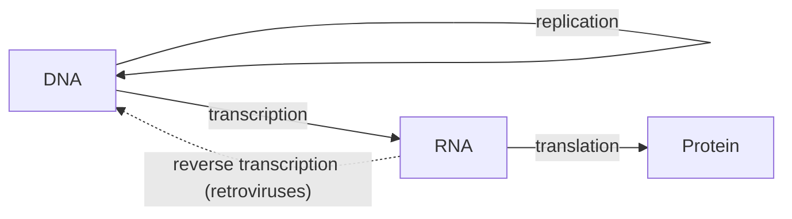
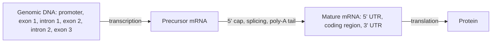
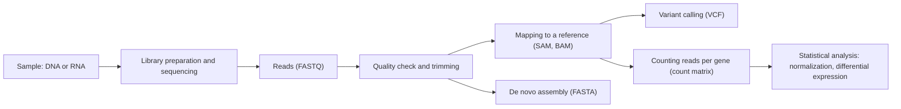
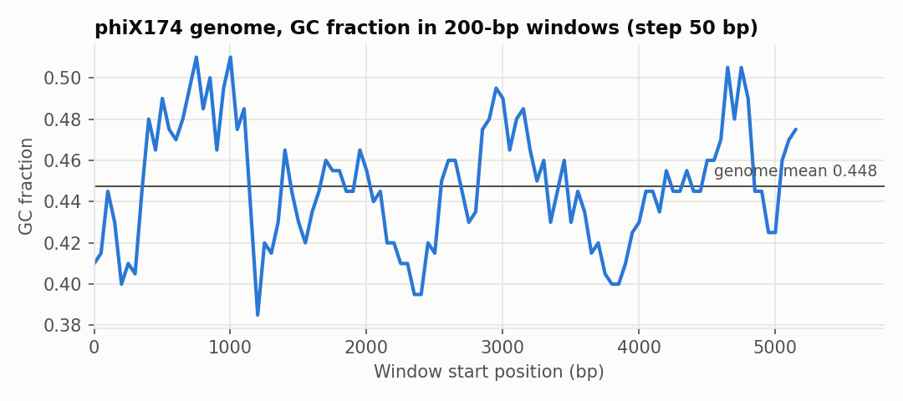

# Chapter 7 — Introduction to Bioinformatics

[Repository Guide](../../README.md) | [English](Concepts_Lecture.md) | [한국어](Concepts_Lecture.ko.md)

> **Last Updated:** 2026-11-19

> **Learning Objectives:**
> 1. Distinguish the scope of bioinformatics and computational biology and describe the typical problems the two fields address
> 2. Explain the chemical structure of DNA, RNA, and proteins at the level needed for informatics and represent each molecule as a string
> 3. Translate a DNA sequence into a protein sequence with the central dogma and the genetic code, and judge the effect of a mutation
> 4. Distinguish the genome, transcriptome, and proteome, and explain the properties of the data produced by sequencing technologies
> 5. Read the FASTA and FASTQ formats, convert quality scores into error probabilities, and explain the role of the major databases
> 6. Compute the reverse complement, GC content, translation, and k-mer frequencies of a sequence in R

---

## Table of Contents

- [1. Bioinformatics and Computational Biology](#1-bioinformatics-and-computational-biology)
  - [1.1 Definitions of the Two Fields](#11-definitions-of-the-two-fields)
  - [1.2 Characteristics of Biological Data](#12-characteristics-of-biological-data)
- [2. Cells and Biomolecules](#2-cells-and-biomolecules)
  - [2.1 Cells, Prokaryotes, and Eukaryotes](#21-cells-prokaryotes-and-eukaryotes)
  - [2.2 Four Kinds of Biological Macromolecules](#22-four-kinds-of-biological-macromolecules)
- [3. Chemistry of DNA and RNA](#3-chemistry-of-dna-and-rna)
  - [3.1 Nucleotides](#31-nucleotides)
  - [3.2 The Sugar-Phosphate Backbone and Direction](#32-the-sugar-phosphate-backbone-and-direction)
  - [3.3 Complementary Base Pairing and the Double Helix](#33-complementary-base-pairing-and-the-double-helix)
  - [3.4 RNA](#34-rna)
  - [3.5 String Representation and IUPAC Codes](#35-string-representation-and-iupac-codes)
- [4. Chemistry of Proteins](#4-chemistry-of-proteins)
  - [4.1 Amino Acids](#41-amino-acids)
  - [4.2 Peptide Bonds and the Direction of a Protein](#42-peptide-bonds-and-the-direction-of-a-protein)
  - [4.3 Four Levels of Protein Structure](#43-four-levels-of-protein-structure)
- [5. The Central Dogma](#5-the-central-dogma)
  - [5.1 Replication, Transcription, and Translation](#51-replication-transcription-and-translation)
  - [5.2 The Genetic Code](#52-the-genetic-code)
  - [5.3 Reading Frames and Open Reading Frames](#53-reading-frames-and-open-reading-frames)
  - [5.4 Structure of a Eukaryotic Gene](#54-structure-of-a-eukaryotic-gene)
  - [5.5 Extensions of the Central Dogma](#55-extensions-of-the-central-dogma)
- [6. Genome, Transcriptome, and Proteome](#6-genome-transcriptome-and-proteome)
  - [6.1 Genes and Genomes](#61-genes-and-genomes)
  - [6.2 The Transcriptome and Gene Expression](#62-the-transcriptome-and-gene-expression)
  - [6.3 The Proteome](#63-the-proteome)
  - [6.4 The Shape of Omics Data](#64-the-shape-of-omics-data)
- [7. Mutations and Variants](#7-mutations-and-variants)
  - [7.1 Point Mutations](#71-point-mutations)
  - [7.2 Insertions, Deletions, and Frameshifts](#72-insertions-deletions-and-frameshifts)
  - [7.3 Structural Variants](#73-structural-variants)
  - [7.4 Germline and Somatic Variants](#74-germline-and-somatic-variants)
  - [7.5 Alleles, Genotypes, and SNPs](#75-alleles-genotypes-and-snps)
- [8. Sequencing Technologies](#8-sequencing-technologies)
  - [8.1 Sanger Sequencing](#81-sanger-sequencing)
  - [8.2 Short-Read Sequencing](#82-short-read-sequencing)
  - [8.3 Long-Read Sequencing](#83-long-read-sequencing)
  - [8.4 Depth and Coverage](#84-depth-and-coverage)
  - [8.5 The Analysis Workflow](#85-the-analysis-workflow)
- [9. Data Formats](#9-data-formats)
  - [9.1 FASTA](#91-fasta)
  - [9.2 FASTQ and Quality Scores](#92-fastq-and-quality-scores)
  - [9.3 Other Formats](#93-other-formats)
- [10. Major Databases](#10-major-databases)
  - [10.1 INSDC and GenBank](#101-insdc-and-genbank)
  - [10.2 Ensembl](#102-ensembl)
  - [10.3 UniProt](#103-uniprot)
  - [10.4 PDB](#104-pdb)
- [11. Handling Sequences in R](#11-handling-sequences-in-r)
  - [11.1 Sequences as Strings](#111-sequences-as-strings)
  - [11.2 Reverse Complement](#112-reverse-complement)
  - [11.3 GC Content and Sliding Windows](#113-gc-content-and-sliding-windows)
  - [11.4 Translation and the Effect of Mutations](#114-translation-and-the-effect-of-mutations)
  - [11.5 k-mer Frequencies](#115-k-mer-frequencies)
  - [11.6 Decoding Quality Strings](#116-decoding-quality-strings)
  - [11.7 The Biostrings Package](#117-the-biostrings-package)
- [12. Problems Addressed by Computational Biology](#12-problems-addressed-by-computational-biology)
  - [12.1 Sequence Problems](#121-sequence-problems)
  - [12.2 Expression and Variant Problems](#122-expression-and-variant-problems)
  - [12.3 Structure, Network, and Evolution Problems](#123-structure-network-and-evolution-problems)
- [Concept Applications](#concept-applications)
- [Glossary](#glossary)
- [Summary](#summary)
- [Self-Check Questions](#self-check-questions)
- [References](#references)

---

<br>

## 1. Bioinformatics and Computational Biology

### 1.1 Definitions of the Two Fields

Section 5.5 of Chapter 2 defined bioinformatics as the interdisciplinary field that combines biology, computer science, mathematics, and statistics to develop methods and software tools for storing, analyzing, and interpreting biological data, and it divided biological data into three kinds, DNA, RNA, and protein, linked by the central dogma. This chapter extends that material to collect the basic biology a computer science student needs and the basic tools for handling biological data. It is useful first to separate bioinformatics from computational biology, a name often used alongside it.

> **Definition:** **Computational biology** is the field that answers biological questions with computational methods such as mathematical models, simulation, and statistical inference.

The boundary between the two fields is not sharp, and in practice the names are often used almost interchangeably. If a distinction is drawn, bioinformatics leans toward tools and data, and computational biology leans toward biological questions and models. For example, building a program that quickly finds similar sequences in a vast sequence database (BLAST in Chapter 8) is closer to bioinformatics, while explaining the changes among the sequences found by that program with an evolutionary model is closer to computational biology.

| Aspect | Bioinformatics | Computational Biology |
|:-----|:-----|:-----|
| Focus | Data, algorithms, software, databases | Biological questions, mathematical models, simulation |
| Typical products | Sequence alignment programs, genome databases, analysis pipelines | Evolutionary models, gene regulatory network models, population genetics theory |
| Required background | Algorithms, data structures, statistics, programming | Probability, differential equations, statistical inference, biology |

*Table 1. Comparison of bioinformatics and computational biology*

### 1.2 Characteristics of Biological Data

There are three main reasons why biological data become objects of computation.

- **Sequences are strings.** DNA can be written as a long string over a four-letter alphabet and a protein as a long string over a twenty-letter alphabet. Computer science techniques such as string comparison, pattern search, compression, and indexing apply almost unchanged.
- **The volume is large.** One human genome is about 3 billion base pairs [1], and a single sequencing experiment produces hundreds of millions of short sequence fragments. This is not a scale a person can read by eye.
- **Measurements are noisy.** Sequencing machines misread letters with some probability, and gene expression differs even among cells under the same conditions. Interpreting the results therefore requires probability models and statistical tests (Chapter 9).

In the classification of Chapter 2, a raw sequence is unstructured data, and counting its length, base composition, and substring frequencies into a table turns it into structured data. Much of bioinformatics is this kind of feature extraction, turning unstructured sequences into tables that can be analyzed.

---

<br>

## 2. Cells and Biomolecules

### 2.1 Cells, Prokaryotes, and Eukaryotes

Every organism consists of one or more **cells**. A cell is a small space enclosed by a membrane, in which genetic information is stored and copied and proteins are made according to that information. Organisms fall into two groups by cell structure.

- **Prokaryotes:** Bacteria and archaea belong here. They have no nuclear membrane, so the DNA lies directly in the cytoplasm, and the genome is usually a single circular chromosome.
- **Eukaryotes:** Fungi such as yeast, plants, and animals belong here. The DNA is divided into several linear chromosomes inside a **nucleus** enclosed by a nuclear membrane. They also have organelles such as mitochondria, and mitochondria carry their own small DNA.

A **virus** cannot reproduce by itself and reproduces by borrowing the machinery of a host cell, so it is usually not considered a cell. Viral genomes are small and well characterized, however, and serve as frequent examples in bioinformatics. The bacteriophage phiX174 used in the examples of Section 11 is a virus that infects bacteria, and its genome is single-stranded DNA of 5,386 bases.

### 2.2 Four Kinds of Biological Macromolecules

The large molecules that make up a cell are of four kinds. Bioinformatics deals mainly with nucleic acids, which carry information, and with proteins, which are made from that information and perform functions.

| Macromolecule | Monomer | Main role |
|:-----|:-----|:-----|
| Nucleic acids (DNA, RNA) | Nucleotides | Storage and transmission of genetic information |
| Proteins | Amino acids | Enzymatic reactions, structure, signaling, transport |
| Carbohydrates | Monosaccharides | Energy storage, structures such as cell walls |
| Lipids | Fatty acids, glycerol, and others | Cell membranes, energy storage, signaling |

*Table 2. Four kinds of biological macromolecules*

Nucleic acids and proteins are both **polymers**, chains of monomers joined in a line. Because the kinds of monomers are finite and the order in which they are joined carries the information, both molecules are represented exactly as strings over a finite alphabet. This fact is the starting point of bioinformatics.

---

<br>

## 3. Chemistry of DNA and RNA

### 3.1 Nucleotides

> **Definition:** A **nucleotide** is a molecule made of a five-carbon sugar, a phosphate group, and a nitrogen-containing base, and it is the monomer of nucleic acids.

The sugar of DNA is **deoxyribose** and the sugar of RNA is **ribose**. The two sugars differ by one small group on carbon 2. Ribose has a hydroxyl group (-OH) on carbon 2, whereas deoxyribose has only a hydrogen there ("deoxy" means that one oxygen is missing). Because of this difference RNA is chemically less stable, and DNA is suited to long-term storage.

There are five bases, which fall into two groups by ring structure.

| Base | Symbol | Group | Rings | Found in |
|:-----|:-----|:-----|:-----|:-----|
| Adenine | A | Purine | Two | DNA, RNA |
| Guanine | G | Purine | Two | DNA, RNA |
| Cytosine | C | Pyrimidine | One | DNA, RNA |
| Thymine | T | Pyrimidine | One | DNA |
| Uracil | U | Pyrimidine | One | RNA |

*Table 3. The five bases of nucleic acids*

The distinction between purines and pyrimidines is used again in the classification of mutations in Section 7.1 (transitions and transversions) and in the IUPAC codes (R, Y).

### 3.2 The Sugar-Phosphate Backbone and Direction

The carbons of the sugar are numbered 1' through 5' (the prime distinguishes them from the atom numbers of the base). The base is attached to the 1' carbon and the phosphate group to the 5' carbon. Two neighboring nucleotides are joined by a **phosphodiester bond** between the 3' hydroxyl of the first and the 5' phosphate of the second. The chain of alternating sugars and phosphates formed in this way is called the **sugar-phosphate backbone**, and the bases stick out sideways from it.

Because the bonds always run from 3' to 5', a nucleic acid strand has a direction. One end keeps a free 5' phosphate and the other a free 3' hydroxyl; these are called the **5' end** and the **3' end**. By convention a sequence is written in the 5' to 3' direction. Writing `ATGC` therefore means 5'-ATGC-3', and it is a different molecule from 5'-CGTA-3'.

> **Caution:** The reversed string `CGTA` of `ATGC` merely reads the same strand in the 3' to 5' direction, but databases and file formats all assume the 5' to 3' direction, so storing it as `CGTA` denotes a different molecule, 5'-CGTA-3'. This is why a sequence must never be stored reversed without stating its direction.

### 3.3 Complementary Base Pairing and the Double Helix

DNA in a cell is usually a **double helix** of two twisted strands. The two strands are held together by hydrogen bonds between bases, and adenine pairs only with thymine and guanine only with cytosine.

> **Definition:** **Complementary base pairing** is the rule by which A pairs with T (A with U in RNA) and G pairs with C through hydrogen bonds.

An A-T pair is joined by two hydrogen bonds and a G-C pair by three. DNA rich in GC pairs therefore needs a higher temperature to separate its two strands, which is one reason the **GC content** of a sequence is computed so often. Because a purine (two rings) always pairs with a pyrimidine (one ring), the width of the helix stays constant.

The two strands run in opposite directions, which is called **antiparallel**. If one strand runs 5' to 3' from left to right, its partner runs 3' to 5' at the same positions.

```text
5'- A T G G C T T C A -3'
    | | | | | | | | |
3'- T A C C G A A G T -5'

5'- T G A A G C C A T -3'
```

*Figure 1. Two antiparallel strands and the reverse complement*

The upper two lines of Figure 1 are the strand written as the sequence and its complementary strand, and the last line rewrites the complementary strand in the conventional 5' to 3' direction. This string equals the upper strand with every letter replaced by its complementary base and the order reversed.

> **Definition:** The **reverse complement** of a sequence is the sequence obtained by replacing each base with its complementary base and reversing the order; it equals the partner strand read in the 5' to 3' direction.

A gene can lie on either of the two strands, so a search in a DNA sequence must examine both the given sequence and its reverse complement. As a direct consequence of complementarity, in double-stranded DNA as a whole the number of A equals the number of T and the number of G equals the number of C. On a single strand this equality does not hold exactly, but in long genomes it tends to hold approximately even on one strand.

### 3.4 RNA

RNA differs from DNA in three ways. Its sugar is ribose, it uses uracil instead of thymine, and it usually exists as a single strand. Although single-stranded, complementary stretches within its own sequence can pair to form secondary structures such as hairpins, and these structures can determine function. Inside RNA, G and U can also pair weakly.

| Kind of RNA | Role |
|:-----|:-----|
| Messenger RNA (mRNA) | Template that carries the information of a gene to the ribosome |
| Transfer RNA (tRNA) | Adapter that reads a codon and brings the matching amino acid to the ribosome |
| Ribosomal RNA (rRNA) | Core of the structure and catalytic activity of the ribosome |
| Other noncoding RNAs | Regulation of gene expression, for example microRNAs (miRNA) and long noncoding RNAs (lncRNA) |

*Table 4. Main kinds of RNA*

### 3.5 String Representation and IUPAC Codes

From the viewpoint of informatics, a DNA sequence is a string over the alphabet $`\Sigma_{\mathrm{DNA}} = \lbrace A, C, G, T \rbrace`$, and an RNA sequence is a string over $`\lbrace A, C, G, U \rbrace`$. There are $`4^n`$ DNA strings of length $`n`$, so even strings of length 10 number about a million (1,048,576).

Real data contain positions where the base could not be determined. Such positions are written with the internationally agreed **IUPAC codes**.

| Code | Meaning | Code | Meaning |
|:-----|:-----|:-----|:-----|
| R | A or G (purine) | Y | C or T (pyrimidine) |
| S | G or C (strong pairing) | W | A or T (weak pairing) |
| K | G or T | M | A or C |
| B | not A (C, G, T) | D | not C (A, G, T) |
| H | not G (A, C, T) | V | not T (A, C, G) |
| N | any base | `-` | gap in an alignment (Chapter 8) |

*Table 5. IUPAC codes for nucleic acids*

A position where the sequencing machine could not decide the base is usually recorded as `N`. Code that analyzes sequences should allow from the start for letters other than A, C, G, and T in its input.

---

<br>

## 4. Chemistry of Proteins

### 4.1 Amino Acids

> **Definition:** An **amino acid** is a molecule in which an amino group (-NH2), a carboxyl group (-COOH), a hydrogen atom, and a side chain that differs by kind are attached to one central carbon, and it is the monomer of proteins.

The proteins of living things are made mainly of twenty standard amino acids. The twenty differ only in their side chains, and the size, charge, and affinity for water (hydrophilicity and hydrophobicity) of the side chain decide how a protein folds and functions. Sequence data write amino acids with one-letter symbols.

| Property | Amino acids (three-letter symbol, one-letter symbol) |
|:-----|:-----|
| Nonpolar (hydrophobic) | Glycine (Gly, G), alanine (Ala, A), valine (Val, V), leucine (Leu, L), isoleucine (Ile, I), methionine (Met, M), phenylalanine (Phe, F), tryptophan (Trp, W), proline (Pro, P) |
| Polar, uncharged | Serine (Ser, S), threonine (Thr, T), cysteine (Cys, C), tyrosine (Tyr, Y), asparagine (Asn, N), glutamine (Gln, Q) |
| Positively charged (basic) | Lysine (Lys, K), arginine (Arg, R), histidine (His, H) |
| Negatively charged (acidic) | Aspartic acid (Asp, D), glutamic acid (Glu, E) |

*Table 6. Classification of the twenty standard amino acids*

This classification is used to understand the substitution matrices of Chapter 8. Substitutions between amino acids with similar properties (for example leucine and isoleucine) harm protein function less and therefore often persist in evolution, while substitutions between amino acids with very different properties rarely persist. Among the one-letter symbols, B, J, O, U, X, and Z serve purposes outside the twenty above (ambiguous, rare, or unknown amino acids), and `*` denotes a stop codon.

### 4.2 Peptide Bonds and the Direction of a Protein

The bond formed when the carboxyl group of one amino acid joins the amino group of the next while releasing one water molecule is called a **peptide bond**. A chain of amino acids joined this way is a **polypeptide**, and each amino acid in the chain is called a **residue**. One end of the chain keeps a free amino group (the **N-terminus**) and the other a free carboxyl group (the **C-terminus**). By convention protein sequences are written from the N-terminus to the C-terminus, which is also the direction in which the ribosome synthesizes the protein.

### 4.3 Four Levels of Protein Structure

After synthesis a protein folds into its own three-dimensional shape, and the shape determines its function. Structure is described at four levels.

| Level | Content | Example |
|:-----|:-----|:-----|
| Primary structure | The order of amino acids, that is, the sequence itself | `MASGLKR` |
| Secondary structure | Local repeating shapes formed by hydrogen bonds of the backbone | α-helix, β-sheet |
| Tertiary structure | The three-dimensional fold of one whole chain | The fold that forms the active site of an enzyme |
| Quaternary structure | A complex assembled from several chains | Hemoglobin, made of four chains |

*Table 7. Four levels of protein structure*

The primary structure is obtained relatively easily by sequencing, but the tertiary structure must be determined by experiments such as X-ray crystallography, nuclear magnetic resonance, and cryo-electron microscopy, which take much time and money. Predicting structure from sequence is a long-standing problem of computational biology, and determined structures are collected in the PDB of Section 10.4.

---

<br>

## 5. The Central Dogma

### 5.1 Replication, Transcription, and Translation

> **Definition:** The **central dogma** is the basic principle of molecular biology that genetic information is transferred from DNA to RNA and from RNA to protein, and is not transferred back from protein to nucleic acid.

The information is transferred by three processes.

- **Replication:** DNA copies itself. The two strands unwind and each serves as a template for a new complementary strand, so each new double helix consists of one old strand and one new strand. It happens every time a cell divides.
- **Transcription:** A stretch of DNA (a gene) is copied into RNA. RNA polymerase reads the **template strand** in the 3' to 5' direction and synthesizes RNA in the 5' to 3' direction. As a result the RNA sequence equals the sequence of the strand complementary to the template, the **coding strand**, with T replaced by U.
- **Translation:** The ribosome reads mRNA three bases at a time in the 5' to 3' direction and joins the amino acid corresponding to each triplet into a protein. A tRNA attaches to the mRNA through an anticodon complementary to the triplet and delivers the amino acid.



*Figure 2. Information flow in the central dogma*

Because the coding strand and the mRNA have the same sequence except for T and U, databases usually store a gene as the DNA sequence of its coding strand, and translation reads T in place of U. The R code in Section 11 follows the same convention.

### 5.2 The Genetic Code

> **Definition:** A **codon** is a run of three consecutive bases in mRNA that specifies one amino acid or the end of translation.

Four bases make $`4^3 = 64`$ three-letter words. Of these, 61 specify the twenty amino acids, and three (`TAA`, `TAG`, `TGA`; UAA, UAG, UGA in RNA) are **stop codons** that halt translation. `ATG` (AUG) specifies methionine and also serves as the **start codon** where translation begins. The table of correspondences between codons and amino acids is called the **genetic code**.

| First base | Second T | Second C | Second A | Second G | Third base |
|:-----|:-----|:-----|:-----|:-----|:-----|
| T | `TTT` F | `TCT` S | `TAT` Y | `TGT` C | T |
| T | `TTC` F | `TCC` S | `TAC` Y | `TGC` C | C |
| T | `TTA` L | `TCA` S | `TAA` Stop | `TGA` Stop | A |
| T | `TTG` L | `TCG` S | `TAG` Stop | `TGG` W | G |
| C | `CTT` L | `CCT` P | `CAT` H | `CGT` R | T |
| C | `CTC` L | `CCC` P | `CAC` H | `CGC` R | C |
| C | `CTA` L | `CCA` P | `CAA` Q | `CGA` R | A |
| C | `CTG` L | `CCG` P | `CAG` Q | `CGG` R | G |
| A | `ATT` I | `ACT` T | `AAT` N | `AGT` S | T |
| A | `ATC` I | `ACC` T | `AAC` N | `AGC` S | C |
| A | `ATA` I | `ACA` T | `AAA` K | `AGA` R | A |
| A | `ATG` M | `ACG` T | `AAG` K | `AGG` R | G |
| G | `GTT` V | `GCT` A | `GAT` D | `GGT` G | T |
| G | `GTC` V | `GCC` A | `GAC` D | `GGC` G | C |
| G | `GTA` V | `GCA` A | `GAA` E | `GGA` G | A |
| G | `GTG` V | `GCG` A | `GAG` E | `GGG` G | G |

*Table 8. The standard genetic code (written on the DNA coding strand)*

Table 8 shows the following properties.

- **Degeneracy:** Sixty-four codons specify 21 meanings (twenty amino acids and stop), so several codons specify the same amino acid. Methionine (M) and tryptophan (W) have only one codon each, while leucine (L), serine (S), and arginine (R) have six each.
- **Tolerance at the third position:** Codons for the same amino acid usually share the first two bases and differ only in the third. For example, `GCT`, `GCC`, `GCA`, and `GCG` all specify alanine. A substitution at the third position therefore often leaves the amino acid unchanged (Section 7.1).
- **Similar codons, similar amino acids:** The column whose second base is T gathers hydrophobic amino acids (F, L, I, M, V). A single-base substitution often changes an amino acid into one with similar properties, which reduces the damage of mutations.

> **Note:** **Variants of the genetic code.** Table 8 is the standard code that most organisms use for nuclear genes. Mitochondria and some microorganisms use variant codes in which a few codons have different meanings, so translation tools let the user choose the code table.

### 5.3 Reading Frames and Open Reading Frames

Translation reads three bases at a time, so the amino acid sequence depends entirely on where the reading starts. One strand has three **reading frames**, starting at the first, second, and third letter, and the reverse complement strand has three more, so double-stranded DNA has six reading frames in all.

```text
         A T G G C T T C A G G T C T G A A A C G C T A A
+1       ATG GCT TCA GGT CTG AAA CGC TAA        -> M A S G L K R *
+2        TGG CTT CAG GTC TGA AAC GCT AA        -> W L Q V * N A
+3         GGC TTC AGG TCT GAA ACG CTA A        -> G F R S E T L
```

*Figure 3. The three reading frames of one strand and their translations*

> **Definition:** An **open reading frame (ORF)** is a stretch of sequence within one reading frame that starts at a start codon, continues without an intervening stop codon, and ends at a stop codon.

In Figure 3, +1, +2, and +3 denote the reading frames starting at the first, second, and third letter. Frame +1 is an ORF that starts with `ATG` and ends at `TAA`, while frame +2 has a `TGA` (stop) in the middle. In a random sequence three of the 64 codons are stops, so on average a stop codon appears about every 21 codons. A long ORF of hundreds of codons or more is therefore unlikely to arise by chance and is likely to be a real protein-coding gene. Gene finding in prokaryotes starts from this property by searching the six reading frames for long ORFs.

### 5.4 Structure of a Eukaryotic Gene

A prokaryotic gene is usually one continuous ORF, but in the genes of many eukaryotes, including humans, the stretch translated into protein is broken into several pieces.

- **Promoter:** A regulatory region in front of the gene where RNA polymerase binds to start transcription.
- **Exons and introns:** In the transcribed RNA, the stretches that remain in the final mRNA are exons and the stretches cut out are introns.
- **Untranslated regions (UTRs):** The stretches of mRNA before the start codon (5' UTR) and after the stop codon (3' UTR) that are not translated.



*Figure 4. Transcription and processing of a eukaryotic gene*

The process that cuts introns out of the transcribed precursor mRNA and joins the exons is called **splicing**. Even one gene can produce different mRNAs depending on which exons are included; this is **alternative splicing**, and its products are called **isoforms**. As a result there are far more kinds of transcripts and proteins than genes. The RNA-seq example data in Chapter 9 come from an experiment that suppressed the function of a splicing factor.

### 5.5 Extensions of the Central Dogma

The central dogma states only the basic route of information flow, and several extensions are known.

- **Reverse transcription:** Retroviruses such as HIV convert their RNA genome into DNA with the enzyme reverse transcriptase and insert it into the host genome. In the laboratory this enzyme converts mRNA into DNA (cDNA) for sequencing, and RNA-seq also passes through this step.
- **RNA replication:** Some RNA viruses replicate RNA directly without passing through DNA.
- **Functional RNA:** Not every RNA is translated into protein. rRNA, tRNA, and many noncoding RNAs function as RNA.

Even with these extensions, it remains true that no route is known by which information flows back from the amino acid sequence of a protein to a nucleic acid sequence.

---

<br>

## 6. Genome, Transcriptome, and Proteome

### 6.1 Genes and Genomes

> **Definition:** A **genome** is the whole genetic information of an organism, that is, the entire DNA sequence of all its chromosomes (and organelles).

A **gene** is a stretch of DNA that carries the information needed to make a functional product (a protein or a functional RNA). The human genome sequence consists of the sequences of the 22 autosomes and the two sex chromosomes X and Y; the complete sequence of a human genome published in 2022 (T2T-CHM13, excluding the Y chromosome) is about 3.055 billion base pairs, and 19,969 genes were annotated as protein-coding [1]. In the same annotation the number of genes including noncoding genes was 63,494 [1]. Most of the genome is therefore sequence that does not encode protein, containing regulatory regions, noncoding RNA genes, and repeats.

Genome size varies greatly among organisms. The two sequences used in Section 11 and Chapter 9 are the phiX174 bacteriophage genome of 5,386 bases and the yeast (Saccharomyces cerevisiae) chromosome I sequence shipped with the Biostrings package, of 230,208 bases. Human cells are **diploid**, carrying two sets of chromosomes, so the amount of DNA in one cell is twice the genome size.

### 6.2 The Transcriptome and Gene Expression

> **Definition:** The **transcriptome** is the whole set of RNA molecules in a particular cell or tissue at a particular time.

The genome is almost the same in nearly every cell of a person, but the transcriptome differs with the cell type and state. Liver cells and nerve cells carry the same genome yet transcribe different genes, which is why they do different work. The amount by which a gene is transcribed into RNA is called its **expression** level. Expression levels are measured with microarrays or RNA-seq (Section 8.5), and the results are arranged in a matrix with genes as rows and samples as columns. **Differential expression** analysis, which finds genes expressed differently in diseased and normal tissue, is the starting point of the statistical methods of Chapter 9 and of the biomarker discovery, clustering, and classification of Chapter 10 onward.

### 6.3 The Proteome

The **proteome** is the whole set of proteins in a cell or tissue. Protein amounts are often not proportional to mRNA amounts. Translation efficiency and protein degradation rates differ among genes, and **post-translational modifications** such as phosphorylation change protein function after translation. The proteome is measured mainly by mass spectrometry.

### 6.4 The Shape of Omics Data

Fields such as genomics, transcriptomics, and proteomics that measure an entire set of biomolecules at once are grouped under the name **omics**.

| Field | What is measured | Typical technology | Typical shape of the data |
|:-----|:-----|:-----|:-----|
| Genomics | DNA sequence and variants | Whole-genome sequencing | Read sequences, variant lists (position, alleles) |
| Transcriptomics | Kinds and amounts of RNA | RNA-seq, microarrays | Gene × sample matrix of counts or intensities |
| Proteomics | Kinds and amounts of protein | Mass spectrometry | Protein × sample matrix of intensities |
| Epigenomics | DNA methylation, histone modifications | Bisulfite sequencing, ChIP-seq | Position × sample proportions or counts |
| Metabolomics | Small metabolites | Mass spectrometry, nuclear magnetic resonance | Compound × sample matrix of intensities |

*Table 9. Major omics fields*

What omics data have in common is that the number of variables $`p`$ (genes, proteins, positions) is much larger than the number of samples $`n`$. Matrices with tens of samples and 20,000 genes are common. The curse of dimensionality in Chapter 4, multiple testing in Chapter 9, and feature selection from Chapter 10 onward all arise from this $`p \gg n`$ structure.

---

<br>

## 7. Mutations and Variants

### 7.1 Point Mutations

A **mutation** is a change in a DNA sequence. Mutations arise from causes such as replication errors, chemicals, and ultraviolet light. A **substitution**, in which one base changes into another, is the simplest mutation and falls into two kinds by the purine and pyrimidine distinction.

- **Transition:** A substitution between purines (A and G) or between pyrimidines (C and T). There are four possible directions: A to G, G to A, C to T, and T to C.
- **Transversion:** A substitution between a purine and a pyrimidine. There are eight possible directions.

By the number of directions alone, transversions would be twice as frequent as transitions, but in the sequences of real organisms transitions are observed far more often. A change between bases with the same number of rings is known to occur more easily chemically. The fact that the DNA scoring scheme of Chapter 8 treats all mismatches alike is a simplification that ignores this difference.

Substitutions in protein-coding regions are also classified by their effect on translation.

| Kind | Definition | Example (`ATG GCT TCA GGT CTG AAA CGC TAA`, translation `MASGLKR*`) |
|:-----|:-----|:-----|
| Synonymous | The amino acid does not change | Second codon `GCT` to `GCC`: still A, translation `MASGLKR*` |
| Missense | The amino acid changes to another | Second codon `GCT` to `ACT`: A to T, translation `MTSGLKR*` |
| Nonsense | The codon changes to a stop codon | Sixth codon `AAA` to `TAA`: translation stops at `MASGL*` |

*Table 10. Effects of substitutions in coding regions*

Because synonymous substitutions do not change the protein, they are under weaker natural selection and accumulate more than nonsynonymous substitutions in evolution. When the same gene from several species is compared in the multiple alignment of Chapter 8, Section 9, most differences are concentrated at the third positions of codons.

### 7.2 Insertions, Deletions, and Frameshifts

The addition of one or more bases is an **insertion** and their loss a **deletion**; together they are called **indels**. In a coding region, an indel whose length is not a multiple of three shifts the whole reading frame after it.

> **Definition:** A **frameshift mutation** is a mutation in which an insertion or deletion of a length that is not a multiple of three in a coding region changes all codon boundaries after it.

In the earlier example, deleting the first base `G` of the second codon makes the sequence read as `ATG CTT CAG GTC TGA ...`, and translation stops at `MLQV*` (checked in R in Section 11.4). A single substitution changes one amino acid, but a frameshift changes the entire protein after it and usually creates an early stop codon. In sequence alignment (Chapter 8), substitutions appear as mismatches and indels as gaps, and the scoring scheme of an alignment treats these two kinds of change with different penalties.

### 7.3 Structural Variants

Changes of stretches longer than point mutations and short indels are called **structural variants**. They include long deletions and duplications, inversions in which the direction of a stretch is flipped, and translocations to another chromosome. Variation among people in the number of copies of a stretch is called **copy number variation (CNV)**. Structural variants are often longer than one short read, so the long-read technologies of Section 8.3 are better at finding them.

### 7.4 Germline and Somatic Variants

- **Germline variant:** A variant present in sperm or egg and passed on to offspring. Nearly every cell of the individual carries the same variant.
- **Somatic variant:** A variant that arises in some cells after birth and is not passed on to offspring. Cancer is understood as a state in which accumulated somatic variants break down the control of cell proliferation, and somatic variants are found by comparing the sequences of tumor and normal tissue.

### 7.5 Alleles, Genotypes, and SNPs

Different sequences at the same position are called **alleles**. A diploid organism carries two alleles at each position, and their combination is the **genotype**. If the two alleles are the same the individual is homozygous, and if they differ it is heterozygous. For example, if A and G are observed at a position, the possible genotypes are AA, AG, and GG.

> **Definition:** A **single nucleotide polymorphism (SNP)** is a variant at one base position that is commonly observed in a population (conventionally with an allele frequency of 1% or more).

SNPs are the most common kind of genetic difference among people, and studies that test the association of hundreds of thousands to millions of SNPs with a disease at once are a representative case of the multiple testing problem in Chapter 9.

---

<br>

## 8. Sequencing Technologies

**Sequencing** is the technology of reading out the order of bases in a DNA or RNA molecule. A sequence fragment that the machine reads at once is called a **read**. No technology reads a whole chromosome from start to end in one pass, so analysis is always a computational problem of joining many reads back together or matching them to an already known sequence.

### 8.1 Sanger Sequencing

**Sanger sequencing** mixes chain-terminating nucleotides (dideoxynucleotides that lack the 3' hydroxyl) at a fixed ratio while DNA polymerase synthesizes a new strand. Synthesis stops wherever such a nucleotide is incorporated, producing fragments that differ in length by one base; with a different fluorescent label for each of the four bases, separating the fragments by length lets the color of the end base be read in order to obtain the sequence. Reads are long, from hundreds to about a thousand bases, and accurate, but little is read at once, so today the method is used mainly to confirm particular regions.

### 8.2 Short-Read Sequencing

The most widely used approach today is **massively parallel sequencing**, which reads hundreds of millions of short reads of tens to hundreds of bases at once and is often called next-generation sequencing (NGS). Its representative form, sequencing by synthesis, proceeds as follows.

1. DNA is cut into short fragments and known short sequences (adapters) are attached to both ends to make a **library**.
2. The fragments are attached to a glass slide (flow cell) and amplified in place to form spots (clusters) of copies of the same sequence.
3. Fluorescently labeled reversible-terminator nucleotides are incorporated one at a time, and an image is taken every cycle so that the color of each cluster gives the base at that position.
4. The number of cycles is the read length. Reading both ends of a fragment gives two reads that form a pair (paired-end reads).

As the cycles proceed, the copies within a cluster gradually fall out of step and the signal blurs, so the error probability tends to rise toward the end of a read. The machine records for each base the probability that its call is wrong, which is the quality score of Section 9.2.

### 8.3 Long-Read Sequencing

Long-read technologies read a single molecule directly without amplification and produce reads of tens of thousands of bases or more.

- **Single-molecule real-time sequencing:** One polymerase fixed in a tiny well is observed by fluorescence in real time as it synthesizes.
- **Nanopore sequencing:** As a DNA strand passes through a protein pore (nanopore) in a membrane, the ionic current flowing through the pore changes with the bases, and this change is measured.

| Technology | Read length (approximate) | Strengths | Weaknesses |
|:-----|:-----|:-----|:-----|
| Sanger | Hundreds to about a thousand bases | High accuracy | Low throughput and high cost |
| Short reads (sequencing by synthesis) | Tens to hundreds of bases | Very high throughput, low cost per base | Hard to resolve repeats and long structural variants |
| Long reads (single-molecule, nanopore) | Tens of thousands of bases or more | Good for repeats, structural variants, and genome assembly | Error rate and cost per base vary with the technology and mode |

*Table 11. Comparison of sequencing technologies*

### 8.4 Depth and Coverage

The number of reads covering a position of the genome is the **depth** at that position, and the average depth over the whole genome is the **coverage**. Reading $`N`$ reads of length $`L`$ from a genome of size $`G`$ gives the average coverage

```math
C = \frac{N L}{G}
```

For example, covering a 3.055-billion-base-pair genome 30 times on average with 150-base reads requires $`N = 30 \times 3.055 \times 10^9 / 150 \approx 6.11 \times 10^8`$ reads, about 600 million.

If reads are assumed to start at any position of the genome with equal probability and independently of one another, the depth at a position follows a Poisson distribution with mean $`C`$ (Chapter 9, Section 2). The probability that the depth is zero, that is, that the position is never read, is $`e^{-C}`$. With coverage 1 about 36.8% of the genome is never read, with coverage 2 about 13.5%, and with coverage 5 about 0.67%. Even with the same total amount of reading, depth varies from position to position, so the average coverage must be high enough to reduce the missed regions.

> **[Probability and Statistics]** The Poisson distribution is the distribution of the number of times a rare event occurs in a fixed interval; with mean $`\lambda`$, $`P(X = k) = e^{-\lambda} \lambda^k / k!`$. The probability $`L/G`$ that one read covers a particular position is very small and the number of reads $`N`$ is very large, so the binomial distribution $`\mathrm{Bin}(N, L/G)`$ can be approximated by a Poisson distribution with mean $`NL/G`$.

> **Caution:** Real data cover the genome less evenly than the Poisson distribution because of regions with extreme GC content, repeats, and amplification bias. $`e^{-C}`$ is the calculation for the most ideal case, and the regions actually missed are more numerous.

### 8.5 The Analysis Workflow

The analysis of sequencing data usually follows this workflow.



*Figure 5. A typical workflow for sequencing data*

- **Read mapping:** For a species whose sequence is already known, the position in the reference genome from which each read came is found. Because hundreds of millions of reads must be matched to a reference of billions of bases, fast methods that combine the alignment algorithms of Chapter 8 with a k-mer index are used.
- **De novo assembly:** Without a reference, overlapping reads are joined to reconstruct long sequences. When a repeat is longer than a read, it cannot be decided where to continue, and the assembly breaks.
- **Variant calling:** The mapped reads are compared with the reference to decide the alleles at each position. Depth and quality scores are used to distinguish sequencing errors from real variants.
- **Quantification:** In RNA-seq, the reads mapped to each gene are counted to build a gene × sample count matrix. The statistical analysis of this matrix is the subject of Chapter 9, Section 7.

---

<br>

## 9. Data Formats

### 9.1 FASTA

The **FASTA format** is the simplest text format for storing sequences. A header line starting with `>` holds the name and description of a sequence, and the sequence follows from the next line until the next `>`. The sequence may be written on one line or wrapped at a fixed width. Several sequences can follow one another in one file.

```text
>seq1 example coding sequence
ATGGCTTCAGGTCTGAAACGCTAA
>seq2 example peptide
MASGLKR
```

FASTA holds only sequences, not per-base quality information. It can store DNA, RNA, and protein sequences alike, so the reader of a file must check the alphabet.

### 9.2 FASTQ and Quality Scores

The **FASTQ format** is the standard format for reads, storing a sequence together with a quality score for each base. The format itself allows the sequence and quality strings to be wrapped over several lines, but most tools do not wrap them, so one read consists of the following four lines, and this convention is recommended [2].

1. An identifier line starting with `@`
2. The sequence
3. A line starting with `+` (sometimes repeating the identifier)
4. A quality string of the same length as the sequence

```text
@read_001
GATTACAGGCTTAC
+
IIIIHHGG@@5+#!
```

Each letter of the quality string represents the quality score of the base at the same position.

> **Definition:** The **Phred quality score** is the value $`Q = -10 \log_{10} P`$ obtained from the probability $`P`$ that a base call is wrong.

Each increase of 10 in $`Q`$ reduces the error probability tenfold.

| Q | Error probability P | Accuracy |
|:-----|:-----|:-----|
| 10 | 0.1 | 90% |
| 20 | 0.01 | 99% |
| 30 | 0.001 | 99.9% |
| 40 | 0.0001 | 99.99% |

*Table 12. Phred quality scores and error probabilities*

To store a score as one character, a fixed value (an offset) is added to it as an ASCII code. Standard FASTQ (the Sanger format) uses offset 33 and represents scores from 0 to 93 with the characters from ASCII 33 (`!`) to 126 (`~`) [2]. Hence `I` (ASCII 73) is $`73 - 33 = 40`$, `#` (ASCII 35) is 2, and `!` (ASCII 33) is 0. The last few bases of the read above have very low quality, and the last base `C` carries essentially no information (Q = 0 means P = 1).

> **Caution:** The early Solexa format and the Illumina 1.3+ format used offset 64 (the Solexa format also defines the score slightly differently from Phred) [2], and sometimes the offset cannot be determined with certainty from the file alone. Offset-64 formats use only characters of ASCII 59 or above, so if even one character has an ASCII value below 59 (`:` or lower), the offset is 33. Assuming the wrong offset shifts every score by 31.

### 9.3 Other Formats

| Format | Content | Features |
|:-----|:-----|:-----|
| SAM, BAM | Reads mapped to a reference sequence | SAM is text and BAM its compressed binary form. Each read's position, alignment shape, and mapping quality are recorded |
| VCF | Variant lists | Position, reference allele, alternative allele, and per-sample genotypes are recorded |
| GFF, GTF | Genome annotation | Positions and strands of genes, exons, and coding regions are recorded |
| BED | Genomic intervals | A simple list of intervals whose basic three columns are chromosome, start, and end |
| PDB, mmCIF | Three-dimensional structures | Coordinates of each atom are recorded. mmCIF is the current standard format |

*Table 13. Major file formats in bioinformatics*

> **Caution:** Formats count positions differently. GFF and VCF count the first base as 1 and include the end position, while BED counts the first base as 0 and excludes the end position. The interval from base 1 to base 100 is therefore `1 100` in GFF and `0 100` in BED. Off-by-one errors are common when the two formats are mixed.

---

<br>

## 10. Major Databases

Biological data are gathered in public databases shared by researchers worldwide. Publishing a paper often requires depositing newly obtained sequences in a public database. Each entry receives a unique **accession number**, and when its content changes the version number increases, like the `.4` in `NM_002449.4`.

### 10.1 INSDC and GenBank

**GenBank** is the genetic sequence database of the US National Institutes of Health (NIH), an annotated collection of all publicly available DNA sequences [3]. GenBank forms the International Nucleotide Sequence Database Collaboration (INSDC) together with DDBJ in Japan and ENA in Europe, and the three organizations exchange data daily [3]. A sequence deposited in any one of them can therefore be found in all three.

Because GenBank keeps the sequences that researchers submit as they are, the same gene may appear several times redundantly. To complement this, the National Center for Biotechnology Information (NCBI) runs **RefSeq** separately, a curated set of representative sequences for each organism, and accession numbers starting with `NM_` are RefSeq mRNA entries. NCBI also provides a service to search these databases with BLAST (Chapter 8).

### 10.2 Ensembl

**Ensembl** is a genomic resource that provides high-quality annotations, tools, and services for vertebrate and model organism genomes free of charge [4]. It overlays the positions of genes, transcripts, variants, and regulatory regions on the genome sequence as annotation and shows them in a genome browser, assigning each human gene a unique identifier starting with `ENSG`. It is used mainly to find what lies where in a sequence rather than the sequence itself. Many data sets, like the expression data of Chapter 9, label rows by database gene identifiers instead of gene names (for example FlyBase identifiers starting with `FBgn` for the fruit fly), and converting identifiers into gene names is also done through such databases.

### 10.3 UniProt

**UniProt** is a database of protein sequences and their functional information. Its core, the UniProt Knowledgebase (UniProtKB), is divided into **Swiss-Prot** (reviewed entries), whose functional information expert curators compile from the literature, and **TrEMBL** (unreviewed entries), annotated by automated systems [5]. As of the 2023 update paper, the number of sequences in UniProtKB had exceeded 227 million [5], most of them unreviewed entries predicted from genome sequences. When reliable functional information is needed, Swiss-Prot entries should be preferred.

### 10.4 PDB

The **PDB (Protein Data Bank)** is the single repository of three-dimensional structural information on proteins, nucleic acids, and their complexes [6]. The wwPDB, formed by member organizations such as the RCSB PDB, PDBe in Europe, and PDBj in Japan, manages this repository and makes it freely available worldwide [6]. Each structure receives a four-character PDB identifier, and the tertiary and quaternary structures of Section 4.3 are recorded there as atomic coordinates.

| Database | Main content | Operated by | Typical use |
|:-----|:-----|:-----|:-----|
| GenBank (INSDC) | All public nucleotide sequences | NCBI (shared with DDBJ and ENA) | Depositing and searching sequences, BLAST searches |
| RefSeq | Curated representative sequences per organism | NCBI | Nonredundant reference sequences |
| Ensembl | Genome annotation and browser | EMBL-EBI and partners | Checking gene positions and structures, variants |
| UniProt | Protein sequences and functions | UniProt Consortium | Checking protein functions |
| PDB | Three-dimensional structures | wwPDB | Checking structures and structure-based analysis |

*Table 14. Major biological databases*

---

<br>

## 11. Handling Sequences in R

This section builds functions for handling sequences with only the R syntax of Chapter 1 and, at the end, performs the same computations with the Biostrings package of Bioconductor. Implementing with base syntax first makes clear which string operation each computation is and also allows the package results to be checked.

### 11.1 Sequences as Strings

In R a sequence is stored as one string. To process it letter by letter, split it into a character vector with `strsplit()`.

```r
dna <- "ATGGCTTCAGGTCTGAAACGCTAA"
nchar(dna)
bases <- strsplit(dna, "")[[1]]
bases[1:6]
table(factor(bases, levels = c("A", "C", "G", "T")))
```

```text
[1] 24

[1] "A" "T" "G" "G" "C" "T"

A C G T 
7 5 6 6 
```

- `nchar(dna)` returns the length of the sequence (24 bases).
- `strsplit(dna, "")` splits at every letter by using the empty string as the separator. The result is a list, so `[[1]]` extracts its first element, the character vector.
- Fixing the four bases as levels with `factor(..., levels = ...)` before counting with `table()` shows bases absent from the sequence as 0 and keeps the order always A, C, G, T. This is the same computation as counting each letter in the feature extraction example of Chapter 2.

### 11.2 Reverse Complement

The reverse complement splits into two operations, replacing letters and reversing the order.

```r
revcomp <- function(s) {
  comp <- chartr("ACGT", "TGCA", s)          # swap A with T and C with G
  paste(rev(strsplit(comp, "")[[1]]), collapse = "")
}
revcomp(dna)
revcomp(revcomp(dna)) == dna
```

```text
[1] "TTAGCGTTTCAGACCTGAAGCCAT"
[1] TRUE
```

- `chartr("ACGT", "TGCA", s)` replaces each letter of the first argument with the letter at the same position of the second. A becomes T, C becomes G, G becomes C, and T becomes A, so the complementary bases are obtained at once.
- `rev(strsplit(comp, "")[[1]])` reverses the order of the letter vector, and `paste(..., collapse = "")` joins the vector back into one string.
- Taking the reverse complement twice must return the original sequence. The `TRUE` on the last line confirms this. Checking such a property is a simple way to test sequence functions.

> **Caution:** `chartr()` is case-sensitive, so a lowercase sequence (`acgt`) or one containing `N` keeps unchanged letters. For real data, convert to uppercase with `toupper()` and extend the correspondence so that N maps to N.

### 11.3 GC Content and Sliding Windows

GC content is the proportion of G and C in a sequence.

```math
\mathrm{GC} = \frac{n_G + n_C}{n_A + n_C + n_G + n_T}
```

In a long sequence, how the proportion changes along the positions tells more than one overall proportion. Computing the GC content of each window while moving a window of fixed length (window) by a fixed interval (step) is called **sliding window** analysis.

```r
gc_content <- function(s) {
  b <- strsplit(s, "")[[1]]
  sum(b == "G" | b == "C") / length(b)
}
gc_content(dna)
gc_window <- function(s, w, step) {
  starts <- seq(1, nchar(s) - w + 1, by = step)
  data.frame(start = starts,
             gc = sapply(starts, function(i) gc_content(substr(s, i, i + w - 1))))
}
gc_window("GGGGCCCCAAAATTTTGCGC", w = 8, step = 4)
```

```text
[1] 0.4583333
  start  gc
1     1 1.0
2     5 0.5
3     9 0.0
4    13 0.5
```

- `b == "G" | b == "C"` is a logical vector that is `TRUE` where a letter is G or C, and `sum()` counts `TRUE` as 1, giving the number of G and C. The example sequence has 11 G or C out of 24 bases, so 11/24 = 0.458.
- `seq(1, nchar(s) - w + 1, by = step)` gives the window start positions. The upper bound of the start positions is `nchar(s) - w + 1` so that the last window does not run past the end of the sequence. With length 20, window 8, and step 4, the start positions are 1, 5, 9, and 13.
- `substr(s, i, i + w - 1)` cuts `w` letters starting at position `i`, and `sapply()` computes the GC content for each start position and collects the results in a vector. The first window `GGGGCCCC` gives 1.0 and the third window `AAAATTTT` gives 0.0.

The same function is applied to the phiX174 genome. The sequence ships with the Bioconductor package pwalign and is extracted with the Biostrings package of Section 11.7.

```r
suppressPackageStartupMessages(library(Biostrings))
data(phiX174Phage, package = "pwalign")
s <- as.character(phiX174Phage[[1]])
win <- gc_window(s, w = 200, step = 50)
nrow(win)
summary(win$gc)
win[which.min(win$gc), ]
win[which.max(win$gc), ]
```

```text
[1] 104
   Min. 1st Qu.  Median    Mean 3rd Qu.    Max. 
 0.3850  0.4288  0.4450  0.4483  0.4662  0.5100 
   start    gc
25  1201 0.385
   start   gc
16   751 0.51
```

Over 104 windows of 200 bases, the GC content varies from 0.385 (the window starting at position 1,201) to 0.510 (the window starting at position 751). Figure 6 plots this variation. The GC content of the whole genome is 0.448, but individual windows deviate from it by up to about 6 percentage points.



*Figure 6. Sliding-window GC content of the phiX174 genome*

> **Note:** **Window size and resolution.** A small window shows local changes well but also magnifies chance fluctuations, while a large window smooths the curve but loses features of narrow regions. The chance fluctuation of the GC content in a window of length $`w`$ is about the binomial standard deviation $`\sqrt{p(1-p)/w}`$, which is about 0.035 for $`p = 0.45`$ and $`w = 200`$. The variation in Figure 6 is of similar size, so claiming that the GC content of a particular region differs meaningfully requires the tests of Chapter 9.

### 11.4 Translation and the Effect of Mutations

Translation requires a table of the 64 codons. Listing the codons in the order of Table 8 (T, C, A, G) allows the amino acids to be written as one 64-letter string.

```r
b <- c("T", "C", "A", "G")
codons <- paste0(rep(b, each = 16), rep(rep(b, each = 4), times = 4), rep(b, times = 16))
aa <- strsplit("FFLLSSSSYY**CC*WLLLLPPPPHHQQRRRRIIIMTTTTNNKKSSRRVVVVAAAADDEEGGGG", "")[[1]]
code <- setNames(aa, codons)
code[c("ATG", "TGG", "TAA", "TAG", "TGA", "GCT", "GCC", "GCA", "GCG")]
translate_dna <- function(s, frame = 1) {
  s <- substr(s, frame, nchar(s))
  n <- nchar(s) %/% 3
  starts <- seq(1, by = 3, length.out = n)
  cods <- substring(s, starts, starts + 2)
  paste(code[cods], collapse = "")
}
translate_dna(dna)
sapply(1:3, function(f) translate_dna(dna, f))
table(table(aa))
```

```text
ATG TGG TAA TAG TGA GCT GCC GCA GCG 
"M" "W" "*" "*" "*" "A" "A" "A" "A" 
[1] "MASGLKR*"
[1] "MASGLKR*" "WLQV*NA"  "GFRSETL" 

1 2 3 4 6 
2 9 2 5 3 
```

- `codons` repeats each first base 16 times and each second base 4 times and changes the third base fastest, producing the 64 codons in the order of Table 8: `TTT, TTC, TTA, TTG, TCT, ...`.
- The 64 letters of `aa` are the amino acids in that order, with `*` for stop codons. Naming them by codon with `setNames()` makes a lookup table indexed by name, as in `code["ATG"]`. This is a structure that finds a value by key, like a hash table in data structures.
- `translate_dna()` cuts the sequence from letter `frame` onward and obtains the number of complete codons with `nchar(s) %/% 3` (integer division). One or two leftover letters at the end are discarded.
- `substring(s, starts, starts + 2)` takes a vector of start positions and cuts all codons at once, and `code[cods]` converts each codon into an amino acid. The result matches Figure 3.
- The last line counts the distribution of the number of codons. Two meanings have one codon (M, W), nine have two, two have three (I and stop), five have four, and three have six (L, S, R). This confirms the degeneracy of Section 5.2 numerically.

The same function checks the mutations of Table 10 and Section 7.2.

```r
ref <- "ATGGCTTCAGGTCTGAAACGCTAA"
variants <- c(reference  = ref,
              synonymous = "ATGGCCTCAGGTCTGAAACGCTAA",
              missense   = "ATGACTTCAGGTCTGAAACGCTAA",
              nonsense   = "ATGGCTTCAGGTCTGTAACGCTAA",
              frameshift = "ATGCTTCAGGTCTGAAACGCTAA")
sapply(variants, translate_dna)
```

```text
 reference synonymous   missense   nonsense frameshift 
"MASGLKR*" "MASGLKR*" "MTSGLKR*" "MASGL*R*"  "MLQV*NA" 
```

In the nonsense result `MASGL*R*`, the `R*` after the first `*` is not actually made, because the ribosome stops at the first stop codon. The function keeps translating mechanically past a stop codon, so to obtain the protein the result must be cut at the first `*`. In the frameshift result `MLQV*NA`, every amino acid from the second codon onward changes and translation stops at the fifth codon.

### 11.5 k-mer Frequencies

> **Definition:** A **k-mer** is a contiguous substring of length $`k`$ in a sequence.

A sequence of length $`n`$ contains $`n - k + 1`$ k-mers when overlapping ones are all counted, and DNA has $`4^k`$ possible kinds of k-mers. k-mer frequencies are features that summarize the composition of a sequence; they are also the unit in which BLAST finds seeds in Chapter 8 and the words in which sequences are treated like documents in Chapter 8, Section 10.

```r
count_kmers <- function(s, k) {
  n <- nchar(s) - k + 1
  kmers <- substring(s, 1:n, k:nchar(s))
  table(kmers)
}
count_kmers("ATGGCTTCAGGTCTGAAACGCTAA", 2)
```

```text
kmers
AA AC AG AT CA CG CT GA GC GG GT TA TC TG TT 
 3  1  1  1  1  1  3  1  2  2  1  1  2  2  1 
```

- `substring(s, 1:n, k:nchar(s))` pairs start positions 1, 2, ..., n with end positions k, k+1, ..., nchar(s) and cuts all k-mers at once. With length 24 and k = 2 there are 23.
- `table()` counts identical k-mers. The counts sum to 23, and of the 16 possible 2-mers, `CC` does not appear and is missing from the table. To compare sequences, the levels must be fixed with `factor()` as in Section 11.1 so that k-mers with count 0 keep their place.

> **[Data Structures]** Counting k-mers is a typical use of a hash table with strings as keys and counts as values. For a sequence of length $`n`$, inserting the k-mers one by one into a hash table takes $`O(nk)`$ time on average, and the space needed is proportional to the number of distinct k-mers. As $`k`$ grows, $`4^k`$ becomes much larger than the sequence length, and most k-mers appear once or not at all.

### 11.6 Decoding Quality Strings

The quality string of the FASTQ read in Section 9.2 is converted into scores and error probabilities.

```r
rec <- c("@read_001",
         "GATTACAGGCTTAC",
         "+",
         "IIIIHHGG@@5+#!")
qchar <- strsplit(rec[4], "")[[1]]
q <- utf8ToInt(rec[4]) - 33
p_err <- 10^(-q / 10)
data.frame(base = strsplit(rec[2], "")[[1]], qchar = qchar, Q = q,
           p_error = signif(p_err, 3))
mean(q)
sum(p_err)
```

```text
   base qchar  Q  p_error
1     G     I 40 0.000100
2     A     I 40 0.000100
3     T     I 40 0.000100
4     T     I 40 0.000100
5     A     H 39 0.000126
6     C     H 39 0.000126
7     A     G 38 0.000158
8     G     G 38 0.000158
9     G     @ 31 0.000794
10    C     @ 31 0.000794
11    T     5 20 0.010000
12    T     + 10 0.100000
13    A     #  2 0.631000
14    C     !  0 1.000000
[1] 29.14286
[1] 1.743515
```

- `utf8ToInt()` converts a string into a vector of the code values of its letters. For letters in the ASCII range the code value equals the ASCII value, so subtracting 33 gives the Phred score.
- `10^(-q / 10)` inverts the definition of the Phred score to obtain the error probability.
- The sum of the error probabilities, 1.74, is the expected number of erroneous bases in this read. The mean score of 29 looks high, but the errors are concentrated in the last three bases. This is why low-quality bases are cut from the ends of reads (trimming) before analysis.

> **Caution:** The mean of quality scores differs from the mean of error probabilities. Scores are logarithms of probabilities, so averaging the scores and then converting gives $`10^{-2.914} \approx 0.0012`$, almost a hundred times smaller than the actual mean error probability $`1.74/14 \approx 0.125`$. To summarize the quality of a read, convert to error probabilities first and then sum or average.

### 11.7 The Biostrings Package

Bioconductor is a collection of R packages for the analysis of biological data, and Biostrings is its basic package for sequences. It stores sequences as dedicated objects such as `DNAString` and `AAString` and processes even large sequences quickly. It is installed with the BiocManager package from CRAN (`BiocManager::install("Biostrings")`).

```r
suppressPackageStartupMessages({library(Biostrings); library(pwalign)})
data(phiX174Phage)
phix <- phiX174Phage[[1]]
length(phix)
letterFrequency(phix, c("A", "C", "G", "T"))
round(letterFrequency(phix, "GC", as.prob = TRUE), 4)
dna <- DNAString("ATGGCTTCAGGTCTGAAACGCTAA")
reverseComplement(dna)
translate(dna)
oligonucleotideFrequency(phix, width = 2)
k3 <- oligonucleotideFrequency(phix, width = 3)
sum(k3 == 0)
head(sort(k3, decreasing = TRUE), 5)
```

```text
[1] 5386
   A    C    G    T 
1291 1157 1254 1684 
   G|C 
0.4476 
24-letter DNAString object
seq: TTAGCGTTTCAGACCTGAAGCCAT
8-letter AAString object
seq: MASGLKR*
 AA  AC  AG  AT  CA  CC  CG  CT  GA  GC  GG  GT  TA  TC  TG  TT 
395 261 251 383 257 229 267 404 327 347 255 325 312 320 480 572 
[1] 0
TTT GCT TTG ATG GTT 
178 149 142 140 140 
```

- `letterFrequency()` returns letter counts, or proportions with `as.prob = TRUE`. Giving several letters in one string, as in `"GC"`, counts them together. The phiX174 GC content of 0.4476 is the reference line of Figure 6.
- `reverseComplement()` and `translate()` give the same results as the functions of Sections 11.2 and 11.4. When two independent implementations agree, a mistake in either one becomes less likely.
- `oligonucleotideFrequency(width = k)` counts all $`4^k`$ k-mers in the same order, including zeros. The 16 2-mer counts sum to 5,385 (= 5,386 - 1). All 64 3-mers appear (none has count 0), and the most common is `TTT` (178 times).

The base composition of phiX174 is uneven, with T the most common at 1,684 and C the least common at 1,157. The phiX174 genome is single-stranded DNA, so there is no reason for the equalities A = T and G = C of double-stranded DNA (Section 3.3) to hold. Methods for testing how far a base composition departs from expectation are treated in Chapter 9, Section 3.

---

<br>

## 12. Problems Addressed by Computational Biology

This section summarizes the typical computational problems that start from the data seen so far and links each problem to the unit that treats it.

### 12.1 Sequence Problems

- **Sequence comparison and search:** These ask how similar two sequences are and where in a database the sequences similar to a given one lie. Similar sequences are likely to share a common ancestor, and similarity to a sequence of known function lets the function be inferred. The alignment algorithms and BLAST of Chapter 8 treat this problem.
- **Genome assembly:** The original long sequence is reconstructed from short read fragments. The problem becomes a path problem in a graph whose vertices are reads and whose edges are overlaps.
- **Gene finding and annotation:** The positions of genes, exons, and regulatory regions are found in a genome sequence. The ORF search of Section 5.3, comparison with similar sequences, and statistical sequence models (the Markov chains of Chapter 9, Section 3) are used.
- **Motif finding:** Patterns that recur in several sequences, such as the short sequence patterns bound by regulatory proteins, are found.

### 12.2 Expression and Variant Problems

- **Variant calling:** Reads are compared with the reference sequence to distinguish sequencing errors from real variants. Depth, quality scores, and probability models are needed.
- **Differential expression:** Genes expressed differently under two conditions are found. A test is performed for each gene, so tens of thousands of tests are carried out at once, and the count data models and multiple testing of Chapter 9 are the tools for this problem.
- **Biomarker discovery and disease prediction:** A few variables related to a disease are chosen from tens of thousands (Chapter 10), genes and samples with similar expression patterns are grouped (Chapter 11), and models that predict disease from those variables are built (Chapter 12). This is where the clustering of Chapter 3, the dimension reduction of Chapter 4, and the classification of Chapter 6 are applied to biological data.
- **Association analysis:** The association of each of hundreds of thousands or more SNPs with a trait is tested.

### 12.3 Structure, Network, and Evolution Problems

- **Structure prediction:** The tertiary structure of a protein is predicted from its amino acid sequence. The experimental structures collected in the PDB serve as material for training and validation.
- **Network analysis:** Interactions among genes, proteins, and metabolites are represented as graphs, and important vertices and modules are found.
- **Phylogenetic analysis:** The sequences of several species are aligned (Chapter 8, Section 9), and a phylogenetic tree representing the evolutionary relationships among the species is estimated from the sequence differences.

| Question | Main data | Typical method | Related unit |
|:-----|:-----|:-----|:-----|
| How similar are two sequences | Two sequences | Dynamic programming alignment | Chapter 8 |
| Is there a similar sequence in a database | Query sequence, sequence database | BLAST | Chapter 8 |
| Can the composition of a sequence be explained by chance | A sequence | Multinomial model, Markov chain, goodness-of-fit test | Chapter 9 |
| Does the expression of a gene differ between conditions | Gene × sample count matrix | Negative binomial model, multiple testing | Chapter 9 |
| Which variables are related to a disease | Expression matrix and sample information | Feature selection and extraction | Chapter 10 |
| How are genes with similar expression grouped | Expression matrix | Clustering, networks | Chapter 11 |
| Can a patient's disease status be predicted | Expression matrix and diagnoses | Classification models and cross-validation | Chapter 12 |

*Table 15. Typical questions of computational biology and related units*

---

<br>

## Concept Applications

**True/False Check:**

| Statement | Judgment and Reason |
|:-----|:-----|
| The sequences `ATGC` and `CGTA` represent the same molecule. | **F.** Sequences are written in the 5' to 3' direction, so the two strings are different molecules. The partner strand of the same double helix is the reverse complement `GCAT`. |
| In double-stranded DNA, the number of G on one strand always equals the number of C on that strand. | **F.** Complementarity guarantees that the G of one strand equals the C of the partner strand, and that G and C are equal in the two strands combined. Within one strand they only tend to be roughly equal. |
| If the third base of a codon changes, the amino acid always stays the same. | **F.** Third-position substitutions are often synonymous, but a change from `TGG` (W) to `TGA` (stop), for example, is a nonsense mutation. |
| A deletion of three bases in a coding region does not cause a frameshift. | **T.** A deletion whose length is a multiple of three only changes or removes one amino acid (or two when it spans a boundary), and the reading frame after it stays the same. |
| A base with Q = 30 is wrong about once in 1,000 times. | **T.** $`P = 10^{-30/10} = 0.001`$. |
| With an average coverage of 10, every position of the genome is read at least once. | **F.** Even in the ideal Poisson model a fraction $`e^{-10} \approx 4.5 \times 10^{-5}`$ is never read, and in practice the uneven depth leaves more regions missed. |

---

<br>

## Glossary

| English | Korean | One-Line Definition |
|:-----|:-----|:-----|
| prokaryote / eukaryote | 원핵생물 / 진핵생물 | An organism without a nuclear membrane, and one whose DNA lies inside a nucleus |
| purine / pyrimidine | 퓨린 / 피리미딘 | Bases with two rings (A, G) and bases with one ring (C, T, U) |
| phosphodiester bond | 인산다이에스터 결합 | The bond joining the 3' carbon of one nucleotide to the 5' phosphate of the next |
| antiparallel | 역평행 | The state in which the two strands of a double helix run in opposite directions |
| GC content | GC 함량 | The proportion of G and C in a sequence |
| IUPAC code | IUPAC 부호 | International standard symbols for undetermined bases |
| residue | 잔기 | One amino acid within a polypeptide chain |
| transcription / translation | 전사 / 번역 | Copying DNA into RNA, and synthesizing protein from mRNA |
| genetic code | 유전 암호 | The table of correspondences between the 64 codons and amino acids |
| reading frame | 읽기 틀 | The choice of start position for reading a sequence three bases at a time |
| exon / intron | 엑손 / 인트론 | Stretches kept in mature mRNA, and stretches cut out by splicing |
| alternative splicing | 선택적 스플라이싱 | Producing several mRNAs from one gene by varying the combination of exons |
| proteome | 단백질체 | All proteins of a particular cell or tissue |
| transition / transversion | 전이 / 전환 | A substitution within the same base group, and one between a purine and a pyrimidine |
| synonymous / missense / nonsense | 동의 치환 / 과오 돌연변이 / 넌센스 돌연변이 | A substitution that keeps the amino acid, one that changes it to another, and one that creates a stop codon |
| structural variant | 구조 변이 | A deletion, duplication, inversion, or translocation of a long stretch |
| allele / genotype | 대립 유전자 / 유전자형 | Different sequences at the same position, and the combination of alleles an individual carries |
| read | 리드 | A sequence fragment read at once by a sequencing machine |
| depth / coverage | 깊이 / 커버리지 | The number of reads covering a position, and its average |
| accession number | 접근 번호 | The unique identifier of a database entry |

*Table 16. Glossary*

---

<br>

## Summary

| Concept | Key Summary |
|:-----|:-----|
| Bioinformatics and computational biology | Bioinformatics leans toward data and tools and computational biology toward biological questions and models, and the boundary is not sharp. |
| Structure of nucleic acids | A nucleotide consists of a sugar, a phosphate group, and a base, and a strand joined by phosphodiester bonds has a 5' to 3' direction. |
| Complementarity and reverse complement | A pairs with T (U) and G with C, and the partner strand read 5' to 3' is the reverse complement. |
| Differences between DNA and RNA | RNA uses ribose and uracil and is usually single-stranded, and there are mRNA, tRNA, rRNA, and regulatory RNAs. |
| Amino acids and proteins | The twenty amino acids differ in side chains, form chains from the N-terminus to the C-terminus through peptide bonds, and have structure at four levels. |
| Central dogma | Information flows from DNA to RNA to protein through replication, transcription, and translation, and despite extensions such as reverse transcription it does not flow from protein to nucleic acid. |
| Genetic code | Sixty-four codons specify twenty amino acids and stop, and because of degeneracy third-position substitutions are often synonymous. |
| Reading frames and ORFs | Double-stranded DNA has six reading frames, and long ORFs are unlikely by chance and become gene candidates. |
| Genome, transcriptome, proteome | The genome is nearly the same in every cell, but the transcriptome and proteome vary with cell type and state, and omics data have far more variables than samples. |
| Mutations | Substitutions divide into transitions and transversions and, by their effect on translation, into synonymous, missense, and nonsense, and indels not a multiple of three cause frameshifts. |
| Kinds of variants | Germline variants are inherited and somatic variants are not, and a SNP is a single-base variant common in a population. |
| Sequencing technologies | Sanger is accurate but low in throughput, short-read technology has high throughput, and long-read technology is good for repeats and structural variants. |
| Coverage | The average coverage is $`C = NL/G`$, and in the ideal Poisson model the fraction never read is $`e^{-C}`$. |
| FASTA and FASTQ | FASTA stores names and sequences, and FASTQ stores a name, a sequence, a separator line, and a quality string in four lines. |
| Phred score | $`Q = -10 \log_{10} P`$, and standard FASTQ obtains the score by subtracting 33 from the ASCII value. |
| Databases | GenBank (INSDC) collects nucleotide sequences, Ensembl genome annotation, UniProt protein sequences and functions, and PDB three-dimensional structures. |
| Sequence handling in R | The reverse complement uses chartr and rev, GC content the sum of a logical vector, translation a codon lookup table, and k-mers substring and table, and Biostrings provides the same functions. |

---

<br>

## Self-Check Questions

1. **Reverse complement:** Write the reverse complement of the sequence 5'-AACGTTGC-3' and compute the GC content of this sequence. Explain whether the GC content of the reverse complement equals that of the original sequence.

   <details>
   <summary>Answer</summary>

   Replacing with complementary bases gives TTGCAACG, and reversing the order gives the reverse complement 5'-GCAACGTT-3'. The original sequence has 4 G or C (C, G, G, C) out of 8 bases, so its GC content is 0.5. Complementing swaps G and C with each other and A and T with each other, so the total number of G and C does not change, and reversing the order leaves the counts unchanged. The GC content of the reverse complement therefore always equals that of the original sequence.

   </details>

2. **Translation:** Translate the sequence `ATGAAATGGTGCTAG` in the first reading frame. How does the translation change if the third base `C` of the fourth codon becomes `A`?

   <details>
   <summary>Answer</summary>

   The codons are `ATG AAA TGG TGC TAG`, translated as M, K, W, C, stop, so the result is `MKWC*`. If the fourth codon `TGC` becomes `TGA`, it is a stop codon and translation stops at `MKW*`. Although it is a third-position substitution, it is a nonsense mutation, not a synonymous one.

   </details>

3. **Frameshift:** In a coding region of 300 bases (100 codons), one base inside the 30th codon is deleted. Explain which part of the protein is affected, and compare with the case in which three consecutive bases are deleted at the same place.

   <details>
   <summary>Answer</summary>

   Deleting one base shifts every codon boundary by one position from the 30th codon onward, so the entire amino acid sequence after that point changes. In the new frame a stop codon appears on average about every 21 codons, so translation usually ends early soon afterward. The first 29 amino acids are unchanged. If three consecutive bases are deleted, the reading frame is preserved, so one amino acid is lost (when the deletion matches a codon boundary) or the two codons spanning the boundary become one codon, and the rest of the sequence is unchanged.

   </details>

4. **Quality scores:** Convert each character of the FASTQ quality string `?5+&` into a Phred score and an error probability, and compute the expected number of erroneous bases among the four. The ASCII values are 63 for `?`, 53 for `5`, 43 for `+`, and 38 for `&`.

   <details>
   <summary>Answer</summary>

   Subtracting the offset 33 gives scores 30, 20, 10, and 5. The error probabilities are $`10^{-3} = 0.001`$, $`10^{-2} = 0.01`$, $`10^{-1} = 0.1`$, and $`10^{-0.5} \approx 0.316`$. The expected number of erroneous bases is the sum of the probabilities, 0.001 + 0.01 + 0.1 + 0.316 = 0.427.

   </details>

5. **Coverage:** A genome of 100 million base pairs is read with 4 million reads of 100 bases. Compute the average coverage, and compute the fraction and the number of positions never read in the ideal Poisson model.

   <details>
   <summary>Answer</summary>

   $`C = NL/G = 4 \times 10^6 \times 100 / 10^8 = 4`$. The probability of never being read is $`e^{-4} \approx 0.0183`$, so about 1.83% of the genome, about 1.83 million positions, is never read. This shows that even fourfold coverage leaves a substantial number of missed regions.

   </details>

6. **Number of k-mers:** How many overlapping 6-mers does a sequence of 1,000 bases contain? How many kinds of 6-mers are possible, and why must some 6-mers never appear in this sequence?

   <details>
   <summary>Answer</summary>

   There are 1,000 - 6 + 1 = 995 overlapping 6-mers. There are $`4^6 = 4096`$ possible 6-mers. At most 995 kinds can appear in the sequence, so at least 4,096 - 995 = 3,101 kinds never appear. This is a simple application of the pigeonhole principle, and it is why k-mer frequency vectors become sparse vectors that are mostly zero as $`k`$ grows.

   </details>

7. **File formats and coordinates:** A gene is recorded in a GFF file as the interval `1001 2000` on chromosome 2. Write the same interval in BED format and compute the length of the interval.

   <details>
   <summary>Answer</summary>

   GFF counts from 1 and includes the end, so the interval runs from base 1,001 to base 2,000, which is 2,000 - 1,001 + 1 = 1,000 bases. BED counts from 0 and excludes the end, so the start becomes 1,001 - 1 = 1,000 and the end 2,000, written as `1000 2000`. In BED, subtracting the start from the end directly gives the length 1,000.

   </details>

---

<br>

## References

1. S. Nurk et al., "The complete sequence of a human genome," *Science*, vol. 376, no. 6588, pp. 44-53, 2022. [Online]. Available: https://doi.org/10.1126/science.abj6987
2. P. J. A. Cock, C. J. Fields, N. Goto, M. L. Heuer, and P. M. Rice, "The Sanger FASTQ file format for sequences with quality scores, and the Solexa/Illumina FASTQ variants," *Nucleic Acids Research*, vol. 38, no. 6, pp. 1767-1771, 2010. [Online]. Available: https://doi.org/10.1093/nar/gkp1137
3. National Center for Biotechnology Information, "GenBank Overview." [Online]. Available: https://www.ncbi.nlm.nih.gov/genbank/
4. P. W. Harrison et al., "Ensembl 2024," *Nucleic Acids Research*, vol. 52, no. D1, pp. D891-D899, 2024. [Online]. Available: https://doi.org/10.1093/nar/gkad1049
5. The UniProt Consortium, "UniProt: the Universal Protein Knowledgebase in 2023," *Nucleic Acids Research*, vol. 51, no. D1, pp. D523-D531, 2023. [Online]. Available: https://doi.org/10.1093/nar/gkac1052
6. Worldwide Protein Data Bank, "wwPDB." [Online]. Available: https://www.wwpdb.org/
