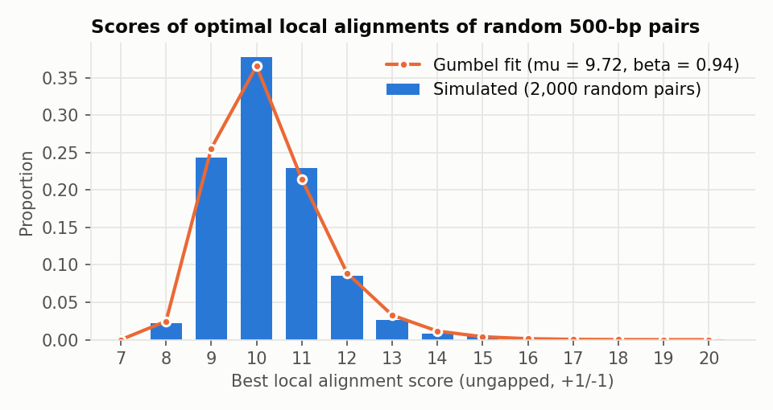
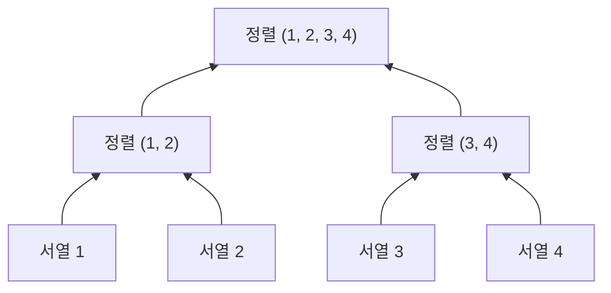

# 8장 — 서열 분석 알고리즘

[레포지토리 안내](../../README.ko.md) | [English](Concepts_Lecture.md) | [한국어](Concepts_Lecture.ko.md)

> **최종 수정일:** 2026-11-26

> **학습 목표:**
> 1. 정확한 문자열 일치와 k-mer 색인으로 서열에서 패턴의 위치를 찾을 수 있다
> 2. 해밍 거리와 편집 거리를 정의하고 동적 계획법으로 편집 거리를 계산할 수 있다
> 3. Needleman-Wunsch 전역 정렬과 Smith-Waterman 국소 정렬의 점화식을 세우고 DP 표를 손으로 채워 역추적할 수 있다
> 4. 치환 행렬의 로그 오즈 해석, PAM과 BLOSUM의 차이, 선형 갭 벌점과 아핀 갭 벌점의 차이를 설명할 수 있다
> 5. BLAST의 시드와 확장 전략을 설명하고 E값을 계산하고 해석할 수 있다
> 6. 다중 서열 정렬의 원리와 서열을 k-mer 문서로 보는 텍스트 마이닝 관점을 설명할 수 있다

---

## 목차

- [1. 서열 비교의 목적](#1-서열-비교의-목적)
  - [1.1 유사성과 상동성](#11-유사성과-상동성)
  - [1.2 문자열의 용어](#12-문자열의-용어)
- [2. 문자열 일치와 k-mer](#2-문자열-일치와-k-mer)
  - [2.1 정확한 패턴 일치](#21-정확한-패턴-일치)
  - [2.2 k-mer 색인](#22-k-mer-색인)
  - [2.3 k의 선택](#23-k의-선택)
- [3. 해밍 거리와 편집 거리](#3-해밍-거리와-편집-거리)
  - [3.1 해밍 거리](#31-해밍-거리)
  - [3.2 편집 거리](#32-편집-거리)
  - [3.3 편집 거리의 동적 계획법](#33-편집-거리의-동적-계획법)
  - [3.4 두 거리의 비교](#34-두-거리의-비교)
- [4. 서열 정렬](#4-서열-정렬)
  - [4.1 정렬의 정의](#41-정렬의-정의)
  - [4.2 점수 체계](#42-점수-체계)
  - [4.3 가능한 정렬의 수](#43-가능한-정렬의-수)
- [5. 전역 정렬: Needleman-Wunsch 알고리즘](#5-전역-정렬-needleman-wunsch-알고리즘)
  - [5.1 점화식](#51-점화식)
  - [5.2 DP 표 채우기](#52-dp-표-채우기)
  - [5.3 역추적](#53-역추적)
  - [5.4 R 구현](#54-r-구현)
  - [5.5 시간과 공간 복잡도](#55-시간과-공간-복잡도)
- [6. 국소 정렬: Smith-Waterman 알고리즘](#6-국소-정렬-smith-waterman-알고리즘)
  - [6.1 국소 정렬이 필요한 경우](#61-국소-정렬이-필요한-경우)
  - [6.2 점화식](#62-점화식)
  - [6.3 DP 표 채우기와 역추적](#63-dp-표-채우기와-역추적)
  - [6.4 R 구현](#64-r-구현)
  - [6.5 전역, 국소, 반전역 정렬](#65-전역-국소-반전역-정렬)
- [7. 점수 행렬과 갭 벌점](#7-점수-행렬과-갭-벌점)
  - [7.1 치환 점수의 로그 오즈 해석](#71-치환-점수의-로그-오즈-해석)
  - [7.2 PAM 행렬](#72-pam-행렬)
  - [7.3 BLOSUM 행렬](#73-blosum-행렬)
  - [7.4 PAM과 BLOSUM의 비교](#74-pam과-blosum의-비교)
  - [7.5 선형 갭 벌점과 아핀 갭 벌점](#75-선형-갭-벌점과-아핀-갭-벌점)
  - [7.6 아핀 갭의 동적 계획법](#76-아핀-갭의-동적-계획법)
- [8. BLAST](#8-blast)
  - [8.1 데이터베이스 검색의 규모](#81-데이터베이스-검색의-규모)
  - [8.2 시드와 확장](#82-시드와-확장)
  - [8.3 점수의 통계와 E값](#83-점수의-통계와-e값)
  - [8.4 BLAST 프로그램의 종류](#84-blast-프로그램의-종류)
  - [8.5 휴리스틱의 대가](#85-휴리스틱의-대가)
- [9. 다중 서열 정렬](#9-다중-서열-정렬)
  - [9.1 정의와 용도](#91-정의와-용도)
  - [9.2 SP 점수와 계산의 어려움](#92-sp-점수와-계산의-어려움)
  - [9.3 점진적 정렬](#93-점진적-정렬)
  - [9.4 다중 정렬의 예](#94-다중-정렬의-예)
- [10. 텍스트 마이닝 관점의 서열](#10-텍스트-마이닝-관점의-서열)
  - [10.1 서열을 문서로 보기](#101-서열을-문서로-보기)
  - [10.2 k-mer 빈도 벡터와 군집화](#102-k-mer-빈도-벡터와-군집화)
  - [10.3 정렬 없는 비교의 장단점](#103-정렬-없는-비교의-장단점)
- [개념 적용](#개념-적용)
- [요약](#요약)
- [점검 문제](#점검-문제)
- [참고 문헌](#참고-문헌)

---

<br>

## 1. 서열 비교의 목적

### 1.1 유사성과 상동성

새로 얻은 서열의 기능을 알아내는 가장 강력한 방법은 기능이 이미 알려진 서열과 비교하는 것이다. 서열이 비슷하면 공통 조상에서 갈라져 나왔을 가능성이 높고, 공통 조상에서 온 유전자는 비슷한 기능을 유지하는 경우가 많기 때문이다. 이 추론에는 서로 다른 두 개념이 쓰인다.

> **용어 정의:** **상동성(homology)** 은 두 서열이 공통 조상의 서열에서 유래했다는 진화적 관계이다.

> **용어 정의:** **유사성(similarity)** 은 두 서열이 얼마나 비슷한지를 정렬 점수나 일치율 같은 수치로 나타낸 것이다.

유사성은 측정하는 양이고, 상동성은 그 측정에서 추론하는 가설이다. 따라서 "두 서열이 70% 상동이다"라는 표현은 정확하지 않으며, "두 서열의 일치율이 70%이고, 이 정도의 유사성은 우연으로 설명하기 어려우므로 상동일 가능성이 높다"라고 써야 한다. 유사성이 우연으로 설명되는지를 판정하는 통계가 8.3절의 E값이다.

7장에서 본 것처럼 진화는 서열에 치환, 삽입, 삭제를 쌓는다. 서열 비교의 계산 문제는 두 서열 사이에 일어난 이 변화들을 가장 그럴듯하게 재구성하는 것이며, 그 재구성이 정렬이다.

### 1.2 문자열의 용어

이 장은 알파벳 $`\Sigma`$ 위의 문자열 $`x = x_1 x_2 \cdots x_m`$에 대하여 다음 용어를 쓴다.

> **용어 정의:** **부분 문자열(substring)** 은 문자열 안에서 연속된 글자들로 이루어진 부분, 곧 $`x_i x_{i+1} \cdots x_j`$ 꼴의 문자열이다. 길이 $`k`$인 부분 문자열이 k-mer이다.

> **용어 정의:** **부분 서열(subsequence)** 은 문자열에서 순서를 유지한 채 일부 글자를 골라 얻은 문자열로, 고른 글자가 연속일 필요는 없다. 예를 들어 `ACGT`에서 `AGT`는 부분 서열이지만 부분 문자열은 아니다.

> **용어 정의:** **접두사(prefix)** 는 문자열의 첫 글자부터 이어지는 부분 문자열 $`x_1 \cdots x_i`$이다.

> **용어 정의:** **접미사(suffix)** 는 문자열의 마지막 글자에서 끝나는 부분 문자열 $`x_j \cdots x_m`$이다.

> **주의:** 생물학에서 "서열(sequence)"은 문자열 전체를 뜻하므로, 수학의 부분 서열과 혼동하지 않도록 이 장은 연속된 구간을 항상 "부분 문자열" 또는 "구간"이라 부른다.

---

<br>

## 2. 문자열 일치와 k-mer

### 2.1 정확한 패턴 일치

가장 단순한 문제는 길이 $`n`$인 텍스트(예: 유전체)에서 길이 $`m`$인 패턴(예: 짧은 리드)이 정확히 나타나는 위치를 모두 찾는 것이다. 단순한 방법은 텍스트의 모든 시작 위치에서 패턴과 글자를 비교한다.

```r
naive_match <- function(text, pattern) {
  n <- nchar(text); m <- nchar(pattern)
  hits <- integer(0)
  for (i in 1:(n - m + 1)) {
    if (substr(text, i, i + m - 1) == pattern) hits <- c(hits, i)
  }
  hits
}
text <- "ACGTTGCAACGTAGCTTACGT"
naive_match(text, "ACGT")
```

```text
[1]  1  9 18
```

- 시작 위치 `i`는 1부터 `n - m + 1`까지이다. 그보다 뒤에서 시작하면 패턴이 텍스트 끝을 넘는다.
- `substr(text, i, i + m - 1)`로 길이 `m`의 구간을 잘라 패턴과 비교하고, 같으면 위치를 `hits`에 덧붙인다.
- 패턴 `ACGT`는 1번, 9번, 18번 위치에 있다.

시작 위치가 $`n - m + 1`$개이고 위치마다 최대 $`m`$글자를 비교하므로 최악의 경우 $`O(nm)`$ 시간이 든다. 길이 30억의 유전체에서 리드 하나를 찾을 때마다 유전체 전체를 훑는다면, 수억 개의 리드를 처리하는 것은 불가능하다. 그래서 텍스트를 한 번 미리 처리하여 색인을 만들어 두고, 각 패턴은 색인에서 찾는다.

> **[알고리즘]** 패턴 하나를 $`O(n + m)`$ 시간에 찾는 Knuth-Morris-Pratt 알고리즘, 텍스트를 미리 처리하여 텍스트의 길이에 거의 무관한 시간에 패턴을 찾게 하는 접미사 트리와 접미사 배열은 알고리즘에서 다루는 문자열 알고리즘이다. 리드 매핑 도구가 쓰는 색인 구조는 이런 구조를 메모리가 적게 들도록 변형한 것이다.

### 2.2 k-mer 색인

가장 단순한 색인은 텍스트의 모든 k-mer와 그 위치를 해시 테이블에 저장하는 것이다.

> **용어 정의:** **k-mer 색인(k-mer index)** 은 텍스트에 나타나는 각 k-mer를 키로, 그 k-mer가 나타나는 위치의 목록을 값으로 저장한 자료 구조이다.

```r
build_index <- function(text, k) {
  n <- nchar(text) - k + 1
  kmers <- substring(text, 1:n, k:nchar(text))
  split(1:n, kmers)
}
idx <- build_index(text, 4)
length(idx)
idx[["ACGT"]]
idx[["TTAC"]]
query <- "GCTTAC"
q_kmers <- substring(query, 1:3, 4:6)
lapply(setNames(q_kmers, q_kmers), function(w) idx[[w]])
```

```text
[1] 16
[1]  1  9 18
[1] 16
$GCTT
[1] 14

$CTTA
[1] 15

$TTAC
[1] 16

```

- `substring()`으로 모든 4-mer를 잘라 낸 뒤, `split(1:n, kmers)`가 위치 번호 `1:n`을 k-mer별로 나누어 리스트로 만든다. 리스트의 이름이 k-mer이고 원소가 위치 벡터이므로, `idx[["ACGT"]]`는 텍스트를 다시 훑지 않고 바로 1, 9, 18을 돌려준다.
- 텍스트의 4-mer 18개 가운데 서로 다른 것은 16개이다.
- 질의 `GCTTAC`의 4-mer 세 개는 텍스트의 14, 15, 16번 위치에서 시작한다. 세 위치가 하나씩 증가하므로 질의 전체가 텍스트의 14번 위치에서 시작하는 구간과 일치한다고 추론할 수 있다. 이처럼 짧은 k-mer의 일치(시드)를 찾고 그 주변으로 넓혀 가는 생각이 8절 BLAST의 출발점이다.

> **용어 정의:** **시드(seed)** 는 질의와 텍스트 사이에서 짧은 k-mer(단어)가 일치하는 자리로, 8절의 단백질 검색에서는 질의 단어와 같지 않더라도 치환 점수가 문턱값 이상인 단어의 일치도 포함하며, 더 긴 정렬을 찾기 위해 그 주변으로 확장을 시작하는 출발점이다.

### 2.3 k의 선택

k-mer 색인의 성능은 $`k`$에 크게 의존한다.

- **k가 작으면** 가능한 k-mer의 종류 $`4^k`$가 텍스트 길이보다 작아 같은 k-mer가 여러 곳에 나타난다. 무작위 텍스트에서 한 k-mer가 우연히 나타나는 기대 횟수는 약 $`n / 4^k`$이므로, $`n = 3 \times 10^9`$이고 $`k = 8`$이면 약 4.6만 번이다. 위치 목록이 길어져 시드가 쓸모없는 후보를 많이 만든다.
- **k가 크면** 우연한 일치는 거의 없어지지만, 질의와 텍스트 사이에 차이가 하나만 있어도 그 차이를 포함하는 k-mer는 모두 일치하지 않는다. 길이 $`L`$인 구간에 불일치가 하나 있으면 그 불일치를 포함하지 않는 k-mer가 남아야 시드가 생기므로, $`k`$가 클수록 비슷하지만 같지 않은 서열을 놓친다.

$`4^k \approx n`$이 되는 $`k = \log_4 n`$이 우연한 일치가 평균 한 번쯤 생기는 경계이다. 사람 유전체에서는 $`\log_4(3 \times 10^9) \approx 15.7`$이므로, 이보다 충분히 긴 k-mer는 반복 서열 구간에 있지 않다면 대개 유전체에서 한 곳에만 나타난다.

---

<br>

## 3. 해밍 거리와 편집 거리

### 3.1 해밍 거리

> **용어 정의:** **해밍 거리(Hamming distance)** 는 길이가 같은 두 문자열에서 같은 위치의 글자가 서로 다른 위치의 수이다.

```r
hamming <- function(x, y) {
  a <- strsplit(x, "")[[1]]; b <- strsplit(y, "")[[1]]
  stopifnot(length(a) == length(b))
  sum(a != b)
}
hamming("GATTACA", "GACTATA")
hamming("ACGTACGT", "CGTACGTA")
```

```text
[1] 2
[1] 8
```

- `a != b`는 위치마다 글자가 다르면 `TRUE`인 논리 벡터이고, `sum()`이 그 수를 센다. `GATTACA`와 `GACTATA`는 3번(T와 C)과 6번(C와 T) 위치만 달라 거리가 2이다.
- `stopifnot()`은 길이가 다르면 오류를 낸다. 해밍 거리는 길이가 같은 문자열에서만 정의된다.

해밍 거리는 음이 아니고, 0이면 두 문자열이 같으며, 대칭이고, 삼각 부등식을 만족하므로 3장에서 본 거리의 성질을 모두 갖춘 거리 함수이다. 각 위치를 하나의 범주형 변수로 보면, 해밍 거리는 일치하지 않는 변수의 수를 세는 범주형 데이터의 거리이다. 서열 사이에 치환만 일어나고 삽입과 삭제가 없다고 가정할 수 있으면(예: 같은 위치의 SNP만 비교할 때) 해밍 거리가 자연스러운 척도이다.

### 3.2 편집 거리

두 번째 예의 `ACGTACGT`와 `CGTACGTA`는 해밍 거리가 8로 모든 위치가 다르지만, 실제로는 앞의 `A` 하나를 지우고 끝에 `A` 하나를 붙이면 같아지는 매우 비슷한 문자열이다. 해밍 거리는 글자 하나가 삽입되거나 삭제되어 뒤쪽이 밀리는 변화를 표현하지 못한다.

> **용어 정의:** **편집 거리(edit distance)** 는 한 글자의 삽입, 삭제, 치환의 세 연산만으로 한 문자열을 다른 문자열로 바꾸는 데 필요한 최소 연산 횟수이다.

이 정의의 편집 거리를 Levenshtein 거리라고도 한다. 편집 거리는 길이가 다른 문자열에도 정의되며, 길이가 같을 때는 해밍 거리보다 크지 않다. 치환만으로 바꾸는 것도 편집의 한 방법이므로, 최소 연산 횟수는 그보다 작거나 같기 때문이다. 앞의 예에서 편집 거리는 2이다.

### 3.3 편집 거리의 동적 계획법

> **용어 정의:** **동적 계획법(dynamic programming)** 은 문제를 서로 겹치는 작은 부분 문제로 나누고, 각 부분 문제의 답을 표에 저장하여 한 번씩만 계산한 뒤 그 답들을 조합하여 큰 문제의 답을 구하는 알고리즘 설계 기법이다.

편집 거리를 모든 편집 순서를 나열하여 구하는 것은 불가능하다. 대신 두 문자열의 접두사 사이의 편집 거리를 작은 것부터 계산하여 표에 저장한다. $`x`$의 처음 $`i`$글자와 $`y`$의 처음 $`j`$글자 사이의 편집 거리를 $`D(i, j)`$라 하면, 마지막 글자를 어떻게 처리했느냐에 따라 세 경우만 있다.

- $`x_i`$와 $`y_j`$를 짝지었다: 두 글자가 같으면 비용 0, 다르면 치환 비용 1이 들고, 남은 문제는 $`D(i-1, j-1)`$이다.
- $`x_i`$를 삭제했다: 비용 1이 들고, 남은 문제는 $`D(i-1, j)`$이다.
- $`y_j`$를 삽입했다: 비용 1이 들고, 남은 문제는 $`D(i, j-1)`$이다.

```math
D(i, j) = \min \begin{cases} D(i-1, j-1) + [x_i \ne y_j] \\ D(i-1, j) + 1 \\ D(i, j-1) + 1 \end{cases}, \qquad D(i, 0) = i, \quad D(0, j) = j
```

여기서 $`[x_i \ne y_j]`$는 두 글자가 다르면 1, 같으면 0이다. 빈 문자열과 길이 $`i`$인 문자열 사이의 편집 거리는 $`i`$개를 모두 지우는 것이므로 $`D(i, 0) = i`$이다.

> **[알고리즘]** 큰 문제의 최적해가 작은 부분 문제의 최적해로 이루어지고(최적 부분 구조), 같은 부분 문제가 여러 번 쓰이면(중복 부분 문제), 동적 계획법을 쓸 수 있다. 편집 거리와 이 장의 모든 정렬 알고리즘은 두 문자열의 접두사 쌍을 부분 문제로 하는 2차원 동적 계획법이다.

`GCAT`와 `GATC`의 편집 거리를 계산한다.

```r
edit_distance <- function(x, y) {
  a <- strsplit(x, "")[[1]]; b <- strsplit(y, "")[[1]]
  m <- length(a); n <- length(b)
  D <- matrix(0, m + 1, n + 1, dimnames = list(c("-", a), c("-", b)))
  D[, 1] <- 0:m
  D[1, ] <- 0:n
  for (i in 1:m) {
    for (j in 1:n) {
      cost <- if (a[i] == b[j]) 0 else 1
      D[i + 1, j + 1] <- min(D[i, j] + cost,
                             D[i, j + 1] + 1,
                             D[i + 1, j] + 1)
    }
  }
  D
}
D <- edit_distance("GCAT", "GATC")
D
D[nrow(D), ncol(D)]
edit_distance("ACGTACGT", "CGTACGTA")[9, 9]
adist("GCAT", "GATC")
```

```text
  - G A T C
- 0 1 2 3 4
G 1 0 1 2 3
C 2 1 1 2 2
A 3 2 1 2 3
T 4 3 2 1 2
[1] 2
[1] 2
     [,1]
[1,]    2
```

- R의 행렬 첨자는 1부터 시작하므로 $`D(i, j)`$는 `D[i + 1, j + 1]`에 저장한다. 첫 행과 첫 열(`-`로 표시)은 빈 접두사에 해당한다.
- `D[, 1] <- 0:m`과 `D[1, ] <- 0:n`이 경계 조건 $`D(i, 0) = i`$, $`D(0, j) = j`$이다.
- 이중 반복문은 표를 위에서 아래로, 왼쪽에서 오른쪽으로 채운다. 칸 $`(i, j)`$를 채울 때 필요한 왼쪽 위, 위, 왼쪽 칸은 이미 채워져 있다.
- R 기본 함수 `adist()`도 같은 Levenshtein 거리 2를 돌려준다.

표의 몇 칸을 직접 확인한다. 칸 $`(1, 1)`$은 G와 G가 같으므로 $`D(0,0) + 0 = 0`$이다. 칸 $`(2, 2)`$는 C와 A가 다르므로 후보가 $`D(1,1) + 1 = 1`$, $`D(1,2) + 1 = 2`$, $`D(2,1) + 1 = 2`$이고 최솟값은 1이다. 마지막 칸 $`(4, 4)`$는 T와 C가 다르므로 후보가 $`D(3,3) + 1 = 3`$, $`D(3,4) + 1 = 4`$, $`D(4,3) + 1 = 2`$이고 최솟값 2는 왼쪽 칸, 즉 C를 삽입하는 경우에서 온다. 이렇게 최솟값을 준 칸을 거꾸로 따라가면 `GCAT`에서 C를 지우고(GAT) 끝에 C를 붙이는(GATC) 편집이 나온다.

### 3.4 두 거리의 비교

| 성질 | 해밍 거리 | 편집 거리 |
|:-----|:-----|:-----|
| 정의되는 문자열 | 길이가 같은 문자열 | 모든 문자열 |
| 허용하는 변화 | 치환 | 치환, 삽입, 삭제 |
| 계산 시간 | $`O(n)`$ | $`O(mn)`$ (동적 계획법) |
| 크기 관계 | 길이가 같으면 편집 거리 이상 | 해밍 거리 이하 |
| 알맞은 경우 | 같은 위치끼리 비교하는 정렬된 데이터, 오류 정정 부호 | 인델이 있는 서열, 철자 교정 |

*표 1. 해밍 거리와 편집 거리의 비교*

편집 거리는 모든 연산의 비용을 1로 두지만, 생물학적 서열에서는 치환의 종류마다, 그리고 삽입과 삭제의 길이에 따라 일어나기 쉬운 정도가 다르다. 연산마다 다른 점수를 주고 거리를 최소화하는 대신 점수를 최대화하는 일반화가 다음 절의 서열 정렬이다.

---

<br>

## 4. 서열 정렬

### 4.1 정렬의 정의

> **용어 정의:** **쌍별 서열 정렬(pairwise sequence alignment)** 은 두 서열의 글자 순서를 유지한 채 갭 기호 `-`를 끼워 넣어 두 서열을 같은 길이로 맞추고 위아래로 늘어놓은 것으로, 단 갭끼리 마주 보는 열은 두지 않는다.

정렬의 각 열은 세 종류 중 하나이다.

> **용어 정의:** **일치(match)** 는 정렬의 한 열에서 같은 글자가 마주 보는 것이다.

> **용어 정의:** **불일치(mismatch)** 는 정렬의 한 열에서 서로 다른 글자가 마주 보는 것으로, 진화 과정의 치환으로 해석한다.

> **용어 정의:** **갭(gap)** 은 정렬의 한 열에서 한쪽 서열의 글자가 다른 쪽의 `-`와 마주 보는 것이다. 한쪽에서의 삽입이나 다른 쪽에서의 삭제로 해석하며, 어느 쪽인지 정렬만으로는 알 수 없으므로 둘을 묶어 인델이라 부른다. 한쪽 서열에서 연속된 갭 열 $`k`$개를 묶어 길이 $`k`$인 갭이라 한다.

```text
A G T C C A
|   | |   |
A - T C G A
```

*그림 1. 일치, 갭, 불일치를 포함한 정렬*

그림 1의 정렬은 일치 4개(A, T, C, A), 갭 1개(G와 `-`), 불일치 1개(C와 G)로 이루어진다. 세로 막대는 일치한 열을 표시하는 관례이다.

### 4.2 점수 체계

정렬의 좋고 나쁨은 열마다 점수를 매겨 더한 **정렬 점수**로 판단한다. 이 장의 DNA 예제는 다음의 단순한 점수 체계를 쓴다.

| 열의 종류 | 점수 |
|:-----|:-----|
| 일치 | +1 |
| 불일치 | -1 |
| 갭 한 칸 | -2 |

*표 2. 이 장의 DNA 예제에 쓰는 점수 체계*

그림 1의 정렬 점수는 $`4 \times (+1) + 1 \times (-1) + 1 \times (-2) = 1`$이다. 갭의 벌점을 불일치보다 크게 둔 것은 진화 과정에서 인델이 치환보다 드물다는 생각을 반영한 것이다. 글자 쌍마다의 점수를 $`s(a, b)`$, 갭 한 칸의 점수를 $`-d`$($`d > 0`$)로 쓰면 이 체계는 $`s(a,a) = 1`$, $`s(a,b) = -1`$($`a \ne b`$), $`d = 2`$이다. 단백질 서열에서는 아미노산 쌍마다 다른 점수를 주는 치환 행렬(7절)을 쓴다.

> **용어 정의:** **치환 행렬(substitution matrix)** 은 알파벳의 모든 글자 쌍 $`(a, b)`$에 대하여 두 글자가 정렬의 한 열에서 마주 볼 때의 점수 $`s(a, b)`$를 모은 행렬이다.

> **참고:** **편집 거리와의 관계.** 일치 0, 불일치 -1, 갭 -1의 점수 체계로 최대 점수 정렬을 구하면 그 점수의 부호를 바꾼 값이 편집 거리이다. 편집 거리는 정렬 점수의 특수한 경우이며, 거리의 최소화와 점수의 최대화는 같은 문제를 반대 방향에서 본 것이다.

### 4.3 가능한 정렬의 수

최대 점수 정렬을 찾으려면 모든 정렬을 비교해야 할 것 같지만, 정렬의 수는 서열 길이에 따라 지수적으로 늘어난다. 두 서열의 정렬은 2차원 격자에서 왼쪽 위 꼭짓점에서 오른쪽 아래 꼭짓점까지 오른쪽, 아래, 대각선으로만 가는 경로와 일대일로 대응한다(대각선은 두 글자를 짝짓는 열, 아래는 $`x`$의 글자와 갭, 오른쪽은 $`y`$의 글자와 갭). 이런 경로의 수를 Delannoy 수라 하며, 길이 $`n`$인 두 서열의 정렬의 수는 $`n = 3`$이면 63개, $`n = 10`$이면 8,097,453개, $`n = 100`$이면 약 $`2.05 \times 10^{75}`$개이다. 모두 나열하는 방법으로는 길이 100의 서열도 비교할 수 없다.

> **[이산수학]** 격자 경로의 수 $`N(i, j)`$는 마지막 걸음이 오른쪽, 아래, 대각선 중 하나이므로 $`N(i, j) = N(i-1, j) + N(i, j-1) + N(i-1, j-1)`$을 만족하고 $`N(i, 0) = N(0, j) = 1`$이다. 이 점화식을 풀면 위의 값을 얻는다. 정렬 점수를 최대화하는 동적 계획법은 이 점화식에서 덧셈을 최댓값으로 바꾼 것과 같은 구조이다.

---

<br>

## 5. 전역 정렬: Needleman-Wunsch 알고리즘

> **용어 정의:** **전역 정렬(global alignment)** 은 두 서열의 처음부터 끝까지 모든 글자를 포함하는 정렬이다.

전역 정렬의 최대 점수를 동적 계획법으로 구하는 방법은 두 단백질 서열의 유사성을 찾는 일반적인 방법으로 Needleman과 Wunsch가 제안하였으며 [1], 지금은 그 생각을 정리한 아래의 형태를 Needleman-Wunsch 알고리즘이라 부른다. 길이가 비슷하고 처음부터 끝까지 서로 대응한다고 기대되는 두 서열(예: 가까운 두 종의 같은 유전자)을 비교할 때 쓴다.

### 5.1 점화식

$`x`$의 처음 $`i`$글자와 $`y`$의 처음 $`j`$글자의 최적 전역 정렬 점수를 $`F(i, j)`$라 하자. 최적 정렬의 마지막 열은 $`x_i`$와 $`y_j`$의 짝, $`x_i`$와 갭, 갭과 $`y_j`$의 세 경우뿐이고, 마지막 열을 떼어 낸 나머지는 더 작은 접두사 쌍의 최적 정렬이어야 한다. 따라서 다음 점화식이 성립한다.

```math
F(i, j) = \max \begin{cases} F(i-1, j-1) + s(x_i, y_j) \\ F(i-1, j) - d \\ F(i, j-1) - d \end{cases}, \qquad F(i, 0) = -i d, \quad F(0, j) = -j d
```

경계 조건 $`F(i, 0) = -id`$는 $`x`$의 처음 $`i`$글자를 모두 갭과 짝지은 정렬의 점수이다. 마지막 칸 $`F(m, n)`$이 최적 전역 정렬 점수이다.

> **주의:** 점화식의 세 경우는 표에서 왼쪽 위(대각선), 위, 왼쪽의 칸에 대응한다. 위에서 내려오는 것은 $`x`$의 글자를 갭과 짝짓는 것이고, 왼쪽에서 오는 것은 $`y`$의 글자를 갭과 짝짓는 것이다. 행과 열에 어느 서열을 두었는지에 따라 이 해석이 바뀌므로, 표를 그릴 때 먼저 정해 두어야 한다.

### 5.2 DP 표 채우기

$`x`$ = `AGTCCA`(행, $`m = 6`$), $`y`$ = `ATCGA`(열, $`n = 5`$)를 표 2의 점수로 정렬한다. 첫 행은 0, -2, -4, ..., -10이고 첫 열은 0, -2, -4, ..., -12이다. 나머지 칸은 위에서 아래로, 각 행은 왼쪽에서 오른쪽으로 채운다. 몇 칸의 계산은 다음과 같다.

- $`F(1,1)`$: A와 A는 일치이다. 대각선 $`0 + 1 = 1`$, 위 $`-2 - 2 = -4`$, 왼쪽 $`-2 - 2 = -4`$이므로 1이다.
- $`F(1,2)`$: A와 T는 불일치이다. 대각선 $`-2 - 1 = -3`$, 위 $`-4 - 2 = -6`$, 왼쪽 $`1 - 2 = -1`$이므로 -1이다.
- $`F(2,1)`$: G와 A는 불일치이다. 대각선 $`-2 - 1 = -3`$, 위 $`1 - 2 = -1`$, 왼쪽 $`-4 - 2 = -6`$이므로 -1이다.
- $`F(2,2)`$: G와 T는 불일치이다. 대각선 $`1 - 1 = 0`$, 위 $`-1 - 2 = -3`$, 왼쪽 $`-1 - 2 = -3`$이므로 0이다.
- $`F(3,2)`$: T와 T는 일치이다. 대각선 $`F(2,1) + 1 = 0`$, 위 $`F(2,2) - 2 = -2`$, 왼쪽 $`F(3,1) - 2 = -5`$이므로 0이다.
- $`F(4,3)`$: C와 C는 일치이다. 대각선 $`F(3,2) + 1 = 1`$이 위 $`F(3,3) - 2 = -3`$, 왼쪽 $`F(4,2) - 2 = -4`$보다 크므로 1이다.
- $`F(5,4)`$: C와 G는 불일치이다. 대각선 $`F(4,3) - 1 = 0`$, 위 $`F(4,4) - 2 = -3`$, 왼쪽 $`F(5,3) - 2 = -3`$이므로 0이다.
- $`F(6,5)`$: A와 A는 일치이다. 대각선 $`F(5,4) + 1 = 1`$, 위 $`F(5,5) - 2 = -4`$, 왼쪽 $`F(6,4) - 2 = -4`$이므로 1이다.

완성된 표는 다음과 같다. `*`는 5.3절의 역추적 경로에 있는 칸이다.

```text
          -     A     T     C     G     A
    -     0*   -2    -4    -6    -8   -10
    A    -2     1*   -1    -3    -5    -7
    G    -4    -1*    0    -2    -2    -4
    T    -6    -3     0*   -1    -3    -3
    C    -8    -5    -2     1*   -1    -3
    C   -10    -7    -4    -1     0*   -2
    A   -12    -9    -6    -3    -2     1*
```

*그림 2. AGTCCA와 ATCGA의 Needleman-Wunsch DP 표와 역추적 경로*

최적 전역 정렬 점수는 오른쪽 아래 칸의 값 1이다.

### 5.3 역추적

> **용어 정의:** **역추적(traceback)** 은 DP 표의 오른쪽 아래 칸에서 시작하여, 각 칸의 값이 세 후보 중 어느 것에서 왔는지 확인하며 왼쪽 위 칸까지 거꾸로 따라가 정렬을 복원하는 과정이다.

점수만으로는 정렬의 모양을 알 수 없으므로 역추적으로 정렬을 복원한다. 대각선으로 가면 두 글자를 짝짓는 열, 위로 가면 $`x`$의 글자와 갭, 왼쪽으로 가면 갭과 $`y`$의 글자를 정렬의 앞에 덧붙인다.

1. $`(6,5)`$의 1은 대각선 $`(5,4)`$의 0에 일치 +1을 더한 값이다. 열 A/A를 덧붙인다.
2. $`(5,4)`$의 0은 대각선 $`(4,3)`$의 1에 불일치 -1을 더한 값이다. 열 C/G를 덧붙인다.
3. $`(4,3)`$의 1은 대각선 $`(3,2)`$의 0에 일치 +1을 더한 값이다. 열 C/C를 덧붙인다.
4. $`(3,2)`$의 0은 대각선 $`(2,1)`$의 -1에 일치 +1을 더한 값이다. 열 T/T를 덧붙인다.
5. $`(2,1)`$의 -1은 대각선($`-2 - 1 = -3`$)이 아니라 위 $`(1,1)`$의 1에 갭 -2를 더한 값이다. 열 G/`-`를 덧붙인다.
6. $`(1,1)`$의 1은 대각선 $`(0,0)`$의 0에 일치 +1을 더한 값이다. 열 A/A를 덧붙이고 $`(0,0)`$에 도착한다.

결과는 그림 1의 정렬 `AGTCCA` / `A-TCGA`이다. 여러 후보가 같은 최댓값을 주는 칸에서는 역추적이 갈라지며, 그때는 점수가 같은 최적 정렬이 여러 개 있다. 이 예에서는 경로의 모든 칸에서 최댓값을 주는 후보가 하나뿐이므로 최적 정렬이 하나이다.

### 5.4 R 구현

```r
nw_align <- function(x, y, match = 1, mismatch = -1, gap = -2) {
  a <- strsplit(x, "")[[1]]; b <- strsplit(y, "")[[1]]
  m <- length(a); n <- length(b)
  F <- matrix(0, m + 1, n + 1, dimnames = list(c("-", a), c("-", b)))
  F[, 1] <- gap * (0:m)
  F[1, ] <- gap * (0:n)
  for (i in 1:m) {
    for (j in 1:n) {
      s <- if (a[i] == b[j]) match else mismatch
      F[i + 1, j + 1] <- max(F[i, j] + s,
                             F[i, j + 1] + gap,
                             F[i + 1, j] + gap)
    }
  }
  i <- m; j <- n; top <- character(0); bot <- character(0)
  while (i > 0 || j > 0) {
    if (i > 0 && j > 0 &&
        F[i + 1, j + 1] == F[i, j] + (if (a[i] == b[j]) match else mismatch)) {
      top <- c(a[i], top); bot <- c(b[j], bot); i <- i - 1; j <- j - 1
    } else if (i > 0 && F[i + 1, j + 1] == F[i, j + 1] + gap) {
      top <- c(a[i], top); bot <- c("-", bot); i <- i - 1
    } else {
      top <- c("-", top); bot <- c(b[j], bot); j <- j - 1
    }
  }
  list(F = F, score = F[m + 1, n + 1],
       aligned = c(paste(top, collapse = ""), paste(bot, collapse = "")))
}
res <- nw_align("AGTCCA", "ATCGA")
res$F
res$score
res$aligned
```

```text
    -  A  T  C  G   A
-   0 -2 -4 -6 -8 -10
A  -2  1 -1 -3 -5  -7
G  -4 -1  0 -2 -2  -4
T  -6 -3  0 -1 -3  -3
C  -8 -5 -2  1 -1  -3
C -10 -7 -4 -1  0  -2
A -12 -9 -6 -3 -2   1
[1] 1
[1] "AGTCCA" "A-TCGA"
```

- 매개변수 `gap`은 갭 한 칸의 점수 $`-d`$이다. `F[, 1] <- gap * (0:m)`이 경계 조건 $`F(i, 0) = -id`$이다.
- 이중 반복문의 `max()`의 세 인자가 점화식의 대각선, 위, 왼쪽 후보이다. R의 첨자가 1부터이므로 `F[i + 1, j + 1]`이 $`F(i, j)`$이고 `F[i, j]`가 $`F(i-1, j-1)`$이다.
- `while` 반복문이 역추적이다. 현재 칸의 값이 대각선 후보와 같으면 대각선으로, 아니면 위 후보와 같은지 보고, 둘 다 아니면 왼쪽으로 간다. 여러 후보가 같을 때는 대각선, 위, 왼쪽의 순서로 우선하므로 최적 정렬 가운데 하나를 돌려준다.
- 조건 `i > 0 || j > 0`과 각 분기의 `i > 0`, `j > 0` 검사는 첫 행이나 첫 열에 도달한 뒤 남은 글자를 모두 갭과 짝짓게 한다.

> **용어 정의:** **선형 갭 벌점(linear gap penalty)** 은 갭 한 칸마다 같은 벌점 $`d`$를 주어 길이 $`k`$인 갭의 벌점을 $`\gamma(k) = dk`$로 매기는, 갭 길이에 비례하는 벌점 방식이다.

결과의 표와 정렬은 그림 2와 5.3절의 손 계산과 같다. Bioconductor의 pwalign 패키지는 같은 계산을 C로 구현한 `pairwiseAlignment()`를 제공한다. pwalign은 갭 길이 $`k`$의 벌점을 `gapOpening + k * gapExtension`으로 계산하므로, `gapOpening = 0`, `gapExtension = 2`가 표 2의 선형 갭 벌점이다.

```r
suppressPackageStartupMessages({library(Biostrings); library(pwalign)})
sm <- nucleotideSubstitutionMatrix(match = 1, mismatch = -1, baseOnly = TRUE)
g <- pairwiseAlignment("AGTCCA", "ATCGA", substitutionMatrix = sm,
                       gapOpening = 0, gapExtension = 2, type = "global")
g
l <- pairwiseAlignment("TACGAT", "GACTATC", substitutionMatrix = sm,
                       gapOpening = 0, gapExtension = 2, type = "local")
l
score(pairwiseAlignment("TACGAT", "GACTATC", substitutionMatrix = sm,
                        gapOpening = 0, gapExtension = 2, type = "global"))
```

```text
Global PairwiseAlignmentsSingleSubject (1 of 1)
pattern: AGTCCA
subject: A-TCGA
score: 1 
Local PairwiseAlignmentsSingleSubject (1 of 1)
pattern: [2] ACGAT
subject: [2] ACTAT
score: 3 
[1] 0
```

첫 결과는 위의 `nw_align()` 결과와 같다. 둘째와 셋째 결과는 6절의 국소 정렬 예제와 그 두 서열의 전역 정렬 점수이며, 6.3절에서 다시 해석한다.

### 5.5 시간과 공간 복잡도

표에는 $`(m+1)(n+1)`$개의 칸이 있고 칸마다 상수 번의 연산으로 채우므로, 점수를 구하는 시간은 $`O(mn)`$이다. 역추적은 한 걸음마다 $`i`$나 $`j`$가 줄어 $`O(m + n)`$ 걸음이면 끝난다. 표 전체를 저장하므로 공간도 $`O(mn)`$이다.

$`O(mn)`$은 지수적인 정렬의 수(4.3절)에 비하면 극적인 개선이지만, 긴 서열에서는 여전히 크다. 길이 10만인 두 서열의 표는 100억 칸이고, 칸마다 4바이트를 쓰면 40기가바이트이다. 점수만 필요하면 표를 한 행씩 채우며 바로 위 행만 기억하면 되므로 공간이 $`O(n)`$으로 준다. 분할 정복을 결합하면 정렬의 모양까지 $`O(n)`$ 공간에 구할 수 있다(Hirschberg의 방법).

---

<br>

## 6. 국소 정렬: Smith-Waterman 알고리즘

### 6.1 국소 정렬이 필요한 경우

전역 정렬은 두 서열 전체가 대응한다고 가정한다. 그러나 다음과 같은 경우에는 이 가정이 맞지 않는다.

- 두 단백질이 기능 단위인 도메인 하나만 공유하고 나머지 부분은 관련이 없다.
- 짧은 서열(리드, 유전자)이 긴 서열(염색체)의 일부와 대응한다.
- 비슷한 구간이 서열의 가운데에 있고 양 끝은 진화 과정에서 크게 달라졌다.

이때 전역 정렬은 관련 없는 부분까지 억지로 짝지어 벌점을 쌓으므로, 비슷한 구간이 있어도 전체 점수가 낮아진다.

> **용어 정의:** **국소 정렬(local alignment)** 은 두 서열 각각의 부분 문자열 가운데 정렬 점수가 가장 높은 쌍을 찾아 그 둘만 정렬한 것이다.

국소 정렬을 동적 계획법으로 구하는 방법은 Smith와 Waterman이 제안하였다 [2].

### 6.2 점화식

전역 정렬의 점화식에 0이라는 네 번째 후보를 더한다.

```math
H(i, j) = \max \begin{cases} 0 \\ H(i-1, j-1) + s(x_i, y_j) \\ H(i-1, j) - d \\ H(i, j-1) - d \end{cases}, \qquad H(i, 0) = H(0, j) = 0
```

전역 정렬과의 차이는 세 가지이다.

1. **0의 바닥:** 점수가 음수가 될 것 같으면 0으로 놓는다. 이것은 지금까지의 정렬을 버리고 이 위치에서 새로 시작한다는 뜻이다. 앞부분의 관련 없는 구간이 쌓은 벌점이 뒤로 전해지지 않는다.
2. **경계 조건:** 첫 행과 첫 열이 모두 0이다. 어느 위치에서든 벌점 없이 정렬을 시작할 수 있다.
3. **끝과 역추적:** 최적 국소 정렬은 표에서 가장 큰 값을 가진 칸에서 끝난다. 역추적은 그 칸에서 시작하여 값이 0인 칸에 도달하면 멈춘다.

> **주의:** 국소 정렬이 의미를 가지려면 무작위로 짝지은 두 글자의 점수의 기댓값이 음수여야 한다. 기댓값이 양수이면 관련 없는 서열끼리도 길게 정렬할수록 점수가 오르므로, 국소 정렬이 전역 정렬과 비슷해진다. 네 염기가 같은 비율이면 표 2의 체계에서 기댓값은 $`\frac{1}{4}(+1) + \frac{3}{4}(-1) = -0.5`$로 음수이다.

### 6.3 DP 표 채우기와 역추적

$`x`$ = `TACGAT`(행), $`y`$ = `GACTATC`(열)를 같은 점수 체계로 국소 정렬한다. 대부분의 칸은 0이고, 일치가 이어지는 대각선을 따라서만 양수가 자란다.

- $`H(1,4)`$: T와 T는 일치이므로 $`H(0,3) + 1 = 1`$이다.
- $`H(2,5)`$: A와 A는 일치이므로 $`H(1,4) + 1 = 2`$이다. `TA`와 `TA`의 짧은 일치이다.
- $`H(3,3)`$: C와 C는 일치이므로 $`H(2,2) + 1 = 2`$이다($`H(2,2) = 1`$은 A와 A의 일치).
- $`H(4,4)`$: G와 T는 불일치이다. 대각선 $`2 - 1 = 1`$, 위 $`H(3,4) - 2 = -2`$, 왼쪽 $`H(4,3) - 2 = -2`$, 0 중에서 최댓값은 1이다. 점수가 떨어지지만 0보다 크므로 정렬이 이어진다.
- $`H(5,5)`$: A와 A는 일치이므로 $`H(4,4) + 1 = 2`$이다.
- $`H(6,6)`$: T와 T는 일치이므로 $`H(5,5) + 1 = 3`$이다. 표 전체의 최댓값이다.

```text
        -   G   A   C   T   A   T   C
    -   0   0   0   0   0   0   0   0
    T   0   0   0   0   1   0   1   0
    A   0   0   1*  0   0   2   0   0
    C   0   0   0   2*  0   0   1   1
    G   0   1   0   0   1*  0   0   0
    A   0   0   2   0   0   2*  0   0
    T   0   0   0   1   1   0   3*  1
```

*그림 3. TACGAT와 GACTATC의 Smith-Waterman DP 표와 역추적 경로*

역추적은 최댓값 3이 있는 $`(6,6)`$에서 시작하여 대각선으로 $`(5,5)`$, $`(4,4)`$, $`(3,3)`$, $`(2,2)`$를 거쳐, 값이 0인 $`(1,1)`$에 이르러 멈춘다. 지나온 칸이 짝지은 글자는 $`x`$의 2\~6번째 글자 `ACGAT`와 $`y`$의 2\~6번째 글자 `ACTAT`이다.

```text
A C G A T
| |   | |
A C T A T
```

*그림 4. 최적 국소 정렬*

이 정렬은 일치 4개와 불일치 1개로 점수가 3이다. 점수 2인 짧은 일치(`TA`/`TA`, `GA`/`GA`)도 표에 있지만, 국소 정렬은 불일치 하나를 감수하고 더 긴 구간을 잇는 쪽이 점수가 높음을 찾아냈다. 같은 두 서열의 전역 정렬 점수는 5.4절의 출력처럼 0으로, 양 끝의 관련 없는 글자가 벌점을 쌓아 국소 정렬의 3보다 낮다.

### 6.4 R 구현

```r
sw_align <- function(x, y, match = 1, mismatch = -1, gap = -2) {
  a <- strsplit(x, "")[[1]]; b <- strsplit(y, "")[[1]]
  m <- length(a); n <- length(b)
  H <- matrix(0, m + 1, n + 1, dimnames = list(c("-", a), c("-", b)))
  for (i in 1:m) {
    for (j in 1:n) {
      s <- if (a[i] == b[j]) match else mismatch
      H[i + 1, j + 1] <- max(0,
                             H[i, j] + s,
                             H[i, j + 1] + gap,
                             H[i + 1, j] + gap)
    }
  }
  best <- which(H == max(H), arr.ind = TRUE)[1, ]
  i <- unname(best[1]) - 1; j <- unname(best[2]) - 1
  end_x <- i; end_y <- j
  top <- character(0); bot <- character(0)
  while (i > 0 && j > 0 && H[i + 1, j + 1] > 0) {
    if (H[i + 1, j + 1] == H[i, j] + (if (a[i] == b[j]) match else mismatch)) {
      top <- c(a[i], top); bot <- c(b[j], bot); i <- i - 1; j <- j - 1
    } else if (H[i + 1, j + 1] == H[i, j + 1] + gap) {
      top <- c(a[i], top); bot <- c("-", bot); i <- i - 1
    } else {
      top <- c("-", top); bot <- c(b[j], bot); j <- j - 1
    }
  }
  list(H = H, score = max(H),
       aligned = c(paste(top, collapse = ""), paste(bot, collapse = "")),
       x_range = c(i + 1, end_x), y_range = c(j + 1, end_y))
}
res <- sw_align("TACGAT", "GACTATC")
res$H
res$score
res$aligned
res$x_range
res$y_range
```

```text
  - G A C T A T C
- 0 0 0 0 0 0 0 0
T 0 0 0 0 1 0 1 0
A 0 0 1 0 0 2 0 0
C 0 0 0 2 0 0 1 1
G 0 1 0 0 1 0 0 0
A 0 0 2 0 0 2 0 0
T 0 0 0 1 1 0 3 1
[1] 3
[1] "ACGAT" "ACTAT"
[1] 2 6
[1] 2 6
```

- `matrix(0, ...)`로 표 전체를 0으로 시작하므로 첫 행과 첫 열의 경계 조건이 자동으로 만족된다.
- `max()`의 첫 인자 `0`이 점화식의 바닥이다. 나머지 세 인자는 전역 정렬과 같다.
- `which(H == max(H), arr.ind = TRUE)`는 최댓값이 있는 칸의 행과 열 번호를 돌려준다. 최댓값이 여러 칸에 있으면 `[1, ]`로 그 가운데 첫 칸을 고른다. `unname()`은 결과에 붙은 이름(`row`, `col`)을 지운다.
- 역추적의 `while` 조건 `H[i + 1, j + 1] > 0`이 0에 도달하면 멈추는 규칙이다. 반복이 끝났을 때의 `i + 1`, `j + 1`이 정렬이 시작하는 위치이므로 `x_range`와 `y_range`에 시작과 끝 위치를 함께 돌려준다.

결과는 그림 3, 그림 4와 같고, 5.4절에서 본 pwalign의 국소 정렬 결과(`[2] ACGAT`, `[2] ACTAT`, 점수 3)와도 같다. pwalign의 `[2]`는 정렬이 각 서열의 2번째 글자에서 시작한다는 뜻이다.

### 6.5 전역, 국소, 반전역 정렬

> **용어 정의:** **반전역 정렬(semi-global alignment)** 은 한쪽 또는 양쪽 끝의 갭에 벌점을 주지 않는 정렬이다.

짧은 리드를 긴 참조 서열에 맞출 때는 리드는 처음부터 끝까지 모두 정렬하되, 참조 서열의 앞뒤에 남는 부분에는 벌점을 주지 않아야 하므로 반전역 정렬을 쓴다. 점화식은 전역 정렬과 같고, 경계 조건과 답을 읽는 칸만 달라진다. 리드를 행에, 참조 서열을 열에 두면, 참조 서열의 앞부분을 벌점 없이 건너뛰도록 첫 행을 모두 0으로 두고, 뒷부분을 벌점 없이 남기도록 마지막 행에서 가장 큰 값을 답으로 읽는다.

```r
suppressPackageStartupMessages({library(Biostrings); library(pwalign)})
sm <- nucleotideSubstitutionMatrix(match = 1, mismatch = -1, baseOnly = TRUE)
read <- "TACGTCTAC"; ref <- "GGTTACGTATAGCCA"
for (tp in c("global", "local", "global-local")) {
  a <- pairwiseAlignment(read, ref, substitutionMatrix = sm,
                         gapOpening = 0, gapExtension = 2, type = tp)
  cat(sprintf("%-13s %4d  %s\n%-13s       %s\n", tp, score(a),
              alignedPattern(a), "", alignedSubject(a)))
}
```

```text
global          -5  --T-ACGTCTA-C--
                    GGTTACGTATAGCCA
local            6  TACGTCTA
                    TACGTATA
global-local     5  TACGTCTAC
                    TACGTATAG
```

- **전역(`global`):** 참조 서열 전체를 정렬해야 하므로 리드 쪽에 갭 여섯 칸이 생기고, 갭 벌점 때문에 점수가 -5이다. 리드 매핑의 목적에 맞지 않는다.
- **국소(`local`):** 리드의 마지막 글자 C는 참조의 G와 불일치하므로 버리고 `TACGTCTA` 부분만 정렬하여 점수 6을 얻는다. 리드의 일부가 정렬에서 빠진다.
- **반전역(`global-local`):** 리드 전체를 참조의 연속 구간에 정렬한다. 리드의 모든 글자에 대한 판정(불일치 두 개)이 남으므로 변이 판정에 알맞다.

| 종류 | 정렬에 포함하는 부분 | 끝 갭의 벌점 | 대표적인 용도 |
|:-----|:-----|:-----|:-----|
| 전역 | 두 서열 전체 | 있음 | 길이가 비슷한 상동 서열의 비교 |
| 국소 | 두 서열의 가장 비슷한 구간 | 없음 (구간 밖은 무시) | 도메인 찾기, 데이터베이스 검색 |
| 반전역 | 한 서열 전체와 다른 서열의 구간 | 긴 서열 쪽의 끝 갭은 없음 | 리드 매핑, 겹치는 리드의 이어 붙이기 |

*표 3. 전역, 국소, 반전역 정렬의 비교*

---

<br>

## 7. 점수 행렬과 갭 벌점

### 7.1 치환 점수의 로그 오즈 해석

표 2의 +1과 -1은 임의로 고른 값처럼 보이지만, 좋은 점수는 확률 모형에서 나온다. 정렬된 두 글자 쌍 $`(a, b)`$를 관찰했을 때 다음 두 가설을 비교한다.

- **상동 가설:** 두 글자는 공통 조상에서 왔으며, 상동 서열의 정렬에서 쌍 $`(a, b)`$가 나타날 확률은 $`q_{ab}`$이다.
- **무작위 가설:** 두 글자는 서로 무관하게 배경 빈도 $`p_a`$, $`p_b`$로 뽑혔으며, 쌍의 확률은 $`p_a p_b`$이다.

두 확률의 비의 로그를 점수로 삼는다.

> **용어 정의:** **로그 오즈 점수(log-odds score)** 는 쌍 $`(a, b)`$가 상동 서열에서 나타날 확률과 무작위로 나타날 확률의 비의 로그 $`s(a, b) = \frac{1}{\lambda} \log \frac{q_{ab}}{p_a p_b}`$이다.

$`\lambda`$는 점수를 다루기 쉬운 정수로 만들기 위한 척도 상수이다. 쌍이 상동 서열에서 더 자주 나타나면 점수가 양수, 우연보다 드물면 음수이다. 정렬 점수는 열마다의 점수를 더한 것이므로, 열들이 서로 독립이라 가정하면 정렬 전체의 확률비의 로그와 같다. 따라서 최대 점수 정렬은 상동 가설이 무작위 가설에 비해 가장 그럴듯해지는 정렬이다. 모든 치환 행렬은 암묵적으로 이런 로그 오즈 형태를 가지며, 목표 빈도 $`q_{ab}`$를 정하면 척도 상수를 빼고 행렬이 하나로 정해진다 [3].

DNA의 예로, 네 염기의 배경 빈도가 모두 1/4이고 상동 서열의 정렬에서 70%의 열이 일치한다고 하자. 특정 염기의 일치 쌍 $`(a, a)`$의 확률은 $`0.7/4 = 0.175`$, 특정 불일치 쌍 $`(a, b)`$의 확률은 $`0.3/12 = 0.025`$이다. 밑을 2로 하면

```math
s(a, a) = \log_2 \frac{0.175}{0.0625} \approx 1.49, \qquad s(a, b) = \log_2 \frac{0.025}{0.0625} \approx -1.32
```

이므로 일치와 불일치의 점수가 크기가 비슷하고 부호가 반대인 표 2의 체계와 비슷하다. 점수의 단위가 비트이므로, 일치 한 열은 상동 가설을 약 1.49비트만큼 지지하는 증거이다.

> **[확률및통계]** 두 가설의 가능도 비 $`P(\text{data} \mid H_1) / P(\text{data} \mid H_0)`$는 데이터가 어느 가설을 얼마나 더 지지하는지를 나타내며, Neyman-Pearson 정리에 따르면 두 단순 가설을 비교할 때 가능도 비에 대한 검정이 주어진 유의 수준에서 가장 강력한 검정이다. 로그를 취하면 독립인 관찰의 곱이 합으로 바뀌므로, 열마다의 로그 오즈 점수를 더하는 정렬 점수는 가능도 비 검정 통계량의 로그이다.

### 7.2 PAM 행렬

단백질에서는 스무 가지 아미노산 쌍마다 목표 빈도를 추정해야 한다. 초기에 널리 쓰인 치환 행렬은 Dayhoff의 진화 모형에 바탕을 둔 PAM 행렬이다 [4].

- 매우 가까운 단백질들의 정렬에서 아미노산이 다른 아미노산으로 바뀌어 자연 선택을 거쳐 남은(accepted) 치환을 센다.
- 이로부터 아미노산 100개당 평균 1개가 바뀌는 진화 거리에 대한 치환 확률 행렬 PAM1을 만든다.
- 진화를 마르코프 연쇄로 보고 PAM1을 거듭제곱하여 더 먼 거리의 행렬을 만든다. PAM250은 PAM1을 250번 곱한 것으로, 아미노산 100개당 평균 250번의 치환이 일어난 거리(같은 자리가 여러 번 바뀔 수 있다)에 해당한다.
- 각 거리의 치환 확률을 로그 오즈 점수로 바꾼다.

> **용어 정의:** **PAM 행렬(point accepted mutation matrix)** 은 매우 가까운 단백질들의 정렬에서 센 아미노산 치환을, 진화를 마르코프 연쇄로 보고 거듭제곱하여 더 먼 진화 거리로 외삽한 치환 행렬이다.

### 7.3 BLOSUM 행렬

> **용어 정의:** **BLOSUM(BLOcks SUbstitution Matrix)** 은 단백질 군에서 보존된 짧은 구간(블록)들의 정렬로부터 직접 만든 치환 행렬이다.

Henikoff와 Henikoff는 500개가 넘는 단백질 군을 대표하는 약 2,000개의 블록에서 치환을 세어 이 행렬을 만들었으며, 이 행렬로 정렬과 검색의 성능이 크게 좋아졌다 [4]. 블록 안의 서열 가운데 일치율이 정해진 기준 이상인 것들을 한 무리로 묶어 가까운 서열의 영향을 줄이는데, 그 기준의 백분율이 행렬의 이름에 붙는다. BLOSUM62는 62% 이상 같은 서열들을 묶어 만든 행렬이다.

BLOSUM62의 일부를 보면 성질이 비슷한 아미노산끼리의 점수가 높다.

```r
suppressPackageStartupMessages({library(Biostrings); library(pwalign)})
data(BLOSUM62); data(PAM250)
aa <- c("A", "R", "N", "D", "C", "L", "I", "V", "F", "Y", "W")
BLOSUM62[aa, aa]
PAM250[aa, aa]
diag(BLOSUM62)[c("W", "C", "A", "L")]
p <- AAString("MKTWVLAGHE"); q <- AAString("MRTWLSGHE")
al <- pairwiseAlignment(p, q, substitutionMatrix = "BLOSUM62",
                        gapOpening = 10, gapExtension = 1)
al
score(al)
```

```text
   A  R  N  D  C  L  I  V  F  Y  W
A  4 -1 -2 -2  0 -1 -1  0 -2 -2 -3
R -1  5  0 -2 -3 -2 -3 -3 -3 -2 -3
N -2  0  6  1 -3 -3 -3 -3 -3 -2 -4
D -2 -2  1  6 -3 -4 -3 -3 -3 -3 -4
C  0 -3 -3 -3  9 -1 -1 -1 -2 -2 -2
L -1 -2 -3 -4 -1  4  2  1  0 -1 -2
I -1 -3 -3 -3 -1  2  4  3  0 -1 -3
V  0 -3 -3 -3 -1  1  3  4 -1 -1 -3
F -2 -3 -3 -3 -2  0  0 -1  6  3  1
Y -2 -2 -2 -3 -2 -1 -1 -1  3  7  2
W -3 -3 -4 -4 -2 -2 -3 -3  1  2 11
   A  R  N  D  C  L  I  V  F  Y  W
A  2 -2  0  0 -2 -2 -1  0 -3 -3 -6
R -2  6  0 -1 -4 -3 -2 -2 -4 -4  2
N  0  0  2  2 -4 -3 -2 -2 -3 -2 -4
D  0 -1  2  4 -5 -4 -2 -2 -6 -4 -7
C -2 -4 -4 -5 12 -6 -2 -2 -4  0 -8
L -2 -3 -3 -4 -6  6  2  2  2 -1 -2
I -1 -2 -2 -2 -2  2  5  4  1 -1 -5
V  0 -2 -2 -2 -2  2  4  4 -1 -2 -6
F -3 -4 -3 -6 -4  2  1 -1  9  7  0
Y -3 -4 -2 -4  0 -1 -1 -2  7 10  0
W -6  2 -4 -7 -8 -2 -5 -6  0  0 17
 W  C  A  L 
11  9  4  4 
Global PairwiseAlignmentsSingleSubject (1 of 1)
pattern: MKTWVLAGHE
subject: MRTW-LSGHE
score: 36 
[1] 36
```

- **대각선의 크기가 다르다.** BLOSUM62에서 트립토판(W)끼리는 11, 시스테인(C)끼리는 9이지만 알라닌(A)과 류신(L)은 4이다. 드문 아미노산의 일치는 우연히 일어날 확률 $`p_a^2`$가 작아 로그 오즈가 크다.
- **비슷한 아미노산의 쌍은 양수이다.** 소수성 지방족 아미노산 I, L, V 사이(1\~3), 방향족 아미노산 F, Y, W 사이(1\~3), 산성 아미노산 D와 아마이드 곁사슬의 N 사이(1)의 점수가 양수이다. 7장 4.1절의 아미노산 분류가 점수에 그대로 나타난다.
- **단백질 정렬의 예:** `MKTWVLAGHE`와 `MRTWLSGHE`의 전역 정렬 점수 36은 M/M 5, K/R 2, T/T 5, W/W 11, V/갭 -11(갭 길이 1, `10 + 1 * 1`), L/L 4, A/S 1, G/G 6, H/H 8, E/E 5의 합이다. K와 R(둘 다 양전하), A와 S의 불일치가 양수 점수를 받는 것이 단순한 일치/불일치 점수와의 차이이다.

### 7.4 PAM과 BLOSUM의 비교

| 항목 | PAM | BLOSUM |
|:-----|:-----|:-----|
| 자료 | 매우 가까운 단백질의 전체 정렬 | 먼 관계까지 포함한 보존 블록의 정렬 |
| 먼 거리의 행렬을 얻는 방법 | 가까운 거리의 행렬을 거듭제곱하여 외삽 | 묶는 기준 일치율을 바꾸어 직접 계산 |
| 번호의 뜻 | 진화 거리 (클수록 먼 서열용) | 묶는 기준 일치율 (작을수록 먼 서열용) |
| 대표 행렬 | PAM250, PAM120, PAM30 | BLOSUM62, BLOSUM45, BLOSUM80 |

*표 4. PAM과 BLOSUM의 비교*

> **주의:** 번호가 커질 때의 의미가 두 계열에서 반대이다. 먼 관계의 서열을 비교할 때는 PAM에서는 큰 번호(PAM250), BLOSUM에서는 작은 번호(BLOSUM45)를 고른다. 가까운 서열에는 PAM30이나 BLOSUM80처럼 그 반대를 고른다.

### 7.5 선형 갭 벌점과 아핀 갭 벌점

지금까지는 갭 한 칸마다 같은 벌점 $`d`$를 주는 선형 갭 벌점(5.4절)을 썼다. 그러나 실제 진화에서는 한 번의 사건으로 여러 염기가 한꺼번에 삽입되거나 삭제되는 경우가 많다. 길이 3의 갭 하나와 길이 1의 갭 세 개는 선형 벌점에서 같지만, 생물학적으로는 앞의 것이 훨씬 그럴듯하다.

> **용어 정의:** **아핀 갭 벌점(affine gap penalty)** 은 갭을 여는 데 드는 벌점 $`o`$에 갭 한 칸마다의 확장 벌점 $`e`$를 더해, 길이 $`k`$인 갭의 벌점을 $`\gamma(k) = o + ek`$로 주는 방식이다.

보통 $`o`$를 $`e`$보다 크게 두어, 갭의 수를 줄이고 하나의 갭을 길게 만드는 정렬을 선호하게 한다. 도구마다 벌점의 정의가 조금 다르다는 점에 주의해야 한다. pwalign은 길이 $`k`$인 갭에 $`o + ek`$를 매기지만, 다른 도구와 교과서는 $`o + e(k-1)`$로 쓰기도 하며 이때는 같은 숫자라도 갭 하나의 벌점이 $`e`$만큼 다르다.

`AACCGGTTAC`와 `AAGGTAC`를 선형 벌점($`o = 0, e = 2`$)과 아핀 벌점($`o = 4, e = 1`$)으로 정렬한다.

```r
suppressPackageStartupMessages({library(Biostrings); library(pwalign)})
sm <- nucleotideSubstitutionMatrix(match = 1, mismatch = -1, baseOnly = TRUE)
x <- "AACCGGTTAC"; y <- "AAGGTAC"
lin <- pairwiseAlignment(x, y, substitutionMatrix = sm, gapOpening = 0, gapExtension = 2)
aff <- pairwiseAlignment(x, y, substitutionMatrix = sm, gapOpening = 4, gapExtension = 1)
data.frame(model = c("linear", "affine"),
           x = c(as.character(alignedPattern(lin)), as.character(alignedPattern(aff))),
           y = c(as.character(alignedSubject(lin)), as.character(alignedSubject(aff))),
           score = c(score(lin), score(aff)))
```

```text
   model          x          y score
1 linear AACCGGTTAC AA--GGT-AC     1
2 affine AACCGGTTAC AA---GGTAC    -2
```

- **선형 벌점:** 정렬 `AA--GGT-AC`는 일치 7개(+7)와 갭 세 칸(-6)으로 점수가 1이다. 갭이 두 군데(길이 2와 1)로 나뉘어 있다.
- **아핀 벌점:** 정렬 `AA---GGTAC`는 일치 6개(+6), 불일치 1개(T/G, -1), 길이 3의 갭 하나($`-(4 + 3 \times 1) = -7`$)로 점수가 -2이다. 선형 벌점의 정렬을 아핀 벌점으로 매기면 갭 두 개의 벌점이 $`(4 + 2) + (4 + 1) = 11`$이 되어 점수가 $`7 - 11 = -4`$로 더 낮다. 반대로 아핀 벌점의 정렬을 선형 벌점으로 매기면 $`5 - 6 = -1`$로 선형 벌점의 최적값 1보다 낮다.

갭을 여는 데 비용이 들면, 불일치 하나를 감수하더라도 갭을 하나로 모으는 정렬이 최적이 된다.

### 7.6 아핀 갭의 동적 계획법

아핀 벌점에서는 칸 $`(i, j)`$의 최적 점수만으로는 부족하다. 다음 칸에서 갭을 이어 가면 $`e`$만, 새로 열면 $`o + e`$를 빼야 하므로, 지금 갭 안에 있는지를 함께 기억해야 한다. Gotoh는 세 개의 표를 함께 채워 이 문제를 $`O(mn)`$ 시간에 푸는 방법을 제시하였다 [5].

- $`M(i, j)`$: $`x_i`$와 $`y_j`$를 짝지은 열로 끝나는 최적 점수
- $`X(i, j)`$: $`x_i`$와 갭의 열로 끝나는 최적 점수
- $`Y(i, j)`$: 갭과 $`y_j`$의 열로 끝나는 최적 점수

```math
\begin{aligned}
M(i, j) &= s(x_i, y_j) + \max \lbrace M(i-1, j-1),\ X(i-1, j-1),\ Y(i-1, j-1) \rbrace \\
X(i, j) &= \max \lbrace M(i-1, j) - (o + e),\ X(i-1, j) - e,\ Y(i-1, j) - (o + e) \rbrace \\
Y(i, j) &= \max \lbrace M(i, j-1) - (o + e),\ Y(i, j-1) - e,\ X(i, j-1) - (o + e) \rbrace
\end{aligned}
```

$`X`$의 둘째 후보 $`X(i-1, j) - e`$가 갭의 확장이고, 나머지 후보는 새 갭을 여는 것이다. 최적 전역 정렬 점수는 $`\max \lbrace M(m,n), X(m,n), Y(m,n) \rbrace`$이다.

```r
gotoh_score <- function(x, y, match = 1, mismatch = -1, o = 4, e = 1) {
  a <- strsplit(x, "")[[1]]; b <- strsplit(y, "")[[1]]
  m <- length(a); n <- length(b); NEG <- -Inf
  M <- matrix(NEG, m + 1, n + 1); X <- M; Y <- M
  M[1, 1] <- 0
  for (i in 1:m) X[i + 1, 1] <- -(o + e * i)
  for (j in 1:n) Y[1, j + 1] <- -(o + e * j)
  for (i in 1:m) {
    for (j in 1:n) {
      s <- if (a[i] == b[j]) match else mismatch
      M[i + 1, j + 1] <- s + max(M[i, j], X[i, j], Y[i, j])
      X[i + 1, j + 1] <- max(M[i, j + 1] - (o + e), X[i, j + 1] - e, Y[i, j + 1] - (o + e))
      Y[i + 1, j + 1] <- max(M[i + 1, j] - (o + e), Y[i + 1, j] - e, X[i + 1, j] - (o + e))
    }
  }
  max(M[m + 1, n + 1], X[m + 1, n + 1], Y[m + 1, n + 1])
}
gotoh_score("AACCGGTTAC", "AAGGTAC", o = 4, e = 1)
gotoh_score("AACCGGTTAC", "AAGGTAC", o = 0, e = 2)
```

```text
[1] -2
[1] 1
```

- 세 표를 모두 $`-\infty`$(`-Inf`)로 시작하는 것은 불가능한 상태를 나타낸다. 예를 들어 첫 열에서는 $`y`$의 글자를 하나도 쓰지 않았으므로 $`M`$과 $`Y`$ 상태로 끝날 수 없다.
- `X[i + 1, 1] <- -(o + e * i)`는 $`x`$의 처음 $`i`$글자를 길이 $`i`$인 갭 하나와 짝지은 점수이다. 경계에서도 갭을 하나로 모아 여는 벌점을 한 번만 매긴다.
- 반복문 안의 세 줄이 위의 세 점화식이다. `o = 0`으로 두면 여는 벌점이 사라져 선형 벌점과 같아지고, 결과 1은 7.5절의 선형 벌점 점수와 같다. `o = 4, e = 1`의 결과 -2는 pwalign의 아핀 벌점 점수와 같다.

---

<br>

## 8. BLAST

### 8.1 데이터베이스 검색의 규모

질의 서열 하나와 비슷한 서열을 데이터베이스에서 찾는 것은 질의를 데이터베이스의 모든 서열과 국소 정렬하는 문제이다. 질의의 길이를 $`m`$, 데이터베이스 전체의 글자 수를 $`n`$이라 하면 Smith-Waterman 알고리즘은 $`O(mn)`$ 시간이 든다. $`m = 300`$, $`n = 10^{11}`$이면 $`3 \times 10^{13}`$칸을 채워야 하며, 이것을 질의마다 반복하는 것은 현실적이지 않다. 빠른 검색을 위해서는 정확한 최적해를 포기하고, 좋은 정렬이 거의 확실히 포함할 짧은 일치에서 출발하는 휴리스틱이 필요하다.

> **용어 정의:** **BLAST(Basic Local Alignment Search Tool)** 는 질의와 데이터베이스 서열 사이의 짧은 고득점 단어 일치를 시드로 찾아 확장하는 방식으로, 국소 유사성의 척도인 최대 구간 쌍(maximal segment pair) 점수를 직접 근사하는 서열 검색 방법이다.

BLAST는 비슷한 민감도를 가진 기존 도구보다 한 자릿수 빠르며, 점수의 확률적 성질에 관한 수학적 결과로 정렬의 통계적 유의성을 평가할 수 있다 [6].

### 8.2 시드와 확장

BLAST의 단백질 검색은 다음 단계로 진행된다.


*그림 5. BLAST의 검색 단계*

1. **단어 목록:** 질의를 길이 $`w`$의 겹치는 단어로 쪼갠다. 단백질 검색에서는 보통 3글자 정도, DNA 검색에서는 그보다 훨씬 긴 단어를 쓴다.
2. **이웃 단어:** 비슷한 아미노산으로 바뀐 구간도 시드로 잡기 위해, 단백질에서는 질의 단어와 정확히 같은 단어만이 아니라 이웃 단어를 모두 찾는다.
3. **히트 찾기:** 데이터베이스는 미리 단어 색인(2.2절)으로 만들어 두므로, 이웃 단어가 나타나는 위치를 바로 찾는다.
4. **갭 없는 확장:** 히트를 양쪽으로 한 글자씩 넓히며 점수를 더한다. 지금까지의 최고 점수보다 일정한 값 이상 떨어지면 확장을 멈추고 최고 점수였던 지점까지를 남긴다. 이렇게 얻은 갭 없는 정렬 구간 가운데 점수가 기준 이상인 것을 남긴다.
5. **갭을 허용한 정렬:** 현재의 BLAST 구현은 유망한 HSP 주변에서 갭을 허용하는 동적 계획법 정렬을 추가로 수행하여 최종 정렬을 얻는다.

> **용어 정의:** **이웃 단어(neighborhood word)** 는 BLAST의 단백질 검색에서 질의 단어와의 점수를 치환 행렬로 매겼을 때 문턱값 $`T`$ 이상이 되는 단어로, 질의 단어와 정확히 같을 필요는 없다.

> **용어 정의:** **고득점 구간 쌍(high-scoring segment pair, HSP)** 은 질의와 데이터베이스 서열 사이의 갭 없는 정렬 구간 가운데 점수가 기준 이상인 것이다.

이웃 단어의 예로, 질의 단어 `RDW`에 대해 BLOSUM62 점수가 17 이상인 단어를 모두 구한다.

```r
suppressPackageStartupMessages({library(Biostrings); library(pwalign)})
data(BLOSUM62)
aa <- c("A","R","N","D","C","Q","E","G","H","I","L","K","M","F","P","S","T","W","Y","V")
neighbors <- function(word, T) {
  w <- strsplit(word, "")[[1]]
  g <- expand.grid(aa, aa, aa, stringsAsFactors = FALSE)
  sc <- BLOSUM62[w[1], g[, 1]] + BLOSUM62[w[2], g[, 2]] + BLOSUM62[w[3], g[, 3]]
  names(sc) <- paste0(g[, 1], g[, 2], g[, 3])
  sort(sc[sc >= T], decreasing = TRUE)
}
neighbors("RDW", T = 17)
length(neighbors("RDW", T = 13))
```

```text
RDW KDW QDW REW RNW NDW EDW HDW 
 22  19  18  18  17  17  17  17 
[1] 47
```

- `expand.grid()`로 스무 가지 아미노산의 세 글자 조합 $`20^3 = 8000`$개를 모두 만들고, 각 자리의 BLOSUM62 점수를 더한다.
- `RDW` 자신의 점수는 R/R 5, D/D 6, W/W 11의 합 22이다. `KDW`는 K/R 2를 받아 19, `REW`는 E/D 2를 받아 18이다. 트립토판의 자기 점수 11이 커서 W 자리를 바꾼 단어는 문턱을 넘지 못한다.
- $`T = 17`$이면 이웃이 8개, $`T = 13`$이면 47개이다. $`T`$를 낮추면 먼 관계의 서열도 시드를 얻어 민감도가 오르지만, 히트가 많아져 확장 단계의 계산이 늘어난다.

### 8.3 점수의 통계와 E값

데이터베이스가 크면 관련 없는 서열 가운데서도 우연히 점수가 높은 정렬이 나온다. 따라서 점수 자체보다 그 점수가 우연히 나올 가능성을 보고해야 한다. 무작위 서열 쌍의 최적 국소 정렬 점수는 많은 구간 점수 가운데 최댓값이므로, 정규 분포가 아니라 극단값 분포를 따른다 [3].

> **용어 정의:** **극단값 분포(extreme value distribution)** 는 서로 독립이고 같은 분포를 따르는 많은 확률 변수의 최댓값(또는 최솟값)을 적절히 표준화했을 때 극한에서 따르는 분포로, 정렬 점수의 통계에 쓰는 것은 그 한 형태인 Gumbel 분포이다.

> **용어 정의:** **E값(E-value)** 은 같은 크기의 무작위 서열 데이터베이스를 검색했을 때 점수가 $`S`$ 이상인 HSP가 우연히 나타날 횟수의 기댓값이다.

길이가 충분히 긴 무작위 서열에서 갭 없는 국소 정렬의 경우, 점수가 $`S`$ 이상인 HSP의 기대 개수는 다음과 같다 [7].

```math
E = K m n \, e^{-\lambda S}
```

$`m`$과 $`n`$은 질의와 데이터베이스의 길이이고, $`K`$와 $`\lambda`$는 점수 체계와 배경 빈도로 정해지는 상수이다. $`\lambda`$는 무작위로 짝지은 글자 쌍의 점수에 대한 식 $`\sum_{a,b} p_a p_b e^{\lambda s(a,b)} = 1`$의 양의 해이다. 네 염기가 같은 비율이고 일치 +1, 불일치 -1이면 $`\frac{1}{4} e^{\lambda} + \frac{3}{4} e^{-\lambda} = 1`$이고, $`u = e^{\lambda}`$로 두면 $`u^2 - 4u + 3 = 0`$이므로 $`u = 3`$, 즉 $`\lambda = \ln 3 \approx 1.099`$이다.

이 이론을 시뮬레이션으로 확인한다. 길이 500의 무작위 DNA 서열 쌍 2,000개에 대해 갭을 허용하지 않는 국소 정렬(갭 벌점을 매우 크게 둔다)의 최고 점수를 구한다.

```r
suppressPackageStartupMessages({library(Biostrings); library(pwalign)})
set.seed(2025)
sm <- nucleotideSubstitutionMatrix(match = 1, mismatch = -1, baseOnly = TRUE)
rand_seq <- function(n) paste(sample(c("A", "C", "G", "T"), n, replace = TRUE), collapse = "")
N <- 2000; len <- 500
x <- DNAStringSet(replicate(N, rand_seq(len)))
y <- DNAStringSet(replicate(N, rand_seq(len)))
s <- pairwiseAlignment(x, y, substitutionMatrix = sm, type = "local",
                       gapOpening = 1000, gapExtension = 1000, scoreOnly = TRUE)
summary(s)
table(s)
beta <- sd(s) * sqrt(6) / pi
mu <- mean(s) - 0.5772 * beta
c(beta = beta, lambda_hat = 1 / beta, mu = mu, log3 = log(3))
```

```text
   Min. 1st Qu.  Median    Mean 3rd Qu.    Max. 
   8.00    9.00   10.00   10.27   11.00   20.00 
s
  8   9  10  11  12  13  14  15  16  17  20 
 44 487 756 458 171  53  17  10   2   1   1 
      beta lambda_hat         mu       log3 
  0.936523   1.067779   9.724939   1.098612 
```

- `pairwiseAlignment()`에 서열 집합 두 개를 주면 같은 번째끼리 정렬하고, `scoreOnly = TRUE`는 점수만 돌려준다. 갭 벌점 1000은 사실상 갭을 금지한다.
- 극단값 분포(Gumbel 분포)의 척도 모수 $`\beta`$는 표준편차와 $`\sigma = \pi \beta / \sqrt{6}`$의 관계가 있고, 위치 모수 $`\mu`$는 평균에서 오일러 상수 0.5772배의 $`\beta`$를 뺀 값이다. 이 적률 추정으로 $`\hat{\beta} = 0.937`$을 얻는다.
- 이론에서 $`\beta = 1/\lambda`$이므로 $`\hat{\lambda} = 1/\hat{\beta} = 1.068`$이고, 이론값 $`\ln 3 = 1.099`$와 가깝다. 점수가 정수뿐이라는 이산성과 유한한 서열 길이 때문에 조금 차이가 난다.



*그림 6. 무작위 서열 쌍의 최적 국소 정렬 점수와 Gumbel 분포*

그림 6에서 점수의 분포는 오른쪽 꼬리가 긴 비대칭 모양이며, 적합한 Gumbel 분포가 막대와 잘 맞는다. 무작위 서열에서도 점수 15 이상이 2,000쌍 가운데 14번(0.7%) 나왔다는 점은, 점수 15라는 숫자만으로는 상동성을 주장할 수 없음을 보여 준다.

위치 모수와 $`\lambda`$에서 $`K`$를 추정할 수 있다. Gumbel 분포에서 $`\mu = \ln(Kmn)/\lambda`$이므로 $`\lambda = \ln 3`$, $`\hat{\mu} = 9.725`$, $`m = n = 500`$을 넣으면 $`K \approx e^{1.0986 \times 9.725} / 250000 \approx 0.175`$이다. 이 값으로 E값을 계산하면 다음과 같다.

- 길이 500의 서열 쌍 하나에서 점수 15: $`E = 0.175 \times 500 \times 500 \times e^{-1.0986 \times 15} \approx 0.0030`$
- 같은 쌍에서 점수 20: $`E \approx 1.25 \times 10^{-5}`$
- 같은 질의로 길이 $`10^9`$의 데이터베이스를 검색할 때 점수 20: $`E \approx 25`$, 점수 25: $`E \approx 0.10`$, 점수 30: $`E \approx 4.2 \times 10^{-4}`$

같은 점수 20도 서열 쌍 하나에서는 매우 드물지만, 10억 글자의 데이터베이스에서는 우연히 25번쯤 나온다. E값은 검색 공간의 크기 $`mn`$에 비례하므로 데이터베이스가 커질수록 같은 점수의 E값이 커진다. 이것은 9장의 다중 검정 문제와 같은 구조이다. 검색은 데이터베이스의 모든 위치에서 하나씩 검정을 하는 것과 같기 때문이다.

E값을 해석할 때는 다음 관계를 쓴다.

- 점수가 $`S`$ 이상인 HSP가 적어도 하나 나올 확률은 HSP의 수를 평균 $`E`$인 푸아송 분포로 보아 $`P = 1 - e^{-E}`$이다. $`E`$가 0.01보다 작으면 $`P`$와 $`E`$는 거의 같다 [3].
- 원점수 $`S`$는 점수 체계마다 단위가 다르므로 비트 점수 $`S'`$를 함께 보고한다. 그러면 $`E = mn \, 2^{-S'}`$로 점수 체계와 무관하게 해석할 수 있다 [3]. 위의 예에서 점수 20은 비트 점수 약 34.2이고, $`250000 \times 2^{-34.2} \approx 1.25 \times 10^{-5}`$로 같은 E값을 준다.

> **용어 정의:** **비트 점수(bit score)** 는 원점수 $`S`$를 $`S' = (\lambda S - \ln K)/\ln 2`$로 바꾸어, 점수 체계와 무관하게 비교할 수 있도록 정규화한 정렬 점수이다.

> **주의:** E값은 p값이 아니며, 0과 1 사이에 있을 필요도 없다. E = 25는 "이 정도 점수의 우연한 일치가 25개쯤 기대된다"는 뜻이다. 또한 E값은 서열이 무작위라는 가정 아래의 계산이므로, 같은 글자가 반복되는 저복잡도 구간처럼 무작위 모형에서 벗어나는 서열에서는 E값이 지나치게 작게 나올 수 있다. BLAST가 이런 구간을 가리는(masking) 선택 사항을 제공하는 이유이다.

### 8.4 BLAST 프로그램의 종류

질의와 데이터베이스가 DNA인지 단백질인지에 따라 다른 프로그램을 쓴다. DNA를 단백질과 비교할 때는 DNA를 여섯 읽기 틀(7장 5.3절)로 번역한다.

| 프로그램 | 질의 | 데이터베이스 | 비교 방식 |
|:-----|:-----|:-----|:-----|
| blastn | 염기 서열 | 염기 서열 | 염기끼리 비교 |
| blastp | 단백질 | 단백질 | 아미노산끼리 비교 |
| blastx | 염기 서열 | 단백질 | 질의를 여섯 틀로 번역하여 비교 |
| tblastn | 단백질 | 염기 서열 | 데이터베이스를 여섯 틀로 번역하여 비교 |
| tblastx | 염기 서열 | 염기 서열 | 양쪽을 모두 번역하여 비교 |

*표 5. BLAST 프로그램의 종류*

단백질 수준의 비교는 동의 치환(7장 7.1절)이 만드는 차이를 무시하고 치환 행렬로 비슷한 아미노산을 반영하므로, 먼 관계의 서열을 찾는 데 DNA 수준의 비교보다 민감하다.

### 8.5 휴리스틱의 대가

BLAST는 시드가 없는 정렬을 찾지 못한다. 두 서열이 비슷하더라도 그 사이의 차이가 고르게 퍼져 있어 문턱값을 넘는 단어 일치가 한 곳도 없으면 HSP가 생기지 않는다. 따라서 BLAST의 결과에 없다는 것이 비슷한 서열이 없다는 증명은 아니다. 단어 길이와 문턱값은 속도와 민감도를 바꾸는 손잡이이며, 일반적인 관계는 다음과 같다.

| 조정 | 속도 | 민감도 |
|:-----|:-----|:-----|
| 단어 길이 $`w`$를 늘린다 | 빨라진다 (우연한 히트 감소) | 떨어진다 (차이가 많은 서열의 시드 소실) |
| 문턱값 $`T`$를 낮춘다 | 느려진다 (이웃 단어와 히트 증가) | 오른다 (먼 관계의 시드 확보) |
| Smith-Waterman 전체 계산 | 가장 느리다 | 점수 체계 안에서 최적 |

*표 6. BLAST 매개변수와 속도, 민감도의 관계*

---

<br>

## 9. 다중 서열 정렬

### 9.1 정의와 용도

> **용어 정의:** **다중 서열 정렬(multiple sequence alignment, MSA)** 은 셋 이상의 서열에 갭을 끼워 넣어 같은 길이로 맞추고, 같은 열의 글자들이 서로 대응하도록 늘어놓은 것이다.

다중 정렬은 쌍별 정렬보다 많은 정보를 준다. 여러 종에서 같은 자리가 보존된 열은 기능에 중요한 자리일 가능성이 높고, 열마다의 글자 분포는 단백질 군을 나타내는 프로파일이 된다. 다중 정렬은 계통수 추정(7장 12.3절)의 입력이며, 7.3절의 BLOSUM도 보존 블록의 다중 정렬에서 만들어졌다.

### 9.2 SP 점수와 계산의 어려움

> **용어 정의:** **SP 점수(sum-of-pairs score)** 는 다중 정렬의 각 열에서 가능한 모든 서열 쌍의 점수를 더하고, 이것을 모든 열에 대해 더한 점수이다.

다중 정렬의 점수로는 SP 점수를 흔히 쓴다. 서열이 $`k`$개이면 열마다 $`k(k-1)/2`$개의 쌍이 있다.

쌍별 정렬의 동적 계획법을 그대로 넓히면 길이 $`n`$인 서열 $`k`$개에 대해 $`k`$차원 표의 $`n^k`$개 칸을 채워야 하고, 각 칸은 $`2^k - 1`$개의 이전 칸을 살펴야 하므로 $`O(2^k n^k)`$ 시간이 든다. 길이 300의 서열 10개만 해도 $`300^{10} \approx 5.9 \times 10^{24}`$칸이다. 최적 SP 정렬을 찾는 문제는 서열 수가 늘면 다루기 어려운 문제(NP-난해)로 알려져 있어, 실제로는 휴리스틱을 쓴다.

### 9.3 점진적 정렬

가장 널리 쓰이는 휴리스틱은 점진적 정렬이다.

1. 모든 서열 쌍을 쌍별 정렬하여 거리 행렬을 만든다.
2. 거리 행렬로 계층적 군집화(3장)를 하여 안내 트리를 만든다.
3. 트리의 잎에서 뿌리 쪽으로, 가장 가까운 서열끼리 먼저 정렬하고, 그 정렬(프로파일)에 다음 서열이나 다른 프로파일을 차례로 정렬해 나간다.

> **용어 정의:** **안내 트리(guide tree)** 는 서열 쌍의 거리 행렬을 계층적 군집화하여 만든 트리로, 다중 정렬에서 서열을 정렬해 나갈 순서를 정한다.

> **용어 정의:** **점진적 정렬(progressive alignment)** 은 안내 트리를 따라 가장 가까운 서열끼리 먼저 정렬하고, 그 정렬에 다음 서열이나 다른 정렬을 차례로 더해 가는 다중 정렬의 휴리스틱이다.



*그림 7. 안내 트리를 따르는 점진적 정렬*

점진적 정렬은 빠르지만, 앞 단계에서 넣은 갭은 뒤 단계에서 고칠 수 없다("한 번 갭이면 영원히 갭"). 처음에 정렬한 두 서열의 오류가 끝까지 남으므로, 정렬을 반복해서 다듬는 반복 개선법과 여러 쌍별 정렬의 일관성을 이용하는 방법이 함께 쓰인다. Clustal, MUSCLE, MAFFT 같은 도구가 이런 방법들을 구현한다.

### 9.4 다중 정렬의 예

Biostrings 패키지에는 사람 MSX2 유전자의 mRNA(RefSeq `NM_002449.4`) [8]를 포함하여 척추동물 여덟 종의 MSX2 mRNA를 Clustal로 정렬한 파일이 들어 있다. 그 가운데 600\~639번 열을 본다.

```r
suppressPackageStartupMessages(library(Biostrings))
f <- system.file("extdata", "msx2_mRNA.aln", package = "Biostrings")
msa <- readDNAMultipleAlignment(f, format = "clustal")
dim(as.matrix(msa))
w <- subseq(DNAStringSet(msa), start = 600, end = 639)
names(w) <- substr(names(w), 1, 14)
w
cm <- consensusMatrix(w, baseOnly = TRUE)
paste(apply(cm[1:4, ], 2, function(col) names(which.max(col))), collapse = "")
sum(apply(cm[1:4, ], 2, max) == length(w))
which(apply(cm[1:4, ], 2, max) < length(w))
unique(as.character(translate(subseq(w, 1, 39))))
```

```text
[1]    8 2343
DNAStringSet object of length 8:
    width seq                                               names               
[1]    40 CAGTACCTCTCCATTGCAGAGCGTGCAGAGTTCTCCAGCT          gi|84452153|re
[2]    40 CAGTACCTCTCCATTGCAGAGCGTGCAGAGTTCTCCAGCT          gi|208431713|r
[3]    40 CAGTACCTCTCCATCGCAGAGCGGGCAGAGTTCTCCAGCT          gi|118601823|r
[4]    40 CAGTACCTGTCCATAGCAGAGCGGGCCGAGTTCTCCAGCT          gi|114326503|r
[5]    40 CAGTACCTCTCCATCGCAGAGCGGGCCGAGTTCTCCAGCT          gi|119220589|r
[6]    40 CAATACCTCTCCATTGCAGAGCGCGCGGAGTTCTCCAGCT          gi|148540149|r
[7]    40 CAGTACCTGTCCATCGCCGAGCGAGCCGAATTCTCCAGCT          gi|45383056|re
[8]    40 CAGTACCTGTCCATTGCAGAGCGGGCCGAGTTCTCCTCCT          gi|213515133|r
[1] "CAGTACCTCTCCATTGCAGAGCGGGCCGAGTTCTCCAGCT"
[1] 31
[1]  3  9 15 18 24 27 30 37 38
[1] "QYLSIAERAEFSS"
```

- 정렬은 8개 서열, 2,343열이다. `subseq()`로 600\~639번 열만 잘라 보고, 이름은 앞 14글자만 남긴다.
- `consensusMatrix()`는 열마다 각 염기의 개수를 센 4행 행렬(과 그 밖의 글자 행)을 돌려준다. 열마다 가장 많은 염기를 이어 붙인 것이 **합의 서열(consensus sequence)** 이다.
- 40열 가운데 31열은 여덟 서열이 모두 같다. 다른 열은 3, 9, 15, 18, 24, 27, 30, 37, 38번이다.
- 마지막 줄은 여덟 서열의 앞 39염기(13코돈)를 번역한 결과에서 서로 다른 것만 남긴다. 결과가 하나뿐이므로 여덟 서열은 모두 같은 펩타이드 `QYLSIAERAEFSS`로 번역된다.

이 결과는 다음을 뜻한다. 서로 다른 열 가운데 3, 9, 15, 18, 24, 27, 30번은 모두 코돈의 셋째 자리이고, 37과 38번은 13번째 코돈의 첫째와 둘째 자리인데 그 코돈은 `AGC`와 `TCC`로 둘 다 세린을 지정한다. 즉 이 구간의 염기 차이는 모두 동의 치환이며, 단백질 서열은 완전히 보존되어 있다. 7장 5.2절의 유전 암호의 중복성과 7장 7.1절의 동의 치환이 실제 다중 정렬에서 이렇게 나타난다. 같은 이유로 먼 관계의 유전자를 비교할 때는 DNA보다 단백질 서열의 정렬이 더 많은 신호를 보존한다.

---

<br>

## 10. 텍스트 마이닝 관점의 서열

### 10.1 서열을 문서로 보기

정렬은 글자 하나하나의 대응을 구하는 정밀한 방법이지만 계산 비용이 크다. 다른 방법은 서열을 자연어 문서처럼 다루는 것이다. 텍스트 마이닝에서 문서를 단어의 빈도 벡터(bag of words)로 바꾸어 비교하듯, 서열을 k-mer의 빈도 벡터로 바꾸면 순서 정보 대부분을 버리는 대신 서열을 고정된 길이의 수치 벡터로 표현할 수 있다.

| 텍스트 마이닝 | 서열 분석 |
|:-----|:-----|
| 문서 | 서열 (유전자, 리드, 유전체) |
| 단어 | k-mer |
| 어휘 | 가능한 모든 k-mer ($`4^k`$ 가지) |
| 단어 빈도 벡터 | k-mer 빈도 벡터 (k-mer 프로파일) |
| 문서 사이의 거리 | 프로파일 사이의 거리 |
| 문서 군집화와 분류 | 서열 군집화와 분류 |

*표 7. 텍스트 마이닝과 서열 분석의 대응*

> **용어 정의:** **k-mer 프로파일(k-mer profile)** 은 서열에 나타나는 각 k-mer의 개수를 서열 안 k-mer의 총수로 나눈 상대 빈도를 가능한 $`4^k`$ 가지 k-mer마다 하나씩 늘어놓은 벡터로, k-mer 빈도 벡터라고도 한다.

이 표현은 2장의 특성 추출과 같은 생각이다. 길이가 서로 다른 비정형 서열이 같은 열을 가진 정형 데이터의 행이 되므로, 3장의 거리와 군집화, 4장의 차원 축소, 6장의 분류를 그대로 적용할 수 있다.

### 10.2 k-mer 빈도 벡터와 군집화

GC가 많은 모형과 AT가 많은 모형에서 길이 300인 서열을 세 개씩 만들고, 2-mer 빈도 벡터로 군집화한다.

```r
set.seed(7)
gen <- function(n, p) paste(sample(c("A", "C", "G", "T"), n, replace = TRUE, prob = p), collapse = "")
seqs <- c(gc1 = gen(300, c(0.15, 0.35, 0.35, 0.15)),
          gc2 = gen(300, c(0.15, 0.35, 0.35, 0.15)),
          gc3 = gen(300, c(0.15, 0.35, 0.35, 0.15)),
          at1 = gen(300, c(0.35, 0.15, 0.15, 0.35)),
          at2 = gen(300, c(0.35, 0.15, 0.15, 0.35)),
          at3 = gen(300, c(0.35, 0.15, 0.15, 0.35)))
b <- c("A", "C", "G", "T")
all2 <- as.vector(outer(b, b, paste0))
profile <- function(s, k = 2, words = all2) {
  n <- nchar(s) - k + 1
  km <- substring(s, 1:n, k:nchar(s))
  as.vector(table(factor(km, levels = words))) / n
}
P <- t(sapply(seqs, profile))
colnames(P) <- all2
round(P[, c("AA", "AT", "CG", "GC", "TA")], 3)
D <- dist(P)
round(D, 3)
hc <- hclust(D, method = "average")
cutree(hc, k = 2)
```

```text
       AA    AT    CG    GC    TA
gc1 0.027 0.023 0.110 0.114 0.017
gc2 0.023 0.020 0.117 0.124 0.020
gc3 0.020 0.020 0.137 0.114 0.013
at1 0.130 0.130 0.037 0.023 0.127
at2 0.147 0.114 0.027 0.020 0.110
at3 0.154 0.144 0.017 0.007 0.144
      gc1   gc2   gc3   at1   at2
gc2 0.110                        
gc3 0.081 0.065                  
at1 0.278 0.298 0.282            
at2 0.276 0.291 0.278 0.052      
at3 0.293 0.318 0.307 0.083 0.087
gc1 gc2 gc3 at1 at2 at3 
  1   1   1   2   2   2 
```

- `outer(b, b, paste0)`는 16가지 2-mer `AA, CA, GA, TA, AC, ...`를 만든다. 이것이 어휘이다.
- `profile()`은 2-mer를 센 뒤 전체 개수 `n`으로 나누어 상대 빈도로 만든다. 길이가 다른 서열도 비교할 수 있도록 하는 정규화이다. `factor(..., levels = words)`가 없으면 나타나지 않은 2-mer의 자리가 빠져 벡터의 길이가 서열마다 달라진다.
- `dist()`는 프로파일 사이의 유클리드 거리(3장)를 계산한다. 같은 모형에서 나온 서열끼리의 거리(0.05\~0.11)가 다른 모형의 서열과의 거리(0.28\~0.32)보다 훨씬 작다.
- 평균 연결법의 계층적 군집화(3장)를 두 군집에서 자르면 서열이 생성 모형대로 나뉜다. 이 비교에는 정렬이 한 번도 쓰이지 않았다.

### 10.3 정렬 없는 비교의 장단점

| 항목 | 정렬 기반 비교 | k-mer 기반 비교 |
|:-----|:-----|:-----|
| 계산 시간 | 서열 쌍마다 $`O(mn)`$ | 서열마다 $`O(n)`$으로 벡터를 만든 뒤 벡터끼리 비교 |
| 결과 | 글자 단위의 대응, 변이의 위치 | 전체적인 조성의 유사성 |
| 길이가 매우 다른 서열 | 국소 정렬이 필요 | 상대 빈도로 바로 비교 |
| 재배열(구간의 순서 바뀜) | 정렬이 깨진다 | 영향이 작다 |
| 먼 관계의 서열 | 치환 행렬로 민감하게 찾는다 | 공유하는 k-mer가 적어 신호가 약하다 |

*표 8. 정렬 기반 비교와 k-mer 기반 비교*

k-mer 기반 비교는 수많은 서열을 빠르게 분류하거나 군집화할 때(예: 미생물 군집에서 얻은 리드의 분류, 유전체 사이의 대략적인 거리 추정) 쓰이고, 변이의 정확한 위치가 필요하면 정렬을 쓴다. 두 방법은 2.2절과 8절처럼 함께 쓰이기도 한다. k-mer로 후보를 빠르게 좁힌 뒤, 후보에만 정밀한 정렬을 하는 것이 대부분의 실용적인 서열 분석 도구의 구조이다.

> **참고:** **서열의 언어 모형.** 텍스트 마이닝의 발전처럼, 단어의 빈도만이 아니라 문맥을 고려한 표현을 서열에도 쓰는 연구가 활발하다. 대량의 단백질 서열로 다음 아미노산이나 가려진 아미노산을 맞히도록 학습한 신경망 모형은 서열마다 수치 벡터를 만들어 주며, 그 벡터가 단백질의 구조와 기능에 관한 정보를 담는다. 이런 표현도 결국 12장의 분류 모형 같은 하위 작업의 입력으로 쓰인다.

---

<br>

## 개념 적용

**T/F 점검:**

| 문장 | 판단과 근거 |
|:-----|:-----|
| 길이가 같은 두 문자열의 편집 거리는 해밍 거리보다 클 수 있다. | **F.** 치환만으로 바꾸는 것도 편집의 한 방법이므로 편집 거리는 해밍 거리 이하이다. |
| Needleman-Wunsch 알고리즘은 가능한 모든 정렬의 점수를 계산하여 최댓값을 고른다. | **F.** 정렬의 수는 지수적이며, 알고리즘은 접두사 쌍의 최적 점수를 표에 저장하여 $`O(mn)`$ 시간에 최댓값만 구한다. |
| Smith-Waterman 표에서 최적 국소 정렬은 항상 오른쪽 아래 칸에서 끝난다. | **F.** 최적 국소 정렬은 표 전체에서 값이 가장 큰 칸에서 끝나며, 그 칸은 어디에든 있을 수 있다. |
| BLOSUM45는 BLOSUM80보다 먼 관계의 서열을 비교하는 데 알맞다. | **T.** BLOSUM의 번호는 서열을 묶는 일치율 기준이며, 번호가 작을수록 먼 관계의 서열에서 얻은 치환을 반영한다. |
| 아핀 갭 벌점에서 길이 3의 갭 하나는 길이 1의 갭 세 개보다 벌점이 작다. | **T.** $`o > 0`$이면 $`o + 3e < 3(o + e)`$이므로 갭 하나의 벌점이 더 작다. |
| E값이 0.001인 BLAST 결과는 그 정렬이 우연일 확률이 0.1%라는 뜻이다. | **F.** E값은 같은 크기의 무작위 검색에서 그 점수 이상의 일치가 나타날 기대 횟수이다. E가 작으면 적어도 하나 나올 확률 $`1 - e^{-E}`$와 거의 같지만, 정렬이 우연일 사후 확률은 아니다. |

---

<br>

## 요약

| 개념 | 핵심 요약 |
|:-----|:-----|
| 유사성과 상동성 | 유사성은 측정하는 수치이고 상동성은 그 수치에서 추론하는 진화적 가설이다. |
| 정확한 일치와 k-mer 색인 | 단순한 일치는 $`O(nm)`$ 시간이 들고, k-mer 색인은 텍스트를 한 번 처리해 두어 시드를 바로 찾게 하며, $`k = \log_4 n`$ 근처가 우연한 일치의 경계이다. |
| 해밍 거리 | 길이가 같은 문자열에서 다른 위치의 수이며, 인델로 생긴 밀림을 표현하지 못한다. |
| 편집 거리 | 삽입, 삭제, 치환의 최소 횟수이며, 접두사 쌍에 대한 점화식으로 $`O(mn)`$ 시간에 계산하고 해밍 거리 이하이다. |
| 정렬과 점수 | 정렬의 열은 일치, 불일치, 갭이고, 열 점수의 합이 정렬 점수이며, 정렬의 수는 지수적으로 늘어난다. |
| Needleman-Wunsch | $`F(i,j)`$는 대각선, 위, 왼쪽 후보의 최댓값이고 경계는 갭 벌점의 누적이며, 오른쪽 아래 칸이 최적 전역 점수이고 역추적으로 정렬을 복원한다. |
| Smith-Waterman | 후보에 0을 더하고 경계를 0으로 두며, 표의 최댓값에서 시작하여 0을 만날 때까지 역추적한다. |
| 반전역 정렬 | 끝 갭에 벌점을 주지 않아 짧은 리드 전체를 긴 참조의 구간에 맞춘다. |
| 로그 오즈 점수 | 치환 점수는 상동 서열의 쌍 빈도와 무작위 쌍 빈도의 비의 로그이며, 정렬 점수는 가능도 비의 로그이다. |
| PAM과 BLOSUM | PAM은 가까운 서열의 치환을 거듭제곱으로 외삽하고 번호가 클수록 먼 서열용이며, BLOSUM은 보존 블록에서 직접 만들고 번호가 작을수록 먼 서열용이다. |
| 아핀 갭 벌점 | 갭 길이 $`k`$의 벌점은 $`o + ek`$이며, $`M`$, $`X`$, $`Y`$ 세 표를 함께 채우는 Gotoh의 방법으로 $`O(mn)`$ 시간에 정렬한다. |
| BLAST | 이웃 단어의 히트를 시드로 찾고 갭 없이 확장하여 HSP를 얻은 뒤 갭을 허용한 정렬로 다듬으며, 속도를 얻는 대신 시드가 없는 정렬은 놓친다. |
| E값 | $`E = Kmn e^{-\lambda S}`$는 무작위 검색에서 점수가 $`S`$ 이상인 일치의 기대 횟수이고 검색 공간에 비례하며, 비트 점수로 바꾸면 $`E = mn 2^{-S'}`$이다. |
| 다중 서열 정렬 | SP 점수의 최적화는 서열 수에 대해 지수적이므로 안내 트리를 따르는 점진적 정렬을 쓰며, 앞 단계의 갭은 고칠 수 없다. |
| 텍스트 마이닝 관점 | 서열을 k-mer 빈도 벡터로 바꾸면 정렬 없이 거리, 군집화, 분류를 적용할 수 있지만 글자 단위의 대응은 잃는다. |

---

<br>

## 점검 문제

1. **편집 거리:** `ACGT`와 `AGT`의 편집 거리를 DP 표로 계산하고, 최소 편집 연산을 쓰라.

   <details>
   <summary>정답</summary>

   행에 `ACGT`, 열에 `AGT`를 두면 첫 행은 0, 1, 2, 3이고 첫 열은 0, 1, 2, 3, 4이다. 행 A는 1, 0, 1, 2, 행 C는 2, 1, 1, 2, 행 G는 3, 2, 1, 2, 행 T는 4, 3, 2, 1이다. 마지막 칸의 값 1이 편집 거리이다. 역추적하면 T/T, G/G는 대각선, C는 위(삭제), A/A는 대각선이므로 `ACGT`에서 C 하나를 삭제하면 `AGT`가 된다.

   </details>

2. **전역 정렬:** `GAT`와 `GT`를 일치 +1, 불일치 -1, 갭 -2로 전역 정렬하라. DP 표를 채우고 최적 정렬과 점수를 쓰라.

   <details>
   <summary>정답</summary>

   행에 `GAT`, 열에 `GT`를 둔다. 첫 행은 0, -2, -4이고 첫 열은 0, -2, -4, -6이다. 행 G는 $`F(1,1) = 0 + 1 = 1`$, $`F(1,2) = \max(-2 - 1, -4 - 2, 1 - 2) = -1`$이다. 행 A는 $`F(2,1) = \max(-2 - 1, 1 - 2, -4 - 2) = -1`$, $`F(2,2) = \max(1 - 1, -1 - 2, -1 - 2) = 0`$이다. 행 T는 $`F(3,1) = \max(-4 - 1, -1 - 2, -6 - 2) = -3`$, $`F(3,2) = \max(-1 + 1, 0 - 2, -3 - 2) = 0`$이다. 최적 점수는 0이고, 역추적하면 T/T(대각선), A/갭(위), G/G(대각선)이므로 정렬은 `GAT` / `G-T`이다. 점수는 $`1 - 2 + 1 = 0`$으로 확인된다.

   </details>

3. **국소 정렬:** Smith-Waterman 점화식에서 0의 바닥을 없애고 경계 조건을 전역 정렬처럼 두면, 그림 3의 예에서 무엇이 달라지는지 설명하라.

   <details>
   <summary>정답</summary>

   그러면 점화식과 경계 조건이 전역 정렬과 같아지므로 표는 전역 정렬의 DP 표가 된다. 첫 행과 첫 열이 0, -2, -4, ...로 줄어들고, 일치가 없는 구간을 지날 때마다 음수가 쌓여 그 뒤의 일치 구간의 점수도 낮아진다. 예를 들어 $`(1,4)`$ 칸(T와 T의 일치)은 국소 정렬에서 1이지만, 전역 정렬의 점화식으로는 대각선 후보가 $`F(0,3) + 1 = -6 + 1 = -5`$이고 다른 후보는 더 작으므로 -5가 된다. 국소 정렬은 이런 음수를 0으로 잘라 어느 위치에서든 새로 시작할 수 있게 하므로, 양 끝의 관련 없는 글자의 벌점이 최적 구간의 점수에 섞이지 않는다. 그 결과 국소 정렬의 최고 점수 3은 같은 두 서열의 전역 정렬 점수 0보다 높다.

   </details>

4. **로그 오즈 점수:** 배경 빈도가 모두 1/4인 DNA에서, 상동 서열의 정렬의 열 가운데 85%가 일치한다고 하자. 밑이 2인 로그로 일치와 불일치의 점수를 구하라.

   <details>
   <summary>정답</summary>

   특정 일치 쌍의 확률은 $`0.85/4 = 0.2125`$이므로 $`s(a,a) = \log_2(0.2125/0.0625) = \log_2 3.4 \approx 1.77`$이다. 특정 불일치 쌍의 확률은 $`0.15/12 = 0.0125`$이므로 $`s(a,b) = \log_2(0.0125/0.0625) = \log_2 0.2 \approx -2.32`$이다. 70%일 때(1.49, -1.32)보다 불일치의 벌점이 커진다. 가까운 서열을 비교할수록 불일치가 드물어 강한 증거가 되기 때문이며, 이것이 비교하려는 진화 거리에 맞추어 행렬을 고르는 이유이다.

   </details>

5. **아핀 갭:** 갭 벌점이 $`o = 5`$, $`e = 1`$($`\gamma(k) = o + ek`$)일 때, 길이 4의 갭 하나와 길이 2의 갭 두 개의 벌점을 비교하라. 선형 벌점 $`d = 2`$에서는 어떠한가?

   <details>
   <summary>정답</summary>

   아핀 벌점에서 길이 4의 갭 하나는 $`5 + 4 = 9`$, 길이 2의 갭 두 개는 $`2 \times (5 + 2) = 14`$이므로 갭 하나가 5만큼 유리하다. 선형 벌점에서는 둘 다 $`2 \times 4 = 8`$로 같다. 아핀 벌점은 갭을 여는 횟수마다 $`o`$를 매기므로 같은 총 길이라면 갭을 하나로 모은 정렬을 선호한다.

   </details>

6. **E값:** $`K = 0.1`$, $`\lambda = 0.3`$인 점수 체계로 길이 250의 질의를 길이 $`2 \times 10^8`$의 데이터베이스에서 검색하였다. 점수 60인 HSP의 E값을 구하고, 데이터베이스가 10배 커지면 E값이 어떻게 되는지 설명하라.

   <details>
   <summary>정답</summary>

   $`E = Kmn e^{-\lambda S} = 0.1 \times 250 \times 2 \times 10^8 \times e^{-18} = 5 \times 10^9 \times 1.523 \times 10^{-8} \approx 76`$이다. 이 점수는 우연히 70번 넘게 기대되므로 상동성의 증거가 되지 못한다. 데이터베이스가 10배 커지면 $`n`$이 10배가 되므로 E값도 10배인 약 760이 된다. 같은 E값을 유지하려면 점수가 $`\ln 10 / \lambda \approx 7.7`$만큼 더 높아야 한다.

   </details>

7. **BLAST의 한계:** 두 단백질의 일치율이 25%이고 일치하는 자리가 서열 전체에 고르게 흩어져 있다. 단어 길이 3, 높은 문턱값 $`T`$로 BLAST 검색을 할 때 이 관계를 놓칠 수 있는 이유와, 놓치지 않기 위한 방법을 설명하라.

   <details>
   <summary>정답</summary>

   BLAST는 질의 단어와 점수가 $`T`$ 이상인 단어의 일치가 있어야 시드를 얻는다. 일치하는 자리가 흩어져 있으면 연속된 세 글자가 모두 같거나 비슷한 구간이 드물어, 높은 $`T`$를 넘는 히트가 하나도 없을 수 있고, 그러면 확장 단계가 시작되지 않는다. 문턱값을 낮추면 이웃 단어가 늘어 시드를 얻을 가능성이 커지지만 계산이 늘어난다. 더 확실하게는 시드 없이 전체 표를 계산하는 Smith-Waterman 정렬을 쓰거나, 먼 관계의 서열을 위한 치환 행렬(예: BLOSUM45)을 쓴다.

   </details>

8. **k-mer 프로파일:** 서열 `ACGTACGT`의 2-mer 상대 빈도 벡터에서 0이 아닌 원소를 모두 쓰고, 이 서열을 한 글자 밀어 쓴 `CGTACGTA`의 벡터와 비교하라. 해밍 거리와 비교하여 이 결과가 뜻하는 바를 설명하라.

   <details>
   <summary>정답</summary>

   `ACGTACGT`의 2-mer 7개는 AC, CG, GT, TA, AC, CG, GT이므로 AC, CG, GT가 각각 2/7, TA가 1/7이다. `CGTACGTA`의 2-mer 7개는 CG, GT, TA, AC, CG, GT, TA이므로 CG, GT, TA가 각각 2/7, AC가 1/7이다. 두 벡터는 AC와 TA의 값만 1/7씩 다르므로 유클리드 거리가 $`\sqrt{2}/7 \approx 0.20`$으로 작다. 해밍 거리는 8로 모든 위치가 다르지만, k-mer 프로파일은 밀림에 거의 영향을 받지 않는다. 정렬 없는 비교가 위치의 밀림과 재배열에 강한 이유이다.

   </details>

---

<br>

## 참고 문헌

1. S. B. Needleman and C. D. Wunsch, "A general method applicable to the search for similarities in the amino acid sequence of two proteins," *Journal of Molecular Biology*, vol. 48, no. 3, pp. 443-453, 1970. [Online]. Available: https://doi.org/10.1016/0022-2836(70)90057-4
2. T. F. Smith and M. S. Waterman, "Identification of common molecular subsequences," *Journal of Molecular Biology*, vol. 147, no. 1, pp. 195-197, 1981. [Online]. Available: https://doi.org/10.1016/0022-2836(81)90087-5
3. National Center for Biotechnology Information, "The Statistics of Sequence Similarity Scores." [Online]. Available: https://www.ncbi.nlm.nih.gov/BLAST/tutorial/Altschul-1.html
4. S. Henikoff and J. G. Henikoff, "Amino acid substitution matrices from protein blocks," *Proceedings of the National Academy of Sciences of the USA*, vol. 89, no. 22, pp. 10915-10919, 1992. [Online]. Available: https://doi.org/10.1073/pnas.89.22.10915
5. O. Gotoh, "An improved algorithm for matching biological sequences," *Journal of Molecular Biology*, vol. 162, no. 3, pp. 705-708, 1982. [Online]. Available: https://doi.org/10.1016/0022-2836(82)90398-9
6. S. F. Altschul, W. Gish, W. Miller, E. W. Myers, and D. J. Lipman, "Basic local alignment search tool," *Journal of Molecular Biology*, vol. 215, no. 3, pp. 403-410, 1990. [Online]. Available: https://doi.org/10.1016/S0022-2836(05)80360-2
7. S. Karlin and S. F. Altschul, "Methods for assessing the statistical significance of molecular sequence features by using general scoring schemes," *Proceedings of the National Academy of Sciences of the USA*, vol. 87, no. 6, pp. 2264-2268, 1990. [Online]. Available: https://doi.org/10.1073/pnas.87.6.2264
8. National Center for Biotechnology Information, "Homo sapiens msh homeobox 2 (MSX2), transcript variant 1, mRNA," NCBI Reference Sequence NM_002449.4. [Online]. Available: https://www.ncbi.nlm.nih.gov/nuccore/NM_002449.4
