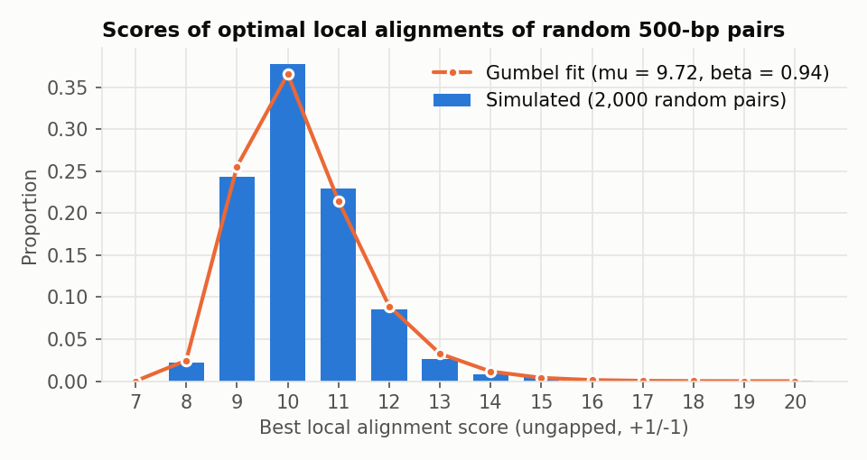
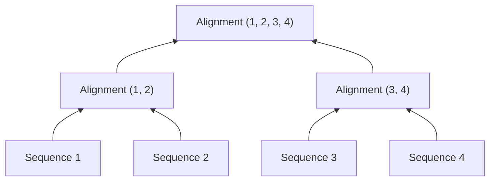

# Chapter 8 — Sequence Analysis Algorithms

[Repository Guide](../../README.md) | [English](Concepts_Lecture.md) | [한국어](Concepts_Lecture.ko.md)

> **Last Updated:** 2026-11-19

> **Learning Objectives:**
> 1. Find the positions of a pattern in a sequence with exact string matching and a k-mer index
> 2. Define the Hamming distance and the edit distance and compute the edit distance by dynamic programming
> 3. Set up the recurrences of Needleman-Wunsch global alignment and Smith-Waterman local alignment, fill the DP table by hand, and trace back
> 4. Explain the log-odds interpretation of substitution matrices, the difference between PAM and BLOSUM, and the difference between linear and affine gap penalties
> 5. Explain the seed-and-extend strategy of BLAST and compute and interpret E-values
> 6. Explain the principle of multiple sequence alignment and the text-mining view of sequences as k-mer documents

---

## Table of Contents

- [1. The Purpose of Sequence Comparison](#1-the-purpose-of-sequence-comparison)
  - [1.1 Similarity and Homology](#11-similarity-and-homology)
  - [1.2 String Terminology](#12-string-terminology)
- [2. String Matching and k-mers](#2-string-matching-and-k-mers)
  - [2.1 Exact Pattern Matching](#21-exact-pattern-matching)
  - [2.2 The k-mer Index](#22-the-k-mer-index)
  - [2.3 Choosing k](#23-choosing-k)
- [3. Hamming Distance and Edit Distance](#3-hamming-distance-and-edit-distance)
  - [3.1 Hamming Distance](#31-hamming-distance)
  - [3.2 Edit Distance](#32-edit-distance)
  - [3.3 Dynamic Programming for the Edit Distance](#33-dynamic-programming-for-the-edit-distance)
  - [3.4 Comparing the Two Distances](#34-comparing-the-two-distances)
- [4. Sequence Alignment](#4-sequence-alignment)
  - [4.1 Definition of an Alignment](#41-definition-of-an-alignment)
  - [4.2 Scoring Scheme](#42-scoring-scheme)
  - [4.3 The Number of Possible Alignments](#43-the-number-of-possible-alignments)
- [5. Global Alignment: The Needleman-Wunsch Algorithm](#5-global-alignment-the-needleman-wunsch-algorithm)
  - [5.1 Recurrence](#51-recurrence)
  - [5.2 Filling the DP Table](#52-filling-the-dp-table)
  - [5.3 Traceback](#53-traceback)
  - [5.4 R Implementation](#54-r-implementation)
  - [5.5 Time and Space Complexity](#55-time-and-space-complexity)
- [6. Local Alignment: The Smith-Waterman Algorithm](#6-local-alignment-the-smith-waterman-algorithm)
  - [6.1 When Local Alignment Is Needed](#61-when-local-alignment-is-needed)
  - [6.2 Recurrence](#62-recurrence)
  - [6.3 Filling the DP Table and Traceback](#63-filling-the-dp-table-and-traceback)
  - [6.4 R Implementation](#64-r-implementation)
  - [6.5 Global, Local, and Semi-Global Alignment](#65-global-local-and-semi-global-alignment)
- [7. Scoring Matrices and Gap Penalties](#7-scoring-matrices-and-gap-penalties)
  - [7.1 The Log-Odds Interpretation of Substitution Scores](#71-the-log-odds-interpretation-of-substitution-scores)
  - [7.2 PAM Matrices](#72-pam-matrices)
  - [7.3 BLOSUM Matrices](#73-blosum-matrices)
  - [7.4 Comparing PAM and BLOSUM](#74-comparing-pam-and-blosum)
  - [7.5 Linear and Affine Gap Penalties](#75-linear-and-affine-gap-penalties)
  - [7.6 Dynamic Programming with Affine Gaps](#76-dynamic-programming-with-affine-gaps)
- [8. BLAST](#8-blast)
  - [8.1 The Scale of Database Search](#81-the-scale-of-database-search)
  - [8.2 Seeds and Extension](#82-seeds-and-extension)
  - [8.3 Score Statistics and the E-Value](#83-score-statistics-and-the-e-value)
  - [8.4 Kinds of BLAST Programs](#84-kinds-of-blast-programs)
  - [8.5 The Cost of the Heuristic](#85-the-cost-of-the-heuristic)
- [9. Multiple Sequence Alignment](#9-multiple-sequence-alignment)
  - [9.1 Definition and Uses](#91-definition-and-uses)
  - [9.2 The SP Score and Computational Difficulty](#92-the-sp-score-and-computational-difficulty)
  - [9.3 Progressive Alignment](#93-progressive-alignment)
  - [9.4 An Example of Multiple Alignment](#94-an-example-of-multiple-alignment)
- [10. The Text-Mining View of Sequences](#10-the-text-mining-view-of-sequences)
  - [10.1 Sequences as Documents](#101-sequences-as-documents)
  - [10.2 k-mer Frequency Vectors and Clustering](#102-k-mer-frequency-vectors-and-clustering)
  - [10.3 Strengths and Weaknesses of Alignment-Free Comparison](#103-strengths-and-weaknesses-of-alignment-free-comparison)
- [Concept Applications](#concept-applications)
- [Glossary](#glossary)
- [Summary](#summary)
- [Self-Check Questions](#self-check-questions)
- [References](#references)

---

<br>

## 1. The Purpose of Sequence Comparison

### 1.1 Similarity and Homology

The most powerful way to learn the function of a newly obtained sequence is to compare it with sequences whose function is already known. Similar sequences are likely to have diverged from a common ancestor, and genes from a common ancestor often retain similar functions. Two different concepts are used in this inference.

> **Definition:** **Homology** is the evolutionary relationship in which two sequences descend from a common ancestral sequence.

**Similarity** expresses how alike two sequences are as a number such as an alignment score or a percent identity. Similarity is a measured quantity, and homology is a hypothesis inferred from that measurement. The phrase "the two sequences are 70% homologous" is therefore inaccurate; it should be "the two sequences are 70% identical, and similarity of this degree is hard to explain by chance, so they are likely homologous." The statistic that judges whether similarity can be explained by chance is the E-value of Section 8.3.

As seen in Chapter 7, evolution accumulates substitutions, insertions, and deletions in sequences. The computational problem of sequence comparison is to reconstruct most plausibly these changes between two sequences, and that reconstruction is an alignment.

### 1.2 String Terminology

This chapter uses the following terms. For a string $`x = x_1 x_2 \cdots x_m`$ over an alphabet $`\Sigma`$,

- **Substring:** Consecutive letters $`x_i x_{i+1} \cdots x_j`$. A k-mer is a substring of length $`k`$.
- **Subsequence:** A string obtained by choosing some letters while keeping their order; they need not be consecutive. For example, `AGT` is a subsequence of `ACGT` but not a substring.
- **Prefix and suffix:** $`x_1 \cdots x_i`$ and $`x_j \cdots x_m`$. Dynamic programming solves problems on pairs of prefixes of two sequences from the smallest up.

> **Caution:** In biology "sequence" means a whole string, so to avoid confusion with the mathematical subsequence, this chapter always calls a consecutive stretch a "substring" or a "region."

---

<br>

## 2. String Matching and k-mers

### 2.1 Exact Pattern Matching

The simplest problem is to find every position where a pattern of length $`m`$ (for example a short read) occurs exactly in a text of length $`n`$ (for example a genome). The simple method compares the pattern with the text at every start position.

```r
naive_match <- function(text, pattern) {
  n <- nchar(text); m <- nchar(pattern)
  hits <- integer(0)
  for (i in 1:(n - m + 1)) {
    if (substr(text, i, i + m - 1) == pattern) hits <- c(hits, i)
  }
  hits
}
text <- "ACGTTGCAACGTAGCTTACGT"
naive_match(text, "ACGT")
```

```text
[1]  1  9 18
```

- The start position `i` runs from 1 to `n - m + 1`. Starting later would run the pattern past the end of the text.
- `substr(text, i, i + m - 1)` cuts a region of length `m` to compare with the pattern, and a match appends the position to `hits`.
- The pattern `ACGT` occurs at positions 1, 9, and 18.

There are $`n - m + 1`$ start positions and up to $`m`$ letter comparisons at each, so the worst case takes $`O(nm)`$ time. If every read required a scan of a 3-billion-letter genome, processing hundreds of millions of reads would be impossible. The text is therefore preprocessed once into an index, and each pattern is looked up in the index.

> **[Algorithms]** The Knuth-Morris-Pratt algorithm, which finds one pattern in $`O(n + m)`$ time, and suffix trees and suffix arrays, which preprocess the text so that a pattern is found in time nearly independent of the text length, are string algorithms covered in algorithms courses. The index structures used by read mappers are variants of such structures designed to use little memory.

### 2.2 The k-mer Index

The simplest index stores every k-mer of the text with its positions in a hash table.

> **Definition:** A **k-mer index** is a data structure that stores each k-mer occurring in a text as a key and the list of positions where it occurs as the value.

```r
build_index <- function(text, k) {
  n <- nchar(text) - k + 1
  kmers <- substring(text, 1:n, k:nchar(text))
  split(1:n, kmers)
}
idx <- build_index(text, 4)
length(idx)
idx[["ACGT"]]
idx[["TTAC"]]
query <- "GCTTAC"
q_kmers <- substring(query, 1:3, 4:6)
lapply(setNames(q_kmers, q_kmers), function(w) idx[[w]])
```

```text
[1] 16
[1]  1  9 18
[1] 16
$GCTT
[1] 14

$CTTA
[1] 15

$TTAC
[1] 16

```

- After `substring()` cuts out all 4-mers, `split(1:n, kmers)` divides the position numbers `1:n` by k-mer into a list. The names of the list are k-mers and the elements are position vectors, so `idx[["ACGT"]]` returns 1, 9, 18 immediately without scanning the text again.
- Of the 18 4-mers in the text, 16 are distinct.
- The three 4-mers of the query `GCTTAC` start at positions 14, 15, and 16 of the text. Because the positions increase by one, the whole query can be inferred to match the region of the text starting at position 14. This idea of finding short k-mer matches (seeds) and widening around them is the starting point of BLAST in Section 8.

### 2.3 Choosing k

The performance of a k-mer index depends strongly on $`k`$.

- **When k is small,** the number of possible k-mers $`4^k`$ is smaller than the text length, and the same k-mer occurs in many places. The expected number of chance occurrences of a k-mer in a random text is about $`n / 4^k`$, so for $`n = 3 \times 10^9`$ and $`k = 8`$ it is about 46,000. The position lists become long, and seeds produce many useless candidates.
- **When k is large,** chance matches almost disappear, but a single difference between the query and the text spoils every k-mer that contains it. If a region of length $`L`$ has one mismatch, a seed arises only if some k-mer avoiding the mismatch remains, so the larger $`k`$ is, the more similar but not identical sequences are missed.

The value $`k = \log_4 n`$, where $`4^k \approx n`$, is the boundary at which chance matches occur about once on average. For the human genome, $`\log_4(3 \times 10^9) \approx 15.7`$, so k-mers sufficiently longer than this usually occur at only one place in the genome unless they lie in repeats.

---

<br>

## 3. Hamming Distance and Edit Distance

### 3.1 Hamming Distance

> **Definition:** The **Hamming distance** between two strings of equal length is the number of positions at which the letters differ.

```r
hamming <- function(x, y) {
  a <- strsplit(x, "")[[1]]; b <- strsplit(y, "")[[1]]
  stopifnot(length(a) == length(b))
  sum(a != b)
}
hamming("GATTACA", "GACTATA")
hamming("ACGTACGT", "CGTACGTA")
```

```text
[1] 2
[1] 8
```

- `a != b` is a logical vector that is `TRUE` where the letters differ, and `sum()` counts them. `GATTACA` and `GACTATA` differ only at positions 3 (T and C) and 6 (C and T), so the distance is 2.
- `stopifnot()` raises an error if the lengths differ. The Hamming distance is defined only for strings of equal length.

The Hamming distance is nonnegative, is 0 only for identical strings, is symmetric, and satisfies the triangle inequality, so it is a distance function with all the properties seen in Chapter 3. Treating each position as one categorical variable, the Hamming distance is the distance for categorical data that counts disagreeing variables. When only substitutions and no insertions or deletions can be assumed between sequences (for example when comparing SNPs at the same positions), the Hamming distance is the natural measure.

### 3.2 Edit Distance

In the second example, `ACGTACGT` and `CGTACGTA` have Hamming distance 8, differing at every position, yet they are very similar strings that become identical by deleting the leading `A` and appending an `A` at the end. The Hamming distance cannot express a change in which one inserted or deleted letter shifts everything after it.

> **Definition:** The **edit distance** is the minimum number of operations needed to turn one string into another using only single-letter insertions, deletions, and substitutions.

The edit distance with this definition is also called the Levenshtein distance. It is defined for strings of different lengths, and for strings of equal length it is no larger than the Hamming distance. Changing by substitutions alone is one way of editing, so the minimum number of operations is less than or equal to that. In the example above the edit distance is 2.

### 3.3 Dynamic Programming for the Edit Distance

The edit distance cannot be obtained by listing every edit sequence. Instead, the edit distances between prefixes of the two strings are computed from the smallest up and stored in a table. Let $`D(i, j)`$ be the edit distance between the first $`i`$ letters of $`x`$ and the first $`j`$ letters of $`y`$. Depending on how the last letters were handled, there are only three cases.

- $`x_i`$ was paired with $`y_j`$: the cost is 0 if the letters are the same and a substitution cost of 1 otherwise, and the remaining problem is $`D(i-1, j-1)`$.
- $`x_i`$ was deleted: the cost is 1, and the remaining problem is $`D(i-1, j)`$.
- $`y_j`$ was inserted: the cost is 1, and the remaining problem is $`D(i, j-1)`$.

```math
D(i, j) = \min \begin{cases} D(i-1, j-1) + [x_i \ne y_j] \\ D(i-1, j) + 1 \\ D(i, j-1) + 1 \end{cases}, \qquad D(i, 0) = i, \quad D(0, j) = j
```

Here $`[x_i \ne y_j]`$ is 1 if the two letters differ and 0 if they are the same. The edit distance between the empty string and a string of length $`i`$ is deleting all $`i`$ letters, so $`D(i, 0) = i`$.

> **[Algorithms]** When an optimal solution of a large problem consists of optimal solutions of smaller subproblems (optimal substructure) and the same subproblems are used repeatedly (overlapping subproblems), dynamic programming can store the answers of subproblems in a table and compute each only once. The edit distance and every alignment algorithm in this chapter are two-dimensional dynamic programs whose subproblems are pairs of prefixes of two strings.

The edit distance between `GCAT` and `GATC` is computed.

```r
edit_distance <- function(x, y) {
  a <- strsplit(x, "")[[1]]; b <- strsplit(y, "")[[1]]
  m <- length(a); n <- length(b)
  D <- matrix(0, m + 1, n + 1, dimnames = list(c("-", a), c("-", b)))
  D[, 1] <- 0:m
  D[1, ] <- 0:n
  for (i in 1:m) {
    for (j in 1:n) {
      cost <- if (a[i] == b[j]) 0 else 1
      D[i + 1, j + 1] <- min(D[i, j] + cost,
                             D[i, j + 1] + 1,
                             D[i + 1, j] + 1)
    }
  }
  D
}
D <- edit_distance("GCAT", "GATC")
D
D[nrow(D), ncol(D)]
edit_distance("ACGTACGT", "CGTACGTA")[9, 9]
adist("GCAT", "GATC")
```

```text
  - G A T C
- 0 1 2 3 4
G 1 0 1 2 3
C 2 1 1 2 2
A 3 2 1 2 3
T 4 3 2 1 2
[1] 2
[1] 2
     [,1]
[1,]    2
```

- R matrix indices start at 1, so $`D(i, j)`$ is stored in `D[i + 1, j + 1]`. The first row and first column (marked `-`) correspond to empty prefixes.
- `D[, 1] <- 0:m` and `D[1, ] <- 0:n` are the boundary conditions $`D(i, 0) = i`$ and $`D(0, j) = j`$.
- The double loop fills the table from top to bottom and left to right. When cell $`(i, j)`$ is filled, the upper-left, upper, and left cells it needs are already filled.
- The base R function `adist()` returns the same Levenshtein distance 2.

A few cells of the table are checked directly. Cell $`(1, 1)`$ is $`D(0,0) + 0 = 0`$ because G and G are the same. In cell $`(2, 2)`$, C and A differ, so the candidates are $`D(1,1) + 1 = 1`$, $`D(1,2) + 1 = 2`$, and $`D(2,1) + 1 = 2`$, and the minimum is 1. In the last cell $`(4, 4)`$, T and C differ, so the candidates are $`D(3,3) + 1 = 3`$, $`D(3,4) + 1 = 4`$, and $`D(4,3) + 1 = 2`$, and the minimum 2 comes from the left cell, the case of inserting C. Following back the cells that gave each minimum yields the edit that deletes C from `GCAT` (GAT) and appends C at the end (GATC).

### 3.4 Comparing the Two Distances

| Property | Hamming distance | Edit distance |
|:-----|:-----|:-----|
| Strings for which it is defined | Strings of equal length | All strings |
| Changes allowed | Substitutions | Substitutions, insertions, deletions |
| Computation time | $`O(n)`$ | $`O(mn)`$ (dynamic programming) |
| Size relation | At least the edit distance for equal lengths | At most the Hamming distance |
| Suitable cases | Aligned data compared position by position, error-correcting codes | Sequences with indels, spelling correction |

*Table 1. Comparison of the Hamming distance and the edit distance*

The edit distance gives every operation a cost of 1, but in biological sequences how readily a change occurs differs with the kind of substitution and with the length of an insertion or deletion. The generalization that gives each operation a different score and maximizes the score instead of minimizing a distance is the sequence alignment of the next section.

---

<br>

## 4. Sequence Alignment

### 4.1 Definition of an Alignment

> **Definition:** A **pairwise sequence alignment** arranges two sequences one above the other at equal length by inserting gap symbols `-` while keeping the order of their letters, with no column in which two gaps face each other.

Each column of an alignment is one of three kinds.

- **Match:** The same letter faces itself.
- **Mismatch:** Different letters face each other. It is interpreted as a substitution in evolution.
- **Gap:** A letter of one sequence faces a `-` in the other. It is interpreted as an insertion in one sequence or a deletion in the other; the alignment alone cannot tell which, so both are called indels.

```text
A G T C C A
|   | |   |
A - T C G A
```

*Figure 1. An alignment with matches, a gap, and a mismatch*

The alignment of Figure 1 consists of four matches (A, T, C, A), one gap (G and `-`), and one mismatch (C and G). The vertical bars conventionally mark matching columns.

### 4.2 Scoring Scheme

The quality of an alignment is judged by the **alignment score**, the sum of scores assigned to each column. The DNA examples of this chapter use the following simple scoring scheme.

| Kind of column | Score |
|:-----|:-----|
| Match | +1 |
| Mismatch | -1 |
| One gap position | -2 |

*Table 2. The scoring scheme used in the DNA examples of this chapter*

The score of the alignment in Figure 1 is $`4 \times (+1) + 1 \times (-1) + 1 \times (-2) = 1`$. Setting the gap penalty larger than the mismatch penalty reflects the idea that indels are rarer than substitutions in evolution. Writing the score of each letter pair as $`s(a, b)`$ and the score of one gap position as $`-d`$ ($`d > 0`$), this scheme is $`s(a,a) = 1`$, $`s(a,b) = -1`$ ($`a \ne b`$), $`d = 2`$. Protein sequences use substitution matrices (Section 7) that give a different score to each amino acid pair.

> **Note:** **Relation to the edit distance.** Finding the maximum-score alignment under the scheme match 0, mismatch -1, gap -1 and changing the sign of the score gives the edit distance. The edit distance is a special case of the alignment score, and minimizing a distance and maximizing a score are the same problem seen from opposite directions.

### 4.3 The Number of Possible Alignments

Finding the maximum-score alignment seems to require comparing every alignment, but the number of alignments grows exponentially with sequence length. An alignment of two sequences corresponds one to one with a path in a two-dimensional grid from the top-left corner to the bottom-right corner moving only right, down, or diagonally (a diagonal step is a column pairing two letters, a down step a letter of $`x`$ with a gap, and a right step a letter of $`y`$ with a gap). The number of such paths is a Delannoy number, and the number of alignments of two sequences of length $`n`$ is 63 for $`n = 3`$, 8,097,453 for $`n = 10`$, and about $`2.05 \times 10^{75}`$ for $`n = 100`$. Listing them all cannot compare even sequences of length 100.

> **[Discrete Mathematics]** Since the last step of a lattice path is right, down, or diagonal, the number of paths $`N(i, j)`$ satisfies $`N(i, j) = N(i-1, j) + N(i, j-1) + N(i-1, j-1)`$ with $`N(i, 0) = N(0, j) = 1`$. Solving this recurrence gives the values above. The dynamic program that maximizes the alignment score has the same structure as this recurrence with addition replaced by the maximum.

---

<br>

## 5. Global Alignment: The Needleman-Wunsch Algorithm

> **Definition:** A **global alignment** is an alignment that includes every letter of the two sequences from start to end.

Computing the maximum score of a global alignment by dynamic programming was proposed by Needleman and Wunsch as a general method for finding similarities between two protein sequences [1], and the refined form below is now called the Needleman-Wunsch algorithm. It is used to compare two sequences of similar length that are expected to correspond from start to end (for example the same gene in two close species).

### 5.1 Recurrence

Let $`F(i, j)`$ be the optimal global alignment score of the first $`i`$ letters of $`x`$ and the first $`j`$ letters of $`y`$. The last column of an optimal alignment has only three possibilities, $`x_i`$ paired with $`y_j`$, $`x_i`$ with a gap, or a gap with $`y_j`$, and removing the last column must leave an optimal alignment of a smaller pair of prefixes. The following recurrence therefore holds.

```math
F(i, j) = \max \begin{cases} F(i-1, j-1) + s(x_i, y_j) \\ F(i-1, j) - d \\ F(i, j-1) - d \end{cases}, \qquad F(i, 0) = -i d, \quad F(0, j) = -j d
```

The boundary condition $`F(i, 0) = -id`$ is the score of the alignment that pairs the first $`i`$ letters of $`x`$ all with gaps. The last cell $`F(m, n)`$ is the optimal global alignment score.

> **Caution:** The three cases of the recurrence correspond to the upper-left (diagonal), upper, and left cells of the table. Coming down from above pairs a letter of $`x`$ with a gap, and coming from the left pairs a letter of $`y`$ with a gap. This interpretation depends on which sequence is placed on the rows and which on the columns, so it must be fixed before drawing the table.

### 5.2 Filling the DP Table

$`x`$ = `AGTCCA` (rows, $`m = 6`$) and $`y`$ = `ATCGA` (columns, $`n = 5`$) are aligned with the scores of Table 2. The first row is 0, -2, -4, ..., -10 and the first column is 0, -2, -4, ..., -12. The remaining cells are filled from top to bottom, each row from left to right. Some of the computations are as follows.

- $`F(1,1)`$: A and A match. Diagonal $`0 + 1 = 1`$, up $`-2 - 2 = -4`$, left $`-2 - 2 = -4`$, so 1.
- $`F(1,2)`$: A and T mismatch. Diagonal $`-2 - 1 = -3`$, up $`-4 - 2 = -6`$, left $`1 - 2 = -1`$, so -1.
- $`F(2,1)`$: G and A mismatch. Diagonal $`-2 - 1 = -3`$, up $`1 - 2 = -1`$, left $`-4 - 2 = -6`$, so -1.
- $`F(2,2)`$: G and T mismatch. Diagonal $`1 - 1 = 0`$, up $`-1 - 2 = -3`$, left $`-1 - 2 = -3`$, so 0.
- $`F(3,2)`$: T and T match. Diagonal $`F(2,1) + 1 = 0`$, up $`F(2,2) - 2 = -2`$, left $`F(3,1) - 2 = -5`$, so 0.
- $`F(4,3)`$: C and C match. Diagonal $`F(3,2) + 1 = 1`$ exceeds up $`F(3,3) - 2 = -3`$ and left $`F(4,2) - 2 = -4`$, so 1.
- $`F(5,4)`$: C and G mismatch. Diagonal $`F(4,3) - 1 = 0`$, up $`F(4,4) - 2 = -3`$, left $`F(5,3) - 2 = -3`$, so 0.
- $`F(6,5)`$: A and A match. Diagonal $`F(5,4) + 1 = 1`$, up $`F(5,5) - 2 = -4`$, left $`F(6,4) - 2 = -4`$, so 1.

The completed table is as follows. `*` marks the cells on the traceback path of Section 5.3.

```text
          -     A     T     C     G     A
    -     0*   -2    -4    -6    -8   -10
    A    -2     1*   -1    -3    -5    -7
    G    -4    -1*    0    -2    -2    -4
    T    -6    -3     0*   -1    -3    -3
    C    -8    -5    -2     1*   -1    -3
    C   -10    -7    -4    -1     0*   -2
    A   -12    -9    -6    -3    -2     1*
```

*Figure 2. Needleman-Wunsch DP table and traceback path for AGTCCA and ATCGA*

The optimal global alignment score is the value 1 in the bottom-right cell.

### 5.3 Traceback

The score alone does not reveal the shape of the alignment. Starting at the bottom-right cell and following back to the top-left cell while checking which of the three candidates produced each value is called **traceback**. A diagonal step prepends a column pairing two letters, an upward step a letter of $`x`$ with a gap, and a leftward step a gap with a letter of $`y`$.

1. The 1 at $`(6,5)`$ is the 0 at the diagonal $`(5,4)`$ plus a match +1. Prepend the column A/A.
2. The 0 at $`(5,4)`$ is the 1 at the diagonal $`(4,3)`$ plus a mismatch -1. Prepend the column C/G.
3. The 1 at $`(4,3)`$ is the 0 at the diagonal $`(3,2)`$ plus a match +1. Prepend the column C/C.
4. The 0 at $`(3,2)`$ is the -1 at the diagonal $`(2,1)`$ plus a match +1. Prepend the column T/T.
5. The -1 at $`(2,1)`$ comes not from the diagonal ($`-2 - 1 = -3`$) but from the 1 at the upper cell $`(1,1)`$ plus a gap -2. Prepend the column G/`-`.
6. The 1 at $`(1,1)`$ is the 0 at the diagonal $`(0,0)`$ plus a match +1. Prepend the column A/A and arrive at $`(0,0)`$.

The result is the alignment of Figure 1, `AGTCCA` / `A-TCGA`. At a cell where several candidates give the same maximum, the traceback branches, and there are then several optimal alignments with the same score. In this example only one candidate gives the maximum at every cell of the path, so there is one optimal alignment.

### 5.4 R Implementation

```r
nw_align <- function(x, y, match = 1, mismatch = -1, gap = -2) {
  a <- strsplit(x, "")[[1]]; b <- strsplit(y, "")[[1]]
  m <- length(a); n <- length(b)
  F <- matrix(0, m + 1, n + 1, dimnames = list(c("-", a), c("-", b)))
  F[, 1] <- gap * (0:m)
  F[1, ] <- gap * (0:n)
  for (i in 1:m) {
    for (j in 1:n) {
      s <- if (a[i] == b[j]) match else mismatch
      F[i + 1, j + 1] <- max(F[i, j] + s,
                             F[i, j + 1] + gap,
                             F[i + 1, j] + gap)
    }
  }
  i <- m; j <- n; top <- character(0); bot <- character(0)
  while (i > 0 || j > 0) {
    if (i > 0 && j > 0 &&
        F[i + 1, j + 1] == F[i, j] + (if (a[i] == b[j]) match else mismatch)) {
      top <- c(a[i], top); bot <- c(b[j], bot); i <- i - 1; j <- j - 1
    } else if (i > 0 && F[i + 1, j + 1] == F[i, j + 1] + gap) {
      top <- c(a[i], top); bot <- c("-", bot); i <- i - 1
    } else {
      top <- c("-", top); bot <- c(b[j], bot); j <- j - 1
    }
  }
  list(F = F, score = F[m + 1, n + 1],
       aligned = c(paste(top, collapse = ""), paste(bot, collapse = "")))
}
res <- nw_align("AGTCCA", "ATCGA")
res$F
res$score
res$aligned
```

```text
    -  A  T  C  G   A
-   0 -2 -4 -6 -8 -10
A  -2  1 -1 -3 -5  -7
G  -4 -1  0 -2 -2  -4
T  -6 -3  0 -1 -3  -3
C  -8 -5 -2  1 -1  -3
C -10 -7 -4 -1  0  -2
A -12 -9 -6 -3 -2   1
[1] 1
[1] "AGTCCA" "A-TCGA"
```

- The parameter `gap` is the score $`-d`$ of one gap position. `F[, 1] <- gap * (0:m)` is the boundary condition $`F(i, 0) = -id`$.
- The three arguments of `max()` in the double loop are the diagonal, upper, and left candidates of the recurrence. R indices start at 1, so `F[i + 1, j + 1]` is $`F(i, j)`$ and `F[i, j]` is $`F(i-1, j-1)`$.
- The `while` loop is the traceback. If the value of the current cell equals the diagonal candidate it moves diagonally, otherwise it checks the upper candidate, and if neither holds it moves left. When several candidates tie, it prefers diagonal, then up, then left, so it returns one of the optimal alignments.
- The condition `i > 0 || j > 0` and the `i > 0` and `j > 0` checks in each branch make the remaining letters pair with gaps once the first row or first column is reached.

The resulting table and alignment match Figure 2 and the hand computation of Section 5.3. The Bioconductor package pwalign provides `pairwiseAlignment()`, which implements the same computation in C. pwalign computes the penalty of a gap of length $`k`$ as `gapOpening + k * gapExtension`, so `gapOpening = 0` and `gapExtension = 2` give the linear gap penalty of Table 2.

```r
suppressPackageStartupMessages({library(Biostrings); library(pwalign)})
sm <- nucleotideSubstitutionMatrix(match = 1, mismatch = -1, baseOnly = TRUE)
g <- pairwiseAlignment("AGTCCA", "ATCGA", substitutionMatrix = sm,
                       gapOpening = 0, gapExtension = 2, type = "global")
g
l <- pairwiseAlignment("TACGAT", "GACTATC", substitutionMatrix = sm,
                       gapOpening = 0, gapExtension = 2, type = "local")
l
score(pairwiseAlignment("TACGAT", "GACTATC", substitutionMatrix = sm,
                        gapOpening = 0, gapExtension = 2, type = "global"))
```

```text
Global PairwiseAlignmentsSingleSubject (1 of 1)
pattern: AGTCCA
subject: A-TCGA
score: 1 
Local PairwiseAlignmentsSingleSubject (1 of 1)
pattern: [2] ACGAT
subject: [2] ACTAT
score: 3 
[1] 0
```

The first result matches the output of `nw_align()` above. The second and third results are the local alignment example of Section 6 and the global alignment score of those two sequences, interpreted again in Section 6.3.

### 5.5 Time and Space Complexity

The table has $`(m+1)(n+1)`$ cells, each filled with a constant number of operations, so computing the score takes $`O(mn)`$ time. The traceback ends after $`O(m + n)`$ steps, since each step decreases $`i`$ or $`j`$. Storing the whole table also takes $`O(mn)`$ space.

$`O(mn)`$ is a dramatic improvement over the exponential number of alignments (Section 4.3), but it is still large for long sequences. A table for two sequences of length 100,000 has 10 billion cells, which at 4 bytes per cell is 40 gigabytes. If only the score is needed, the table can be filled one row at a time while remembering only the row above, reducing the space to $`O(n)`$. Combining this with divide and conquer obtains even the shape of the alignment in $`O(n)`$ space (Hirschberg's method).

---

<br>

## 6. Local Alignment: The Smith-Waterman Algorithm

### 6.1 When Local Alignment Is Needed

Global alignment assumes that the two sequences correspond as a whole. This assumption fails in cases such as the following.

- Two proteins share only one domain, a functional unit, and the rest is unrelated.
- A short sequence (a read, a gene) corresponds to part of a long sequence (a chromosome).
- The similar region lies in the middle of the sequences, and both ends have diverged greatly in evolution.

In these cases global alignment forcibly pairs even the unrelated parts and accumulates penalties, so the total score is low even when a similar region exists.

> **Definition:** A **local alignment** finds, among the substrings of each of two sequences, the pair with the highest alignment score and aligns only those two.

The dynamic programming method for local alignment was proposed by Smith and Waterman [2].

### 6.2 Recurrence

A fourth candidate, 0, is added to the recurrence of global alignment.

```math
H(i, j) = \max \begin{cases} 0 \\ H(i-1, j-1) + s(x_i, y_j) \\ H(i-1, j) - d \\ H(i, j-1) - d \end{cases}, \qquad H(i, 0) = H(0, j) = 0
```

There are three differences from global alignment.

1. **The floor at 0:** If the score would become negative, it is set to 0. This means discarding the alignment so far and starting anew at this position. Penalties accumulated by an unrelated earlier region are not carried forward.
2. **Boundary conditions:** The first row and first column are all 0. An alignment can start at any position without penalty.
3. **End and traceback:** The optimal local alignment ends at the cell with the largest value in the table. The traceback starts at that cell and stops on reaching a cell with value 0.

> **Caution:** For local alignment to be meaningful, the expected score of two randomly paired letters must be negative. If the expectation is positive, aligning unrelated sequences longer keeps raising the score, and local alignment comes to resemble global alignment. With equal frequencies of the four bases, the expectation under the scheme of Table 2 is $`\frac{1}{4}(+1) + \frac{3}{4}(-1) = -0.5`$, which is negative.

### 6.3 Filling the DP Table and Traceback

$`x`$ = `TACGAT` (rows) and $`y`$ = `GACTATC` (columns) are aligned locally with the same scoring scheme. Most cells are 0, and positive values grow only along diagonals where matches continue.

- $`H(1,4)`$: T and T match, so $`H(0,3) + 1 = 1`$.
- $`H(2,5)`$: A and A match, so $`H(1,4) + 1 = 2`$. This is the short match of `TA` with `TA`.
- $`H(3,3)`$: C and C match, so $`H(2,2) + 1 = 2`$ ($`H(2,2) = 1`$ is the match of A with A).
- $`H(4,4)`$: G and T mismatch. Among the diagonal $`2 - 1 = 1`$, up $`H(3,4) - 2 = -2`$, left $`H(4,3) - 2 = -2`$, and 0, the maximum is 1. The score drops but stays above 0, so the alignment continues.
- $`H(5,5)`$: A and A match, so $`H(4,4) + 1 = 2`$.
- $`H(6,6)`$: T and T match, so $`H(5,5) + 1 = 3`$. This is the maximum of the whole table.

```text
        -   G   A   C   T   A   T   C
    -   0   0   0   0   0   0   0   0
    T   0   0   0   0   1   0   1   0
    A   0   0   1*  0   0   2   0   0
    C   0   0   0   2*  0   0   1   1
    G   0   1   0   0   1*  0   0   0
    A   0   0   2   0   0   2*  0   0
    T   0   0   0   1   1   0   3*  1
```

*Figure 3. Smith-Waterman DP table and traceback path for TACGAT and GACTATC*

The traceback starts at $`(6,6)`$, where the maximum 3 lies, moves diagonally through $`(5,5)`$, $`(4,4)`$, $`(3,3)`$, and $`(2,2)`$, and stops on reaching $`(1,1)`$, whose value is 0. The letters paired by the visited cells are letters 2-6 of $`x`$, `ACGAT`, and letters 2-6 of $`y`$, `ACTAT`.

```text
A C G A T
| |   | |
A C T A T
```

*Figure 4. The optimal local alignment*

This alignment has four matches and one mismatch and scores 3. Short matches of score 2 (`TA`/`TA`, `GA`/`GA`) are also in the table, but local alignment found that joining a longer region at the cost of one mismatch scores higher. The global alignment score of the same two sequences is 0, as in the output of Section 5.4, lower than the local score of 3 because the unrelated letters at both ends accumulate penalties.

### 6.4 R Implementation

```r
sw_align <- function(x, y, match = 1, mismatch = -1, gap = -2) {
  a <- strsplit(x, "")[[1]]; b <- strsplit(y, "")[[1]]
  m <- length(a); n <- length(b)
  H <- matrix(0, m + 1, n + 1, dimnames = list(c("-", a), c("-", b)))
  for (i in 1:m) {
    for (j in 1:n) {
      s <- if (a[i] == b[j]) match else mismatch
      H[i + 1, j + 1] <- max(0,
                             H[i, j] + s,
                             H[i, j + 1] + gap,
                             H[i + 1, j] + gap)
    }
  }
  best <- which(H == max(H), arr.ind = TRUE)[1, ]
  i <- unname(best[1]) - 1; j <- unname(best[2]) - 1
  end_x <- i; end_y <- j
  top <- character(0); bot <- character(0)
  while (i > 0 && j > 0 && H[i + 1, j + 1] > 0) {
    if (H[i + 1, j + 1] == H[i, j] + (if (a[i] == b[j]) match else mismatch)) {
      top <- c(a[i], top); bot <- c(b[j], bot); i <- i - 1; j <- j - 1
    } else if (H[i + 1, j + 1] == H[i, j + 1] + gap) {
      top <- c(a[i], top); bot <- c("-", bot); i <- i - 1
    } else {
      top <- c("-", top); bot <- c(b[j], bot); j <- j - 1
    }
  }
  list(H = H, score = max(H),
       aligned = c(paste(top, collapse = ""), paste(bot, collapse = "")),
       x_range = c(i + 1, end_x), y_range = c(j + 1, end_y))
}
res <- sw_align("TACGAT", "GACTATC")
res$H
res$score
res$aligned
res$x_range
res$y_range
```

```text
  - G A C T A T C
- 0 0 0 0 0 0 0 0
T 0 0 0 0 1 0 1 0
A 0 0 1 0 0 2 0 0
C 0 0 0 2 0 0 1 1
G 0 1 0 0 1 0 0 0
A 0 0 2 0 0 2 0 0
T 0 0 0 1 1 0 3 1
[1] 3
[1] "ACGAT" "ACTAT"
[1] 2 6
[1] 2 6
```

- Starting the whole table at 0 with `matrix(0, ...)` satisfies the boundary conditions of the first row and first column automatically.
- The first argument `0` of `max()` is the floor of the recurrence. The other three arguments are the same as in global alignment.
- `which(H == max(H), arr.ind = TRUE)` returns the row and column numbers of the cells holding the maximum. If the maximum occurs in several cells, `[1, ]` picks the first. `unname()` removes the names (`row`, `col`) attached to the result.
- The `while` condition `H[i + 1, j + 1] > 0` of the traceback is the rule of stopping on reaching 0. When the loop ends, `i + 1` and `j + 1` are the positions where the alignment starts, so `x_range` and `y_range` return the start and end positions together.

The result matches Figures 3 and 4 and also the pwalign local alignment seen in Section 5.4 (`[2] ACGAT`, `[2] ACTAT`, score 3). The `[2]` in pwalign means that the alignment starts at the second letter of each sequence.

### 6.5 Global, Local, and Semi-Global Alignment

When a short read is mapped to a long reference sequence, the read should be aligned from start to end, while the parts of the reference left over at both ends should not be penalized. An alignment that does not penalize gaps at one or both ends in this way is called a **semi-global alignment**. The recurrence is the same as for global alignment, and only the boundary conditions and the cell from which the answer is read change. With the read on the rows and the reference on the columns, the first row is set to all 0 so that the start of the reference can be skipped without penalty, and the largest value in the last row is read as the answer so that the end of the reference can be left without penalty.

```r
suppressPackageStartupMessages({library(Biostrings); library(pwalign)})
sm <- nucleotideSubstitutionMatrix(match = 1, mismatch = -1, baseOnly = TRUE)
read <- "TACGTCTAC"; ref <- "GGTTACGTATAGCCA"
for (tp in c("global", "local", "global-local")) {
  a <- pairwiseAlignment(read, ref, substitutionMatrix = sm,
                         gapOpening = 0, gapExtension = 2, type = tp)
  cat(sprintf("%-13s %4d  %s\n%-13s       %s\n", tp, score(a),
              alignedPattern(a), "", alignedSubject(a)))
}
```

```text
global          -5  --T-ACGTCTA-C--
                    GGTTACGTATAGCCA
local            6  TACGTCTA
                    TACGTATA
global-local     5  TACGTCTAC
                    TACGTATAG
```

- **Global (`global`):** The whole reference must be aligned, so six gap positions appear on the read side, and the gap penalties make the score -5. This does not suit the purpose of read mapping.
- **Local (`local`):** The last letter C of the read mismatches the G of the reference, so it is dropped and only the part `TACGTCTA` is aligned, scoring 6. Part of the read is left out of the alignment.
- **Semi-global (`global-local`):** The whole read is aligned to a contiguous region of the reference. A judgment on every letter of the read (two mismatches) remains, which suits variant calling.

| Kind | Part included in the alignment | End-gap penalty | Typical use |
|:-----|:-----|:-----|:-----|
| Global | Both whole sequences | Yes | Comparing homologous sequences of similar length |
| Local | The most similar regions of the two sequences | None (outside the region is ignored) | Finding domains, database search |
| Semi-global | One whole sequence and a region of the other | None at the ends of the longer sequence | Read mapping, joining overlapping reads |

*Table 3. Comparison of global, local, and semi-global alignment*

---

<br>

## 7. Scoring Matrices and Gap Penalties

### 7.1 The Log-Odds Interpretation of Substitution Scores

The +1 and -1 of Table 2 look like arbitrary choices, but good scores come from a probability model. On observing an aligned letter pair $`(a, b)`$, two hypotheses are compared.

- **Homology hypothesis:** The two letters come from a common ancestor, and the probability that the pair $`(a, b)`$ appears in an alignment of homologous sequences is $`q_{ab}`$.
- **Random hypothesis:** The two letters were drawn independently with background frequencies $`p_a`$ and $`p_b`$, and the probability of the pair is $`p_a p_b`$.

The logarithm of the ratio of the two probabilities is taken as the score.

> **Definition:** The **log-odds score** is the logarithm of the ratio of the probability that the pair $`(a, b)`$ appears in homologous sequences to the probability that it appears at random, $`s(a, b) = \frac{1}{\lambda} \log \frac{q_{ab}}{p_a p_b}`$.

$`\lambda`$ is a scale constant that turns the scores into convenient integers. A pair that appears more often in homologous sequences gets a positive score, and one rarer than chance a negative score. The alignment score is the sum of column scores, so if the columns are assumed independent it equals the logarithm of the probability ratio of the whole alignment. The maximum-score alignment is therefore the alignment under which the homology hypothesis becomes most plausible relative to the random hypothesis. Every substitution matrix implicitly has this log-odds form, and once the target frequencies $`q_{ab}`$ are fixed, the matrix is determined uniquely up to the scale constant [3].

As a DNA example, suppose the background frequencies of the four bases are all 1/4 and 70% of the columns in alignments of homologous sequences are matches. The probability of a particular matching pair $`(a, a)`$ is $`0.7/4 = 0.175`$, and that of a particular mismatching pair $`(a, b)`$ is $`0.3/12 = 0.025`$. With base 2,

```math
s(a, a) = \log_2 \frac{0.175}{0.0625} \approx 1.49, \qquad s(a, b) = \log_2 \frac{0.025}{0.0625} \approx -1.32
```

so the match and mismatch scores have similar magnitudes and opposite signs, resembling the scheme of Table 2. The scores are in bits, so one matching column is evidence of about 1.49 bits in favor of the homology hypothesis.

> **[Probability and Statistics]** The likelihood ratio $`P(\text{data} \mid H_1) / P(\text{data} \mid H_0)`$ of two hypotheses expresses how much more the data support one hypothesis than the other, and by the Neyman-Pearson lemma, when two simple hypotheses are compared, the test based on the likelihood ratio is the most powerful test at a given significance level. Taking logarithms turns the product over independent observations into a sum, so the alignment score that adds column log-odds scores is the logarithm of a likelihood ratio test statistic.

### 7.2 PAM Matrices

For proteins, target frequencies must be estimated for every pair of the twenty amino acids. The substitution matrices widely used early on were the **PAM (point accepted mutation)** matrices, based on Dayhoff's model of evolution [4].

- In alignments of very closely related proteins, substitutions in which an amino acid changed into another and survived natural selection (accepted) are counted.
- From these counts a substitution probability matrix PAM1 is built for the evolutionary distance at which on average one amino acid per hundred changes.
- Evolution is treated as a Markov chain, and powers of PAM1 give matrices for larger distances. PAM250 is PAM1 multiplied by itself 250 times, corresponding to a distance with on average 250 substitutions per hundred amino acids (the same site may change several times).
- The substitution probabilities at each distance are converted into log-odds scores.

### 7.3 BLOSUM Matrices

**BLOSUM (BLOcks SUbstitution Matrix)** matrices were built by Henikoff and Henikoff directly from alignments of short conserved regions (blocks) in protein families. Substitutions were counted in about 2,000 blocks representing more than 500 protein families, and these matrices markedly improved alignments and searches [4]. Within a block, sequences whose identity is at or above a chosen threshold are grouped together to reduce the influence of close sequences, and the percentage of that threshold appears in the name of the matrix. BLOSUM62 is the matrix built by grouping sequences that are at least 62% identical.

A part of BLOSUM62 shows high scores between amino acids with similar properties.

```r
suppressPackageStartupMessages({library(Biostrings); library(pwalign)})
data(BLOSUM62); data(PAM250)
aa <- c("A", "R", "N", "D", "C", "L", "I", "V", "F", "Y", "W")
BLOSUM62[aa, aa]
PAM250[aa, aa]
diag(BLOSUM62)[c("W", "C", "A", "L")]
p <- AAString("MKTWVLAGHE"); q <- AAString("MRTWLSGHE")
al <- pairwiseAlignment(p, q, substitutionMatrix = "BLOSUM62",
                        gapOpening = 10, gapExtension = 1)
al
score(al)
```

```text
   A  R  N  D  C  L  I  V  F  Y  W
A  4 -1 -2 -2  0 -1 -1  0 -2 -2 -3
R -1  5  0 -2 -3 -2 -3 -3 -3 -2 -3
N -2  0  6  1 -3 -3 -3 -3 -3 -2 -4
D -2 -2  1  6 -3 -4 -3 -3 -3 -3 -4
C  0 -3 -3 -3  9 -1 -1 -1 -2 -2 -2
L -1 -2 -3 -4 -1  4  2  1  0 -1 -2
I -1 -3 -3 -3 -1  2  4  3  0 -1 -3
V  0 -3 -3 -3 -1  1  3  4 -1 -1 -3
F -2 -3 -3 -3 -2  0  0 -1  6  3  1
Y -2 -2 -2 -3 -2 -1 -1 -1  3  7  2
W -3 -3 -4 -4 -2 -2 -3 -3  1  2 11
   A  R  N  D  C  L  I  V  F  Y  W
A  2 -2  0  0 -2 -2 -1  0 -3 -3 -6
R -2  6  0 -1 -4 -3 -2 -2 -4 -4  2
N  0  0  2  2 -4 -3 -2 -2 -3 -2 -4
D  0 -1  2  4 -5 -4 -2 -2 -6 -4 -7
C -2 -4 -4 -5 12 -6 -2 -2 -4  0 -8
L -2 -3 -3 -4 -6  6  2  2  2 -1 -2
I -1 -2 -2 -2 -2  2  5  4  1 -1 -5
V  0 -2 -2 -2 -2  2  4  4 -1 -2 -6
F -3 -4 -3 -6 -4  2  1 -1  9  7  0
Y -3 -4 -2 -4  0 -1 -1 -2  7 10  0
W -6  2 -4 -7 -8 -2 -5 -6  0  0 17
 W  C  A  L 
11  9  4  4 
Global PairwiseAlignmentsSingleSubject (1 of 1)
pattern: MKTWVLAGHE
subject: MRTW-LSGHE
score: 36 
[1] 36
```

- **The diagonal entries differ in size.** In BLOSUM62, tryptophan (W) with itself scores 11 and cysteine (C) 9, while alanine (A) and leucine (L) score 4. A match of a rare amino acid has a small chance probability $`p_a^2`$, so its log-odds is large.
- **Pairs of similar amino acids score positively.** The scores among the hydrophobic aliphatic amino acids I, L, and V (1-3), among the aromatic amino acids F, Y, and W (1-3), and between acidic D and N with its amide side chain (1) are positive. The amino acid classification of Chapter 7, Section 4.1 shows up directly in the scores.
- **An example of protein alignment:** The global alignment score 36 of `MKTWVLAGHE` and `MRTWLSGHE` is the sum of M/M 5, K/R 2, T/T 5, W/W 11, V/gap -11 (a gap of length 1, `10 + 1 * 1`), L/L 4, A/S 1, G/G 6, H/H 8, and E/E 5. The positive scores for the mismatches K and R (both positively charged) and A and S are what distinguish this from a simple match/mismatch score.

### 7.4 Comparing PAM and BLOSUM

| Item | PAM | BLOSUM |
|:-----|:-----|:-----|
| Data | Whole alignments of very close proteins | Alignments of conserved blocks including distant relationships |
| How matrices for larger distances are obtained | Extrapolated by powers of the matrix for a short distance | Computed directly by changing the grouping identity threshold |
| Meaning of the number | Evolutionary distance (larger for more distant sequences) | Grouping identity threshold (smaller for more distant sequences) |
| Representative matrices | PAM250, PAM120, PAM30 | BLOSUM62, BLOSUM45, BLOSUM80 |

*Table 4. Comparison of PAM and BLOSUM*

> **Caution:** A larger number means opposite things in the two families. For distantly related sequences, choose a large number in PAM (PAM250) and a small number in BLOSUM (BLOSUM45). For close sequences, choose the opposite, such as PAM30 or BLOSUM80.

### 7.5 Linear and Affine Gap Penalties

So far every gap position received the same penalty $`d`$. This scheme, in which a gap of length $`k`$ is penalized $`\gamma(k) = dk`$, is called a **linear gap penalty**. In real evolution, however, a single event often inserts or deletes several bases at once. One gap of length 3 and three gaps of length 1 are equal under a linear penalty, but biologically the former is far more plausible.

> **Definition:** An **affine gap penalty** penalizes a gap of length $`k`$ by $`\gamma(k) = o + ek`$, the sum of a penalty $`o`$ for opening a gap and an extension penalty $`e`$ proportional to its length.

Usually $`o`$ is set larger than $`e`$, favoring alignments with fewer gaps and one long gap. Note that the definition of the penalty differs slightly between tools. pwalign charges $`o + ek`$ for a gap of length $`k`$, while other tools and textbooks sometimes write $`o + e(k-1)`$, in which case the same numbers give a penalty for one gap that differs by $`e`$.

`AACCGGTTAC` and `AAGGTAC` are aligned with a linear penalty ($`o = 0, e = 2`$) and an affine penalty ($`o = 4, e = 1`$).

```r
suppressPackageStartupMessages({library(Biostrings); library(pwalign)})
sm <- nucleotideSubstitutionMatrix(match = 1, mismatch = -1, baseOnly = TRUE)
x <- "AACCGGTTAC"; y <- "AAGGTAC"
lin <- pairwiseAlignment(x, y, substitutionMatrix = sm, gapOpening = 0, gapExtension = 2)
aff <- pairwiseAlignment(x, y, substitutionMatrix = sm, gapOpening = 4, gapExtension = 1)
data.frame(model = c("linear", "affine"),
           x = c(as.character(alignedPattern(lin)), as.character(alignedPattern(aff))),
           y = c(as.character(alignedSubject(lin)), as.character(alignedSubject(aff))),
           score = c(score(lin), score(aff)))
```

```text
   model          x          y score
1 linear AACCGGTTAC AA--GGT-AC     1
2 affine AACCGGTTAC AA---GGTAC    -2
```

- **Linear penalty:** The alignment `AA--GGT-AC` has seven matches (+7) and three gap positions (-6) and scores 1. The gaps are split into two places (lengths 2 and 1).
- **Affine penalty:** The alignment `AA---GGTAC` has six matches (+6), one mismatch (T/G, -1), and one gap of length 3 ($`-(4 + 3 \times 1) = -7`$) and scores -2. Scoring the linear-penalty alignment with the affine penalty gives two gaps with penalties $`(4 + 2) + (4 + 1) = 11`$ and a lower score $`7 - 11 = -4`$. Conversely, scoring the affine-penalty alignment with the linear penalty gives $`5 - 6 = -1`$, lower than the linear optimum of 1.

When opening a gap costs something, the optimal alignment gathers the gaps into one even at the price of a mismatch.

### 7.6 Dynamic Programming with Affine Gaps

With an affine penalty the optimal score of cell $`(i, j)`$ alone is not enough. Continuing a gap in the next cell subtracts only $`e`$ while opening a new one subtracts $`o + e`$, so whether the alignment is currently inside a gap must also be remembered. Gotoh presented a method that fills three tables together to solve this problem in $`O(mn)`$ time [5].

- $`M(i, j)`$: the optimal score ending with a column pairing $`x_i`$ and $`y_j`$
- $`X(i, j)`$: the optimal score ending with a column of $`x_i`$ and a gap
- $`Y(i, j)`$: the optimal score ending with a column of a gap and $`y_j`$

```math
\begin{aligned}
M(i, j) &= s(x_i, y_j) + \max \lbrace M(i-1, j-1),\ X(i-1, j-1),\ Y(i-1, j-1) \rbrace \\
X(i, j) &= \max \lbrace M(i-1, j) - (o + e),\ X(i-1, j) - e,\ Y(i-1, j) - (o + e) \rbrace \\
Y(i, j) &= \max \lbrace M(i, j-1) - (o + e),\ Y(i, j-1) - e,\ X(i, j-1) - (o + e) \rbrace
\end{aligned}
```

The second candidate of $`X`$, $`X(i-1, j) - e`$, extends a gap, and the other candidates open a new gap. The optimal global alignment score is $`\max \lbrace M(m,n), X(m,n), Y(m,n) \rbrace`$.

```r
gotoh_score <- function(x, y, match = 1, mismatch = -1, o = 4, e = 1) {
  a <- strsplit(x, "")[[1]]; b <- strsplit(y, "")[[1]]
  m <- length(a); n <- length(b); NEG <- -Inf
  M <- matrix(NEG, m + 1, n + 1); X <- M; Y <- M
  M[1, 1] <- 0
  for (i in 1:m) X[i + 1, 1] <- -(o + e * i)
  for (j in 1:n) Y[1, j + 1] <- -(o + e * j)
  for (i in 1:m) {
    for (j in 1:n) {
      s <- if (a[i] == b[j]) match else mismatch
      M[i + 1, j + 1] <- s + max(M[i, j], X[i, j], Y[i, j])
      X[i + 1, j + 1] <- max(M[i, j + 1] - (o + e), X[i, j + 1] - e, Y[i, j + 1] - (o + e))
      Y[i + 1, j + 1] <- max(M[i + 1, j] - (o + e), Y[i + 1, j] - e, X[i + 1, j] - (o + e))
    }
  }
  max(M[m + 1, n + 1], X[m + 1, n + 1], Y[m + 1, n + 1])
}
gotoh_score("AACCGGTTAC", "AAGGTAC", o = 4, e = 1)
gotoh_score("AACCGGTTAC", "AAGGTAC", o = 0, e = 2)
```

```text
[1] -2
[1] 1
```

- Starting all three tables at $`-\infty`$ (`-Inf`) represents impossible states. For example, in the first column no letter of $`y`$ has been used, so the alignment cannot end in state $`M`$ or $`Y`$.
- `X[i + 1, 1] <- -(o + e * i)` is the score of pairing the first $`i`$ letters of $`x`$ with one gap of length $`i`$. Even at the boundary the gap is gathered into one, and the opening penalty is charged only once.
- The three lines inside the loop are the three recurrences above. With `o = 0` the opening penalty disappears and the scheme equals the linear penalty, and the result 1 equals the linear-penalty score of Section 7.5. The result -2 for `o = 4, e = 1` equals the affine-penalty score of pwalign.

---

<br>

## 8. BLAST

### 8.1 The Scale of Database Search

Finding sequences similar to one query in a database is the problem of locally aligning the query with every sequence in the database. With query length $`m`$ and total database length $`n`$, the Smith-Waterman algorithm takes $`O(mn)`$ time. For $`m = 300`$ and $`n = 10^{11}`$ it must fill $`3 \times 10^{13}`$ cells, and repeating this for every query is impractical. Fast search requires giving up the exact optimum and using a heuristic that starts from short matches almost certainly contained in good alignments.

> **Definition:** **BLAST (Basic Local Alignment Search Tool)** is a sequence search method that directly approximates the maximal segment pair score, a measure of local similarity, by finding short high-scoring word matches between the query and database sequences as seeds and extending them.

BLAST is an order of magnitude faster than existing tools of comparable sensitivity, and mathematical results on the stochastic properties of the scores allow the statistical significance of its alignments to be assessed [6].

### 8.2 Seeds and Extension

A BLAST protein search proceeds in the following steps.


*Figure 5. The search steps of BLAST*

1. **Word list:** The query is split into overlapping words of length $`w`$. Protein searches usually use words of about 3 letters, and DNA searches much longer words.
2. **Neighborhood words:** For proteins, not only words identical to a query word but every word whose score by the substitution matrix is at least the threshold $`T`$ counts as a neighbor. This catches as seeds the regions changed into similar amino acids.
3. **Finding hits:** The database is indexed by words in advance (Section 2.2), so the positions of neighborhood words are found immediately.
4. **Ungapped extension:** A hit is widened one letter at a time in both directions while adding scores. When the score falls a fixed amount below the best score so far, extension stops and the region up to the best point is kept. Among the ungapped alignment regions obtained this way, those scoring above a cutoff are called **high-scoring segment pairs (HSPs)**.
5. **Gapped alignment:** Current BLAST implementations additionally perform a dynamic programming alignment that allows gaps around promising HSPs to obtain the final alignment.

As an example of neighborhood words, all words with a BLOSUM62 score of at least 17 against the query word `RDW` are found.

```r
suppressPackageStartupMessages({library(Biostrings); library(pwalign)})
data(BLOSUM62)
aa <- c("A","R","N","D","C","Q","E","G","H","I","L","K","M","F","P","S","T","W","Y","V")
neighbors <- function(word, T) {
  w <- strsplit(word, "")[[1]]
  g <- expand.grid(aa, aa, aa, stringsAsFactors = FALSE)
  sc <- BLOSUM62[w[1], g[, 1]] + BLOSUM62[w[2], g[, 2]] + BLOSUM62[w[3], g[, 3]]
  names(sc) <- paste0(g[, 1], g[, 2], g[, 3])
  sort(sc[sc >= T], decreasing = TRUE)
}
neighbors("RDW", T = 17)
length(neighbors("RDW", T = 13))
```

```text
RDW KDW QDW REW RNW NDW EDW HDW 
 22  19  18  18  17  17  17  17 
[1] 47
```

- `expand.grid()` builds all $`20^3 = 8000`$ three-letter combinations of the twenty amino acids, and the BLOSUM62 scores at each position are added.
- The score of `RDW` itself is the sum of R/R 5, D/D 6, and W/W 11, which is 22. `KDW` receives K/R 2 and scores 19, and `REW` receives E/D 2 and scores 18. Because the self-score of tryptophan, 11, is large, words that change the W position do not pass the threshold.
- With $`T = 17`$ there are 8 neighbors, and with $`T = 13`$ there are 47. Lowering $`T`$ lets distantly related sequences obtain seeds and raises sensitivity, but more hits increase the computation of the extension step.

### 8.3 Score Statistics and the E-Value

In a large database, unrelated sequences also produce alignments with high scores by chance. Rather than the score itself, the probability that such a score arises by chance should therefore be reported. The optimal local alignment score of a random sequence pair is the maximum of many segment scores, so it follows not a normal distribution but an **extreme value distribution** [3].

> **Definition:** The **E-value** is the expected number of HSPs with score at least $`S`$ that would appear by chance in a search of a random sequence database of the same size.

For ungapped local alignment of sufficiently long random sequences, the expected number of HSPs with score at least $`S`$ is as follows [7].

```math
E = K m n \, e^{-\lambda S}
```

$`m`$ and $`n`$ are the lengths of the query and the database, and $`K`$ and $`\lambda`$ are constants determined by the scoring scheme and the background frequencies. $`\lambda`$ is the positive solution of $`\sum_{a,b} p_a p_b e^{\lambda s(a,b)} = 1`$ over the scores of randomly paired letters. With equal frequencies of the four bases, match +1, and mismatch -1, this is $`\frac{1}{4} e^{\lambda} + \frac{3}{4} e^{-\lambda} = 1`$, and setting $`u = e^{\lambda}`$ gives $`u^2 - 4u + 3 = 0`$, so $`u = 3`$, that is, $`\lambda = \ln 3 \approx 1.099`$.

The theory is checked by simulation. For 2,000 pairs of random DNA sequences of length 500, the best score of a local alignment without gaps (the gap penalties are set very large) is found.

```r
suppressPackageStartupMessages({library(Biostrings); library(pwalign)})
set.seed(2025)
sm <- nucleotideSubstitutionMatrix(match = 1, mismatch = -1, baseOnly = TRUE)
rand_seq <- function(n) paste(sample(c("A", "C", "G", "T"), n, replace = TRUE), collapse = "")
N <- 2000; len <- 500
x <- DNAStringSet(replicate(N, rand_seq(len)))
y <- DNAStringSet(replicate(N, rand_seq(len)))
s <- pairwiseAlignment(x, y, substitutionMatrix = sm, type = "local",
                       gapOpening = 1000, gapExtension = 1000, scoreOnly = TRUE)
summary(s)
table(s)
beta <- sd(s) * sqrt(6) / pi
mu <- mean(s) - 0.5772 * beta
c(beta = beta, lambda_hat = 1 / beta, mu = mu, log3 = log(3))
```

```text
   Min. 1st Qu.  Median    Mean 3rd Qu.    Max. 
   8.00    9.00   10.00   10.27   11.00   20.00 
s
  8   9  10  11  12  13  14  15  16  17  20 
 44 487 756 458 171  53  17  10   2   1   1 
      beta lambda_hat         mu       log3 
  0.936523   1.067779   9.724939   1.098612 
```

- Given two sequence sets, `pairwiseAlignment()` aligns elements with the same index, and `scoreOnly = TRUE` returns only the scores. A gap penalty of 1000 effectively forbids gaps.
- The scale parameter $`\beta`$ of the extreme value distribution (Gumbel distribution) is related to the standard deviation by $`\sigma = \pi \beta / \sqrt{6}`$, and the location parameter $`\mu`$ is the mean minus 0.5772 (Euler's constant) times $`\beta`$. This moment estimate gives $`\hat{\beta} = 0.937`$.
- In the theory $`\beta = 1/\lambda`$, so $`\hat{\lambda} = 1/\hat{\beta} = 1.068`$, close to the theoretical value $`\ln 3 = 1.099`$. The discreteness of integer scores and the finite sequence length cause the small difference.



*Figure 6. Optimal local alignment scores of random sequence pairs and the Gumbel distribution*

In Figure 6 the distribution of scores is asymmetric with a long right tail, and the fitted Gumbel distribution agrees well with the bars. The fact that even random sequences produced scores of 15 or more in 14 of 2,000 pairs (0.7%) shows that the number 15 alone cannot support a claim of homology.

$`K`$ can be estimated from the location parameter and $`\lambda`$. In the Gumbel distribution $`\mu = \ln(Kmn)/\lambda`$, so inserting $`\lambda = \ln 3`$, $`\hat{\mu} = 9.725`$, and $`m = n = 500`$ gives $`K \approx e^{1.0986 \times 9.725} / 250000 \approx 0.175`$. E-values computed with this value are as follows.

- Score 15 for one pair of sequences of length 500: $`E = 0.175 \times 500 \times 500 \times e^{-1.0986 \times 15} \approx 0.0030`$
- Score 20 for the same pair: $`E \approx 1.25 \times 10^{-5}`$
- Searching a database of length $`10^9`$ with the same query, score 20: $`E \approx 25`$, score 25: $`E \approx 0.10`$, score 30: $`E \approx 4.2 \times 10^{-4}`$

The same score 20 is very rare for one pair of sequences, but in a database of a billion letters it appears about 25 times by chance. The E-value is proportional to the size of the search space $`mn`$, so the E-value of the same score grows as the database grows. This has the same structure as the multiple testing problem of Chapter 9, because a search is like performing one test at every position of the database.

The following relations are used in interpreting E-values.

- Treating the number of HSPs as Poisson with mean $`E`$, the probability that at least one HSP with score at least $`S`$ appears is $`P = 1 - e^{-E}`$. When $`E`$ is below 0.01, $`P`$ and $`E`$ are nearly identical [3].
- Raw scores $`S`$ have different units for each scoring scheme, so the **bit score** $`S' = (\lambda S - \ln K)/\ln 2`$ is reported as well. Then $`E = mn \, 2^{-S'}`$ can be interpreted independently of the scoring scheme [3]. In the example above, score 20 is a bit score of about 34.2, and $`250000 \times 2^{-34.2} \approx 1.25 \times 10^{-5}`$ gives the same E-value.

> **Caution:** The E-value is not a p-value and need not lie between 0 and 1. E = 25 means "about 25 chance matches of this score are expected." The E-value is also computed under the assumption that sequences are random, so for sequences that depart from the random model, such as low-complexity regions repeating the same letters, the E-value can come out too small. This is why BLAST offers the option of masking such regions.

### 8.4 Kinds of BLAST Programs

Different programs are used depending on whether the query and the database are DNA or protein. When DNA is compared with protein, the DNA is translated in the six reading frames (Chapter 7, Section 5.3).

| Program | Query | Database | Comparison |
|:-----|:-----|:-----|:-----|
| blastn | Nucleotide | Nucleotide | Bases compared with bases |
| blastp | Protein | Protein | Amino acids compared with amino acids |
| blastx | Nucleotide | Protein | Query translated in six frames and compared |
| tblastn | Protein | Nucleotide | Database translated in six frames and compared |
| tblastx | Nucleotide | Nucleotide | Both sides translated and compared |

*Table 5. Kinds of BLAST programs*

Comparison at the protein level ignores differences created by synonymous substitutions (Chapter 7, Section 7.1) and reflects similar amino acids through the substitution matrix, so it is more sensitive than DNA-level comparison for finding distantly related sequences.

### 8.5 The Cost of the Heuristic

BLAST cannot find an alignment without a seed. Even if two sequences are similar, if their differences are spread evenly so that no word match exceeds the threshold, no HSP arises. Absence from BLAST results is therefore not proof that no similar sequence exists. The word length and the threshold are knobs that trade speed against sensitivity, and the general relation is as follows.

| Adjustment | Speed | Sensitivity |
|:-----|:-----|:-----|
| Increase the word length $`w`$ | Faster (fewer chance hits) | Lower (seeds lost for sequences with many differences) |
| Lower the threshold $`T`$ | Slower (more neighborhood words and hits) | Higher (seeds found for distant relationships) |
| Full Smith-Waterman computation | Slowest | Optimal within the scoring scheme |

*Table 6. BLAST parameters and their relation to speed and sensitivity*

---

<br>

## 9. Multiple Sequence Alignment

### 9.1 Definition and Uses

> **Definition:** A **multiple sequence alignment (MSA)** arranges three or more sequences at equal length by inserting gaps so that the letters in each column correspond to one another.

A multiple alignment gives more information than pairwise alignments. Columns conserved across several species are likely to be functionally important sites, and the distribution of letters in each column becomes a profile representing a protein family. Multiple alignments are the input to phylogenetic tree estimation (Chapter 7, Section 12.3), and the BLOSUM matrices of Section 7.3 were also built from multiple alignments of conserved blocks.

### 9.2 The SP Score and Computational Difficulty

A commonly used score for multiple alignments is the **sum-of-pairs (SP) score**. In each column the scores of all possible sequence pairs are added, and this is summed over all columns. With $`k`$ sequences each column has $`k(k-1)/2`$ pairs.

Extending pairwise dynamic programming directly to $`k`$ sequences of length $`n`$ requires filling $`n^k`$ cells of a $`k`$-dimensional table, each examining $`2^k - 1`$ previous cells, which takes $`O(2^k n^k)`$ time. Even ten sequences of length 300 give $`300^{10} \approx 5.9 \times 10^{24}`$ cells. The problem of finding the optimal SP alignment is known to be intractable (NP-hard) as the number of sequences grows, so heuristics are used in practice.

### 9.3 Progressive Alignment

The most widely used heuristic is **progressive alignment**.

1. Every pair of sequences is aligned pairwise to build a distance matrix.
2. Hierarchical clustering (Chapter 3) of the distance matrix builds a **guide tree**.
3. From the leaves of the tree toward the root, the closest sequences are aligned first, and the next sequence or another profile is aligned in turn to that alignment (profile).



*Figure 7. Progressive alignment following a guide tree*

Progressive alignment is fast, but gaps inserted at an earlier step cannot be corrected at later steps ("once a gap, always a gap"). Errors in the first aligned pair remain to the end, so iterative refinement, which repeatedly polishes the alignment, and methods that exploit the consistency of many pairwise alignments are used alongside. Tools such as Clustal, MUSCLE, and MAFFT implement these methods.

### 9.4 An Example of Multiple Alignment

The Biostrings package includes a file of the MSX2 mRNAs of eight vertebrate species aligned with Clustal, including the mRNA of the human MSX2 gene (RefSeq `NM_002449.4`) [8]. Columns 600-639 are examined.

```r
suppressPackageStartupMessages(library(Biostrings))
f <- system.file("extdata", "msx2_mRNA.aln", package = "Biostrings")
msa <- readDNAMultipleAlignment(f, format = "clustal")
dim(as.matrix(msa))
w <- subseq(DNAStringSet(msa), start = 600, end = 639)
names(w) <- substr(names(w), 1, 14)
w
cm <- consensusMatrix(w, baseOnly = TRUE)
paste(apply(cm[1:4, ], 2, function(col) names(which.max(col))), collapse = "")
sum(apply(cm[1:4, ], 2, max) == length(w))
which(apply(cm[1:4, ], 2, max) < length(w))
unique(as.character(translate(subseq(w, 1, 39))))
```

```text
[1]    8 2343
DNAStringSet object of length 8:
    width seq                                               names               
[1]    40 CAGTACCTCTCCATTGCAGAGCGTGCAGAGTTCTCCAGCT          gi|84452153|re
[2]    40 CAGTACCTCTCCATTGCAGAGCGTGCAGAGTTCTCCAGCT          gi|208431713|r
[3]    40 CAGTACCTCTCCATCGCAGAGCGGGCAGAGTTCTCCAGCT          gi|118601823|r
[4]    40 CAGTACCTGTCCATAGCAGAGCGGGCCGAGTTCTCCAGCT          gi|114326503|r
[5]    40 CAGTACCTCTCCATCGCAGAGCGGGCCGAGTTCTCCAGCT          gi|119220589|r
[6]    40 CAATACCTCTCCATTGCAGAGCGCGCGGAGTTCTCCAGCT          gi|148540149|r
[7]    40 CAGTACCTGTCCATCGCCGAGCGAGCCGAATTCTCCAGCT          gi|45383056|re
[8]    40 CAGTACCTGTCCATTGCAGAGCGGGCCGAGTTCTCCTCCT          gi|213515133|r
[1] "CAGTACCTCTCCATTGCAGAGCGGGCCGAGTTCTCCAGCT"
[1] 31
[1]  3  9 15 18 24 27 30 37 38
[1] "QYLSIAERAEFSS"
```

- The alignment has 8 sequences and 2,343 columns. `subseq()` cuts out only columns 600-639, and the names are shortened to their first 14 letters.
- `consensusMatrix()` returns a 4-row matrix (plus a row for other letters) counting each base in every column. Joining the most common base of each column gives the **consensus sequence**.
- In 31 of the 40 columns all eight sequences agree. The differing columns are 3, 9, 15, 18, 24, 27, 30, 37, and 38.
- The last line keeps only the distinct results of translating the first 39 bases (13 codons) of the eight sequences. There is only one result, so all eight sequences translate into the same peptide `QYLSIAERAEFSS`.

This result means the following. Among the differing columns, 3, 9, 15, 18, 24, 27, and 30 are all third codon positions, and 37 and 38 are the first and second positions of the 13th codon, which is `AGC` or `TCC`, both specifying serine. All base differences in this region are therefore synonymous substitutions, and the protein sequence is completely conserved. This is how the degeneracy of the genetic code (Chapter 7, Section 5.2) and synonymous substitutions (Chapter 7, Section 7.1) appear in a real multiple alignment. For the same reason, alignments of protein sequences preserve more signal than DNA when distantly related genes are compared.

---

<br>

## 10. The Text-Mining View of Sequences

### 10.1 Sequences as Documents

Alignment is a precise method that finds the correspondence of each letter, but it is computationally expensive. Another approach treats sequences like natural-language documents. Just as text mining compares documents by turning them into word frequency vectors (bag of words), turning a sequence into a vector of k-mer frequencies discards most order information but represents the sequence as a numeric vector of fixed length.

| Text mining | Sequence analysis |
|:-----|:-----|
| Document | Sequence (gene, read, genome) |
| Word | k-mer |
| Vocabulary | All possible k-mers ($`4^k`$ kinds) |
| Word frequency vector | k-mer frequency vector (k-mer profile) |
| Distance between documents | Distance between profiles |
| Document clustering and classification | Sequence clustering and classification |

*Table 7. Correspondence between text mining and sequence analysis*

This representation is the same idea as the feature extraction of Chapter 2. Unstructured sequences of different lengths become rows of structured data with the same columns, so the distances and clustering of Chapter 3, the dimension reduction of Chapter 4, and the classification of Chapter 6 apply directly.

### 10.2 k-mer Frequency Vectors and Clustering

Three sequences of length 300 are generated from a GC-rich model and three from an AT-rich model, and they are clustered by their 2-mer frequency vectors.

```r
set.seed(7)
gen <- function(n, p) paste(sample(c("A", "C", "G", "T"), n, replace = TRUE, prob = p), collapse = "")
seqs <- c(gc1 = gen(300, c(0.15, 0.35, 0.35, 0.15)),
          gc2 = gen(300, c(0.15, 0.35, 0.35, 0.15)),
          gc3 = gen(300, c(0.15, 0.35, 0.35, 0.15)),
          at1 = gen(300, c(0.35, 0.15, 0.15, 0.35)),
          at2 = gen(300, c(0.35, 0.15, 0.15, 0.35)),
          at3 = gen(300, c(0.35, 0.15, 0.15, 0.35)))
b <- c("A", "C", "G", "T")
all2 <- as.vector(outer(b, b, paste0))
profile <- function(s, k = 2, words = all2) {
  n <- nchar(s) - k + 1
  km <- substring(s, 1:n, k:nchar(s))
  as.vector(table(factor(km, levels = words))) / n
}
P <- t(sapply(seqs, profile))
colnames(P) <- all2
round(P[, c("AA", "AT", "CG", "GC", "TA")], 3)
D <- dist(P)
round(D, 3)
hc <- hclust(D, method = "average")
cutree(hc, k = 2)
```

```text
       AA    AT    CG    GC    TA
gc1 0.027 0.023 0.110 0.114 0.017
gc2 0.023 0.020 0.117 0.124 0.020
gc3 0.020 0.020 0.137 0.114 0.013
at1 0.130 0.130 0.037 0.023 0.127
at2 0.147 0.114 0.027 0.020 0.110
at3 0.154 0.144 0.017 0.007 0.144
      gc1   gc2   gc3   at1   at2
gc2 0.110                        
gc3 0.081 0.065                  
at1 0.278 0.298 0.282            
at2 0.276 0.291 0.278 0.052      
at3 0.293 0.318 0.307 0.083 0.087
gc1 gc2 gc3 at1 at2 at3 
  1   1   1   2   2   2 
```

- `outer(b, b, paste0)` builds the 16 2-mers `AA, CA, GA, TA, AC, ...`. This is the vocabulary.
- `profile()` counts 2-mers and divides by the total count `n` to obtain relative frequencies. This normalization allows sequences of different lengths to be compared. Without `factor(..., levels = words)`, the positions of 2-mers that do not appear would be dropped and the vector length would vary from sequence to sequence.
- `dist()` computes the Euclidean distance (Chapter 3) between profiles. Distances between sequences from the same model (0.05-0.11) are much smaller than distances to sequences from the other model (0.28-0.32).
- Cutting the average-linkage hierarchical clustering (Chapter 3) at two clusters splits the sequences according to their generating models. No alignment was used in this comparison.

### 10.3 Strengths and Weaknesses of Alignment-Free Comparison

| Item | Alignment-based comparison | k-mer-based comparison |
|:-----|:-----|:-----|
| Computation time | $`O(mn)`$ per sequence pair | $`O(n)`$ per sequence to build a vector, then vector comparisons |
| Result | Letter-level correspondence, positions of variants | Overall similarity of composition |
| Sequences of very different lengths | Local alignment needed | Compared directly by relative frequencies |
| Rearrangements (order of regions changed) | The alignment breaks | Little effect |
| Distantly related sequences | Found sensitively with substitution matrices | Few shared k-mers, weak signal |

*Table 8. Alignment-based and k-mer-based comparison*

k-mer-based comparison is used to classify or cluster huge numbers of sequences quickly (for example classifying reads from microbial communities or roughly estimating distances between genomes), and alignment is used when the exact positions of variants are needed. The two methods are also used together, as in Sections 2.2 and 8. Quickly narrowing candidates with k-mers and then applying precise alignment only to the candidates is the structure of most practical sequence analysis tools.

> **Note:** **Language models of sequences.** As in the development of text mining, representations that consider context and not just word frequencies are actively studied for sequences too. Neural network models trained on large numbers of protein sequences to predict the next or a masked amino acid produce a numeric vector for each sequence, and these vectors carry information about protein structure and function. Such representations, too, are ultimately used as input for downstream tasks such as the classification models of Chapter 12.

---

<br>

## Concept Applications

**True/False Check:**

| Statement | Judgment and Reason |
|:-----|:-----|
| The edit distance between two strings of equal length can exceed their Hamming distance. | **F.** Changing by substitutions alone is one way of editing, so the edit distance is at most the Hamming distance. |
| The Needleman-Wunsch algorithm computes the score of every possible alignment and picks the maximum. | **F.** The number of alignments is exponential, and the algorithm obtains only the maximum in $`O(mn)`$ time by storing the optimal scores of prefix pairs in a table. |
| In a Smith-Waterman table, the optimal local alignment always ends at the bottom-right cell. | **F.** The optimal local alignment ends at the cell with the largest value in the whole table, which can be anywhere. |
| BLOSUM45 is better suited than BLOSUM80 to comparing distantly related sequences. | **T.** The BLOSUM number is the identity threshold for grouping sequences, and a smaller number reflects substitutions from more distantly related sequences. |
| Under an affine gap penalty, one gap of length 3 is penalized less than three gaps of length 1. | **T.** If $`o > 0`$, then $`o + 3e < 3(o + e)`$, so the single gap has the smaller penalty. |
| A BLAST result with E-value 0.001 means that the probability that the alignment is due to chance is 0.1%. | **F.** The E-value is the expected number of matches with at least that score in a random search of the same size. When E is small it nearly equals the probability $`1 - e^{-E}`$ of at least one such match, but it is not the posterior probability that the alignment is due to chance. |

---

<br>

## Glossary

| English | Korean | One-Line Definition |
|:-----|:-----|:-----|
| similarity | 유사성 | A number expressing how alike two sequences are |
| substring / subsequence | 부분 문자열 / 부분 서열 | Consecutive letters, and letters chosen while keeping their order |
| dynamic programming | 동적 계획법 | A design technique that stores subproblem answers in a table and computes each once |
| match / mismatch / gap | 일치 / 불일치 / 갭 | Alignment columns with the same letter, different letters, and a letter facing a gap |
| traceback | 역추적 | Recovering an alignment by following back the cells that gave the maxima in a DP table |
| semi-global alignment | 반전역 정렬 | An alignment that does not penalize end gaps |
| substitution matrix | 치환 행렬 | A matrix collecting the alignment score of each letter pair |
| PAM | PAM 행렬 | A substitution matrix extrapolating substitutions of close proteins by evolutionary distance |
| BLOSUM | BLOSUM 행렬 | A substitution matrix built directly from alignments of conserved blocks |
| linear gap penalty | 선형 갭 벌점 | A penalty proportional to the gap length |
| neighborhood word | 이웃 단어 | A word whose substitution score against a query word is at least the threshold |
| high-scoring segment pair (HSP) | 고득점 구간 쌍 | An ungapped alignment region scoring above a cutoff |
| extreme value distribution | 극단값 분포 | The distribution followed by the maximum of many random variables |
| bit score | 비트 점수 | An alignment score normalized for comparison independent of the scoring scheme |
| sum-of-pairs score | SP 점수 | A multiple alignment score adding the scores of all sequence pairs in each column |
| progressive alignment | 점진적 정렬 | A method that aligns sequences in turn from the closest following a guide tree |
| guide tree | 안내 트리 | A hierarchical clustering tree that sets the order of progressive alignment |
| consensus sequence | 합의 서열 | The sequence joining the most common letter of each column of a multiple alignment |
| k-mer profile | k-mer 프로파일 | The vector of relative k-mer frequencies of a sequence |

*Table 9. Glossary*

---

<br>

## Summary

| Concept | Key Summary |
|:-----|:-----|
| Similarity and homology | Similarity is a measured number, and homology is an evolutionary hypothesis inferred from that number. |
| Exact matching and k-mer indexes | Simple matching takes $`O(nm)`$ time, a k-mer index processes the text once so that seeds are found immediately, and $`k = \log_4 n`$ is roughly the boundary of chance matches. |
| Hamming distance | The number of differing positions in strings of equal length, unable to express the shifts caused by indels. |
| Edit distance | The minimum number of insertions, deletions, and substitutions, computed in $`O(mn)`$ time by a recurrence over prefix pairs, and at most the Hamming distance. |
| Alignment and scores | Alignment columns are matches, mismatches, and gaps, the sum of column scores is the alignment score, and the number of alignments grows exponentially. |
| Needleman-Wunsch | $`F(i,j)`$ is the maximum of the diagonal, upper, and left candidates, the boundaries accumulate gap penalties, the bottom-right cell is the optimal global score, and traceback recovers the alignment. |
| Smith-Waterman | It adds 0 to the candidates, sets the boundaries to 0, and traces back from the table maximum until reaching 0. |
| Semi-global alignment | It does not penalize end gaps and fits a whole short read to a region of a long reference. |
| Log-odds score | A substitution score is the logarithm of the ratio of the pair frequency in homologous sequences to the random pair frequency, and the alignment score is the logarithm of a likelihood ratio. |
| PAM and BLOSUM | PAM extrapolates substitutions of close sequences by matrix powers and larger numbers suit more distant sequences, while BLOSUM is built directly from conserved blocks and smaller numbers suit more distant sequences. |
| Affine gap penalty | A gap of length $`k`$ is penalized $`o + ek`$, and Gotoh's method of filling three tables $`M`$, $`X`$, and $`Y`$ together aligns in $`O(mn)`$ time. |
| BLAST | It finds hits of neighborhood words as seeds, extends them without gaps to obtain HSPs, refines them with gapped alignment, and gains speed at the cost of missing alignments without seeds. |
| E-value | $`E = Kmn e^{-\lambda S}`$ is the expected number of matches with score at least $`S`$ in a random search and is proportional to the search space, and with bit scores $`E = mn 2^{-S'}`$. |
| Multiple sequence alignment | Optimizing the SP score is exponential in the number of sequences, so progressive alignment following a guide tree is used, and gaps from earlier steps cannot be corrected. |
| Text-mining view | Turning sequences into k-mer frequency vectors allows distances, clustering, and classification without alignment but loses letter-level correspondence. |

---

<br>

## Self-Check Questions

1. **Edit distance:** Compute the edit distance between `ACGT` and `AGT` with a DP table and write the minimal edit operations.

   <details>
   <summary>Answer</summary>

   With `ACGT` on the rows and `AGT` on the columns, the first row is 0, 1, 2, 3 and the first column is 0, 1, 2, 3, 4. Row A is 1, 0, 1, 2, row C is 2, 1, 1, 2, row G is 3, 2, 1, 2, and row T is 4, 3, 2, 1. The value 1 in the last cell is the edit distance. Tracing back, T/T and G/G are diagonal, C is upward (deletion), and A/A is diagonal, so deleting one C from `ACGT` gives `AGT`.

   </details>

2. **Global alignment:** Align `GAT` and `GT` globally with match +1, mismatch -1, and gap -2. Fill the DP table and write the optimal alignment and score.

   <details>
   <summary>Answer</summary>

   Place `GAT` on the rows and `GT` on the columns. The first row is 0, -2, -4 and the first column is 0, -2, -4, -6. In row G, $`F(1,1) = 0 + 1 = 1`$ and $`F(1,2) = \max(-2 - 1, -4 - 2, 1 - 2) = -1`$. In row A, $`F(2,1) = \max(-2 - 1, 1 - 2, -4 - 2) = -1`$ and $`F(2,2) = \max(1 - 1, -1 - 2, -1 - 2) = 0`$. In row T, $`F(3,1) = \max(-4 - 1, -1 - 2, -6 - 2) = -3`$ and $`F(3,2) = \max(-1 + 1, 0 - 2, -3 - 2) = 0`$. The optimal score is 0, and tracing back gives T/T (diagonal), A/gap (up), and G/G (diagonal), so the alignment is `GAT` / `G-T`. The score checks out as $`1 - 2 + 1 = 0`$.

   </details>

3. **Local alignment:** If the floor at 0 is removed from the Smith-Waterman recurrence and the boundary conditions are set as in global alignment, explain what changes in the example of Figure 3.

   <details>
   <summary>Answer</summary>

   The recurrence and boundary conditions then become those of global alignment, so the table becomes the DP table of a global alignment. The first row and column decrease as 0, -2, -4, ..., and every stretch without matches accumulates negative values that lower the scores of the matching regions after it. For example, cell $`(1,4)`$ (the match of T with T) is 1 in the local alignment, but under the global recurrence its diagonal candidate is $`F(0,3) + 1 = -6 + 1 = -5`$ and the other candidates are smaller, so it becomes -5. Local alignment cuts such negative values to 0 so that an alignment can start anew at any position, keeping the penalties of the unrelated letters at both ends out of the score of the optimal region. As a result the best local score of 3 is higher than the global alignment score of 0 for the same two sequences.

   </details>

4. **Log-odds scores:** In DNA with all background frequencies 1/4, suppose 85% of the columns in alignments of homologous sequences are matches. Compute the match and mismatch scores with base-2 logarithms.

   <details>
   <summary>Answer</summary>

   The probability of a particular matching pair is $`0.85/4 = 0.2125`$, so $`s(a,a) = \log_2(0.2125/0.0625) = \log_2 3.4 \approx 1.77`$. The probability of a particular mismatching pair is $`0.15/12 = 0.0125`$, so $`s(a,b) = \log_2(0.0125/0.0625) = \log_2 0.2 \approx -2.32`$. The mismatch penalty is larger than at 70% (1.49, -1.32). The closer the sequences compared, the rarer mismatches are and the stronger the evidence they give, which is why a matrix is chosen to match the evolutionary distance to be compared.

   </details>

5. **Affine gaps:** With gap penalties $`o = 5`$ and $`e = 1`$ ($`\gamma(k) = o + ek`$), compare the penalties of one gap of length 4 and two gaps of length 2. What about a linear penalty $`d = 2`$?

   <details>
   <summary>Answer</summary>

   Under the affine penalty, one gap of length 4 costs $`5 + 4 = 9`$ and two gaps of length 2 cost $`2 \times (5 + 2) = 14`$, so the single gap is better by 5. Under the linear penalty both cost $`2 \times 4 = 8`$. The affine penalty charges $`o`$ each time a gap is opened, so for the same total length it favors alignments that gather the gaps into one.

   </details>

6. **E-value:** A query of length 250 is searched against a database of length $`2 \times 10^8`$ with a scoring scheme having $`K = 0.1`$ and $`\lambda = 0.3`$. Compute the E-value of an HSP with score 60, and explain what happens to the E-value if the database grows tenfold.

   <details>
   <summary>Answer</summary>

   $`E = Kmn e^{-\lambda S} = 0.1 \times 250 \times 2 \times 10^8 \times e^{-18} = 5 \times 10^9 \times 1.523 \times 10^{-8} \approx 76`$. This score is expected by chance more than 70 times, so it is not evidence of homology. If the database grows tenfold, $`n`$ becomes ten times larger and the E-value becomes about 760, also ten times larger. Keeping the same E-value would require a score higher by $`\ln 10 / \lambda \approx 7.7`$.

   </details>

7. **Limits of BLAST:** Two proteins are 25% identical, and the identical positions are scattered evenly over the whole sequence. Explain why a BLAST search with word length 3 and a high threshold $`T`$ may miss this relationship, and how to avoid missing it.

   <details>
   <summary>Answer</summary>

   BLAST obtains a seed only if a word scoring at least $`T`$ against a query word matches. When the identical positions are scattered, regions where three consecutive letters are identical or similar are rare, so there may be no hit above a high $`T`$, and then the extension step never starts. Lowering the threshold adds neighborhood words and raises the chance of a seed but increases computation. More reliably, use a Smith-Waterman alignment that computes the whole table without seeds, or use a substitution matrix for distant relationships (for example BLOSUM45).

   </details>

8. **k-mer profiles:** Write all nonzero entries of the 2-mer relative frequency vector of the sequence `ACGTACGT`, and compare it with the vector of `CGTACGTA`, the same sequence shifted by one letter. Explain what this result means in comparison with the Hamming distance.

   <details>
   <summary>Answer</summary>

   The seven 2-mers of `ACGTACGT` are AC, CG, GT, TA, AC, CG, GT, so AC, CG, and GT are each 2/7 and TA is 1/7. The seven 2-mers of `CGTACGTA` are CG, GT, TA, AC, CG, GT, TA, so CG, GT, and TA are each 2/7 and AC is 1/7. The two vectors differ only in AC and TA, by 1/7 each, so the Euclidean distance is a small $`\sqrt{2}/7 \approx 0.20`$. The Hamming distance is 8, with every position different, but k-mer profiles are hardly affected by the shift. This is why alignment-free comparison is robust to positional shifts and rearrangements.

   </details>

---

<br>

## References

1. S. B. Needleman and C. D. Wunsch, "A general method applicable to the search for similarities in the amino acid sequence of two proteins," *Journal of Molecular Biology*, vol. 48, no. 3, pp. 443-453, 1970. [Online]. Available: https://doi.org/10.1016/0022-2836(70)90057-4
2. T. F. Smith and M. S. Waterman, "Identification of common molecular subsequences," *Journal of Molecular Biology*, vol. 147, no. 1, pp. 195-197, 1981. [Online]. Available: https://doi.org/10.1016/0022-2836(81)90087-5
3. National Center for Biotechnology Information, "The Statistics of Sequence Similarity Scores." [Online]. Available: https://www.ncbi.nlm.nih.gov/BLAST/tutorial/Altschul-1.html
4. S. Henikoff and J. G. Henikoff, "Amino acid substitution matrices from protein blocks," *Proceedings of the National Academy of Sciences of the USA*, vol. 89, no. 22, pp. 10915-10919, 1992. [Online]. Available: https://doi.org/10.1073/pnas.89.22.10915
5. O. Gotoh, "An improved algorithm for matching biological sequences," *Journal of Molecular Biology*, vol. 162, no. 3, pp. 705-708, 1982. [Online]. Available: https://doi.org/10.1016/0022-2836(82)90398-9
6. S. F. Altschul, W. Gish, W. Miller, E. W. Myers, and D. J. Lipman, "Basic local alignment search tool," *Journal of Molecular Biology*, vol. 215, no. 3, pp. 403-410, 1990. [Online]. Available: https://doi.org/10.1016/S0022-2836(05)80360-2
7. S. Karlin and S. F. Altschul, "Methods for assessing the statistical significance of molecular sequence features by using general scoring schemes," *Proceedings of the National Academy of Sciences of the USA*, vol. 87, no. 6, pp. 2264-2268, 1990. [Online]. Available: https://doi.org/10.1073/pnas.87.6.2264
8. National Center for Biotechnology Information, "Homo sapiens msh homeobox 2 (MSX2), transcript variant 1, mRNA," NCBI Reference Sequence NM_002449.4. [Online]. Available: https://www.ncbi.nlm.nih.gov/nuccore/NM_002449.4
