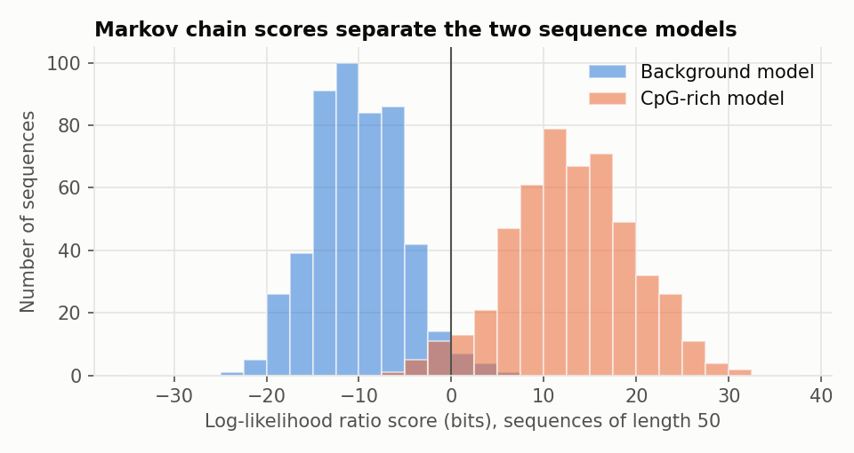
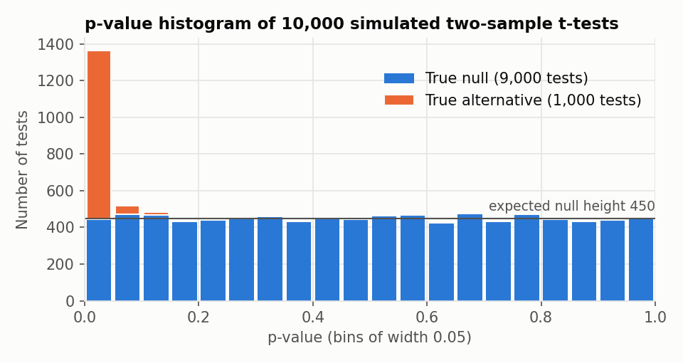
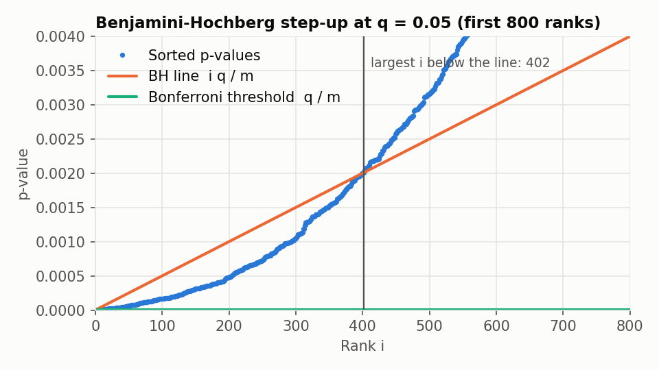
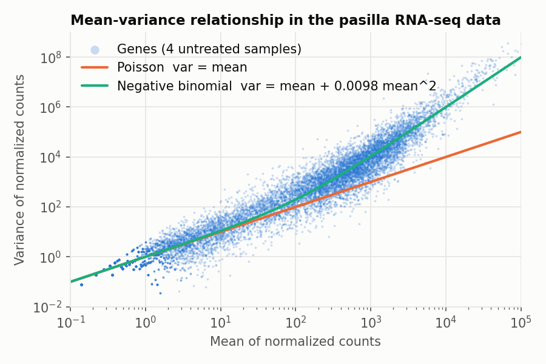
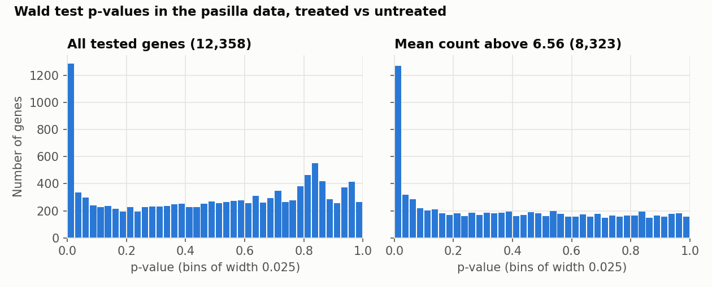

# 9장 — 고처리량 데이터의 통계

[레포지토리 안내](../../README.ko.md) | [English](Concepts_Lecture.md) | [한국어](Concepts_Lecture.ko.md)

> **최종 수정일:** 2026-11-27

> **학습 목표:**
> 1. 개수 데이터를 이항, Poisson, 다항, 음이항 분포의 생성 모형으로 설명하고 최대 가능도로 모수를 추정할 수 있다
> 2. 염기 조성과 CpG 이염기 빈도를 다항 모형과 Markov 연쇄로 분석하고 적합도 검정을 할 수 있다
> 3. 가설 검정의 다섯 단계를 적용하여 이항 검정, t 검정, 순열 검정의 p값을 계산할 수 있다
> 4. 귀무가설 아래 p값의 분포를 설명하고 p값 히스토그램으로 검정 결과를 진단할 수 있다
> 5. FWER와 FDR을 구별하고 Bonferroni 보정과 Benjamini-Hochberg 절차를 손과 R로 계산할 수 있다
> 6. RNA-seq 개수 데이터의 정규화와 과대 산포를 설명하고 차등 발현 분석의 흐름을 설명할 수 있다

---

## 목차

- [1. 고처리량 데이터와 통계](#1-고처리량-데이터와-통계)
  - [1.1 고처리량 데이터의 특징](#11-고처리량-데이터의-특징)
  - [1.2 확률 모형과 통계 모형](#12-확률-모형과-통계-모형)
- [2. 개수 데이터의 생성 모형](#2-개수-데이터의-생성-모형)
  - [2.1 Bernoulli 시행과 이항 분포](#21-bernoulli-시행과-이항-분포)
  - [2.2 Poisson 분포](#22-poisson-분포)
  - [2.3 다항 분포](#23-다항-분포)
  - [2.4 최대 가능도 추정](#24-최대-가능도-추정)
  - [2.5 음이항 분포와 과대 산포](#25-음이항-분포와-과대-산포)
- [3. 염기 빈도와 CpG](#3-염기-빈도와-cpg)
  - [3.1 염기 조성의 적합도 검정](#31-염기-조성의-적합도-검정)
  - [3.2 시뮬레이션으로 만든 귀무 분포](#32-시뮬레이션으로-만든-귀무-분포)
  - [3.3 이염기 빈도와 CpG 관측 대 기대 비](#33-이염기-빈도와-cpg-관측-대-기대-비)
  - [3.4 Markov 연쇄 모형](#34-markov-연쇄-모형)
  - [3.5 로그 가능도 비로 서열 분류하기](#35-로그-가능도-비로-서열-분류하기)
- [4. 오믹스의 가설 검정](#4-오믹스의-가설-검정)
  - [4.1 가설 검정의 다섯 단계](#41-가설-검정의-다섯-단계)
  - [4.2 이항 검정](#42-이항-검정)
  - [4.3 두 표본 t 검정](#43-두-표본-t-검정)
  - [4.4 순열 검정](#44-순열-검정)
  - [4.5 p값의 의미와 흔한 오해](#45-p값의-의미와-흔한-오해)
- [5. p값의 분포](#5-p값의-분포)
  - [5.1 귀무가설 아래의 균등 분포](#51-귀무가설-아래의-균등-분포)
  - [5.2 혼합 분포로서의 p값 히스토그램](#52-혼합-분포로서의-p값-히스토그램)
  - [5.3 귀무가설의 비율 추정](#53-귀무가설의-비율-추정)
  - [5.4 이산 데이터의 p값](#54-이산-데이터의-p값)
- [6. 다중 검정](#6-다중-검정)
  - [6.1 다중 검정 문제](#61-다중-검정-문제)
  - [6.2 판정 결과의 분류](#62-판정-결과의-분류)
  - [6.3 FWER와 Bonferroni 보정](#63-fwer와-bonferroni-보정)
  - [6.4 허위 발견률](#64-허위-발견률)
  - [6.5 Benjamini-Hochberg 절차](#65-benjamini-hochberg-절차)
  - [6.6 시뮬레이션으로 본 세 방법](#66-시뮬레이션으로-본-세-방법)
  - [6.7 FDR 제어의 조건과 해석](#67-fdr-제어의-조건과-해석)
- [7. RNA-seq 개수 데이터](#7-rna-seq-개수-데이터)
  - [7.1 개수 행렬과 라이브러리 크기](#71-개수-행렬과-라이브러리-크기)
  - [7.2 크기 인자와 중앙값 비 정규화](#72-크기-인자와-중앙값-비-정규화)
  - [7.3 평균과 분산의 관계](#73-평균과-분산의-관계)
  - [7.4 분산 안정화 변환](#74-분산-안정화-변환)
  - [7.5 차등 발현 분석의 흐름](#75-차등-발현-분석의-흐름)
- [개념 적용](#개념-적용)
- [요약](#요약)
- [점검 문제](#점검-문제)
- [참고 문헌](#참고-문헌)

---

<br>

## 1. 고처리량 데이터와 통계

### 1.1 고처리량 데이터의 특징

> **용어 정의:** **고처리량 실험(high-throughput experiment)** 은 한 번에 수천에서 수백만 개의 변수를 측정하는 실험이다.

RNA-seq은 모든 유전자의 발현량을, 유전형 분석은 수십만 개의 SNP를, 서열 분석은 수억 개의 리드를 한꺼번에 만든다(7장). 이런 데이터를 분석할 때 통계가 필요한 이유는 세 가지이다.

- **측정값은 개수이다.** 리드의 수, 변이를 지지하는 리드의 수, 특정 염기의 개수처럼 많은 측정값이 음이 아닌 정수이다. 개수는 평균이 커질수록 분산도 커지는 성질이 있어, 정규 분포를 가정하는 방법을 그대로 쓰기 어렵다. 2절의 개수 분포가 이 성질을 다룬다.
- **잡음이 있다.** 같은 조건의 반복 실험끼리도 측정값이 다르다. 관찰한 차이가 실제 효과인지 우연인지를 판정하는 가설 검정(4절)이 필요하다.
- **검정이 매우 많다.** 2만 개의 유전자를 하나씩 검정하면, 실제로는 아무 차이가 없어도 유의 수준 0.05에서 약 1,000개가 우연히 유의하게 나온다. 6절의 다중 검정 보정이 이 문제를 다룬다.

이 문제들은 생물정보학에만 있는 것이 아니다. 뇌 영상의 수십만 개 화소마다 활성을 검정하는 신경과학, 하늘의 수많은 위치에서 신호를 찾는 천문학, 수많은 지표를 동시에 비교하는 온라인 실험처럼 측정 변수가 많은 학제 간 분야에서는 모두 같은 통계 도구를 쓴다. 이 장은 생물학 데이터를 예로 들지만, 개수 모형, p값의 분포, 다중 검정은 그대로 다른 분야에 적용된다.

### 1.2 확률 모형과 통계 모형

이 장의 출발점은 두 종류의 추론을 구별하는 것이다 [1, Ch. 1-2].

> **용어 정의:** **생성 모형(generative model)** 은 데이터가 어떤 확률적 과정으로 만들어지는지를 기술한 모형으로, 모수를 알면 그 모형에서 데이터를 시뮬레이션할 수 있다.

- **확률 모형에 의한 추론:** 모수를 안다고 가정하고 데이터가 어떻게 나올지를 계산한다. 예를 들어 염기 하나의 오류 확률이 0.002일 때 길이 150의 리드에 오류가 2개 이상 있을 확률을 구한다. 연역적인 방향이다.
- **통계 모형에 의한 추론:** 데이터를 관찰하고 그 데이터를 만들었을 모수를 추정하거나, 모수에 관한 가설을 검정한다. 예를 들어 관찰한 리드들의 오류 수에서 오류 확률을 추정한다. 귀납적인 방향이다.

두 방향은 같은 모형을 공유한다. 통계적 추론은 "이 모수라면 이런 데이터가 나올 확률은 얼마인가"라는 확률 계산을 거꾸로 이용하므로, 먼저 데이터의 생성 모형을 정확히 세우는 것이 출발점이다.

| 구분 | 확률 모형 | 통계 모형 |
|:-----|:-----|:-----|
| 알고 있는 것 | 모형과 모수 | 모형의 형태와 데이터 |
| 구하는 것 | 데이터의 분포, 사건의 확률 | 모수의 추정값, 가설의 판정 |
| 추론의 방향 | 모수에서 데이터로 (연역) | 데이터에서 모수로 (귀납) |
| 예 | 오류 확률 0.002에서 오류 수의 분포 | 관찰한 오류 수에서 오류 확률 추정 |

*표 1. 확률 모형과 통계 모형의 비교*

---

<br>

## 2. 개수 데이터의 생성 모형

### 2.1 Bernoulli 시행과 이항 분포

> **용어 정의:** **Bernoulli 시행(Bernoulli trial)** 은 결과가 성공과 실패 두 가지뿐인 시행이다.

> **용어 정의:** **이항 분포(binomial distribution)** 는 성공 확률이 $`p`$인 Bernoulli 시행을 독립적으로 $`n`$번 반복할 때 성공 횟수 $`K`$가 따르는 분포 $`\mathrm{Bin}(n, p)`$이다.

이항 분포 $`\mathrm{Bin}(n, p)`$에서 성공 횟수 $`K`$의 확률과 평균, 분산은 다음과 같다.

```math
P(K = k) = \binom{n}{k} p^k (1-p)^{n-k}, \qquad E[K] = np, \qquad \mathrm{Var}(K) = np(1-p)
```

$`\binom{n}{k}`$는 $`n`$번 중 어느 $`k`$번이 성공인지를 고르는 경우의 수이고, $`p^k (1-p)^{n-k}`$는 그런 특정한 순서 하나가 나올 확률이다. 생물학의 예로, 길이 150 염기의 리드에서 각 염기가 독립적으로 확률 0.002로 잘못 읽힌다면 리드 하나의 오류 수는 $`\mathrm{Bin}(150, 0.002)`$를 따른다. 이형 접합인 위치에서 리드가 두 대립 유전자 중 한쪽에서 올 확률이 0.5라면, 그 위치를 덮는 리드 100개 가운데 한 대립 유전자를 지지하는 리드의 수는 $`\mathrm{Bin}(100, 0.5)`$를 따른다(4.2절).

> **주의:** 이항 분포는 시행들이 독립이고 성공 확률이 모든 시행에서 같다는 두 가정에 의존한다. 리드의 뒤쪽일수록 오류가 많아지는 실제 데이터(7장 8.2절)에서는 두 번째 가정이 깨지므로, 이항 분포는 첫 근사로만 쓸 수 있다.

### 2.2 Poisson 분포

$`n`$이 크고 $`p`$가 작아 기댓값 $`\lambda = np`$가 적당한 크기일 때, 이항 분포는 하나의 모수 $`\lambda`$만 가진 더 단순한 분포로 근사된다 [1, Ch. 1].

> **용어 정의:** **Poisson 분포(Poisson distribution)** 는 드물게 일어나는 사건의 횟수를 나타내는 분포로, 모수가 $`\lambda`$이면 $`P(X = k) = e^{-\lambda} \lambda^k / k!`$이고 평균과 분산이 모두 $`\lambda`$이다.

$`n \to \infty`$, $`p \to 0`$이고 $`np = \lambda`$로 고정하면 $`\binom{n}{k} p^k (1-p)^{n-k} \to e^{-\lambda} \lambda^k / k!`$이다. $`(1 - \lambda/n)^n \to e^{-\lambda}`$이 이 극한의 핵심이다. 리드 오류의 예에서 두 분포를 비교한다.

```r
n <- 150; p <- 0.002; lambda <- n * p
k <- 0:4
round(data.frame(k = k, binomial = dbinom(k, n, p), poisson = dpois(k, lambda)), 5)
1 - pbinom(1, n, p)
1 - ppois(1, lambda)
```

```text
  k binomial poisson
1 0  0.74060 0.74082
2 1  0.22262 0.22225
3 2  0.03324 0.03334
4 3  0.00329 0.00333
5 4  0.00024 0.00025
[1] 0.03678033
[1] 0.03693631
```

- `dbinom(k, n, p)`과 `dpois(k, lambda)`는 각각 이항 분포와 Poisson 분포의 확률 질량 함수이다. $`\lambda = 150 \times 0.002 = 0.3`$이다.
- 두 분포의 확률은 소수 셋째 자리까지 거의 같다. 리드의 74%는 오류가 없고, 22%는 오류가 하나이다.
- `1 - pbinom(1, n, p)`는 오류가 2개 이상일 확률 $`P(K \ge 2)`$이며, 두 분포 모두 약 3.7%이다. 수억 개의 리드에서는 수백만 개의 리드가 오류를 둘 이상 가진다는 뜻이다.

Poisson 분포는 7장 8.4절의 깊이 분포, 유전체에서의 돌연변이 수, 정해진 구간에 떨어지는 리드의 수처럼 "많은 기회 가운데 드물게 일어나는 사건"의 횟수에 두루 쓰인다. 평균과 분산이 같다는 성질은 모형이 맞는지를 확인하는 간단한 기준이 된다(2.5절, 7.3절).

### 2.3 다항 분포

> **용어 정의:** **다항 분포(multinomial distribution)** 는 결과가 $`r`$가지인 시행을 독립적으로 $`n`$번 반복할 때 각 결과의 횟수 $`(K_1, \ldots, K_r)`$가 따르는 분포이다.

결과 $`i`$의 확률이 $`p_i`$($`\sum p_i = 1`$)이면

```math
P(K_1 = k_1, \ldots, K_r = k_r) = \frac{n!}{k_1! \cdots k_r!} p_1^{k_1} \cdots p_r^{k_r}, \qquad \sum_{i} k_i = n
```

이다. 서열의 염기를 서로 독립이고 확률 $`(p_A, p_C, p_G, p_T)`$로 뽑는다고 보면, 길이 $`n`$인 서열의 염기 개수는 다항 분포를 따른다 [1, Ch. 1].

```r
dmultinom(c(A = 4, C = 2, G = 2, T = 2), prob = rep(0.25, 4))
factorial(10) / (factorial(4) * factorial(2)^3) * 0.25^10
dmultinom(c(A = 10, C = 0, G = 0, T = 0), prob = rep(0.25, 4))
```

```text
[1] 0.01802444
[1] 0.01802444
[1] 9.536743e-07
```

- 네 염기가 같은 확률일 때 길이 10의 서열에 A가 4개, 나머지가 2개씩 있을 확률은 약 0.018이다. 둘째 줄은 같은 값을 공식으로 계산한 것이다. 경우의 수 $`10!/(4!\,2!\,2!\,2!) = 18900`$에 특정 서열 하나의 확률 $`0.25^{10}`$을 곱한다.
- 모두 A인 서열의 확률은 $`0.25^{10} \approx 9.5 \times 10^{-7}`$로, 경우의 수가 1뿐이어서 매우 작다.

이 독립 모형은 이웃한 염기 사이의 의존성을 무시한다. 3.3절은 그 의존성이 실제로 있음을 보이고, 3.4절은 Markov 연쇄로 그것을 모형에 넣는다.

### 2.4 최대 가능도 추정

> **용어 정의:** **가능도(likelihood)** 는 데이터 $`y_1, \ldots, y_n`$을 관찰했을 때, 모수 $`\theta`$에서 그 데이터가 나올 확률을 $`\theta`$의 함수로 본 것이다.

관측값들이 서로 독립이면 가능도와 그 로그는 다음과 같다.

```math
L(\theta) = \prod_{i=1}^{n} P(y_i \mid \theta), \qquad \ell(\theta) = \log L(\theta) = \sum_{i=1}^{n} \log P(y_i \mid \theta)
```

> **용어 정의:** **최대 가능도 추정(maximum likelihood estimation, MLE)** 은 가능도를 가장 크게 하는 모수 값을 추정값으로 삼는 방법이다.

곱보다 합이 다루기 쉬우므로 로그 가능도 $`\ell(\theta)`$를 최대화한다. 로그는 증가 함수이므로 최대점은 같다.

**Poisson 분포의 MLE.** $`y_i \sim \mathrm{Pois}(\lambda)`$이면

```math
\ell(\lambda) = \sum_{i=1}^{n} \left( y_i \log \lambda - \lambda - \log y_i! \right), \qquad \frac{d\ell}{d\lambda} = \frac{\sum_i y_i}{\lambda} - n = 0 \;\Rightarrow\; \hat{\lambda} = \bar{y}
```

이다. 이계 도함수 $`-\sum_i y_i / \lambda^2`$가 음수이므로 이 점은 최대점이다. 같은 방법으로 이항 분포에서 $`n`$번 중 $`y`$번 성공을 관찰하면 $`\hat{p} = y/n`$을 얻는다.

> **[미적분학]** 미분 가능한 함수의 극값에서는 도함수가 0이고, 이계 도함수가 음수이면 그 점은 극대이다. 로그 가능도가 엄격하게 오목한(위로 볼록한) 함수이면 도함수가 0인 점은 유일한 최대점이다. Poisson과 이항 분포의 로그 가능도는 관찰값이 모두 0인 경우처럼 최대점이 모수 범위의 경계에 놓이는 경우를 빼면 이 성질을 가진다.

평균이 2.3인 Poisson 분포에서 40개의 값을 뽑고, 로그 가능도를 격자에서 계산하여 공식과 비교한다.

```r
set.seed(2)
y <- rpois(40, lambda = 2.3)
table(y)
mean(y)
loglik <- function(lam) sum(dpois(y, lam, log = TRUE))
grid <- seq(1.5, 3.5, by = 0.01)
ll <- sapply(grid, loglik)
grid[which.max(ll)]
optimize(loglik, c(0.1, 10), maximum = TRUE)$maximum
```

```text
y
 0  1  2  3  4  5  6 
 2 12 11  5  6  3  1 
[1] 2.35
[1] 2.35
[1] 2.350014
```

- `dpois(y, lam, log = TRUE)`는 각 관찰값의 로그 확률이고, 그 합이 로그 가능도 $`\ell(\lambda)`$이다.
- 0.01 간격의 격자에서 로그 가능도가 가장 큰 값은 2.35이고, 수치 최적화 함수 `optimize()`도 2.350을 찾는다. 둘 다 표본 평균 $`\bar{y} = 94/40 = 2.35`$와 같다.
- 추정값 2.35는 참값 2.3과 다르다. 표본이 40개이면 $`\hat{\lambda}`$의 표준오차는 약 $`\sqrt{2.3/40} \approx 0.24`$이므로, 이 정도의 차이는 우연한 변동이다.

### 2.5 음이항 분포와 과대 산포

> **용어 정의:** **과대 산포(overdispersion)** 는 개수 데이터의 분산이 Poisson 모형이 예측하는 값, 곧 평균보다 큰 현상이다.

실제 개수 데이터에서는 과대 산포가 흔하다. 대표적인 원인은 개수를 만드는 비율 $`\lambda`$ 자체가 표본마다 다르다는 것이다. RNA-seq에서는 같은 조건의 반복 표본이라도 세포의 상태가 조금씩 달라 유전자의 실제 발현량이 다르고, 그 위에 리드를 뽑는 과정의 Poisson 변동이 더해진다.

이 2단계 과정을 그대로 모형으로 만들면 **감마-Poisson 혼합**이 된다.


*그림 1. 감마-Poisson 혼합으로 본 음이항 분포*

> **용어 정의:** **음이항 분포(negative binomial distribution)** 는 평균 $`\mu`$와 모수 $`\alpha`$를 가지며 분산이 $`\mu + \alpha \mu^2`$인 개수 분포로, 비율이 감마 분포를 따르는 Poisson 분포의 혼합과 같다.

> **용어 정의:** **산포 모수(dispersion parameter)** 는 음이항 분포의 분산 $`\mu + \alpha \mu^2`$에서 Poisson 분산 $`\mu`$를 넘는 과대 산포의 크기를 정하는 모수 $`\alpha`$로, $`\alpha \to 0`$이면 음이항 분포는 Poisson 분포로 돌아간다.

분산은 전체 분산의 법칙으로 구한다. $`\lambda`$의 평균이 $`\mu`$, 분산이 $`\mu^2/r`$이면

```math
\mathrm{Var}(X) = E[\mathrm{Var}(X \mid \lambda)] + \mathrm{Var}(E[X \mid \lambda]) = E[\lambda] + \mathrm{Var}(\lambda) = \mu + \frac{\mu^2}{r}
```

이므로 $`\alpha = 1/r`$이다. 첫째 항 $`\mu`$는 Poisson 변동, 둘째 항 $`\alpha \mu^2`$는 비율의 변동에서 온다. $`\alpha \to 0`$이면 Poisson 분포로 돌아간다. 평균이 작을 때는 첫째 항이, 클 때는 둘째 항이 분산을 지배한다는 점이 중요하다(7.3절).

```r
set.seed(3)
mu <- 50; r <- 5
x_pois <- rpois(1e5, mu)
x_nb <- rnbinom(1e5, mu = mu, size = r)
lam <- rgamma(1e5, shape = r, rate = r / mu)
x_mix <- rpois(1e5, lam)
rbind(poisson = c(mean = mean(x_pois), var = var(x_pois)),
      negbin = c(mean = mean(x_nb), var = var(x_nb)),
      gamma_poisson = c(mean = mean(x_mix), var = var(x_mix)))
mu + mu^2 / r
```

```text
                  mean       var
poisson       50.00128  50.08172
negbin        50.05104 545.77191
gamma_poisson 49.97232 554.78768
[1] 550
```

- `rnbinom(mu = mu, size = r)`는 평균 $`\mu`$, 크기 모수 $`r`$의 음이항 분포에서 뽑는다. R의 `size`가 위의 $`r`$이고, 산포 모수는 $`\alpha = 1/r = 0.2`$이다.
- `rgamma(shape = r, rate = r / mu)`는 평균 $`r / (r/\mu) = \mu`$, 분산 $`r / (r/\mu)^2 = \mu^2 / r`$인 감마 분포에서 비율을 뽑고, `rpois(1e5, lam)`은 각 비율로 개수를 하나씩 뽑는다.
- 세 경우 모두 평균은 약 50이지만, Poisson의 분산은 약 50이고 음이항과 감마-Poisson 혼합의 분산은 이론값 $`50 + 50^2/5 = 550`$ 근처이다. 두 방법으로 뽑은 표본의 평균과 분산이 같다는 것은 음이항 분포가 감마-Poisson 혼합과 같다는 사실을 수치로 보여 준다.

| 분포 | 모수 | 평균 | 분산 | 대표적인 용도 |
|:-----|:-----|:-----|:-----|:-----|
| 이항 | $`n, p`$ | $`np`$ | $`np(1-p)`$ | 정해진 시행 수 중 성공 수, 대립 유전자 리드 수 |
| Poisson | $`\lambda`$ | $`\lambda`$ | $`\lambda`$ | 드문 사건의 수, 깊이, 기술적 반복의 리드 수 |
| 다항 | $`n, p_1, \ldots, p_r`$ | $`n p_i`$ | $`n p_i (1 - p_i)`$ | 염기 조성, 범주별 개수 |
| 음이항 | $`\mu, \alpha`$ | $`\mu`$ | $`\mu + \alpha \mu^2`$ | 생물학적 반복의 RNA-seq 리드 수 |

*표 2. 개수 데이터의 주요 분포*

> **[확률및통계]** 전체 분산의 법칙 $`\mathrm{Var}(X) = E[\mathrm{Var}(X \mid Y)] + \mathrm{Var}(E[X \mid Y])`$는 분산을 조건부 분산의 평균과 조건부 평균의 분산으로 나눈다. 확률 변수의 모수가 다시 확률 변수인 계층 모형에서 주변 분포의 분산을 구할 때 쓰며, 음이항 분포의 분산이 Poisson보다 큰 이유를 바로 설명한다.

---

<br>

## 3. 염기 빈도와 CpG

### 3.1 염기 조성의 적합도 검정

2.3절의 다항 모형으로 실제 서열의 염기 조성을 검정한다. 귀무가설은 "네 염기의 확률이 모두 1/4이다"이다. 관측 개수 $`O_i`$와 귀무가설 아래의 기대 개수 $`E_i = n p_i`$의 차이를 모은 **카이제곱 통계량**은

```math
X^2 = \sum_{i=1}^{r} \frac{(O_i - E_i)^2}{E_i}
```

이고, 귀무가설이 참이고 기대 개수가 충분히 크면 자유도 $`r - 1`$인 카이제곱 분포를 근사적으로 따른다. 확률을 모두 미리 정했으므로 자유도는 범주 수에서 합이 $`n`$이라는 제약 하나를 뺀 $`4 - 1 = 3`$이다.

> **용어 정의:** **귀무가설(null hypothesis)** 은 가설 검정에서 관심 있는 효과나 차이가 없다고 두는 가설로, 검정 통계량의 분포를 계산하는 기준이 된다.

> **용어 정의:** **적합도 검정(goodness-of-fit test)** 은 범주마다 관측한 빈도가 확률 모형이 예측하는 기대 빈도와 맞는지를 판정하는 검정으로, 귀무가설은 데이터가 그 모형을 따른다는 것이다.

먼저 효모 1번 염색체 전체에 적용한다.

```r
suppressPackageStartupMessages(library(Biostrings))
data(yeastSEQCHR1)
chr1 <- DNAString(yeastSEQCHR1)
obs <- letterFrequency(chr1, c("A", "C", "G", "T"))
obs
N <- sum(obs)
expct <- N * rep(0.25, 4)
stat <- sum((obs - expct)^2 / expct)
stat
pchisq(stat, df = 3, lower.tail = FALSE)
chisq.test(obs, p = rep(0.25, 4))
```

```text
    A     C     G     T 
69830 44643 45765 69970 
[1] 10608.35
[1] 0

	Chi-squared test for given probabilities

data:  obs
X-squared = 10608, df = 3, p-value < 2.2e-16
```

- `yeastSEQCHR1`은 Biostrings에 들어 있는 효모 1번 염색체 서열(230,208 염기)이다.
- 통계량은 10,608로 매우 크고, p값은 컴퓨터의 수 표현 범위보다 작아 0으로 나온다. GC 함량이 $`(44643 + 45765)/230208 \approx 0.393`$으로 0.5에서 크게 벗어나기 때문이다.
- A와 T(69,830과 69,970), C와 G(44,643과 45,765)는 한 가닥 안에서도 거의 같다. 7장 3.3절에서 말한, 긴 유전체의 한 가닥에서도 A = T, G = C가 대략 성립하는 경향이 이것이다.

> **주의:** 표본이 매우 크면 매우 작은 차이도 통계적으로 유의해진다. 23만 염기의 서열에서 p값이 0이라는 것은 "조성이 정확히 1/4씩은 아니다"라는 사실을 확실히 알려 줄 뿐, 차이가 생물학적으로 얼마나 중요한지는 말해 주지 않는다. 효과의 크기(여기서는 GC 함량 0.393)를 p값과 함께 보고해야 한다.

다음으로 같은 염색체의 14,001번부터 200 염기의 짧은 구간을 검정한다.

```r
suppressPackageStartupMessages(library(Biostrings))
data(yeastSEQCHR1)
w <- subseq(DNAString(yeastSEQCHR1), start = 14001, width = 200)
obs <- letterFrequency(w, c("A", "C", "G", "T"))
obs
expct <- rep(50, 4)
stat <- sum((obs - expct)^2 / expct)
stat
pchisq(stat, df = 3, lower.tail = FALSE)
set.seed(1)
sim <- rmultinom(10000, size = 200, prob = rep(0.25, 4))
sim_stat <- colSums((sim - 50)^2 / 50)
mean(sim_stat >= stat)
```

```text
 A  C  G  T 
59 35 46 60 
[1] 8.44
[1] 0.03774185
[1] 0.0356
```

손으로 계산하면 $`X^2 = [(59-50)^2 + (35-50)^2 + (46-50)^2 + (60-50)^2]/50 = (81 + 225 + 16 + 100)/50 = 8.44`$이고, 자유도 3인 카이제곱 분포에서 8.44 이상이 나올 확률이 p값 0.0377이다.

### 3.2 시뮬레이션으로 만든 귀무 분포

카이제곱 분포는 근사이므로, 귀무 분포를 직접 시뮬레이션하여 확인할 수 있다 [1, Ch. 2]. 위 코드의 마지막 세 줄이 그 계산이다.

- `rmultinom(10000, size = 200, prob = rep(0.25, 4))`는 귀무가설의 다항 분포에서 길이 200인 서열의 염기 개수를 10,000번 뽑는다. 결과는 4행 10,000열의 행렬이다.
- `colSums((sim - 50)^2 / 50)`는 열마다, 즉 시뮬레이션한 서열마다 같은 통계량을 계산한다.
- 시뮬레이션한 통계량 가운데 관측값 8.44 이상인 비율 0.0356이 시뮬레이션 p값이다. 카이제곱 근사 0.0377과 가깝다.

> **용어 정의:** **귀무 분포(null distribution)** 는 귀무가설이 참일 때 검정 통계량이 따르는 분포이다.

시뮬레이션 방법은 근사 분포가 알려지지 않은 통계량에도 그대로 쓸 수 있다는 장점이 있다. 귀무가설 아래에서 데이터를 만들 수 있는 생성 모형만 있으면, 어떤 통계량이든 그 귀무 분포를 얻을 수 있다. 이것이 1.2절에서 생성 모형을 먼저 세우는 이유이다.

### 3.3 이염기 빈도와 CpG 관측 대 기대 비

2.3절의 독립 모형이 맞다면 이웃한 두 염기 $`xy`$가 나타날 확률은 $`p_x p_y`$이다. 이 기대와 실제 빈도를 비교하면 이웃한 염기 사이의 의존성을 볼 수 있다. 특히 5' 쪽의 C와 3' 쪽의 G가 이어진 이염기를 **CpG**라 한다(p는 둘 사이의 인산 결합을 뜻하며, 두 가닥에서 마주 보는 C-G 염기쌍과 구별하기 위한 표기이다).

> **용어 정의:** **CpG 관측 대 기대 비(CpG observed-to-expected ratio)** 는 서열에서 CpG 이염기의 빈도를 C와 G의 빈도의 곱으로 나눈 값으로, 독립 모형에서 기대되는 양에 비해 CpG가 얼마나 많거나 적은지를 나타낸다.

```math
\mathrm{O/E}(\mathrm{CpG}) = \frac{n_{CG} / (N - 1)}{(n_C / N)(n_G / N)}
```

$`N`$은 서열 길이, $`n_{CG}`$는 겹치는 이염기 $`N - 1`$개 가운데 CG의 개수이다. 이 값이 1이면 C 다음에 G가 오는 빈도가 독립 모형의 기대와 같다. 척추동물의 유전체 전체에서는 CpG가 기대보다 훨씬 적다. 널리 받아들여지는 설명은 CpG의 사이토신이 메틸화되기 쉽고, 메틸화된 사이토신은 탈아미노화되어 티민으로 바뀌는 돌연변이가 잦아 진화 과정에서 CpG가 줄었다는 것이다. 유전자의 프로모터 근처에는 이 감소를 피한 구간이 있다.

> **용어 정의:** **CpG 섬(CpG island)** 은 유전자의 프로모터 근처처럼 메틸화되지 않아 CpG 이염기가 기대만큼 남아 있는 유전체 구간이다.

Bioconductor 패키지에 들어 있는 서열 네 가지에서 이 비를 계산한다.

```r
suppressPackageStartupMessages(library(Biostrings))
cpg_oe <- function(x) {
  f1 <- letterFrequency(x, c("C", "G"))
  f2 <- dinucleotideFrequency(x)
  N <- length(x)
  (f2["CG"] / (N - 1)) / ((f1["C"] / N) * (f1["G"] / N))
}
data(yeastSEQCHR1); data(phiX174Phage, package = "pwalign")
msa <- readDNAMultipleAlignment(system.file("extdata", "msx2_mRNA.aln", package = "Biostrings"), format = "clustal")
human_msx2 <- DNAString(gsub("-", "", as.character(DNAStringSet(msa)[[1]])))
fly <- readDNAStringSet(system.file("extdata", "dm3_upstream2000.fa.gz", package = "Biostrings"))
fly <- unlist(fly[1:200])
seqs <- list(yeast_chrI = DNAString(yeastSEQCHR1), phiX174 = phiX174Phage[[1]],
             human_MSX2_mRNA = human_msx2, fly_upstream = fly)
t(sapply(seqs, function(x) c(length = length(x),
                             CG = unname(dinucleotideFrequency(x)["CG"]),
                             GC = unname(dinucleotideFrequency(x)["GC"]),
                             oe_CG = round(unname(cpg_oe(x)), 3))))
```

```text
                length    CG    GC oe_CG
yeast_chrI      230208  7089  8910 0.799
phiX174           5386   267   347 0.991
human_MSX2_mRNA   2224    79   137 0.653
fly_upstream    400000 16297 21641 0.987
```

- `dinucleotideFrequency()`는 16가지 이염기의 개수를 센다. 위의 공식을 그대로 옮긴 `cpg_oe()`가 비를 계산한다.
- `human_MSX2_mRNA`는 8장 9.4절의 다중 정렬 파일에서 사람 MSX2 mRNA(NM_002449.4) [2]의 갭을 지운 서열이고, `fly_upstream`은 초파리 RefSeq 전사체 200개의 상류 2,000 염기씩을 이어 붙인 40만 염기이다. 같은 상류 구간을 공유하는 전사체가 있어 서로 다른 구간은 100개이며, 중복을 없애고 계산해도 비는 0.970으로 거의 같다.
- 네 서열 모두 CG가 GC보다 적다. 두 이염기는 C와 G의 빈도가 같으므로 독립 모형에서는 기대 개수가 같지만, 실제로는 CG 쪽이 적다.
- phiX174와 초파리 상류 서열의 비는 거의 1이고, 효모 염색체는 0.80, 사람의 MSX2 mRNA는 0.65이다. 사람 전사체 하나는 유전체 전체를 대표하지 않으며, 이 값만으로 0.65가 1과 의미 있게 다른지는 판단할 수 없다. 서열 길이와 염기 조성을 고려한 귀무 분포(3.2절처럼 시뮬레이션으로 만든 것)와 비교해야 한다.

### 3.4 Markov 연쇄 모형

이웃한 염기의 의존성을 모형에 넣는 가장 단순한 방법은 각 염기가 바로 앞의 염기에만 의존한다고 보는 것이다 [1, Ch. 2].

> **용어 정의:** **1차 Markov 연쇄(first-order Markov chain)** 는 다음 상태의 확률이 바로 앞의 상태에만 의존하고 그보다 앞의 상태와는 무관한 확률 과정이다.

> **용어 정의:** **전이 행렬(transition matrix)** 은 Markov 연쇄에서 앞 상태 $`s`$에서 다음 상태 $`t`$로 갈 확률 $`a_{st} = P(x_i = t \mid x_{i-1} = s)`$를 모은 행렬로, 각 행의 합은 1이다.

DNA 서열에서 상태는 네 염기이고, 모형은 4 × 4 전이 행렬로 정해진다. 서열 전체의 확률은

```math
P(x_1, \ldots, x_N) = P(x_1) \prod_{i=2}^{N} a_{x_{i-1} x_i}
```

이다. 전이 확률의 최대 가능도 추정값은 이염기의 개수를 행마다 정규화한 $`\hat{a}_{st} = n_{st} / \sum_{t'} n_{st'}`$이다. 2.4절의 이항 분포 MLE가 성공 비율인 것과 같은 원리이다.

CpG가 적은 배경 서열과 CpG가 많은 서열을 각각 전이 행렬로 정의하고, 두 모형에서 서열을 시뮬레이션한 뒤 다시 전이 행렬을 추정한다.

```r
b <- c("A", "C", "G", "T")
P_bg <- matrix(c(0.30, 0.20, 0.25, 0.25,
                 0.35, 0.30, 0.05, 0.30,
                 0.25, 0.25, 0.25, 0.25,
                 0.20, 0.25, 0.25, 0.30), 4, byrow = TRUE, dimnames = list(b, b))
P_isl <- matrix(c(0.15, 0.35, 0.35, 0.15,
                  0.15, 0.30, 0.30, 0.25,
                  0.15, 0.35, 0.35, 0.15,
                  0.10, 0.35, 0.35, 0.20), 4, byrow = TRUE, dimnames = list(b, b))
sim_chain <- function(n, P) {
  s <- character(n)
  s[1] <- sample(b, 1)
  for (i in 2:n) s[i] <- sample(b, 1, prob = P[s[i - 1], ])
  s
}
est_trans <- function(s) {
  counts <- table(from = factor(head(s, -1), levels = b),
                  to = factor(tail(s, -1), levels = b))
  counts / rowSums(counts)
}
set.seed(42)
bg_train <- sim_chain(20000, P_bg)
isl_train <- sim_chain(20000, P_isl)
Q_bg <- est_trans(bg_train); Q_isl <- est_trans(isl_train)
round(Q_bg, 3)
round(Q_isl, 3)
oe <- function(s) {
  N <- length(s)
  cg <- sum(head(s, -1) == "C" & tail(s, -1) == "G") / (N - 1)
  cg / (mean(s == "C") * mean(s == "G"))
}
c(background = oe(bg_train), island = oe(isl_train))
```

```text
    to
from     A     C     G     T
   A 0.304 0.204 0.250 0.241
   C 0.352 0.302 0.051 0.295
   G 0.246 0.253 0.241 0.260
   T 0.192 0.261 0.244 0.303
    to
from     A     C     G     T
   A 0.154 0.361 0.337 0.148
   C 0.148 0.296 0.311 0.246
   G 0.158 0.344 0.348 0.151
   T 0.106 0.347 0.346 0.201
background     island 
 0.2618363  0.9319306 
```

- `P_bg`의 둘째 행은 C 다음에 G가 올 확률을 0.05로 작게 두어 CpG가 적은 서열을 만든다. `P_isl`은 C와 G로 가는 확률을 모든 행에서 크게 두어 GC와 CpG가 많은 서열을 만든다.
- `sim_chain()`은 첫 염기를 무작위로 고른 뒤, 앞 염기에 해당하는 행의 확률로 다음 염기를 뽑는다. Markov 연쇄의 정의를 그대로 옮긴 것이다.
- `est_trans()`는 `head(s, -1)`(앞 염기)과 `tail(s, -1)`(뒤 염기)의 교차표로 이염기 개수 $`n_{st}`$를 세고, `rowSums()`로 나누어 행마다 정규화한다. 길이 20,000의 서열에서 추정한 행렬은 참 행렬과 소수 둘째 자리까지 거의 같다.
- 배경 모형 서열의 CpG 관측 대 기대 비는 0.26으로, C와 G가 흔해도 C 다음의 G만 드물게 만든 의존성이 3.3절의 비로 그대로 드러난다.

### 3.5 로그 가능도 비로 서열 분류하기

> **용어 정의:** **로그 가능도 비(log-likelihood ratio)** 는 같은 데이터에 대한 두 모형의 가능도의 비에 로그를 취한 값으로, 양수이면 분자 쪽 모형이 데이터를 더 잘 설명한다.

두 모형이 있으면, 새 서열이 어느 모형에서 나왔을 가능성이 더 큰지를 로그 가능도 비로 판정할 수 있다. 첫 염기의 항을 무시하면

```math
S(x) = \log_2 \frac{P(x \mid M^{+})}{P(x \mid M^{-})} = \sum_{i=2}^{N} \log_2 \frac{a^{+}_{x_{i-1} x_i}}{a^{-}_{x_{i-1} x_i}}
```

이고, $`S(x) > 0`$이면 CpG가 많은 모형 쪽으로 분류한다. 여기서 $`M^{+}`$는 CpG가 많은 모형, $`M^{-}`$는 배경 모형이고, $`a^{+}`$와 $`a^{-}`$는 각 모형의 전이 확률이다. 8장 7.1절의 로그 오즈 점수와 같은 구조로, 이염기마다의 점수 $`\log_2(a^{+}_{st} / a^{-}_{st})`$를 더한다.

```r
B <- log2(unclass(Q_isl) / unclass(Q_bg))
round(B, 2)
llr <- function(s) sum(B[cbind(head(s, -1), tail(s, -1))])
test_bg <- replicate(500, llr(sim_chain(50, P_bg)))
test_isl <- replicate(500, llr(sim_chain(50, P_isl)))
c(mean_bg = mean(test_bg), mean_isl = mean(test_isl))
c(bg_correct = mean(test_bg < 0), isl_correct = mean(test_isl > 0))
```

```text
    to
from     A     C    G     T
   A -0.98  0.82 0.43 -0.70
   C -1.25 -0.03 2.60 -0.26
   G -0.64  0.44 0.53 -0.78
   T -0.86  0.41 0.51 -0.59
  mean_bg  mean_isl 
-10.11039  13.08263 
 bg_correct isl_correct 
      0.976       0.966 
```

- 점수 행렬 `B`에서 가장 큰 값은 CG 이염기의 2.60비트이다. 서열에 CG가 하나 나타날 때마다 CpG가 많은 모형 쪽 증거가 2.6비트씩 쌓인다.
- `B[cbind(앞 염기, 뒤 염기)]`는 문자 행렬로 행렬 원소를 한꺼번에 꺼내는 R의 색인 방법이다. 서열의 모든 이염기 점수를 한 줄로 더한다.
- 두 모형에서 길이 50인 서열을 500개씩 만들어 점수를 매기면, 배경 서열의 97.6%가 음수, CpG가 많은 서열의 96.6%가 양수로 바르게 분류된다.



*그림 2. 두 Markov 연쇄 모형에서 만든 서열의 로그 가능도 비 점수*

그림 2의 두 분포는 대부분 분리되지만 0 근처에서 겹친다. 서열이 짧을수록 더해지는 이염기가 적어 두 분포가 더 많이 겹치고, 길수록 잘 분리된다. 실제 유전체에서 CpG 섬을 찾을 때는 이 점수를 일정한 길이의 창마다 계산하거나, 두 모형 사이를 오가는 숨은 상태를 함께 추정하는 모형을 쓴다.

---

<br>

## 4. 오믹스의 가설 검정

### 4.1 가설 검정의 다섯 단계

6장 8.1절은 검정의 판정이 혼동 행렬의 네 칸 가운데 하나가 된다는 것과 제1종 오류, 제2종 오류, 검정력을 다루었다. 이 절은 검정 하나를 실제로 수행하는 절차를 정리한다. 가설 검정은 다음 다섯 단계로 이루어진다 [1, Ch. 6].

1. **관심 있는 효과와 검정 통계량을 정한다.** 예: 두 조건의 평균 발현량의 차이, 한 대립 유전자를 지지하는 리드의 수.
2. **귀무가설을 세우고, 그 아래에서 검정 통계량의 분포(귀무 분포)를 구한다.** 귀무가설은 귀무 분포를 계산할 수 있을 만큼 구체적이어야 한다.
3. **기각역을 정한다.**
4. **데이터를 모으고 검정 통계량을 계산한다.**
5. **통계량이 기각역에 들어가면 귀무가설을 기각한다.**

> **용어 정의:** **기각역(rejection region)** 은 귀무가설 아래에서 확률이 유의 수준 $`\alpha`$ 이하가 되도록 정한, 효과의 방향으로 극단적인 검정 통계량 값들의 영역으로, 통계량이 이 영역에 들어가면 귀무가설을 기각한다.

> **용어 정의:** **p값(p-value)** 은 귀무가설이 참일 때, 관찰한 검정 통계량만큼 또는 그보다 더 극단적인 값이 나올 확률이다.

p값이 $`\alpha`$ 이하이면 통계량이 기각역에 들어간 것과 같다. 1\~3단계는 데이터를 보기 전에 정해야 한다. 데이터를 본 뒤 결과가 유의하게 나오도록 통계량이나 기각역을 바꾸면 귀무 분포의 계산이 더 이상 맞지 않는다(4.5절).

### 4.2 이항 검정

이형 접합인 SNP 위치에서 두 대립 유전자가 같은 양으로 발현된다면, 그 위치를 덮는 RNA-seq 리드는 각 대립 유전자에서 확률 0.5로 온다. 리드 100개 가운데 62개가 대립 유전자 A를 지지할 때, 두 대립 유전자의 발현이 같다는 귀무가설 $`H_0: p = 0.5`$를 검정한다. 검정 통계량은 A 리드의 수 $`K`$이고, 귀무 분포는 $`\mathrm{Bin}(100, 0.5)`$이다.

```r
k <- 62; n <- 100
pbinom(k - 1, n, 0.5, lower.tail = FALSE)
pbinom(n - k, n, 0.5)
2 * pbinom(k - 1, n, 0.5, lower.tail = FALSE)
binom.test(k, n, p = 0.5)$p.value
```

```text
[1] 0.01048937
[1] 0.01048937
[1] 0.02097874
[1] 0.02097874
```

- `pbinom(k - 1, n, 0.5, lower.tail = FALSE)`는 $`P(K > 61) = P(K \ge 62)`$이다. `lower.tail = FALSE`가 위쪽 꼬리를 뜻하며, 62를 포함하려면 61을 넣어야 한다.
- 둘째 줄의 $`P(K \le 38)`$이 첫째 줄과 같은 것은 $`p = 0.5`$일 때 이항 분포가 50을 중심으로 대칭이기 때문이다.
- 어느 쪽 대립 유전자가 더 많을지 미리 정하지 않았으므로 양쪽 꼬리를 더한 양측 p값 0.021을 쓴다. `binom.test()`도 같은 값을 준다. $`\alpha = 0.05`$에서 귀무가설을 기각한다.

### 4.3 두 표본 t 검정

한 유전자의 발현량(로그 척도)을 대조군과 처리군에서 네 번씩 측정하였다. 두 집단의 평균이 같다는 귀무가설을 검정한다. 두 집단의 분산이 같다고 가정한 **두 표본 t 통계량**은

```math
t = \frac{\bar{x}_1 - \bar{x}_2}{\sqrt{s^2 \left( \frac{1}{n_1} + \frac{1}{n_2} \right)}}, \qquad s^2 = \frac{\sum (x_{1i} - \bar{x}_1)^2 + \sum (x_{2i} - \bar{x}_2)^2}{n_1 + n_2 - 2}
```

이다. $`s^2`$는 두 집단을 합한 분산의 추정값(합동 분산)이고, 귀무가설 아래에서 데이터가 정규 분포를 따르면 $`t`$는 자유도 $`n_1 + n_2 - 2`$인 t 분포를 따른다 [1, Ch. 6].

```r
ctrl <- c(5.1, 4.8, 5.6, 5.0)
trt  <- c(6.0, 5.7, 6.4, 5.5)
m1 <- mean(trt); m2 <- mean(ctrl)
s2 <- (sum((trt - m1)^2) + sum((ctrl - m2)^2)) / (4 + 4 - 2)
t_stat <- (m1 - m2) / sqrt(s2 * (1/4 + 1/4))
c(diff = m1 - m2, s2 = s2, t = t_stat)
2 * pt(abs(t_stat), df = 6, lower.tail = FALSE)
t.test(trt, ctrl, var.equal = TRUE)$p.value
```

```text
     diff        s2         t 
0.7750000 0.1345833 2.9875904 
[1] 0.02439605
[1] 0.02439605
```

손으로 계산하면 처리군의 평균은 5.9, 대조군은 5.125이고 차이는 0.775이다. 편차 제곱합은 처리군이 $`0.1^2 + 0.2^2 + 0.5^2 + 0.4^2 = 0.46`$, 대조군이 $`0.025^2 + 0.325^2 + 0.475^2 + 0.125^2 = 0.3475`$이므로 $`s^2 = 0.8075/6 \approx 0.1346`$이다. $`t = 0.775 / \sqrt{0.1346 \times 0.5} \approx 2.99`$이고, 자유도 6인 t 분포의 양측 p값이 0.0244이다. `t.test(..., var.equal = TRUE)`가 같은 값을 준다.

### 4.4 순열 검정

> **용어 정의:** **순열 검정(permutation test)** 은 귀무가설 아래에서 집단 표시가 데이터와 무관하다는 점을 이용해, 집단 표시를 다시 배치한 여러 경우의 검정 통계량으로 분포 가정 없이 귀무 분포를 만드는 검정이다.

t 검정은 데이터가 정규 분포를 따른다는 가정에 의존한다. 표본이 네 개씩뿐이면 이 가정을 확인하기 어렵다. 귀무가설이 참이면 집단 표시는 데이터와 무관하므로, 여덟 값에 집단 표시를 다시 나누어 붙인 모든 경우가 똑같이 그럴듯하다.

```r
x <- c(trt, ctrl)
idx <- combn(8, 4)
perm_diff <- apply(idx, 2, function(i) mean(x[i]) - mean(x[-i]))
length(perm_diff)
mean(abs(perm_diff) >= abs(m1 - m2) - 1e-12)
```

```text
[1] 70
[1] 0.05714286
```

- `combn(8, 4)`는 여덟 값 가운데 처리군이 될 네 개를 고르는 $`\binom{8}{4} = 70`$가지 경우를 모두 열로 나열한다.
- 각 경우의 평균 차이가 순열 귀무 분포이다. 실제 차이 0.775보다 절댓값이 크거나 같은 경우의 비율이 p값이다. `- 1e-12`는 같은 값을 부동소수점 오차 때문에 놓치지 않도록 하는 여유이다.
- p값은 70가지 중 4가지인 0.057이다. 실제 배치보다 차이가 큰 배치(처리군이 6.4, 6.0, 5.7, 5.6인 경우)가 하나 더 있고, 각 배치와 두 집단을 맞바꾼 배치는 차이의 절댓값이 같기 때문이다. 실제 배치와 그 맞바꿈은 항상 포함되므로, 네 개씩 여덟 개인 이 설계에서 순열 검정이 낼 수 있는 가장 작은 p값은 $`2/70 \approx 0.029`$이다.

두 검정의 결과(0.024와 0.057)가 다른 이유는 가정의 차이이다. t 검정은 정규 분포라는 가정을 이용해 더 작은 p값을 얻고, 순열 검정은 가정을 쓰지 않는 대신 표본이 적으면 작은 p값을 낼 수 없다. 표본이 몇 개뿐인 오믹스 실험에서는 순열 검정만으로는 6절의 엄격한 다중 검정 기준을 통과할 수 없으며, 많은 유전자의 정보를 함께 써서 분산을 안정적으로 추정하는 모형 기반 방법(7.5절)이 쓰이는 이유이다.

### 4.5 p값의 의미와 흔한 오해

p값은 $`P(\text{이만큼 극단적인 데이터} \mid H_0)`$이다. 다음은 p값이 뜻하지 않는 것들이다.

- **귀무가설이 참일 확률이 아니다.** $`P(H_0 \mid \text{데이터})`$를 구하려면 귀무가설이 참일 사전 확률이 필요하다. p = 0.03은 "귀무가설이 참일 확률이 3%"라는 뜻이 아니다.
- **효과의 크기가 아니다.** 3.1절처럼 표본이 크면 작은 효과도 매우 작은 p값을 낸다.
- **유의하지 않다는 것이 효과가 없다는 증거는 아니다.** 4.4절처럼 검정력이 낮으면 실제 효과가 있어도 p값이 클 수 있다.

> **주의:** 데이터를 본 뒤 여러 검정 통계량, 여러 변수 변환, 여러 이상치 제거 기준을 시도하고 가장 작은 p값만 보고하는 것을 **p값 해킹(p-value hacking)** 이라 한다. 시도한 횟수만큼 검정을 한 것이므로, 6절의 다중 검정 문제가 보고서 밖에 숨어 있는 것과 같다 [1, Ch. 6].

---

<br>

## 5. p값의 분포

### 5.1 귀무가설 아래의 균등 분포

연속형 검정 통계량 $`T`$의 귀무 분포의 누적 분포 함수를 $`F_0`$라 하고, 큰 값이 극단적인 단측 검정을 생각한다. 관찰한 통계량이 $`T`$일 때 p값은 $`p = 1 - F_0(T)`$이다. 귀무가설이 참이면 $`T`$가 $`F_0`$를 따르므로, $`0 \le u \le 1`$인 $`u`$에 대해

```math
P(p \le u) = P(1 - F_0(T) \le u) = P(F_0(T) \ge 1 - u) = 1 - (1 - u) = u
```

이다. 즉 **귀무가설이 참이면 p값은 0과 1 사이의 균등 분포를 따른다.** 마지막 등호는 연속형 확률 변수 $`T`$에 대해 $`F_0(T)`$가 균등 분포를 따른다는 사실(확률 적분 변환)에서 나온다. 이 성질 덕분에 "귀무가설이 참일 때 p값이 0.05 이하일 확률은 정확히 0.05"이고, 유의 수준이 제1종 오류의 확률이 된다.

### 5.2 혼합 분포로서의 p값 히스토그램

수천 개의 검정을 한꺼번에 하면 p값의 히스토그램을 그릴 수 있다. 검정 가운데 귀무가설이 참인 것의 비율을 $`\pi_0`$라 하면, p값의 밀도는 두 성분의 혼합이다 [1, Ch. 6].

```math
f(p) = \pi_0 \cdot 1 + (1 - \pi_0) f_{\mathrm{alt}}(p)
```

첫째 성분은 귀무가설이 참인 검정의 균등 분포이고, 둘째 성분은 대립가설이 참인 검정의 분포로 0 근처에 몰려 있다. 이것을 **두 집단 모형(two-groups model)** 이라 한다.

10,000개 유전자의 두 표본 t 검정을 시뮬레이션한다. 9,000개는 두 집단의 평균이 같고, 1,000개는 처리군의 평균이 표준편차의 2.5배만큼 크며, 집단마다 표본은 5개이다.

```r
sim_p <- function(m = 10000, m1 = 1000, n = 5, effect = 2.5) {
  truth <- c(rep(FALSE, m - m1), rep(TRUE, m1))
  A <- matrix(rnorm(m * n), m, n)
  B <- matrix(rnorm(m * n), m, n) + ifelse(truth, effect, 0)
  sp2 <- ((n - 1) * apply(A, 1, var) + (n - 1) * apply(B, 1, var)) / (2 * n - 2)
  tt <- (rowMeans(B) - rowMeans(A)) / sqrt(sp2 * 2 / n)
  list(p = 2 * pt(abs(tt), df = 2 * n - 2, lower.tail = FALSE), truth = truth)
}
set.seed(2026)
s <- sim_p(); p <- s$p; truth <- s$truth
c(null_below_0.05 = sum(p[!truth] < 0.05), alt_below_0.05 = sum(p[truth] < 0.05))
mean(p > 0.5) / 0.5
```

```text
null_below_0.05  alt_below_0.05 
            446             919 
[1] 0.9018
```

- `sim_p()`는 행이 유전자인 행렬 두 개(대조군 `A`, 처리군 `B`)를 만들고, `truth`가 `TRUE`인 행에만 효과 2.5를 더한다. 4.3절의 t 통계량을 행마다 한꺼번에 계산하여 p값과 참값을 함께 돌려준다.
- 귀무가설이 참인 9,000개 가운데 446개(5.0%)가 0.05 아래에 있다. 균등 분포에서 기대되는 450개와 같다. 이 446개는 모두 거짓 양성이다.
- 대립가설이 참인 1,000개 가운데 919개가 0.05 아래에 있으므로, 이 설정에서 검정 하나의 검정력은 약 92%이다.



*그림 3. 시뮬레이션한 10,000개 t 검정의 p값 히스토그램*

그림 3에서 0.05보다 큰 구간의 막대는 거의 평평하며 높이가 기대값 450 근처에 있다. 이 평평한 바닥이 귀무 성분이다. 첫 구간의 높이 1,365는 귀무 성분 446개에 대립 성분 919개가 더해진 것이다. 실제 데이터에서는 어느 검정이 참인지 모르지만, 히스토그램의 모양만으로 이 두 성분을 구별해 볼 수 있다.

> **참고:** **히스토그램으로 하는 진단.** p값 히스토그램은 분석이 제대로 되었는지를 확인하는 간단한 점검 수단이다 [1, Ch. 6]. 평평한 바닥 위에 0 근처의 봉우리가 있으면 정상이다. 반면 1 근처에 봉우리가 있거나 바닥이 기울어 있으면, 검정의 가정(분포, 독립성, 분산의 추정)이 데이터와 맞지 않거나 이산성(5.4절)이 큰 경우가 많으므로 다중 검정 보정을 하기 전에 원인을 찾아야 한다.

### 5.3 귀무가설의 비율 추정

대립가설이 참인 검정의 p값은 대부분 작으므로, p값이 큰 구간(예: 0.5보다 큰 구간)에는 거의 귀무 성분만 있다고 볼 수 있다. 귀무 성분은 균등하므로 $`(0.5, 1]`$에 귀무 검정의 절반이 들어간다. 따라서

```math
\hat{\pi}_0 = \frac{\#\lbrace p_i > 0.5 \rbrace}{m (1 - 0.5)}
```

로 귀무가설의 비율을 추정할 수 있다. 위 코드의 마지막 줄 `mean(p > 0.5) / 0.5`가 이 계산이며, 결과 0.902는 참값 0.9와 가깝다. 대립 성분이 큰 p값 구간에도 조금 남아 있으므로 이 추정은 $`\pi_0`$를 약간 크게 잡는 경향이 있으며, 6.7절에서 FDR을 해석할 때 쓰인다.

### 5.4 이산 데이터의 p값

5.1절의 균등성은 검정 통계량이 연속형일 때의 결과이다. 개수 데이터의 검정은 통계량이 이산적이어서 p값이 몇 개의 값만 가질 수 있다. 4.4절의 순열 검정은 p값이 $`2/70, 4/70, \ldots`$ 같은 값만 가지며, 개수가 매우 적은 유전자는 어떤 데이터가 나와도 작은 p값을 낼 수 없다. 이런 검정의 p값은 귀무가설 아래에서 $`P(p \le u) \le u`$로 보수적이며, 히스토그램에는 1 근처나 특정 값에 봉우리가 생긴다 [1, Ch. 6]. 7.5절의 RNA-seq 예에서 실제로 이 현상을 본다.

---

<br>

## 6. 다중 검정

### 6.1 다중 검정 문제

귀무가설이 참인 검정 $`m_0`$개를 각각 유의 수준 $`\alpha`$로 독립적으로 하면, 거짓 양성의 기대 개수는 $`m_0 \alpha`$이고, 거짓 양성의 수를 $`V`$라 할 때 적어도 하나의 거짓 양성이 나올 확률은

```math
P(V \ge 1) = 1 - (1 - \alpha)^{m_0}
```

이다 [1, Ch. 6]. $`\alpha = 0.05`$일 때 이 확률은 $`m_0 = 1`$이면 0.05, $`m_0 = 20`$이면 0.64, $`m_0 = 100`$이면 0.994이고, $`m_0 = 10000`$이면 사실상 1이다. 20번만 검정해도 하나쯤은 우연히 유의하게 나올 가능성이 더 크다. 5.2절의 시뮬레이션에서 아무 보정 없이 0.05를 기준으로 하면, 유의하다고 판정한 1,365개 가운데 446개(33%)가 거짓 양성이다.

이 문제는 유전체학에만 있지 않다. 8장 8.3절의 E값이 데이터베이스 크기에 비례하는 것도 같은 현상이며, 1.1절에서 말한 신경 영상, 천문학, 대규모 온라인 실험도 모두 같은 문제를 다룬다.

### 6.2 판정 결과의 분류

$`m`$개의 검정을 한 뒤의 결과를 다음 표로 나타낸다. $`R`$과 $`m`$만 관찰할 수 있고, 나머지는 알 수 없다.

| | 기각하지 않음 | 기각함 (발견) | 합 |
|:-----|:-----|:-----|:-----|
| 귀무가설이 참 | $`U`$ | $`V`$ (거짓 양성) | $`m_0`$ |
| 귀무가설이 거짓 | $`T`$ (거짓 음성) | $`S`$ (참 양성) | $`m - m_0`$ |
| 합 | $`m - R`$ | $`R`$ | $`m`$ |

*표 3. 다중 검정의 판정 결과*

6장 8.1절의 혼동 행렬과 같은 구조이며, 다중 검정 보정은 $`V`$를 어떤 의미에서 작게 유지할지를 정하는 것이다. 두 가지 기준이 널리 쓰인다.

### 6.3 FWER와 Bonferroni 보정

> **용어 정의:** **가족별 오류율(family-wise error rate, FWER)** 은 검정 전체에서 거짓 양성이 하나라도 나올 확률 $`P(V \ge 1)`$이다.

> **용어 정의:** **Bonferroni 보정(Bonferroni correction)** 은 검정마다의 유의 수준을 $`\alpha / m`$으로 낮추어 FWER를 $`\alpha`$ 이하로 제어하는 방법이다.

Bonferroni 보정이 FWER를 $`\alpha`$ 이하로 제어한다는 것은 확률의 합집합 상계로 증명된다.

```math
P(V \ge 1) = P\left( \bigcup_{i \in H_0} \left\lbrace p_i \le \frac{\alpha}{m} \right\rbrace \right) \le \sum_{i \in H_0} P\left( p_i \le \frac{\alpha}{m} \right) = m_0 \frac{\alpha}{m} \le \alpha
```

여기서 $`H_0`$는 귀무가설이 참인 검정의 집합이다. 합집합 상계는 사건들의 의존 관계와 무관하게 성립하므로 Bonferroni 보정은 검정 사이에 어떤 상관이 있어도 유효하다. 같은 판정을 p값을 바꾸어 표현한 보정 p값은 $`\tilde{p}_i = \min(1, m p_i)`$이고, $`\tilde{p}_i \le \alpha`$이면 기각한다.

> **용어 정의:** **보정 p값(adjusted p-value)** 은 다중 검정 보정의 판정을 p값의 척도로 나타낸 값으로, 보정 p값이 목표 수준 이하이면 그 검정을 기각한다.

Bonferroni 보정의 대가는 검정력이다. $`m = 10000`$, $`\alpha = 0.05`$이면 검정마다의 기준이 $`5 \times 10^{-6}`$이 되어, 표본이 적은 실험에서는 실제 효과도 거의 발견하지 못한다. 하나의 거짓 양성도 허용하지 않는 기준은 수만 개의 후보에서 다음 실험으로 넘길 유전자를 고르는 탐색적 연구에는 지나치게 엄격하다.

### 6.4 허위 발견률

> **용어 정의:** **허위 발견률(false discovery rate, FDR)** 은 기각한 검정 가운데 거짓 양성이 차지하는 비율의 기댓값 $`E[V / \max(R, 1)]`$이다.

$`\max(R, 1)`$은 하나도 기각하지 않았을 때 0으로 나누지 않기 위한 것이다. 6장 8.3절의 FDR = FP / (FP + TP)는 한 번의 판정 결과에서 계산한 비율이고, 여기의 FDR은 그 비율 $`V/R`$(거짓 발견 비율, false discovery proportion)의 기댓값이다. FDR을 0.05로 제어한다는 것은 "발견 목록의 평균 5%까지는 거짓이어도 된다"는 뜻이다. 모든 귀무가설이 참이면($`m_0 = m`$) $`V = R`$이므로 FDR은 $`P(V \ge 1)`$, 즉 FWER와 같다 [1, Ch. 6]. 일반적으로 $`V / \max(R, 1)`$은 $`V = 0`$이면 0이고 그렇지 않으면 1 이하이므로 FDR은 항상 FWER 이하이다. 따라서 FDR 제어는 FWER 제어보다 느슨한 기준이며 더 많은 발견을 허용한다.

### 6.5 Benjamini-Hochberg 절차

FDR을 제어하는 대표적인 방법은 Benjamini와 Hochberg가 제안한 다음 절차이다 [3].

1. p값을 작은 것부터 정렬한다: $`p_{(1)} \le p_{(2)} \le \cdots \le p_{(m)}`$.
2. 목표 FDR 수준 $`q`$에 대해 $`p_{(k)} \le \frac{k}{m} q`$를 만족하는 가장 큰 $`k`$를 찾는다.
3. $`p_{(1)}, \ldots, p_{(k)}`$에 해당하는 $`k`$개의 귀무가설을 모두 기각한다.

> **용어 정의:** **Benjamini-Hochberg 절차(Benjamini-Hochberg procedure)** 는 정렬한 p값 $`p_{(k)}`$를 순위에 비례하는 기준 $`kq/m`$과 비교하여, 기준 이하인 가장 큰 순위까지를 모두 기각하는 다중 검정 방법이다.

Bonferroni 보정은 모든 p값을 같은 기준 $`q/m`$과 비교하지만, BH 절차의 기준은 순위가 내려갈수록 $`q/m, 2q/m, 3q/m, \ldots`$로 커진다. 작은 p값이 많을수록 더 많은 검정을 기각하는, 데이터에 적응하는 기준이다.

p값 10개로 손 계산을 해 본다. $`m = 10`$, $`q = 0.05`$이면 기준은 $`0.005 k`$이다.

```r
pv <- c(0.0002, 0.0011, 0.0040, 0.0082, 0.0260, 0.0290, 0.0710, 0.2100, 0.4800, 0.8800)
m <- length(pv); q <- 0.05
data.frame(i = 1:m, p = pv, threshold = (1:m) * q / m, pass = pv <= (1:m) * q / m)
k <- max(which(pv <= (1:m) * q / m))
k
adj <- rev(cummin(rev(pv * m / (1:m))))
round(cbind(raw = pv, bh_manual = pmin(adj, 1), bh = p.adjust(pv, "BH"), bonferroni = p.adjust(pv, "bonferroni")), 4)
sum(p.adjust(pv, "bonferroni") <= q)
sum(p.adjust(pv, "BH") <= q)
```

```text
    i      p threshold  pass
1   1 0.0002     0.005  TRUE
2   2 0.0011     0.010  TRUE
3   3 0.0040     0.015  TRUE
4   4 0.0082     0.020  TRUE
5   5 0.0260     0.025 FALSE
6   6 0.0290     0.030  TRUE
7   7 0.0710     0.035 FALSE
8   8 0.2100     0.040 FALSE
9   9 0.4800     0.045 FALSE
10 10 0.8800     0.050 FALSE
[1] 6
         raw bh_manual     bh bonferroni
 [1,] 0.0002    0.0020 0.0020      0.002
 [2,] 0.0011    0.0055 0.0055      0.011
 [3,] 0.0040    0.0133 0.0133      0.040
 [4,] 0.0082    0.0205 0.0205      0.082
 [5,] 0.0260    0.0483 0.0483      0.260
 [6,] 0.0290    0.0483 0.0483      0.290
 [7,] 0.0710    0.1014 0.1014      0.710
 [8,] 0.2100    0.2625 0.2625      1.000
 [9,] 0.4800    0.5333 0.5333      1.000
[10,] 0.8800    0.8800 0.8800      1.000
[1] 3
[1] 6
```

- **기준과의 비교:** 1\~4번째 p값은 기준 아래에 있고, 5번째 0.026은 기준 0.025를 넘는다. 그러나 6번째 0.029는 기준 0.030 아래에 있다.
- **가장 큰 k:** 절차는 처음으로 기준을 넘는 곳에서 멈추지 않고, 기준 아래에 있는 가장 큰 순위를 찾는다. $`k = 6`$이므로 자기 기준을 넘었던 5번째를 포함하여 여섯 개를 모두 기각한다. BH 절차가 단계 상승 절차인 것은 이 성질 때문이다.
- **BH 보정 p값:** 판정을 p값의 형태로 바꾼 것이 $`\tilde{p}_{(i)} = \min_{j \ge i} \min\left(1, \frac{m}{j} p_{(j)}\right)`$이다. 코드의 `rev(cummin(rev(...)))`는 뒤에서부터 누적 최솟값을 구하는 계산이다. 5번째 값은 $`10 \times 0.026 / 5 = 0.052`$이지만, 뒤의 6번째 값 $`10 \times 0.029 / 6 = 0.0483`$보다 클 수 없으므로 0.0483이 된다. 직접 계산한 값이 `p.adjust(pv, "BH")`와 같다.
- **두 방법의 비교:** BH 보정 p값이 0.05 이하인 검정은 6개, Bonferroni 보정 p값이 0.05 이하인 검정은 3개이다. Bonferroni의 보정 p값은 $`10 p_i`$를 1에서 자른 것이다.

> **용어 정의:** **단계 상승 절차(step-up procedure)** 는 정렬한 p값 가운데 자기 기준 아래에 있는 가장 큰 순위를 찾아, 그 순위까지의 검정을 모두 기각하는 다중 검정 절차이다.

> **주의:** BH 보정 p값 $`\tilde{p}_i`$는 그 검정이 거짓 양성일 확률이 아니다. $`\tilde{p}_i \le q`$는 "목표 FDR을 $`q`$로 정했다면 이 검정이 기각 목록에 들어간다"는 뜻이며, FDR은 목록 전체의 평균적인 성질이다. R의 `p.adjust(..., "BH")`와 7.5절의 DESeq2가 보고하는 `padj`가 이 보정 p값이다.

### 6.6 시뮬레이션으로 본 세 방법

5.2절의 시뮬레이션 데이터에 세 기준을 적용하고, 참값을 이용해 거짓 양성을 센다.

```r
summarize <- function(rej) c(R = sum(rej), V = sum(rej & !truth), S = sum(rej & truth),
                             FDP = round(sum(rej & !truth) / max(sum(rej), 1), 4))
rbind(unadjusted = summarize(p < 0.05),
      bonferroni = summarize(p.adjust(p, "bonferroni") < 0.05),
      BH = summarize(p.adjust(p, "BH") < 0.05))
```

```text
              R   V   S    FDP
unadjusted 1365 446 919 0.3267
bonferroni    2   0   2 0.0000
BH          402  22 380 0.0547
```

- **보정 없음:** 1,365개를 발견하지만 거짓 발견 비율이 33%이다.
- **Bonferroni:** 거짓 양성은 0개이지만 발견도 2개뿐이다. 기준 $`5 \times 10^{-6}`$을 넘으려면 자유도 8인 t 통계량이 매우 커야 하므로, 효과가 있는 1,000개 유전자를 거의 모두 놓친다.
- **BH:** 402개를 발견하고 그 가운데 22개가 거짓이다. 거짓 발견 비율은 5.5%이다.



*그림 4. 시뮬레이션 데이터에 적용한 Benjamini-Hochberg 절차*

그림 4는 정렬한 p값을 순위에 따라 찍고, BH 기준선 $`iq/m`$을 함께 그린 것이다. p값의 점들이 기준선 아래에 있는 마지막 순위가 402이며, 그보다 앞의 모든 검정이 기각된다. Bonferroni 기준 $`q/m = 5 \times 10^{-6}`$은 이 척도에서 0과 거의 구별되지 않는 수평선이다.

한 번의 시뮬레이션에서 거짓 발견 비율이 5.5%로 목표 0.05를 넘었다. 이것은 절차의 실패가 아니다. FDR은 거짓 발견 비율의 기댓값이므로, 한 번의 실험에서는 목표보다 크거나 작을 수 있다. 같은 시뮬레이션을 200번 반복하여 평균을 확인한다.

```r
set.seed(7)
res <- replicate(200, {
  s <- sim_p(); bh <- p.adjust(s$p, "BH") < 0.05; bf <- p.adjust(s$p, "bonferroni") < 0.05
  c(fdp_bh = sum(bh & !s$truth) / max(sum(bh), 1), any_fp_bf = any(bf & !s$truth),
    any_fp_bh = any(bh & !s$truth), R_bh = sum(bh), R_bf = sum(bf))
})
round(rowMeans(res), 4)
```

```text
   fdp_bh any_fp_bf any_fp_bh      R_bh      R_bf 
   0.0446    0.0550    1.0000  434.4800    6.3350 
```

- `fdp_bh`의 평균 0.0446은 BH 절차의 실제 FDR 추정값이다. 6.7절의 이론값 $`\pi_0 q = 0.9 \times 0.05 = 0.045`$와 거의 같다.
- `any_fp_bf`의 평균 0.055는 Bonferroni 보정에서 거짓 양성이 하나라도 나온 반복의 비율, 즉 FWER의 추정값이다. 200번 반복의 Monte Carlo 오차(표준오차 약 0.015)를 고려하면 목표 0.05와 맞는다.
- `any_fp_bh`의 평균 1.0은 BH 절차가 200번 모두 거짓 양성을 하나 이상 냈다는 뜻이다. BH는 FDR을 제어할 뿐 FWER를 제어하지 않는다.
- 평균 발견 수는 BH가 434개, Bonferroni가 6개이다.

| 항목 | Bonferroni | Benjamini-Hochberg |
|:-----|:-----|:-----|
| 제어하는 양 | FWER, $`P(V \ge 1)`$ | FDR, $`E[V / \max(R, 1)]`$ |
| 기준 | 모든 p값을 $`\alpha / m`$과 비교 | 정렬한 p값을 $`kq/m`$과 비교 |
| 보정 p값 | $`\min(1, m p_i)`$ | $`\min_{j \ge i} \min(1, m p_{(j)} / j)`$ |
| 의존성에 대한 가정 | 필요 없음 | 독립 또는 양의 회귀 의존성 |
| 검정력 | 낮다 | 높다 |
| 알맞은 상황 | 거짓 양성 하나의 비용이 클 때, 검정 수가 적을 때 | 후보를 고르는 탐색적 연구, 검정 수가 많을 때 |

*표 4. Bonferroni 보정과 Benjamini-Hochberg 절차의 비교*

### 6.7 FDR 제어의 조건과 해석

Benjamini와 Hochberg는 검정 통계량이 서로 독립일 때, 이 절차의 FDR이 $`(m_0 / m) q = \pi_0 q`$ 이하임을 증명하였다 [3]. 몇 가지 해석이 따라 나온다.

- **보수성:** 귀무가설이 대부분인 오믹스 데이터에서는 $`\pi_0`$가 1에 가까우므로 실제 FDR은 $`q`$와 거의 같다. 대립가설이 많으면 실제 FDR이 $`q`$보다 작아 절차가 보수적이다. 5.3절의 $`\hat{\pi}_0`$로 기준을 $`q / \hat{\pi}_0`$로 높여 검정력을 되찾는 변형이 있다.
- **의존성:** 유전자의 발현은 서로 상관되어 있어 독립 가정이 맞지 않는다. Benjamini와 Yekutieli는 검정 통계량 사이에 양의 회귀 의존성(positive regression dependency)이 있으면 같은 절차가 FDR을 제어함을 증명하였으며, 상관 행렬의 원소가 모두 양수인 다변량 정규 통계량이 그 예이다 [4]. 그래서 BH 절차가 실제로 널리 쓰이지만, 그 밖의 의존 구조에서는 이 보장이 없으며 더 보수적으로 고친 절차를 써야 한다 [4].
- **평균의 성질:** FDR은 같은 실험을 반복했을 때의 평균이다. 6.6절처럼 한 번의 목록에서 거짓 발견의 비율은 $`q`$보다 클 수 있다.
- **목록 단위의 판단:** FDR은 개별 검정이 아니라 기각 목록 전체에 대한 보장이다. 목록의 맨 끝에 겨우 들어간 검정은 목록의 맨 앞의 검정보다 거짓일 가능성이 훨씬 크다. 검정마다의 거짓 가능성을 나타내는 국소 FDR이라는 별도의 개념이 있다 [1, Ch. 6].

---

<br>

## 7. RNA-seq 개수 데이터

### 7.1 개수 행렬과 라이브러리 크기

> **용어 정의:** **개수 행렬(count matrix)** 은 유전자를 행, 표본을 열로 하여 각 칸에 그 표본에서 그 유전자에 맞추어진 리드의 수를 담은 행렬이다.

RNA-seq의 정량 단계(7장 8.5절)는 유전자마다 맞추어진 리드를 세어 개수 행렬을 만든다. 예로 pasilla 데이터를 쓴다. 초파리 세포에서 RNAi로 스플라이싱 인자 Pasilla의 발현을 줄인 실험과 대조 실험의 RNA-seq 데이터이며 [5], Bioconductor 패키지 pasilla에 유전자별 개수 행렬로 들어 있다 [1, Ch. 8].

```r
suppressPackageStartupMessages(library(DESeq2))
fn <- system.file("extdata", "pasilla_gene_counts.tsv", package = "pasilla", mustWork = TRUE)
counts <- as.matrix(read.csv(fn, sep = "\t", row.names = "gene_id"))
dim(counts)
counts[1:3, 1:4]
colSums(counts)
mean(rowSums(counts) == 0)
keep <- rowSums(counts > 0) == ncol(counts)
sum(keep)
logc <- log(counts[keep, ])
log_ref <- rowMeans(logc)
sf <- apply(logc, 2, function(lc) exp(median(lc - log_ref)))
round(sf, 4)
round(estimateSizeFactorsForMatrix(counts), 4)
round(colSums(counts) / exp(mean(log(colSums(counts)))), 4)
```

```text
[1] 14599     7
            untreated1 untreated2 untreated3 untreated4
FBgn0000003          0          0          0          0
FBgn0000008         92        161         76         70
FBgn0000014          5          1          0          0
untreated1 untreated2 untreated3 untreated4   treated1   treated2   treated3 
  13972512   21911438    8358426    9841335   18670279    9571826   10343856 
[1] 0.1534352
[1] 9063
untreated1 untreated2 untreated3 untreated4   treated1   treated2   treated3 
    1.1383     1.7930     0.6495     0.7517     1.6356     0.7613     0.8327 
untreated1 untreated2 untreated3 untreated4   treated1   treated2   treated3 
    1.1383     1.7930     0.6495     0.7517     1.6356     0.7613     0.8327 
untreated1 untreated2 untreated3 untreated4   treated1   treated2   treated3 
    1.1216     1.7589     0.6710     0.7900     1.4987     0.7684     0.8303 
```

- 개수 행렬은 유전자 14,599개, 표본 7개(대조 4개, 처리 3개)이다. 행 이름 `FBgn...`은 FlyBase의 유전자 번호이다(7장 10.2절).
- `colSums(counts)`는 표본마다의 라이브러리 크기이다. untreated2는 약 2,190만 개, untreated3은 약 840만 개로 2.6배 차이가 난다. 같은 유전자의 개수도 이 비율만큼 차이가 날 것이므로, 개수를 그대로 비교할 수 없다.
- 유전자의 15.3%는 모든 표본에서 개수가 0이다. 그 유전자는 이 세포에서 발현되지 않거나 너무 적게 발현된다.

> **용어 정의:** **라이브러리 크기(library size)** 는 RNA-seq에서 한 표본의 총 리드 수이다.

개수 데이터에는 다음과 같은 어려움이 있다 [1, Ch. 8].

- 값의 범위가 0부터 수백만까지 넓고, 범위에 따라 분산과 분포의 모양이 달라진다.
- 음이 아닌 정수이고 분포가 비대칭이어서 정규 분포나 로그 정규 분포가 잘 맞지 않는다.
- 서열 분석 깊이, 유전자 길이, GC 함량 같은 체계적인 편향이 있다.
- 반복 표본이 적어 유전자마다의 분산을 추정하기 어렵다.

### 7.2 크기 인자와 중앙값 비 정규화

> **용어 정의:** **크기 인자(size factor)** 는 표본 $`j`$의 개수가 다른 표본보다 체계적으로 몇 배 많은지를 나타내는 값 $`s_j`$로, 정규화된 개수는 $`K_{ij} / s_j`$이다.

가장 단순한 크기 인자는 라이브러리 크기의 비이지만, 이 방법에는 약점이 있다. 소수의 유전자가 한 조건에서 매우 많이 발현되면 그 표본의 총 리드 수가 늘어나, 나머지 유전자는 실제로 변하지 않았는데도 정규화한 뒤 줄어든 것처럼 보인다.

> **용어 정의:** **중앙값 비 정규화(median-of-ratios normalization)** 는 각 유전자의 개수를 모든 표본에 걸친 기하 평균으로 나눈 비율을 구하고, 표본마다 그 비율의 중앙값을 크기 인자로 삼는 정규화 방법이다.

DESeq 방법은 대부분의 유전자는 조건에 따라 변하지 않는다는 가정 아래, 유전자마다의 비율의 중앙값으로 크기 인자를 정한다 [6].

```math
s_j = \mathrm{median}_{i} \frac{K_{ij}}{\left( \prod_{v=1}^{n} K_{iv} \right)^{1/n}}
```

위 식의 기하 평균은 가상의 기준 표본 역할을 한다. 앞 절 코드의 둘째 부분이 이 계산이다.

- 기하 평균은 개수가 하나라도 0이면 0이 되므로, 모든 표본에서 개수가 양수인 유전자 9,063개만 쓴다(`keep`).
- 로그 척도에서 기하 평균은 로그의 평균이 된다. `log_ref`가 유전자마다의 로그 기하 평균이고, `lc - log_ref`가 로그 비율이다. 그 중앙값을 지수 함수로 되돌린 것이 크기 인자이다.
- 직접 계산한 크기 인자는 DESeq2 패키지의 `estimateSizeFactorsForMatrix()`와 소수 넷째 자리까지 같다.
- 마지막 줄은 라이브러리 크기를 기하 평균 1이 되도록 맞춘 값이다. 중앙값 비와 비슷하지만 treated1에서는 1.499와 1.636으로 약 9% 차이가 난다. 총 리드 수에는 소수의 많이 발현된 유전자가 큰 영향을 미치지만, 중앙값은 그런 유전자에 덜 민감하다.

> **주의:** 중앙값 비 정규화는 대부분의 유전자가 조건에 따라 변하지 않는다는 가정에 의존한다. 많은 유전자가 변하더라도 증가와 감소가 균형을 이루면 정규화에는 큰 문제가 없지만, 많은 유전자가 한쪽 방향으로 함께 변하는 실험에서는 이 가정이 깨진다 [1, Ch. 8]. 그때는 변하지 않는다고 믿을 수 있는 대조 유전자나 외부에서 일정한 양을 넣은 기준 RNA(spike-in)만으로 크기 인자를 추정해야 한다 [1, Ch. 8].

### 7.3 평균과 분산의 관계

대조군 표본 4개의 정규화된 개수에서 유전자마다 평균과 분산을 계산하고, 평균의 크기에 따라 묶어 분산 대 평균의 비를 본다.

```r
suppressPackageStartupMessages(library(DESeq2))
fn <- system.file("extdata", "pasilla_gene_counts.tsv", package = "pasilla", mustWork = TRUE)
counts <- as.matrix(read.csv(fn, sep = "\t", row.names = "gene_id"))
sf <- estimateSizeFactorsForMatrix(counts)
norm <- sweep(counts, 2, sf, "/")
u <- norm[, grep("^untreated", colnames(norm))]
u <- u[rowSums(u) > 0, ]
mu <- rowMeans(u); v <- apply(u, 1, var)
nrow(u)
bins <- cut(mu, breaks = c(0, 1, 10, 100, 1000, 10000, Inf))
round(t(sapply(split(seq_along(mu), bins), function(i)
  c(genes = length(i), median_mean = median(mu[i]), median_var_over_mean = median(v[i] / mu[i])))), 2)
alpha <- (v - mu) / mu^2
median(alpha[mu > 100])
```

```text
[1] 11886
              genes median_mean median_var_over_mean
(0,1]          1810        0.38                 0.88
(1,10]         2129        3.02                 1.13
(10,100]       1663       34.57                 1.97
(100,1e+03]    3815      382.74                 4.63
(1e+03,1e+04]  2279     1943.60                20.17
(1e+04,Inf]     190    19307.06               391.37
[1] 0.009765414
```

- `sweep(counts, 2, sf, "/")`는 각 열(표본)을 그 크기 인자로 나누어 정규화한다.
- 평균이 10 이하인 유전자의 분산 대 평균의 비는 약 1로, Poisson 모형(분산 = 평균)과 맞는다. 평균이 커질수록 비가 2, 4.6, 20, 391로 커진다. 개수가 큰 유전자일수록 과대 산포가 두드러진다.
- 음이항 모형의 분산 $`\mu + \alpha \mu^2`$에서 적률로 $`\alpha = (v - \mu)/\mu^2`$를 구하면, 평균이 100보다 큰 유전자의 중앙값은 약 0.0098이다. 이 값이면 분산 대 평균의 비는 $`1 + \alpha \mu`$이므로, 평균 383에서 약 4.7, 평균 1,944에서 약 20으로 표의 중앙값(4.63, 20.17)과 맞는다.



*그림 5. pasilla 데이터의 유전자별 평균과 분산*

그림 5의 로그-로그 그림에서 점들은 평균이 작을 때 Poisson 직선(분산 = 평균)을 따르다가, 평균이 커지면 그보다 위로 벗어나 음이항 곡선($`\alpha = 0.0098`$)을 따른다. 2.5절의 분산 분해가 그대로 나타난 것이다. 개수가 작을 때는 리드를 뽑는 과정의 Poisson 변동이, 클 때는 반복 표본 사이의 생물학적 변동 $`\alpha \mu^2`$이 분산을 지배한다. 개수가 큰 유전자에서도 상대적인 변동(변동 계수)은 $`\sqrt{\alpha} \approx 0.1`$, 즉 약 10% 아래로 줄지 않는다는 뜻이다.

### 7.4 분산 안정화 변환

평균에 따라 분산이 달라지면, 거리를 쓰는 방법(3장의 군집화, 4장의 PCA)에서 개수가 큰 유전자가 결과를 지배한다. 그래서 군집화나 시각화 전에 분산이 평균과 무관해지도록 데이터를 변환한다 [1, Ch. 8].

- **로그 변환:** $`\log_2(K/s + 1)`$처럼 작은 수를 더해 로그를 취한다. 개수가 큰 쪽의 분산은 잘 줄이지만, 개수가 0에 가까운 쪽에서는 오히려 분산을 키운다.
- **분산 안정화 변환:** 로그 변환과 달리 0 근처에서도 유한한 값을 준다.
- **규제된 로그(regularized logarithm, rlog):** 유전자마다 각 표본의 로그 개수가 그 유전자의 평균 수준에서 벗어난 편차를 0 쪽으로 줄이는(수축) 방식의 로그 변환이다. 크기 인자를 직접 반영하므로, 표본마다 크기 인자가 크게 다를 때 분산 안정화 변환보다 유리하다 [7].

> **용어 정의:** **분산 안정화 변환(variance-stabilizing transformation)** 은 추정한 평균-분산 관계로부터 구한 함수로 데이터를 바꾸어, 변환한 뒤의 분산이 평균과 무관하게 거의 일정해지도록 하는 변환이다.

> **[기계학습]** 거리 기반 학습 방법은 변수의 척도에 민감하므로, 3장의 Z-점수 정규화처럼 변수마다의 분산을 맞추는 전처리를 한다. 분산 안정화 변환은 같은 목적을 개수 데이터의 평균-분산 관계에 맞게 이룬 것이다. 10\~12장의 특성 선택, 군집화, 분류 모형에 RNA-seq 데이터를 넣을 때도 이런 변환을 먼저 한다.

검정에는 변환한 값이 아니라 원래의 개수를 쓴다. 차등 발현 검정은 개수 분포를 직접 모형화하기 때문이다.

### 7.5 차등 발현 분석의 흐름

DESeq2는 지금까지의 내용을 하나의 분석으로 묶는다 [7].

1. **정규화:** 7.2절의 크기 인자를 추정한다.
2. **모형:** 유전자 $`i`$, 표본 $`j`$의 개수를 평균 $`s_j q_{ij}`$, 산포 $`\alpha_i`$의 음이항 분포로 모형화하고, $`\log_2 q_{ij}`$를 조건(대조, 처리)에 대한 선형 모형으로 둔다. 조건의 계수가 로그 배수 변화(log2 fold change)이다.
3. **산포의 공유:** 반복 표본이 적어 유전자마다 $`\alpha_i`$를 따로 추정하면 불안정하므로, 평균이 비슷한 유전자들의 산포 정보를 함께 써서 추정값을 안정시킨다.
4. **검정:** 유전자마다 로그 배수 변화가 0이라는 귀무가설을 Wald 검정으로 검정하여 p값을 얻는다.
5. **다중 검정 보정:** BH 절차로 보정 p값을 구한다. 이때 평균 개수가 너무 적어 검정력이 거의 없는 유전자를 미리 빼는 독립 필터링을 한다.

> **용어 정의:** **로그 배수 변화(log2 fold change)** 는 한 유전자의 두 조건(예: 처리와 대조)에서의 발현량의 비를 밑이 2인 로그로 나타낸 값으로, 1이면 발현량이 두 배, -1이면 절반이라는 뜻이다.

> **용어 정의:** **독립 필터링(independent filtering)** 은 다중 검정 보정 전에, 귀무가설 아래에서 p값과 독립인 기준(예: 조건 표시를 쓰지 않고 구한 평균 개수)으로 검정력이 거의 없는 검정을 미리 빼서 보정할 검정의 수를 줄이는 방법이다.

```r
suppressPackageStartupMessages(library(DESeq2))
fn <- system.file("extdata", "pasilla_gene_counts.tsv", package = "pasilla", mustWork = TRUE)
counts <- as.matrix(read.csv(fn, sep = "\t", row.names = "gene_id"))
ann <- read.csv(system.file("extdata", "pasilla_sample_annotation.csv", package = "pasilla"))
rownames(ann) <- sub("fb$", "", ann$file)
ann <- ann[colnames(counts), c("condition", "type")]
ann$condition <- factor(ann$condition, levels = c("untreated", "treated"))
dds <- DESeqDataSetFromMatrix(counts, colData = ann, design = ~ condition)
dds <- DESeq(dds, quiet = TRUE)
res <- results(dds)
summary(res$pvalue)
sum(!is.na(res$pvalue))
sum(res$padj < 0.1, na.rm = TRUE)
sum(p.adjust(res$pvalue, "BH") < 0.1, na.rm = TRUE)
sum(res$pvalue < 0.1, na.rm = TRUE)
metadata(res)$filterThreshold
sum(!is.na(res$padj))
head(res[order(res$padj), c("baseMean", "log2FoldChange", "pvalue", "padj")], 3)
```

```text
   Min. 1st Qu.  Median    Mean 3rd Qu.    Max.    NA's 
 0.0000  0.2061  0.5318  0.4994  0.7943  0.9998    2241 
[1] 12358
[1] 1061
[1] 921
[1] 2160
42.97944% 
 6.561688 
[1] 8323
log2 fold change (MLE): condition treated vs untreated 
Wald test p-value: condition treated vs untreated 
DataFrame with 3 rows and 4 columns
             baseMean log2FoldChange       pvalue         padj
            <numeric>      <numeric>    <numeric>    <numeric>
FBgn0039155   730.596       -4.61901 4.88548e-165 4.06619e-161
FBgn0025111  1501.411        2.89986 1.53386e-115 6.38316e-112
FBgn0029167  3706.117       -2.19700 1.33061e-113 3.69155e-110
```

- 표본 정보 파일에서 조건(`condition`)을 읽어 개수 행렬의 열 순서에 맞추고, 대조군을 기준 수준으로 둔다. `design = ~ condition`이 2단계의 선형 모형이다. 이 데이터에는 리드를 읽은 방식(`type`: 단일 말단, 쌍 말단)의 차이도 있으며, 그것까지 모형에 넣는 분석은 [1, Ch. 8]에 있다.
- `DESeq()`가 1\~4단계를 한꺼번에 수행하고, `results()`가 5단계를 수행한다. p값이 계산된 유전자는 모든 표본에서 개수가 0인 유전자 2,240개와, 한 표본의 개수가 결과를 지나치게 좌우하는 이상치로 판정된(Cook 거리 기준) 유전자 1개를 뺀 12,358개이다.
- p값 0.1 아래의 유전자는 2,160개이지만, BH 보정 p값이 0.1 아래인 유전자는 921개(12,358개 전체를 보정)이고, DESeq2의 보정 p값 `padj`로는 1,061개이다.
- 두 보정의 차이는 독립 필터링에서 온다. DESeq2는 평균 개수가 6.56 이하인 유전자(전체의 하위 43%)를 보정에서 빼고 남은 유전자 가운데 p값이 있는 8,323개에만 BH 절차를 적용한다. 검정의 수 $`m`$이 줄어 기준 $`kq/m`$이 커지므로, 같은 FDR 수준에서 더 많이 발견한다.
- 가장 유의한 유전자는 처리 후 발현이 $`2^{-4.6} \approx 1/24`$로 줄었다.



*그림 6. pasilla 데이터의 Wald 검정 p값 히스토그램과 독립 필터링의 효과*

그림 6의 왼쪽은 12,358개 유전자 전체의 p값 히스토그램이다. 0 근처의 봉우리는 실제로 발현이 변한 유전자이지만, 0.8 근처와 1 근처에도 봉우리가 있어 귀무 성분이 평평하지 않다. 오른쪽은 평균 개수가 6.56보다 큰 8,323개만 그린 것이다. 0 근처의 봉우리는 거의 그대로 남고, 큰 p값 쪽의 봉우리는 사라져 바닥이 평평해진다. 큰 p값 쪽의 봉우리는 개수가 매우 적은 유전자의 이산적인 p값(5.4절)이 만든 것이며, 그런 유전자는 효과가 있더라도 작은 p값을 낼 수 없으므로 빼도 발견은 거의 줄지 않는다.

독립 필터링이 FDR 제어를 해치지 않으려면, 거르는 기준이 귀무가설 아래에서 p값과 독립이어야 한다 [1, Ch. 6]. 평균 개수는 조건 표시를 쓰지 않고 모든 표본에서 계산하므로 이 조건을 만족한다. 반대로 두 조건의 차이가 큰 유전자만 남기는 것처럼 검정 결과와 관련된 기준으로 거르면, 남은 귀무 유전자의 p값이 더 이상 균등하지 않아 FDR이 커진다.

---

<br>

## 개념 적용

**T/F 점검:**

| 문장 | 판단과 근거 |
|:-----|:-----|
| Poisson 분포를 따르는 개수 데이터에서는 분산이 평균보다 크다. | **F.** Poisson 분포는 평균과 분산이 같다. 분산이 평균보다 큰 것은 과대 산포이며, 음이항 분포로 모형화한다. |
| 귀무가설이 참이고 검정 통계량이 연속형이면, p값이 0.01 이하일 확률은 0.01이다. | **T.** 귀무가설 아래에서 p값은 균등 분포를 따르므로 $`P(p \le u) = u`$이다. |
| p = 0.003은 귀무가설이 참일 확률이 0.3%라는 뜻이다. | **F.** p값은 귀무가설이 참일 때 이만큼 극단적인 데이터가 나올 확률이며, 귀무가설의 사후 확률이 아니다. |
| 검정 20개를 각각 α = 0.05로 독립적으로 하면, 모든 귀무가설이 참일 때 거짓 양성이 하나 이상 나올 확률은 0.64이다. | **T.** $`1 - 0.95^{20} \approx 0.64`$이다. |
| BH 절차는 처음으로 기준을 넘는 p값에서 멈추고 그 앞까지만 기각한다. | **F.** BH는 $`p_{(k)} \le kq/m`$을 만족하는 가장 큰 $`k`$까지 기각하는 단계 상승 절차이므로, 중간에 기준을 넘은 p값도 기각될 수 있다. |
| 라이브러리 크기로 나누는 정규화와 중앙값 비 정규화는 항상 같은 결과를 준다. | **F.** 소수의 유전자가 크게 변하면 총 리드 수가 그 영향을 받으므로 두 방법이 달라진다. pasilla의 treated1에서는 약 9% 차이가 난다. |

---

<br>

## 요약

| 개념 | 핵심 요약 |
|:-----|:-----|
| 고처리량 데이터 | 측정값이 개수이고 잡음이 있으며 검정이 매우 많아, 개수 모형과 다중 검정 보정이 필요하다. |
| 확률 모형과 통계 모형 | 확률 모형은 모수에서 데이터의 분포를 계산하고, 통계 모형은 데이터에서 모수를 추정하거나 검정하며, 둘은 같은 생성 모형을 공유한다. |
| 이항과 Poisson 분포 | 이항 분포는 $`n`$번 중 성공 수이고, $`n`$이 크고 $`p`$가 작으면 평균과 분산이 모두 $`\lambda = np`$인 Poisson 분포로 근사된다. |
| 다항 분포 | 독립인 염기의 개수는 다항 분포를 따르며, 이웃한 염기의 의존성은 무시한다. |
| 최대 가능도 추정 | 로그 가능도를 최대로 하는 모수를 고르며, Poisson에서는 표본 평균, 이항에서는 성공 비율이 MLE이다. |
| 음이항 분포 | 감마 분포를 따르는 비율의 Poisson 혼합으로, 분산이 $`\mu + \alpha \mu^2`$이며 생물학적 반복의 개수 데이터에 쓴다. |
| 적합도 검정 | 카이제곱 통계량을 근사 분포나 시뮬레이션한 귀무 분포와 비교하며, 표본이 크면 작은 차이도 유의해진다. |
| CpG 관측 대 기대 비 | CpG 빈도를 C와 G 빈도의 곱으로 나눈 값으로, 1보다 작으면 독립 모형보다 CpG가 적다. |
| Markov 연쇄 | 다음 염기가 앞 염기에만 의존하는 모형으로, 전이 행렬은 이염기 개수의 행별 비율로 추정하고 두 모형의 로그 가능도 비로 서열을 분류한다. |
| 가설 검정 | 통계량과 귀무 분포, 기각역을 데이터 전에 정하고, p값은 귀무가설 아래에서 관찰값 이상으로 극단적인 값의 확률이다. |
| 순열 검정 | 집단 표시를 다시 배치하여 분포 가정 없이 귀무 분포를 만들지만, 표본이 적으면 작은 p값을 낼 수 없다. |
| p값의 분포 | 귀무가설 아래 연속형 검정의 p값은 균등 분포이고, 여러 검정의 히스토그램은 평평한 귀무 성분과 0 근처의 대립 성분의 혼합이다. |
| FWER와 Bonferroni | FWER는 거짓 양성이 하나라도 나올 확률이며, 기준을 $`\alpha/m`$으로 낮추는 Bonferroni는 의존성과 무관하게 FWER를 제어하지만 검정력이 낮다. |
| FDR과 BH | FDR은 발견 가운데 거짓의 비율의 기댓값이며, BH는 $`p_{(k)} \le kq/m`$인 가장 큰 $`k`$까지 기각하여 독립일 때 FDR을 $`\pi_0 q`$ 이하로 제어한다. |
| RNA-seq 정규화 | 라이브러리 크기가 표본마다 다르므로 크기 인자로 나누며, 중앙값 비 정규화는 대부분의 유전자가 변하지 않는다는 가정 아래 소수의 큰 변화에 강하다. |
| 평균과 분산 | RNA-seq 개수는 평균이 작으면 Poisson처럼, 크면 생물학적 변동 $`\alpha \mu^2`$이 지배하는 음이항처럼 행동한다. |
| 차등 발현 분석 | 크기 인자, 음이항 모형, 산포의 공유, Wald 검정, 독립 필터링과 BH 보정의 순서로 진행한다. |

---

<br>

## 점검 문제

1. **Poisson 근사:** 길이 100 염기의 리드에서 각 염기의 오류 확률이 0.01이다. 이항 분포와 Poisson 근사로 오류가 하나도 없을 확률을 각각 구하라.

   <details>
   <summary>정답</summary>

   이항 분포로는 $`(1 - 0.01)^{100} = 0.99^{100} \approx 0.366`$이다. Poisson 근사로는 $`\lambda = 100 \times 0.01 = 1`$이므로 $`e^{-1} \approx 0.368`$이다. 두 값의 차이는 0.002 정도로, $`n`$이 크고 $`p`$가 작아 근사가 잘 맞는다.

   </details>

2. **최대 가능도:** 어떤 구간의 깊이를 다섯 위치에서 측정하여 3, 5, 2, 4, 6을 얻었다. 깊이가 Poisson 분포를 따른다고 할 때 $`\lambda`$의 최대 가능도 추정값을 구하고, 그 이유를 로그 가능도의 도함수로 설명하라.

   <details>
   <summary>정답</summary>

   로그 가능도는 $`\ell(\lambda) = \sum (y_i \log \lambda - \lambda) + \text{상수}`$이고, 도함수 $`\sum y_i / \lambda - n`$을 0으로 놓으면 $`\hat{\lambda} = \bar{y}`$이다. 합이 20, 개수가 5이므로 $`\hat{\lambda} = 4`$이다. 이계 도함수가 음수이므로 이 점은 최대점이다.

   </details>

3. **음이항 분산:** 어떤 유전자의 정규화된 개수의 평균이 400이고 산포 모수가 $`\alpha = 0.04`$이다. 음이항 모형의 분산과 표준편차를 구하고, 같은 평균의 Poisson 모형과 비교하라.

   <details>
   <summary>정답</summary>

   분산은 $`400 + 0.04 \times 400^2 = 400 + 6400 = 6800`$이고 표준편차는 약 82.5이다. Poisson 모형의 분산은 400, 표준편차는 20이다. 음이항 분산의 대부분(6,400)은 생물학적 변동에서 오며, 변동 계수는 $`82.5/400 \approx 0.21`$로 $`\sqrt{\alpha} = 0.2`$에 가깝다.

   </details>

4. **적합도 검정:** 길이 400 염기의 구간에서 A, C, G, T의 개수가 120, 80, 90, 110이었다. 네 염기의 확률이 같다는 귀무가설의 카이제곱 통계량과 자유도를 구하라. 자유도 3인 카이제곱 분포의 0.05 임계값은 7.81이다.

   <details>
   <summary>정답</summary>

   기대 개수는 각각 100이다. $`X^2 = (400 + 400 + 100 + 100)/100 = 10`$이고 자유도는 $`4 - 1 = 3`$이다. 10이 임계값 7.81보다 크므로 유의 수준 0.05에서 귀무가설을 기각한다.

   </details>

5. **CpG 관측 대 기대 비:** 길이 1,001 염기의 서열에 C가 250개, G가 250개 있고, 겹치는 이염기 1,000개 가운데 CG가 20개이다. CpG 관측 대 기대 비를 구하고 해석하라.

   <details>
   <summary>정답</summary>

   CG의 빈도는 $`20/1000 = 0.02`$이고, C와 G의 빈도는 각각 $`250/1001 \approx 0.2498`$이므로 기대 빈도는 약 0.0624이다. 비는 $`0.02/0.0624 \approx 0.32`$로, 이 서열에는 독립 모형이 기대하는 CpG의 약 3분의 1만 있다. CpG가 고갈된 서열이며, 척추동물 유전체의 CpG 섬 밖의 구간에서 볼 수 있는 모습이다.

   </details>

6. **Bonferroni와 BH:** 검정 8개의 p값이 0.001, 0.004, 0.009, 0.013, 0.020, 0.150, 0.400, 0.700이다. $`\alpha = q = 0.05`$에서 Bonferroni 보정과 BH 절차가 각각 몇 개를 기각하는지 구하라.

   <details>
   <summary>정답</summary>

   Bonferroni의 기준은 $`0.05/8 = 0.00625`$이므로 0.001, 0.004의 2개를 기각한다. BH의 기준은 $`0.05k/8`$로 0.00625, 0.0125, 0.01875, 0.025, 0.03125, 0.0375, 0.04375, 0.05이다. $`p_{(1)}`$부터 $`p_{(5)}`$까지 0.001, 0.004, 0.009, 0.013, 0.020은 모두 각자의 기준 아래에 있고, $`p_{(6)} = 0.150`$부터는 기준을 넘는다. 따라서 $`k = 5`$이고 BH는 5개를 기각한다.

   </details>

7. **FDR의 해석:** 연구자가 2만 개의 유전자를 검정하여 BH 절차로 $`q = 0.1`$에서 500개를 발견하였다. 이 결과에 대한 다음 해석이 맞는지 판단하라. (a) 500개 가운데 거짓 양성은 정확히 50개이다. (b) 목록의 각 유전자가 거짓일 확률은 10%이다. (c) 같은 방법을 여러 실험에 적용하면 발견 목록의 거짓 비율이 평균적으로 10% 이하이다.

   <details>
   <summary>정답</summary>

   (a)는 틀렸다. FDR은 기댓값이므로 한 번의 목록에서 거짓 양성의 수는 50보다 많거나 적을 수 있다. (b)도 틀렸다. FDR은 목록 전체의 평균적인 성질이며, 목록의 앞쪽 유전자는 끝쪽 유전자보다 거짓일 가능성이 훨씬 작다. (c)가 FDR의 올바른 해석이며, 검정 통계량이 독립이면 이론적으로 보장된다.

   </details>

8. **크기 인자:** 세 표본에서 세 유전자의 개수가 다음과 같다. 유전자 1은 (10, 20, 40), 유전자 2는 (100, 200, 400), 유전자 3은 (50, 100, 600)이다. 중앙값 비 방법으로 크기 인자를 구하라.

   <details>
   <summary>정답</summary>

   유전자별 기하 평균은 유전자 1이 $`(10 \times 20 \times 40)^{1/3} = 8000^{1/3} = 20`$, 유전자 2가 $`(100 \times 200 \times 400)^{1/3} = 200`$, 유전자 3이 $`(50 \times 100 \times 600)^{1/3} = 3000000^{1/3} \approx 144.2`$이다. 표본 1의 비율은 0.5, 0.5, 0.347이므로 중앙값 0.5, 표본 2는 1, 1, 0.693이므로 1, 표본 3은 2, 2, 4.16이므로 2이다. 크기 인자는 (0.5, 1, 2)이다. 유전자 3이 표본 3에서 크게 늘었지만 중앙값은 그 영향을 받지 않는다.

   </details>

---

<br>

## 참고 문헌

1. S. Holmes and W. Huber, *Modern Statistics for Modern Biology*. Cambridge, U.K.: Cambridge University Press, 2019. [Online]. Available: https://www.huber.embl.de/msmb/
2. National Center for Biotechnology Information, "Homo sapiens msh homeobox 2 (MSX2), transcript variant 1, mRNA," NCBI Reference Sequence NM_002449.4. [Online]. Available: https://www.ncbi.nlm.nih.gov/nuccore/NM_002449.4
3. Y. Benjamini and Y. Hochberg, "Controlling the false discovery rate: A practical and powerful approach to multiple testing," *Journal of the Royal Statistical Society: Series B (Methodological)*, vol. 57, no. 1, pp. 289-300, 1995. [Online]. Available: https://doi.org/10.1111/j.2517-6161.1995.tb02031.x
4. Y. Benjamini and D. Yekutieli, "The control of the false discovery rate in multiple testing under dependency," *The Annals of Statistics*, vol. 29, no. 4, pp. 1165-1188, 2001. [Online]. Available: https://doi.org/10.1214/aos/1013699998
5. A. N. Brooks et al., "Conservation of an RNA regulatory map between Drosophila and mammals," *Genome Research*, vol. 21, no. 2, pp. 193-202, 2011. [Online]. Available: https://doi.org/10.1101/gr.108662.110
6. S. Anders and W. Huber, "Differential expression analysis for sequence count data," *Genome Biology*, vol. 11, no. 10, Art. no. R106, 2010. [Online]. Available: https://doi.org/10.1186/gb-2010-11-10-r106
7. M. I. Love, W. Huber, and S. Anders, "Moderated estimation of fold change and dispersion for RNA-seq data with DESeq2," *Genome Biology*, vol. 15, no. 12, Art. no. 550, 2014. [Online]. Available: https://doi.org/10.1186/s13059-014-0550-8
