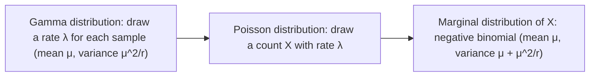
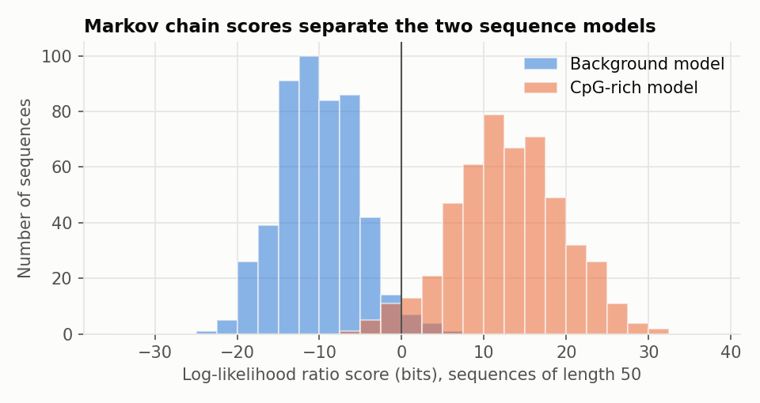
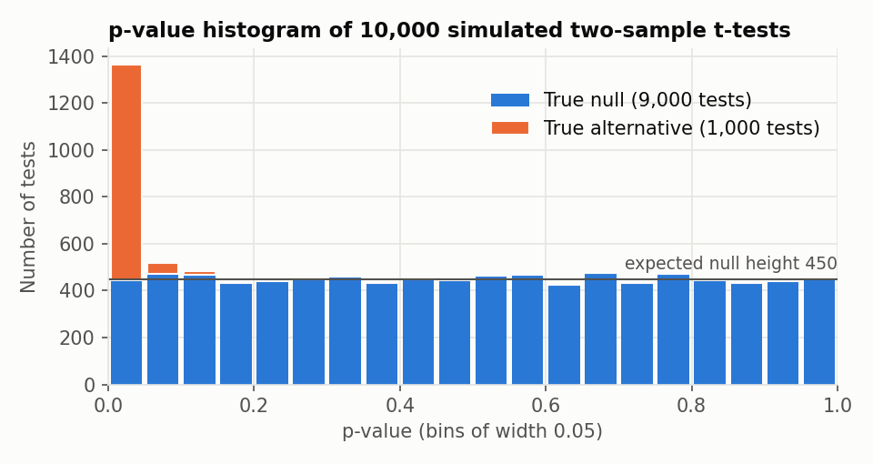
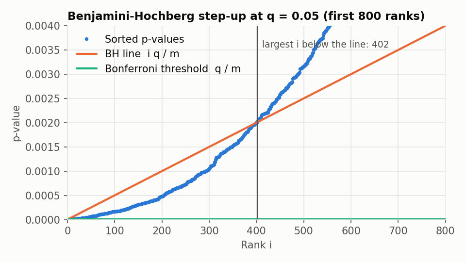
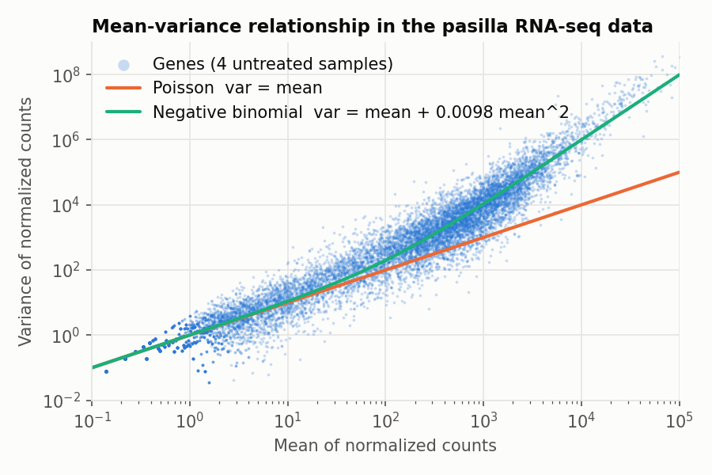
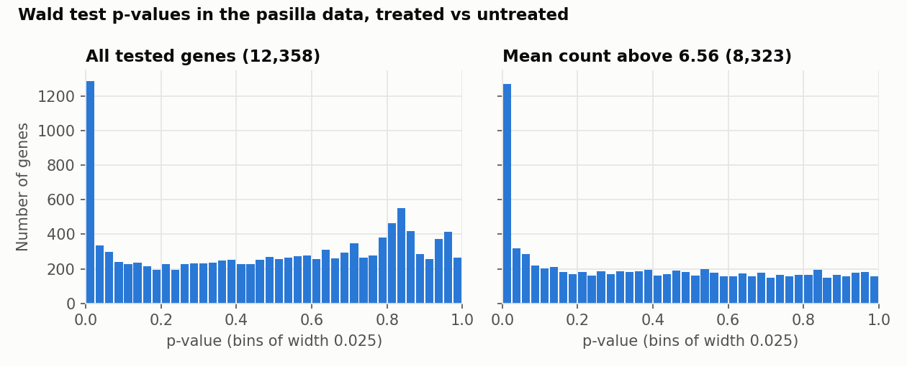

# Chapter 9 — Statistics for High-Throughput Data

[Repository Guide](../../README.md) | [English](Concepts_Lecture.md) | [한국어](Concepts_Lecture.ko.md)

> **Last Updated:** 2026-11-19

> **Learning Objectives:**
> 1. Describe count data with binomial, Poisson, multinomial, and negative binomial generative models and estimate parameters by maximum likelihood
> 2. Analyze base composition and CpG dinucleotide frequencies with multinomial models and Markov chains, and perform goodness-of-fit tests
> 3. Apply the five steps of hypothesis testing to compute p-values for binomial tests, t-tests, and permutation tests
> 4. Explain the distribution of p-values under the null hypothesis and diagnose test results with p-value histograms
> 5. Distinguish the FWER and the FDR and compute the Bonferroni correction and the Benjamini-Hochberg procedure by hand and in R
> 6. Explain the normalization and overdispersion of RNA-seq count data and the workflow of differential expression analysis

---

## Table of Contents

- [1. High-Throughput Data and Statistics](#1-high-throughput-data-and-statistics)
  - [1.1 Characteristics of High-Throughput Data](#11-characteristics-of-high-throughput-data)
  - [1.2 Probability Models and Statistical Models](#12-probability-models-and-statistical-models)
- [2. Generative Models for Count Data](#2-generative-models-for-count-data)
  - [2.1 Bernoulli Trials and the Binomial Distribution](#21-bernoulli-trials-and-the-binomial-distribution)
  - [2.2 The Poisson Distribution](#22-the-poisson-distribution)
  - [2.3 The Multinomial Distribution](#23-the-multinomial-distribution)
  - [2.4 Maximum Likelihood Estimation](#24-maximum-likelihood-estimation)
  - [2.5 The Negative Binomial Distribution and Overdispersion](#25-the-negative-binomial-distribution-and-overdispersion)
- [3. Nucleotide Frequencies and CpG](#3-nucleotide-frequencies-and-cpg)
  - [3.1 Goodness-of-Fit Test for Base Composition](#31-goodness-of-fit-test-for-base-composition)
  - [3.2 A Null Distribution by Simulation](#32-a-null-distribution-by-simulation)
  - [3.3 Dinucleotide Frequencies and the CpG Observed-to-Expected Ratio](#33-dinucleotide-frequencies-and-the-cpg-observed-to-expected-ratio)
  - [3.4 Markov Chain Models](#34-markov-chain-models)
  - [3.5 Classifying Sequences by Log-Likelihood Ratio](#35-classifying-sequences-by-log-likelihood-ratio)
- [4. Hypothesis Testing in Omics](#4-hypothesis-testing-in-omics)
  - [4.1 The Five Steps of Hypothesis Testing](#41-the-five-steps-of-hypothesis-testing)
  - [4.2 The Binomial Test](#42-the-binomial-test)
  - [4.3 The Two-Sample t-Test](#43-the-two-sample-t-test)
  - [4.4 The Permutation Test](#44-the-permutation-test)
  - [4.5 The Meaning of a p-Value and Common Misreadings](#45-the-meaning-of-a-p-value-and-common-misreadings)
- [5. The Distribution of p-Values](#5-the-distribution-of-p-values)
  - [5.1 The Uniform Distribution under the Null](#51-the-uniform-distribution-under-the-null)
  - [5.2 The p-Value Histogram as a Mixture](#52-the-p-value-histogram-as-a-mixture)
  - [5.3 Estimating the Proportion of Nulls](#53-estimating-the-proportion-of-nulls)
  - [5.4 p-Values for Discrete Data](#54-p-values-for-discrete-data)
- [6. Multiple Testing](#6-multiple-testing)
  - [6.1 The Multiple Testing Problem](#61-the-multiple-testing-problem)
  - [6.2 Classification of Outcomes](#62-classification-of-outcomes)
  - [6.3 The FWER and the Bonferroni Correction](#63-the-fwer-and-the-bonferroni-correction)
  - [6.4 The False Discovery Rate](#64-the-false-discovery-rate)
  - [6.5 The Benjamini-Hochberg Procedure](#65-the-benjamini-hochberg-procedure)
  - [6.6 The Three Approaches in Simulation](#66-the-three-approaches-in-simulation)
  - [6.7 Conditions and Interpretation of FDR Control](#67-conditions-and-interpretation-of-fdr-control)
- [7. RNA-Seq Count Data](#7-rna-seq-count-data)
  - [7.1 The Count Matrix and Library Size](#71-the-count-matrix-and-library-size)
  - [7.2 Size Factors and Median-of-Ratios Normalization](#72-size-factors-and-median-of-ratios-normalization)
  - [7.3 The Relationship between Mean and Variance](#73-the-relationship-between-mean-and-variance)
  - [7.4 Variance-Stabilizing Transformations](#74-variance-stabilizing-transformations)
  - [7.5 The Workflow of Differential Expression Analysis](#75-the-workflow-of-differential-expression-analysis)
- [Concept Applications](#concept-applications)
- [Glossary](#glossary)
- [Summary](#summary)
- [Self-Check Questions](#self-check-questions)
- [References](#references)

---

<br>

## 1. High-Throughput Data and Statistics

### 1.1 Characteristics of High-Throughput Data

**High-throughput** experiments measure thousands to millions of variables at once. RNA-seq produces the expression of every gene, genotyping hundreds of thousands of SNPs, and sequencing hundreds of millions of reads in one run (Chapter 7). There are three reasons why statistics is needed to analyze such data.

- **The measurements are counts.** Many measurements, such as numbers of reads, numbers of reads supporting a variant, and numbers of a particular base, are nonnegative integers. Counts have variances that grow with their means, so methods that assume a normal distribution are hard to apply directly. The count distributions of Section 2 handle this property.
- **There is noise.** Measurements differ even among replicate experiments under the same conditions. Hypothesis tests (Section 4) are needed to judge whether an observed difference is a real effect or chance.
- **There are very many tests.** Testing 20,000 genes one by one at significance level 0.05 yields about 1,000 significant results by chance even when nothing differs. The multiple testing corrections of Section 6 address this problem.

These problems are not unique to bioinformatics. Neuroscience testing activity at hundreds of thousands of voxels of a brain image, astronomy searching for signals at many positions in the sky, and online experiments comparing many metrics at once all use the same statistical tools in interdisciplinary fields with many measured variables. This chapter uses biological data as examples, but count models, the distribution of p-values, and multiple testing carry over directly to other fields.

### 1.2 Probability Models and Statistical Models

The starting point of this chapter is the distinction between two kinds of reasoning [1, Ch. 1-2].

> **Definition:** A **generative model** describes the probabilistic process by which data are produced; when its parameters are known, data can be simulated from it.

- **Reasoning with a probability model:** The parameters are assumed known, and how the data will come out is computed. For example, given an error probability of 0.002 per base, the probability that a read of length 150 has two or more errors is computed. This is the deductive direction.
- **Reasoning with a statistical model:** Data are observed, and the parameters that produced them are estimated or hypotheses about the parameters are tested. For example, the error probability is estimated from the numbers of errors in observed reads. This is the inductive direction.

The two directions share the same model. Statistical inference reverses the probability calculation "how likely are these data under this parameter," so setting up the generative model of the data correctly comes first.

| Aspect | Probability model | Statistical model |
|:-----|:-----|:-----|
| What is known | The model and its parameters | The form of the model and the data |
| What is sought | The distribution of the data, probabilities of events | Parameter estimates, decisions on hypotheses |
| Direction of reasoning | From parameters to data (deductive) | From data to parameters (inductive) |
| Example | Distribution of error counts given error probability 0.002 | Estimating the error probability from observed error counts |

*Table 1. Comparison of probability models and statistical models*

---

<br>

## 2. Generative Models for Count Data

### 2.1 Bernoulli Trials and the Binomial Distribution

A trial with only two outcomes, success and failure, is called a **Bernoulli trial**. When a Bernoulli trial with success probability $`p`$ is repeated independently $`n`$ times, the number of successes $`K`$ follows the **binomial distribution** $`\mathrm{Bin}(n, p)`$.

```math
P(K = k) = \binom{n}{k} p^k (1-p)^{n-k}, \qquad E[K] = np, \qquad \mathrm{Var}(K) = np(1-p)
```

$`\binom{n}{k}`$ is the number of ways to choose which $`k`$ of the $`n`$ trials succeed, and $`p^k (1-p)^{n-k}`$ is the probability of one such particular order. As a biological example, if each base of a 150-base read is misread independently with probability 0.002, the number of errors in one read follows $`\mathrm{Bin}(150, 0.002)`$. If at a heterozygous position each read comes from either of the two alleles with probability 0.5, the number of reads supporting one allele among 100 reads covering the position follows $`\mathrm{Bin}(100, 0.5)`$ (Section 4.2).

> **Caution:** The binomial distribution depends on two assumptions: the trials are independent, and the success probability is the same in every trial. In real data, where errors increase toward the end of a read (Chapter 7, Section 8.2), the second assumption fails, so the binomial distribution serves only as a first approximation.

### 2.2 The Poisson Distribution

When $`n`$ is large and $`p`$ small so that the expectation $`\lambda = np`$ is moderate, the binomial distribution is approximated by a simpler distribution with the single parameter $`\lambda`$ [1, Ch. 1].

> **Definition:** The **Poisson distribution** is the distribution of the number of rare events; with parameter $`\lambda`$, $`P(X = k) = e^{-\lambda} \lambda^k / k!`$, and both its mean and its variance equal $`\lambda`$.

Letting $`n \to \infty`$ and $`p \to 0`$ with $`np = \lambda`$ fixed gives $`\binom{n}{k} p^k (1-p)^{n-k} \to e^{-\lambda} \lambda^k / k!`$. The key to this limit is $`(1 - \lambda/n)^n \to e^{-\lambda}`$. The two distributions are compared in the read-error example.

```r
n <- 150; p <- 0.002; lambda <- n * p
k <- 0:4
round(data.frame(k = k, binomial = dbinom(k, n, p), poisson = dpois(k, lambda)), 5)
1 - pbinom(1, n, p)
1 - ppois(1, lambda)
```

```text
  k binomial poisson
1 0  0.74060 0.74082
2 1  0.22262 0.22225
3 2  0.03324 0.03334
4 3  0.00329 0.00333
5 4  0.00024 0.00025
[1] 0.03678033
[1] 0.03693631
```

- `dbinom(k, n, p)` and `dpois(k, lambda)` are the probability mass functions of the binomial and Poisson distributions. $`\lambda = 150 \times 0.002 = 0.3`$.
- The probabilities of the two distributions agree almost to the third decimal place. 74% of reads have no error, and 22% have one.
- `1 - pbinom(1, n, p)` is the probability $`P(K \ge 2)`$ of two or more errors, about 3.7% under both distributions. Among hundreds of millions of reads, millions of reads therefore have two or more errors.

The Poisson distribution is widely used for counts of "rare events among many opportunities," such as the depth distribution of Chapter 7, Section 8.4, the number of mutations in a genome, and the number of reads falling in a fixed interval. The property that the mean equals the variance is a simple criterion for checking whether the model fits (Sections 2.5 and 7.3).

### 2.3 The Multinomial Distribution

When a trial with $`r`$ outcomes rather than two is repeated $`n`$ times, the counts of the outcomes $`(K_1, \ldots, K_r)`$ follow the **multinomial distribution**. If outcome $`i`$ has probability $`p_i`$ ($`\sum p_i = 1`$), then

```math
P(K_1 = k_1, \ldots, K_r = k_r) = \frac{n!}{k_1! \cdots k_r!} p_1^{k_1} \cdots p_r^{k_r}, \qquad \sum_{i} k_i = n
```

If the bases of a sequence are regarded as drawn independently with probabilities $`(p_A, p_C, p_G, p_T)`$, the base counts of a sequence of length $`n`$ follow a multinomial distribution [1, Ch. 1].

```r
dmultinom(c(A = 4, C = 2, G = 2, T = 2), prob = rep(0.25, 4))
factorial(10) / (factorial(4) * factorial(2)^3) * 0.25^10
dmultinom(c(A = 10, C = 0, G = 0, T = 0), prob = rep(0.25, 4))
```

```text
[1] 0.01802444
[1] 0.01802444
[1] 9.536743e-07
```

- With equal probabilities for the four bases, the probability that a sequence of length 10 has 4 A and 2 of each other base is about 0.018. The second line computes the same value by the formula: the number of arrangements $`10!/(4!\,2!\,2!\,2!) = 18900`$ times the probability $`0.25^{10}`$ of one particular sequence.
- The probability of a sequence of all A is $`0.25^{10} \approx 9.5 \times 10^{-7}`$, very small because there is only one arrangement.

This independence model ignores dependence between neighboring bases. Section 3.3 shows that such dependence actually exists, and Section 3.4 puts it into the model with a Markov chain.

### 2.4 Maximum Likelihood Estimation

When data $`y_1, \ldots, y_n`$ are observed and the parameter is unknown, the **likelihood** of a parameter $`\theta`$ is the probability of the observed data under that parameter, viewed as a function of the parameter.

```math
L(\theta) = \prod_{i=1}^{n} P(y_i \mid \theta), \qquad \ell(\theta) = \log L(\theta) = \sum_{i=1}^{n} \log P(y_i \mid \theta)
```

> **Definition:** **Maximum likelihood estimation (MLE)** takes as the estimate the parameter value that makes the likelihood largest.

Sums are easier to handle than products, so the log-likelihood $`\ell(\theta)`$ is maximized. The logarithm is increasing, so the maximizer is the same.

**MLE for the Poisson distribution.** If $`y_i \sim \mathrm{Pois}(\lambda)`$,

```math
\ell(\lambda) = \sum_{i=1}^{n} \left( y_i \log \lambda - \lambda - \log y_i! \right), \qquad \frac{d\ell}{d\lambda} = \frac{\sum_i y_i}{\lambda} - n = 0 \;\Rightarrow\; \hat{\lambda} = \bar{y}
```

The second derivative $`-\sum_i y_i / \lambda^2`$ is negative, so this point is a maximum. In the same way, observing $`y`$ successes in $`n`$ binomial trials gives $`\hat{p} = y/n`$.

> **[Calculus]** At an extremum of a differentiable function the derivative is 0, and if the second derivative is negative the point is a local maximum. If the log-likelihood is strictly concave, the point where the derivative is 0 is the unique maximum. The log-likelihoods of the Poisson and binomial distributions have this property except when the maximum lies on the boundary of the parameter range, as when all observations are 0.

Forty values are drawn from a Poisson distribution with mean 2.3, and the log-likelihood computed on a grid is compared with the formula.

```r
set.seed(2)
y <- rpois(40, lambda = 2.3)
table(y)
mean(y)
loglik <- function(lam) sum(dpois(y, lam, log = TRUE))
grid <- seq(1.5, 3.5, by = 0.01)
ll <- sapply(grid, loglik)
grid[which.max(ll)]
optimize(loglik, c(0.1, 10), maximum = TRUE)$maximum
```

```text
y
 0  1  2  3  4  5  6 
 2 12 11  5  6  3  1 
[1] 2.35
[1] 2.35
[1] 2.350014
```

- `dpois(y, lam, log = TRUE)` gives the log probability of each observation, and their sum is the log-likelihood $`\ell(\lambda)`$.
- On a grid with spacing 0.01 the log-likelihood is largest at 2.35, and the numerical optimizer `optimize()` also finds 2.350. Both equal the sample mean $`\bar{y} = 94/40 = 2.35`$.
- The estimate 2.35 differs from the true value 2.3. With 40 observations the standard error of $`\hat{\lambda}`$ is about $`\sqrt{2.3/40} \approx 0.24`$, so a difference of this size is chance variation.

### 2.5 The Negative Binomial Distribution and Overdispersion

The variance of real count data is often larger than the Poisson model predicts (equal to the mean). This is called **overdispersion**. A typical cause is that the rate $`\lambda`$ producing the counts itself varies from sample to sample. In RNA-seq, even replicate samples under the same condition differ slightly in cell state, so the true expression of a gene differs, and the Poisson variation of drawing reads is added on top.

Turning this two-stage process directly into a model gives a **gamma-Poisson mixture**.



*Figure 1. The negative binomial distribution as a gamma-Poisson mixture*

> **Definition:** The **negative binomial distribution** is a count distribution with mean $`\mu`$ and dispersion parameter $`\alpha`$ whose variance is $`\mu + \alpha \mu^2`$; it equals a Poisson distribution whose rate follows a gamma distribution.

The variance follows from the law of total variance. If $`\lambda`$ has mean $`\mu`$ and variance $`\mu^2/r`$,

```math
\mathrm{Var}(X) = E[\mathrm{Var}(X \mid \lambda)] + \mathrm{Var}(E[X \mid \lambda]) = E[\lambda] + \mathrm{Var}(\lambda) = \mu + \frac{\mu^2}{r}
```

so $`\alpha = 1/r`$. The first term $`\mu`$ comes from Poisson variation and the second term $`\alpha \mu^2`$ from variation of the rate. As $`\alpha \to 0`$ the distribution returns to the Poisson. It is important that the first term dominates the variance when the mean is small and the second when it is large (Section 7.3).

```r
set.seed(3)
mu <- 50; r <- 5
x_pois <- rpois(1e5, mu)
x_nb <- rnbinom(1e5, mu = mu, size = r)
lam <- rgamma(1e5, shape = r, rate = r / mu)
x_mix <- rpois(1e5, lam)
rbind(poisson = c(mean = mean(x_pois), var = var(x_pois)),
      negbin = c(mean = mean(x_nb), var = var(x_nb)),
      gamma_poisson = c(mean = mean(x_mix), var = var(x_mix)))
mu + mu^2 / r
```

```text
                  mean       var
poisson       50.00128  50.08172
negbin        50.05104 545.77191
gamma_poisson 49.97232 554.78768
[1] 550
```

- `rnbinom(mu = mu, size = r)` draws from a negative binomial distribution with mean $`\mu`$ and size parameter $`r`$. R's `size` is the $`r`$ above, and the dispersion parameter is $`\alpha = 1/r = 0.2`$.
- `rgamma(shape = r, rate = r / mu)` draws rates from a gamma distribution with mean $`r / (r/\mu) = \mu`$ and variance $`r / (r/\mu)^2 = \mu^2 / r`$, and `rpois(1e5, lam)` draws one count for each rate.
- In all three cases the mean is about 50, but the Poisson variance is about 50, while the variances of the negative binomial and the gamma-Poisson mixture are near the theoretical value $`50 + 50^2/5 = 550`$. The equal means and variances of the samples drawn in the two ways show numerically that the negative binomial distribution equals the gamma-Poisson mixture.

| Distribution | Parameters | Mean | Variance | Typical use |
|:-----|:-----|:-----|:-----|:-----|
| Binomial | $`n, p`$ | $`np`$ | $`np(1-p)`$ | Successes in a fixed number of trials, allele read counts |
| Poisson | $`\lambda`$ | $`\lambda`$ | $`\lambda`$ | Counts of rare events, depth, read counts of technical replicates |
| Multinomial | $`n, p_1, \ldots, p_r`$ | $`n p_i`$ | $`n p_i (1 - p_i)`$ | Base composition, counts by category |
| Negative binomial | $`\mu, \alpha`$ | $`\mu`$ | $`\mu + \alpha \mu^2`$ | RNA-seq read counts of biological replicates |

*Table 2. Main distributions for count data*

> **[Probability and Statistics]** The law of total variance $`\mathrm{Var}(X) = E[\mathrm{Var}(X \mid Y)] + \mathrm{Var}(E[X \mid Y])`$ splits a variance into the mean of the conditional variance and the variance of the conditional mean. It is used to obtain the variance of a marginal distribution in hierarchical models whose parameters are themselves random variables, and it directly explains why the negative binomial variance exceeds the Poisson variance.

---

<br>

## 3. Nucleotide Frequencies and CpG

### 3.1 Goodness-of-Fit Test for Base Composition

The multinomial model of Section 2.3 is used to test the base composition of a real sequence. The null hypothesis is "the probabilities of the four bases are all 1/4." The **chi-squared statistic**, which collects the differences between the observed counts $`O_i`$ and the expected counts under the null $`E_i = n p_i`$, is

```math
X^2 = \sum_{i=1}^{r} \frac{(O_i - E_i)^2}{E_i}
```

and when the null hypothesis is true and the expected counts are large enough, it approximately follows a chi-squared distribution with $`r - 1`$ degrees of freedom. Since all the probabilities are fixed in advance, the degrees of freedom are the number of categories minus the one constraint that they sum to $`n`$, $`4 - 1 = 3`$.

First the test is applied to the whole of yeast chromosome I.

```r
suppressPackageStartupMessages(library(Biostrings))
data(yeastSEQCHR1)
chr1 <- DNAString(yeastSEQCHR1)
obs <- letterFrequency(chr1, c("A", "C", "G", "T"))
obs
N <- sum(obs)
expct <- N * rep(0.25, 4)
stat <- sum((obs - expct)^2 / expct)
stat
pchisq(stat, df = 3, lower.tail = FALSE)
chisq.test(obs, p = rep(0.25, 4))
```

```text
    A     C     G     T 
69830 44643 45765 69970 
[1] 10608.35
[1] 0

	Chi-squared test for given probabilities

data:  obs
X-squared = 10608, df = 3, p-value < 2.2e-16
```

- `yeastSEQCHR1` is the sequence of yeast chromosome I (230,208 bases) included in Biostrings.
- The statistic is a very large 10,608, and the p-value is smaller than the computer's number representation and comes out as 0. This is because the GC content, $`(44643 + 45765)/230208 \approx 0.393`$, departs greatly from 0.5.
- A and T (69,830 and 69,970) and C and G (44,643 and 45,765) are nearly equal even within one strand. This is the tendency mentioned in Chapter 7, Section 3.3, for A = T and G = C to hold roughly even on one strand of a long genome.

> **Caution:** With a very large sample, even a tiny difference becomes statistically significant. A p-value of 0 for a sequence of 230,000 bases only tells with certainty that "the composition is not exactly 1/4 each"; it says nothing about how biologically important the difference is. The size of the effect (here the GC content of 0.393) must be reported together with the p-value.

Next, a short region of 200 bases starting at position 14,001 of the same chromosome is tested.

```r
suppressPackageStartupMessages(library(Biostrings))
data(yeastSEQCHR1)
w <- subseq(DNAString(yeastSEQCHR1), start = 14001, width = 200)
obs <- letterFrequency(w, c("A", "C", "G", "T"))
obs
expct <- rep(50, 4)
stat <- sum((obs - expct)^2 / expct)
stat
pchisq(stat, df = 3, lower.tail = FALSE)
set.seed(1)
sim <- rmultinom(10000, size = 200, prob = rep(0.25, 4))
sim_stat <- colSums((sim - 50)^2 / 50)
mean(sim_stat >= stat)
```

```text
 A  C  G  T 
59 35 46 60 
[1] 8.44
[1] 0.03774185
[1] 0.0356
```

By hand, $`X^2 = [(59-50)^2 + (35-50)^2 + (46-50)^2 + (60-50)^2]/50 = (81 + 225 + 16 + 100)/50 = 8.44`$, and the probability of 8.44 or more under a chi-squared distribution with 3 degrees of freedom is the p-value 0.0377.

### 3.2 A Null Distribution by Simulation

The chi-squared distribution is an approximation, so the null distribution can be checked by simulating it directly [1, Ch. 2]. The last three lines of the code above perform this computation.

- `rmultinom(10000, size = 200, prob = rep(0.25, 4))` draws the base counts of a sequence of length 200 from the null multinomial distribution 10,000 times. The result is a matrix with 4 rows and 10,000 columns.
- `colSums((sim - 50)^2 / 50)` computes the same statistic for each column, that is, for each simulated sequence.
- The proportion of simulated statistics at or above the observed 8.44, 0.0356, is the simulated p-value. It is close to the chi-squared approximation of 0.0377.

The simulation method has the advantage of applying directly to statistics whose approximate distribution is unknown. As long as there is a generative model that can produce data under the null hypothesis, the null distribution of any statistic can be obtained. This is why Section 1.2 sets up the generative model first.

### 3.3 Dinucleotide Frequencies and the CpG Observed-to-Expected Ratio

If the independence model of Section 2.3 were right, the probability of two neighboring bases $`xy`$ would be $`p_x p_y`$. Comparing this expectation with the actual frequency reveals dependence between neighboring bases. In particular, the dinucleotide of a C on the 5' side followed by a G on the 3' side is called **CpG** (the p denotes the phosphate bond between them, a notation that distinguishes it from a C-G base pair facing across the two strands).

> **Definition:** The **CpG observed-to-expected ratio** is the frequency of the CpG dinucleotide in a sequence divided by the product of the frequencies of C and G, indicating how many more or fewer CpGs there are than the independence model expects.

```math
\mathrm{O/E}(\mathrm{CpG}) = \frac{n_{CG} / (N - 1)}{(n_C / N)(n_G / N)}
```

$`N`$ is the sequence length, and $`n_{CG}`$ is the number of CG among the $`N - 1`$ overlapping dinucleotides. A value of 1 means that G follows C as often as the independence model expects. In vertebrate genomes as a whole, CpG is much rarer than expected. The widely accepted explanation is that the cytosine of CpG is readily methylated, and methylated cytosine frequently mutates to thymine by deamination, so CpG has declined over evolution. Near the promoters of genes there are regions that are not methylated and keep CpG at the expected level, called **CpG islands**.

The ratio is computed for four sequences included in Bioconductor packages.

```r
suppressPackageStartupMessages(library(Biostrings))
cpg_oe <- function(x) {
  f1 <- letterFrequency(x, c("C", "G"))
  f2 <- dinucleotideFrequency(x)
  N <- length(x)
  (f2["CG"] / (N - 1)) / ((f1["C"] / N) * (f1["G"] / N))
}
data(yeastSEQCHR1); data(phiX174Phage, package = "pwalign")
msa <- readDNAMultipleAlignment(system.file("extdata", "msx2_mRNA.aln", package = "Biostrings"), format = "clustal")
human_msx2 <- DNAString(gsub("-", "", as.character(DNAStringSet(msa)[[1]])))
fly <- readDNAStringSet(system.file("extdata", "dm3_upstream2000.fa.gz", package = "Biostrings"))
fly <- unlist(fly[1:200])
seqs <- list(yeast_chrI = DNAString(yeastSEQCHR1), phiX174 = phiX174Phage[[1]],
             human_MSX2_mRNA = human_msx2, fly_upstream = fly)
t(sapply(seqs, function(x) c(length = length(x),
                             CG = unname(dinucleotideFrequency(x)["CG"]),
                             GC = unname(dinucleotideFrequency(x)["GC"]),
                             oe_CG = round(unname(cpg_oe(x)), 3))))
```

```text
                length    CG    GC oe_CG
yeast_chrI      230208  7089  8910 0.799
phiX174           5386   267   347 0.991
human_MSX2_mRNA   2224    79   137 0.653
fly_upstream    400000 16297 21641 0.987
```

- `dinucleotideFrequency()` counts the 16 dinucleotides. `cpg_oe()`, a direct transcription of the formula above, computes the ratio.
- `human_MSX2_mRNA` is the human MSX2 mRNA (NM_002449.4) [2] from the multiple alignment file of Chapter 8, Section 9.4, with gaps removed, and `fly_upstream` joins the 2,000 upstream bases of 200 fruit fly RefSeq transcripts into 400,000 bases. Some transcripts share the same upstream region, so there are 100 distinct regions, and removing the duplicates gives almost the same ratio, 0.970.
- In all four sequences CG is less common than GC. The two dinucleotides involve the same C and G frequencies, so the independence model expects equal counts, but CG is actually rarer.
- The ratio is nearly 1 for phiX174 and the fly upstream sequences, 0.80 for the yeast chromosome, and 0.65 for the human MSX2 mRNA. One human transcript does not represent the whole genome, and this value alone cannot tell whether 0.65 differs meaningfully from 1. It must be compared with a null distribution that accounts for the sequence length and base composition (built by simulation, as in Section 3.2).

### 3.4 Markov Chain Models

The simplest way to put dependence between neighboring bases into a model is to assume that each base depends only on the base immediately before it [1, Ch. 2].

> **Definition:** A **first-order Markov chain** is a stochastic process in which the probability of the next state depends only on the immediately preceding state and not on earlier states.

In a DNA sequence the states are the four bases, and the model is defined by a 4 × 4 **transition matrix** $`a_{st} = P(x_i = t \mid x_{i-1} = s)`$. Each row sums to 1. The probability of a whole sequence is

```math
P(x_1, \ldots, x_N) = P(x_1) \prod_{i=2}^{N} a_{x_{i-1} x_i}
```

The maximum likelihood estimate of the transition probabilities is the dinucleotide counts normalized by row, $`\hat{a}_{st} = n_{st} / \sum_{t'} n_{st'}`$. This is the same principle as the binomial MLE of Section 2.4 being the proportion of successes.

A CpG-poor background sequence and a CpG-rich sequence are each defined by a transition matrix, sequences are simulated from the two models, and the transition matrices are estimated again.

```r
b <- c("A", "C", "G", "T")
P_bg <- matrix(c(0.30, 0.20, 0.25, 0.25,
                 0.35, 0.30, 0.05, 0.30,
                 0.25, 0.25, 0.25, 0.25,
                 0.20, 0.25, 0.25, 0.30), 4, byrow = TRUE, dimnames = list(b, b))
P_isl <- matrix(c(0.15, 0.35, 0.35, 0.15,
                  0.15, 0.30, 0.30, 0.25,
                  0.15, 0.35, 0.35, 0.15,
                  0.10, 0.35, 0.35, 0.20), 4, byrow = TRUE, dimnames = list(b, b))
sim_chain <- function(n, P) {
  s <- character(n)
  s[1] <- sample(b, 1)
  for (i in 2:n) s[i] <- sample(b, 1, prob = P[s[i - 1], ])
  s
}
est_trans <- function(s) {
  counts <- table(from = factor(head(s, -1), levels = b),
                  to = factor(tail(s, -1), levels = b))
  counts / rowSums(counts)
}
set.seed(42)
bg_train <- sim_chain(20000, P_bg)
isl_train <- sim_chain(20000, P_isl)
Q_bg <- est_trans(bg_train); Q_isl <- est_trans(isl_train)
round(Q_bg, 3)
round(Q_isl, 3)
oe <- function(s) {
  N <- length(s)
  cg <- sum(head(s, -1) == "C" & tail(s, -1) == "G") / (N - 1)
  cg / (mean(s == "C") * mean(s == "G"))
}
c(background = oe(bg_train), island = oe(isl_train))
```

```text
    to
from     A     C     G     T
   A 0.304 0.204 0.250 0.241
   C 0.352 0.302 0.051 0.295
   G 0.246 0.253 0.241 0.260
   T 0.192 0.261 0.244 0.303
    to
from     A     C     G     T
   A 0.154 0.361 0.337 0.148
   C 0.148 0.296 0.311 0.246
   G 0.158 0.344 0.348 0.151
   T 0.106 0.347 0.346 0.201
background     island 
 0.2618363  0.9319306 
```

- The second row of `P_bg` sets the probability of G after C to a small 0.05, producing CpG-poor sequences. `P_isl` sets high probabilities of moving to C and G in every row, producing sequences rich in GC and CpG.
- `sim_chain()` chooses the first base at random and then draws each next base with the probabilities of the row for the preceding base. It is a direct transcription of the definition of a Markov chain.
- `est_trans()` counts dinucleotides $`n_{st}`$ with a cross table of `head(s, -1)` (preceding bases) and `tail(s, -1)` (following bases) and normalizes each row by dividing by `rowSums()`. The matrices estimated from sequences of length 20,000 agree with the true matrices almost to the second decimal place.
- The CpG observed-to-expected ratio of the background-model sequence is 0.26: the dependence that makes only G after C rare, even though C and G are common, shows up directly in the ratio of Section 3.3.

### 3.5 Classifying Sequences by Log-Likelihood Ratio

Given two models, whether a new sequence more likely came from one or the other can be judged by the **log-likelihood ratio**. Ignoring the term for the first base,

```math
S(x) = \log_2 \frac{P(x \mid M^{+})}{P(x \mid M^{-})} = \sum_{i=2}^{N} \log_2 \frac{a^{+}_{x_{i-1} x_i}}{a^{-}_{x_{i-1} x_i}}
```

and if $`S(x) > 0`$ the sequence is classified as coming from the CpG-rich model. Here $`M^{+}`$ is the CpG-rich model, $`M^{-}`$ the background model, and $`a^{+}`$ and $`a^{-}`$ the transition probabilities of each model. This has the same structure as the log-odds score of Chapter 8, Section 7.1, adding a score $`\log_2(a^{+}_{st} / a^{-}_{st})`$ for each dinucleotide.

```r
B <- log2(unclass(Q_isl) / unclass(Q_bg))
round(B, 2)
llr <- function(s) sum(B[cbind(head(s, -1), tail(s, -1))])
test_bg <- replicate(500, llr(sim_chain(50, P_bg)))
test_isl <- replicate(500, llr(sim_chain(50, P_isl)))
c(mean_bg = mean(test_bg), mean_isl = mean(test_isl))
c(bg_correct = mean(test_bg < 0), isl_correct = mean(test_isl > 0))
```

```text
    to
from     A     C    G     T
   A -0.98  0.82 0.43 -0.70
   C -1.25 -0.03 2.60 -0.26
   G -0.64  0.44 0.53 -0.78
   T -0.86  0.41 0.51 -0.59
  mean_bg  mean_isl 
-10.11039  13.08263 
 bg_correct isl_correct 
      0.976       0.966 
```

- The largest value in the score matrix `B` is 2.60 bits for the CG dinucleotide. Each CG in a sequence adds 2.6 bits of evidence in favor of the CpG-rich model.
- `B[cbind(preceding base, following base)]` is R's way of extracting matrix elements all at once with a character matrix. It adds the scores of all dinucleotides of a sequence in one line.
- Scoring 500 sequences of length 50 from each model classifies 97.6% of the background sequences as negative and 96.6% of the CpG-rich sequences as positive, correctly.



*Figure 2. Log-likelihood ratio scores of sequences from two Markov chain models*

The two distributions in Figure 2 are mostly separated but overlap near 0. The shorter the sequence, the fewer dinucleotides are added and the more the distributions overlap; longer sequences separate better. To find CpG islands in a real genome, this score is computed in windows of fixed length, or a model that also estimates hidden states switching between the two models is used.

---

<br>

## 4. Hypothesis Testing in Omics

### 4.1 The Five Steps of Hypothesis Testing

Chapter 6, Section 8.1 covered how a test decision falls into one of the four cells of a confusion matrix, along with type I errors, type II errors, and power. This section summarizes the procedure for actually carrying out one test. A hypothesis test consists of the following five steps [1, Ch. 6].

1. **Choose the effect of interest and the test statistic.** Example: the difference in mean expression between two conditions, the number of reads supporting one allele.
2. **State the null hypothesis and obtain the distribution of the test statistic under it (the null distribution).** The null hypothesis states that there is no effect and must be specific enough for the null distribution to be computed.
3. **Choose the rejection region.** It is the region of values extreme in the direction of the effect whose probability under the null hypothesis is at most the significance level $`\alpha`$.
4. **Collect the data and compute the test statistic.**
5. **Reject the null hypothesis if the statistic falls in the rejection region.**

> **Definition:** The **p-value** is the probability, when the null hypothesis is true, of a test statistic as extreme as or more extreme than the one observed.

A p-value at or below $`\alpha`$ is the same as the statistic falling in the rejection region. Steps 1-3 must be fixed before seeing the data. Changing the statistic or the rejection region after seeing the data so that the result becomes significant makes the computation of the null distribution no longer valid (Section 4.5).

### 4.2 The Binomial Test

If the two alleles at a heterozygous SNP position are expressed equally, each RNA-seq read covering the position comes from either allele with probability 0.5. When 62 of 100 reads support allele A, the null hypothesis $`H_0: p = 0.5`$ that the two alleles are expressed equally is tested. The test statistic is the number of A reads $`K`$, and the null distribution is $`\mathrm{Bin}(100, 0.5)`$.

```r
k <- 62; n <- 100
pbinom(k - 1, n, 0.5, lower.tail = FALSE)
pbinom(n - k, n, 0.5)
2 * pbinom(k - 1, n, 0.5, lower.tail = FALSE)
binom.test(k, n, p = 0.5)$p.value
```

```text
[1] 0.01048937
[1] 0.01048937
[1] 0.02097874
[1] 0.02097874
```

- `pbinom(k - 1, n, 0.5, lower.tail = FALSE)` is $`P(K > 61) = P(K \ge 62)`$. `lower.tail = FALSE` means the upper tail, and 61 must be passed to include 62.
- The second line, $`P(K \le 38)`$, equals the first because the binomial distribution with $`p = 0.5`$ is symmetric about 50.
- Which allele would be more common was not decided in advance, so the two-sided p-value 0.021, the sum of both tails, is used. `binom.test()` gives the same value. The null hypothesis is rejected at $`\alpha = 0.05`$.

### 4.3 The Two-Sample t-Test

The expression of one gene (on a log scale) was measured four times each in a control group and a treatment group. The null hypothesis that the two group means are equal is tested. Assuming equal variances in the two groups, the **two-sample t statistic** is

```math
t = \frac{\bar{x}_1 - \bar{x}_2}{\sqrt{s^2 \left( \frac{1}{n_1} + \frac{1}{n_2} \right)}}, \qquad s^2 = \frac{\sum (x_{1i} - \bar{x}_1)^2 + \sum (x_{2i} - \bar{x}_2)^2}{n_1 + n_2 - 2}
```

$`s^2`$ is the estimate of the variance pooled over both groups, and if the data are normally distributed under the null hypothesis, $`t`$ follows a t distribution with $`n_1 + n_2 - 2`$ degrees of freedom [1, Ch. 6].

```r
ctrl <- c(5.1, 4.8, 5.6, 5.0)
trt  <- c(6.0, 5.7, 6.4, 5.5)
m1 <- mean(trt); m2 <- mean(ctrl)
s2 <- (sum((trt - m1)^2) + sum((ctrl - m2)^2)) / (4 + 4 - 2)
t_stat <- (m1 - m2) / sqrt(s2 * (1/4 + 1/4))
c(diff = m1 - m2, s2 = s2, t = t_stat)
2 * pt(abs(t_stat), df = 6, lower.tail = FALSE)
t.test(trt, ctrl, var.equal = TRUE)$p.value
```

```text
     diff        s2         t 
0.7750000 0.1345833 2.9875904 
[1] 0.02439605
[1] 0.02439605
```

By hand, the treatment mean is 5.9 and the control mean 5.125, a difference of 0.775. The sums of squared deviations are $`0.1^2 + 0.2^2 + 0.5^2 + 0.4^2 = 0.46`$ for the treatment group and $`0.025^2 + 0.325^2 + 0.475^2 + 0.125^2 = 0.3475`$ for the control group, so $`s^2 = 0.8075/6 \approx 0.1346`$. Then $`t = 0.775 / \sqrt{0.1346 \times 0.5} \approx 2.99`$, and the two-sided p-value from a t distribution with 6 degrees of freedom is 0.0244. `t.test(..., var.equal = TRUE)` gives the same value.

### 4.4 The Permutation Test

The t-test depends on the assumption that the data are normally distributed. With only four observations per group, this assumption is hard to check. A **permutation test** builds the null distribution without distributional assumptions. If the null hypothesis is true, the group labels are unrelated to the data, so every reassignment of the labels to the eight values is equally plausible.

```r
x <- c(trt, ctrl)
idx <- combn(8, 4)
perm_diff <- apply(idx, 2, function(i) mean(x[i]) - mean(x[-i]))
length(perm_diff)
mean(abs(perm_diff) >= abs(m1 - m2) - 1e-12)
```

```text
[1] 70
[1] 0.05714286
```

- `combn(8, 4)` lists as columns all $`\binom{8}{4} = 70`$ ways to choose which four of the eight values form the treatment group.
- The mean differences of these assignments form the permutation null distribution. The proportion with an absolute value at least as large as the actual difference 0.775 is the p-value. The `- 1e-12` is a margin so that equal values are not missed because of floating-point error.
- The p-value is 4 of 70, or 0.057. There is one more assignment with a larger difference than the actual one (treatment values 6.4, 6.0, 5.7, 5.6), and swapping the two groups of any assignment gives the same absolute difference. The actual assignment and its swap are always included, so the smallest p-value a permutation test can produce in this design of four plus four is $`2/70 \approx 0.029`$.

The two tests give different results (0.024 and 0.057) because of their assumptions. The t-test uses the normality assumption to obtain a smaller p-value, while the permutation test uses no such assumption but cannot produce small p-values when samples are few. With only a few samples in an omics experiment, a permutation test alone cannot pass the strict multiple testing criteria of Section 6, which is why model-based methods that pool information across many genes to estimate variances stably (Section 7.5) are used.

### 4.5 The Meaning of a p-Value and Common Misreadings

A p-value is $`P(\text{data this extreme} \mid H_0)`$. The following are things a p-value does not mean.

- **It is not the probability that the null hypothesis is true.** Obtaining $`P(H_0 \mid \text{data})`$ requires the prior probability that the null hypothesis is true. p = 0.03 does not mean "the probability that the null hypothesis is true is 3%."
- **It is not the size of the effect.** As in Section 3.1, a large sample gives a very small p-value even for a small effect.
- **Nonsignificance is not evidence of no effect.** As in Section 4.4, when power is low, the p-value can be large even if a real effect exists.

> **Caution:** Trying several test statistics, several variable transformations, and several outlier-removal criteria after seeing the data and reporting only the smallest p-value is called **p-value hacking**. It amounts to performing as many tests as were tried, so it is the multiple testing problem of Section 6 hidden outside the report [1, Ch. 6].

---

<br>

## 5. The Distribution of p-Values

### 5.1 The Uniform Distribution under the Null

Let $`F_0`$ be the cumulative distribution function of the null distribution of a continuous test statistic $`T`$, and consider a one-sided test in which large values are extreme. With observed statistic $`T`$, the p-value is $`p = 1 - F_0(T)`$. If the null hypothesis is true, $`T`$ follows $`F_0`$, so for $`u`$ with $`0 \le u \le 1`$,

```math
P(p \le u) = P(1 - F_0(T) \le u) = P(F_0(T) \ge 1 - u) = 1 - (1 - u) = u
```

That is, **if the null hypothesis is true, the p-value is uniformly distributed between 0 and 1.** The last equality follows from the fact that $`F_0(T)`$ is uniformly distributed for a continuous random variable $`T`$ (the probability integral transform). Because of this property, "the probability that the p-value is at most 0.05 when the null hypothesis is true is exactly 0.05," and the significance level becomes the probability of a type I error.

### 5.2 The p-Value Histogram as a Mixture

Performing thousands of tests at once allows a histogram of the p-values to be drawn. If $`\pi_0`$ is the proportion of tests whose null hypothesis is true, the density of the p-values is a mixture of two components [1, Ch. 6].

```math
f(p) = \pi_0 \cdot 1 + (1 - \pi_0) f_{\mathrm{alt}}(p)
```

The first component is the uniform distribution of the tests whose null hypothesis is true, and the second is the distribution of the tests whose alternative is true, concentrated near 0. This is called the **two-groups model**.

Two-sample t-tests for 10,000 genes are simulated. For 9,000 genes the two group means are equal, for 1,000 the treatment mean is larger by 2.5 standard deviations, and each group has 5 samples.

```r
sim_p <- function(m = 10000, m1 = 1000, n = 5, effect = 2.5) {
  truth <- c(rep(FALSE, m - m1), rep(TRUE, m1))
  A <- matrix(rnorm(m * n), m, n)
  B <- matrix(rnorm(m * n), m, n) + ifelse(truth, effect, 0)
  sp2 <- ((n - 1) * apply(A, 1, var) + (n - 1) * apply(B, 1, var)) / (2 * n - 2)
  tt <- (rowMeans(B) - rowMeans(A)) / sqrt(sp2 * 2 / n)
  list(p = 2 * pt(abs(tt), df = 2 * n - 2, lower.tail = FALSE), truth = truth)
}
set.seed(2026)
s <- sim_p(); p <- s$p; truth <- s$truth
c(null_below_0.05 = sum(p[!truth] < 0.05), alt_below_0.05 = sum(p[truth] < 0.05))
mean(p > 0.5) / 0.5
```

```text
null_below_0.05  alt_below_0.05 
            446             919 
[1] 0.9018
```

- `sim_p()` builds two matrices with genes as rows (control `A`, treatment `B`) and adds the effect 2.5 only to the rows where `truth` is `TRUE`. It computes the t statistic of Section 4.3 for all rows at once and returns the p-values together with the truth.
- Of the 9,000 genes whose null hypothesis is true, 446 (5.0%) lie below 0.05, matching the 450 expected under the uniform distribution. All 446 are false positives.
- Of the 1,000 genes whose alternative is true, 919 lie below 0.05, so the power of a single test in this setting is about 92%.



*Figure 3. p-value histogram of 10,000 simulated t-tests*

In Figure 3 the bars above 0.05 are nearly flat, with heights near the expected 450. This flat floor is the null component. The height of the first bin, 1,365, is the 446 null tests plus the 919 alternative tests. In real data it is unknown which tests are true, but the shape of the histogram alone allows the two components to be distinguished.

> **Note:** **Diagnosis with the histogram.** The p-value histogram is a simple check of whether an analysis went right [1, Ch. 6]. A peak near 0 above a flat floor is normal. A peak near 1 or a sloping floor, on the other hand, often means that the assumptions of the test (distribution, independence, variance estimation) do not fit the data or that discreteness (Section 5.4) is large, so the cause should be found before applying multiple testing corrections.

### 5.3 Estimating the Proportion of Nulls

The p-values of tests whose alternative is true are mostly small, so the region of large p-values (for example above 0.5) can be regarded as containing almost only the null component. The null component is uniform, so half of the null tests fall in $`(0.5, 1]`$. Therefore

```math
\hat{\pi}_0 = \frac{\#\lbrace p_i > 0.5 \rbrace}{m (1 - 0.5)}
```

estimates the proportion of null hypotheses. The last line of the code above, `mean(p > 0.5) / 0.5`, is this computation, and the result 0.902 is close to the true value 0.9. Some of the alternative component remains in the region of large p-values, so this estimate tends to overstate $`\pi_0`$ slightly; it is used in interpreting the FDR in Section 6.7.

### 5.4 p-Values for Discrete Data

The uniformity of Section 5.1 holds when the test statistic is continuous. Tests on count data have discrete statistics, so the p-values can take only a few values. The permutation test of Section 4.4 has p-values only among values such as $`2/70, 4/70, \ldots`$, and genes with very low counts cannot produce a small p-value whatever the data. The p-values of such tests are conservative under the null hypothesis, $`P(p \le u) \le u`$, and the histogram develops peaks near 1 or at particular values [1, Ch. 6]. The RNA-seq example of Section 7.5 shows this phenomenon in practice.

---

<br>

## 6. Multiple Testing

### 6.1 The Multiple Testing Problem

If $`m_0`$ tests whose null hypotheses are true are each performed independently at significance level $`\alpha`$, the expected number of false positives is $`m_0 \alpha`$, and with $`V`$ the number of false positives, the probability of at least one false positive is

```math
P(V \ge 1) = 1 - (1 - \alpha)^{m_0}
```

[1, Ch. 6]. With $`\alpha = 0.05`$ this probability is 0.05 for $`m_0 = 1`$, 0.64 for $`m_0 = 20`$, 0.994 for $`m_0 = 100`$, and essentially 1 for $`m_0 = 10000`$. Even with only 20 tests, one is more likely than not to come out significant by chance. In the simulation of Section 5.2, using 0.05 without any correction makes 446 (33%) of the 1,365 tests judged significant false positives.

This problem is not confined to genomics. The proportionality of the E-value of Chapter 8, Section 8.3 to the database size is the same phenomenon, and the neuroimaging, astronomy, and large-scale online experiments mentioned in Section 1.1 all deal with the same problem.

### 6.2 Classification of Outcomes

The outcomes after $`m`$ tests are shown in the following table. Only $`R`$ and $`m`$ can be observed; the rest are unknown.

| | Not rejected | Rejected (discovery) | Total |
|:-----|:-----|:-----|:-----|
| Null hypothesis true | $`U`$ | $`V`$ (false positives) | $`m_0`$ |
| Null hypothesis false | $`T`$ (false negatives) | $`S`$ (true positives) | $`m - m_0`$ |
| Total | $`m - R`$ | $`R`$ | $`m`$ |

*Table 3. Outcomes of multiple testing*

This has the same structure as the confusion matrix of Chapter 6, Section 8.1, and a multiple testing correction decides in what sense to keep $`V`$ small. Two criteria are widely used.

### 6.3 The FWER and the Bonferroni Correction

> **Definition:** The **family-wise error rate (FWER)** is the probability $`P(V \ge 1)`$ of at least one false positive among all the tests.

The **Bonferroni correction** lowers the per-test significance level to $`\alpha / m`$ and controls the FWER at or below $`\alpha`$. It is proved by the union bound on probabilities.

```math
P(V \ge 1) = P\left( \bigcup_{i \in H_0} \left\lbrace p_i \le \frac{\alpha}{m} \right\rbrace \right) \le \sum_{i \in H_0} P\left( p_i \le \frac{\alpha}{m} \right) = m_0 \frac{\alpha}{m} \le \alpha
```

Here $`H_0`$ is the set of tests whose null hypothesis is true. The union bound holds regardless of the dependence among the events, so the Bonferroni correction is valid whatever the correlation among the tests. The **adjusted p-value** expressing the same decision on the p-value scale is $`\tilde{p}_i = \min(1, m p_i)`$, and a test is rejected if $`\tilde{p}_i \le \alpha`$.

The price of the Bonferroni correction is power. With $`m = 10000`$ and $`\alpha = 0.05`$, the per-test criterion becomes $`5 \times 10^{-6}`$, and an experiment with few samples finds almost none of the real effects. A criterion that allows not even one false positive is too strict for exploratory studies that choose genes from tens of thousands of candidates for follow-up experiments.

### 6.4 The False Discovery Rate

> **Definition:** The **false discovery rate (FDR)** is the expected proportion of false positives among the rejected tests, $`E[V / \max(R, 1)]`$.

$`\max(R, 1)`$ avoids dividing by 0 when nothing is rejected. The FDR = FP / (FP + TP) of Chapter 6, Section 8.3 is a proportion computed from one set of decisions, while the FDR here is the expectation of that proportion $`V/R`$ (the false discovery proportion). Controlling the FDR at 0.05 means "up to 5% of the discovery list may be false on average." If all null hypotheses are true ($`m_0 = m`$), then $`V = R`$, so the FDR equals $`P(V \ge 1)`$, the FWER [1, Ch. 6]. In general $`V / \max(R, 1)`$ is 0 when $`V = 0`$ and at most 1 otherwise, so the FDR never exceeds the FWER. FDR control is therefore a looser criterion than FWER control and allows more discoveries.

### 6.5 The Benjamini-Hochberg Procedure

The representative method for controlling the FDR is the following procedure proposed by Benjamini and Hochberg [3].

1. Sort the p-values from smallest: $`p_{(1)} \le p_{(2)} \le \cdots \le p_{(m)}`$.
2. For a target FDR level $`q`$, find the largest $`k`$ satisfying $`p_{(k)} \le \frac{k}{m} q`$.
3. Reject all $`k`$ null hypotheses corresponding to $`p_{(1)}, \ldots, p_{(k)}`$.

> **Definition:** The **Benjamini-Hochberg procedure** is a multiple testing method that compares the sorted p-values $`p_{(k)}`$ with criteria $`kq/m`$ proportional to their ranks and rejects everything up to the largest rank at or below its criterion.

The Bonferroni correction compares every p-value with the same criterion $`q/m`$, but the criteria of the BH procedure grow down the ranks as $`q/m, 2q/m, 3q/m, \ldots`$. It is an adaptive criterion that rejects more tests the more small p-values there are.

A hand computation with ten p-values follows. With $`m = 10`$ and $`q = 0.05`$, the criterion is $`0.005 k`$.

```r
pv <- c(0.0002, 0.0011, 0.0040, 0.0082, 0.0260, 0.0290, 0.0710, 0.2100, 0.4800, 0.8800)
m <- length(pv); q <- 0.05
data.frame(i = 1:m, p = pv, threshold = (1:m) * q / m, pass = pv <= (1:m) * q / m)
k <- max(which(pv <= (1:m) * q / m))
k
adj <- rev(cummin(rev(pv * m / (1:m))))
round(cbind(raw = pv, bh_manual = pmin(adj, 1), bh = p.adjust(pv, "BH"), bonferroni = p.adjust(pv, "bonferroni")), 4)
sum(p.adjust(pv, "bonferroni") <= q)
sum(p.adjust(pv, "BH") <= q)
```

```text
    i      p threshold  pass
1   1 0.0002     0.005  TRUE
2   2 0.0011     0.010  TRUE
3   3 0.0040     0.015  TRUE
4   4 0.0082     0.020  TRUE
5   5 0.0260     0.025 FALSE
6   6 0.0290     0.030  TRUE
7   7 0.0710     0.035 FALSE
8   8 0.2100     0.040 FALSE
9   9 0.4800     0.045 FALSE
10 10 0.8800     0.050 FALSE
[1] 6
         raw bh_manual     bh bonferroni
 [1,] 0.0002    0.0020 0.0020      0.002
 [2,] 0.0011    0.0055 0.0055      0.011
 [3,] 0.0040    0.0133 0.0133      0.040
 [4,] 0.0082    0.0205 0.0205      0.082
 [5,] 0.0260    0.0483 0.0483      0.260
 [6,] 0.0290    0.0483 0.0483      0.290
 [7,] 0.0710    0.1014 0.1014      0.710
 [8,] 0.2100    0.2625 0.2625      1.000
 [9,] 0.4800    0.5333 0.5333      1.000
[10,] 0.8800    0.8800 0.8800      1.000
[1] 3
[1] 6
```

- **Comparison with the criteria:** The first four p-values lie below their criteria, and the fifth, 0.026, exceeds its criterion 0.025. The sixth, 0.029, however, lies below its criterion 0.030.
- **The largest k:** The procedure does not stop where a p-value first exceeds its criterion; it finds the largest rank below its criterion. Since $`k = 6`$, all six are rejected, including the fifth, which exceeded its own criterion. Because of this property the BH procedure is called a **step-up** procedure.
- **BH-adjusted p-values:** The decision expressed on the p-value scale is $`\tilde{p}_{(i)} = \min_{j \ge i} \min\left(1, \frac{m}{j} p_{(j)}\right)`$. The `rev(cummin(rev(...)))` in the code computes the cumulative minimum from the end. The fifth value is $`10 \times 0.026 / 5 = 0.052`$, but it cannot exceed the sixth value $`10 \times 0.029 / 6 = 0.0483`$, so it becomes 0.0483. The hand-computed values equal `p.adjust(pv, "BH")`.
- **Comparison of the two methods:** Six tests have BH-adjusted p-values at or below 0.05, and three have Bonferroni-adjusted p-values at or below 0.05. The Bonferroni-adjusted p-value is $`10 p_i`$ truncated at 1.

> **Caution:** The BH-adjusted p-value $`\tilde{p}_i`$ is not the probability that the test is a false positive. $`\tilde{p}_i \le q`$ means "had the target FDR been set to $`q`$, this test would be on the rejection list," and the FDR is an average property of the whole list. The values returned by R's `p.adjust(..., "BH")` and reported as `padj` by DESeq2 in Section 7.5 are these adjusted p-values.

### 6.6 The Three Approaches in Simulation

The three criteria are applied to the simulated data of Section 5.2, and false positives are counted using the truth.

```r
summarize <- function(rej) c(R = sum(rej), V = sum(rej & !truth), S = sum(rej & truth),
                             FDP = round(sum(rej & !truth) / max(sum(rej), 1), 4))
rbind(unadjusted = summarize(p < 0.05),
      bonferroni = summarize(p.adjust(p, "bonferroni") < 0.05),
      BH = summarize(p.adjust(p, "BH") < 0.05))
```

```text
              R   V   S    FDP
unadjusted 1365 446 919 0.3267
bonferroni    2   0   2 0.0000
BH          402  22 380 0.0547
```

- **No correction:** 1,365 discoveries, but a false discovery proportion of 33%.
- **Bonferroni:** No false positives, but only 2 discoveries. Passing the criterion $`5 \times 10^{-6}`$ requires a very large t statistic with 8 degrees of freedom, so almost all 1,000 genes with effects are missed.
- **BH:** 402 discoveries, of which 22 are false. The false discovery proportion is 5.5%.



*Figure 4. The Benjamini-Hochberg procedure applied to simulated data*

Figure 4 plots the sorted p-values by rank together with the BH line $`iq/m`$. The last rank at which the points of the p-values lie below the line is 402, and every test before it is rejected. The Bonferroni criterion $`q/m = 5 \times 10^{-6}`$ is a horizontal line almost indistinguishable from 0 on this scale.

In this one simulation the false discovery proportion was 5.5%, above the target 0.05. This is not a failure of the procedure. The FDR is the expectation of the false discovery proportion, so in a single experiment the proportion can be above or below the target. The same simulation is repeated 200 times to check the average.

```r
set.seed(7)
res <- replicate(200, {
  s <- sim_p(); bh <- p.adjust(s$p, "BH") < 0.05; bf <- p.adjust(s$p, "bonferroni") < 0.05
  c(fdp_bh = sum(bh & !s$truth) / max(sum(bh), 1), any_fp_bf = any(bf & !s$truth),
    any_fp_bh = any(bh & !s$truth), R_bh = sum(bh), R_bf = sum(bf))
})
round(rowMeans(res), 4)
```

```text
   fdp_bh any_fp_bf any_fp_bh      R_bh      R_bf 
   0.0446    0.0550    1.0000  434.4800    6.3350 
```

- The mean of `fdp_bh`, 0.0446, estimates the actual FDR of the BH procedure. It nearly equals the theoretical value $`\pi_0 q = 0.9 \times 0.05 = 0.045`$ of Section 6.7.
- The mean of `any_fp_bf`, 0.055, is the proportion of repetitions in which the Bonferroni correction produced at least one false positive, an estimate of the FWER. Given the Monte Carlo error of 200 repetitions (standard error about 0.015), it agrees with the target 0.05.
- The mean of `any_fp_bh`, 1.0, means that the BH procedure produced one or more false positives in all 200 repetitions. BH controls the FDR but not the FWER.
- The average number of discoveries is 434 for BH and 6 for Bonferroni.

| Item | Bonferroni | Benjamini-Hochberg |
|:-----|:-----|:-----|
| Quantity controlled | FWER, $`P(V \ge 1)`$ | FDR, $`E[V / \max(R, 1)]`$ |
| Criterion | Every p-value compared with $`\alpha / m`$ | Sorted p-values compared with $`kq/m`$ |
| Adjusted p-value | $`\min(1, m p_i)`$ | $`\min_{j \ge i} \min(1, m p_{(j)} / j)`$ |
| Assumption on dependence | None needed | Independence or positive regression dependency |
| Power | Low | High |
| Suitable situation | When one false positive is costly, few tests | Exploratory studies choosing candidates, many tests |

*Table 4. Comparison of the Bonferroni correction and the Benjamini-Hochberg procedure*

### 6.7 Conditions and Interpretation of FDR Control

Benjamini and Hochberg proved that when the test statistics are independent, the FDR of this procedure is at most $`(m_0 / m) q = \pi_0 q`$ [3]. Several interpretations follow.

- **Conservativeness:** In omics data, where most null hypotheses are true, $`\pi_0`$ is close to 1, so the actual FDR is nearly $`q`$. When alternatives are many, the actual FDR is smaller than $`q`$ and the procedure is conservative. Variants regain power by raising the criterion to $`q / \hat{\pi}_0`$ with the $`\hat{\pi}_0`$ of Section 5.3.
- **Dependence:** Gene expression levels are correlated with one another, so the independence assumption does not hold. Benjamini and Yekutieli proved that the same procedure controls the FDR when the test statistics have positive regression dependency, of which multivariate normal statistics whose correlation matrix has only positive entries are an example [4]. This is why the BH procedure is widely used in practice, but under other dependence structures the guarantee does not hold, and a more conservative modification of the procedure is needed [4].
- **An average property:** The FDR is an average over repetitions of the same experiment. As in Section 6.6, the proportion of false discoveries in one list can exceed $`q`$.
- **Judgment at the list level:** The FDR is a guarantee about the whole rejection list, not about individual tests. A test that barely made the end of the list is far more likely to be false than a test at the top. A separate concept, the local FDR, expresses the chance that each individual test is false [1, Ch. 6].

---

<br>

## 7. RNA-Seq Count Data

### 7.1 The Count Matrix and Library Size

The quantification step of RNA-seq (Chapter 7, Section 8.5) counts the reads mapped to each gene to build a gene × sample **count matrix**. The pasilla data serve as the example. They are RNA-seq data from an experiment that reduced the expression of the splicing factor Pasilla by RNAi in fruit fly cells, together with control experiments [5], and are included as a gene-level count matrix in the Bioconductor package pasilla [1, Ch. 8].

```r
suppressPackageStartupMessages(library(DESeq2))
fn <- system.file("extdata", "pasilla_gene_counts.tsv", package = "pasilla", mustWork = TRUE)
counts <- as.matrix(read.csv(fn, sep = "\t", row.names = "gene_id"))
dim(counts)
counts[1:3, 1:4]
colSums(counts)
mean(rowSums(counts) == 0)
keep <- rowSums(counts > 0) == ncol(counts)
sum(keep)
logc <- log(counts[keep, ])
log_ref <- rowMeans(logc)
sf <- apply(logc, 2, function(lc) exp(median(lc - log_ref)))
round(sf, 4)
round(estimateSizeFactorsForMatrix(counts), 4)
round(colSums(counts) / exp(mean(log(colSums(counts)))), 4)
```

```text
[1] 14599     7
            untreated1 untreated2 untreated3 untreated4
FBgn0000003          0          0          0          0
FBgn0000008         92        161         76         70
FBgn0000014          5          1          0          0
untreated1 untreated2 untreated3 untreated4   treated1   treated2   treated3 
  13972512   21911438    8358426    9841335   18670279    9571826   10343856 
[1] 0.1534352
[1] 9063
untreated1 untreated2 untreated3 untreated4   treated1   treated2   treated3 
    1.1383     1.7930     0.6495     0.7517     1.6356     0.7613     0.8327 
untreated1 untreated2 untreated3 untreated4   treated1   treated2   treated3 
    1.1383     1.7930     0.6495     0.7517     1.6356     0.7613     0.8327 
untreated1 untreated2 untreated3 untreated4   treated1   treated2   treated3 
    1.1216     1.7589     0.6710     0.7900     1.4987     0.7684     0.8303 
```

- The count matrix has 14,599 genes and 7 samples (4 control, 3 treated). The row names `FBgn...` are FlyBase gene identifiers (Chapter 7, Section 10.2).
- `colSums(counts)` gives the total number of reads per sample, the **library size**. untreated2 has about 21.9 million reads and untreated3 about 8.4 million, a 2.6-fold difference. Counts of the same gene would differ by this ratio, so raw counts cannot be compared directly.
- 15.3% of the genes have count 0 in every sample. Such genes are not expressed, or are expressed too weakly, in these cells.

Count data present the following difficulties [1, Ch. 8].

- The values range widely from 0 to millions, and the variance and shape of the distribution change across the range.
- They are nonnegative integers with asymmetric distributions, so normal or log-normal distributions fit poorly.
- There are systematic biases such as sequencing depth, gene length, and GC content.
- Replicate samples are few, so the variance of each gene is hard to estimate.

### 7.2 Size Factors and Median-of-Ratios Normalization

Suppose the counts of sample $`j`$ are systematically $`s_j`$ times larger than those of other samples; this $`s_j`$ is called the **size factor**. The normalized count is $`K_{ij} / s_j`$. The simplest size factor is the ratio of library sizes, but this method has a weakness. If a few genes are very highly expressed under one condition, the total read count of that sample increases, and after normalization the remaining genes appear to decrease even though they did not actually change.

The DESeq method sets the size factor by the median of per-gene ratios, under the assumption that most genes do not change between conditions [6].

> **Definition:** **Median-of-ratios normalization** divides each gene's count by its geometric mean across all samples and takes the median of these ratios in each sample as the size factor.

```math
s_j = \mathrm{median}_{i} \frac{K_{ij}}{\left( \prod_{v=1}^{n} K_{iv} \right)^{1/n}}
```

The geometric mean in the formula plays the role of a virtual reference sample. The second part of the code in the previous section is this computation.

- The geometric mean is 0 if any count is 0, so only the 9,063 genes with positive counts in every sample are used (`keep`).
- On the log scale the geometric mean becomes the mean of the logs. `log_ref` is the log geometric mean of each gene, and `lc - log_ref` is the log ratio. Exponentiating its median gives the size factor.
- The hand-computed size factors agree to the fourth decimal place with `estimateSizeFactorsForMatrix()` of the DESeq2 package.
- The last line scales the library sizes to a geometric mean of 1. It resembles the median-of-ratios result, but for treated1 the two are 1.499 and 1.636, a difference of about 9%. The total read count is strongly affected by a few highly expressed genes, while the median is less sensitive to such genes.

> **Caution:** Median-of-ratios normalization depends on the assumption that most genes do not change between conditions. Even when many genes change, normalization is not seriously affected as long as increases and decreases are balanced, but in experiments in which many genes change together in one direction the assumption fails [1, Ch. 8]. Then the size factors must be estimated only from control genes believed not to change or from reference RNA added from outside in a fixed amount (spike-in) [1, Ch. 8].

### 7.3 The Relationship between Mean and Variance

The mean and variance of each gene are computed from the normalized counts of the four control samples, and genes are grouped by the size of the mean to examine the ratio of variance to mean.

```r
suppressPackageStartupMessages(library(DESeq2))
fn <- system.file("extdata", "pasilla_gene_counts.tsv", package = "pasilla", mustWork = TRUE)
counts <- as.matrix(read.csv(fn, sep = "\t", row.names = "gene_id"))
sf <- estimateSizeFactorsForMatrix(counts)
norm <- sweep(counts, 2, sf, "/")
u <- norm[, grep("^untreated", colnames(norm))]
u <- u[rowSums(u) > 0, ]
mu <- rowMeans(u); v <- apply(u, 1, var)
nrow(u)
bins <- cut(mu, breaks = c(0, 1, 10, 100, 1000, 10000, Inf))
round(t(sapply(split(seq_along(mu), bins), function(i)
  c(genes = length(i), median_mean = median(mu[i]), median_var_over_mean = median(v[i] / mu[i])))), 2)
alpha <- (v - mu) / mu^2
median(alpha[mu > 100])
```

```text
[1] 11886
              genes median_mean median_var_over_mean
(0,1]          1810        0.38                 0.88
(1,10]         2129        3.02                 1.13
(10,100]       1663       34.57                 1.97
(100,1e+03]    3815      382.74                 4.63
(1e+03,1e+04]  2279     1943.60                20.17
(1e+04,Inf]     190    19307.06               391.37
[1] 0.009765414
```

- `sweep(counts, 2, sf, "/")` normalizes by dividing each column (sample) by its size factor.
- For genes with mean at most 10, the ratio of variance to mean is about 1, consistent with the Poisson model (variance = mean). As the mean grows the ratio grows to 2, 4.6, 20, and 391. Overdispersion is more pronounced for genes with larger counts.
- Obtaining $`\alpha = (v - \mu)/\mu^2`$ by moments from the negative binomial variance $`\mu + \alpha \mu^2`$, the median for genes with mean above 100 is about 0.0098. With this value the ratio of variance to mean is $`1 + \alpha \mu`$, about 4.7 at mean 383 and about 20 at mean 1,944, matching the medians in the table (4.63, 20.17).



*Figure 5. Gene-wise mean and variance in the pasilla data*

In the log-log plot of Figure 5, the points follow the Poisson line (variance = mean) when the mean is small and depart above it as the mean grows, following the negative binomial curve ($`\alpha = 0.0098`$). This is the variance decomposition of Section 2.5 in plain view. At small counts the Poisson variation of drawing reads dominates the variance, and at large counts the biological variation $`\alpha \mu^2`$ between replicate samples dominates. It also means that even for genes with large counts, the relative variation (coefficient of variation) does not fall below $`\sqrt{\alpha} \approx 0.1`$, about 10%.

### 7.4 Variance-Stabilizing Transformations

When the variance depends on the mean, genes with large counts dominate methods that use distances (the clustering of Chapter 3, the PCA of Chapter 4). Before clustering or visualization, the data are therefore transformed so that the variance becomes independent of the mean [1, Ch. 8].

- **Log transformation:** A small number is added before taking logs, as in $`\log_2(K/s + 1)`$. It reduces the variance well for large counts but actually increases it for counts near 0.
- **Variance-stabilizing transformation:** A function under which the variance after transformation is nearly constant is derived from the estimated mean-variance relationship and applied. It gives finite values even near 0.
- **Regularized logarithm (rlog):** A log transformation that shrinks each gene's log fold changes toward 0. Because it accounts for the size factors directly, it is advantageous over the variance-stabilizing transformation when size factors differ greatly among samples [7].

> **[Machine Learning]** Distance-based learning methods are sensitive to the scale of variables, so preprocessing that equalizes the variance of each variable, such as the Z-score normalization of Chapter 3, is applied. The variance-stabilizing transformation achieves the same goal in a way suited to the mean-variance relationship of count data. Such transformations are also applied first when RNA-seq data are fed into the feature selection, clustering, and classification models of Chapters 10-12.

Tests use the original counts, not the transformed values, because differential expression tests model the count distribution directly.

### 7.5 The Workflow of Differential Expression Analysis

DESeq2 combines the material so far into one analysis [7].

1. **Normalization:** The size factors of Section 7.2 are estimated.
2. **Model:** The count of gene $`i`$ in sample $`j`$ is modeled as negative binomial with mean $`s_j q_{ij}`$ and dispersion $`\alpha_i`$, and $`\log_2 q_{ij}`$ is set as a linear model in the condition (control, treated). The coefficient of the condition is the log2 fold change.
3. **Sharing dispersion:** Replicates are few, so estimating $`\alpha_i`$ separately for each gene is unstable; the dispersion information of genes with similar means is used together to stabilize the estimates.
4. **Testing:** For each gene the null hypothesis that the log2 fold change is 0 is tested with a Wald test to obtain a p-value.
5. **Multiple testing correction:** Adjusted p-values are obtained with the BH procedure. At this point **independent filtering** removes in advance the genes whose mean counts are too low to have any power.

```r
suppressPackageStartupMessages(library(DESeq2))
fn <- system.file("extdata", "pasilla_gene_counts.tsv", package = "pasilla", mustWork = TRUE)
counts <- as.matrix(read.csv(fn, sep = "\t", row.names = "gene_id"))
ann <- read.csv(system.file("extdata", "pasilla_sample_annotation.csv", package = "pasilla"))
rownames(ann) <- sub("fb$", "", ann$file)
ann <- ann[colnames(counts), c("condition", "type")]
ann$condition <- factor(ann$condition, levels = c("untreated", "treated"))
dds <- DESeqDataSetFromMatrix(counts, colData = ann, design = ~ condition)
dds <- DESeq(dds, quiet = TRUE)
res <- results(dds)
summary(res$pvalue)
sum(!is.na(res$pvalue))
sum(res$padj < 0.1, na.rm = TRUE)
sum(p.adjust(res$pvalue, "BH") < 0.1, na.rm = TRUE)
sum(res$pvalue < 0.1, na.rm = TRUE)
metadata(res)$filterThreshold
sum(!is.na(res$padj))
head(res[order(res$padj), c("baseMean", "log2FoldChange", "pvalue", "padj")], 3)
```

```text
   Min. 1st Qu.  Median    Mean 3rd Qu.    Max.    NA's 
 0.0000  0.2061  0.5318  0.4994  0.7943  0.9998    2241 
[1] 12358
[1] 1061
[1] 921
[1] 2160
42.97944% 
 6.561688 
[1] 8323
log2 fold change (MLE): condition treated vs untreated 
Wald test p-value: condition treated vs untreated 
DataFrame with 3 rows and 4 columns
             baseMean log2FoldChange       pvalue         padj
            <numeric>      <numeric>    <numeric>    <numeric>
FBgn0039155   730.596       -4.61901 4.88548e-165 4.06619e-161
FBgn0025111  1501.411        2.89986 1.53386e-115 6.38316e-112
FBgn0029167  3706.117       -2.19700 1.33061e-113 3.69155e-110
```

- The condition (`condition`) is read from the sample information file and aligned to the column order of the count matrix, with the control group as the reference level. `design = ~ condition` is the linear model of step 2. These data also differ in how reads were sequenced (`type`: single-end, paired-end), and an analysis that includes this in the model is in [1, Ch. 8].
- `DESeq()` performs steps 1-4 at once, and `results()` performs step 5. p-values are computed for 12,358 genes, all genes except the 2,240 with count 0 in every sample and 1 gene flagged as having an outlier, a single sample's count that unduly drives the result (by Cook's distance).
- 2,160 genes have p-values below 0.1, but 921 genes have BH-adjusted p-values below 0.1 (correcting over all 12,358), and 1,061 genes by DESeq2's adjusted p-value `padj`.
- The difference between the two corrections comes from independent filtering. DESeq2 excludes from the correction the genes with mean counts at or below 6.56 (the bottom 43%) and applies the BH procedure only to the 8,323 remaining genes that have p-values. Fewer tests $`m`$ raise the criteria $`kq/m`$, so more is discovered at the same FDR level.
- The most significant gene decreased in expression after treatment to $`2^{-4.6} \approx 1/24`$.



*Figure 6. Wald test p-value histograms of the pasilla data and the effect of independent filtering*

The left panel of Figure 6 is the p-value histogram of all 12,358 genes. The peak near 0 comes from genes whose expression actually changed, but there are also peaks near 0.8 and near 1, so the null component is not flat. The right panel shows only the 8,323 genes with mean counts above 6.56. The peak near 0 remains almost intact, and the peaks at large p-values disappear, leaving a flat floor. The peaks at large p-values were produced by the discrete p-values (Section 5.4) of genes with very low counts, and since such genes cannot produce small p-values even when an effect exists, removing them barely reduces the discoveries.

For independent filtering not to harm FDR control, the filtering criterion must be independent of the p-values under the null hypothesis [1, Ch. 6]. The mean count is computed over all samples without using the condition labels, so it satisfies this condition. Conversely, filtering by a criterion related to the test results, such as keeping only genes with a large difference between the two conditions, makes the p-values of the remaining null genes no longer uniform and inflates the FDR.

---

<br>

## Concept Applications

**True/False Check:**

| Statement | Judgment and Reason |
|:-----|:-----|
| In count data following a Poisson distribution, the variance exceeds the mean. | **F.** The Poisson distribution has equal mean and variance. A variance larger than the mean is overdispersion, modeled with the negative binomial distribution. |
| If the null hypothesis is true and the test statistic is continuous, the probability that the p-value is at most 0.01 is 0.01. | **T.** Under the null hypothesis the p-value is uniformly distributed, so $`P(p \le u) = u`$. |
| p = 0.003 means that the probability that the null hypothesis is true is 0.3%. | **F.** The p-value is the probability of data this extreme when the null hypothesis is true, not the posterior probability of the null hypothesis. |
| If 20 tests are each performed independently at α = 0.05 and all null hypotheses are true, the probability of one or more false positives is 0.64. | **T.** $`1 - 0.95^{20} \approx 0.64`$. |
| The BH procedure stops at the first p-value that exceeds its criterion and rejects only those before it. | **F.** BH is a step-up procedure that rejects up to the largest $`k`$ satisfying $`p_{(k)} \le kq/m`$, so a p-value that exceeded its criterion along the way can still be rejected. |
| Normalizing by library size and median-of-ratios normalization always give the same result. | **F.** If a few genes change greatly, the total read count is affected by them, so the two methods differ. For treated1 in pasilla the difference is about 9%. |

---

<br>

## Glossary

| English | Korean | One-Line Definition |
|:-----|:-----|:-----|
| high-throughput experiment | 고처리량 실험 | An experiment that measures thousands to millions of variables at once |
| Bernoulli trial | 베르누이 시행 | A trial with only two outcomes, success and failure |
| binomial distribution | 이항 분포 | The distribution of the number of successes in $`n`$ independent Bernoulli trials |
| multinomial distribution | 다항 분포 | The distribution of the count vector of $`n`$ repetitions of a trial with $`r`$ outcomes |
| likelihood | 가능도 | The probability of the observed data viewed as a function of the parameter |
| overdispersion | 과대 산포 | A variance larger than the Poisson prediction (the mean) |
| dispersion parameter | 산포 모수 | The $`\alpha`$ that sets the size of overdispersion in the negative binomial distribution |
| goodness-of-fit test | 적합도 검정 | A test of whether observed frequencies match the expected frequencies of a model |
| CpG island | CpG 섬 | A genomic region that keeps CpG at the expected level |
| transition matrix | 전이 행렬 | A matrix of the probabilities of moving from a preceding state to the next state |
| log-likelihood ratio | 로그 가능도 비 | The logarithm of the ratio of the likelihoods under two models |
| null hypothesis / null distribution | 귀무가설 / 귀무 분포 | The hypothesis of no effect, and the distribution of the test statistic under it |
| rejection region | 기각역 | The region of the test statistic in which the null hypothesis is rejected |
| permutation test | 순열 검정 | A test that builds the null distribution by reassigning group labels |
| p-value hacking | p값 해킹 | The practice of trying many analyses and reporting only the smallest p-value |
| two-groups model | 두 집단 모형 | A model viewing the p-value distribution as a mixture of null and alternative components |
| Bonferroni correction | Bonferroni 보정 | An FWER control method that lowers the per-test criterion to $`\alpha/m`$ |
| step-up procedure | 단계 상승 절차 | A procedure that rejects up to the largest rank below its criterion |
| count matrix | 개수 행렬 | A gene × sample table of read counts |
| library size | 라이브러리 크기 | The total number of reads in a sample |
| size factor | 크기 인자 | A value expressing how many times larger a sample's counts are systematically |
| variance-stabilizing transformation | 분산 안정화 변환 | A transformation that makes the variance independent of the mean |
| log2 fold change | 로그 배수 변화 | The base-2 logarithm of the ratio of expression levels in two conditions |
| independent filtering | 독립 필터링 | Removing low-power tests in advance by a criterion independent of the p-values |

*Table 5. Glossary*

---

<br>

## Summary

| Concept | Key Summary |
|:-----|:-----|
| High-throughput data | The measurements are counts, noisy, and the tests very many, so count models and multiple testing corrections are needed. |
| Probability and statistical models | A probability model computes the distribution of data from parameters, a statistical model estimates or tests parameters from data, and both share the same generative model. |
| Binomial and Poisson distributions | The binomial distribution counts successes in $`n`$ trials, and when $`n`$ is large and $`p`$ small it is approximated by a Poisson distribution with mean and variance both $`\lambda = np`$. |
| Multinomial distribution | The counts of independent bases follow a multinomial distribution, which ignores dependence between neighboring bases. |
| Maximum likelihood estimation | It chooses the parameter maximizing the log-likelihood, and the MLE is the sample mean for the Poisson and the proportion of successes for the binomial. |
| Negative binomial distribution | A Poisson mixture over gamma-distributed rates with variance $`\mu + \alpha \mu^2`$, used for count data of biological replicates. |
| Goodness-of-fit test | The chi-squared statistic is compared with an approximate distribution or a simulated null distribution, and with large samples even small differences become significant. |
| CpG observed-to-expected ratio | The CpG frequency divided by the product of the C and G frequencies; values below 1 mean fewer CpGs than the independence model. |
| Markov chain | A model in which the next base depends only on the preceding base, whose transition matrix is estimated by row proportions of dinucleotide counts, and whose log-likelihood ratio between two models classifies sequences. |
| Hypothesis testing | The statistic, null distribution, and rejection region are fixed before the data, and the p-value is the probability under the null of a value at least as extreme as the observed one. |
| Permutation test | It builds the null distribution without distributional assumptions by reassigning group labels, but cannot produce small p-values when samples are few. |
| Distribution of p-values | Under the null, p-values of continuous tests are uniform, and the histogram of many tests is a mixture of a flat null component and an alternative component near 0. |
| FWER and Bonferroni | The FWER is the probability of at least one false positive, and Bonferroni, which lowers the criterion to $`\alpha/m`$, controls it regardless of dependence but with low power. |
| FDR and BH | The FDR is the expected proportion of false discoveries, and BH rejects up to the largest $`k`$ with $`p_{(k)} \le kq/m`$, controlling the FDR at or below $`\pi_0 q`$ under independence. |
| RNA-seq normalization | Library sizes differ among samples, so counts are divided by size factors, and median-of-ratios normalization is robust to a few large changes under the assumption that most genes do not change. |
| Mean and variance | RNA-seq counts behave like Poisson when the mean is small and like a negative binomial dominated by the biological variation $`\alpha \mu^2`$ when it is large. |
| Differential expression analysis | It proceeds through size factors, a negative binomial model, shared dispersion, Wald tests, and independent filtering with BH correction. |

---

<br>

## Self-Check Questions

1. **Poisson approximation:** Each base of a 100-base read has error probability 0.01. Compute the probability of no errors with the binomial distribution and with the Poisson approximation.

   <details>
   <summary>Answer</summary>

   With the binomial distribution it is $`(1 - 0.01)^{100} = 0.99^{100} \approx 0.366`$. With the Poisson approximation, $`\lambda = 100 \times 0.01 = 1`$, so it is $`e^{-1} \approx 0.368`$. The two values differ by about 0.002, so the approximation is good because $`n`$ is large and $`p`$ small.

   </details>

2. **Maximum likelihood:** The depth of a region was measured at five positions as 3, 5, 2, 4, and 6. Assuming the depth follows a Poisson distribution, compute the maximum likelihood estimate of $`\lambda`$ and explain why using the derivative of the log-likelihood.

   <details>
   <summary>Answer</summary>

   The log-likelihood is $`\ell(\lambda) = \sum (y_i \log \lambda - \lambda) + \text{constant}`$, and setting the derivative $`\sum y_i / \lambda - n`$ to 0 gives $`\hat{\lambda} = \bar{y}`$. The sum is 20 and the count 5, so $`\hat{\lambda} = 4`$. The second derivative is negative, so this point is a maximum.

   </details>

3. **Negative binomial variance:** The mean normalized count of a gene is 400 and its dispersion parameter is $`\alpha = 0.04`$. Compute the variance and standard deviation under the negative binomial model and compare them with a Poisson model of the same mean.

   <details>
   <summary>Answer</summary>

   The variance is $`400 + 0.04 \times 400^2 = 400 + 6400 = 6800`$, and the standard deviation is about 82.5. The Poisson model has variance 400 and standard deviation 20. Most of the negative binomial variance (6,400) comes from biological variation, and the coefficient of variation $`82.5/400 \approx 0.21`$ is close to $`\sqrt{\alpha} = 0.2`$.

   </details>

4. **Goodness-of-fit test:** In a region of 400 bases the counts of A, C, G, and T were 120, 80, 90, and 110. Compute the chi-squared statistic and degrees of freedom for the null hypothesis of equal probabilities for the four bases. The 0.05 critical value of a chi-squared distribution with 3 degrees of freedom is 7.81.

   <details>
   <summary>Answer</summary>

   The expected counts are 100 each. $`X^2 = (400 + 400 + 100 + 100)/100 = 10`$, and the degrees of freedom are $`4 - 1 = 3`$. Since 10 exceeds the critical value 7.81, the null hypothesis is rejected at significance level 0.05.

   </details>

5. **CpG observed-to-expected ratio:** A sequence of 1,001 bases has 250 C and 250 G, and 20 of the 1,000 overlapping dinucleotides are CG. Compute and interpret the CpG observed-to-expected ratio.

   <details>
   <summary>Answer</summary>

   The frequency of CG is $`20/1000 = 0.02`$, and the frequencies of C and G are each $`250/1001 \approx 0.2498`$, so the expected frequency is about 0.0624. The ratio is $`0.02/0.0624 \approx 0.32`$, so this sequence has only about a third of the CpGs the independence model expects. It is a CpG-depleted sequence, the kind seen outside CpG islands in vertebrate genomes.

   </details>

6. **Bonferroni and BH:** The p-values of eight tests are 0.001, 0.004, 0.009, 0.013, 0.020, 0.150, 0.400, and 0.700. At $`\alpha = q = 0.05`$, find how many the Bonferroni correction and the BH procedure each reject.

   <details>
   <summary>Answer</summary>

   The Bonferroni criterion is $`0.05/8 = 0.00625`$, so it rejects the 2 tests with 0.001 and 0.004. The BH criteria $`0.05k/8`$ are 0.00625, 0.0125, 0.01875, 0.025, 0.03125, 0.0375, 0.04375, and 0.05. From $`p_{(1)}`$ to $`p_{(5)}`$, the values 0.001, 0.004, 0.009, 0.013, and 0.020 all lie below their criteria, and from $`p_{(6)} = 0.150`$ on they exceed them. Thus $`k = 5`$ and BH rejects 5.

   </details>

7. **Interpreting the FDR:** A researcher tested 20,000 genes and found 500 with the BH procedure at $`q = 0.1`$. Judge whether each of the following interpretations is correct. (a) Exactly 50 of the 500 are false positives. (b) Each gene on the list has a 10% probability of being false. (c) If the same method is applied over many experiments, the false proportion of the discovery lists is at most 10% on average.

   <details>
   <summary>Answer</summary>

   (a) is wrong. The FDR is an expectation, so the number of false positives in one list can be more or fewer than 50. (b) is also wrong. The FDR is an average property of the whole list, and genes at the top of the list are far less likely to be false than genes at the end. (c) is the correct interpretation of the FDR, guaranteed in theory when the test statistics are independent.

   </details>

8. **Size factors:** The counts of three genes in three samples are as follows: gene 1 (10, 20, 40), gene 2 (100, 200, 400), and gene 3 (50, 100, 600). Compute the size factors by the median-of-ratios method.

   <details>
   <summary>Answer</summary>

   The geometric means are $`(10 \times 20 \times 40)^{1/3} = 8000^{1/3} = 20`$ for gene 1, $`(100 \times 200 \times 400)^{1/3} = 200`$ for gene 2, and $`(50 \times 100 \times 600)^{1/3} = 3000000^{1/3} \approx 144.2`$ for gene 3. The ratios for sample 1 are 0.5, 0.5, and 0.347, with median 0.5; for sample 2 they are 1, 1, and 0.693, with median 1; and for sample 3 they are 2, 2, and 4.16, with median 2. The size factors are (0.5, 1, 2). Gene 3 increased greatly in sample 3, but the median is unaffected.

   </details>

---

<br>

## References

1. S. Holmes and W. Huber, *Modern Statistics for Modern Biology*. Cambridge, U.K.: Cambridge University Press, 2019. [Online]. Available: https://www.huber.embl.de/msmb/
2. National Center for Biotechnology Information, "Homo sapiens msh homeobox 2 (MSX2), transcript variant 1, mRNA," NCBI Reference Sequence NM_002449.4. [Online]. Available: https://www.ncbi.nlm.nih.gov/nuccore/NM_002449.4
3. Y. Benjamini and Y. Hochberg, "Controlling the false discovery rate: A practical and powerful approach to multiple testing," *Journal of the Royal Statistical Society: Series B (Methodological)*, vol. 57, no. 1, pp. 289-300, 1995. [Online]. Available: https://doi.org/10.1111/j.2517-6161.1995.tb02031.x
4. Y. Benjamini and D. Yekutieli, "The control of the false discovery rate in multiple testing under dependency," *The Annals of Statistics*, vol. 29, no. 4, pp. 1165-1188, 2001. [Online]. Available: https://doi.org/10.1214/aos/1013699998
5. A. N. Brooks et al., "Conservation of an RNA regulatory map between Drosophila and mammals," *Genome Research*, vol. 21, no. 2, pp. 193-202, 2011. [Online]. Available: https://doi.org/10.1101/gr.108662.110
6. S. Anders and W. Huber, "Differential expression analysis for sequence count data," *Genome Biology*, vol. 11, no. 10, Art. no. R106, 2010. [Online]. Available: https://doi.org/10.1186/gb-2010-11-10-r106
7. M. I. Love, W. Huber, and S. Anders, "Moderated estimation of fold change and dispersion for RNA-seq data with DESeq2," *Genome Biology*, vol. 15, no. 12, Art. no. 550, 2014. [Online]. Available: https://doi.org/10.1186/s13059-014-0550-8
