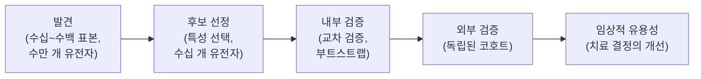
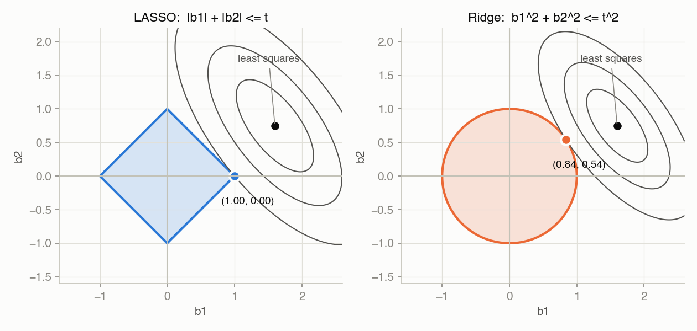
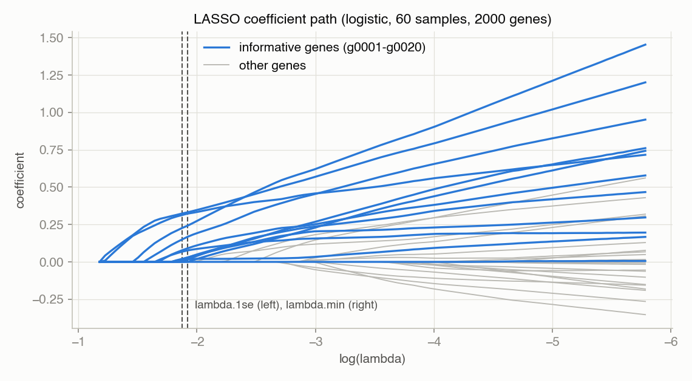
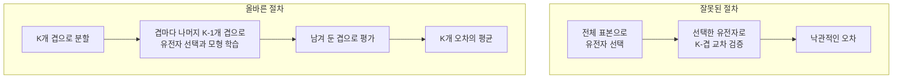
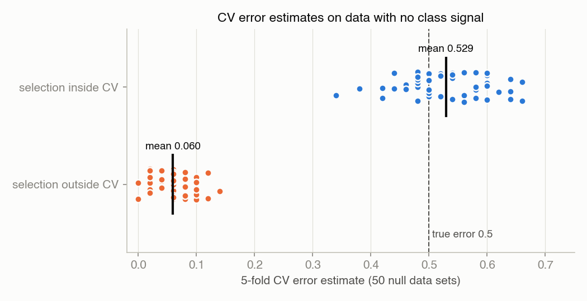

# 10장 — 바이오마커 발굴과 특성 선택

[레포지토리 안내](../../README.ko.md) | [English](Concepts_Lecture.md) | [한국어](Concepts_Lecture.ko.md)

> **최종 수정일:** 2026-11-26

> **학습 목표:**
> 1. 바이오마커를 정의하고 진단, 예후, 예측 바이오마커를 구별할 수 있다
> 2. 변수가 표본보다 훨씬 많은 데이터에서 추정과 분류가 어려워지는 이유를 설명할 수 있다
> 3. 필터, 래퍼, 임베디드 방법의 원리를 설명하고 장단점을 비교할 수 있다
> 4. LASSO와 엘라스틱 넷의 벌점이 계수를 0으로 만드는 이유를 기하학과 연성 임계값 함수로 설명할 수 있다
> 5. 특성 선택을 교차 검증 밖에서 하면 오차가 낙관적으로 추정되는 이유를 설명하고 올바른 절차를 구성할 수 있다
> 6. 선택된 특성 집합의 안정성을 평가하고 검증의 단계를 구별할 수 있다

---

## 목차

- [1. 바이오마커](#1-바이오마커)
  - [1.1 바이오마커의 정의](#11-바이오마커의-정의)
  - [1.2 바이오마커의 종류](#12-바이오마커의-종류)
  - [1.3 예후 바이오마커와 예측 바이오마커의 구별](#13-예후-바이오마커와-예측-바이오마커의-구별)
  - [1.4 발현 데이터에서 바이오마커를 찾는 과정](#14-발현-데이터에서-바이오마커를-찾는-과정)
- [2. 변수가 표본보다 많은 문제](#2-변수가-표본보다-많은-문제)
  - [2.1 고차원 발현 행렬](#21-고차원-발현-행렬)
  - [2.2 최소제곱 추정의 붕괴](#22-최소제곱-추정의-붕괴)
  - [2.3 우연에 의한 완전 분리](#23-우연에-의한-완전-분리)
  - [2.4 세 가지 해결 방향](#24-세-가지-해결-방향)
- [3. 필터 방법](#3-필터-방법)
  - [3.1 원리](#31-원리)
  - [3.2 t 통계량으로 순위 매기기](#32-t-통계량으로-순위-매기기)
  - [3.3 배수 변화](#33-배수-변화)
  - [3.4 FDR로 선택 개수 정하기](#34-fdr로-선택-개수-정하기)
  - [3.5 필터 방법의 한계](#35-필터-방법의-한계)
- [4. 래퍼 방법](#4-래퍼-방법)
  - [4.1 부분집합 탐색](#41-부분집합-탐색)
  - [4.2 전진 선택과 후진 제거](#42-전진-선택과-후진-제거)
  - [4.3 재귀적 특성 제거](#43-재귀적-특성-제거)
  - [4.4 래퍼 방법의 비용과 위험](#44-래퍼-방법의-비용과-위험)
- [5. 임베디드 방법: LASSO와 엘라스틱 넷](#5-임베디드-방법-lasso와-엘라스틱-넷)
  - [5.1 벌점이 붙은 손실 함수](#51-벌점이-붙은-손실-함수)
  - [5.2 릿지 회귀](#52-릿지-회귀)
  - [5.3 LASSO](#53-lasso)
  - [5.4 벌점의 기하학](#54-벌점의-기하학)
  - [5.5 직교 설계에서의 해: 연성 임계값 함수](#55-직교-설계에서의-해-연성-임계값-함수)
  - [5.6 엘라스틱 넷](#56-엘라스틱-넷)
  - [5.7 규제 강도의 선택과 계수 경로](#57-규제-강도의-선택과-계수-경로)
  - [5.8 R로 하는 LASSO 로지스틱 회귀](#58-r로-하는-lasso-로지스틱-회귀)
- [6. 특성 추출](#6-특성-추출)
  - [6.1 주성분을 특성으로 쓰기](#61-주성분을-특성으로-쓰기)
  - [6.2 지도 정보를 쓰는 추출](#62-지도-정보를-쓰는-추출)
  - [6.3 선택과 추출의 비교](#63-선택과-추출의-비교)
- [7. 선택 편향과 교차 검증](#7-선택-편향과-교차-검증)
  - [7.1 선택 편향](#71-선택-편향)
  - [7.2 잘못된 절차와 올바른 절차](#72-잘못된-절차와-올바른-절차)
  - [7.3 시뮬레이션: 신호가 없는 데이터](#73-시뮬레이션-신호가-없는-데이터)
  - [7.4 모든 학습 단계를 교차 검증 안에 두는 원칙](#74-모든-학습-단계를-교차-검증-안에-두는-원칙)
- [8. 안정성과 검증](#8-안정성과-검증)
  - [8.1 선택 결과의 불안정성](#81-선택-결과의-불안정성)
  - [8.2 안정성 선택](#82-안정성-선택)
  - [8.3 검증의 단계](#83-검증의-단계)
  - [8.4 흔한 실수](#84-흔한-실수)
- [개념 적용](#개념-적용)
- [요약](#요약)
- [점검 문제](#점검-문제)
- [참고 문헌](#참고-문헌)

---

<br>

## 1. 바이오마커

### 1.1 바이오마커의 정의

혈당 수치는 당뇨병을 진단하는 데 쓰이고, 혈중 콜레스테롤은 심혈관 질환의 위험을 가늠하는 데 쓰인다. 이처럼 몸에서 측정한 값이 몸 안에서 일어나는 생물학적 과정을 알려 주는 지표 역할을 할 때 그 값을 바이오마커라 부른다.

> **용어 정의:** **바이오마커(biomarker)** 는 정상적인 생물학적 과정, 병적 과정, 또는 노출이나 개입(치료)에 대한 반응의 지표로서 측정되는 정의된 특성이다.

미국 식품의약국(FDA)은 이 정의를 따르면서 분자적, 조직학적, 영상학적, 생리학적 특성이 모두 바이오마커가 될 수 있다고 설명한다 [1]. 같은 설명은 바이오마커가 환자가 어떻게 느끼고, 기능하고, 생존하는지를 직접 평가하는 척도는 아니라는 점도 밝힌다 [1]. 즉 바이오마커는 그 자체가 건강 상태의 결과가 아니라, 결과와 관련된 생물학적 상태를 대신 보여 주는 측정값이다.

이 장이 다루는 바이오마커는 주로 분자 바이오마커이다. 7장에서 보았듯이 전사체 측정은 한 번에 수만 개 유전자의 발현을 측정하므로, 그 가운데 질병과 관련된 소수의 유전자를 찾는 일은 곧 특성 선택 문제가 된다. 여러 유전자를 묶어 하나의 점수로 쓰는 경우 그 유전자 집합을 **유전자 시그니처(gene signature)** 라 한다.

> **용어 정의:** **분자 바이오마커(molecular biomarker)** 는 유전자의 발현 수준, DNA 변이, 단백질이나 대사 물질의 농도처럼 분자 수준에서 측정한 바이오마커이다.

> **용어 정의:** **특성 선택(feature selection)** 은 원래 변수(예: 유전자) 가운데 예측이나 해석에 쓸모 있는 일부만 골라 남기고 나머지는 버리는 방법이다.

### 1.2 바이오마커의 종류

바이오마커는 무엇을 알려 주는지에 따라 분류한다. FDA는 BEST(Biomarkers, EndpointS, and other Tools) 용어집에 따라 감수성 또는 위험, 진단, 모니터링, 예후, 예측, 약력학 또는 반응, 안전성의 일곱 범주를 든다 [1]. 이 가운데 정보학에서 가장 자주 다루는 세 범주는 진단, 예후, 예측 바이오마커이다.

| 범주 | 알려 주는 것 | 시점 | 예 |
|:-----|:-----|:-----|:-----|
| 감수성 또는 위험 (susceptibility/risk) | 아직 병이 없는 사람이 병에 걸릴 가능성 | 발병 전 | 유방암 위험을 높이는 BRCA1 변이 |
| 진단 (diagnostic) | 지금 병이 있는지, 어떤 하위 유형인지 | 현재 | 혈당으로 당뇨병 진단, 발현 패턴으로 백혈병 유형 구분 |
| 모니터링 (monitoring) | 병의 상태나 치료 효과의 변화 | 반복 측정 | 치료 중 반복 측정하는 종양 표지자 |
| 예후 (prognostic) | 치료와 관계없이 앞으로 재발, 진행, 사망 같은 사건이 일어날 가능성 | 미래 | 종양의 크기와 등급 |
| 예측 (predictive) | 특정 치료에 반응할 가능성이 높은 환자 | 치료 선택 전 | 표적 치료제의 표적 유전자 변이 |
| 약력학 또는 반응 (pharmacodynamic/response) | 치료가 생물학적 반응을 일으켰는지 | 치료 중 | 약물 투여 뒤 표적 단백질의 활성 변화 |
| 안전성 (safety) | 치료로 인한 독성이나 부작용 | 치료 중 | 간 독성을 보여 주는 간 효소 수치 |

*표 1. 바이오마커의 일곱 범주*

> **용어 정의:** **진단 바이오마커(diagnostic biomarker)** 는 지금 병이 있는지, 또는 그 병이 어떤 하위 유형인지를 알려 주는 바이오마커이다.

같은 측정값이 여러 범주에 속할 수 있다. 범주는 측정값의 성질이 아니라 그 측정값을 어떤 질문에 쓰는지로 정해지기 때문이다. 예를 들어 어떤 단백질의 혈중 농도는 진단에도, 치료 중 모니터링에도 쓰일 수 있다.

### 1.3 예후 바이오마커와 예측 바이오마커의 구별

예후와 예측은 이름이 비슷해 자주 혼동되지만 알려 주는 대상이 다르다. 통계적으로 말하면 예측 바이오마커는 치료와 표지 사이의 상호작용이 있는 변수이다.

> **용어 정의:** **예후 바이오마커(prognostic biomarker)** 는 어떤 치료를 받든 앞으로의 결과(재발, 진행, 사망 같은 사건)가 좋을지 나쁠지를 알려 주는 바이오마커이다.

> **용어 정의:** **예측 바이오마커(predictive biomarker)** 는 특정 치료의 효과가 그 표지의 값에 따라 달라지는지, 곧 어떤 환자가 그 치료에 반응할 가능성이 높은지를 알려 주는 바이오마커이다.

> **용어 정의:** **상호작용(interaction)** 은 한 변수(예: 치료)가 결과에 미치는 효과가 다른 변수(예: 표지)의 값에 따라 달라지는 관계이다.

다음은 두 가지 치료를 비교한 가상의 임상시험에서 표지 A와 표지 B에 따라 5년 생존율을 나눈 결과이다.

| 표지 | 표지 상태 | 표준 치료 | 신약 | 신약의 효과 (차이) |
|:-----|:-----|-----:|-----:|-----:|
| A | 양성 | 40% | 45% | +5%p |
| A | 음성 | 70% | 75% | +5%p |
| B | 양성 | 40% | 75% | +35%p |
| B | 음성 | 70% | 72% | +2%p |

*표 2. 가상의 임상시험에서 표지 상태와 치료에 따른 5년 생존율*

표지 A의 양성 환자는 어느 치료를 받든 음성 환자보다 생존율이 30%p 낮지만, 신약의 효과는 양성과 음성에서 똑같이 +5%p이다. 따라서 표지 A는 예후 바이오마커이고 예측 바이오마커는 아니다. 표지 B는 표준 치료에서 양성 환자의 생존율이 낮으므로 예후 정보도 담고 있지만, 신약의 효과가 양성에서 +35%p, 음성에서 +2%p로 크게 다르다. 따라서 표지 B는 예측 바이오마커이며, 신약은 B 양성 환자에게 선택적으로 쓰는 것이 합리적이다.

> **주의:** 한 가지 치료만 받은 환자 집단에서 표지와 결과의 관계를 보여도 그 표지가 예측 바이오마커라는 근거가 되지 않는다. 표준 치료만 받은 집단에서는 표지 A와 표지 B가 똑같이 40% 대 70%로 보인다. 예측 바이오마커임을 보이려면 치료를 받은 집단과 받지 않은 집단(또는 다른 치료를 받은 집단)을 모두 관찰하여 치료 효과가 표지에 따라 다른지 확인해야 한다.

### 1.4 발현 데이터에서 바이오마커를 찾는 과정

분자 바이오마커의 발굴은 하나의 분석으로 끝나지 않고 여러 단계를 거친다. 처음에는 적은 수의 표본에서 많은 후보를 측정하여 후보를 좁히고, 뒤로 갈수록 적은 수의 후보를 많은 표본에서 정밀하게 측정한다.



*그림 1. 분자 바이오마커 발굴의 단계*

이 장은 앞의 세 단계, 즉 고차원 발현 데이터에서 후보를 고르고 그 성능을 정직하게 평가하는 방법을 다룬다. 외부 검증과 예측 모형 전체의 평가는 12장에서 다룬다. 발견 단계의 데이터는 보통 다음 모양을 갖는다.

- 표본 $`n`$개(환자와 대조군 등)의 행과 유전자 $`p`$개의 열로 이루어진 발현 행렬 $`X`$($`n \times p`$)가 있다. 생물학에서는 유전자를 행에 두는 경우가 많지만, 이 장은 4장과 6장처럼 표본을 행에 두는 기계학습의 관례를 따른다.
- 각 표본의 반응 변수 $`y`$가 있다. 이 장에서는 주로 대조군(control)과 환자군(case)의 두 클래스이다.
- 발현 값은 7장에서 설명한 측정값을 로그 변환하고 정규화한 값이다.

---

<br>

## 2. 변수가 표본보다 많은 문제

### 2.1 고차원 발현 행렬

발현 데이터의 가장 큰 특징은 변수의 수 $`p`$가 표본의 수 $`n`$보다 훨씬 많다는 것이다. 환자 60명에서 유전자 2만 개를 측정하면 $`p/n \approx 333`$이다. 이런 상황을 $`p \gg n`$ 문제라 부르며, 4장의 차원의 저주가 가장 극단적으로 나타나는 경우이다.

이 장의 R 예제는 다음 모의 데이터를 쓴다. 표본은 대조군 30개와 환자군 30개이고 유전자는 2,000개이다. 모든 값은 표준정규분포에서 뽑고, 앞의 20개 유전자(`g0001`~`g0020`)만 환자군에서 평균이 1만큼 높다. 실제 데이터와 달리 어떤 유전자가 정보를 가진 유전자인지 알고 있으므로, 방법이 그 유전자를 찾아내는지 확인할 수 있다. 같은 규칙으로 만든 200개 표본의 독립된 테스트 세트도 만든다.

```r
sim_expr <- function(n, p = 2000, n_inf = 20, shift = 1) {
  y <- factor(rep(c("control", "case"), each = n / 2),
              levels = c("control", "case"))
  X <- matrix(rnorm(n * p), nrow = n, ncol = p)
  colnames(X) <- sprintf("g%04d", 1:p)
  X[y == "case", 1:n_inf] <- X[y == "case", 1:n_inf] + shift
  list(X = X, y = y)
}
set.seed(2025)
train <- sim_expr(60)
test  <- sim_expr(200)
X <- train$X; y <- train$y
dim(X)
table(y)
```

```text
[1]   60 2000
y
control    case 
     30      30 
```

`sim_expr()`는 표본 수 `n`, 유전자 수 `p`, 정보를 가진 유전자 수 `n_inf`, 평균 차이 `shift`를 받는다. `rnorm(n * p)`로 만든 값을 `n`행 `p`열 행렬에 채운 뒤, 환자군 행(`y == "case"`)의 앞쪽 `n_inf`개 열에만 `shift`를 더한다. `set.seed(2025)`는 난수를 고정하여 같은 결과가 다시 나오게 하고, 훈련 데이터 `train`과 테스트 데이터 `test`를 차례로 만든다.

### 2.2 최소제곱 추정의 붕괴

5장의 다중 선형 회귀에서 최소제곱 추정량은 정규 방정식 $`X^\top X \hat\beta = X^\top y`$의 해이고, $`X^\top X`$가 역행렬을 가지면 $`\hat\beta = (X^\top X)^{-1} X^\top y`$로 하나로 정해진다. 그런데 $`X^\top X`$는 $`p \times p`$ 행렬이고 그 계수(rank)는 $`X`$의 계수와 같아서 $`\min(n, p)`$를 넘을 수 없다. $`p > n`$이면 $`X^\top X`$의 계수는 많아야 $`n`$이므로 $`p \times p`$ 행렬이 역행렬을 갖지 못한다.

> **[선형대수학]** 행렬의 계수는 선형 독립인 열(또는 행)의 최대 개수이다. $`\mathrm{rank}(X^\top X) = \mathrm{rank}(X) \le \min(n, p)`$이고, 정사각 행렬은 계수가 크기와 같을 때만 역행렬을 갖는다. 계수가 크기보다 작으면 영공간(null space)에 0이 아닌 벡터가 있어서, 해가 하나 있으면 그 해에 영공간의 벡터를 더한 것도 모두 해가 된다.

가장 작은 예로 확인한다. 표본 2개, 변수 3개이고

```math
X = \begin{pmatrix} 1 & 0 & 1 \\ 0 & 1 & 1 \end{pmatrix}, \qquad y = \begin{pmatrix} 1 \\ 2 \end{pmatrix}
```

라 하자. $`\beta = (1, 2, 0)^\top`$이면 $`X\beta = (1, 2)^\top = y`$이므로 잔차가 0이다. 그런데 $`v = (1, 1, -1)^\top`$은 $`Xv = (1 + 0 - 1, 0 + 1 - 1)^\top = (0, 0)^\top`$을 만족하므로, 모든 실수 $`t`$에 대해 $`\beta + t v`$도 잔차가 0인 해이다. $`t = 1`$이면 $`(2, 3, -1)^\top`$, $`t = -2`$이면 $`(-1, 0, 2)^\top`$이다. 훈련 데이터를 완벽하게 설명하는 계수가 무수히 많고, 그 가운데 어느 것이 새 데이터를 잘 예측하는지는 데이터만으로 알 수 없다.

이 현상은 일반적이다. $`p \ge n`$이고 $`X`$의 행이 선형 독립이면 어떤 $`y`$든 훈련 오차가 0인 해가 존재한다. 훈련 오차 0은 6장의 과적합이 극단에 이른 상태이며, 훈련 데이터의 적합도가 모형의 질에 관해 아무것도 알려 주지 않는다는 뜻이다.

### 2.3 우연에 의한 완전 분리

변수가 많으면 아무 관련이 없는 변수 가운데서도 두 클래스를 완벽하게 나누는 변수가 우연히 나타난다. 환자군 5명과 대조군 5명의 표본에서 어떤 유전자의 값이 질병과 무관한 연속 확률변수라 하자. 10개 값의 순위는 $`10!`$가지 순열이 모두 같은 확률로 나타나고, 환자군 5명이 차지하는 순위 집합은 $`\binom{10}{5} = 252`$가지가 같은 확률로 나타난다. 그 가운데 그 유전자 하나로 두 클래스가 완전히 나뉘는 경우는 환자군이 위쪽 5개 순위를 모두 차지하거나 아래쪽 5개 순위를 모두 차지하는 2가지이다. 따라서 한 유전자가 우연히 완전 분리를 만들 확률은

```math
P(\text{완전 분리}) = \frac{2}{\binom{10}{5}} = \frac{2}{252} \approx 0.00794
```

이다. 유전자가 20,000개이고 서로 독립이면 완전 분리를 만드는 유전자 수의 기댓값은 $`20000 \times 2/252 \approx 158.7`$개이다. 아래 코드는 이 계산을 시뮬레이션으로 확인한다.

```r
set.seed(1)
yy <- rep(0:1, each = 5)
Z <- matrix(rnorm(10 * 20000), nrow = 10)
separates <- apply(Z, 2, function(g)
  max(g[yy == 0]) < min(g[yy == 1]) || max(g[yy == 1]) < min(g[yy == 0]))
sum(separates)
20000 * 2 / choose(10, 5)
```

```text
[1] 145
[1] 158.7302
```

`Z`는 10개 표본과 20,000개 유전자의 정규 난수 행렬이고, `apply(Z, 2, ...)`는 열(유전자)마다 함수를 적용한다. 함수는 대조군의 최댓값이 환자군의 최솟값보다 작거나, 그 반대이면 `TRUE`를 돌려준다. 신호가 전혀 없는 데이터인데도 145개 유전자가 두 클래스를 완벽하게 나누었으며, 이는 기댓값 158.7과 가깝다. 이 유전자들은 이 10명에서만 완벽할 뿐 새 환자에게는 아무 정보도 주지 않는다.

> **핵심:** $`p \gg n`$에서는 훈련 데이터를 완벽하게 설명하는 모형이나 변수가 우연만으로도 많이 생긴다. 그러므로 바이오마커 후보의 가치는 그것을 고르는 데 쓰지 않은 데이터에서만 평가할 수 있다.

### 2.4 세 가지 해결 방향

$`p \gg n`$ 문제를 다루는 방법은 크게 세 방향으로 나뉜다.

1. **특성 선택:** 원래 유전자 가운데 일부만 남긴다. 남은 변수가 실제 유전자이므로 해석이 쉽고, 바이오마커 후보 목록이 곧 결과가 된다. 3\~5절에서 다룬다.
2. **특성 추출:** 원래 변수 대신 그 조합으로 만든 새 변수를 쓴다. 4장의 PCA가 대표적이며 6절에서 다룬다.
3. **규제(regularization):** 모든 변수를 쓰되 계수의 크기에 벌점을 주어 해를 하나로 정하고 분산을 줄인다. 5절의 릿지 회귀가 여기에 속하며, LASSO는 규제이면서 동시에 특성 선택을 한다.

> **용어 정의:** **특성 추출(feature extraction)** 은 원래 변수를 조합하여 적은 수의 새 변수를 만드는 방법이다.

특성 선택 방법은 선택을 모형 학습과 어떻게 결합하는지에 따라 세 가지로 나눈다.

> **용어 정의:** **필터 방법(filter method)** 은 모형과 무관한 통계량으로 변수의 순위를 매겨 위쪽의 변수를 고르는 특성 선택 방법이다.

> **용어 정의:** **래퍼 방법(wrapper method)** 은 모형의 성능을 기준으로 변수 부분집합을 탐색하는 특성 선택 방법이다.

> **용어 정의:** **임베디드 방법(embedded method)** 은 모형을 학습하는 과정 자체에서 변수를 고르는 특성 선택 방법이다.

---

<br>

## 3. 필터 방법

### 3.1 원리

필터 방법은 유전자마다 클래스와의 관련성을 나타내는 통계량을 따로 계산하고, 그 값으로 순위를 매겨 위쪽의 유전자를 고른다. 계산이 유전자마다 독립이므로 수만 개 유전자에도 빠르게 적용할 수 있고, 어떤 분류 모형과도 결합할 수 있다. 연속형 발현 값과 두 클래스에는 t 통계량, 배수 변화, Wilcoxon 순위합 통계량이 흔히 쓰이고, 클래스가 셋 이상이면 F 통계량을 쓴다.

필터 방법을 쓰려면 두 가지를 정해야 한다. 하나는 순위를 매길 통계량이고, 다른 하나는 위에서 몇 개를 고를지이다. 두 번째 결정은 개수를 미리 정하거나(예: 상위 50개), 유의성 기준으로 정하거나(3.4절), 교차 검증으로 정한다(7절).

### 3.2 t 통계량으로 순위 매기기

환자군의 표본 평균, 표본 분산, 표본 수를 $`\bar x_1, s_1^2, n_1`$, 대조군의 것을 $`\bar x_0, s_0^2, n_0`$라 하면 Welch의 t 통계량은

```math
t = \frac{\bar x_1 - \bar x_0}{\sqrt{s_1^2 / n_1 + s_0^2 / n_0}}
```

이다. 분자는 두 집단의 평균 차이이고, 분모는 그 차이의 표준오차이다. 따라서 $`t`$는 평균 차이가 우연한 변동에 비해 몇 배나 큰지를 나타내며, 순위는 보통 $`\lvert t \rvert`$로 매긴다. 이 통계량은 유전자마다 분산이 다른 발현 데이터에 적합하다.

> **용어 정의:** **Welch의 t 통계량(Welch's t statistic)** 은 두 집단의 평균 차이를 그 차이의 표준오차 $`\sqrt{s_1^2 / n_1 + s_0^2 / n_0}`$로 나눈 값으로, 두 집단의 분산이 같다고 가정하지 않는다.

> **[확률및통계]** 두 집단의 평균이 같다는 귀무가설 아래에서 Welch의 t 통계량은 근사적으로 t 분포를 따르며, 자유도는 Welch-Satterthwaite 식 $`\nu = (s_1^2/n_1 + s_0^2/n_0)^2 / \{ (s_1^2/n_1)^2/(n_1 - 1) + (s_0^2/n_0)^2/(n_0 - 1) \}`$으로 근사한다. 유의확률은 이 분포에서 관측된 $`\lvert t \rvert`$보다 극단적인 값이 나올 확률이며, 9장에서 자세히 다룬다.

두 유전자를 손으로 비교한다. 값은 로그 척도의 발현 값이고 집단마다 4개 표본이 있다.

| 유전자 | 환자군 | 대조군 | $`\bar x_1`$ | $`\bar x_0`$ | $`s_1^2`$ | $`s_0^2`$ |
|:-----|:-----|:-----|-----:|-----:|-----:|-----:|
| A | 8.2, 8.9, 9.4, 8.7 | 7.1, 7.6, 7.3, 7.0 | 8.80 | 7.25 | 0.2467 | 0.0700 |
| B | 7.0, 10.4, 6.1, 9.7 | 5.1, 4.4, 8.9, 3.8 | 8.30 | 5.55 | 4.3000 | 5.2700 |

*표 3. t 통계량을 계산할 두 유전자의 발현 값*

유전자 A의 표준오차는 $`\sqrt{0.2467/4 + 0.0700/4} = \sqrt{0.0792} = 0.2814`$이므로 $`t = 1.55 / 0.2814 = 5.51`$이다. 유전자 B의 표준오차는 $`\sqrt{4.30/4 + 5.27/4} = \sqrt{2.3925} = 1.5468`$이므로 $`t = 2.75 / 1.5468 = 1.78`$이다. Welch 자유도는 각각 4.58과 5.94이고, 양측 유의확률은 A가 0.0035, B가 0.126이다. 평균 차이는 B가 2.75로 A의 1.55보다 크지만, B는 집단 안의 변동이 커서 t 통계량은 A가 훨씬 크다.

### 3.3 배수 변화

> **용어 정의:** **배수 변화(fold change)** 는 원래 척도에서 한 집단의 평균이 다른 집단의 평균의 몇 배인지를 나타낸 두 평균의 비이다.

생물학자는 평균 차이를 배수 변화로 표현하는 경우가 많다. 원래 척도의 발현 값에서 환자군 평균이 대조군 평균의 4배이면 배수 변화는 4이다. 발현 값을 밑이 2인 로그로 변환해 두었다면 로그 척도의 평균 차이가 곧 **로그 배수 변화(log fold change)** 이다.

```math
\log_2 \mathrm{FC} = \bar x_1 - \bar x_0 \quad (\text{값이 } \log_2 \text{ 척도일 때}), \qquad \mathrm{FC} = 2^{\bar x_1 - \bar x_0}
```

표 3에서 유전자 A의 로그 배수 변화는 1.55이므로 배수 변화는 $`2^{1.55} = 2.93`$배이고, 유전자 B는 $`2^{2.75} = 6.73`$배이다. 로그 배수 변화는 증가와 감소를 대칭으로 나타낸다는 장점이 있다. 2배 증가는 $`+1`$, 절반으로 감소는 $`-1`$이지만, 배수 변화로는 2와 0.5가 되어 대칭이 아니다.

배수 변화만으로 순위를 매기면 유전자 B처럼 변동이 큰 유전자가 위로 올라오고, t 통계량만으로 순위를 매기면 분산이 우연히 매우 작은 유전자에서 생물학적으로 의미 없는 작은 차이가 위로 올라올 수 있다. 그래서 실제 분석에서는 두 기준을 함께 쓴다. 가로축에 로그 배수 변화, 세로축에 $`-\log_{10} p`$를 놓은 **화산 그림(volcano plot)** 은 두 기준을 한 그림에 보여 주며, 오른쪽 위와 왼쪽 위에 있는 유전자가 차이가 크면서 유의한 유전자이다.

### 3.4 FDR로 선택 개수 정하기

유전자 2,000개를 각각 유의수준 0.05로 검정하면, 차이가 없는 유전자가 1,980개일 때 그 가운데 평균 99개가 우연히 유의하게 나온다. 그래서 위에서 몇 개를 고를지 정할 때는 9장의 **허위 발견률(false discovery rate, FDR)** 을 쓴다. Benjamini-Hochberg 절차로 유의확률을 보정한 값(q 값)이 0.05보다 작은 유전자를 고르면, 고른 유전자 가운데 거짓 발견의 비율의 기댓값이 5% 이하로 제어된다. 절차와 그 성립 조건은 9장에서 다루고, 여기서는 그 결과를 선택 기준으로 쓴다.

```r
welch <- function(g) {
  tt <- t.test(g[y == "case"], g[y == "control"])
  c(lfc = mean(g[y == "case"]) - mean(g[y == "control"]),
    t = unname(tt$statistic), p = tt$p.value)
}
res <- as.data.frame(t(apply(X, 2, welch)))
res$q <- p.adjust(res$p, method = "BH")
res <- res[order(res$p), ]
signif(head(res, 8), 3)
sel <- rownames(res)[res$q < 0.05]
length(sel)
sum(sel %in% sprintf("g%04d", 1:20))
```

```text
       lfc    t        p        q
g0003 1.51 5.95 1.81e-07 0.000312
g0014 1.21 5.78 3.12e-07 0.000312
g0007 1.01 4.27 7.45e-05 0.029100
g0019 1.22 4.20 9.32e-05 0.029100
g0009 1.05 4.19 9.93e-05 0.029100
g0018 1.12 4.21 9.98e-05 0.029100
g0020 1.06 4.22 1.02e-04 0.029100
g0016 1.08 4.05 1.57e-04 0.039200
[1] 8
[1] 8
```

`welch()`는 유전자 하나의 값 벡터 `g`를 받아 로그 배수 변화(`lfc`), Welch t 통계량(`t`), 유의확률(`p`)을 돌려준다. `t.test()`는 기본값이 Welch 검정이다. `apply(X, 2, welch)`는 2,000개 열마다 이 함수를 적용하여 3행 2,000열 행렬을 만들고, `t()`로 뒤집어 유전자가 행인 데이터 프레임으로 바꾼다. `p.adjust(..., method = "BH")`가 Benjamini-Hochberg q 값을 계산한다.

결과를 보면 q 값이 0.05보다 작은 유전자는 8개이고 모두 실제로 정보를 가진 유전자이다. 정보를 가진 유전자는 20개였으므로 12개는 놓쳤다. 평균 차이가 1인 유전자도 표본 30 대 30에서는 t 통계량이 약 3.9를 중심으로 흩어지므로, 2,000번의 검정에 대한 보정을 통과하지 못하는 경우가 많다. 첫 행의 q 값이 유의확률에서 계산한 $`1.81 \times 10^{-7} \times 2000 / 1 = 3.62 \times 10^{-4}`$이 아니라 $`3.12 \times 10^{-4}`$인 것은 BH 절차가 q 값을 순위에 대해 단조가 되도록 뒤쪽 순위의 값과 비교하여 작은 쪽을 택하기 때문이다($`3.12 \times 10^{-7} \times 2000 / 2 = 3.12 \times 10^{-4}`$).

### 3.5 필터 방법의 한계

필터 방법은 유전자를 하나씩 따로 보기 때문에 다음 한계가 있다.

- **중복:** 서로 상관이 높은 유전자들이 모두 위쪽에 올라온다. 같은 경로에서 함께 움직이는 유전자 10개를 고르면 정보는 사실상 하나인데 10개 자리를 차지한다.
- **상호작용의 무시:** 혼자서는 클래스와 관련이 없지만 다른 유전자와 함께 쓸 때 정보를 주는 유전자를 놓친다. 예를 들어 두 유전자의 값이 모두 높거나 모두 낮으면 환자이고 하나만 높으면 대조군인 경우(XOR 형태), 각 유전자의 평균은 두 클래스에서 같아 t 통계량이 0에 가깝다.
- **모형과의 불일치:** 필터의 기준(평균 차이)과 최종 분류기가 쓰는 정보(예: 결정 경계)가 다를 수 있다.

그런데도 필터 방법은 계산이 가볍고 결과를 설명하기 쉬워 발현 데이터 분석의 첫 단계로 가장 많이 쓰인다. 다른 방법을 쓰기 전에 유전자 수를 수천에서 수백으로 줄이는 사전 거르기에도 쓰인다. 이때도 거르기는 7절의 원칙에 따라 교차 검증 안에서 해야 한다.

---

<br>

## 4. 래퍼 방법

### 4.1 부분집합 탐색

래퍼 방법은 분류 모형을 상자처럼 감싸고(wrap), 변수 부분집합마다 모형을 학습하여 그 성능으로 부분집합을 평가한다. 성능은 교차 검증 오차나 검증 세트 오차로 잰다. 가장 확실한 방법은 모든 부분집합을 평가하는 것이지만, 변수 $`p`$개의 부분집합은 공집합을 포함해 $`2^p`$개이다. $`p = 20`$이면 약 105만 개, $`p = 2000`$이면 $`2^{2000} \approx 10^{602}`$개이므로 발현 데이터에서 전수 탐색은 불가능하다. 그래서 래퍼 방법은 탐욕적(greedy) 탐색으로 부분집합을 하나씩 바꾸어 간다.

### 4.2 전진 선택과 후진 제거

> **용어 정의:** **전진 선택(forward selection)** 은 빈 집합에서 시작하여, 매 단계 아직 들어가지 않은 변수 가운데 추가했을 때 성능이 가장 좋아지는 변수를 하나씩 더하는 탐욕적 탐색이다.

변수 $`k`$개를 고르기까지 모형을 $`p + (p - 1) + \cdots + (p - k + 1)`$번 학습한다. $`p = 2000`$, $`k = 10`$이면 19,955번이다.

> **용어 정의:** **후진 제거(backward elimination)** 는 모든 변수에서 시작하여, 매 단계 뺐을 때 성능이 가장 덜 나빠지는(또는 가장 좋아지는) 변수를 하나씩 빼는 탐욕적 탐색이다.

후진 제거는 출발점에서 모든 변수를 쓰는 모형을 학습해야 하므로, $`p > n`$인 최소제곱 회귀처럼 그 모형이 정의되지 않으면 쓸 수 없다.

두 방법 모두 한 번 내린 결정을 되돌리지 않으므로 최적 부분집합을 보장하지 않는다. 예를 들어 두 변수가 함께 있을 때만 유용한 경우, 전진 선택은 첫 단계에서 둘 중 어느 것도 고르지 않을 수 있다.

### 4.3 재귀적 특성 제거

> **용어 정의:** **재귀적 특성 제거(recursive feature elimination, RFE)** 는 학습한 모형이 변수마다 주는 중요도(선형 모형이면 계수의 절댓값)를 보고 가장 덜 중요한 변수를 여러 개씩 빼는 과정을 되풀이하여, 후진 제거의 비용을 줄인 방법이다.

RFE는 변수 하나를 뺄 때마다 모든 후보를 다시 평가하지 않으므로 계산이 훨씬 적다. Guyon 등은 선형 서포트 벡터 머신(SVM)과 결합한 RFE를 암 분류를 위한 유전자 선택에 제안했으며, 백혈병 데이터에서 유전자 2개로 leave-one-out 오류 0을 얻었다고 보고했다 [2].

RFE의 알고리즘은 다음과 같다.

1. 남길 변수 개수의 목록 $`s_1 > s_2 > \cdots > s_m`$을 정하고, 현재 변수 집합을 전체 변수로 둔다.
2. 현재 변수로 선형 분류기를 학습하고, 변수마다 가중치의 절댓값 $`\lvert w_j \rvert`$를 구한다.
3. $`\lvert w_j \rvert`$가 큰 순서로 다음 목표 개수 $`s_i`$개만 남긴다.
4. 목표 개수가 남아 있으면 2단계로 돌아간다.
5. 각 크기의 변수 집합을 검증 데이터로 평가하여 크기를 정한다.

> **[기계학습]** 선형 SVM은 두 클래스 사이의 여백(margin)을 최대로 하는 초평면 $`w^\top x + b = 0`$을 찾는다. 학습이 끝나면 $`w = \sum_i \alpha_i y_i x_i`$로 쓸 수 있고, 계수 $`\alpha_i`$가 0이 아닌 훈련 표본을 서포트 벡터라 한다. 변수를 같은 척도로 맞추어 두면 $`\lvert w_j \rvert`$가 큰 변수일수록 결정 함수에 크게 기여한다.

```r
library(e1071)
svm_rfe <- function(X, y, sizes) {
  keep <- colnames(X)
  path <- list()
  for (s in sizes) {
    fit <- svm(X[, keep], y, kernel = "linear", cost = 1, scale = TRUE)
    w <- drop(t(fit$coefs) %*% fit$SV)      # 선형 SVM에서 각 유전자의 가중치
    keep <- keep[order(abs(w), decreasing = TRUE)][1:s]
    path[[as.character(s)]] <- keep
  }
  path
}
sizes <- c(1000, 500, 250, 100, 50, 20, 10, 5)
path <- svm_rfe(X, y, sizes)
test_err <- sapply(path, function(g) {
  fit <- svm(X[, g, drop = FALSE], y, kernel = "linear", cost = 1)
  mean(predict(fit, test$X[, g, drop = FALSE]) != test$y)
})
true_hits <- sapply(path, function(g) sum(g %in% sprintf("g%04d", 1:20)))
rbind(test_err = round(test_err, 3), true_hits = true_hits)
```

```text
           1000  500    250    100     50     20    10     5
test_err   0.24  0.2  0.125  0.065  0.085  0.105 0.145 0.155
true_hits 20.00 20.0 20.000 20.000 15.000 11.000 7.000 4.000
```

`svm()`은 e1071 패키지의 SVM 함수이고, `kernel = "linear"`이면 선형 SVM을 학습한다. `fit$coefs`는 서포트 벡터마다의 $`\alpha_i y_i`$이고 `fit$SV`는 (척도를 맞춘) 서포트 벡터 행렬이므로, 둘을 곱한 `w`가 위 상자의 가중치 벡터 $`w`$이다. 반복문은 `sizes`의 각 크기마다 모형을 다시 학습하고, 가중치 절댓값이 큰 유전자만 남긴다. 마지막으로 각 크기의 유전자 집합으로 SVM을 다시 학습하여 독립된 테스트 세트 200개의 오분류율을 계산한다.

유전자를 100개까지 줄이는 동안 정보를 가진 20개는 모두 남았고 테스트 오차는 0.24에서 0.065로 줄었다. 그보다 더 줄이면 정보를 가진 유전자도 빠지기 시작하여 오차가 다시 커진다. 1,000개를 쓸 때 오차가 큰 것은 정보가 없는 유전자 980개의 가중치가 결정 함수에 잡음을 더하여 결정 경계를 흐리기 때문이다. 여기서는 독립된 테스트 세트로 크기를 비교했지만, 실제로는 테스트 세트가 따로 없으므로 크기의 선택도 교차 검증 안에서 해야 한다(7절).

### 4.4 래퍼 방법의 비용과 위험

래퍼 방법은 최종 모형의 성능을 직접 기준으로 삼는다는 장점이 있지만, 두 가지 대가가 따른다.

- **계산 비용:** 부분집합마다 모형을 학습하고 교차 검증까지 하면 학습 횟수가 크게 늘어난다. RFE는 단계마다 많은 변수를 한꺼번에 빼서 이 비용을 줄인다.
- **선택의 과적합:** 수많은 부분집합 가운데 표본 오차 덕분에 우연히 좋은 성능을 보인 부분집합이 뽑히기 쉽다. 평가에 쓴 데이터로 고른 부분집합의 성능을 다시 그 데이터로 보고하면 낙관적으로 추정된다. 이 문제는 7절의 선택 편향과 같은 원리이다.

---

<br>

## 5. 임베디드 방법: LASSO와 엘라스틱 넷

### 5.1 벌점이 붙은 손실 함수

> **용어 정의:** **벌점 회귀(penalized regression)** 는 손실 함수에 계수의 크기에 대한 벌점 항을 더한 목적 함수를 최소화하여 계수를 추정하는 회귀이다.

임베디드 방법은 모형을 학습하는 최적화 문제 안에 변수 선택을 넣는다. 가장 널리 쓰이는 것은 계수에 벌점을 주는 벌점 회귀이다. 선형 회귀에서는 잔차 제곱합에 벌점 항을 더한 목적 함수를 최소화한다.

```math
\hat\beta(\lambda) = \underset{\beta_0, \beta}{\text{argmin}} \; \frac{1}{2} \sum_{i=1}^{n} \left( y_i - \beta_0 - \sum_{j=1}^{p} x_{ij} \beta_j \right)^2 + \lambda \, P(\beta)
```

$`P(\beta)`$는 계수의 크기를 재는 벌점 함수이고, $`\lambda \ge 0`$는 규제 매개변수이다. 절편 $`\beta_0`$에는 벌점을 주지 않는다. 분류 문제에서는 잔차 제곱합 대신 로지스틱 회귀의 음의 로그우도를 쓴다. R의 glmnet 패키지는 손실 항을 표본 수 $`n`$으로 나눈 목적 함수를 쓰므로, glmnet의 $`\lambda`$는 위 식의 $`\lambda`$를 $`n`$으로 나눈 값에 해당한다.

> **용어 정의:** **규제 매개변수(regularization parameter)** 는 벌점 회귀에서 벌점의 강도를 정하는 값 $`\lambda \ge 0`$으로, $`\lambda = 0`$이면 벌점이 없는 보통의 추정(선형 회귀에서는 최소제곱)이 되고 $`\lambda`$가 커질수록 계수가 0 쪽으로 줄어든다.

> **주의:** 벌점은 계수의 크기에 매겨지므로 변수의 척도에 따라 결과가 달라진다. 단위가 다른 변수가 섞여 있으면 학습 전에 각 변수를 평균 0, 표준편차 1로 표준화해야 한다. R의 glmnet 패키지는 기본값으로 내부에서 표준화하고 계수를 원래 척도로 되돌려 보고한다.

### 5.2 릿지 회귀

> **용어 정의:** **릿지 회귀(ridge regression)** 는 계수 제곱합에 벌점을 주는 L2 벌점 $`P(\beta) = \frac{1}{2} \sum_j \beta_j^2`$를 쓰는 벌점 회귀이다.

릿지 회귀의 목적 함수는 미분 가능하므로 기울기를 0으로 두면 닫힌 해를 얻는다. 변수를 중심화하여 절편을 따로 두면

```math
\hat\beta_{\text{ridge}} = (X^\top X + \lambda I)^{-1} X^\top y
```

이다. $`X^\top X`$는 양의 준정부호이므로 고윳값이 모두 0 이상이고, $`\lambda I`$를 더하면 모든 고윳값이 $`\lambda`$ 이상이 된다. 따라서 $`\lambda > 0`$이면 $`p > n`$이어도 $`X^\top X + \lambda I`$는 역행렬을 갖고, 2.2절의 무수히 많은 해 가운데 하나가 정해진다. 그러나 릿지 회귀의 계수는 0에 가까워질 뿐 정확히 0이 되지 않으므로, 2,000개 유전자를 모두 쓰는 모형이 나오고 바이오마커 후보를 고르지는 못한다.

### 5.3 LASSO

> **용어 정의:** **LASSO**는 계수 절댓값의 합 $`\sum_j \lvert \beta_j \rvert`$에 벌점을 주어 계수를 줄이면서 일부 계수를 정확히 0으로 만드는 벌점 회귀이다. 이름은 least absolute shrinkage and selection operator의 약자이다.

Tibshirani는 계수 절댓값의 합이 일정한 값을 넘지 않는다는 제약 아래에서 잔차 제곱합을 최소화하는 방법으로 LASSO를 제안했으며, 이 제약 때문에 일부 계수가 정확히 0이 되어 해석하기 쉬운 모형이 나온다고 밝혔다 [3]. 계수가 0인 변수는 모형에서 빠지므로 LASSO는 추정과 변수 선택을 한 번에 한다. 이것이 LASSO가 임베디드 방법의 대표인 이유이다.

LASSO에는 $`p > n`$에서 중요한 성질이 하나 있다. Zou와 Hastie는 $`p > n`$일 때 LASSO가 포화되기 전까지 많아야 $`n`$개의 변수만 고른다고 지적했다 [4]. 표본이 60개이면 LASSO가 고르는 유전자는 60개를 넘지 못한다. 실제로 관련된 유전자가 그보다 많으면 일부를 놓칠 수밖에 없다.

### 5.4 벌점의 기하학

LASSO가 계수를 정확히 0으로 만드는 이유는 벌점을 제약으로 바꾸어 그려 보면 드러난다. 각 $`\lambda`$에 대해 그와 같은 해를 주는 $`t`$가 있어서, 벌점 문제는 다음 제약 문제와 같다.

```math
\min_{\beta} \; \sum_{i=1}^{n} (y_i - x_i^\top \beta)^2 \quad \text{subject to} \quad \sum_{j} \lvert \beta_j \rvert \le t \;\; (\text{LASSO}), \qquad \sum_{j} \beta_j^2 \le t^2 \;\; (\text{릿지})
```

변수가 2개이면 잔차 제곱합의 등고선은 최소제곱 추정값 $`\hat\beta_{\text{OLS}}`$를 중심으로 하는 타원이다. 해는 타원을 점점 키워 가다가 제약 영역에 처음 닿는 점이다. LASSO의 제약 영역은 꼭짓점이 좌표축 위에 있는 마름모이고, 릿지의 제약 영역은 원이다.



*그림 2. LASSO와 릿지의 제약 영역과 잔차 제곱합 등고선*

그림 2는 $`\hat\beta_{\text{OLS}} = (1.6, 0.75)`$, $`t = 1`$인 예이다. 마름모는 꼭짓점이 뾰족하게 튀어나와 있으므로, 타원이 처음 닿는 점이 꼭짓점 $`(1, 0)`$이 되기 쉽다. 꼭짓점에서는 $`\beta_2 = 0`$이므로 변수 2가 모형에서 빠진다. 원에는 꼭짓점이 없으므로 접점 $`(0.84, 0.54)`$처럼 두 계수가 모두 0이 아닌 점에서 만나는 것이 일반적이다. 차원이 높아지면 L1 제약 영역의 꼭짓점과 모서리가 훨씬 많아지므로, LASSO의 해는 많은 계수가 0인 점에 놓이기 쉽다.

### 5.5 직교 설계에서의 해: 연성 임계값 함수

변수들이 서로 직교하고 각각 길이가 1인 특수한 경우($`X^\top X = I`$)에는 두 방법의 해를 식으로 쓸 수 있어 차이가 분명해진다. 최소제곱 추정값을 $`z_j = x_j^\top y`$라 하면 목적 함수가 변수마다 분리되어 $`\frac{1}{2}(z_j - \beta_j)^2 + \lambda P(\beta_j)`$를 각각 최소화하면 된다.

- 릿지($`P = \frac{1}{2}\beta_j^2`$)는 미분하여 $`-(z_j - \beta_j) + \lambda \beta_j = 0`$에서 $`\hat\beta_j = z_j / (1 + \lambda)`$이다. 모든 계수가 같은 비율로 줄어든다.
- LASSO($`P = \lvert \beta_j \rvert`$)는 $`\beta_j = 0`$에서 미분할 수 없으므로 경우를 나눈다. $`\beta_j > 0`$이면 $`\beta_j = z_j - \lambda`$이고 이것이 양수여야 하므로 $`z_j > \lambda`$일 때만 가능하다. $`\beta_j < 0`$이면 $`\beta_j = z_j + \lambda`$이고 $`z_j < -\lambda`$일 때만 가능하다. $`\lvert z_j \rvert \le \lambda`$이면 0이 최솟값이다.

LASSO의 해를 한 식으로 쓰면 다음 연성 임계값 함수가 된다.

```math
\hat\beta_j = S(z_j, \lambda) = \mathrm{sign}(z_j) \, \bigl( \lvert z_j \rvert - \lambda \bigr)_+, \qquad (a)_+ = \max(a, 0)
```

> **용어 정의:** **연성 임계값 함수(soft-thresholding function)** 는 값 $`z`$를 $`\lambda`$만큼 0 쪽으로 옮기되 0을 넘어가면 0으로 자르는 함수 $`S(z, \lambda) = \mathrm{sign}(z) (\lvert z \rvert - \lambda)_+`$이다.

> **[미적분학]** $`f(\beta) = \lvert \beta \rvert`$는 $`\beta = 0`$에서 왼쪽 미분계수 $`-1`$과 오른쪽 미분계수 $`+1`$이 달라 미분할 수 없다. 이런 점에서는 두 값 사이의 모든 기울기 $`[-1, 1]`$을 허용하는 부분 미분(subgradient)으로 최적 조건을 쓴다. $`\beta_j = 0`$이 최적일 조건은 $`0 \in -(z_j - 0) + \lambda [-1, 1]`$, 즉 $`\lvert z_j \rvert \le \lambda`$이다.

$`z = (3, 1.2, -0.4)`$, $`\lambda = 1`$인 경우를 계산하면 다음과 같다.

| 변수 | $`z_j`$ | 릿지 $`z_j / (1 + \lambda)`$ | LASSO $`S(z_j, \lambda)`$ |
|:-----|-----:|-----:|-----:|
| 1 | 3.0 | 1.5 | 2.0 |
| 2 | 1.2 | 0.6 | 0.2 |
| 3 | -0.4 | -0.2 | 0 |

*표 4. 직교 설계에서 릿지와 LASSO의 계수 ($`\lambda = 1`$)*

릿지는 세 계수를 모두 절반으로 줄이므로 작은 계수도 남는다. LASSO는 모든 계수를 $`\lambda`$만큼 0 쪽으로 옮기고, 그 과정에서 0을 넘어가는 계수는 0으로 자른다. 그래서 $`\lvert z_3 \rvert = 0.4 < 1`$인 변수 3이 빠진다. 큰 계수는 상대적으로 덜 줄어들고(3.0에서 2.0), 작은 계수는 사라진다. 다만 남은 계수도 $`\lambda`$만큼 작아지므로 LASSO의 계수는 0 쪽으로 편향되어 있다.

### 5.6 엘라스틱 넷

LASSO는 상관이 높은 변수들이 있을 때 약점을 보인다. 같은 경로의 유전자처럼 거의 같은 정보를 가진 변수 여러 개 가운데 하나를 사실상 임의로 고르고 나머지는 0으로 만든다. 바이오마커 발굴에서는 그 묶음 전체를 아는 편이 생물학적 해석에 유리하다.

> **용어 정의:** **엘라스틱 넷(elastic net)** 은 L1 벌점과 L2 벌점을 섞은 벌점 $`\lambda \{ \alpha \sum_j \lvert \beta_j \rvert + \frac{1 - \alpha}{2} \sum_j \beta_j^2 \}`$($`0 \le \alpha \le 1`$)을 쓰는 벌점 회귀이다.

$`\alpha = 1`$이면 LASSO이고 $`\alpha = 0`$이면 릿지이다. 위 식은 glmnet 패키지의 매개변수화이다. Zou와 Hastie는 엘라스틱 넷이 LASSO처럼 희소한 모형을 만들면서, 묶음 효과를 가진다고 보였다 [4]. L2 항이 목적 함수를 엄격하게 볼록하게 만들기 때문이다. 상관이 1에 가까운 두 변수를 생각하면, L1 벌점은 계수를 한 변수에 몰아주든 나누어 주든 합이 같으면 벌점이 같지만, L2 벌점은 $`b^2 + 0^2 > (b/2)^2 + (b/2)^2`$이므로 계수를 고르게 나누는 쪽을 택한다.

> **용어 정의:** **묶음 효과(grouping effect)** 는 상관이 높은 변수들이 모형에 함께 들어가거나 함께 빠지는 성질이다.

아래 코드는 서로 상관이 약 0.96인 세 변수(`x1`~`x3`)가 공통 요인 `z`를 통해 반응과 관련된 데이터에서 두 방법을 비교한다. 나머지 47개 변수는 잡음이다.

```r
library(glmnet)
set.seed(21)
m <- 100
z <- rnorm(m)                                 # 세 유전자의 공통 요인
G <- cbind(z + rnorm(m, sd = 0.2), z + rnorm(m, sd = 0.2), z + rnorm(m, sd = 0.2),
           matrix(rnorm(m * 47), nrow = m))
colnames(G) <- paste0("x", 1:50)
round(cor(G[, 1:3]), 2)
resp <- 2 * z + rnorm(m)
fit_l  <- glmnet(G, resp, alpha = 1,   lambda = 0.5)
fit_en <- glmnet(G, resp, alpha = 0.5, lambda = 0.5)
round(cbind(lasso = coef(fit_l)[2:6, 1], enet = coef(fit_en)[2:6, 1]), 3)
c(lasso = sum(coef(fit_l)[-1, 1] != 0), enet = sum(coef(fit_en)[-1, 1] != 0))
```

```text
     x1   x2   x3
x1 1.00 0.96 0.96
x2 0.96 1.00 0.96
x3 0.96 0.96 1.00
   lasso  enet
x1 0.512 0.575
x2 0.981 0.689
x3 0.000 0.414
x4 0.000 0.000
x5 0.000 0.000
lasso  enet 
    2     3 
```

`library(glmnet)`은 glmnet 패키지를 불러온다. `glmnet()`의 `alpha`가 혼합 비율 $`\alpha`$이고 `lambda`가 $`\lambda`$이다. `coef()`의 첫 행은 절편이므로 `[2:6, 1]`은 `x1`~`x5`의 계수이다. LASSO는 `x1`과 `x2`만 고르고 `x3`을 0으로 만들었으며, 그 계수도 0.512와 0.981로 고르지 않다. 엘라스틱 넷은 세 변수를 모두 고르고 계수를 0.414\~0.689로 비교적 고르게 나누었다. 두 방법 모두 잡음 변수 47개는 하나도 고르지 않았다.

### 5.7 규제 강도의 선택과 계수 경로

$`\lambda`$는 데이터에서 직접 추정되지 않는 **하이퍼파라미터(hyperparameter)** 이므로 교차 검증으로 정한다. glmnet은 $`\lambda`$의 최댓값(모든 계수가 0이 되는 가장 작은 $`\lambda`$)에서 시작하여 로그 척도로 줄여 가며 100개 정도의 $`\lambda`$에서 해를 계산한다. `cv.glmnet()`은 각 $`\lambda`$의 교차 검증 오차를 계산하고 두 값을 알려 준다.

- `lambda.min`은 교차 검증 오차가 가장 작은 $`\lambda`$이다.
- `lambda.1se`는 교차 검증 오차가 최솟값에서 그 표준오차 하나를 더한 값 이하인 $`\lambda`$ 가운데 가장 큰 값이다. 오차가 최솟값과 통계적으로 구별되지 않는 범위에서 가장 단순한(변수가 적은) 모형을 고르는 **1-표준오차 규칙(one-standard-error rule)** 이다.

바이오마커 발굴에서는 짧은 후보 목록이 검증 비용을 줄이므로 `lambda.1se`를 많이 쓴다.

> **용어 정의:** **계수 경로(coefficient path)** 는 규제 매개변수 $`\lambda`$를 바꿔 가며 계산한 계수 추정값들의 모임으로, $`\lambda`$에 따라 각 계수가 어떻게 변하는지를 보여 준다.

### 5.8 R로 하는 LASSO 로지스틱 회귀

2.1절의 데이터에 LASSO 로지스틱 회귀를 적용한다. 반응이 두 클래스이므로 `family = "binomial"`을 쓰고, 교차 검증의 오차로는 오분류율(`type.measure = "class"`)을 쓴다.

```r
set.seed(7)
cvfit <- cv.glmnet(X, y, family = "binomial", alpha = 1,
                   type.measure = "class", nfolds = 5)
c(lambda.min = cvfit$lambda.min, lambda.1se = cvfit$lambda.1se)
b <- coef(cvfit, s = "lambda.1se")[-1, 1]
chosen <- names(b)[b != 0]
length(chosen)
sum(chosen %in% sprintf("g%04d", 1:20))
round(sort(b[chosen], decreasing = TRUE), 3)
pred <- predict(cvfit, test$X, s = "lambda.1se", type = "class")
mean(pred != test$y)
```

```text
lambda.min lambda.1se 
 0.1462480  0.1532117 
[1] 10
[1] 10
g0003 g0014 g0007 g0018 g0020 g0009 g0004 g0002 g0016 g0015 
0.324 0.314 0.227 0.150 0.078 0.068 0.020 0.016 0.015 0.001 
[1] 0.09
```

`cv.glmnet()`은 5-겹 교차 검증(`nfolds = 5`)으로 각 $`\lambda`$의 오분류율을 계산한다. `coef(cvfit, s = "lambda.1se")`는 `lambda.1se`에서의 계수이며, 첫 행인 절편을 `[-1, 1]`로 뺀다. `predict(..., type = "class")`는 테스트 표본마다 예측 클래스를 돌려준다.

`lambda.1se`에서 LASSO는 유전자 10개를 골랐고 10개 모두 정보를 가진 유전자였다. 이 10개만 쓰는 모형의 테스트 오분류율은 0.09로, 4.3절의 RFE에서 가장 좋았던 0.065와 비슷한 수준이다. 계수는 0.001에서 0.324까지 다양한데, 같은 평균 차이를 가진 유전자라도 이 훈련 표본에서 우연히 차이가 크게 나타난 유전자가 큰 계수를 받는다.



*그림 3. 모의 데이터에서 LASSO 로지스틱 회귀의 계수 경로*

그림 3은 $`\lambda`$를 왼쪽의 큰 값에서 오른쪽의 작은 값으로 줄여 가며 계수가 어떻게 변하는지 보여 준다. 파란 선은 정보를 가진 유전자, 회색 선은 그 밖의 유전자이다. $`\lambda`$가 크면 모든 계수가 0이고, $`\lambda`$가 줄어들면 정보를 가진 유전자가 먼저 0을 벗어난다. 점선으로 표시한 `lambda.min`과 `lambda.1se` 부근에서는 파란 선만 0이 아니다. $`\lambda`$를 더 줄이면 회색 선, 즉 우연히 클래스와 상관된 잡음 유전자도 모형에 들어오는데, 이것이 과적합이 진행되는 모습이다.

---

<br>

## 6. 특성 추출

### 6.1 주성분을 특성으로 쓰기

특성 추출은 원래 변수를 조합하여 새 변수를 만든다. 4장의 PCA는 공분산 행렬의 고유벡터 방향으로 데이터를 투영하여, 분산이 큰 순서로 서로 상관이 없는 주성분을 만든다. 주성분 점수 처음 몇 개를 분류기의 입력으로 쓰면 변수가 2,000개에서 몇 개로 줄어든다. 주성분 점수로 회귀하는 방법을 **주성분 회귀(principal component regression)** 라 한다.

이 방법의 약점은 PCA가 클래스 정보를 쓰지 않는 비지도 방법이라는 데 있다. 분산이 큰 방향이 반드시 클래스를 나누는 방향은 아니다. 다음 코드는 2.1절의 데이터에서 주성분의 설명 분산 비율과, 처음 10개 주성분 점수의 클래스 간 t 통계량을 계산한다.

```r
pc <- prcomp(X, center = TRUE, scale. = TRUE)
ve <- pc$sdev^2 / sum(pc$sdev^2)
round(ve[1:5], 4)
pc_t <- apply(pc$x[, 1:10], 2, function(s) t.test(s[y == "case"], s[y == "control"])$statistic)
round(pc_t, 2)
```

```text
[1] 0.0226 0.0223 0.0218 0.0216 0.0213
  PC1   PC2   PC3   PC4   PC5   PC6   PC7   PC8   PC9  PC10 
-1.98 -0.58 -3.76  1.58 -0.07 -1.41 -0.43  0.15 -0.80 -0.58 
```

`prcomp()`는 각 변수를 중심화하고(`center = TRUE`) 표준화한(`scale. = TRUE`) 뒤 PCA를 하며, `pc$sdev`는 주성분의 표준편차, `pc$x`는 표본마다의 주성분 점수이다. 첫 주성분도 전체 분산의 2.26%만 설명하고, 다섯 주성분의 설명 분산 비율이 거의 같다. 정보를 가진 유전자 20개의 신호가 정보 없는 1,980개 유전자의 분산 속에 묻혀 뚜렷한 주된 방향이 없기 때문이다. 처음 10개 주성분 가운데 클래스를 가장 잘 나누는 것은 첫째가 아니라 셋째(t = -3.76)이며, 이 값도 3.2절의 필터에서 가장 강했던 유전자의 t = 5.95보다 작다.

> **핵심:** 비지도 특성 추출은 분산이 큰 방향을 찾을 뿐 클래스를 나누는 방향을 찾지 않는다. 신호가 적은 수의 유전자에 몰려 있으면 주성분이 신호를 희석하므로, 분류 목적에는 지도 정보를 쓰는 선택이나 추출이 더 효과적인 경우가 많다.

### 6.2 지도 정보를 쓰는 추출

클래스 정보를 써서 새 변수를 만드는 방법도 있다.

- **PLS:** 주성분이 $`X`$의 분산을 최대로 하는 방향인 것과 달리 반응 $`y`$와의 공분산을 쓰므로, 적은 성분으로 반응과 관련된 정보를 모을 수 있다.
- **유전자 집합 점수:** 11장의 공발현 모듈이나 알려진 경로에 속한 유전자들의 발현을 평균하거나 첫 주성분으로 요약하여 하나의 변수로 쓴다. 11장의 모듈 고유유전자가 그 예이다.
- **비음수 행렬 분해(non-negative matrix factorization, NMF):** 음이 아닌 발현 행렬을 음이 아닌 두 행렬의 곱으로 분해하여, 유전자들의 가산적인 묶음(메타유전자)을 만든다.

> **용어 정의:** **부분 최소제곱(partial least squares, PLS)** 은 $`X`$의 선형 결합과 반응 $`y`$의 공분산이 최대가 되는 방향으로 성분을 차례로 만드는 특성 추출 방법이다.

4장의 t-SNE와 UMAP은 시각화를 위한 비선형 임베딩이다. 새 표본을 같은 좌표에 놓는 방법이 정해져 있지 않거나(t-SNE) 무작위성이 커서, 분류기의 입력 특성으로는 잘 쓰지 않는다.

### 6.3 선택과 추출의 비교

| 기준 | 특성 선택 | 특성 추출 |
|:-----|:-----|:-----|
| 결과 변수 | 원래 유전자의 일부 | 유전자들의 조합 |
| 해석 | 유전자 이름으로 바로 해석 | 적재값을 보고 간접적으로 해석 |
| 바이오마커로의 이행 | 소수 유전자의 측정법(예: PCR)으로 옮기기 쉬움 | 새 표본에서도 모든 유전자를 측정해야 함 |
| 상관된 유전자 | 하나만 남기거나 모두 남기는 문제 | 상관된 유전자를 한 성분으로 묶음 |
| 대표 방법 | t 검정 필터, RFE, LASSO, 엘라스틱 넷 | PCA, PLS, NMF |

*표 5. 특성 선택과 특성 추출의 비교*

임상에서 쓸 바이오마커가 목적이면 선택이 유리하다. 진단 검사는 보통 소수의 유전자만 측정하는 값싼 방법으로 만들어지기 때문이다. 예측 성능만이 목적이고 모든 유전자를 측정할 수 있으면 추출도 좋은 선택이다.

---

<br>

## 7. 선택 편향과 교차 검증

### 7.1 선택 편향

> **용어 정의:** **선택 편향(selection bias)** 은 특성 선택에 쓴 표본으로 그 특성을 쓰는 모형의 오차를 평가하여, 오차가 실제보다 작게 추정되는 현상이다.

Ambroise와 McLachlan은 적은 수의 종양 표본과 수천 개 유전자의 발현 데이터에서 몇 개 유전자만으로 예측 오차가 거의 없는 규칙을 만들었다는 보고들이 선택 편향을 고려하지 않았다고 지적했다 [5]. 그 보고들은 유전자를 고르는 데 쓴 표본으로 규칙을 시험했거나, 교차 검증을 하면서 각 단계에서 유전자 선택을 다시 하지 않았다. 두 사람은 유전자 선택 과정 바깥에서 교차 검증이나 부트스트랩을 하여 편향을 바로잡아야 한다고 권했고, 이렇게 바로잡으면 소수 유전자로 만든 규칙의 교차 검증 오차가 더 이상 0이 아님을 공개된 두 데이터로 보였다 [5].

편향이 생기는 이유는 2.3절의 우연한 분리와 같다. 전체 표본으로 유전자를 고르면, 고른 유전자는 전체 표본에서, 따라서 나중에 검증 겹(fold)이 될 표본에서도 클래스와 우연히 상관된 유전자이다. 검증 겹은 그 유전자를 고르는 데 이미 쓰였으므로 더 이상 새 데이터가 아니다.

### 7.2 잘못된 절차와 올바른 절차



*그림 4. 특성 선택과 교차 검증의 잘못된 순서와 올바른 순서*

올바른 절차에서는 겹마다 유전자 선택을 처음부터 다시 하므로, 겹마다 고르는 유전자가 다를 수 있다. 교차 검증이 평가하는 것은 특정 유전자 목록이 아니라 "t 통계량 상위 20개를 골라 KNN으로 분류한다"라는 절차 전체이다.

### 7.3 시뮬레이션: 신호가 없는 데이터

두 절차의 차이를 가장 분명히 보는 방법은 정답 오차를 아는 데이터를 쓰는 것이다. 표본 50개, 유전자 5,000개의 값을 모두 정규 난수로 만들고 클래스 레이블을 무작위로 붙이면, 어떤 분류기의 실제 오분류율도 0.5이다. 각 절차는 t 통계량 상위 20개 유전자를 고르고, 6장의 KNN($`k = 3`$)으로 5-겹 교차 검증 오차를 계산한다. 이 실험을 50번 반복한다.

```r
library(class)
welch_t <- function(X, y) {                # 모든 유전자의 Welch t 통계량을 한 번에 계산
  a <- X[y == levels(y)[2], , drop = FALSE]; b <- X[y == levels(y)[1], , drop = FALSE]
  (colMeans(a) - colMeans(b)) /
    sqrt(apply(a, 2, var) / nrow(a) + apply(b, 2, var) / nrow(b))
}
cv_knn_error <- function(X, y, folds, select_inside, n_top = 20, k = 3) {
  if (!select_inside) top <- order(-abs(welch_t(X, y)))[1:n_top]
  wrong <- 0
  for (f in unique(folds)) {
    tr <- folds != f
    if (select_inside) top <- order(-abs(welch_t(X[tr, ], y[tr])))[1:n_top]
    pred <- knn(X[tr, top], X[!tr, top], y[tr], k = k)
    wrong <- wrong + sum(pred != y[!tr])
  }
  wrong / length(y)
}
set.seed(42)
n0 <- 50; p0 <- 5000
out <- t(replicate(50, {
  X0 <- matrix(rnorm(n0 * p0), nrow = n0)
  y0 <- factor(sample(rep(c("A", "B"), each = n0 / 2)))
  folds <- sample(rep(1:5, length.out = n0))
  c(outside = cv_knn_error(X0, y0, folds, select_inside = FALSE),
    inside  = cv_knn_error(X0, y0, folds, select_inside = TRUE))
}))
round(colMeans(out), 3)
round(apply(out, 2, range), 2)
```

```text
outside  inside 
  0.060   0.529 
     outside inside
[1,]    0.00   0.34
[2,]    0.14   0.66
```

`welch_t()`는 행렬 연산으로 5,000개 유전자의 t 통계량을 한꺼번에 계산하여, 3.4절처럼 `t.test()`를 유전자마다 부르는 것보다 훨씬 빠르다. `cv_knn_error()`의 `select_inside`가 `FALSE`이면 반복문에 들어가기 전에 전체 표본으로 상위 20개를 한 번만 고르고(잘못된 절차), `TRUE`이면 각 겹의 훈련 부분(`tr`)으로 다시 고른다(올바른 절차). `knn()`은 class 패키지의 KNN 분류기이다. `replicate(50, ...)`가 새 데이터를 만들고 두 절차를 같은 겹 분할로 평가하는 일을 50번 반복한다.

선택을 교차 검증 밖에서 한 절차는 평균 오차를 0.060으로 추정했고, 50번 가운데 가장 나쁜 경우도 0.14였다. 신호가 전혀 없는 데이터에서 94% 정확도의 분류기를 만들었다고 보고하게 되는 것이다. 선택을 교차 검증 안에서 한 절차는 평균 0.529로 실제 값 0.5에 가깝다. 반복마다 0.34에서 0.66까지 흩어지는 것은 표본이 50개뿐이어서 오차 추정 자체의 분산이 크기 때문이다.



*그림 5. 신호가 없는 데이터에서 두 절차가 추정한 교차 검증 오차*

### 7.4 모든 학습 단계를 교차 검증 안에 두는 원칙

선택 편향은 특성 선택에만 해당하는 문제가 아니다. 반응 변수 $`y`$를 보는 모든 단계는 학습의 일부이므로 교차 검증의 각 겹 안에서 훈련 부분만으로 다시 해야 한다.

- 필터로 유전자 거르기, RFE의 크기 결정, LASSO의 $`\lambda`$ 선택
- 6.2절의 PLS처럼 $`y`$를 쓰는 특성 추출
- 분류 임계값의 결정, 하이퍼파라미터 조정

반면 $`y`$를 보지 않는 비지도 전처리(예: 발현 값의 로그 변환)는 표본마다 따로 하는 연산이면 문제가 없다. 다만 표준화의 평균과 표준편차, 분산 기준의 유전자 거르기처럼 여러 표본에서 계산하는 값은 $`y`$를 보지 않더라도 테스트 표본의 정보를 쓰므로 훈련 부분에서만 계산하는 것이 원칙이다. 하이퍼파라미터를 고르는 교차 검증과 성능을 추정하는 교차 검증을 분리하는 중첩 교차 검증은 12장에서 다룬다.

> **주의:** `cv.glmnet()`이 보고하는 최소 교차 검증 오차는 $`\lambda`$를 고르는 데 쓴 바로 그 오차이므로, 고른 모형의 성능 추정으로 그대로 보고하면 약간 낙관적이다. 후보 $`\lambda`$가 많을수록, 표본이 적을수록 이 편향이 커진다.

---

<br>

## 8. 안정성과 검증

### 8.1 선택 결과의 불안정성

> **용어 정의:** **자카드 지수(Jaccard index)** 는 두 집합 $`A`$, $`B`$의 유사도를 교집합의 크기를 합집합의 크기로 나눈 값 $`J(A, B) = \lvert A \cap B \rvert / \lvert A \cup B \rvert`$로 나타낸 것으로, 두 집합이 같으면 1, 공통 원소가 없으면 0이다.

$`p \gg n`$에서는 데이터가 조금만 달라져도 선택되는 유전자가 크게 바뀐다. 5.8절의 `lambda.1se`를 고정하고, 훈련 표본 60개에서 복원 추출한 부트스트랩 표본 100개에 LASSO를 다시 적용하여 선택 결과를 비교한다. 두 집합의 유사도는 자카드 지수로 잰다.

```r
lam <- cvfit$lambda.1se
set.seed(99)
B <- 100
freq <- setNames(numeric(ncol(X)), colnames(X))
sets <- vector("list", B)
for (b in 1:B) {
  idx <- sample(nrow(X), replace = TRUE)
  fit <- glmnet(X[idx, ], y[idx], family = "binomial", alpha = 1, lambda = lam)
  s <- rownames(fit$beta)[fit$beta[, 1] != 0]
  freq[s] <- freq[s] + 1
  sets[[b]] <- s
}
jac <- combn(B, 2, function(ij) {
  a <- sets[[ij[1]]]; b <- sets[[ij[2]]]
  length(intersect(a, b)) / length(union(a, b))
})
round(mean(jac), 3)
summary(sapply(sets, length))
top <- sort(freq, decreasing = TRUE)[1:15] / B
round(top, 2)
```

```text
[1] 0.203
   Min. 1st Qu.  Median    Mean 3rd Qu.    Max. 
   3.00    7.00    9.00    9.06   11.00   15.00 
g0003 g0014 g0007 g0018 g0009 g0020 g0004 g0015 g0019 g0002 g0016 g0013 g0006 
 0.87  0.86  0.57  0.49  0.44  0.44  0.30  0.30  0.28  0.23  0.21  0.20  0.17 
g0299 g0017 
 0.12  0.11 
```

`sample(nrow(X), replace = TRUE)`는 60개 표본 번호를 복원 추출하여 부트스트랩 표본을 만든다. `fit$beta`는 고정한 $`\lambda`$에서의 계수이고, 0이 아닌 유전자 이름을 `sets`에 저장하며 `freq`에 선택 횟수를 센다. `combn(B, 2, ...)`는 100개 집합의 모든 쌍 4,950개에 대해 자카드 지수를 계산한다.

부트스트랩마다 3\~15개의 유전자가 선택되었지만, 두 부트스트랩의 선택 결과는 평균 자카드 지수 0.203으로 겹치는 부분이 적었다. 선택 빈도를 보면 `g0003`과 `g0014`는 87%와 86%로 꾸준히 선택되었지만, 정보를 가진 나머지 유전자는 대부분 20\~57%였다. 정보가 없는 `g0299`도 12% 선택되었다. 한 번의 분석으로 얻은 유전자 목록은 이 분포에서 뽑은 하나의 표본일 뿐이다.

### 8.2 안정성 선택

> **용어 정의:** **안정성 선택(stability selection)** 은 데이터에서 부분 표본을 반복해서 뽑아 각 부분 표본에서 선택 방법을 실행하고, 꾸준히 선택되는 변수만 남기는 방법이다.

안정성 선택은 선택이 불안정하다는 사실을 거꾸로 이용하며, Meinshausen과 Bühlmann이 고차원 선택 방법에 쓰도록 제안했다 [6]. 이 방법은 거짓으로 선택되는 변수의 수에 대해 유한 표본에서 성립하는 상한을 주며, 그래서 규제의 강도를 정하는 기준으로도 쓸 수 있다 [6].

절차는 다음과 같다.

1. 표본의 절반을 비복원 추출하는 일을 $`B`$번(예: 100번) 반복한다.
2. 각 부분 표본에 LASSO 같은 선택 방법을 적용한다.
3. 변수마다 선택된 비율 $`\hat\pi_j`$를 계산한다.
4. $`\hat\pi_j`$가 임계값 $`\pi_{\text{thr}}`$(예: 0.6\~0.9) 이상인 변수만 고른다.

8.1절의 부트스트랩 선택 빈도에 같은 방식으로 임계값 0.6을 적용하면 `g0003`과 `g0014` 두 개만 남는다. 선택 목록은 짧아지지만 남은 유전자는 데이터가 바뀌어도 다시 나타날 가능성이 높으므로, 비싼 검증 실험에 올릴 후보로 적합하다.

### 8.3 검증의 단계

바이오마커 후보는 다음 단계를 차례로 통과해야 한다.

| 단계 | 질문 | 방법 |
|:-----|:-----|:-----|
| 내부 검증 | 같은 데이터 안에서 과적합 없이 성능이 재현되는가 | 선택을 포함한 교차 검증, 부트스트랩 |
| 기술적 검증 | 다른 측정법으로도 같은 값이 나오는가 | 마이크로어레이 결과를 PCR로 재측정 |
| 외부 검증 | 다른 기관, 다른 시기의 환자에서도 성능이 유지되는가 | 독립된 코호트에서 고정된 모형을 평가 |
| 임상적 유용성 | 바이오마커를 쓰면 환자의 결과가 나아지는가 | 전향적 임상시험 |

*표 6. 바이오마커 검증의 단계*

내부 검증에서 좋은 결과를 얻었더라도 외부 검증에서 성능이 크게 떨어지는 경우가 흔하다. 측정 플랫폼, 표본 처리, 환자 구성이 다르기 때문이다. 외부 검증에서는 유전자 목록, 계수, 임계값을 모두 고정한 채 새 데이터에 적용해야 하며, 새 데이터를 보고 모형을 고치면 그 데이터는 더 이상 외부 검증 데이터가 아니다. 외부 검증과 재보정은 12장에서 자세히 다룬다.

### 8.4 흔한 실수

- **전체 표본으로 선택한 뒤 교차 검증:** 7.3절처럼 신호가 없어도 높은 정확도가 나온다.
- **훈련 정확도의 보고:** $`p \gg n`$에서는 훈련 오차가 0인 모형이 언제나 있으므로 훈련 정확도는 아무 의미가 없다.
- **배수 변화나 유의확률 하나만으로 선택:** 3.3절처럼 변동이 큰 유전자나 분산이 우연히 작은 유전자가 위로 올라온다.
- **다중 검정을 보정하지 않은 유의성 선택:** 2,000개 유전자를 유의수준 0.05로 검정하면 신호가 없어도 약 100개가 선택된다.
- **선택된 목록을 확정된 사실로 해석:** 8.1절처럼 같은 방법도 데이터가 조금 바뀌면 다른 목록을 낸다. 선택 빈도나 안정성을 함께 보고해야 한다.
- **선택된 유전자를 원인으로 해석:** 선택은 예측에 쓸모 있는 상관을 찾을 뿐이다. 실제 원인 유전자와 상관된 유전자가 대신 선택될 수 있다(5.6절).

---

<br>

## 개념 적용

**T/F 점검:**

| 문장 | 판단과 근거 |
|:-----|:-----|
| 한 가지 치료를 받은 환자에서 생존과 강하게 관련된 표지는 예측 바이오마커이다. | **F.** 그 관계는 예후 정보일 수 있다. 예측 바이오마커임을 보이려면 치료 효과가 표지에 따라 다른지, 즉 상호작용을 확인해야 한다(1.3절). |
| $`p > n`$이면 최소제곱 회귀의 훈련 오차를 0으로 만드는 계수가 무수히 많다. | **T.** $`X`$의 행이 선형 독립이면 $`X\beta = y`$의 해가 있고, 영공간의 벡터를 더해도 해이다(2.2절). |
| q 값이 0.05 미만인 유전자만 고르면 고른 유전자 가운데 거짓 발견의 비율이 언제나 5% 이하이다. | **F.** BH 절차는 거짓 발견 비율의 기댓값을 제어할 뿐이며, 한 번의 분석에서 실제 비율은 5%를 넘을 수 있다(3.4절). |
| 릿지 회귀는 $`\lambda`$를 충분히 크게 하면 일부 계수를 정확히 0으로 만든다. | **F.** 직교 설계에서 릿지 계수는 $`z_j / (1 + \lambda)`$로 0에 가까워질 뿐 0이 되지 않는다(5.5절). |
| 상관이 높은 유전자 묶음에서 LASSO는 보통 하나 또는 일부만 고르고, 엘라스틱 넷은 묶음 전체를 고르는 경향이 있다. | **T.** 엘라스틱 넷의 L2 항이 묶음 효과를 만든다(5.6절). |
| 유전자 선택을 전체 데이터로 한 번만 하고 그 뒤 교차 검증을 하면 계산이 절약될 뿐 결과는 같다. | **F.** 검증 겹이 선택에 쓰였으므로 오차가 크게 낙관적으로 추정된다. 신호가 없는 데이터에서 0.529가 0.060이 되었다(7.3절). |
| 첫 주성분은 분산이 가장 큰 방향이므로 클래스를 가장 잘 나누는 방향이기도 하다. | **F.** PCA는 클래스 정보를 쓰지 않는다. 6.1절에서는 셋째 주성분이 클래스를 가장 잘 나누었다. |

---

<br>

## 요약

| 개념 | 핵심 요약 |
|:-----|:-----|
| 바이오마커 | 생물학적 상태의 지표로 측정되는 특성이며, 쓰임에 따라 진단, 예후, 예측 등 일곱 범주로 나뉜다. |
| 예후와 예측 | 예후 바이오마커는 치료와 무관한 결과를, 예측 바이오마커는 치료 효과의 차이(상호작용)를 알려 준다. |
| $`p \gg n`$ 문제 | 변수가 표본보다 많으면 훈련 오차 0인 해가 무수히 많고, 우연히 클래스를 완전히 나누는 변수도 많아진다. |
| 필터 방법 | t 통계량이나 배수 변화로 유전자마다 순위를 매기고 FDR로 개수를 정하며, 빠르지만 중복과 상호작용을 다루지 못한다. |
| 래퍼 방법 | 모형 성능으로 부분집합을 탐색하며, RFE는 선형 모형의 가중치가 작은 변수를 반복해서 뺀다. |
| 릿지 회귀 | L2 벌점으로 $`p > n`$에서도 해를 하나로 정하지만 계수를 0으로 만들지 않는다. |
| LASSO | L1 벌점의 꼭짓점 때문에 일부 계수가 정확히 0이 되어 추정과 선택을 함께 하며, $`p > n`$에서 많아야 $`n`$개를 고른다. |
| 연성 임계값 함수 | 직교 설계에서 LASSO 계수는 $`\mathrm{sign}(z)(\lvert z \rvert - \lambda)_+`$이고, 릿지 계수는 $`z/(1 + \lambda)`$이다. |
| 엘라스틱 넷 | L1과 L2 벌점을 섞어 희소성을 유지하면서 상관된 변수를 함께 고른다. |
| 규제 강도의 선택 | $`\lambda`$는 교차 검증으로 정하며, `lambda.1se`는 최소 오차와 구별되지 않는 가장 단순한 모형을 고른다. |
| 특성 추출 | PCA는 클래스 정보 없이 분산이 큰 방향을 찾으므로 소수 유전자의 신호를 희석할 수 있다. |
| 선택 편향 | 전체 표본으로 고른 특성을 교차 검증하면 신호가 없어도 오차가 0에 가깝게 추정되므로, 선택을 각 겹 안에서 다시 해야 한다. |
| 안정성 | 부트스트랩마다 선택 결과가 크게 달라지므로 선택 빈도를 보고하고, 안정성 선택으로 꾸준한 후보만 남긴다. |
| 검증의 단계 | 내부 검증, 기술적 검증, 외부 검증, 임상적 유용성의 순서로 확인하며, 외부 검증에서는 모형을 고정한다. |

---

<br>

## 점검 문제

1. **예후와 예측의 판정:** 어떤 유전자 변이가 있는 환자는 표준 치료에서 3년 재발률이 50%, 신약에서 20%이고, 변이가 없는 환자는 표준 치료에서 30%, 신약에서 28%이다. 이 변이는 예후 바이오마커인가, 예측 바이오마커인가?

   <details>
   <summary>정답</summary>

   신약의 효과(재발률 감소)는 변이가 있으면 50% - 20% = 30%p이고, 없으면 30% - 28% = 2%p이다. 치료 효과가 변이 여부에 따라 크게 다르므로 예측 바이오마커이다. 또 표준 치료에서 변이가 있는 환자의 재발률(50%)이 없는 환자(30%)보다 높으므로 예후 정보도 함께 가진다. 신약은 변이가 있는 환자에게 선택적으로 쓰는 것이 합리적이다.

   </details>

2. **우연한 완전 분리:** 환자군 4명과 대조군 4명의 표본에서 질병과 무관한 유전자 10,000개를 측정했다. 두 클래스를 완벽하게 나누는 유전자 수의 기댓값을 구하라. 값은 연속형이고 유전자는 서로 독립이라 가정한다.

   <details>
   <summary>정답</summary>

   환자군 4명이 차지하는 순위 집합은 $`\binom{8}{4} = 70`$가지가 같은 확률로 나타나고, 완전 분리는 위쪽 4개 또는 아래쪽 4개를 모두 차지하는 2가지이다. 따라서 한 유전자의 완전 분리 확률은 $`2/70 \approx 0.0286`$이고, 기댓값은 $`10000 \times 2/70 \approx 285.7`$개이다. 표본이 적을수록 우연한 완전 분리가 많아진다.

   </details>

3. **연성 임계값:** 직교 설계에서 최소제곱 추정값이 $`z = (2.5, -1.8, 0.6, -0.3)`$이다. $`\lambda = 0.8`$일 때 LASSO 계수와 릿지 계수를 각각 구하고, LASSO가 남기는 변수를 쓰라.

   <details>
   <summary>정답</summary>

   LASSO는 $`S(z_j, 0.8) = \mathrm{sign}(z_j)(\lvert z_j \rvert - 0.8)_+`$이므로 $`(1.7, -1.0, 0, 0)`$이다. $`\lvert 0.6 \rvert`$와 $`\lvert -0.3 \rvert`$이 0.8 이하이므로 셋째와 넷째 변수가 빠지고, 첫째와 둘째 변수만 남는다. 릿지는 $`z_j / 1.8`$이므로 $`(1.389, -1.0, 0.333, -0.167)`$이고 네 변수가 모두 남는다.

   </details>

4. **벌점의 기하학:** 변수가 2개일 때 LASSO의 해가 좌표축 위에 놓이기 쉬운 이유를 제약 영역의 모양으로 설명하라. 릿지의 해는 왜 그렇지 않은가?

   <details>
   <summary>정답</summary>

   LASSO의 제약 영역 $`\lvert \beta_1 \rvert + \lvert \beta_2 \rvert \le t`$는 꼭짓점이 좌표축 위에 있는 마름모이다. 잔차 제곱합의 타원 등고선을 키워 가다 처음 닿는 점은 뾰족하게 튀어나온 꼭짓점일 가능성이 높고, 꼭짓점에서는 계수 하나가 0이다. 릿지의 제약 영역은 원이어서 경계가 매끄럽고 꼭짓점이 없으므로, 접점은 보통 두 계수가 모두 0이 아닌 곳에 생긴다. 접점이 축 위에 생기려면 최소제곱 추정값이 특별한 위치에 있어야 한다.

   </details>

5. **선택 편향의 원리:** 표본 40개와 유전자 10,000개의 데이터에서 연구자가 전체 표본으로 t 통계량 상위 10개 유전자를 고른 뒤, 그 10개로 LOOCV를 하여 오분류율 2.5%를 보고했다. 이 추정이 믿을 만하지 않은 이유와 올바른 절차를 설명하라.

   <details>
   <summary>정답</summary>

   유전자를 고를 때 40개 표본을 모두 썼으므로, LOOCV에서 남겨 둔 표본도 유전자 선택에 이미 쓰였다. 10,000개 가운데 고른 상위 10개는 남겨 둔 표본을 포함한 이 40개에서 우연히 클래스와 상관된 유전자일 수 있어서, 신호가 없어도 오차가 매우 작게 추정된다. 올바른 절차에서는 LOOCV의 각 단계(또는 각 겹)마다 남겨 둔 표본을 뺀 39개로 상위 10개를 다시 고르고, 그 유전자로 모형을 학습한 뒤 남겨 둔 표본을 분류한다. Ambroise와 McLachlan은 LOOCV보다 10-겹 교차 검증을 권했다.

   </details>

6. **상관된 변수:** 같은 경로에서 상관이 0.95인 유전자 5개가 모두 질병과 관련되어 있다. LASSO와 엘라스틱 넷이 각각 어떤 결과를 내기 쉬운지, 바이오마커 발굴의 관점에서 어느 쪽이 유리한지 설명하라.

   <details>
   <summary>정답</summary>

   LASSO는 L1 벌점이 계수를 한 변수에 몰아주는 것과 나누어 주는 것을 구별하지 않으므로, 5개 가운데 하나나 일부만 사실상 임의로 고르고 나머지를 0으로 만들기 쉽다. 데이터가 조금만 바뀌어도 다른 유전자를 고를 수 있어 불안정하다. 엘라스틱 넷은 L2 항 때문에 계수를 고르게 나누는 쪽을 택하므로 5개를 함께 고르는 경향이 있다(묶음 효과). 경로 전체가 관련되어 있다는 생물학적 해석과 선택의 안정성 면에서 엘라스틱 넷이 유리하다.

   </details>

7. **안정성 선택:** 100번의 부분 표본 분석에서 유전자 G1, G2, G3, G4가 선택된 횟수가 각각 92, 64, 41, 8이다. 임계값 $`\pi_{\text{thr}} = 0.6`$과 $`0.9`$에서 각각 어떤 유전자가 선택되는가? 임계값을 높이면 무엇을 얻고 무엇을 잃는가?

   <details>
   <summary>정답</summary>

   선택 비율은 0.92, 0.64, 0.41, 0.08이다. 임계값 0.6에서는 G1과 G2가, 0.9에서는 G1만 선택된다. 임계값을 높이면 거짓으로 선택되는 유전자가 줄어 남은 후보가 더 신뢰할 만해지지만, 실제로 관련된 유전자 가운데 선택이 덜 안정적인 것(예: G2)을 놓칠 가능성이 커진다.

   </details>

---

<br>

## 참고 문헌

1. U.S. Food and Drug Administration, "About biomarkers and qualification," Jul. 2021. [Online]. Available: https://www.fda.gov/drugs/biomarker-qualification-program/about-biomarkers-and-qualification
2. I. Guyon, J. Weston, S. Barnhill, and V. Vapnik, "Gene selection for cancer classification using support vector machines," *Machine Learning*, vol. 46, no. 1-3, pp. 389-422, 2002.
3. R. Tibshirani, "Regression shrinkage and selection via the lasso," *Journal of the Royal Statistical Society: Series B (Methodological)*, vol. 58, no. 1, pp. 267-288, 1996.
4. H. Zou and T. Hastie, "Regularization and variable selection via the elastic net," *Journal of the Royal Statistical Society: Series B (Statistical Methodology)*, vol. 67, no. 2, pp. 301-320, 2005.
5. C. Ambroise and G. J. McLachlan, "Selection bias in gene extraction on the basis of microarray gene-expression data," *Proceedings of the National Academy of Sciences*, vol. 99, no. 10, pp. 6562-6566, 2002.
6. N. Meinshausen and P. Bühlmann, "Stability selection," *Journal of the Royal Statistical Society: Series B (Statistical Methodology)*, vol. 72, no. 4, pp. 417-473, 2010.
