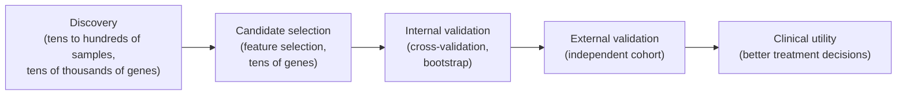
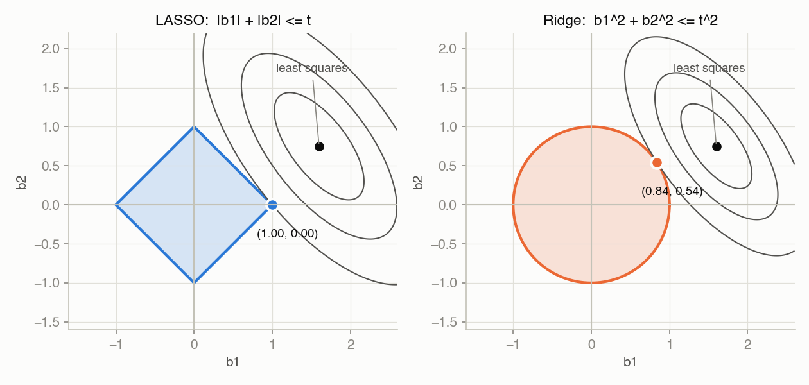
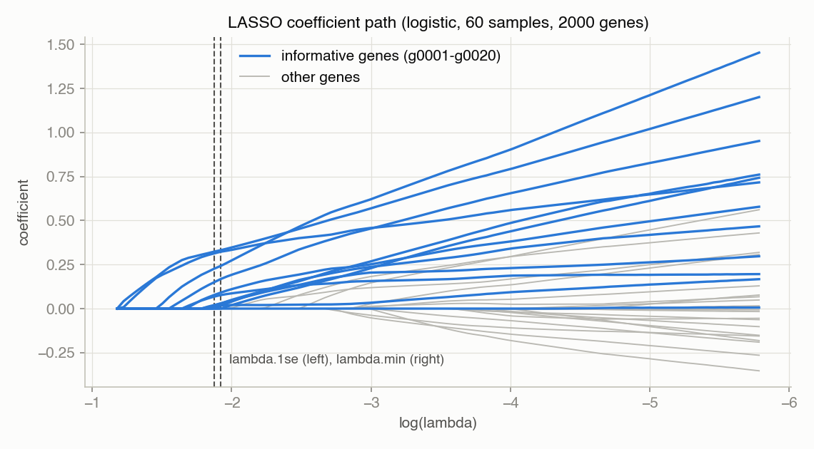
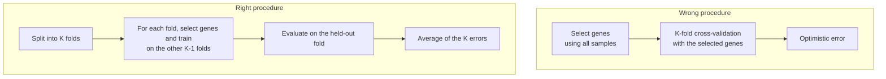
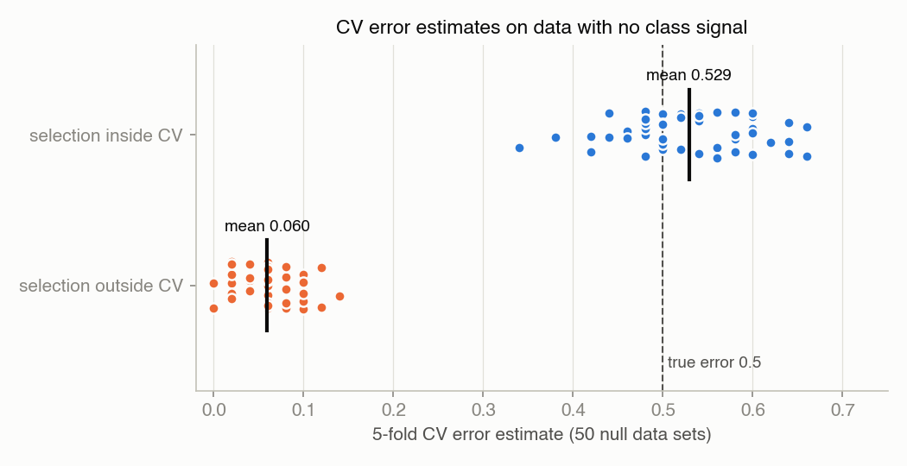

# Chapter 10 — Biomarker Discovery and Feature Selection

[Repository Guide](../../README.md) | [English](Concepts_Lecture.md) | [한국어](Concepts_Lecture.ko.md)

> **Last Updated:** 2026-11-26

> **Learning Objectives:**
> 1. Define a biomarker and distinguish diagnostic, prognostic, and predictive biomarkers
> 2. Explain why estimation and classification become difficult when variables far outnumber samples
> 3. Explain the principles of filter, wrapper, and embedded methods and compare their strengths and weaknesses
> 4. Explain, with geometry and the soft-thresholding function, why the LASSO and elastic-net penalties set coefficients to zero
> 5. Explain why feature selection outside cross-validation gives an optimistic error estimate, and construct the correct procedure
> 6. Assess the stability of a selected feature set and distinguish the stages of validation

---

## Table of Contents

- [1. Biomarkers](#1-biomarkers)
  - [1.1 Definition of a Biomarker](#11-definition-of-a-biomarker)
  - [1.2 Categories of Biomarkers](#12-categories-of-biomarkers)
  - [1.3 Distinguishing Prognostic and Predictive Biomarkers](#13-distinguishing-prognostic-and-predictive-biomarkers)
  - [1.4 The Process of Finding Biomarkers in Expression Data](#14-the-process-of-finding-biomarkers-in-expression-data)
- [2. More Variables Than Samples](#2-more-variables-than-samples)
  - [2.1 High-Dimensional Expression Matrices](#21-high-dimensional-expression-matrices)
  - [2.2 Breakdown of Least Squares Estimation](#22-breakdown-of-least-squares-estimation)
  - [2.3 Perfect Separation by Chance](#23-perfect-separation-by-chance)
  - [2.4 Three Remedies](#24-three-remedies)
- [3. Filter Methods](#3-filter-methods)
  - [3.1 Principle](#31-principle)
  - [3.2 Ranking by the t Statistic](#32-ranking-by-the-t-statistic)
  - [3.3 Fold Change](#33-fold-change)
  - [3.4 Choosing the Number of Genes with the FDR](#34-choosing-the-number-of-genes-with-the-fdr)
  - [3.5 Limitations of Filter Methods](#35-limitations-of-filter-methods)
- [4. Wrapper Methods](#4-wrapper-methods)
  - [4.1 Subset Search](#41-subset-search)
  - [4.2 Forward Selection and Backward Elimination](#42-forward-selection-and-backward-elimination)
  - [4.3 Recursive Feature Elimination](#43-recursive-feature-elimination)
  - [4.4 Costs and Risks of Wrapper Methods](#44-costs-and-risks-of-wrapper-methods)
- [5. Embedded Methods: The LASSO and the Elastic Net](#5-embedded-methods-the-lasso-and-the-elastic-net)
  - [5.1 Penalized Loss Functions](#51-penalized-loss-functions)
  - [5.2 Ridge Regression](#52-ridge-regression)
  - [5.3 The LASSO](#53-the-lasso)
  - [5.4 Geometry of the Penalties](#54-geometry-of-the-penalties)
  - [5.5 The Solution under an Orthonormal Design: Soft Thresholding](#55-the-solution-under-an-orthonormal-design-soft-thresholding)
  - [5.6 The Elastic Net](#56-the-elastic-net)
  - [5.7 Choosing the Regularization Strength and the Coefficient Path](#57-choosing-the-regularization-strength-and-the-coefficient-path)
  - [5.8 LASSO Logistic Regression in R](#58-lasso-logistic-regression-in-r)
- [6. Feature Extraction](#6-feature-extraction)
  - [6.1 Principal Components as Features](#61-principal-components-as-features)
  - [6.2 Extraction That Uses the Labels](#62-extraction-that-uses-the-labels)
  - [6.3 Selection versus Extraction](#63-selection-versus-extraction)
- [7. Selection Bias and Cross-Validation](#7-selection-bias-and-cross-validation)
  - [7.1 Selection Bias](#71-selection-bias)
  - [7.2 The Wrong and the Right Procedure](#72-the-wrong-and-the-right-procedure)
  - [7.3 Simulation: Data with No Signal](#73-simulation-data-with-no-signal)
  - [7.4 The Principle of Keeping Every Learning Step inside Cross-Validation](#74-the-principle-of-keeping-every-learning-step-inside-cross-validation)
- [8. Stability and Validation](#8-stability-and-validation)
  - [8.1 Instability of Selection Results](#81-instability-of-selection-results)
  - [8.2 Stability Selection](#82-stability-selection)
  - [8.3 Stages of Validation](#83-stages-of-validation)
  - [8.4 Common Mistakes](#84-common-mistakes)
- [Concept Applications](#concept-applications)
- [Summary](#summary)
- [Self-Check Questions](#self-check-questions)
- [References](#references)

---

<br>

## 1. Biomarkers

### 1.1 Definition of a Biomarker

Blood glucose is used to diagnose diabetes, and blood cholesterol is used to gauge the risk of cardiovascular disease. When a value measured in the body serves as an indicator of a biological process inside the body, the value is called a biomarker.

> **Definition:** A **biomarker** is a defined characteristic that is measured as an indicator of normal biological processes, pathogenic processes, or responses to an exposure or intervention (treatment).

The U.S. Food and Drug Administration (FDA) follows this definition and explains that molecular, histologic, radiographic, and physiologic characteristics can all be biomarkers [1]. The same explanation states that a biomarker is not a measure that directly assesses how a patient feels, functions, or survives [1]. A biomarker is therefore not itself an outcome of health, but a measurement that stands in for a biological state related to the outcome.

The biomarkers in this chapter are mainly molecular biomarkers. As Chapter 7 showed, a transcriptome measurement records the expression of tens of thousands of genes at once, so finding the few genes related to a disease is a feature selection problem. When several genes are combined into a single score, the gene set is called a **gene signature**.

> **Definition:** A **molecular biomarker** is a biomarker measured at the molecular level, such as a gene expression level, a DNA variant, or the concentration of a protein or metabolite.

> **Definition:** **Feature selection** keeps only a subset of the original variables (for example genes) that is useful for prediction or interpretation and discards the rest.

### 1.2 Categories of Biomarkers

Biomarkers are classified by what they indicate. Following the BEST (Biomarkers, EndpointS, and other Tools) glossary, the FDA lists seven categories: susceptibility or risk, diagnostic, monitoring, prognostic, predictive, pharmacodynamic or response, and safety [1]. Of these, the three that informatics deals with most often are diagnostic, prognostic, and predictive biomarkers.

| Category | What It Indicates | Timing | Example |
|:-----|:-----|:-----|:-----|
| Susceptibility/risk | The chance that a person without the disease will develop it | Before onset | A BRCA1 variant that raises breast cancer risk |
| Diagnostic | Whether the disease is present now, and which subtype | Present | Diabetes diagnosis by blood glucose, leukemia subtype by expression pattern |
| Monitoring | Change in disease status or treatment effect | Repeated measurement | A tumor marker measured repeatedly during treatment |
| Prognostic | The chance of a future event such as relapse, progression, or death, regardless of treatment | Future | Tumor size and grade |
| Predictive | Patients who are likely to respond to a specific treatment | Before treatment choice | A mutation in the target gene of a targeted drug |
| Pharmacodynamic/response | Whether the treatment produced a biological response | During treatment | Change in the activity of a target protein after dosing |
| Safety | Toxicity or adverse effects of the treatment | During treatment | Liver enzyme levels that show liver toxicity |

*Table 1. The seven categories of biomarkers*

> **Definition:** A **diagnostic biomarker** tells whether a disease is present now, or which subtype it is.

One measurement can belong to several categories, because the category is set not by the nature of the measurement but by the question it is used to answer. For example, the blood concentration of a protein can be used for diagnosis and also for monitoring during treatment.

### 1.3 Distinguishing Prognostic and Predictive Biomarkers

Prognostic and predictive sound alike and are often confused, but they indicate different things. Statistically, a predictive biomarker is a variable that has an interaction with the treatment.

> **Definition:** A **prognostic biomarker** tells whether the future outcome (an event such as relapse, progression, or death) will be good or bad whatever treatment is given.

> **Definition:** A **predictive biomarker** tells whether the effect of a specific treatment differs according to the value of the marker, that is, which patients are likely to respond to that treatment.

> **Definition:** An **interaction** is a relation in which the effect of one variable (for example a treatment) on the outcome depends on the value of another variable (for example a marker).

The following are the 5-year survival rates in a hypothetical trial comparing two treatments, split by marker A and marker B.

| Marker | Marker Status | Standard Treatment | New Drug | Effect of New Drug (Difference) |
|:-----|:-----|-----:|-----:|-----:|
| A | Positive | 40% | 45% | +5 pp |
| A | Negative | 70% | 75% | +5 pp |
| B | Positive | 40% | 75% | +35 pp |
| B | Negative | 70% | 72% | +2 pp |

*Table 2. Five-year survival by marker status and treatment in a hypothetical trial*

Patients positive for marker A survive 30 percentage points less than negative patients under either treatment, but the effect of the new drug is the same +5 pp in both groups. Marker A is therefore a prognostic biomarker and not a predictive one. Marker B also carries prognostic information, since positive patients do worse under the standard treatment, but the effect of the new drug differs greatly: +35 pp when positive and +2 pp when negative. Marker B is therefore a predictive biomarker, and it is reasonable to give the new drug selectively to B-positive patients.

> **Caution:** A relation between a marker and the outcome in a group that received only one treatment is no evidence that the marker is predictive. In the group that received only the standard treatment, markers A and B look identical: 40% versus 70%. To show that a marker is predictive, one must observe both treated and untreated (or differently treated) groups and check whether the treatment effect differs by the marker.

### 1.4 The Process of Finding Biomarkers in Expression Data

Discovering a molecular biomarker is not a single analysis but a series of stages. Early stages measure many candidates in few samples to narrow the candidates, and later stages measure few candidates precisely in many samples.



*Figure 1. Stages of molecular biomarker discovery*

This chapter covers the first three stages: choosing candidates from high-dimensional expression data and assessing their performance honestly. External validation and the evaluation of whole prediction models are covered in Chapter 12. Data at the discovery stage usually have the following form.

- There is an expression matrix $`X`$ ($`n \times p`$) whose rows are $`n`$ samples (patients and controls, for example) and whose columns are $`p`$ genes. Biology often puts genes in rows, but this chapter follows the machine learning convention of Chapters 4 and 6 and puts samples in rows.
- Each sample has a response $`y`$. In this chapter it is mostly two classes, control and case.
- The expression values are the measurements described in Chapter 7 after log transformation and normalization.

---

<br>

## 2. More Variables Than Samples

### 2.1 High-Dimensional Expression Matrices

The defining feature of expression data is that the number of variables $`p`$ is far larger than the number of samples $`n`$. Measuring 20,000 genes in 60 patients gives $`p/n \approx 333`$. This situation is called the $`p \gg n`$ problem, and it is the most extreme form of the curse of dimensionality from Chapter 4.

The R examples in this chapter use the following simulated data. There are 30 control and 30 case samples and 2,000 genes. Every value is drawn from the standard normal distribution, and only the first 20 genes (`g0001`-`g0020`) have a mean that is higher by 1 in the cases. Unlike real data, we know which genes carry information, so we can check whether a method finds them. An independent test set of 200 samples is generated by the same rule.

```r
sim_expr <- function(n, p = 2000, n_inf = 20, shift = 1) {
  y <- factor(rep(c("control", "case"), each = n / 2),
              levels = c("control", "case"))
  X <- matrix(rnorm(n * p), nrow = n, ncol = p)
  colnames(X) <- sprintf("g%04d", 1:p)
  X[y == "case", 1:n_inf] <- X[y == "case", 1:n_inf] + shift
  list(X = X, y = y)
}
set.seed(2025)
train <- sim_expr(60)
test  <- sim_expr(200)
X <- train$X; y <- train$y
dim(X)
table(y)
```

```text
[1]   60 2000
y
control    case 
     30      30 
```

`sim_expr()` takes the number of samples `n`, the number of genes `p`, the number of informative genes `n_inf`, and the mean difference `shift`. It fills an `n`-by-`p` matrix with values from `rnorm(n * p)` and adds `shift` only to the first `n_inf` columns of the case rows (`y == "case"`). `set.seed(2025)` fixes the random numbers so that the same results come out again, and the training data `train` and the test data `test` are generated in turn.

### 2.2 Breakdown of Least Squares Estimation

In the multiple linear regression of Chapter 5, the least squares estimator solves the normal equations $`X^\top X \hat\beta = X^\top y`$, and if $`X^\top X`$ is invertible it is unique: $`\hat\beta = (X^\top X)^{-1} X^\top y`$. But $`X^\top X`$ is a $`p \times p`$ matrix whose rank equals the rank of $`X`$ and so cannot exceed $`\min(n, p)`$. If $`p > n`$, the rank of $`X^\top X`$ is at most $`n`$, and the $`p \times p`$ matrix has no inverse.

> **[Linear Algebra]** The rank of a matrix is the maximum number of linearly independent columns (or rows). $`\mathrm{rank}(X^\top X) = \mathrm{rank}(X) \le \min(n, p)`$, and a square matrix is invertible only when its rank equals its size. If the rank is smaller, the null space contains a nonzero vector, so whenever there is one solution, that solution plus any vector in the null space is also a solution.

A minimal example makes this concrete. Let there be 2 samples and 3 variables with

```math
X = \begin{pmatrix} 1 & 0 & 1 \\ 0 & 1 & 1 \end{pmatrix}, \qquad y = \begin{pmatrix} 1 \\ 2 \end{pmatrix}
```

With $`\beta = (1, 2, 0)^\top`$ we get $`X\beta = (1, 2)^\top = y`$, so the residuals are zero. But $`v = (1, 1, -1)^\top`$ satisfies $`Xv = (1 + 0 - 1, 0 + 1 - 1)^\top = (0, 0)^\top`$, so $`\beta + t v`$ is also a zero-residual solution for every real $`t`$. For $`t = 1`$ it is $`(2, 3, -1)^\top`$, and for $`t = -2`$ it is $`(-1, 0, 2)^\top`$. Infinitely many coefficient vectors explain the training data perfectly, and the data alone cannot tell which of them predicts new data well.

This is general. If $`p \ge n`$ and the rows of $`X`$ are linearly independent, a solution with zero training error exists for any $`y`$. Zero training error is the extreme of the overfitting in Chapter 6, and it means the fit to the training data says nothing about the quality of the model.

### 2.3 Perfect Separation by Chance

With many variables, some variable unrelated to the classes will separate them perfectly by chance. Take 5 cases and 5 controls, and let a gene's value be a continuous random variable unrelated to the disease. All $`10!`$ orderings of the 10 values are equally likely, so all $`\binom{10}{5} = 252`$ sets of ranks occupied by the 5 cases are equally likely. Of these, the gene alone separates the classes perfectly in 2 cases: the cases take all of the top 5 ranks or all of the bottom 5 ranks. The probability that one gene separates the classes perfectly by chance is therefore

```math
P(\text{perfect separation}) = \frac{2}{\binom{10}{5}} = \frac{2}{252} \approx 0.00794
```

With 20,000 independent genes, the expected number of perfectly separating genes is $`20000 \times 2/252 \approx 158.7`$. The code below checks this calculation by simulation.

```r
set.seed(1)
yy <- rep(0:1, each = 5)
Z <- matrix(rnorm(10 * 20000), nrow = 10)
separates <- apply(Z, 2, function(g)
  max(g[yy == 0]) < min(g[yy == 1]) || max(g[yy == 1]) < min(g[yy == 0]))
sum(separates)
20000 * 2 / choose(10, 5)
```

```text
[1] 145
[1] 158.7302
```

`Z` is a matrix of normal random numbers for 10 samples and 20,000 genes, and `apply(Z, 2, ...)` applies a function to each column (gene). The function returns `TRUE` if the maximum of the controls is below the minimum of the cases or the other way around. Although the data contain no signal at all, 145 genes separated the two classes perfectly, close to the expected 158.7. These genes are perfect only for these 10 people and carry no information about a new patient.

> **Key Point:** When $`p \gg n`$, chance alone produces many models or variables that explain the training data perfectly. The value of a biomarker candidate can therefore be assessed only on data that were not used to choose it.

### 2.4 Three Remedies

Methods for the $`p \gg n`$ problem fall into three broad directions.

1. **Feature selection:** keep only some of the original genes. The remaining variables are real genes, so interpretation is easy, and the list of biomarker candidates is the result itself. Sections 3-5 cover this.
2. **Feature extraction:** uses new variables built from combinations of the original ones instead of the originals. PCA in Chapter 4 is the typical example, covered in Section 6.
3. **Regularization:** use all variables but penalize the size of the coefficients, which makes the solution unique and reduces variance. Ridge regression in Section 5 belongs here, and the LASSO is both regularization and feature selection.

> **Definition:** **Feature extraction** combines the original variables into a small number of new variables.

Feature selection methods are divided into three kinds by how selection is combined with model training.

> **Definition:** A **filter method** is a feature selection method that ranks variables by a statistic unrelated to the model and keeps the top ones.

> **Definition:** A **wrapper method** is a feature selection method that searches variable subsets using model performance as the criterion.

> **Definition:** An **embedded method** is a feature selection method that selects variables during the training of the model itself.

---

<br>

## 3. Filter Methods

### 3.1 Principle

A filter method computes, separately for each gene, a statistic of its association with the classes, ranks the genes by that value, and keeps the top ones. Because the computation is independent across genes, it runs quickly on tens of thousands of genes and can be combined with any classifier. For continuous expression values and two classes, the t statistic, the fold change, and the Wilcoxon rank-sum statistic are common, and for three or more classes the F statistic is used.

A filter method requires two decisions: the statistic to rank by, and how many genes to keep from the top. The second decision is made by fixing the number in advance (for example, the top 50), by a significance criterion (Section 3.4), or by cross-validation (Section 7).

### 3.2 Ranking by the t Statistic

Let the sample mean, sample variance, and sample size of the cases be $`\bar x_1, s_1^2, n_1`$ and those of the controls be $`\bar x_0, s_0^2, n_0`$. Welch's t statistic is

```math
t = \frac{\bar x_1 - \bar x_0}{\sqrt{s_1^2 / n_1 + s_0^2 / n_0}}
```

The numerator is the difference between the group means, and the denominator is the standard error of that difference. So $`t`$ tells how many times larger the mean difference is than random variation, and ranking is usually done by $`\lvert t \rvert`$. This statistic suits expression data, where the variance differs from gene to gene.

> **Definition:** **Welch's t statistic** is the difference of two group means divided by the standard error of that difference, $`\sqrt{s_1^2 / n_1 + s_0^2 / n_0}`$; it does not assume that the two groups have equal variances.

> **[Probability and Statistics]** Under the null hypothesis that the two group means are equal, Welch's t statistic approximately follows a t distribution whose degrees of freedom are approximated by the Welch-Satterthwaite formula $`\nu = (s_1^2/n_1 + s_0^2/n_0)^2 / \{ (s_1^2/n_1)^2/(n_1 - 1) + (s_0^2/n_0)^2/(n_0 - 1) \}`$. The p-value is the probability, under this distribution, of a value more extreme than the observed $`\lvert t \rvert`$, and Chapter 9 covers it in detail.

Two genes are compared by hand. The values are log-scale expression values with 4 samples per group.

| Gene | Cases | Controls | $`\bar x_1`$ | $`\bar x_0`$ | $`s_1^2`$ | $`s_0^2`$ |
|:-----|:-----|:-----|-----:|-----:|-----:|-----:|
| A | 8.2, 8.9, 9.4, 8.7 | 7.1, 7.6, 7.3, 7.0 | 8.80 | 7.25 | 0.2467 | 0.0700 |
| B | 7.0, 10.4, 6.1, 9.7 | 5.1, 4.4, 8.9, 3.8 | 8.30 | 5.55 | 4.3000 | 5.2700 |

*Table 3. Expression values of two genes for computing the t statistic*

For gene A the standard error is $`\sqrt{0.2467/4 + 0.0700/4} = \sqrt{0.0792} = 0.2814`$, so $`t = 1.55 / 0.2814 = 5.51`$. For gene B the standard error is $`\sqrt{4.30/4 + 5.27/4} = \sqrt{2.3925} = 1.5468`$, so $`t = 2.75 / 1.5468 = 1.78`$. The Welch degrees of freedom are 4.58 and 5.94, and the two-sided p-values are 0.0035 for A and 0.126 for B. Gene B has the larger mean difference, 2.75 against 1.55, but its within-group variation is large, so gene A has a much larger t statistic.

### 3.3 Fold Change

> **Definition:** A **fold change** is the ratio of two group means on the original scale, telling how many times one mean is the other.

Biologists often express a mean difference as a fold change. If, on the original scale, the case mean is four times the control mean, the fold change is 4. If the expression values have been transformed with the base-2 logarithm, the difference of the log-scale means is the **log fold change**.

```math
\log_2 \mathrm{FC} = \bar x_1 - \bar x_0 \quad (\text{for values on the } \log_2 \text{ scale}), \qquad \mathrm{FC} = 2^{\bar x_1 - \bar x_0}
```

In Table 3, gene A has log fold change 1.55, so its fold change is $`2^{1.55} = 2.93`$, and gene B has $`2^{2.75} = 6.73`$. The log fold change has the advantage of treating increases and decreases symmetrically. A twofold increase is $`+1`$ and a halving is $`-1`$, whereas as fold changes they are 2 and 0.5, which are not symmetric.

Ranking by fold change alone pushes highly variable genes such as gene B to the top, and ranking by the t statistic alone can push to the top a biologically meaningless small difference in a gene whose variance happens to be tiny. Real analyses therefore use both criteria together. A **volcano plot**, with the log fold change on the horizontal axis and $`-\log_{10} p`$ on the vertical axis, shows both criteria in one figure: genes in the upper right and upper left have large and significant differences.

### 3.4 Choosing the Number of Genes with the FDR

If each of 2,000 genes is tested at significance level 0.05 and 1,980 of them have no difference, on average 99 of those come out significant by chance. So the number of top genes to keep is set with the **false discovery rate (FDR)** of Chapter 9. Keeping the genes whose p-values adjusted by the Benjamini-Hochberg procedure (q-values) are below 0.05 controls the expected proportion of false discoveries among the kept genes at 5% or less. The procedure and its conditions are covered in Chapter 9; here its result is used as the selection criterion.

```r
welch <- function(g) {
  tt <- t.test(g[y == "case"], g[y == "control"])
  c(lfc = mean(g[y == "case"]) - mean(g[y == "control"]),
    t = unname(tt$statistic), p = tt$p.value)
}
res <- as.data.frame(t(apply(X, 2, welch)))
res$q <- p.adjust(res$p, method = "BH")
res <- res[order(res$p), ]
signif(head(res, 8), 3)
sel <- rownames(res)[res$q < 0.05]
length(sel)
sum(sel %in% sprintf("g%04d", 1:20))
```

```text
       lfc    t        p        q
g0003 1.51 5.95 1.81e-07 0.000312
g0014 1.21 5.78 3.12e-07 0.000312
g0007 1.01 4.27 7.45e-05 0.029100
g0019 1.22 4.20 9.32e-05 0.029100
g0009 1.05 4.19 9.93e-05 0.029100
g0018 1.12 4.21 9.98e-05 0.029100
g0020 1.06 4.22 1.02e-04 0.029100
g0016 1.08 4.05 1.57e-04 0.039200
[1] 8
[1] 8
```

`welch()` takes the value vector `g` of one gene and returns the log fold change (`lfc`), the Welch t statistic (`t`), and the p-value (`p`). `t.test()` performs the Welch test by default. `apply(X, 2, welch)` applies this function to each of the 2,000 columns to make a 3-by-2,000 matrix, and `t()` transposes it into a data frame with genes in rows. `p.adjust(..., method = "BH")` computes the Benjamini-Hochberg q-values.

Eight genes have q-values below 0.05, and all of them are truly informative. There were 20 informative genes, so 12 were missed. Even a gene with mean difference 1 has a t statistic scattered around about 3.9 with 30 versus 30 samples, so it often fails to survive the correction for 2,000 tests. The first row's q-value is $`3.12 \times 10^{-4}`$ rather than $`1.81 \times 10^{-7} \times 2000 / 1 = 3.62 \times 10^{-4}`$ because the BH procedure makes the q-values monotone in rank by comparing with the values of later ranks and taking the smaller ($`3.12 \times 10^{-7} \times 2000 / 2 = 3.12 \times 10^{-4}`$).

### 3.5 Limitations of Filter Methods

Because a filter method looks at one gene at a time, it has the following limitations.

- **Redundancy:** highly correlated genes all rise to the top together. Choosing 10 genes that move together in one pathway takes 10 places for what is essentially one piece of information.
- **Ignoring interactions:** it misses genes that are unrelated to the classes on their own but informative together with other genes. For example, if a sample is a case when two genes are both high or both low and a control when only one is high (an XOR pattern), each gene has the same mean in both classes and a t statistic near 0.
- **Mismatch with the model:** the filter criterion (a mean difference) may differ from the information the final classifier uses (a decision boundary, for example).

Even so, filter methods are light to compute and easy to explain, and they are the most common first step in expression analysis. They are also used as a prefilter that cuts the genes from thousands to hundreds before another method is applied. Here too, the filtering must be done inside cross-validation, following the principle of Section 7.

---

<br>

## 4. Wrapper Methods

### 4.1 Subset Search

A wrapper method wraps a classifier like a box, trains the model on each variable subset, and evaluates the subset by the model's performance. Performance is measured by cross-validation error or validation-set error. The surest way is to evaluate every subset, but $`p`$ variables have $`2^p`$ subsets including the empty set. For $`p = 20`$ that is about 1.05 million, and for $`p = 2000`$ it is $`2^{2000} \approx 10^{602}`$, so exhaustive search is impossible for expression data. Wrapper methods therefore change the subset one step at a time by greedy search.

### 4.2 Forward Selection and Backward Elimination

> **Definition:** **Forward selection** is a greedy search that starts from the empty set and at each step adds the variable, among those not yet included, whose addition improves performance the most.

Choosing $`k`$ variables requires $`p + (p - 1) + \cdots + (p - k + 1)`$ model fits. For $`p = 2000`$ and $`k = 10`$ that is 19,955 fits.

> **Definition:** **Backward elimination** is a greedy search that starts from all variables and at each step removes the variable whose removal hurts performance the least (or helps the most).

Backward elimination must first fit the model with all variables, so it cannot be used when that model is undefined, as in least squares regression with $`p > n`$.

Neither method revisits a decision once made, so neither guarantees the best subset. For example, if two variables are useful only together, forward selection may choose neither of them at the first step.

### 4.3 Recursive Feature Elimination

> **Definition:** **Recursive feature elimination (RFE)** reduces the cost of backward elimination by repeatedly removing many of the least important variables at once, judged by the importance that the fitted model assigns to each variable (the absolute coefficient, for a linear model).

Because RFE does not re-evaluate every candidate each time one variable is removed, it needs far less computation. Guyon et al. proposed RFE combined with a linear support vector machine (SVM) for gene selection in cancer classification and reported a leave-one-out error of zero with 2 genes on leukemia data [2].

The RFE algorithm is as follows.

1. Fix a list of sizes to keep, $`s_1 > s_2 > \cdots > s_m`$, and set the current variable set to all variables.
2. Train a linear classifier on the current variables and compute the absolute weight $`\lvert w_j \rvert`$ of each variable.
3. Keep only the next target number $`s_i`$ of variables, in decreasing order of $`\lvert w_j \rvert`$.
4. If target sizes remain, return to step 2.
5. Evaluate the variable set of each size on validation data and choose the size.

> **[Machine Learning]** A linear SVM finds the hyperplane $`w^\top x + b = 0`$ that maximizes the margin between two classes. After training, $`w = \sum_i \alpha_i y_i x_i`$, and the training samples with nonzero $`\alpha_i`$ are called support vectors. When the variables are on the same scale, a variable with larger $`\lvert w_j \rvert`$ contributes more to the decision function.

```r
library(e1071)
svm_rfe <- function(X, y, sizes) {
  keep <- colnames(X)
  path <- list()
  for (s in sizes) {
    fit <- svm(X[, keep], y, kernel = "linear", cost = 1, scale = TRUE)
    w <- drop(t(fit$coefs) %*% fit$SV)      # weight of each gene in the linear SVM
    keep <- keep[order(abs(w), decreasing = TRUE)][1:s]
    path[[as.character(s)]] <- keep
  }
  path
}
sizes <- c(1000, 500, 250, 100, 50, 20, 10, 5)
path <- svm_rfe(X, y, sizes)
test_err <- sapply(path, function(g) {
  fit <- svm(X[, g, drop = FALSE], y, kernel = "linear", cost = 1)
  mean(predict(fit, test$X[, g, drop = FALSE]) != test$y)
})
true_hits <- sapply(path, function(g) sum(g %in% sprintf("g%04d", 1:20)))
rbind(test_err = round(test_err, 3), true_hits = true_hits)
```

```text
           1000  500    250    100     50     20    10     5
test_err   0.24  0.2  0.125  0.065  0.085  0.105 0.145 0.155
true_hits 20.00 20.0 20.000 20.000 15.000 11.000 7.000 4.000
```

`svm()` is the SVM function of the e1071 package, and `kernel = "linear"` trains a linear SVM. `fit$coefs` holds $`\alpha_i y_i`$ for each support vector and `fit$SV` is the (scaled) support vector matrix, so their product `w` is the weight vector $`w`$ of the box above. The loop retrains the model for each size in `sizes` and keeps only the genes with the largest absolute weights. Finally, an SVM is retrained on the gene set of each size, and its misclassification rate on the 200 independent test samples is computed.

While the genes were cut down to 100, all 20 informative genes stayed and the test error fell from 0.24 to 0.065. Cutting further starts to remove informative genes, and the error grows again. The error is large with 1,000 genes because the weights of 980 uninformative genes add noise to the decision function and blur the decision boundary. Here the sizes were compared with an independent test set, but in practice there is no separate test set, so the choice of size must also be made inside cross-validation (Section 7).

### 4.4 Costs and Risks of Wrapper Methods

A wrapper method has the advantage of using the final model's performance directly as its criterion, but it comes at two prices.

- **Computational cost:** training a model, and cross-validating it, for every subset multiplies the number of fits. RFE reduces this cost by removing many variables per step.
- **Overfitting the selection:** among many subsets, one that performs well by luck of sampling error is likely to be picked. Reporting the performance of a subset on the same data used to evaluate and choose it gives an optimistic estimate. This is the same principle as the selection bias of Section 7.

---

<br>

## 5. Embedded Methods: The LASSO and the Elastic Net

### 5.1 Penalized Loss Functions

> **Definition:** **Penalized regression** estimates the coefficients by minimizing an objective that adds a penalty on the size of the coefficients to the loss function.

An embedded method puts variable selection inside the optimization problem that trains the model. The most widely used kind is penalized regression. In linear regression it minimizes the residual sum of squares plus a penalty term.

```math
\hat\beta(\lambda) = \underset{\beta_0, \beta}{\text{argmin}} \; \frac{1}{2} \sum_{i=1}^{n} \left( y_i - \beta_0 - \sum_{j=1}^{p} x_{ij} \beta_j \right)^2 + \lambda \, P(\beta)
```

$`P(\beta)`$ is a penalty function that measures the size of the coefficients, and $`\lambda \ge 0`$ is the regularization parameter. The intercept $`\beta_0`$ is not penalized. For classification, the negative log-likelihood of logistic regression replaces the residual sum of squares. The glmnet package in R uses an objective whose loss term is divided by the sample size $`n`$, so glmnet's $`\lambda`$ corresponds to the $`\lambda`$ of the formula above divided by $`n`$.

> **Definition:** The **regularization parameter** is the value $`\lambda \ge 0`$ that sets the strength of the penalty in penalized regression; with $`\lambda = 0`$ the fit is the unpenalized one (ordinary least squares in linear regression), and as $`\lambda`$ grows the coefficients shrink toward 0.

> **Caution:** The penalty is charged on the size of the coefficients, so the result depends on the scale of the variables. If variables with different units are mixed, each must be standardized to mean 0 and standard deviation 1 before training. R's glmnet package standardizes internally by default and reports the coefficients on the original scale.

### 5.2 Ridge Regression

> **Definition:** **Ridge regression** is the penalized regression that uses the L2 penalty $`P(\beta) = \frac{1}{2} \sum_j \beta_j^2`$ on the sum of squared coefficients.

The ridge objective is differentiable, so setting the gradient to zero gives a closed-form solution. With centered variables and the intercept handled separately,

```math
\hat\beta_{\text{ridge}} = (X^\top X + \lambda I)^{-1} X^\top y
```

$`X^\top X`$ is positive semidefinite, so all its eigenvalues are at least 0, and adding $`\lambda I`$ makes every eigenvalue at least $`\lambda`$. Hence for $`\lambda > 0`$ the matrix $`X^\top X + \lambda I`$ is invertible even when $`p > n`$, and one of the infinitely many solutions of Section 2.2 is singled out. But ridge coefficients only approach 0 and never become exactly 0, so the model uses all 2,000 genes and does not pick biomarker candidates.

### 5.3 The LASSO

> **Definition:** The **LASSO** is a penalized regression that penalizes the sum of absolute coefficients $`\sum_j \lvert \beta_j \rvert`$, shrinking the coefficients and setting some of them exactly to 0. The name abbreviates least absolute shrinkage and selection operator.

Tibshirani proposed the LASSO as minimizing the residual sum of squares subject to the sum of absolute coefficients not exceeding a fixed value, and noted that this constraint sets some coefficients exactly to 0 and yields models that are easy to interpret [3]. A variable with coefficient 0 drops out of the model, so the LASSO performs estimation and variable selection at once. This is why the LASSO is the representative embedded method.

The LASSO has one property that matters when $`p > n`$. Zou and Hastie pointed out that, when $`p > n`$, the LASSO selects at most $`n`$ variables before it saturates [4]. With 60 samples, the LASSO cannot choose more than 60 genes. If more genes than that are truly related, some must be missed.

### 5.4 Geometry of the Penalties

The reason the LASSO sets coefficients exactly to 0 becomes visible when the penalty is redrawn as a constraint. For each $`\lambda`$ there is a $`t`$ that gives the same solution, so the penalized problem is equivalent to the following constrained problem.

```math
\min_{\beta} \; \sum_{i=1}^{n} (y_i - x_i^\top \beta)^2 \quad \text{subject to} \quad \sum_{j} \lvert \beta_j \rvert \le t \;\; (\text{LASSO}), \qquad \sum_{j} \beta_j^2 \le t^2 \;\; (\text{ridge})
```

With 2 variables, the contours of the residual sum of squares are ellipses centered at the least squares estimate $`\hat\beta_{\text{OLS}}`$. The solution is the point where a growing ellipse first touches the constraint region. The LASSO constraint region is a diamond with its corners on the coordinate axes, and the ridge region is a circle.



*Figure 2. Constraint regions of the LASSO and ridge with contours of the residual sum of squares*

Figure 2 shows an example with $`\hat\beta_{\text{OLS}} = (1.6, 0.75)`$ and $`t = 1`$. The diamond's corners stick out, so the first point the ellipse touches is likely to be the corner $`(1, 0)`$. At the corner $`\beta_2 = 0`$, so variable 2 drops out of the model. The circle has no corners, so contact usually happens at a point where both coefficients are nonzero, such as $`(0.84, 0.54)`$. In higher dimensions the L1 constraint region has far more corners and edges, so the LASSO solution tends to lie at a point where many coefficients are 0.

### 5.5 The Solution under an Orthonormal Design: Soft Thresholding

In the special case where the variables are mutually orthogonal and each has length 1 ($`X^\top X = I`$), both solutions can be written as formulas and the difference becomes clear. Let $`z_j = x_j^\top y`$ be the least squares estimate. The objective separates by variable, and it suffices to minimize $`\frac{1}{2}(z_j - \beta_j)^2 + \lambda P(\beta_j)`$ for each one.

- For ridge ($`P = \frac{1}{2}\beta_j^2`$), differentiating gives $`-(z_j - \beta_j) + \lambda \beta_j = 0`$, so $`\hat\beta_j = z_j / (1 + \lambda)`$. Every coefficient shrinks by the same factor.
- For the LASSO ($`P = \lvert \beta_j \rvert`$), the objective is not differentiable at $`\beta_j = 0`$, so we split cases. If $`\beta_j > 0`$, then $`\beta_j = z_j - \lambda`$, which must be positive, so this is possible only when $`z_j > \lambda`$. If $`\beta_j < 0`$, then $`\beta_j = z_j + \lambda`$, possible only when $`z_j < -\lambda`$. If $`\lvert z_j \rvert \le \lambda`$, the minimum is at 0.

Written as one formula, the LASSO solution is the following soft-thresholding function.

```math
\hat\beta_j = S(z_j, \lambda) = \mathrm{sign}(z_j) \, \bigl( \lvert z_j \rvert - \lambda \bigr)_+, \qquad (a)_+ = \max(a, 0)
```

> **Definition:** The **soft-thresholding function** $`S(z, \lambda) = \mathrm{sign}(z) (\lvert z \rvert - \lambda)_+`$ moves a value $`z`$ toward 0 by $`\lambda`$ and cuts it to 0 if it would cross 0.

> **[Calculus]** $`f(\beta) = \lvert \beta \rvert`$ is not differentiable at $`\beta = 0`$, where its left derivative $`-1`$ and right derivative $`+1`$ differ. At such points the optimality condition is written with the subgradient, which allows every slope in $`[-1, 1]`$ between the two values. The condition for $`\beta_j = 0`$ to be optimal is $`0 \in -(z_j - 0) + \lambda [-1, 1]`$, that is, $`\lvert z_j \rvert \le \lambda`$.

For $`z = (3, 1.2, -0.4)`$ and $`\lambda = 1`$ the results are as follows.

| Variable | $`z_j`$ | Ridge $`z_j / (1 + \lambda)`$ | LASSO $`S(z_j, \lambda)`$ |
|:-----|-----:|-----:|-----:|
| 1 | 3.0 | 1.5 | 2.0 |
| 2 | 1.2 | 0.6 | 0.2 |
| 3 | -0.4 | -0.2 | 0 |

*Table 4. Ridge and LASSO coefficients under an orthonormal design ($`\lambda = 1`$)*

Ridge halves all three coefficients, so even small ones remain. The LASSO moves every coefficient toward 0 by $`\lambda`$ and cuts to 0 any coefficient that would cross 0. That is why variable 3, with $`\lvert z_3 \rvert = 0.4 < 1`$, drops out. Large coefficients shrink relatively little (3.0 to 2.0) and small ones vanish. The surviving coefficients are also reduced by $`\lambda`$, however, so LASSO coefficients are biased toward 0.

### 5.6 The Elastic Net

The LASSO shows a weakness when variables are highly correlated. Among several variables carrying nearly the same information, such as genes of the same pathway, it picks one more or less arbitrarily and sets the rest to 0. In biomarker discovery, knowing the whole group is better for biological interpretation.

> **Definition:** The **elastic net** is a penalized regression that uses a mixture of the L1 and L2 penalties, $`\lambda \{ \alpha \sum_j \lvert \beta_j \rvert + \frac{1 - \alpha}{2} \sum_j \beta_j^2 \}`$ ($`0 \le \alpha \le 1`$).

With $`\alpha = 1`$ it is the LASSO, and with $`\alpha = 0`$ it is ridge. The formula is the glmnet package's parameterization. Zou and Hastie showed that the elastic net produces sparse models like the LASSO while having a grouping effect [4]. The reason is that the L2 term makes the objective strictly convex. For two variables with correlation near 1, the L1 penalty is the same whether the coefficient goes entirely to one variable or is split, as long as the sum is the same, but the L2 penalty prefers an even split because $`b^2 + 0^2 > (b/2)^2 + (b/2)^2`$.

> **Definition:** The **grouping effect** is the property that highly correlated variables enter or leave the model together.

The code below compares the two methods on data in which three variables (`x1`-`x3`) with mutual correlation about 0.96 are related to the response through a common factor `z`. The other 47 variables are noise.

```r
library(glmnet)
set.seed(21)
m <- 100
z <- rnorm(m)                                 # common factor of three genes
G <- cbind(z + rnorm(m, sd = 0.2), z + rnorm(m, sd = 0.2), z + rnorm(m, sd = 0.2),
           matrix(rnorm(m * 47), nrow = m))
colnames(G) <- paste0("x", 1:50)
round(cor(G[, 1:3]), 2)
resp <- 2 * z + rnorm(m)
fit_l  <- glmnet(G, resp, alpha = 1,   lambda = 0.5)
fit_en <- glmnet(G, resp, alpha = 0.5, lambda = 0.5)
round(cbind(lasso = coef(fit_l)[2:6, 1], enet = coef(fit_en)[2:6, 1]), 3)
c(lasso = sum(coef(fit_l)[-1, 1] != 0), enet = sum(coef(fit_en)[-1, 1] != 0))
```

```text
     x1   x2   x3
x1 1.00 0.96 0.96
x2 0.96 1.00 0.96
x3 0.96 0.96 1.00
   lasso  enet
x1 0.512 0.575
x2 0.981 0.689
x3 0.000 0.414
x4 0.000 0.000
x5 0.000 0.000
lasso  enet 
    2     3 
```

`library(glmnet)` loads the glmnet package. The `alpha` of `glmnet()` is the mixing proportion $`\alpha`$ and `lambda` is $`\lambda`$. The first row of `coef()` is the intercept, so `[2:6, 1]` gives the coefficients of `x1`-`x5`. The LASSO chose only `x1` and `x2`, set `x3` to 0, and split the coefficients unevenly, 0.512 and 0.981. The elastic net chose all three variables and split the coefficients relatively evenly, between 0.414 and 0.689. Neither method chose any of the 47 noise variables.

### 5.7 Choosing the Regularization Strength and the Coefficient Path

$`\lambda`$ is a **hyperparameter** that is not estimated directly from the data, so it is chosen by cross-validation. glmnet starts from the largest $`\lambda`$ (the smallest $`\lambda`$ at which all coefficients are 0), decreases it on a log scale, and computes the solution at about 100 values of $`\lambda`$. `cv.glmnet()` computes the cross-validation error at each $`\lambda`$ and reports two values.

- `lambda.min` is the $`\lambda`$ with the smallest cross-validation error.
- `lambda.1se` is the largest $`\lambda`$ whose cross-validation error is at most the minimum plus one standard error of it. This is the **one-standard-error rule**, which chooses the simplest model (the one with fewest variables) whose error is statistically indistinguishable from the minimum.

Biomarker discovery often uses `lambda.1se`, because a short candidate list lowers the cost of validation.

> **Definition:** The **coefficient path** is the collection of coefficient estimates computed over a range of the regularization parameter $`\lambda`$; it shows how each coefficient changes with $`\lambda`$.

### 5.8 LASSO Logistic Regression in R

LASSO logistic regression is applied to the data of Section 2.1. The response has two classes, so `family = "binomial"` is used, and the cross-validation error is the misclassification rate (`type.measure = "class"`).

```r
set.seed(7)
cvfit <- cv.glmnet(X, y, family = "binomial", alpha = 1,
                   type.measure = "class", nfolds = 5)
c(lambda.min = cvfit$lambda.min, lambda.1se = cvfit$lambda.1se)
b <- coef(cvfit, s = "lambda.1se")[-1, 1]
chosen <- names(b)[b != 0]
length(chosen)
sum(chosen %in% sprintf("g%04d", 1:20))
round(sort(b[chosen], decreasing = TRUE), 3)
pred <- predict(cvfit, test$X, s = "lambda.1se", type = "class")
mean(pred != test$y)
```

```text
lambda.min lambda.1se 
 0.1462480  0.1532117 
[1] 10
[1] 10
g0003 g0014 g0007 g0018 g0020 g0009 g0004 g0002 g0016 g0015 
0.324 0.314 0.227 0.150 0.078 0.068 0.020 0.016 0.015 0.001 
[1] 0.09
```

`cv.glmnet()` computes the misclassification rate at each $`\lambda`$ by 5-fold cross-validation (`nfolds = 5`). `coef(cvfit, s = "lambda.1se")` gives the coefficients at `lambda.1se`, and `[-1, 1]` drops the intercept in the first row. `predict(..., type = "class")` returns the predicted class of each test sample.

At `lambda.1se` the LASSO chose 10 genes, and all 10 are informative. The test misclassification rate of the model using only these 10 is 0.09, close to the best value of 0.065 from RFE in Section 4.3. The coefficients range from 0.001 to 0.324: among genes with the same true mean difference, those whose difference happened to look large in this training sample receive large coefficients.



*Figure 3. Coefficient path of LASSO logistic regression on the simulated data*

Figure 3 shows how the coefficients change as $`\lambda`$ decreases from large values on the left to small values on the right. Blue lines are informative genes and gray lines are the other genes. With large $`\lambda`$ every coefficient is 0, and as $`\lambda`$ decreases the informative genes leave 0 first. Near `lambda.min` and `lambda.1se`, marked by dashed lines, only blue lines are nonzero. Decreasing $`\lambda`$ further lets gray lines, noise genes that happen to correlate with the classes, enter the model; this is overfitting in progress.

---

<br>

## 6. Feature Extraction

### 6.1 Principal Components as Features

Feature extraction builds new variables by combining the original ones. PCA in Chapter 4 projects the data onto the eigenvectors of the covariance matrix and produces mutually uncorrelated principal components in decreasing order of variance. Using the first few principal component scores as classifier inputs reduces 2,000 variables to a handful. Regression on principal component scores is called **principal component regression**.

The weakness of this approach is that PCA is an unsupervised method that ignores the class labels. A direction of large variance is not necessarily a direction that separates the classes. The following code computes, for the data of Section 2.1, the explained variance ratio of the principal components and the between-class t statistic of the first 10 principal component scores.

```r
pc <- prcomp(X, center = TRUE, scale. = TRUE)
ve <- pc$sdev^2 / sum(pc$sdev^2)
round(ve[1:5], 4)
pc_t <- apply(pc$x[, 1:10], 2, function(s) t.test(s[y == "case"], s[y == "control"])$statistic)
round(pc_t, 2)
```

```text
[1] 0.0226 0.0223 0.0218 0.0216 0.0213
  PC1   PC2   PC3   PC4   PC5   PC6   PC7   PC8   PC9  PC10 
-1.98 -0.58 -3.76  1.58 -0.07 -1.41 -0.43  0.15 -0.80 -0.58 
```

`prcomp()` centers (`center = TRUE`) and standardizes (`scale. = TRUE`) each variable before PCA; `pc$sdev` holds the standard deviations of the components and `pc$x` the component scores of each sample. Even the first component explains only 2.26% of the total variance, and the first five components explain almost equal shares. The signal of the 20 informative genes is buried in the variance of 1,980 uninformative genes, so there is no clear dominant direction. Among the first ten components, the one that best separates the classes is not the first but the third (t = -3.76), and even this is smaller than the t = 5.95 of the strongest gene in the filter of Section 3.2.

> **Key Point:** Unsupervised feature extraction finds directions of large variance, not directions that separate the classes. When the signal is concentrated in a few genes, principal components dilute it, so for classification, selection or extraction that uses the labels is often more effective.

### 6.2 Extraction That Uses the Labels

Some methods use the class labels to build new variables.

- **PLS:** whereas principal components maximize the variance of $`X`$, PLS uses the covariance with the response $`y`$, so a few components can gather the information related to the response.
- **Gene set scores:** the expression of the genes in a co-expression module of Chapter 11 or in a known pathway is averaged or summarized by its first principal component and used as one variable. The module eigengene of Chapter 11 is an example.
- **Non-negative matrix factorization (NMF):** a non-negative expression matrix is factored into the product of two non-negative matrices, giving additive groups of genes (metagenes).

> **Definition:** **Partial least squares (PLS)** is a feature extraction method that builds components in turn along the directions maximizing the covariance between a linear combination of $`X`$ and the response $`y`$.

t-SNE and UMAP from Chapter 4 are nonlinear embeddings for visualization. There is either no fixed way to place new samples in the same coordinates (t-SNE) or considerable randomness, so they are rarely used as classifier input features.

### 6.3 Selection versus Extraction

| Criterion | Feature Selection | Feature Extraction |
|:-----|:-----|:-----|
| Resulting variables | A subset of the original genes | Combinations of genes |
| Interpretation | Directly by gene names | Indirectly through the loadings |
| Translation to a biomarker | Easy to move to an assay for a few genes (PCR, for example) | New samples still require measuring all genes |
| Correlated genes | The problem of keeping one or all | Correlated genes merge into one component |
| Representative methods | t-test filter, RFE, LASSO, elastic net | PCA, PLS, NMF |

*Table 5. Feature selection versus feature extraction*

When the goal is a biomarker for clinical use, selection has the advantage, because diagnostic tests are usually built as inexpensive assays that measure only a few genes. When prediction performance is the only goal and all genes can be measured, extraction is also a good choice.

---

<br>

## 7. Selection Bias and Cross-Validation

### 7.1 Selection Bias

> **Definition:** **Selection bias** is the underestimation of error that occurs when a model using selected features is evaluated on the same samples that were used to select those features.

Ambroise and McLachlan pointed out that reports of prediction rules with almost no error, built from a few genes using expression data on a small number of tumor samples and thousands of genes, did not allow for selection bias [5]. Those reports either tested the rule on the samples used to select the genes or ran cross-validation without redoing gene selection at each stage. The authors recommended correcting the bias by performing cross-validation or the bootstrap external to the gene selection process, and showed on two published data sets that, after this correction, the cross-validated error of a rule built from a few genes is no longer zero [5].

The bias arises for the same reason as the chance separation of Section 2.3. Genes selected with all samples are genes that happen to correlate with the classes in all samples, and hence also in the samples that later serve as validation folds. The validation fold has already been used to choose the genes, so it is no longer new data.

### 7.2 The Wrong and the Right Procedure



*Figure 4. The wrong and the right order of feature selection and cross-validation*

In the right procedure, gene selection is redone from scratch in each fold, so different folds may choose different genes. What cross-validation evaluates is not a particular gene list but the whole procedure, such as "choose the top 20 genes by t statistic and classify with KNN".

### 7.3 Simulation: Data with No Signal

The clearest way to see the difference between the two procedures is to use data whose true error is known. If 50 samples and 5,000 genes are filled with normal random numbers and the class labels are assigned at random, the true misclassification rate of any classifier is 0.5. Each procedure chooses the top 20 genes by t statistic and computes the 5-fold cross-validation error of KNN ($`k = 3`$) from Chapter 6. The experiment is repeated 50 times.

```r
library(class)
welch_t <- function(X, y) {                # Welch t statistic of every gene at once
  a <- X[y == levels(y)[2], , drop = FALSE]; b <- X[y == levels(y)[1], , drop = FALSE]
  (colMeans(a) - colMeans(b)) /
    sqrt(apply(a, 2, var) / nrow(a) + apply(b, 2, var) / nrow(b))
}
cv_knn_error <- function(X, y, folds, select_inside, n_top = 20, k = 3) {
  if (!select_inside) top <- order(-abs(welch_t(X, y)))[1:n_top]
  wrong <- 0
  for (f in unique(folds)) {
    tr <- folds != f
    if (select_inside) top <- order(-abs(welch_t(X[tr, ], y[tr])))[1:n_top]
    pred <- knn(X[tr, top], X[!tr, top], y[tr], k = k)
    wrong <- wrong + sum(pred != y[!tr])
  }
  wrong / length(y)
}
set.seed(42)
n0 <- 50; p0 <- 5000
out <- t(replicate(50, {
  X0 <- matrix(rnorm(n0 * p0), nrow = n0)
  y0 <- factor(sample(rep(c("A", "B"), each = n0 / 2)))
  folds <- sample(rep(1:5, length.out = n0))
  c(outside = cv_knn_error(X0, y0, folds, select_inside = FALSE),
    inside  = cv_knn_error(X0, y0, folds, select_inside = TRUE))
}))
round(colMeans(out), 3)
round(apply(out, 2, range), 2)
```

```text
outside  inside 
  0.060   0.529 
     outside inside
[1,]    0.00   0.34
[2,]    0.14   0.66
```

`welch_t()` computes the t statistics of all 5,000 genes at once with matrix operations, which is much faster than calling `t.test()` for each gene as in Section 3.4. In `cv_knn_error()`, if `select_inside` is `FALSE` the top 20 genes are chosen once from all samples before the loop (the wrong procedure), and if `TRUE` they are chosen again from the training part (`tr`) of each fold (the right procedure). `knn()` is the KNN classifier of the class package. `replicate(50, ...)` repeats 50 times the generation of new data and the evaluation of both procedures with the same fold split.

The procedure that selected outside cross-validation estimated the mean error at 0.060, and even its worst case out of 50 was 0.14. One would report a 94% accurate classifier built from data that contain no signal at all. The procedure that selected inside cross-validation gave a mean of 0.529, close to the true value 0.5. Its estimates scatter from 0.34 to 0.66 across repetitions because, with only 50 samples, the error estimate itself has a large variance.



*Figure 5. Cross-validation error estimates of the two procedures on data with no signal*

### 7.4 The Principle of Keeping Every Learning Step inside Cross-Validation

Selection bias is not limited to feature selection. Every step that looks at the response $`y`$ is part of learning and must be redone, within each fold of cross-validation, on the training part alone.

- Filtering genes, choosing the size in RFE, choosing the LASSO $`\lambda`$
- Feature extraction that uses $`y`$, such as PLS in Section 6.2
- Choosing a classification threshold, tuning hyperparameters

Unsupervised preprocessing that does not look at $`y`$ (log transformation of expression values, for example) is harmless when it operates on each sample separately. Quantities computed across samples, however, such as the mean and standard deviation for standardization or variance-based gene filtering, use information from the test samples even without looking at $`y`$, so in principle they are computed on the training part only. Nested cross-validation, which separates the cross-validation that chooses hyperparameters from the cross-validation that estimates performance, is covered in Chapter 12.

> **Caution:** The minimum cross-validation error reported by `cv.glmnet()` is the very error used to choose $`\lambda`$, so reporting it as the performance of the chosen model is slightly optimistic. The more candidate values of $`\lambda`$ and the fewer samples, the larger this bias.

---

<br>

## 8. Stability and Validation

### 8.1 Instability of Selection Results

> **Definition:** The **Jaccard index** $`J(A, B) = \lvert A \cap B \rvert / \lvert A \cup B \rvert`$ measures the similarity of two sets as the size of their intersection divided by the size of their union; it is 1 when the sets are equal and 0 when they share no element.

When $`p \gg n`$, a small change in the data greatly changes which genes are selected. Fixing `lambda.1se` from Section 5.8, the LASSO is reapplied to 100 bootstrap samples drawn with replacement from the 60 training samples, and the selection results are compared. The similarity of two sets is measured by the Jaccard index.

```r
lam <- cvfit$lambda.1se
set.seed(99)
B <- 100
freq <- setNames(numeric(ncol(X)), colnames(X))
sets <- vector("list", B)
for (b in 1:B) {
  idx <- sample(nrow(X), replace = TRUE)
  fit <- glmnet(X[idx, ], y[idx], family = "binomial", alpha = 1, lambda = lam)
  s <- rownames(fit$beta)[fit$beta[, 1] != 0]
  freq[s] <- freq[s] + 1
  sets[[b]] <- s
}
jac <- combn(B, 2, function(ij) {
  a <- sets[[ij[1]]]; b <- sets[[ij[2]]]
  length(intersect(a, b)) / length(union(a, b))
})
round(mean(jac), 3)
summary(sapply(sets, length))
top <- sort(freq, decreasing = TRUE)[1:15] / B
round(top, 2)
```

```text
[1] 0.203
   Min. 1st Qu.  Median    Mean 3rd Qu.    Max. 
   3.00    7.00    9.00    9.06   11.00   15.00 
g0003 g0014 g0007 g0018 g0009 g0020 g0004 g0015 g0019 g0002 g0016 g0013 g0006 
 0.87  0.86  0.57  0.49  0.44  0.44  0.30  0.30  0.28  0.23  0.21  0.20  0.17 
g0299 g0017 
 0.12  0.11 
```

`sample(nrow(X), replace = TRUE)` draws the 60 sample indices with replacement to form a bootstrap sample. `fit$beta` holds the coefficients at the fixed $`\lambda`$; the names of nonzero genes are stored in `sets`, and `freq` counts how often each gene is selected. `combn(B, 2, ...)` computes the Jaccard index for all 4,950 pairs of the 100 sets.

Each bootstrap selected 3-15 genes, but the selections of two bootstraps overlapped little, with a mean Jaccard index of 0.203. In the selection frequencies, `g0003` and `g0014` were selected steadily at 87% and 86%, but most of the other informative genes were selected only 20-57% of the time. The uninformative `g0299` was also selected 12% of the time. A gene list obtained from one analysis is only one draw from this distribution.

### 8.2 Stability Selection

> **Definition:** **Stability selection** repeatedly draws subsamples of the data, runs a selection method on each subsample, and keeps only the variables that are selected consistently.

Stability selection turns the instability of selection to advantage; Meinshausen and Bühlmann proposed it for high-dimensional selection methods [6]. The method gives finite-sample bounds on the number of falsely selected variables, so it can also serve as a criterion for choosing the amount of regularization [6].

The procedure is as follows.

1. Repeat $`B`$ times (for example, 100) a draw of half the samples without replacement.
2. Apply a selection method such as the LASSO to each subsample.
3. Compute the selection proportion $`\hat\pi_j`$ of each variable.
4. Keep only the variables with $`\hat\pi_j`$ at least the threshold $`\pi_{\text{thr}}`$ (for example, 0.6-0.9).

Applying the threshold 0.6 in the same way to the bootstrap selection frequencies of Section 8.1 leaves only `g0003` and `g0014`. The list becomes short, but the remaining genes are likely to reappear when the data change, which makes them suitable candidates for expensive validation experiments.

### 8.3 Stages of Validation

A biomarker candidate must pass the following stages in order.

| Stage | Question | Method |
|:-----|:-----|:-----|
| Internal validation | Is the performance reproduced within the same data without overfitting? | Cross-validation including selection, bootstrap |
| Technical validation | Does another measurement method give the same values? | Remeasuring microarray results by PCR |
| External validation | Is the performance maintained in patients from other institutions and periods? | Evaluating the fixed model in an independent cohort |
| Clinical utility | Do patients' outcomes improve when the biomarker is used? | Prospective clinical trial |

*Table 6. Stages of biomarker validation*

Even after good internal validation, performance often drops sharply at external validation because the measurement platform, sample handling, and patient population differ. External validation must apply the gene list, coefficients, and threshold, all fixed, to the new data; if the model is changed after looking at the new data, those data are no longer external validation data. External validation and recalibration are covered in detail in Chapter 12.

### 8.4 Common Mistakes

- **Cross-validating after selecting with all samples:** as in Section 7.3, high accuracy appears even without signal.
- **Reporting training accuracy:** when $`p \gg n`$ a model with zero training error always exists, so training accuracy means nothing.
- **Selecting by fold change or p-value alone:** as in Section 3.3, highly variable genes or genes with accidentally small variance rise to the top.
- **Significance-based selection without multiple-testing correction:** testing 2,000 genes at level 0.05 selects about 100 even without signal.
- **Treating the selected list as established fact:** as in Section 8.1, the same method gives a different list when the data change slightly. Selection frequencies or stability should be reported alongside.
- **Interpreting selected genes as causes:** selection only finds correlations useful for prediction. A gene correlated with the true causal gene may be selected in its place (Section 5.6).

---

<br>

## Concept Applications

**True/False Check:**

| Statement | Judgment and Reason |
|:-----|:-----|
| A marker strongly associated with survival in patients who received one treatment is a predictive biomarker. | **F.** The association may be prognostic information. Showing that a marker is predictive requires checking whether the treatment effect differs by the marker, that is, an interaction (Section 1.3). |
| If $`p > n`$, infinitely many coefficient vectors make the training error of least squares regression zero. | **T.** If the rows of $`X`$ are linearly independent, $`X\beta = y`$ has a solution, and adding a null-space vector gives another solution (Section 2.2). |
| Keeping only genes with q-values below 0.05 always makes the proportion of false discoveries among the kept genes at most 5%. | **F.** The BH procedure controls only the expected proportion of false discoveries; in a single analysis the actual proportion can exceed 5% (Section 3.4). |
| Ridge regression sets some coefficients exactly to 0 if $`\lambda`$ is large enough. | **F.** Under an orthonormal design the ridge coefficient is $`z_j / (1 + \lambda)`$, which approaches 0 but never reaches it (Section 5.5). |
| Within a group of highly correlated genes, the LASSO usually picks one or a few, while the elastic net tends to pick the whole group. | **T.** The L2 term of the elastic net creates the grouping effect (Section 5.6). |
| Selecting genes once on all the data and then cross-validating only saves computation and gives the same result. | **F.** The validation folds were used for selection, so the error is heavily underestimated: on data with no signal, 0.529 became 0.060 (Section 7.3). |
| The first principal component is the direction of largest variance and therefore also the direction that best separates the classes. | **F.** PCA does not use the class labels. In Section 6.1 the third component separated the classes best. |

---

<br>

## Summary

| Concept | Key Summary |
|:-----|:-----|
| Biomarker | A characteristic measured as an indicator of a biological state, divided by use into seven categories including diagnostic, prognostic, and predictive. |
| Prognostic versus predictive | A prognostic biomarker indicates the outcome regardless of treatment; a predictive biomarker indicates a difference in treatment effect (an interaction). |
| The $`p \gg n`$ problem | With more variables than samples there are infinitely many zero-training-error solutions, and many variables separate the classes perfectly by chance. |
| Filter methods | Rank each gene by the t statistic or fold change and set the number by the FDR; fast, but blind to redundancy and interactions. |
| Wrapper methods | Search subsets by model performance; RFE repeatedly removes the variables with the smallest weights in a linear model. |
| Ridge regression | The L2 penalty makes the solution unique even when $`p > n`$, but does not set coefficients to 0. |
| LASSO | The corners of the L1 penalty set some coefficients exactly to 0, combining estimation and selection; when $`p > n`$ it selects at most $`n`$ variables. |
| Soft-thresholding function | Under an orthonormal design the LASSO coefficient is $`\mathrm{sign}(z)(\lvert z \rvert - \lambda)_+`$ and the ridge coefficient is $`z/(1 + \lambda)`$. |
| Elastic net | Mixes L1 and L2 penalties, keeping sparsity while selecting correlated variables together. |
| Choosing the regularization strength | $`\lambda`$ is chosen by cross-validation, and `lambda.1se` picks the simplest model indistinguishable from the minimum error. |
| Feature extraction | PCA finds directions of large variance without class labels and can dilute the signal of a few genes. |
| Selection bias | Cross-validating features chosen with all samples estimates near-zero error even without signal, so selection must be redone inside each fold. |
| Stability | Selections vary greatly across bootstraps, so selection frequencies should be reported and stability selection keeps only consistent candidates. |
| Stages of validation | Internal validation, technical validation, external validation, and clinical utility are checked in order, with the model fixed for external validation. |

---

<br>

## Self-Check Questions

1. **Prognostic or predictive:** Patients with a certain gene variant have a 3-year relapse rate of 50% under the standard treatment and 20% under a new drug, and patients without the variant have 30% under the standard treatment and 28% under the new drug. Is the variant a prognostic or a predictive biomarker?

   <details>
   <summary>Answer</summary>

   The effect of the new drug (reduction in relapse) is 50% - 20% = 30 pp with the variant and 30% - 28% = 2 pp without it. The treatment effect differs greatly by variant status, so it is a predictive biomarker. Under the standard treatment, patients with the variant also relapse more (50%) than those without (30%), so it carries prognostic information as well. It is reasonable to give the new drug selectively to patients with the variant.

   </details>

2. **Perfect separation by chance:** In 4 cases and 4 controls, 10,000 genes unrelated to the disease were measured. Find the expected number of genes that separate the two classes perfectly. Assume continuous values and independent genes.

   <details>
   <summary>Answer</summary>

   All $`\binom{8}{4} = 70`$ sets of ranks occupied by the 4 cases are equally likely, and perfect separation occurs in 2 of them: the cases take all of the top 4 or all of the bottom 4. The probability of perfect separation for one gene is therefore $`2/70 \approx 0.0286`$, and the expected number is $`10000 \times 2/70 \approx 285.7`$ genes. The fewer the samples, the more chance separations occur.

   </details>

3. **Soft thresholding:** Under an orthonormal design the least squares estimates are $`z = (2.5, -1.8, 0.6, -0.3)`$. For $`\lambda = 0.8`$, find the LASSO and ridge coefficients and state which variables the LASSO keeps.

   <details>
   <summary>Answer</summary>

   The LASSO gives $`S(z_j, 0.8) = \mathrm{sign}(z_j)(\lvert z_j \rvert - 0.8)_+`$, which is $`(1.7, -1.0, 0, 0)`$. Since $`\lvert 0.6 \rvert`$ and $`\lvert -0.3 \rvert`$ are at most 0.8, the third and fourth variables drop out and only the first and second remain. Ridge gives $`z_j / 1.8`$, which is $`(1.389, -1.0, 0.333, -0.167)`$, and all four variables remain.

   </details>

4. **Geometry of the penalties:** With 2 variables, explain from the shape of the constraint region why the LASSO solution tends to lie on a coordinate axis. Why does the ridge solution not?

   <details>
   <summary>Answer</summary>

   The LASSO constraint region $`\lvert \beta_1 \rvert + \lvert \beta_2 \rvert \le t`$ is a diamond with its corners on the coordinate axes. When the elliptical contours of the residual sum of squares grow, the first point they touch is likely to be a protruding corner, where one coefficient is 0. The ridge constraint region is a circle with a smooth boundary and no corners, so contact usually happens where both coefficients are nonzero. For contact to occur on an axis, the least squares estimate would have to be in a special position.

   </details>

5. **The principle of selection bias:** With 40 samples and 10,000 genes, a researcher chose the top 10 genes by t statistic using all samples, then ran LOOCV with those 10 genes and reported a misclassification rate of 2.5%. Explain why this estimate is not trustworthy and describe the correct procedure.

   <details>
   <summary>Answer</summary>

   All 40 samples were used to choose the genes, so the sample held out in each LOOCV step had already been used for gene selection. The top 10 of 10,000 genes may be genes that happen to correlate with the classes in these 40 samples, including the held-out ones, so the error is estimated as very small even without signal. In the correct procedure, at each LOOCV step (or each fold) the top 10 genes are chosen again from the 39 samples excluding the held-out one, the model is trained on those genes, and then the held-out sample is classified. Ambroise and McLachlan recommended 10-fold cross-validation over LOOCV.

   </details>

6. **Correlated variables:** Five genes in the same pathway with mutual correlation 0.95 are all related to the disease. Explain what the LASSO and the elastic net are each likely to produce and which is preferable for biomarker discovery.

   <details>
   <summary>Answer</summary>

   The L1 penalty does not distinguish between giving the coefficient to one variable and splitting it, so the LASSO is likely to pick one or a few of the five more or less arbitrarily and set the rest to 0. A slight change in the data can make it pick a different gene, so it is unstable. Because of the L2 term, the elastic net prefers splitting the coefficient evenly and tends to select all five together (the grouping effect). The elastic net is preferable both for the biological interpretation that the whole pathway is involved and for the stability of the selection.

   </details>

7. **Stability selection:** In 100 subsample analyses, genes G1, G2, G3, and G4 were selected 92, 64, 41, and 8 times. Which genes are selected at thresholds $`\pi_{\text{thr}} = 0.6`$ and $`0.9`$? What is gained and what is lost by raising the threshold?

   <details>
   <summary>Answer</summary>

   The selection proportions are 0.92, 0.64, 0.41, and 0.08. At threshold 0.6, G1 and G2 are selected; at 0.9, only G1. Raising the threshold reduces falsely selected genes and makes the remaining candidates more trustworthy, but increases the chance of missing truly related genes whose selection is less stable (G2, for example).

   </details>

---

<br>

## References

1. U.S. Food and Drug Administration, "About biomarkers and qualification," Jul. 2021. [Online]. Available: https://www.fda.gov/drugs/biomarker-qualification-program/about-biomarkers-and-qualification
2. I. Guyon, J. Weston, S. Barnhill, and V. Vapnik, "Gene selection for cancer classification using support vector machines," *Machine Learning*, vol. 46, no. 1-3, pp. 389-422, 2002.
3. R. Tibshirani, "Regression shrinkage and selection via the lasso," *Journal of the Royal Statistical Society: Series B (Methodological)*, vol. 58, no. 1, pp. 267-288, 1996.
4. H. Zou and T. Hastie, "Regularization and variable selection via the elastic net," *Journal of the Royal Statistical Society: Series B (Statistical Methodology)*, vol. 67, no. 2, pp. 301-320, 2005.
5. C. Ambroise and G. J. McLachlan, "Selection bias in gene extraction on the basis of microarray gene-expression data," *Proceedings of the National Academy of Sciences*, vol. 99, no. 10, pp. 6562-6566, 2002.
6. N. Meinshausen and P. Bühlmann, "Stability selection," *Journal of the Royal Statistical Society: Series B (Statistical Methodology)*, vol. 72, no. 4, pp. 417-473, 2010.
