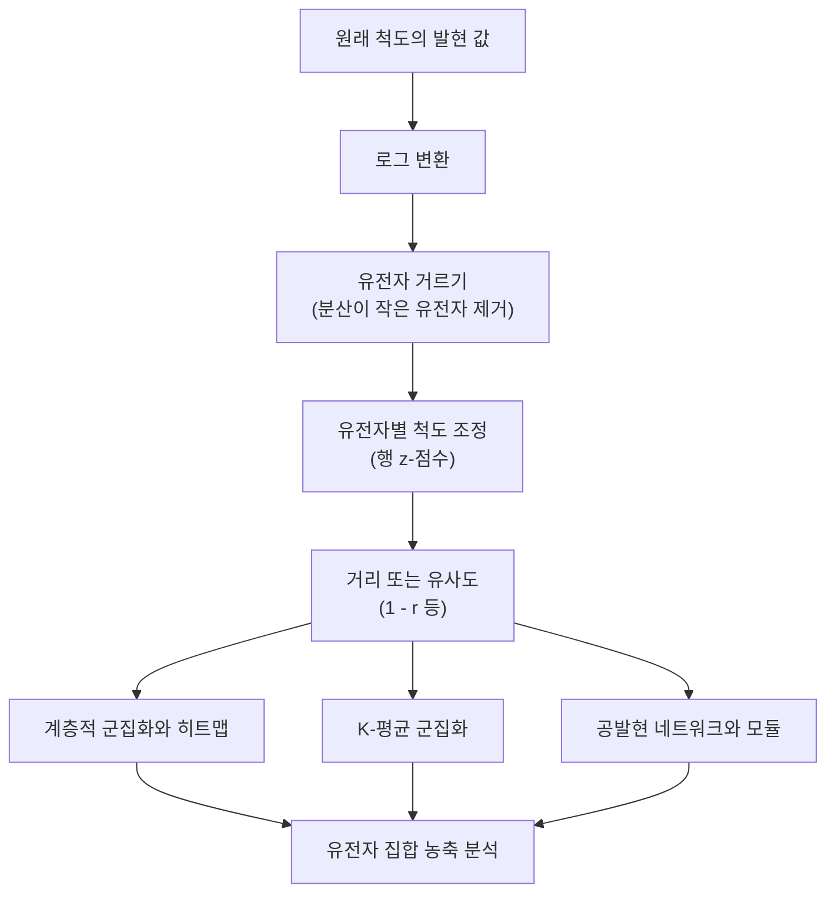
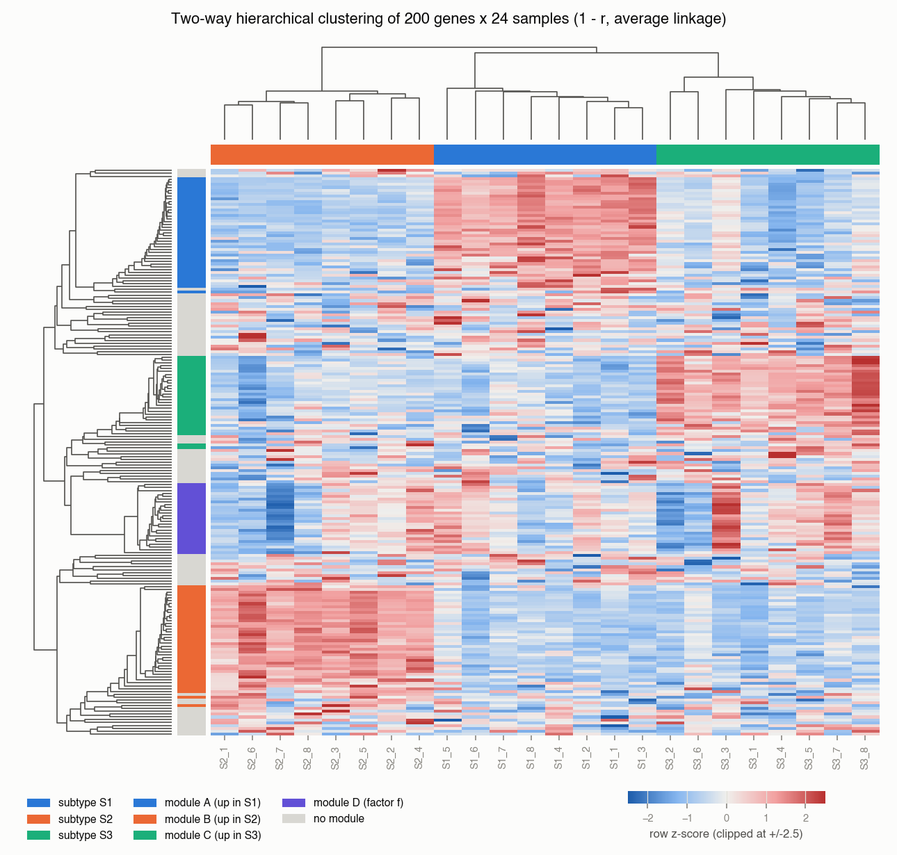
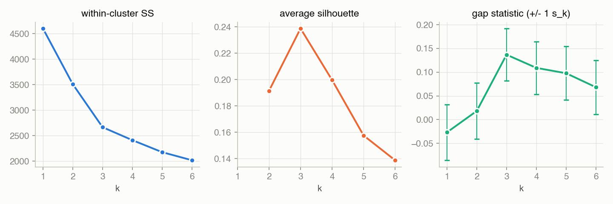
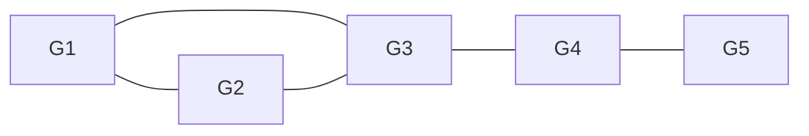
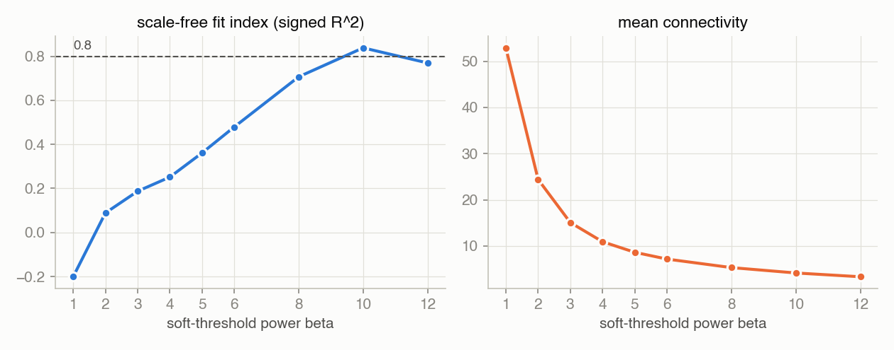

# 11장 — 군집화와 네트워크를 이용한 유전자 발현 프로파일링

[레포지토리 안내](../../README.ko.md) | [English](Concepts_Lecture.md) | [한국어](Concepts_Lecture.ko.md)

> **최종 수정일:** 2026-11-19

> **학습 목표:**
> 1. 발현 행렬의 구조를 설명하고 로그 변환, 유전자 거르기, 척도 조정의 목적과 순서를 설명할 수 있다
> 2. 상관 기반 거리의 종류를 비교하고 유전자 군집화에 알맞은 거리를 고를 수 있다
> 3. 유전자와 표본을 함께 군집화한 히트맵을 해석하고 덴드로그램의 품질을 평가할 수 있다
> 4. 팔꿈치 방법, 평균 실루엣 폭, 갭 통계량으로 K-평균 군집의 수를 정하고 그 결과를 비판적으로 해석할 수 있다
> 5. 상관 임계값과 연성 임계값으로 공발현 네트워크를 만들고 연결 정도, 허브, 위상 중첩을 계산할 수 있다
> 6. 초기하 분포로 유전자 집합의 과대표현을 검정하고 그 가정과 한계를 설명할 수 있다

---

## 목차

- [1. 유전자 발현 프로파일링](#1-유전자-발현-프로파일링)
  - [1.1 발현 행렬과 발현 프로파일](#11-발현-행렬과-발현-프로파일)
  - [1.2 유전자 군집화와 표본 군집화](#12-유전자-군집화와-표본-군집화)
  - [1.3 분석의 흐름](#13-분석의-흐름)
  - [1.4 모의 발현 데이터](#14-모의-발현-데이터)
- [2. 발현 행렬의 전처리](#2-발현-행렬의-전처리)
  - [2.1 로그 변환](#21-로그-변환)
  - [2.2 유전자 거르기](#22-유전자-거르기)
  - [2.3 유전자별 척도 조정](#23-유전자별-척도-조정)
  - [2.4 표본 사이의 정규화](#24-표본-사이의-정규화)
- [3. 상관 기반 거리](#3-상관-기반-거리)
  - [3.1 세 가지 상관 거리](#31-세-가지-상관-거리)
  - [3.2 유클리드 거리와 상관 거리의 차이](#32-유클리드-거리와-상관-거리의-차이)
  - [3.3 상관 거리와 표준화한 유클리드 거리의 관계](#33-상관-거리와-표준화한-유클리드-거리의-관계)
  - [3.4 순위 상관과 이상치](#34-순위-상관과-이상치)
- [4. 계층적 군집화와 히트맵](#4-계층적-군집화와-히트맵)
  - [4.1 이원 군집화](#41-이원-군집화)
  - [4.2 히트맵 읽기](#42-히트맵-읽기)
  - [4.3 덴드로그램 잎 순서의 비유일성](#43-덴드로그램-잎-순서의-비유일성)
  - [4.4 연결법의 선택과 코페네틱 상관](#44-연결법의-선택과-코페네틱-상관)
  - [4.5 덴드로그램 자르기](#45-덴드로그램-자르기)
- [5. K-평균 군집화와 군집 수의 선택](#5-k-평균-군집화와-군집-수의-선택)
  - [5.1 표본 군집화와 K-평균](#51-표본-군집화와-k-평균)
  - [5.2 팔꿈치 방법](#52-팔꿈치-방법)
  - [5.3 평균 실루엣 폭](#53-평균-실루엣-폭)
  - [5.4 갭 통계량](#54-갭-통계량)
  - [5.5 세 기준의 비교](#55-세-기준의-비교)
- [6. 공발현 네트워크](#6-공발현-네트워크)
  - [6.1 그래프로 나타낸 공발현](#61-그래프로-나타낸-공발현)
  - [6.2 상관 임계값으로 만드는 네트워크](#62-상관-임계값으로-만드는-네트워크)
  - [6.3 연결 정도와 허브 유전자](#63-연결-정도와-허브-유전자)
  - [6.4 군집 계수와 그 밖의 측도](#64-군집-계수와-그-밖의-측도)
  - [6.5 R로 만드는 공발현 네트워크](#65-r로-만드는-공발현-네트워크)
  - [6.6 하드 임계값의 문제](#66-하드-임계값의-문제)
- [7. 가중 유전자 공발현 네트워크 분석](#7-가중-유전자-공발현-네트워크-분석)
  - [7.1 연성 임계값](#71-연성-임계값)
  - [7.2 척도 없는 위상 기준](#72-척도-없는-위상-기준)
  - [7.3 위상 중첩](#73-위상-중첩)
  - [7.4 모듈 검출](#74-모듈-검출)
  - [7.5 모듈 고유유전자와 형질의 관계](#75-모듈-고유유전자와-형질의-관계)
- [8. 유전자 집합 농축 분석](#8-유전자-집합-농축-분석)
  - [8.1 유전자 목록의 해석](#81-유전자-목록의-해석)
  - [8.2 과대표현 분석과 초기하 분포](#82-과대표현-분석과-초기하-분포)
  - [8.3 R로 하는 계산](#83-r로-하는-계산)
  - [8.4 여러 유전자 집합의 검정](#84-여러-유전자-집합의-검정)
  - [8.5 과대표현 분석의 가정과 한계](#85-과대표현-분석의-가정과-한계)
- [개념 적용](#개념-적용)
- [용어 사전](#용어-사전)
- [요약](#요약)
- [점검 문제](#점검-문제)
- [참고 문헌](#참고-문헌)

---

<br>

## 1. 유전자 발현 프로파일링

### 1.1 발현 행렬과 발현 프로파일

7장에서 보았듯이 마이크로어레이나 RNA-seq은 한 표본에서 수만 개 유전자의 발현 수준을 한꺼번에 측정한다. 표본 여러 개를 측정한 결과는 유전자를 행으로, 표본을 열로 하는 **발현 행렬(expression matrix)** 로 정리된다. 유전자가 $`G`$개, 표본이 $`n`$개이면 발현 행렬은 $`G \times n`$이다. 이 장은 생물학의 관례대로 유전자를 행에 두며, 10장과 12장처럼 표본을 행에 두는 기계학습의 관례와 반대라는 점에 유의해야 한다. R에서는 `t()`로 전치하여 두 관례를 오간다.

> **용어 정의:** **발현 프로파일(expression profile)** 은 발현 행렬의 한 행, 즉 한 유전자의 발현 수준을 모든 표본에 걸쳐 나열한 벡터이다.

열 하나도 한 표본에서 모든 유전자의 발현을 나열한 벡터이며, 표본의 분자적 상태를 요약한다. **유전자 발현 프로파일링(gene expression profiling)** 은 이런 행과 열의 패턴을 분석하여 함께 움직이는 유전자와 비슷한 분자 상태의 표본을 찾는 일을 말한다.

### 1.2 유전자 군집화와 표본 군집화

발현 행렬을 군집화하는 방향은 두 가지이며, 답하려는 질문이 다르다.

| 방향 | 군집화의 대상 | 거리의 계산 | 답하려는 질문 |
|:-----|:-----|:-----|:-----|
| 유전자 군집화 | 행(유전자) | 두 유전자의 프로파일 사이, 길이 $`n`$ | 어떤 유전자들이 함께 조절되는가 |
| 표본 군집화 | 열(표본) | 두 표본의 발현 벡터 사이, 길이 $`G`$ | 분자적으로 구별되는 하위 유형이 있는가 |

*표 1. 발현 행렬을 군집화하는 두 방향*

유전자 군집화는 같은 전사 인자에 조절되거나 같은 경로에 속하는 유전자는 발현 패턴이 비슷하다는 생각에 근거한다. Eisen 등은 유전체 전체의 발현 데이터에 계층적 군집화를 적용하고 그 결과를 군집 구조와 발현 값이 함께 보이는 그림으로 나타내는 방법을 제시했으며, 효모에서 이 방법이 기능이 비슷한 것으로 알려진 유전자를 효율적으로 한데 묶는다는 것을 보였다 [1]. 따라서 기능이 알려지지 않은 유전자가 기능이 알려진 유전자와 함께 묶이면 그 기능을 추측하는 단서가 된다 [1].

표본 군집화는 같은 진단명 안에 분자적으로 다른 하위 유형이 숨어 있는지 찾는다. Golub 등은 급성 백혈병 데이터에서 클래스를 미리 알려 주지 않은 군집화 절차가 급성 골수성 백혈병(AML)과 급성 림프구성 백혈병(ALL)의 구분을 스스로 찾아냈음을 보이고, 이를 **클래스 발견(class discovery)** 이라 불렀다 [2]. 이미 알려진 클래스에 새 표본을 배정하는 **클래스 예측(class prediction)** 은 12장의 주제이다.

### 1.3 분석의 흐름

발현 프로파일링은 다음 순서로 진행한다. 각 단계의 선택이 다음 단계의 결과를 바꾸므로, 결과를 보고할 때는 각 단계에서 무엇을 골랐는지 함께 밝혀야 한다.



*그림 1. 유전자 발현 프로파일링의 분석 흐름*

### 1.4 모의 발현 데이터

이 장의 R 예제는 정답을 아는 모의 데이터를 쓴다. 표본 24개는 세 하위 유형 S1, S2, S3에 8개씩 속하고, 유전자 400개 가운데 140개는 네 모듈 A, B, C, D에 속한다.

- 모듈 A, B, C의 유전자는 각각 하위 유형 S1, S2, S3에서 함께 높아진다.
- 모듈 D의 유전자는 하위 유형과 무관한 표본 요인 `f`를 따라 함께 움직인다. 실험 조건, 세포 구성, 일괄 효과처럼 하위 유형과 관계없는 변동을 흉내 낸 것이다.
- 유전자마다 모듈을 따르는 정도(`load`)가 0.2\~1.5로 다르다. 그래서 모듈 안에도 모듈을 강하게 따르는 유전자와 약하게 따르는 유전자가 섞인다.
- 나머지 260개 유전자는 모듈에 속하지 않는다.

```r
set.seed(2027)
n_g <- 400; n_s <- 24
subtype <- factor(rep(c("S1", "S2", "S3"), each = 8))
module  <- rep(c("A", "B", "C", "D", "none"), c(40, 40, 30, 30, 260))
mu <- runif(n_g, 4, 12)                       # 유전자마다의 기본 발현 수준 (log2 척도)
f  <- rnorm(n_s)                              # 하위 유형과 무관한 표본 요인
Fm <- cbind(A = 3.0 * (subtype == "S1") + rnorm(n_s, sd = 0.5),
            B = 3.0 * (subtype == "S2") + rnorm(n_s, sd = 0.5),
            C = 2.5 * (subtype == "S3") + rnorm(n_s, sd = 0.5),
            D = 1.2 * f)                      # 표본마다 각 모듈의 활성
load <- runif(n_g, 0.2, 1.5)                  # 유전자가 모듈을 따르는 정도
L <- matrix(mu, n_g, n_s) + matrix(rnorm(n_g * n_s, sd = 0.5), n_g, n_s)
for (m in c("A", "B", "C", "D")) {
  idx <- module == m
  L[idx, ] <- L[idx, ] + outer(load[idx], Fm[, m])
}
raw <- round(2^L)                             # 원래 척도의 발현 강도
dimnames(raw) <- list(sprintf("gene%03d", 1:n_g), paste0(subtype, "_", rep(1:8, 3)))
raw[1:3, 1:5]
```

```text
        S1_1 S1_2 S1_3 S1_4 S1_5
gene001 1248 1016 1086  387  555
gene002 1512 1371 3331 1299 1875
gene003  257  138  160  342  197
```

`L`은 로그(밑 2) 척도의 발현 행렬이다. 유전자마다의 기본 수준 `mu`에 정규 잡음을 더한 뒤, 모듈 유전자에는 `outer(load[idx], Fm[, m])`, 즉 유전자의 `load`와 표본의 모듈 활성의 곱을 더한다. `Fm`의 A 열은 S1 표본에서 약 3, 나머지 표본에서 약 0이다. 마지막으로 `2^L`로 원래 척도로 되돌리고 반올림하여, 측정 장비가 내놓는 것과 비슷한 양의 강도 값 `raw`를 만든다.

---

<br>

## 2. 발현 행렬의 전처리

### 2.1 로그 변환

원래 척도의 발현 값은 군집화에 그대로 쓰기 어렵다. 이유는 세 가지이다.

1. **치우친 분포:** 대부분의 유전자는 낮게 발현되고 소수의 유전자가 매우 높게 발현되어 분포가 오른쪽으로 길게 치우친다.
2. **평균과 분산의 연동:** 발현 수준이 높은 유전자일수록 표준편차도 크다. 그러면 거리 계산이 고발현 유전자에 지배된다.
3. **곱셈적 효과:** 생물학적 변화는 "2배 증가"처럼 비율로 일어나는 경우가 많다. 원래 척도에서는 10에서 20으로의 변화와 1,000에서 2,000으로의 변화가 크기가 다르지만, 두 변화는 같은 2배이다.

밑이 2인 로그를 취하면 비율이 차이로 바뀐다. 값 10, 20, 40, 80은 로그 변환 뒤 3.32, 4.32, 5.32, 6.32가 되어, 2배씩의 증가가 같은 간격 1이 된다. 0이 있을 수 있는 개수 데이터에는 $`\log_2(x + 1)`$처럼 작은 값(유사 개수, pseudocount)을 더하고 로그를 취한다.

```r
m_raw <- rowMeans(raw); s_raw <- apply(raw, 1, sd)
E <- log2(raw + 1)
m_log <- rowMeans(E); s_log <- apply(E, 1, sd)
round(c(raw = cor(m_raw, s_raw), log = cor(m_log, s_log)), 3)
round(quantile(m_raw, c(0, 0.5, 1)), 1)
```

```text
  raw   log 
0.963 0.270 
     0%     50%    100% 
   17.1   308.3 27015.5 
```

`rowMeans()`와 `apply(raw, 1, sd)`는 유전자(행)마다 평균과 표준편차를 계산한다. 원래 척도에서는 유전자 평균이 17.1에서 27,015.5까지 1,500배 넘게 차이 나고, 평균과 표준편차의 상관이 0.963으로 거의 비례한다. 로그 변환 뒤에는 이 상관이 0.270으로 줄어든다. 남은 상관은 모듈 유전자가 하위 유형에 따라 변하는 생물학적 변동 때문이며, 기술적인 평균과 분산의 연동은 대부분 사라졌다.

> **참고:** RNA-seq의 개수는 평균이 작을 때 포아송 잡음 때문에 로그 변환 뒤에도 저발현 유전자의 분산이 커지는 경향이 남는다. 이 문제를 줄이는 분산 안정화 변환과 개수 데이터 모형은 9장에서 다룬다.

### 2.2 유전자 거르기

발현 데이터에는 거의 발현되지 않거나 모든 표본에서 값이 거의 같은 유전자가 많다. 이런 유전자는 군집화에 정보를 주지 않고 잡음만 더하며, 상관을 계산할 때 분산이 0에 가까우면 값이 불안정해진다. 그래서 군집화 전에 **비특이적 거르기(nonspecific filtering)** 를 한다. 클래스 레이블을 쓰지 않고, 평균 발현이 기준보다 낮거나 분산이 작은 유전자를 뺀다. 분산 상위 몇 백\~몇 천 개를 남기는 방법이 흔하다.

```r
v <- apply(E, 1, var)
keep <- order(v, decreasing = TRUE)[1:200]
Ef <- E[keep, ]
table(module[keep])
Ez <- t(scale(t(Ef)))                         # 유전자(행)마다 z-점수
round(c(mean = mean(Ez[1, ]), sd = sd(Ez[1, ])), 3)
```

```text

   A    B    C    D none 
  40   40   30   25   65 
mean   sd 
   0    1 
```

로그 척도의 분산 상위 200개 유전자를 남기자 모듈 A, B, C의 유전자는 모두 남았고, 모듈 D는 30개 중 25개, 모듈에 속하지 않은 유전자는 260개 중 65개만 남았다. 거르기 전에는 400개 중 260개(65%)가 잡음 유전자였지만, 거른 뒤에는 200개 중 65개(32.5%)이다. 모듈 D에서 빠진 5개는 `load`가 작아 요인 `f`를 약하게 따르는 유전자이다.

> **주의:** 분산 기준의 거르기는 클래스 레이블을 보지 않으므로 군집화처럼 비지도 분석의 전처리로는 문제가 없다. 그러나 10장 7절과 같이 거른 데이터로 분류기를 평가하려면 거르기도 교차 검증의 각 겹 안에서 해야 한다. t 통계량처럼 레이블을 쓰는 기준으로 거른 뒤 표본을 군집화하면, 레이블과 일치하는 군집이 나오는 것은 거르기 단계에서 이미 정해진 결과이므로 클래스 발견의 증거가 되지 않는다.

### 2.3 유전자별 척도 조정

유전자를 군집화할 때 관심은 발현 수준의 절대 크기가 아니라 표본에 따라 오르내리는 패턴이다. 그래서 행마다 평균을 빼고 표준편차로 나누는 **행 z-점수(row z-score)** 를 쓴다.

```math
z_{gj} = \frac{x_{gj} - \bar x_{g\cdot}}{s_{g}}, \qquad \bar x_{g\cdot} = \frac{1}{n}\sum_{j=1}^{n} x_{gj}, \quad s_g^2 = \frac{1}{n-1}\sum_{j=1}^{n} (x_{gj} - \bar x_{g\cdot})^2
```

값 (2, 4, 6)을 가진 유전자는 평균 4, 표준편차 2이므로 z-점수가 (-1, 0, 1)이 되고, 값 (102, 104, 106)을 가진 유전자도 똑같이 (-1, 0, 1)이 된다. 두 유전자는 수준이 50배쯤 다르지만 패턴은 같다. 위 코드의 `scale()`은 열마다 표준화하므로, 행을 표준화하려면 `t()`로 전치한 뒤 `scale()`을 적용하고 다시 전치한다. 결과의 첫 행은 평균 0, 표준편차 1이다.

3장 4.3절의 z-점수 정규화는 특성(열)마다 표준화하여 단위가 다른 변수가 거리를 지배하지 않게 하는 것이었다. 행 z-점수는 같은 계산을 유전자(행) 방향으로 하는 것이며, 목적은 유전자 사이의 수준 차이를 지우고 패턴만 남기는 것이다. 표본을 군집화할 때도 행 z-점수를 먼저 하면, 고발현 유전자나 변동이 큰 유전자가 표본 사이의 거리를 지배하지 않는다.

### 2.4 표본 사이의 정규화

표본마다 측정에 쓴 RNA의 양, 시퀀싱 깊이, 마이크로어레이의 전체 밝기가 다르므로, 모든 유전자의 값이 표본 단위로 함께 높거나 낮아질 수 있다. 이런 기술적 차이를 없애는 단계를 **정규화(normalization)** 라 한다.

- RNA-seq은 표본마다 총 리드 수가 다르므로 개수를 크기 인자로 나누어 맞춘다. 크기 인자의 추정은 9장에서 다룬다.
- **분위수 정규화(quantile normalization)** 는 모든 표본의 값 분포를 같게 만든다. 각 표본의 값을 정렬하고, 같은 순위의 값들을 표본 사이에서 평균한 값으로 바꾼 뒤 원래 순서로 되돌린다.

정규화는 거르기와 척도 조정보다 먼저, 로그 변환과 함께 한다. 정규화를 하지 않으면 표본 군집화의 첫 분기가 생물학이 아니라 측정 배치나 깊이를 따라 나뉘는 일이 흔하다. 모의 데이터에는 이런 기술적 차이를 넣지 않았으므로 이 장의 예제는 정규화를 생략한다.

---

<br>

## 3. 상관 기반 거리

### 3.1 세 가지 상관 거리

3장 5.5절은 상관계수를 거리로 바꾸는 방법으로 $`D = 1 - \lvert r \rvert`$를 소개했다. 발현 데이터에서는 다음 세 가지가 모두 쓰이며, 음의 상관을 어떻게 다루는지가 다르다.

| 거리 | 식 | 범위 | $`r = 1`$ | $`r = 0`$ | $`r = -1`$ | 음의 상관의 해석 |
|:-----|:-----|:-----|-----:|-----:|-----:|:-----|
| 부호 있는 상관 거리 | $`1 - r`$ | $`[0, 2]`$ | 0 | 1 | 2 | 가장 먼 것으로 봄 |
| 부호 없는 상관 거리 | $`1 - \lvert r \rvert`$ | $`[0, 1]`$ | 0 | 1 | 0 | 가장 가까운 것으로 봄 |
| 제곱 상관 거리 | $`1 - r^2`$ | $`[0, 1]`$ | 0 | 1 | 0 | 가장 가까운 것으로 봄 |

*표 2. 세 가지 상관 기반 거리*

어느 것을 쓸지는 생물학적 질문에 달려 있다. 한 유전자가 다른 유전자를 억제하여 서로 반대로 움직이는 관계도 같은 조절 회로에 속한다고 보려면 부호 없는 거리를 쓴다. 함께 올라가는 유전자만 한 군집으로 묶고 반대로 움직이는 유전자는 떼어 놓으려면 부호 있는 거리 $`1 - r`$을 쓴다. 군집 하나에 반대 방향의 유전자가 섞이면 "이 군집의 발현이 높다"는 해석이 성립하지 않으므로, 히트맵과 군집 해석에는 $`1 - r`$이 더 자주 쓰인다. 이 장의 예제도 $`1 - r`$을 쓴다.

$`1 - r`$은 삼각 부등식을 만족하지 않으므로 엄밀한 의미의 거리(metric)는 아니다. 3.3절의 $`\sqrt{2(1 - r)}`$은 삼각 부등식을 만족한다. 계층적 군집화는 비유사도만 있으면 동작하므로 실제로는 $`1 - r`$도 문제없이 쓰인다.

### 3.2 유클리드 거리와 상관 거리의 차이

세 유전자의 프로파일이 다음과 같다고 하자.

| 유전자 | 표본 1 | 표본 2 | 표본 3 | 표본 4 |
|:-----|-----:|-----:|-----:|-----:|
| g1 | 1 | 2 | 3 | 4 |
| g2 | 10 | 20 | 30 | 40 |
| g3 | 4 | 3 | 2 | 1 |

*표 3. 유클리드 거리와 상관 거리를 비교할 세 유전자*

유클리드 거리는 $`d(g1, g2) = \sqrt{9^2 + 18^2 + 27^2 + 36^2} = \sqrt{2430} = 49.30`$, $`d(g1, g3) = \sqrt{3^2 + 1^2 + 1^2 + 3^2} = \sqrt{20} = 4.47`$이므로 g1은 g3과 훨씬 가깝다. 상관계수는 $`r(g1, g2) = 1`$, $`r(g1, g3) = -1`$이므로 부호 있는 상관 거리로는 $`1 - r(g1, g2) = 0`$, $`1 - r(g1, g3) = 2`$가 되어 g1은 g2와 가장 가깝고 g3과 가장 멀다. 부호 없는 상관 거리로는 g2와 g3이 모두 g1과 거리 0이다.

g1과 g2는 수준이 10배 다르지만 같은 패턴으로 움직이므로 같은 조절을 받는다고 볼 수 있다. 유클리드 거리는 수준의 차이를 크게 보아 이 관계를 놓친다. 원래 척도나 로그 척도의 값에 유클리드 거리를 쓰면 발현 수준이 비슷한 유전자끼리 묶이는데, 이것은 대개 흥미로운 질문이 아니다.

### 3.3 상관 거리와 표준화한 유클리드 거리의 관계

두 접근은 행 z-점수를 거치면 하나로 만난다. 길이 $`n`$인 두 프로파일 $`x, y`$를 2.3절처럼 표준화한 벡터를 $`z_x, z_y`$라 하면 $`\sum_j z_{x,j}^2 = \sum_j z_{y,j}^2 = n - 1`$이고 $`\sum_j z_{x,j} z_{y,j} = (n - 1) r`$이므로

```math
\lVert z_x - z_y \rVert^2 = \sum_j z_{x,j}^2 + \sum_j z_{y,j}^2 - 2 \sum_j z_{x,j} z_{y,j} = 2(n - 1)(1 - r)
```

이다. 표 3의 g1과 g3을 표준화하면 g1은 (-1.162, -0.387, 0.387, 1.162), g3은 그 부호를 바꾼 값이 되고, 차의 제곱합은 12이다. 식으로는 $`2 \times 3 \times (1 - (-1)) = 12`$로 같다. 따라서 행 z-점수에 유클리드 거리를 쓰는 것은 $`\sqrt{1 - r}`$에 비례하는 거리를 쓰는 것과 같고, 거리의 순서가 $`1 - r`$과 같다. K-평균처럼 유클리드 거리를 전제로 한 방법으로 상관 기반의 군집화를 하고 싶으면 먼저 행 z-점수를 하면 된다.

### 3.4 순위 상관과 이상치

Pearson 상관은 이상치 하나에 크게 흔들린다. 표본 하나에서 측정 오류로 두 유전자가 함께 매우 높게 나오면, 나머지 표본에서 무관한 두 유전자의 상관이 1에 가까워질 수 있다. 3장 5.3절의 Spearman 순위 상관은 값을 순위로 바꾼 뒤 상관을 계산하므로 이런 이상치에 강하다. 표본이 적은 발현 데이터에서는 $`1 - \rho_{\text{Spearman}}`$을 쓰거나, Pearson 상관을 쓰더라도 이상치 표본을 먼저 확인하는 것이 안전하다.

---

<br>

## 4. 계층적 군집화와 히트맵

### 4.1 이원 군집화

3장 7절의 병합적 계층적 군집화는 거리가 가장 가까운 두 군집을 반복해서 합쳐 덴드로그램을 만든다. 발현 행렬에서는 유전자와 표본을 따로 군집화하고, 두 덴드로그램의 잎 순서대로 행과 열을 재배열한다. 이것을 **이원 군집화(two-way clustering)** 라 한다.

```r
d_gene <- as.dist(1 - cor(t(Ef)))            # 유전자 사이의 1 - Pearson r
hc_gene <- hclust(d_gene, method = "average")
cl_gene <- cutree(hc_gene, h = 0.7)
big <- as.numeric(names(which(table(cl_gene) >= 8)))
table(cluster = ifelse(cl_gene %in% big, cl_gene, 0), module = module[keep])
d_samp <- as.dist(1 - cor(Ez))               # 표본 사이, 중심화한 유전자로 계산
hc_samp <- hclust(d_samp, method = "average")
table(cluster = cutree(hc_samp, k = 3), subtype)
```

```text
       module
cluster  A  B  C  D none
      0  0  1  2  0   62
      1 40  0  0  0    1
      2  0 39  0  0    1
      3  0  0 28  0    1
      4  0  0  0 25    0
       subtype
cluster S1 S2 S3
      1  8  0  0
      2  0  8  0
      3  0  0  8
```

`cor(t(Ef))`는 200개 유전자의 쌍별 Pearson 상관 행렬이고(`cor()`은 열 사이의 상관을 계산하므로 전치한다), `as.dist(1 - ...)`가 그것을 거리 객체로 바꾼다. `hclust(..., method = "average")`는 평균 연결법으로 덴드로그램을 만든다. `cutree(hc_gene, h = 0.7)`은 높이 0.7에서 덴드로그램을 잘라 군집 번호를 매기고, 다음 줄은 유전자가 8개 이상인 군집만 남기고 나머지를 0번(군집에 속하지 않음)으로 표시한다. 표본은 행 z-점수 `Ez`의 열 사이 상관으로 거리를 계산한다.

유전자 쪽에서는 크기 8 이상의 군집 네 개가 모듈 A, B, C, D와 거의 정확히 일치했다. 모듈에 속하지 않은 유전자 65개 가운데 62개는 작은 군집으로 흩어졌고, 모듈 B와 C의 유전자 3개도 그쪽에 섞였다. 표본 쪽에서는 세 군집이 세 하위 유형과 정확히 일치했다.

### 4.2 히트맵 읽기

이원 군집화의 결과는 **히트맵(heatmap)** 으로 그린다. 행 z-점수를 색으로 나타내고, 행과 열을 덴드로그램의 잎 순서로 배열하며, 위쪽과 왼쪽에 두 덴드로그램을 붙인다.



*그림 2. 모의 데이터의 유전자 200개와 표본 24개를 이원 군집화한 히트맵*

그림 2에서 빨간색은 그 유전자의 평균보다 높은 발현, 파란색은 낮은 발현이다. 위쪽 색 막대는 표본의 실제 하위 유형이고, 왼쪽 색 막대는 유전자의 실제 모듈이다. 다음과 같이 읽는다.

- 표본 덴드로그램은 세 가지로 크게 갈라지고, 각 가지가 한 하위 유형과 일치한다.
- 유전자 쪽에서는 모듈 A의 유전자 덩어리가 S1 표본에서만 빨갛고, 모듈 B는 S2에서만, 모듈 C는 S3에서만 빨갛다. 이처럼 유전자 덩어리와 표본 덩어리가 만나는 직사각형이 하위 유형을 특징짓는 유전자 묶음이다.
- 모듈 D의 덩어리는 하위 유형과 무관하게 표본마다 빨강과 파랑이 섞인다. 하위 유형으로는 설명되지 않는 공통 변동(요인 `f`)이 있다는 신호이다.
- 모듈에 속하지 않은 유전자는 무늬 없이 흩어진 색으로 나타난다.

색의 범위는 보통 $`\pm 2`$나 $`\pm 3`$에서 잘라 극단값 몇 개가 색 척도를 독차지하지 않게 한다. 그림 2는 $`\pm 2.5`$에서 잘랐다. 색은 0을 가운데 회색으로 두고 양쪽에 대비되는 두 색을 쓰는 발산형 척도를 쓴다.

### 4.3 덴드로그램 잎 순서의 비유일성

덴드로그램의 각 병합 지점에서 두 가지의 좌우를 바꾸어도 같은 덴드로그램이다. 잎이 $`m`$개이면 병합이 $`m - 1`$번 일어나므로 같은 나무를 그리는 잎 순서가 $`2^{m-1}`$가지이다. 표본 24개이면 $`2^{23} \approx 840`$만 가지이다. 따라서 히트맵에서 두 유전자가 이웃해 있다는 사실만으로 둘이 가깝다고 결론지으면 안 된다. 두 잎의 가까움은 덴드로그램에서 두 잎이 처음 합쳐지는 높이로 판단한다. 소프트웨어마다 좌우를 정하는 규칙(군집 크기, 평균 발현 등)이 달라 같은 데이터도 다르게 보일 수 있다.

### 4.4 연결법의 선택과 코페네틱 상관

3장 7.5절의 세 연결법은 같은 거리 행렬에서도 다른 덴드로그램을 만든다. 덴드로그램이 원래 거리를 얼마나 잘 보존하는지는 **코페네틱 상관(cophenetic correlation)** 으로 잴 수 있다.

> **용어 정의:** **코페네틱 거리(cophenetic distance)** 는 덴드로그램에서 두 잎이 처음 같은 군집으로 합쳐지는 병합 높이이다.

코페네틱 상관은 모든 쌍에 대해 원래 거리와 코페네틱 거리 사이의 Pearson 상관이다. 1에 가까울수록 덴드로그램이 원래 거리 구조를 충실히 나타낸다.

```r
sapply(c("single", "complete", "average"), function(m)
  round(cor(cophenetic(hclust(d_gene, method = m)), d_gene), 3))
```

```text
  single complete  average 
   0.675    0.769    0.826 
```

`cophenetic()`은 덴드로그램에서 코페네틱 거리 행렬을 계산한다. 이 데이터에서는 평균 연결법이 0.826으로 가장 높고, 단일 연결법이 0.675로 가장 낮다. 단일 연결법은 가장 가까운 한 쌍만 보고 합치므로, 군집 사이를 잇는 중간 유전자를 따라 사슬처럼 길게 늘어지는 **사슬 효과(chaining)** 를 보이기 쉽다. 그러면 많은 쌍의 병합 높이가 원래 거리보다 크게 낮아진다. 평균 연결법은 상관 거리와 함께 발현 데이터에서 가장 널리 쓰인다. Ward 연결법은 군집 안 제곱합의 증가를 최소로 하는 방법이어서 유클리드 거리(또는 행 z-점수의 유클리드 거리)에 맞다.

### 4.5 덴드로그램 자르기

덴드로그램에서 군집을 얻으려면 높이 $`h`$나 군집 수 $`k`$를 정해 자른다. 높이로 자르면 해석이 분명하다. 상관 거리에서 $`h = 0.7`$로 자르면, 평균 연결법에서는 군집 사이의 평균 거리가 0.7보다 큰 군집끼리는 합쳐지지 않는다. 같은 군집 안의 모든 쌍은 이 높이 이하의 병합에서 처음 합쳐지므로, 군집 안의 평균 상관은 0.3 이상이다.

군집 수 $`k`$로 자르면 덴드로그램의 위쪽 분기만 보므로, 잡음 유전자가 많은 데이터에서는 문제가 생긴다. 서로 무관한 모듈은 $`1 - r \approx 1`$에서 합쳐지고, 잡음 유전자도 비슷한 높이에서 합쳐지므로 위쪽 몇 단계의 분기는 사실상 임의적이다. 4.1절에서 높이로 자르고 작은 군집을 제외한 것은 이 때문이다. 가지의 모양을 보고 높이를 가지마다 다르게 정하는 동적 트리 자르기(dynamic tree cut) 같은 방법도 쓰인다.

---

<br>

## 5. K-평균 군집화와 군집 수의 선택

### 5.1 표본 군집화와 K-평균

3장 8절의 K-평균 군집화는 군집 안 제곱합을 최소로 하는 $`K`$개 군집을 찾는다. 유클리드 거리를 쓰므로, 3.3절에 따라 행 z-점수를 한 뒤 표본(열) 벡터에 적용하면 상관 기반의 표본 군집화가 된다. 계층적 군집화와 달리 군집 수 $`K`$를 미리 정해야 하므로, 데이터로 $`K`$를 정하는 기준이 필요하다. 여기서는 세 가지 기준을 같은 데이터에 적용하고 결과를 비교한다.

### 5.2 팔꿈치 방법

군집 안 제곱합 $`W_K`$는 $`K`$가 커질수록 줄어들고, $`K = n`$이면 0이 된다. 따라서 $`W_K`$가 최소인 $`K`$를 고를 수는 없다. **팔꿈치 방법(elbow method)** 은 $`K`$에 따른 $`W_K`$를 그려, 감소 폭이 갑자기 작아지는 지점(팔꿈치)을 고른다. 실제 군집 수까지는 $`K`$를 늘릴 때마다 서로 다른 군집이 갈라져 $`W_K`$가 크게 줄지만, 그 뒤로는 한 군집을 억지로 나누는 것이므로 조금씩만 준다. 팔꿈치가 뚜렷하지 않은 경우가 많고, 그 판단이 주관적이라는 것이 약점이다.

### 5.3 평균 실루엣 폭

3장 9.2절의 **실루엣 폭(silhouette width)** $`s(i) = \{b(i) - a(i)\} / \max\{a(i), b(i)\}`$는 표본 하나가 자기 군집에 얼마나 잘 들어맞는지를 $`-1`$에서 1 사이의 값으로 잰다. $`a(i)`$는 같은 군집 안의 평균 거리, $`b(i)`$는 가장 가까운 다른 군집까지의 평균 거리이다. Rousseeuw는 이 값을 군집 분석의 해석과 검증을 돕는 그래프 도구로 제안했다 [3]. 3장 9.3절처럼 모든 표본의 평균 실루엣 폭이 가장 큰 $`K`$를 고른다. 평균 실루엣 폭은 $`K = 1`$에서 정의되지 않으므로, 이 기준은 "군집이 없다"는 결론을 낼 수 없다.

### 5.4 갭 통계량

**갭 통계량(gap statistic)** 은 군집 구조가 없는 기준 분포의 데이터와 비교하여 $`W_K`$의 감소가 우연보다 큰지를 본다. Tibshirani, Walther, Hastie가 제안한 이 통계량은 다음과 같다 [4].

```math
\mathrm{Gap}(K) = E^{*}\!\left[\log W_K^{*}\right] - \log W_K
```

$`W_K`$는 관측 데이터의 군집 안 제곱합이고, $`E^{*}[\log W_K^{*}]`$는 군집이 없는 기준 분포(관측 데이터의 범위에 걸친 균등 분포)에서 같은 크기의 데이터를 $`B`$번 만들어 같은 군집화를 했을 때 $`\log W_K^{*}`$의 평균이다. 갭이 클수록 관측 데이터의 군집이 무작위 데이터보다 촘촘하다. 군집 수는 다음 **1-표준오차 규칙**으로 정한다.

```math
\hat K = \min \left\{ K : \mathrm{Gap}(K) \ge \mathrm{Gap}(K+1) - s_{K+1} \right\}
```

$`s_K`$는 $`B`$개 기준 데이터에서 얻은 $`\log W_K^{*}`$의 표준편차에 $`\sqrt{1 + 1/B}`$를 곱한 값이다. 이 규칙은 $`K`$에서 $`K + 1`$로 늘렸을 때 갭이 표준오차 이상 커지지 않으면 거기서 멈춘다. R의 cluster 패키지 문서는 모든 표준편차가 이웃한 갭의 차이보다 크면 이 규칙이 $`K = 1`$을 고른다고 밝힌다 [5]. 갭 통계량은 세 기준 가운데 유일하게 $`K = 1`$, 즉 군집이 없다는 결론을 낼 수 있다.

> **주의:** cluster 패키지의 `clusGap()`은 기본값 `d.power = 1`에서 거리를 제곱하지 않고 더해 $`W_K`$를 계산하며, Tibshirani 등이 제안한 제곱 거리의 합은 `d.power = 2`에 해당한다 [5]. 또 기준 분포를 원래 변수 좌표가 아니라 주성분 좌표의 상자에서 뽑는 것이 기본값(`spaceH0 = "scaledPCA"`)이다. 결과를 보고할 때는 이 설정을 함께 밝혀야 한다.

### 5.5 세 기준의 비교

```r
library(cluster)
S <- t(Ez)                                    # 표본 24개 x 유전자 200개
set.seed(3)
ks <- 1:6
wss <- sapply(ks, function(k) kmeans(S, centers = k, nstart = 25)$tot.withinss)
sil <- sapply(ks, function(k) {
  if (k == 1) return(NA)
  cl <- kmeans(S, centers = k, nstart = 25)$cluster
  mean(silhouette(cl, dist(S))[, "sil_width"])
})
gap <- clusGap(S, FUNcluster = kmeans, nstart = 25, K.max = 6, B = 100, d.power = 2)
data.frame(k = ks, wss = round(wss, 1), silhouette = round(sil, 3),
           gap = round(gap$Tab[, "gap"], 3), se = round(gap$Tab[, "SE.sim"], 3))
c(one_se_rule = maxSE(gap$Tab[, "gap"], gap$Tab[, "SE.sim"], method = "Tibs2001SEmax"),
  global_max  = which.max(gap$Tab[, "gap"]))
```

```text
  k    wss silhouette    gap    se
1 1 4600.0         NA -0.027 0.059
2 2 3508.7      0.191  0.018 0.059
3 3 2665.0      0.239  0.137 0.055
4 4 2410.9      0.200  0.109 0.055
5 5 2175.6      0.158  0.098 0.056
6 6 2017.0      0.139  0.068 0.057
one_se_rule  global_max 
          1           3 
```

`kmeans(S, centers = k, nstart = 25)`는 서로 다른 초기 중심으로 25번 실행하여 군집 안 제곱합이 가장 작은 해를 돌려준다. 3장 8.4절에서 본 지역 최적해 문제를 줄이기 위해서이다. `tot.withinss`가 $`W_K`$이다. `silhouette(cl, dist(S))`는 표본마다 실루엣 너비를 계산하고, 그 평균을 구한다. `clusGap()`은 기준 데이터 100개(`B = 100`)로 갭 통계량과 표준오차 `SE.sim`을 계산하며, `maxSE()`는 표의 갭과 표준오차에 군집 수 결정 규칙을 적용한다.



*그림 3. K에 따른 군집 안 제곱합, 평균 실루엣 폭, 갭 통계량*

결과를 기준별로 읽으면 다음과 같다.

- **팔꿈치 방법:** $`W_K`$는 $`K = 1 \to 2 \to 3`$에서 1,091.3과 843.7만큼 크게 줄고, $`K = 3 \to 4`$부터는 254.1, 235.3, 158.6으로 감소 폭이 작아진다. 팔꿈치는 $`K = 3`$이다.
- **실루엣 폭:** 평균 실루엣 폭이 $`K = 3`$에서 0.239로 가장 크다.
- **갭 통계량:** 갭은 $`K = 3`$에서 0.137로 가장 크다. 그러나 1-표준오차 규칙은 $`K = 1`$을 골랐다. $`\mathrm{Gap}(1) = -0.027`$이 $`\mathrm{Gap}(2) - s_2 = 0.018 - 0.059 = -0.041`$ 이상이기 때문이다. $`K = 1`$에서 2로 늘릴 때의 갭 증가(0.045)가 그 표준오차(0.059)보다 작아서, 규칙은 2개 군집이 1개보다 낫다는 증거가 부족하다고 보고 거기서 멈춘다. 규칙은 $`K = 2`$에서 3으로의 큰 증가(0.119)를 보지 못한다.

세 기준 가운데 둘과 갭의 최댓값이 실제 하위 유형 수 3을 가리켰지만, 1-표준오차 규칙은 더 보수적인 답을 냈다. 표본이 24개뿐이어서 갭의 표준오차가 크기 때문이다. 이처럼 군집 수의 기준은 서로 다른 답을 낼 수 있으며, 하나의 기준으로 "참된 군집 수"를 확정할 수는 없다. 여러 기준과 군집의 안정성(다른 난수 시드, 부트스트랩 표본에서도 같은 군집이 나오는가), 그리고 생물학적 해석 가능성을 함께 보고 정해야 한다.

---

<br>

## 6. 공발현 네트워크

### 6.1 그래프로 나타낸 공발현

군집화는 유전자를 겹치지 않는 묶음으로 나누지만, 유전자 사이의 관계는 묶음 안과 밖을 가리지 않고 얽혀 있다. **공발현 네트워크(co-expression network)** 는 유전자를 정점(node)으로, 발현 프로파일의 상관이 강한 유전자 쌍을 간선(edge)으로 하는 그래프이다. 네트워크로 보면 어떤 유전자가 많은 유전자와 연결된 중심인지, 모듈 사이를 잇는 유전자는 무엇인지 같은 질문을 다룰 수 있다.

> **[이산수학]** 그래프 $`G = (V, E)`$는 정점의 집합 $`V`$와 정점 쌍인 간선의 집합 $`E`$로 이루어진다. 정점 $`p`$개의 그래프는 $`p \times p`$ **인접 행렬(adjacency matrix)** $`A`$로 나타낼 수 있으며, $`a_{ij} = 1`$이면 정점 $`i`$와 $`j`$ 사이에 간선이 있고 0이면 없다. 방향이 없는 그래프의 인접 행렬은 대칭이다. 간선에 0과 1 사이의 가중치를 주는 그래프를 가중 그래프라 한다.

### 6.2 상관 임계값으로 만드는 네트워크

가장 간단한 방법은 상관계수의 절댓값이 임계값 $`\tau`$ 이상인 쌍을 잇는 것이다.

```math
a_{ij} = \begin{cases} 1 & \text{if } \lvert r_{ij} \rvert \ge \tau \\ 0 & \text{otherwise} \end{cases} \qquad (i \ne j)
```

이것을 **하드 임계값(hard threshold)** 이라 한다. 다섯 유전자의 상관 행렬이 다음과 같다고 하자.

| | G1 | G2 | G3 | G4 | G5 |
|:-----|-----:|-----:|-----:|-----:|-----:|
| G1 | 1 | 0.92 | 0.85 | 0.55 | -0.40 |
| G2 | 0.92 | 1 | 0.78 | 0.48 | -0.35 |
| G3 | 0.85 | 0.78 | 1 | 0.72 | -0.55 |
| G4 | 0.55 | 0.48 | 0.72 | 1 | -0.81 |
| G5 | -0.40 | -0.35 | -0.55 | -0.81 | 1 |

*표 4. 다섯 유전자의 상관 행렬*

$`\tau = 0.7`$이면 $`\lvert r \rvert \ge 0.7`$인 쌍은 G1-G2(0.92), G1-G3(0.85), G2-G3(0.78), G3-G4(0.72), G4-G5(-0.81)의 다섯 쌍이다.



*그림 4. 표 4의 상관 행렬에 임계값 0.7을 적용한 네트워크*

G4와 G5는 음의 상관으로 이어졌다. 부호를 무시하는 이런 네트워크를 **부호 없는 네트워크(unsigned network)** 라 하고, 양의 상관만 잇는 네트워크를 **부호 있는 네트워크(signed network)** 라 한다. 3.1절의 거리 선택과 같은 문제이다.

### 6.3 연결 정도와 허브 유전자

정점 $`i`$의 **연결 정도(degree)** 는 그 정점에 연결된 간선의 수 $`k_i = \sum_{j \ne i} a_{ij}`$이다. 그림 4에서 연결 정도는 G1이 2, G2가 2, G3이 3, G4가 2, G5가 1이다.

> **용어 정의:** **허브 유전자(hub gene)** 는 공발현 네트워크에서 연결 정도가 특히 큰 유전자이다.

허브 유전자는 많은 유전자와 함께 움직이므로 모듈 전체의 활동을 대표하며, 그 모듈을 조절하는 유전자일 가능성도 있다. 실제 생물학적 네트워크에서는 대부분의 정점이 적은 수의 간선을 갖고 소수의 정점이 매우 많은 간선을 가지는 경우가 많다. 연결 정도의 분포가 거듭제곱 법칙 $`P(k) \propto k^{-\gamma}`$를 따르는 네트워크를 **척도 없는 네트워크(scale-free network)** 라 하며, 7.2절의 기준이 이 성질을 이용한다.

### 6.4 군집 계수와 그 밖의 측도

정점 $`i`$의 **군집 계수(clustering coefficient)** 는 그 이웃들끼리 얼마나 서로 연결되어 있는지를 잰다. 이웃이 $`k_i`$개이면 이웃 쌍은 $`k_i(k_i - 1)/2`$개이고, 그 가운데 실제로 간선이 있는 쌍의 비율이 군집 계수이다.

```math
C_i = \frac{\text{이웃 쌍 가운데 간선이 있는 쌍의 수}}{k_i (k_i - 1) / 2} \qquad (k_i \ge 2)
```

그림 4에서 G3의 이웃은 G1, G2, G4이고 이웃 쌍 3개 가운데 G1-G2만 이어져 있으므로 $`C_3 = 1/3`$이다. G1의 이웃 G2와 G3은 서로 이어져 있으므로 $`C_1 = 1`$이다. 군집 계수가 높은 정점들은 촘촘한 덩어리, 즉 모듈을 이룬다.

그 밖에 두 정점 사이의 최단 경로 길이, 한 정점이 다른 정점 쌍의 최단 경로에 얼마나 자주 놓이는지를 재는 **매개 중심성(betweenness centrality)** 이 쓰인다. 매개 중심성이 높은 유전자는 모듈과 모듈을 잇는 다리 역할을 한다. G3과 G4는 그림 4에서 G1-G2-G3 덩어리와 G5를 잇는 길목에 있으므로 매개 중심성이 높다.

### 6.5 R로 만드는 공발현 네트워크

모의 데이터의 유전자 200개에 $`\tau = 0.8`$의 하드 임계값을 적용한다.

```r
library(igraph)
R <- cor(t(Ef))
A_hard <- (abs(R) >= 0.8) * 1; diag(A_hard) <- 0
net <- graph_from_adjacency_matrix(A_hard, mode = "undirected")
deg <- degree(net)
c(edges = ecount(net), isolated = sum(deg == 0), max_degree = max(deg))
hubs <- order(deg, decreasing = TRUE)[1:5]
data.frame(gene = names(deg)[hubs], degree = deg[hubs], module = module[keep][hubs],
           row.names = NULL)
comp <- components(net)
sort(comp$csize[comp$csize > 1], decreasing = TRUE)
```

```text
     edges   isolated max_degree 
      1163         89         31 
     gene degree module
1 gene030     31      A
2 gene058     31      B
3 gene060     31      B
4 gene070     31      B
5 gene042     31      B
[1] 34 32 23 22
```

`(abs(R) >= 0.8) * 1`은 논리 행렬을 0과 1의 인접 행렬로 바꾸고, `diag(A_hard) <- 0`은 자기 자신과의 간선을 없앤다. igraph 패키지의 `graph_from_adjacency_matrix()`가 이 행렬을 방향 없는 그래프로 만들고, `degree()`가 정점마다 연결 정도를, `components()`가 서로 연결된 덩어리(연결 성분)를 계산한다.

간선은 1,163개이고 유전자 89개는 어떤 유전자와도 연결되지 않았다. 크기 2 이상의 연결 성분은 정확히 네 개(34, 32, 23, 22개)이며 네 모듈에 대응한다. 연결 정도가 가장 큰 유전자들은 모듈 A와 B에 속하며 31개의 유전자와 연결되어 있다. 이들은 모듈의 활성을 강하게 따르는(`load`가 큰) 유전자들이어서 같은 모듈의 유전자 대부분(39개 가운데 31개)과 $`\lvert r \rvert \ge 0.8`$이다.

### 6.6 하드 임계값의 문제

하드 임계값은 간단하지만 다음 문제가 있다.

- **정보 손실:** $`r = 0.79`$와 $`r = 0.81`$은 거의 같은 관계인데 하나는 연결이 없고 하나는 연결이 있다. 반면 $`r = 0.81`$과 $`r = 0.99`$는 똑같이 1로 취급된다.
- **임계값의 임의성:** $`\tau`$를 0.7로 하느냐 0.8로 하느냐에 따라 간선 수, 허브, 모듈이 크게 바뀐다.
- **표본 크기와의 관계:** 상관계수가 우연히 커지는 정도는 표본 수에 달려 있다. 표본이 24개일 때 상관이 0이라는 귀무가설을 양측 유의수준 0.05로 기각하려면 $`\lvert r \rvert \ge 0.404`$이면 되지만, 표본 100개에서는 0.197이면 된다. 같은 $`\tau`$도 표본 수에 따라 뜻이 다르다.

> **[확률및통계]** 이변량 정규분포에서 모상관이 0이면 표본 상관 $`r`$로 만든 $`t = r \sqrt{(n - 2)/(1 - r^2)}`$가 자유도 $`n - 2`$의 t 분포를 따른다. 이것을 $`r`$에 대해 풀면 유의수준 $`\alpha`$의 임계 상관은 $`r_c = t_c / \sqrt{n - 2 + t_c^2}`$이고, $`n = 24`$이면 $`t_c = 2.074`$에서 $`r_c = 0.404`$이다.

---

<br>

## 7. 가중 유전자 공발현 네트워크 분석

### 7.1 연성 임계값

Zhang과 Horvath는 공발현을 연결 있음(1)과 없음(0)의 이진 정보로 나타내는 것이 생물학적으로 타당한지 물으며, 유전자 쌍마다 연결 가중치를 주는 **연성 임계값(soft thresholding)** 의 틀을 제안했다 [6]. 이 틀로 만든 네트워크를 가중 유전자 공발현 네트워크라 하고, 이를 이용한 분석 방법을 **WGCNA(weighted gene co-expression network analysis)** 라 부른다 [6], [7]. 가장 널리 쓰이는 인접 함수는 거듭제곱 함수이다.

```math
a_{ij} = \lvert r_{ij} \rvert^{\beta} \;\; (\text{부호 없는 네트워크}), \qquad a_{ij} = \left( \frac{1 + r_{ij}}{2} \right)^{\beta} \;\; (\text{부호 있는 네트워크}), \qquad \beta \ge 1
```

거듭제곱은 강한 상관은 남기고 약한 상관은 0 가까이로 누른다. $`\beta = 6`$이면 $`r = 0.92`$는 $`0.92^6 = 0.606`$, $`r = 0.72`$는 0.139, $`r = 0.48`$은 0.012, $`r = 0.35`$는 0.002가 된다. 상관 0.92와 0.48의 비는 약 2배이지만, 가중치의 비는 약 50배이다. 하드 임계값처럼 연결을 끊지 않으면서도 약한 상관이 네트워크에 주는 영향을 크게 줄인다.

부호 있는 네트워크에서는 $`r = -0.81`$이 $`((1 - 0.81)/2)^6 = 0.095^6 \approx 7 \times 10^{-7}`$이 되어 사실상 연결되지 않는다. 표 4의 G4와 G5는 부호 없는 네트워크에서는 $`0.81^6 = 0.282`$로 연결되지만, 부호 있는 네트워크에서는 끊어진다. 연결 정도도 가중치의 합 $`k_i = \sum_{j \ne i} a_{ij}`$로 일반화된다. 표 4의 상관에 부호 없는 $`\beta = 6`$을 적용하면 G1의 연결 정도는 $`0.606 + 0.377 + 0.028 + 0.004 = 1.015`$이다.

### 7.2 척도 없는 위상 기준

$`\beta`$를 정하는 기준으로 Zhang과 Horvath는 생물학적 동기를 가진 **척도 없는 위상 기준(scale-free topology criterion)** 을 제안했다 [6]. 생물학적 네트워크가 대체로 척도 없는 성질을 보인다는 관찰에 근거하여, 연결 정도의 분포가 거듭제곱 법칙에 잘 맞게 되는 $`\beta`$를 고르는 것이다. 맞음의 정도는 연결 정도를 구간으로 나눈 뒤, 구간의 빈도 $`p(k)`$의 로그를 구간 평균 연결 정도 $`k`$의 로그에 회귀한 결정계수 $`R^2`$로 잰다. 기울기가 음수여야 거듭제곱 법칙과 같은 방향이므로, 기울기의 부호를 반영한 $`-\mathrm{sign}(\text{기울기}) \times R^2`$를 적합 지수로 쓴다.

$`\beta`$를 키우면 적합 지수는 대체로 올라가지만 평균 연결 정도는 빠르게 줄어 네트워크가 지나치게 성겨진다. 그래서 적합 지수가 충분히 높아지는 가장 작은 $`\beta`$를 고른다. 이 장의 예에서는 적합 지수 0.8을 기준으로 삼는다.

```r
fit_index <- function(k, nbreaks = 10) {     # log10 p(k)를 log10 k에 회귀한 부호 있는 R^2
  bins <- cut(k, nbreaks)
  pk <- as.numeric(table(bins)) / length(k)
  mk <- tapply(k, bins, mean)
  ok <- pk > 0
  fit <- lm(log10(pk[ok]) ~ log10(mk[ok]))
  -sign(coef(fit)[2]) * summary(fit)$r.squared
}
powers <- c(1:6, 8, 10, 12)
sft <- t(sapply(powers, function(b) {
  A <- abs(R)^b; diag(A) <- 0
  k <- rowSums(A)
  c(power = b, fit = unname(fit_index(k)), mean_k = mean(k))
}))
round(sft, 3)
```

```text
      power    fit mean_k
 [1,]     1 -0.201 52.909
 [2,]     2  0.088 24.421
 [3,]     3  0.187 15.082
 [4,]     4  0.251 10.929
 [5,]     5  0.361  8.640
 [6,]     6  0.479  7.171
 [7,]     8  0.707  5.327
 [8,]    10  0.838  4.164
 [9,]    12  0.769  3.345
```

`fit_index()`는 연결 정도 벡터 `k`를 10개 구간으로 나누고(`cut(k, nbreaks)`), 구간마다 빈도의 비율 `pk`와 평균 연결 정도 `mk`를 구한 뒤, 빈도가 0인 구간을 빼고 로그끼리 선형 회귀한다. 반복문은 후보 $`\beta`$마다 인접 행렬 $`\lvert r \rvert^\beta`$를 만들고 연결 정도와 적합 지수를 계산한다.



*그림 5. 연성 임계값 거듭제곱에 따른 척도 없는 위상 적합 지수와 평균 연결 정도*

$`\beta = 1`$에서는 적합 지수가 음수이다. 약한 상관도 모두 연결로 남아 거의 모든 유전자의 연결 정도가 비슷하게 크기 때문이다. $`\beta`$가 커지면 적합 지수가 올라가 후보 가운데 $`\beta = 10`$에서 처음으로 0.8을 넘는다(0.838). $`\beta = 12`$에서 0.769로 다시 내려간 것은 유전자가 200개뿐이어서 10개 구간의 빈도가 들쭉날쭉하기 때문이다. 평균 연결 정도는 52.9에서 4.2로 줄었다. 따라서 이 데이터에서는 $`\beta = 10`$을 고른다. 실제 데이터는 유전자가 수천 개 이상이어서 곡선이 더 매끄럽다.

### 7.3 위상 중첩

인접도 $`a_{ij}`$는 두 유전자만 본다. 두 유전자가 같은 모듈에 속한다면 둘이 직접 강하게 연결될 뿐 아니라 많은 이웃을 공유할 것이다. **위상 중첩(topological overlap)** 은 직접 연결과 공유된 이웃을 함께 반영한 유사도이다.

```math
\omega_{ij} = \frac{l_{ij} + a_{ij}}{\min(k_i, k_j) + 1 - a_{ij}}, \qquad l_{ij} = \sum_{u \ne i, j} a_{iu} a_{uj}
```

$`l_{ij}`$는 두 유전자가 공유한 이웃의 가중치 곱을 모두 더한 값이다. 이진 네트워크에서는 공통 이웃의 수가 된다. 분모는 $`\omega_{ij}`$가 0과 1 사이에 있도록 맞추는 역할을 하며, 두 유전자가 연결되어 있고 이웃이 완전히 겹치면 1이 된다. 모든 쌍의 $`\omega_{ij}`$를 모은 행렬을 **위상 중첩 행렬(topological overlap matrix, TOM)** 이라 하고, $`1 - \omega_{ij}`$를 비유사도로 써서 모듈을 찾는다. Zhang과 Horvath는 가중 위상 중첩으로 정의한 모듈이 이진 네트워크의 위상 중첩으로 정의한 모듈보다 더 응집력이 있다는 이론적, 경험적 근거를 제시했다 [6].

표 4의 상관에 부호 없는 $`\beta = 6`$을 적용하여 G1과 G2의 위상 중첩을 계산한다. 인접도는 $`a_{12} = 0.606`$, $`a_{13} = 0.377`$, $`a_{23} = 0.225`$, $`a_{14} = 0.028`$, $`a_{24} = 0.012`$, $`a_{15} = 0.004`$, $`a_{25} = 0.002`$이다.

1. 공유 이웃: $`l_{12} = a_{13}a_{32} + a_{14}a_{42} + a_{15}a_{52} = 0.377 \times 0.225 + 0.028 \times 0.012 + 0.004 \times 0.002 \approx 0.0853`$
2. 연결 정도: $`k_1 = 1.015`$, $`k_2 = 0.606 + 0.225 + 0.012 + 0.002 = 0.846`$이므로 $`\min(k_1, k_2) = 0.846`$
3. 위상 중첩: $`\omega_{12} = (0.0853 + 0.606) / (0.846 + 1 - 0.606) = 0.691 / 1.240 = 0.558`$

같은 방법으로 계산하면 G1과 G5는 $`\omega_{15} = 0.018`$로, 공유 이웃도 직접 연결도 거의 없다.

### 7.4 모듈 검출

WGCNA는 $`1 - \text{TOM}`$에 평균 연결법의 계층적 군집화를 적용하고, 덴드로그램을 잘라 모듈을 얻는다. 아래 코드는 7.2절에서 고른 $`\beta = 10`$으로 TOM을 계산한다.

```r
beta <- 10
A <- abs(R)^beta; diag(A) <- 0
k <- rowSums(A)
Lsh <- A %*% A                                # 공유 이웃, sum_u a_iu a_uj
TOM <- (Lsh + A) / (outer(k, k, pmin) + 1 - A)
diag(TOM) <- 1
hc_tom <- hclust(as.dist(1 - TOM), method = "average")
mod_tom <- cutree(hc_tom, h = 0.9)
mod_tom[mod_tom %in% names(which(table(mod_tom) < 10))] <- 0   # 작은 가지는 미배정
table(found = mod_tom, true = module[keep])
```

```text
     true
found  A  B  C  D none
    0  6  6  7  3   65
    1 34  0  0  0    0
    2  0 34  0  0    0
    3  0  0 23  0    0
    4  0  0  0 22    0
```

행렬 곱 `A %*% A`의 $`(i, j)`$ 원소는 $`\sum_u a_{iu} a_{uj}`$이고, 대각 원소를 0으로 두었으므로 $`u = i`$나 $`u = j`$인 항은 0이 되어 정확히 $`l_{ij}`$와 같다. `outer(k, k, pmin)`은 모든 쌍의 $`\min(k_i, k_j)`$ 행렬이다. 덴드로그램을 높이 0.9에서 자르고, 유전자가 10개보다 적은 가지는 모듈 0(미배정)으로 둔다.

찾은 모듈 1\~4는 각각 실제 모듈 A, B, C, D에 대응하며, 어떤 모듈에도 다른 모듈의 유전자나 잡음 유전자가 섞이지 않았다. 대신 실제 모듈 유전자 22개가 미배정으로 남았다. 4.1절의 상관 거리 군집화보다 순도는 높고 포함 범위는 좁다. 연성 임계값과 위상 중첩이 모듈을 약하게 따르는 유전자의 연결을 약화하여, 확실한 핵심 유전자만 모듈에 남겼기 때문이다.

### 7.5 모듈 고유유전자와 형질의 관계

모듈에는 수십\~수백 개 유전자가 있으므로, 모듈의 활성을 하나의 값으로 요약하면 표본의 형질과 관련짓기 쉽다.

> **용어 정의:** **모듈 고유유전자(module eigengene)** 는 한 모듈에 속한 유전자들의 표준화된 발현 행렬의 첫 번째 주성분으로, 표본마다 그 모듈의 대표 발현 값을 준다.

WGCNA 소프트웨어는 모듈을 모듈 고유유전자나 모듈 안의 허브 유전자로 요약하고, 고유유전자를 이용해 모듈을 외부의 표본 형질과 관련짓는 기능을 제공한다 [7]. 4장의 PCA를 모듈의 유전자들에 적용하는 것이므로, 첫 주성분은 모듈 안의 유전자들이 함께 움직이는 공통 패턴이다. 주성분의 부호는 임의이므로, 모듈 유전자들의 평균 발현과 같은 방향이 되도록 부호를 맞춘다.

```r
eigengene <- function(Z) {                    # Z: 유전자 x 표본, 행은 z-점수
  pc <- prcomp(t(Z))$x[, 1]
  if (cor(pc, colMeans(Z)) < 0) pc <- -pc     # 평균 발현과 같은 방향으로 부호 맞춤
  pc
}
mods <- setdiff(sort(unique(mod_tom)), 0)
ME <- sapply(mods, function(m) eigengene(Ez[mod_tom == m, , drop = FALSE]))
colnames(ME) <- paste0("ME", mods)
trait <- sapply(levels(subtype), function(s) as.numeric(subtype == s))
round(cor(ME, cbind(trait, factor_f = f)), 2)
```

```text
       S1    S2    S3 factor_f
ME1  0.95 -0.54 -0.41     0.11
ME2 -0.48  0.96 -0.49    -0.25
ME3 -0.46 -0.45  0.91     0.23
ME4  0.06 -0.25  0.18     1.00
```

`prcomp(t(Z))`는 표본을 행으로 하여 PCA를 하고, `$x[, 1]`이 표본마다의 첫 주성분 점수이다. `trait`는 하위 유형마다 해당하면 1, 아니면 0인 지시 변수 세 개이다. 마지막 줄은 네 고유유전자와 세 지시 변수, 그리고 모의 데이터를 만들 때 쓴 숨은 요인 `f` 사이의 상관을 계산한다.

모듈 1\~3의 고유유전자는 각각 S1, S2, S3의 지시 변수와 0.91\~0.96의 상관을 보여, 각 모듈이 한 하위 유형의 특징임을 알려 준다. 모듈 4의 고유유전자는 어떤 하위 유형과도 상관이 작지만(0.06\~0.25), 요인 `f`와는 상관이 1.00이다. 실제 데이터에서는 `f`를 모르지만, 하위 유형과 무관하면서 강하게 응집된 모듈이 있다는 사실은 숨은 생물학적 과정이나 일괄 효과 같은 기술적 변동을 찾아보라는 신호가 된다. 이처럼 고유유전자를 임상 형질(생존, 치료 반응, 나이 등)과 상관짓는 분석을 모듈-형질 관계 분석이라 한다. 모듈 안에서 각 유전자의 발현과 고유유전자의 상관을 **모듈 소속도(module membership)** 라 하며, 이 값이 큰 유전자가 모듈 안의 허브이다.

---

<br>

## 8. 유전자 집합 농축 분석

### 8.1 유전자 목록의 해석

군집화나 네트워크 분석, 10장의 특성 선택이 끝나면 수십\~수백 개의 유전자 목록이 남는다. 이 목록이 생물학적으로 무엇을 뜻하는지 알려면 유전자의 기능에 관한 기존 지식과 비교해야 한다. 그런 지식은 유전자를 기능별로 묶은 **유전자 집합(gene set)** 의 형태로 데이터베이스에 정리되어 있다. 대표적인 것이 유전자 산물의 생물학적 과정, 분자 기능, 세포 내 위치를 통제된 어휘로 기술하는 Gene Ontology이며 [8], 대사 경로나 신호 전달 경로의 데이터베이스도 쓰인다.

질문은 "내 목록에 특정 기능의 유전자가 우연으로 기대되는 것보다 많이 들어 있는가"이다. 이 질문에 답하는 분석을 **농축 분석(enrichment analysis)** 이라 한다.

### 8.2 과대표현 분석과 초기하 분포

가장 기본적인 농축 분석은 **과대표현 분석(over-representation analysis, ORA)** 이다. 다음과 같이 정의한다.

- $`N`$: 분석 대상이 될 수 있었던 전체 유전자 수(배경 집합, universe)
- $`K`$: 그 가운데 유전자 집합(예: 어떤 GO 항목)에 속하는 유전자 수
- $`n`$: 분석으로 고른 유전자 수(예: 한 모듈의 크기)
- $`x`$: 고른 유전자 가운데 유전자 집합에 속하는 유전자 수

귀무가설은 "고른 유전자가 유전자 집합과 무관하게 뽑혔다"이다. 이것은 $`N`$개의 공 가운데 $`K`$개가 빨간 공인 항아리에서 $`n`$개를 비복원으로 꺼내는 것과 같고, 꺼낸 빨간 공의 수 $`X`$는 **초기하 분포(hypergeometric distribution)** 를 따른다.

```math
P(X = i) = \frac{\binom{K}{i}\binom{N - K}{n - i}}{\binom{N}{n}}, \qquad E[X] = \frac{nK}{N}
```

과대표현의 유의확률은 관측값 이상이 나올 확률이다.

```math
p = P(X \ge x) = \sum_{i = x}^{\min(n, K)} \frac{\binom{K}{i}\binom{N - K}{n - i}}{\binom{N}{n}}
```

> **[확률및통계]** 초기하 분포는 크기 $`N`$인 유한 모집단에서 성공 $`K`$개가 섞여 있을 때 $`n`$개를 비복원으로 뽑은 성공 수의 분포이다. 복원 추출이면 이항분포 $`\mathrm{Bin}(n, K/N)`$가 되며, $`N`$이 $`n`$보다 매우 크면 두 분포가 비슷하다. 분산은 $`n \frac{K}{N} \frac{N - K}{N} \frac{N - n}{N - 1}`$로, 이항분포의 분산에 유한 모집단 수정 계수 $`(N - n)/(N - 1)`$을 곱한 값이다.

예를 들어 유전자 $`N = 10{,}000`$개 가운데 어떤 경로에 $`K = 200`$개가 속하고, 한 모듈의 유전자 $`n = 100`$개 가운데 $`x = 8`$개가 그 경로에 속한다고 하자. 기댓값은 $`100 \times 200 / 10000 = 2`$개이므로 관측값 8은 기댓값의 4배이다. 이 결과는 다음 $`2 \times 2`$ 분할표로도 정리된다.

| | 경로에 속함 | 경로에 속하지 않음 | 합 |
|:-----|-----:|-----:|-----:|
| 모듈에 속함 | 8 | 92 | 100 |
| 모듈에 속하지 않음 | 192 | 9,708 | 9,900 |
| 합 | 200 | 9,800 | 10,000 |

*표 5. 과대표현 분석의 2 × 2 분할표*

이 표에 대한 단측 Fisher 정확 검정은 초기하 분포의 위쪽 꼬리 확률과 같은 값을 준다. 두 검정은 같은 확률 모형이기 때문이다.

### 8.3 R로 하는 계산

```r
N <- 10000; K <- 200; n <- 100; x <- 8
c(expected = n * K / N,
  p_hyper = phyper(x - 1, K, N - K, n, lower.tail = FALSE))
tab <- matrix(c(x, K - x, n - x, N - K - n + x), nrow = 2,
              dimnames = list(selected = c("yes", "no"), annotated = c("yes", "no")))
tab
fisher.test(tab, alternative = "greater")$p.value
```

```text
    expected      p_hyper 
2.0000000000 0.0008589887 
        annotated
selected yes   no
     yes   8   92
     no  192 9708
[1] 0.0008589887
```

`phyper(q, m, n, k)`는 빨간 공 `m`개, 흰 공 `n`개인 항아리에서 `k`개를 꺼낼 때 빨간 공이 `q`개 이하일 확률이다. `lower.tail = FALSE`이면 `q`보다 클 확률 $`P(X > q)`$를 주므로, $`P(X \ge 8)`$을 얻으려면 `q`에 `x - 1 = 7`을 넣어야 한다. 이 경계를 놓쳐 `phyper(x, ...)`를 쓰면 $`P(X \ge 9)`$가 계산되는 흔한 실수가 생긴다. `matrix(..., nrow = 2)`는 값을 열 순서로 채우므로, 첫 열이 경로에 속하는 유전자(모듈 안 8개, 밖 192개)이다. 두 방법 모두 유의확률 0.000859를 준다.

### 8.4 여러 유전자 집합의 검정

실제 분석에서는 GO 항목 수천 개를 모두 검정하므로 9장의 다중 검정 보정이 필요하다. 모의 데이터에서 7.4절의 모듈 네 개와 가상의 유전자 집합 세 개를 검정한다. 집합 P1은 모듈 A의 유전자 25개와 모듈에 속하지 않은 유전자 25개, P2는 모듈 B의 유전자 20개와 다른 유전자 30개, P3은 모듈에 속하지 않은 유전자 50개로 만든다. 배경 집합은 네트워크 분석에 들어간 유전자 200개로 한다.

```r
set.seed(5)
genes <- rownames(raw)
others <- function(m) sample(genes[module == "none"], m)
sets <- list(P1 = c(genes[module == "A"][1:25], others(25)),
             P2 = c(genes[module == "B"][1:20], others(30)),
             P3 = others(50))
universe <- rownames(Ef)                      # 네트워크 분석에 들어간 유전자
ora <- expand.grid(module = mods, set = names(sets), stringsAsFactors = FALSE)
ora$p <- mapply(function(m, s) {
  sel <- universe[mod_tom == m]
  ann <- intersect(sets[[s]], universe)       # 배경 집합 안의 집합 유전자
  x <- length(intersect(sel, ann))
  phyper(x - 1, length(ann), length(universe) - length(ann), length(sel),
         lower.tail = FALSE)
}, ora$module, ora$set)
ora$q <- p.adjust(ora$p, method = "BH")
ora[order(ora$p), ][1:4, ]
sapply(sets, function(s) length(intersect(s, universe)))
```

```text
  module set            p            q
1      1  P1 3.060629e-11 3.672755e-10
6      2  P2 2.251484e-10 1.350891e-09
2      2  P1 1.000000e+00 1.000000e+00
3      3  P1 1.000000e+00 1.000000e+00
P1 P2 P3 
31 30 12 
```

`expand.grid()`는 모듈 4개와 집합 3개의 모든 조합 12개를 만들고, `mapply()`가 조합마다 초기하 검정의 유의확률을 계산한다. 집합의 유전자 가운데 배경 집합에 없는 것은 `intersect()`로 먼저 뺀다. 마지막 줄은 각 집합에서 배경 집합에 남은 유전자 수이다.

모듈 1(실제 모듈 A)은 P1과, 모듈 2(실제 모듈 B)는 P2와 강하게 관련되었다(q 값 $`3.7 \times 10^{-10}`$과 $`1.4 \times 10^{-9}`$). 모듈 1의 유전자 34개 가운데 20개가 P1에 속하는데, 기댓값은 $`34 \times 31 / 200 = 5.27`$개이다. 나머지 조합은 유의확률이 1에 가깝다. 이렇게 농축된 기능 집합이 모듈의 생물학적 이름표가 된다.

### 8.5 과대표현 분석의 가정과 한계

- **배경 집합의 선택:** $`N`$은 분석으로 뽑힐 가능성이 있었던 유전자 전체여야 한다. 측정한 모든 유전자(이 예의 400개)를 배경으로 쓰면, 거르기에서 이미 빠진 유전자들이 "뽑히지 않은 유전자"로 계산되어 유의확률이 왜곡된다. 유전체의 모든 유전자를 배경으로 쓰는 것도 같은 문제를 낳는다. 이 예에서 거르기 뒤의 200개를 배경으로 쓴 것은 이 때문이다.
- **목록을 만드는 임계값:** ORA는 목록 안과 밖의 이분법에 의존하므로, q < 0.05에서 목록을 자르느냐 q < 0.01에서 자르느냐에 따라 결과가 달라진다. 목록 바로 밖의 유전자에 담긴 정보는 버려진다.
- **유전자의 독립성:** 초기하 모형은 유전자가 서로 독립적으로 뽑힌다고 가정한다. 그러나 같은 경로의 유전자들은 함께 발현되므로 함께 뽑히는 경향이 있고, 그러면 유의확률이 실제보다 작게 나온다.
- **집합 사이의 중복:** GO 항목은 계층 구조를 이루어 상위 항목이 하위 항목의 유전자를 포함하므로, 같은 신호가 여러 항목에서 반복해서 유의하게 나온다.

목록의 임계값 문제를 피하는 방법으로, 모든 유전자를 차등 발현 통계량의 순서로 늘어놓고 유전자 집합의 유전자들이 순위의 위나 아래에 몰려 있는지를 보는 **유전자 집합 농축 분석(gene set enrichment analysis, GSEA)** 이 있다. Subramanian 등은 GSEA를 제안하며, 폐암 환자의 생존을 다룬 두 독립 연구에서 단일 유전자 분석은 공통점을 거의 찾지 못했지만 GSEA는 많은 공통 경로를 찾았다고 보고했다 [9].

---

<br>

## 개념 적용

**T/F 점검:**

| 문장 | 판단과 근거 |
|:-----|:-----|
| 원래 척도의 발현 값에 유클리드 거리로 유전자를 군집화하면 같은 패턴으로 움직이는 유전자끼리 묶인다. | **F.** 유클리드 거리는 수준의 차이에 지배되어 발현 수준이 비슷한 유전자끼리 묶인다. 패턴을 보려면 상관 거리나 행 z-점수를 쓴다(3.2절). |
| 행 z-점수에 유클리드 거리를 쓰면 거리의 순서가 $`1 - r`$과 같다. | **T.** $`\lVert z_x - z_y \rVert^2 = 2(n - 1)(1 - r)`$이다(3.3절). |
| 히트맵에서 이웃한 두 유전자는 덴드로그램에서도 가장 가까운 쌍이다. | **F.** 같은 덴드로그램도 잎 순서가 $`2^{m-1}`$가지이므로, 가까움은 병합 높이로 판단해야 한다(4.3절). |
| 평균 실루엣 폭 기준은 데이터에 군집이 없다는 결론을 낼 수 있다. | **F.** 평균 실루엣 폭은 $`K = 1`$에서 정의되지 않는다. $`K = 1`$을 고를 수 있는 기준은 갭 통계량이다(5.3절, 5.4절). |
| 부호 있는 연성 임계값 네트워크에서 $`r = -0.9`$인 두 유전자는 강하게 연결된다. | **F.** $`((1 - 0.9)/2)^\beta`$는 0에 가까우므로 사실상 연결되지 않는다(7.1절). |
| 위상 중첩은 직접 연결이 없는 두 유전자에서도 0보다 클 수 있다. | **T.** 공유 이웃 $`l_{ij}`$가 있으면 $`a_{ij} = 0`$이어도 $`\omega_{ij} > 0`$이다(7.3절). |
| `phyper(x, K, N - K, n, lower.tail = FALSE)`는 $`P(X \ge x)`$이다. | **F.** `lower.tail = FALSE`는 $`P(X > q)`$이므로 $`P(X \ge x)`$를 얻으려면 `q = x - 1`을 넣어야 한다(8.3절). |

---

<br>

## 용어 사전

| 영문 | 한국어 | 한 줄 정의 |
|:-----|:-----|:-----|
| expression matrix | 발현 행렬 | 유전자를 행, 표본을 열로 하는 발현 수준의 행렬 |
| gene expression profiling | 유전자 발현 프로파일링 | 발현 행렬의 행과 열의 패턴을 분석하는 일 |
| class discovery / class prediction | 클래스 발견 / 클래스 예측 | 알려지지 않은 하위 유형을 찾는 일 / 알려진 클래스에 새 표본을 배정하는 일 |
| pseudocount | 유사 개수 | 0의 로그를 피하려고 로그 변환 전에 더하는 작은 값 |
| nonspecific filtering | 비특이적 거르기 | 클래스 레이블 없이 발현 수준이나 분산으로 유전자를 거르는 일 |
| row z-score | 행 z-점수 | 유전자마다 평균을 빼고 표준편차로 나눈 값 |
| normalization, quantile normalization | 정규화, 분위수 정규화 | 표본 사이의 기술적 차이를 없애는 일, 모든 표본의 값 분포를 같게 만드는 방법 |
| signed / unsigned correlation distance | 부호 있는 / 부호 없는 상관 거리 | $`1 - r`$ / $`1 - \lvert r \rvert`$ |
| two-way clustering | 이원 군집화 | 유전자와 표본을 따로 군집화하고 함께 재배열하는 일 |
| heatmap | 히트맵 | 행렬의 값을 색으로 나타낸 그림 |
| cophenetic correlation | 코페네틱 상관 | 원래 거리와 코페네틱 거리 사이의 Pearson 상관 |
| chaining | 사슬 효과 | 단일 연결법에서 군집이 사슬처럼 길게 늘어지는 현상 |
| elbow method | 팔꿈치 방법 | 군집 안 제곱합의 감소 폭이 꺾이는 지점으로 군집 수를 정하는 방법 |
| gap statistic | 갭 통계량 | 기준 분포 대비 군집 안 제곱합의 로그 감소량 |
| co-expression network | 공발현 네트워크 | 유전자를 정점, 강한 공발현을 간선으로 하는 그래프 |
| adjacency matrix | 인접 행렬 | 정점 쌍의 연결 여부나 가중치를 담은 행렬 |
| hard / soft threshold | 하드 / 연성 임계값 | 상관을 0과 1로 자르는 방법 / 거듭제곱으로 가중치를 주는 방법 |
| signed / unsigned network | 부호 있는 / 부호 없는 네트워크 | 양의 상관만 잇는 네트워크 / 상관의 부호를 무시하는 네트워크 |
| degree (connectivity) | 연결 정도 | 정점에 연결된 간선의 수나 가중치의 합 |
| scale-free network | 척도 없는 네트워크 | 연결 정도의 분포가 거듭제곱 법칙을 따르는 네트워크 |
| clustering coefficient | 군집 계수 | 이웃 쌍 가운데 서로 연결된 쌍의 비율 |
| betweenness centrality | 매개 중심성 | 다른 정점 쌍의 최단 경로에 놓이는 정도 |
| WGCNA | 가중 유전자 공발현 네트워크 분석 | 연성 임계값과 위상 중첩으로 모듈을 찾는 분석 방법 |
| scale-free topology criterion | 척도 없는 위상 기준 | 연결 정도 분포가 거듭제곱 법칙에 맞도록 $`\beta`$를 고르는 기준 |
| topological overlap matrix (TOM) | 위상 중첩 행렬 | 직접 연결과 공유 이웃을 함께 반영한 유사도 행렬 |
| module membership | 모듈 소속도 | 유전자의 발현과 모듈 고유유전자 사이의 상관 |
| gene set | 유전자 집합 | 기능, 경로, 위치 등으로 묶은 유전자의 모임 |
| over-representation analysis (ORA) | 과대표현 분석 | 목록 안에 특정 유전자 집합이 기대보다 많은지 초기하 검정으로 보는 분석 |
| hypergeometric distribution | 초기하 분포 | 유한 모집단에서 비복원으로 뽑은 성공 수의 분포 |
| gene set enrichment analysis (GSEA) | 유전자 집합 농축 분석 | 순위 목록에서 유전자 집합이 위나 아래에 몰려 있는지 보는 분석 |

*표 6. 용어 사전*

---

<br>

## 요약

| 개념 | 핵심 요약 |
|:-----|:-----|
| 발현 행렬 | 유전자 × 표본 행렬이며, 행을 군집화하면 함께 조절되는 유전자를, 열을 군집화하면 분자적 하위 유형을 찾는다. |
| 로그 변환 | 치우침과 평균-분산 연동을 줄이고 배수 변화를 차이로 바꾸며, 개수에는 유사 개수를 더한다. |
| 유전자 거르기 | 레이블 없이 분산이 작은 유전자를 빼서 잡음을 줄이며, 분류 평가에서는 교차 검증 안에서 해야 한다. |
| 행 z-점수 | 유전자 사이의 수준 차이를 지우고 패턴만 남기며, 그 유클리드 거리는 $`1 - r`$과 순서가 같다. |
| 상관 거리 | $`1 - r`$은 반대로 움직이는 유전자를 떼어 놓고, $`1 - \lvert r \rvert`$은 함께 묶는다. |
| 이원 군집화와 히트맵 | 유전자와 표본을 따로 군집화해 재배열하며, 잎 순서는 유일하지 않으므로 가까움은 병합 높이로 판단한다. |
| 코페네틱 상관 | 원래 거리와 덴드로그램 병합 높이의 상관이며, 이 데이터에서는 평균 연결법이 가장 높았다. |
| 군집 수의 선택 | 팔꿈치, 실루엣 폭, 갭 통계량은 서로 다른 답을 낼 수 있으며, 갭 통계량만 $`K = 1`$을 고를 수 있다. |
| 공발현 네트워크 | 상관이 강한 유전자 쌍을 이은 그래프이며, 연결 정도가 큰 허브와 촘촘한 모듈을 찾는다. |
| 연성 임계값 | $`\lvert r \rvert^\beta`$로 약한 상관을 누르며, $`\beta`$는 척도 없는 위상 적합 지수로 정한다. |
| 위상 중첩 | 직접 연결과 공유 이웃을 함께 반영한 유사도이며, $`1 - \text{TOM}`$의 계층적 군집화로 모듈을 찾는다. |
| 모듈 고유유전자 | 모듈의 첫 주성분으로 모듈 활성을 요약하고 임상 형질과의 상관으로 모듈을 해석한다. |
| 과대표현 분석 | 목록 안 집합 유전자 수를 초기하 분포의 위쪽 꼬리로 검정하며, 배경 집합과 다중 검정 보정이 결과를 좌우한다. |

---

<br>

## 점검 문제

1. **로그 변환과 배수 변화:** 어떤 유전자의 발현이 대조군에서 50, 환자군에서 400이다. 원래 척도의 배수 변화와 $`\log_2`$ 척도의 차이를 구하라. 다른 유전자가 대조군 400에서 환자군 50으로 줄었다면 두 값은 어떻게 되는가?

   <details>
   <summary>정답</summary>

   첫 유전자의 배수 변화는 400/50 = 8이고, $`\log_2 400 - \log_2 50 = \log_2 8 = 3`$이다. 둘째 유전자의 배수 변화는 50/400 = 0.125이고, 로그 차이는 $`\log_2 0.125 = -3`$이다. 원래 척도의 배수 변화는 8과 0.125로 비대칭이지만, 로그 척도에서는 $`+3`$과 $`-3`$으로 크기가 같고 부호만 다르다.

   </details>

2. **상관 거리:** 유전자 x = (2, 4, 6, 8)과 y = (9, 7, 5, 3)의 Pearson 상관을 구하고, 부호 있는 상관 거리, 부호 없는 상관 거리, 행 z-점수의 유클리드 거리 제곱을 각각 계산하라.

   <details>
   <summary>정답</summary>

   y는 x에 대해 정확히 감소하는 일차 함수($`y = 11 - x`$)이므로 $`r = -1`$이다. 부호 있는 상관 거리는 $`1 - (-1) = 2`$, 부호 없는 상관 거리는 $`1 - 1 = 0`$이다. 행 z-점수의 유클리드 거리 제곱은 $`2(n - 1)(1 - r) = 2 \times 3 \times 2 = 12`$이다. 부호 있는 거리로는 가장 먼 쌍이고, 부호 없는 거리로는 가장 가까운 쌍이다.

   </details>

3. **군집 수의 선택:** 갭 통계량이 $`K = 1, 2, 3, 4`$에서 0.10, 0.25, 0.30, 0.28이고 표준오차 $`s_K`$가 모두 0.04이다. Tibshirani 등의 1-표준오차 규칙으로 고르는 $`K`$와, 갭이 최대인 $`K`$를 각각 구하라.

   <details>
   <summary>정답</summary>

   규칙은 $`\mathrm{Gap}(K) \ge \mathrm{Gap}(K+1) - s_{K+1}`$을 만족하는 가장 작은 $`K`$이다. $`K = 1`$: $`0.10 \ge 0.25 - 0.04 = 0.21`$이 거짓이다. $`K = 2`$: $`0.25 \ge 0.30 - 0.04 = 0.26`$이 거짓이다. $`K = 3`$: $`0.30 \ge 0.28 - 0.04 = 0.24`$가 참이다. 따라서 규칙은 $`K = 3`$을 고르고, 갭이 최대인 $`K`$도 3이다. 이 경우 두 기준이 일치한다.

   </details>

4. **하드 임계값 네트워크:** 표 4의 상관 행렬에 $`\tau = 0.8`$을 적용하면 어떤 간선이 남는가? 각 유전자의 연결 정도와 G1의 군집 계수를 구하라.

   <details>
   <summary>정답</summary>

   $`\lvert r \rvert \ge 0.8`$인 쌍은 G1-G2(0.92), G1-G3(0.85), G4-G5(-0.81)의 세 쌍이다. G2-G3(0.78)과 G3-G4(0.72)는 빠진다. 연결 정도는 G1이 2, G2가 1, G3이 1, G4가 1, G5가 1이다. G1의 이웃 G2와 G3은 이제 서로 연결되어 있지 않으므로 G1의 군집 계수는 0/1 = 0이다. 임계값을 0.7에서 0.8로 올리자 G1의 군집 계수가 1에서 0으로 바뀌었다. 하드 임계값의 결과가 임계값에 민감하다는 예이다.

   </details>

5. **연성 임계값과 위상 중첩:** 세 유전자의 인접도가 $`a_{12} = 0.5`$, $`a_{13} = 0.4`$, $`a_{23} = 0.6`$이고 다른 유전자와의 연결은 없다. $`\omega_{12}`$를 구하라.

   <details>
   <summary>정답</summary>

   공유 이웃은 G3뿐이므로 $`l_{12} = a_{13} a_{32} = 0.4 \times 0.6 = 0.24`$이다. 연결 정도는 $`k_1 = 0.5 + 0.4 = 0.9`$, $`k_2 = 0.5 + 0.6 = 1.1`$이므로 $`\min(k_1, k_2) = 0.9`$이다. 따라서 $`\omega_{12} = (0.24 + 0.5) / (0.9 + 1 - 0.5) = 0.74 / 1.4 \approx 0.529`$이다.

   </details>

6. **과대표현 분석:** 거르기를 통과한 배경 유전자 2,000개 가운데 어떤 경로에 40개가 속한다. 한 모듈의 유전자 50개 가운데 6개가 그 경로에 속한다. 기댓값을 구하고, 유의확률을 R로 계산하는 식을 쓰라. 측정한 유전자 20,000개(그 가운데 경로 유전자 200개)를 배경으로 잘못 쓰면 기댓값과 유의확률은 어떻게 달라지는가?

   <details>
   <summary>정답</summary>

   기댓값은 $`50 \times 40 / 2000 = 1`$개이고, 유의확률은 `phyper(5, 40, 1960, 50, lower.tail = FALSE)`로 계산하며 약 $`3.6 \times 10^{-4}`$이다($`P(X \ge 6)`$이므로 `q = 5`). 배경을 20,000개로 쓰면 기댓값이 $`50 \times 200 / 20000 = 0.5`$개로 줄어, `phyper(5, 200, 19800, 50, lower.tail = FALSE)`는 약 $`1.0 \times 10^{-5}`$이 된다. 거르기에서 경로 유전자가 상대적으로 많이 남았기 때문이다(전체에서는 1%, 거른 뒤에는 2%). 모듈은 거른 2,000개 안에서만 뽑힐 수 있었으므로 20,000개 배경은 실제 추출 과정을 나타내지 않고, 유의성을 30배 넘게 과장한다.

   </details>

7. **모듈과 형질:** WGCNA로 찾은 모듈의 고유유전자가 어떤 임상 형질과도 상관이 작지만, 모듈은 크고 응집력이 높다. 이 결과를 어떻게 해석하고 무엇을 확인해야 하는가?

   <details>
   <summary>정답</summary>

   모듈이 측정된 형질과 무관한 공통 변동을 반영한다는 뜻이다. 7.5절의 모듈 4처럼 숨은 생물학적 과정(세포 구성의 차이, 세포 주기 등)일 수도 있고, 시료 처리 날짜나 측정 배치 같은 기술적 변동일 수도 있다. 고유유전자를 배치, 처리 날짜, RNA 품질 같은 기술적 변수와 상관지어 보고, 모듈 유전자로 과대표현 분석을 하여 알려진 기능 집합과 겹치는지 확인해야 한다. 기술적 변동으로 판명되면 이후 분석에서 그 변동을 보정해야 한다.

   </details>

---

<br>

## 참고 문헌

1. M. B. Eisen, P. T. Spellman, P. O. Brown, and D. Botstein, "Cluster analysis and display of genome-wide expression patterns," *Proceedings of the National Academy of Sciences*, vol. 95, no. 25, pp. 14863-14868, 1998.
2. T. R. Golub et al., "Molecular classification of cancer: Class discovery and class prediction by gene expression monitoring," *Science*, vol. 286, no. 5439, pp. 531-537, 1999.
3. P. J. Rousseeuw, "Silhouettes: A graphical aid to the interpretation and validation of cluster analysis," *Journal of Computational and Applied Mathematics*, vol. 20, pp. 53-65, 1987.
4. R. Tibshirani, G. Walther, and T. Hastie, "Estimating the number of clusters in a data set via the gap statistic," *Journal of the Royal Statistical Society: Series B (Statistical Methodology)*, vol. 63, no. 2, pp. 411-423, 2001.
5. M. Maechler, P. Rousseeuw, A. Struyf, M. Hubert, and K. Hornik, *cluster: Cluster Analysis Basics and Extensions*, R package version 2.1.8.1, 2025. [Online]. Available: https://CRAN.R-project.org/package=cluster
6. B. Zhang and S. Horvath, "A general framework for weighted gene co-expression network analysis," *Statistical Applications in Genetics and Molecular Biology*, vol. 4, no. 1, Art. 17, 2005.
7. P. Langfelder and S. Horvath, "WGCNA: An R package for weighted correlation network analysis," *BMC Bioinformatics*, vol. 9, Art. 559, 2008.
8. M. Ashburner et al., "Gene Ontology: Tool for the unification of biology," *Nature Genetics*, vol. 25, no. 1, pp. 25-29, 2000.
9. A. Subramanian et al., "Gene set enrichment analysis: A knowledge-based approach for interpreting genome-wide expression profiles," *Proceedings of the National Academy of Sciences*, vol. 102, no. 43, pp. 15545-15550, 2005.
