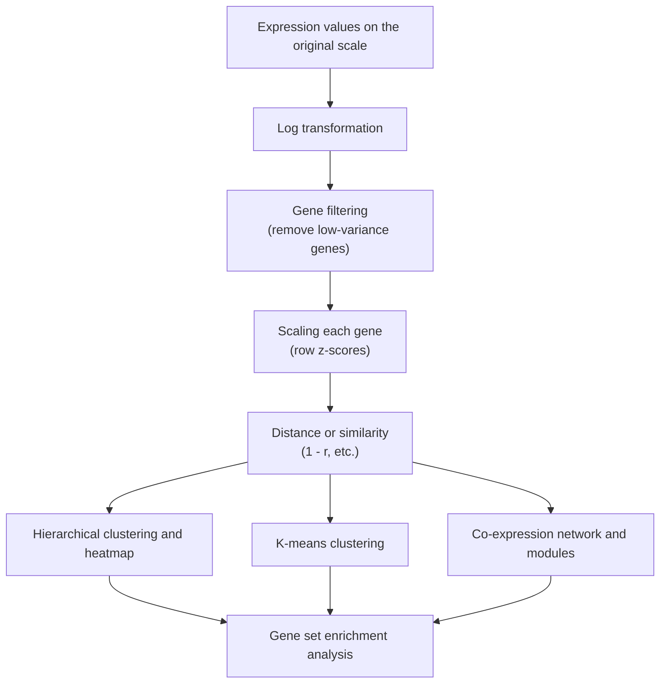
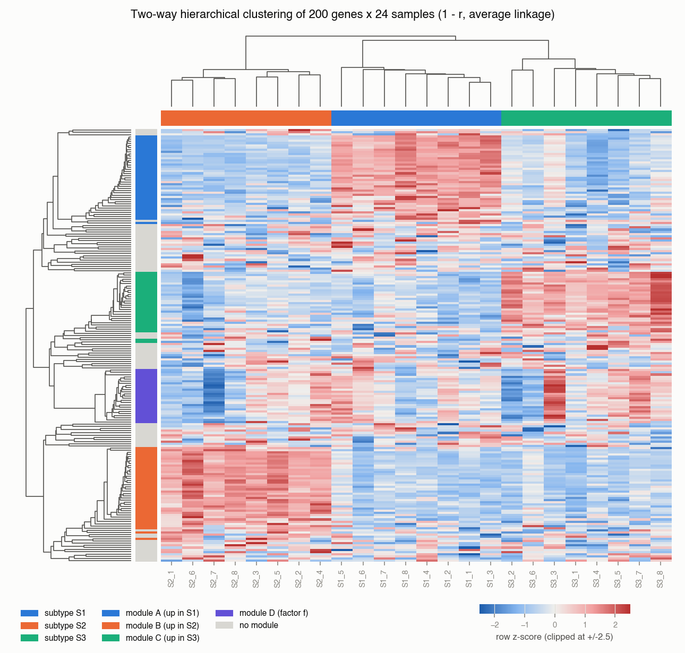
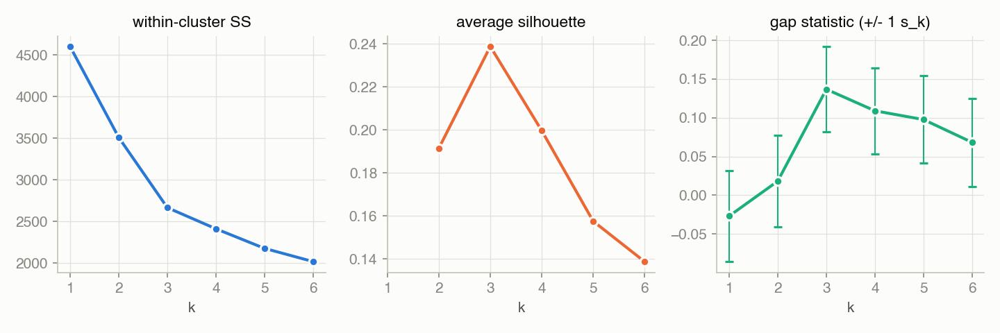
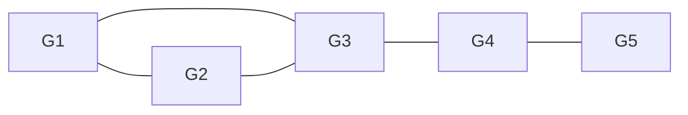
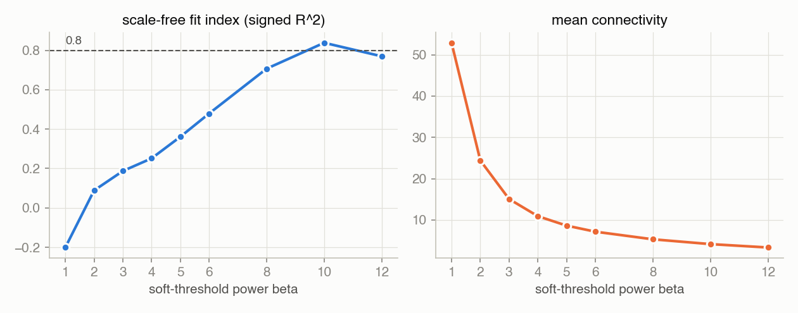

# Chapter 11 — Gene Expression Profiling with Clustering and Networks

[Repository Guide](../../README.md) | [English](Concepts_Lecture.md) | [한국어](Concepts_Lecture.ko.md)

> **Last Updated:** 2026-11-26

> **Learning Objectives:**
> 1. Explain the structure of an expression matrix and the purpose and order of log transformation, gene filtering, and scaling
> 2. Compare kinds of correlation-based distance and choose a distance suitable for clustering genes
> 3. Interpret a heatmap that clusters genes and samples together and assess the quality of a dendrogram
> 4. Choose the number of K-means clusters with the elbow method, the average silhouette width, and the gap statistic, and interpret the result critically
> 5. Build co-expression networks with correlation thresholds and soft thresholds, and compute degree, hubs, and topological overlap
> 6. Test gene sets for over-representation with the hypergeometric distribution and explain its assumptions and limitations

---

## Table of Contents

- [1. Gene Expression Profiling](#1-gene-expression-profiling)
  - [1.1 Expression Matrices and Expression Profiles](#11-expression-matrices-and-expression-profiles)
  - [1.2 Clustering Genes and Clustering Samples](#12-clustering-genes-and-clustering-samples)
  - [1.3 Workflow of the Analysis](#13-workflow-of-the-analysis)
  - [1.4 Simulated Expression Data](#14-simulated-expression-data)
- [2. Preprocessing the Expression Matrix](#2-preprocessing-the-expression-matrix)
  - [2.1 Log Transformation](#21-log-transformation)
  - [2.2 Gene Filtering](#22-gene-filtering)
  - [2.3 Scaling Each Gene](#23-scaling-each-gene)
  - [2.4 Normalization between Samples](#24-normalization-between-samples)
- [3. Correlation-Based Distances](#3-correlation-based-distances)
  - [3.1 Three Correlation Distances](#31-three-correlation-distances)
  - [3.2 Euclidean Distance versus Correlation Distance](#32-euclidean-distance-versus-correlation-distance)
  - [3.3 Correlation Distance and Euclidean Distance after Standardization](#33-correlation-distance-and-euclidean-distance-after-standardization)
  - [3.4 Rank Correlation and Outliers](#34-rank-correlation-and-outliers)
- [4. Hierarchical Clustering and Heatmaps](#4-hierarchical-clustering-and-heatmaps)
  - [4.1 Two-Way Clustering](#41-two-way-clustering)
  - [4.2 Reading a Heatmap](#42-reading-a-heatmap)
  - [4.3 Non-Uniqueness of the Leaf Order](#43-non-uniqueness-of-the-leaf-order)
  - [4.4 Choice of Linkage and the Cophenetic Correlation](#44-choice-of-linkage-and-the-cophenetic-correlation)
  - [4.5 Cutting the Dendrogram](#45-cutting-the-dendrogram)
- [5. K-Means Clustering and the Number of Clusters](#5-k-means-clustering-and-the-number-of-clusters)
  - [5.1 Clustering Samples with K-Means](#51-clustering-samples-with-k-means)
  - [5.2 The Elbow Method](#52-the-elbow-method)
  - [5.3 Average Silhouette Width](#53-average-silhouette-width)
  - [5.4 The Gap Statistic](#54-the-gap-statistic)
  - [5.5 Comparing the Three Criteria](#55-comparing-the-three-criteria)
- [6. Co-Expression Networks](#6-co-expression-networks)
  - [6.1 Co-Expression as a Graph](#61-co-expression-as-a-graph)
  - [6.2 Networks from a Correlation Threshold](#62-networks-from-a-correlation-threshold)
  - [6.3 Degree and Hub Genes](#63-degree-and-hub-genes)
  - [6.4 Clustering Coefficient and Other Measures](#64-clustering-coefficient-and-other-measures)
  - [6.5 Building a Co-Expression Network in R](#65-building-a-co-expression-network-in-r)
  - [6.6 Problems with Hard Thresholds](#66-problems-with-hard-thresholds)
- [7. Weighted Gene Co-Expression Network Analysis](#7-weighted-gene-co-expression-network-analysis)
  - [7.1 Soft Thresholding](#71-soft-thresholding)
  - [7.2 The Scale-Free Topology Criterion](#72-the-scale-free-topology-criterion)
  - [7.3 Topological Overlap](#73-topological-overlap)
  - [7.4 Module Detection](#74-module-detection)
  - [7.5 Module Eigengenes and Their Relation to Traits](#75-module-eigengenes-and-their-relation-to-traits)
- [8. Gene Set Enrichment Analysis](#8-gene-set-enrichment-analysis)
  - [8.1 Interpreting a Gene List](#81-interpreting-a-gene-list)
  - [8.2 Over-Representation Analysis and the Hypergeometric Distribution](#82-over-representation-analysis-and-the-hypergeometric-distribution)
  - [8.3 Computation in R](#83-computation-in-r)
  - [8.4 Testing Many Gene Sets](#84-testing-many-gene-sets)
  - [8.5 Assumptions and Limitations of Over-Representation Analysis](#85-assumptions-and-limitations-of-over-representation-analysis)
- [Concept Applications](#concept-applications)
- [Summary](#summary)
- [Self-Check Questions](#self-check-questions)
- [References](#references)

---

<br>

## 1. Gene Expression Profiling

### 1.1 Expression Matrices and Expression Profiles

As Chapter 7 showed, microarrays and RNA-seq measure the expression levels of tens of thousands of genes in one sample at once. Measurements of many samples are arranged into an expression matrix. With $`G`$ genes and $`n`$ samples, the expression matrix is $`G \times n`$. This chapter follows the biological convention of putting genes in rows; note that this is the opposite of the machine learning convention of Chapters 10 and 12, which put samples in rows. In R, `t()` transposes between the two conventions.

> **Definition:** An **expression matrix** arranges the expression levels measured in many samples with genes as rows and samples as columns.

> **Definition:** An **expression profile** is one row of the expression matrix: the vector of one gene's expression levels across all samples.

Each column of the matrix is the vector of all genes' expression in one sample, and it summarizes the molecular state of the sample.

> **Definition:** **Gene expression profiling** is the analysis of the row and column patterns of an expression matrix to find genes that move together and samples with similar molecular states.

### 1.2 Clustering Genes and Clustering Samples

An expression matrix can be clustered in two directions, which answer different questions.

| Direction | Objects Clustered | Distance Computed | Question Answered |
|:-----|:-----|:-----|:-----|
| Gene clustering | Rows (genes) | Between two gene profiles, length $`n`$ | Which genes are regulated together? |
| Sample clustering | Columns (samples) | Between two sample vectors, length $`G`$ | Are there molecularly distinct subtypes? |

*Table 1. Two directions for clustering an expression matrix*

Gene clustering rests on the idea that genes regulated by the same transcription factor or belonging to the same pathway have similar expression patterns. Eisen et al. presented a method that applies hierarchical clustering to genome-wide expression data and displays the result as a figure showing the cluster structure and the expression values together, and showed in yeast that it efficiently groups genes of known similar function [1]. A gene of unknown function that clusters with genes of known function therefore gives a lead to its function [1].

Sample clustering looks for molecularly distinct subtypes hidden within one diagnosis. Golub et al. showed on acute leukemia data that a clustering procedure, given no prior knowledge of the classes, discovered by itself the distinction between acute myeloid leukemia (AML) and acute lymphoblastic leukemia (ALL), and called this class discovery [2]. Assigning new samples to already known classes, **class prediction**, is the subject of Chapter 12.

> **Definition:** **Class discovery** is finding the subtypes (classes) hidden in data by clustering that is given no prior knowledge of the classes.

### 1.3 Workflow of the Analysis

Expression profiling proceeds in the following order. Each choice changes the results of the next steps, so a report should state what was chosen at each step.



*Figure 1. Workflow of gene expression profiling*

### 1.4 Simulated Expression Data

> **Definition:** A **module** is a group of genes whose expression profiles are strongly correlated so that they move together; it appears as one block in clustering or a gene network.

The R examples in this chapter use simulated data whose truth is known. Twenty-four samples belong to three subtypes S1, S2, and S3, eight each, and 140 of 400 genes belong to four modules A, B, C, and D.

- The genes of modules A, B, and C rise together in subtypes S1, S2, and S3, respectively.
- The genes of module D move together with a sample factor `f` unrelated to the subtypes. This imitates variation unrelated to subtype, such as experimental conditions, cell composition, or batch effects.
- Each gene follows its module to a different degree (`load`), from 0.2 to 1.5. So each module mixes genes that follow it strongly and genes that follow it weakly.
- The other 260 genes belong to no module.

```r
set.seed(2027)
n_g <- 400; n_s <- 24
subtype <- factor(rep(c("S1", "S2", "S3"), each = 8))
module  <- rep(c("A", "B", "C", "D", "none"), c(40, 40, 30, 30, 260))
mu <- runif(n_g, 4, 12)                       # baseline level of each gene (log2 scale)
f  <- rnorm(n_s)                              # sample factor unrelated to subtype
Fm <- cbind(A = 3.0 * (subtype == "S1") + rnorm(n_s, sd = 0.5),
            B = 3.0 * (subtype == "S2") + rnorm(n_s, sd = 0.5),
            C = 2.5 * (subtype == "S3") + rnorm(n_s, sd = 0.5),
            D = 1.2 * f)                      # activity of each module in each sample
load <- runif(n_g, 0.2, 1.5)                  # how strongly a gene follows its module
L <- matrix(mu, n_g, n_s) + matrix(rnorm(n_g * n_s, sd = 0.5), n_g, n_s)
for (m in c("A", "B", "C", "D")) {
  idx <- module == m
  L[idx, ] <- L[idx, ] + outer(load[idx], Fm[, m])
}
raw <- round(2^L)                             # intensity on the original scale
dimnames(raw) <- list(sprintf("gene%03d", 1:n_g), paste0(subtype, "_", rep(1:8, 3)))
raw[1:3, 1:5]
```

```text
        S1_1 S1_2 S1_3 S1_4 S1_5
gene001 1248 1016 1086  387  555
gene002 1512 1371 3331 1299 1875
gene003  257  138  160  342  197
```

`L` is the expression matrix on the log (base 2) scale. Normal noise is added to each gene's baseline `mu`, and module genes also receive `outer(load[idx], Fm[, m])`, the product of the gene's `load` and the sample's module activity. Column A of `Fm` is about 3 in S1 samples and about 0 in the others. Finally `2^L` returns to the original scale, and rounding gives positive intensity values `raw` similar to what a measuring instrument reports.

---

<br>

## 2. Preprocessing the Expression Matrix

### 2.1 Log Transformation

Expression values on the original scale are hard to cluster directly, for three reasons.

1. **Skewed distribution:** most genes are expressed at low levels and a few at very high levels, so the distribution has a long right tail.
2. **Mean-variance coupling:** the more highly a gene is expressed, the larger its standard deviation. Distances are then dominated by highly expressed genes.
3. **Multiplicative effects:** biological changes often happen as ratios, such as "a twofold increase". On the original scale a change from 10 to 20 and a change from 1,000 to 2,000 differ in size, but both are the same twofold change.

Taking the base-2 logarithm turns ratios into differences. The values 10, 20, 40, and 80 become 3.32, 4.32, 5.32, and 6.32, so each doubling becomes the same step of 1. For count data that may contain zeros, a small value (a pseudocount) is added before taking the logarithm, as in $`\log_2(x + 1)`$.

> **Definition:** A **pseudocount** is a small positive number (often 1) added to every value before a log transformation, so that count data containing zeros avoid the undefined $`\log 0`$.

```r
m_raw <- rowMeans(raw); s_raw <- apply(raw, 1, sd)
E <- log2(raw + 1)
m_log <- rowMeans(E); s_log <- apply(E, 1, sd)
round(c(raw = cor(m_raw, s_raw), log = cor(m_log, s_log)), 3)
round(quantile(m_raw, c(0, 0.5, 1)), 1)
```

```text
  raw   log 
0.963 0.270 
     0%     50%    100% 
   17.1   308.3 27015.5 
```

`rowMeans()` and `apply(raw, 1, sd)` compute the mean and standard deviation of each gene (row). On the original scale the gene means range from 17.1 to 27,015.5, more than 1,500-fold, and the correlation between mean and standard deviation is 0.963, almost proportional. After log transformation this correlation falls to 0.270. What remains comes from the biological variation of module genes across subtypes; the technical coupling of mean and variance has mostly disappeared.

> **Note:** For RNA-seq counts, Poisson noise at small means leaves low-expressed genes with larger variance even after log transformation. Variance-stabilizing transformations and count-data models that reduce this problem are covered in Chapter 9.

### 2.2 Gene Filtering

Expression data contain many genes that are barely expressed or have nearly the same value in every sample. Such genes give no information for clustering and only add noise, and their correlations become unstable when the variance is near 0. Before clustering, therefore, **nonspecific filtering** is applied: without using the class labels, genes whose mean expression is below a threshold or whose variance is small are removed. Keeping the top few hundred to few thousand genes by variance is common.

```r
v <- apply(E, 1, var)
keep <- order(v, decreasing = TRUE)[1:200]
Ef <- E[keep, ]
table(module[keep])
Ez <- t(scale(t(Ef)))                         # z-score of each gene (row)
round(c(mean = mean(Ez[1, ]), sd = sd(Ez[1, ])), 3)
```

```text

   A    B    C    D none 
  40   40   30   25   65 
mean   sd 
   0    1 
```

Keeping the 200 genes with the largest log-scale variance retained all genes of modules A, B, and C, 25 of the 30 genes of module D, and only 65 of the 260 genes outside the modules. Before filtering, 260 of 400 genes (65%) were noise genes; after filtering, 65 of 200 (32.5%). The 5 genes dropped from module D have small `load` values and follow the factor `f` only weakly.

> **Caution:** Variance-based filtering does not look at the class labels, so it is harmless as preprocessing for unsupervised analyses such as clustering. But to evaluate a classifier on filtered data, the filtering must also be done inside each fold of cross-validation, as in Section 7 of Chapter 10. If samples are clustered after filtering by a label-based criterion such as the t statistic, clusters that match the labels were already determined at the filtering step and are no evidence of class discovery.

### 2.3 Scaling Each Gene

> **Definition:** The **row z-score** is the value obtained by subtracting each row (gene) mean of the expression matrix and dividing by the row standard deviation.

When clustering genes, the interest is not the absolute level of expression but the pattern of rises and falls across samples. So the row z-score is used.

```math
z_{gj} = \frac{x_{gj} - \bar x_{g\cdot}}{s_{g}}, \qquad \bar x_{g\cdot} = \frac{1}{n}\sum_{j=1}^{n} x_{gj}, \quad s_g^2 = \frac{1}{n-1}\sum_{j=1}^{n} (x_{gj} - \bar x_{g\cdot})^2
```

A gene with values (2, 4, 6) has mean 4 and standard deviation 2, so its z-scores are (-1, 0, 1), and a gene with values (102, 104, 106) also has z-scores (-1, 0, 1). The two genes differ greatly in level (means 4 and 104) but share the same pattern. `scale()` in the code above standardizes each column, so to standardize rows one transposes with `t()`, applies `scale()`, and transposes back. The first row of the result has mean 0 and standard deviation 1.

The z-score normalization of Section 4.3 in Chapter 3 standardized each feature (column) so that variables with different units would not dominate the distance. The row z-score performs the same computation along genes (rows), and its purpose is to remove level differences between genes and keep only the pattern. Applying row z-scores before clustering samples also keeps highly expressed or highly variable genes from dominating the distances between samples.

### 2.4 Normalization between Samples

Samples differ in the amount of RNA measured, the sequencing depth, and the overall brightness of the microarray, so all genes in a sample can be higher or lower together.

> **Definition:** **Normalization** is the step that removes technical differences among samples, such as the amount measured, the sequencing depth, or the brightness, so that their values become comparable.

- In RNA-seq, samples have different total read counts, so counts are divided by a size factor. Estimation of size factors is covered in Chapter 9.
- **Quantile normalization** makes the value distributions of all samples identical. The values of each sample are sorted, the values of the same rank are replaced by their average across samples, and the values are returned to their original order.

Normalization is done before filtering and scaling, together with the log transformation. Without it, the first split of a sample clustering often follows measurement batch or depth rather than biology. The simulated data contain no such technical differences, so the examples in this chapter skip normalization.

---

<br>

## 3. Correlation-Based Distances

### 3.1 Three Correlation Distances

Section 5.5 of Chapter 3 introduced $`D = 1 - \lvert r \rvert`$ as a way to turn a correlation coefficient into a distance. In expression data all three of the following are used, and they differ in how they treat negative correlation.

| Distance | Formula | Range | $`r = 1`$ | $`r = 0`$ | $`r = -1`$ | Treatment of Negative Correlation |
|:-----|:-----|:-----|-----:|-----:|-----:|:-----|
| Signed correlation distance | $`1 - r`$ | $`[0, 2]`$ | 0 | 1 | 2 | As farthest |
| Unsigned correlation distance | $`1 - \lvert r \rvert`$ | $`[0, 1]`$ | 0 | 1 | 0 | As closest |
| Squared correlation distance | $`1 - r^2`$ | $`[0, 1]`$ | 0 | 1 | 0 | As closest |

*Table 2. Three correlation-based distances*

> **Definition:** The **signed correlation distance** is the distance $`1 - r`$, which treats negative correlation as farthest.

> **Definition:** The **unsigned correlation distance** is the distance $`1 - \lvert r \rvert`$, which treats a strong negative correlation as close, just like a strong positive one.

Which one to use depends on the biological question. To treat a relation in which one gene represses another, so that they move in opposite directions, as belonging to the same regulatory circuit, use an unsigned distance. To group only genes that rise together and separate genes that move oppositely, use the signed distance $`1 - r`$. If one cluster mixes genes of opposite directions, the interpretation "this cluster is highly expressed" breaks down, so heatmaps and cluster interpretation use $`1 - r`$ more often. The examples in this chapter also use $`1 - r`$.

> **Definition:** A **heatmap** is a picture that shows the values of a matrix as colors.

$`1 - r`$ does not satisfy the triangle inequality, so it is not a distance (metric) in the strict sense. The quantity $`\sqrt{2(1 - r)}`$ of Section 3.3 does satisfy it. Hierarchical clustering needs only a dissimilarity, so in practice $`1 - r`$ works without problems.

### 3.2 Euclidean Distance versus Correlation Distance

Consider three genes with the following profiles.

| Gene | Sample 1 | Sample 2 | Sample 3 | Sample 4 |
|:-----|-----:|-----:|-----:|-----:|
| g1 | 1 | 2 | 3 | 4 |
| g2 | 10 | 20 | 30 | 40 |
| g3 | 4 | 3 | 2 | 1 |

*Table 3. Three genes for comparing Euclidean and correlation distances*

The Euclidean distances are $`d(g1, g2) = \sqrt{9^2 + 18^2 + 27^2 + 36^2} = \sqrt{2430} = 49.30`$ and $`d(g1, g3) = \sqrt{3^2 + 1^2 + 1^2 + 3^2} = \sqrt{20} = 4.47`$, so g1 is much closer to g3. The correlations are $`r(g1, g2) = 1`$ and $`r(g1, g3) = -1`$, so with the signed correlation distance $`1 - r(g1, g2) = 0`$ and $`1 - r(g1, g3) = 2`$: g1 is closest to g2 and farthest from g3. With the unsigned correlation distance, both g2 and g3 are at distance 0 from g1.

g1 and g2 differ in level by a factor of 10 but move in the same pattern, so they can be considered co-regulated. Euclidean distance weighs the level difference heavily and misses this relation. Euclidean distance on original-scale or log-scale values groups genes of similar expression level, which is usually not an interesting question.

### 3.3 Correlation Distance and Euclidean Distance after Standardization

The two approaches meet after row z-scoring. Let $`z_x, z_y`$ be two profiles $`x, y`$ of length $`n`$ standardized as in Section 2.3. Then $`\sum_j z_{x,j}^2 = \sum_j z_{y,j}^2 = n - 1`$ and $`\sum_j z_{x,j} z_{y,j} = (n - 1) r`$, so

```math
\lVert z_x - z_y \rVert^2 = \sum_j z_{x,j}^2 + \sum_j z_{y,j}^2 - 2 \sum_j z_{x,j} z_{y,j} = 2(n - 1)(1 - r)
```

Standardizing g1 and g3 of Table 3 gives (-1.162, -0.387, 0.387, 1.162) for g1 and the same values with signs flipped for g3, and the sum of squared differences is 12. The formula gives $`2 \times 3 \times (1 - (-1)) = 12`$ as well. Using Euclidean distance on row z-scores is therefore the same as using a distance proportional to $`\sqrt{1 - r}`$, and the ordering of distances is the same as for $`1 - r`$. To perform correlation-based clustering with a method that assumes Euclidean distance, such as K-means, one simply applies row z-scores first.

### 3.4 Rank Correlation and Outliers

The Pearson correlation is swayed heavily by a single outlier. If a measurement error makes two genes very high together in one sample, the correlation of two genes that are unrelated in the remaining samples can approach 1. The Spearman rank correlation of Section 5.3 in Chapter 3 replaces values by ranks before computing the correlation and is robust to such outliers. In expression data with few samples it is safer to use $`1 - \rho_{\text{Spearman}}`$, or, when using the Pearson correlation, to check for outlying samples first.

---

<br>

## 4. Hierarchical Clustering and Heatmaps

### 4.1 Two-Way Clustering

> **Definition:** **Two-way clustering** clusters the genes and the samples of an expression matrix separately by hierarchical clustering and reorders the rows and columns by the leaf orders of the two dendrograms.

The agglomerative hierarchical clustering of Section 7 in Chapter 3 repeatedly merges the two closest clusters to build a dendrogram. Two-way clustering applies this method to genes and samples separately.

```r
d_gene <- as.dist(1 - cor(t(Ef)))            # 1 - Pearson r between genes
hc_gene <- hclust(d_gene, method = "average")
cl_gene <- cutree(hc_gene, h = 0.7)
big <- as.numeric(names(which(table(cl_gene) >= 8)))
table(cluster = ifelse(cl_gene %in% big, cl_gene, 0), module = module[keep])
d_samp <- as.dist(1 - cor(Ez))               # between samples, on centered genes
hc_samp <- hclust(d_samp, method = "average")
table(cluster = cutree(hc_samp, k = 3), subtype)
```

```text
       module
cluster  A  B  C  D none
      0  0  1  2  0   62
      1 40  0  0  0    1
      2  0 39  0  0    1
      3  0  0 28  0    1
      4  0  0  0 25    0
       subtype
cluster S1 S2 S3
      1  8  0  0
      2  0  8  0
      3  0  0  8
```

`cor(t(Ef))` is the matrix of pairwise Pearson correlations of the 200 genes (`cor()` correlates columns, so the matrix is transposed), and `as.dist(1 - ...)` turns it into a distance object. `hclust(..., method = "average")` builds the dendrogram with average linkage. `cutree(hc_gene, h = 0.7)` cuts the dendrogram at height 0.7 and numbers the clusters, and the next line keeps only clusters with at least 8 genes and labels the rest 0 (unassigned). For samples, the distance is computed from the correlations between columns of the row z-scores `Ez`.

On the gene side, the four clusters of size 8 or more matched modules A, B, C, and D almost exactly. Of the 65 genes outside the modules, 62 scattered into small clusters, and 3 genes of modules B and C ended up there as well. On the sample side, the three clusters matched the three subtypes exactly.

### 4.2 Reading a Heatmap

The result of two-way clustering is drawn as a heatmap. Row z-scores are shown as colors, rows and columns are ordered by the leaf orders of the dendrograms, and the two dendrograms are attached at the top and left.



*Figure 2. Heatmap of two-way clustering of 200 genes and 24 samples in the simulated data*

In Figure 2, red means expression above the gene's mean and blue means below. The color bar at the top shows the true subtype of each sample, and the bar at the left shows the true module of each gene. The figure is read as follows.

- The sample dendrogram splits into three main branches, each matching one subtype.
- On the gene side, the block of module A genes is red only in S1 samples, module B only in S2, and module C only in S3. A rectangle where a gene block meets a sample block is a gene group that characterizes a subtype.
- The block of module D mixes red and blue from sample to sample regardless of subtype. This signals shared variation (the factor `f`) that the subtypes do not explain.
- Genes outside the modules appear as scattered colors without pattern.

The color range is usually clipped at $`\pm 2`$ or $`\pm 3`$ so that a few extreme values do not monopolize the color scale. Figure 2 is clipped at $`\pm 2.5`$. The colors use a diverging scale with gray at 0 and two contrasting colors on either side.

### 4.3 Non-Uniqueness of the Leaf Order

Swapping the left and right branches at any merge of a dendrogram gives the same dendrogram. With $`m`$ leaves there are $`m - 1`$ merges, so $`2^{m-1}`$ leaf orders draw the same tree. For 24 samples that is $`2^{23} \approx 8.4`$ million. One must therefore not conclude that two genes are close merely because they are adjacent in a heatmap. The closeness of two leaves is judged by the height at which they are first joined in the dendrogram. Software differs in its rule for choosing left and right (cluster size, mean expression, and so on), so the same data can look different.

### 4.4 Choice of Linkage and the Cophenetic Correlation

The three linkages of Section 7.5 in Chapter 3 build different dendrograms from the same distance matrix. How well a dendrogram preserves the original distances can be measured by the cophenetic correlation.

> **Definition:** The **cophenetic distance** between two leaves is the merge height at which they first join the same cluster in a dendrogram.

> **Definition:** The **cophenetic correlation** is the Pearson correlation, over all pairs of leaves, between the original distances and the cophenetic distances; it measures how well a dendrogram preserves the original distances.

The closer the cophenetic correlation is to 1, the more faithfully the dendrogram represents the original distance structure.

```r
sapply(c("single", "complete", "average"), function(m)
  round(cor(cophenetic(hclust(d_gene, method = m)), d_gene), 3))
```

```text
  single complete  average 
   0.675    0.769    0.826 
```

`cophenetic()` computes the cophenetic distance matrix from a dendrogram. On these data average linkage scores highest at 0.826 and single linkage lowest at 0.675. Single linkage merges by looking only at the closest pair, so it tends to show **chaining**: clusters stretch out like chains along intermediate genes that link them. The merge heights of many pairs then fall far below their original distances. Average linkage, together with correlation distance, is the most widely used choice for expression data. Ward linkage minimizes the increase in within-cluster sum of squares, which suits Euclidean distance (or Euclidean distance on row z-scores).

### 4.5 Cutting the Dendrogram

To obtain clusters from a dendrogram, one cuts it at a height $`h`$ or at a number of clusters $`k`$. Cutting by height has a clear interpretation. Cutting a correlation-distance dendrogram at $`h = 0.7`$ with average linkage means that clusters whose average distance exceeds 0.7 are not merged. Every pair within a cluster is first joined at a merge at or below this height, so the average correlation within a cluster is at least 0.3.

Cutting by the number of clusters $`k`$ looks only at the top splits of the dendrogram, which causes trouble in data with many noise genes. Unrelated modules merge at $`1 - r \approx 1`$, and noise genes merge at similar heights, so the top few splits are essentially arbitrary. That is why Section 4.1 cut by height and excluded small clusters. Methods such as the dynamic tree cut, which sets different heights for different branches based on their shape, are also used.

---

<br>

## 5. K-Means Clustering and the Number of Clusters

### 5.1 Clustering Samples with K-Means

The K-means clustering of Section 8 in Chapter 3 finds $`K`$ clusters that minimize the within-cluster sum of squares. It uses Euclidean distance, so by Section 3.3, applying it to sample (column) vectors after row z-scoring gives a correlation-based sample clustering. Unlike hierarchical clustering, it requires the number of clusters $`K`$ in advance, so a data-based criterion for $`K`$ is needed. Here three criteria are applied to the same data and their results are compared.

### 5.2 The Elbow Method

> **Definition:** The **elbow method** plots the within-cluster sum of squares $`W_K`$ against the number of clusters $`K`$ and chooses as the number of clusters the $`K`$ where the decrease suddenly levels off (the elbow).

The within-cluster sum of squares $`W_K`$ decreases as $`K`$ grows and reaches 0 at $`K = n`$. So one cannot choose the $`K`$ that minimizes $`W_K`$. Up to the true number of clusters, each increase of $`K`$ splits off a distinct cluster and $`W_K`$ drops sharply; beyond it, a cluster is split by force and $`W_K`$ drops only slightly. The weakness is that the elbow is often unclear and judging it is subjective.

### 5.3 Average Silhouette Width

The **silhouette width** of Section 9.2 in Chapter 3, $`s(i) = \{b(i) - a(i)\} / \max\{a(i), b(i)\}`$, measures how well a sample fits its own cluster on a scale from $`-1`$ to 1, where $`a(i)`$ is the mean distance within the sample's cluster and $`b(i)`$ the mean distance to the nearest other cluster. Rousseeuw proposed this value as a graphical aid to the interpretation and validation of cluster analysis [3]. As in Section 9.3 of Chapter 3, one chooses the $`K`$ with the largest average silhouette width over all samples. The average silhouette width is undefined at $`K = 1`$, so this criterion cannot conclude that there are no clusters.

### 5.4 The Gap Statistic

> **Definition:** The **gap statistic** measures, for each number of clusters $`K`$, how much smaller $`\log W_K`$ of the data is than its expected value for data from a reference distribution without cluster structure, to see whether the decrease of $`W_K`$ exceeds chance.

Proposed by Tibshirani, Walther, and Hastie, the gap statistic is [4]

```math
\mathrm{Gap}(K) = E^{*}\!\left[\log W_K^{*}\right] - \log W_K
```

$`W_K`$ is the within-cluster sum of squares of the observed data, and $`E^{*}[\log W_K^{*}]`$ is the mean of $`\log W_K^{*}`$ when $`B`$ data sets of the same size are generated from a reference distribution without clusters (a uniform distribution over the range of the observed data) and clustered the same way. The larger the gap, the tighter the clusters of the observed data compared with random data. The number of clusters is chosen by the following **one-standard-error rule**.

```math
\hat K = \min \left\{ K : \mathrm{Gap}(K) \ge \mathrm{Gap}(K+1) - s_{K+1} \right\}
```

$`s_K`$ is the standard deviation of $`\log W_K^{*}`$ over the $`B`$ reference data sets multiplied by $`\sqrt{1 + 1/B}`$. The rule stops at $`K`$ if increasing to $`K + 1`$ does not raise the gap by at least a standard error. The documentation of R's cluster package notes that this rule chooses $`K = 1`$ when all standard deviations are larger than the differences between neighboring gaps [5]. Of the three criteria, only the gap statistic can conclude $`K = 1`$, that is, that there are no clusters.

> **Caution:** With its default `d.power = 1`, `clusGap()` in the cluster package computes $`W_K`$ by summing unsquared distances; the sum of squared distances proposed by Tibshirani et al. corresponds to `d.power = 2` [5]. By default it also draws the reference distribution from a box in principal component coordinates rather than in the original variable coordinates (`spaceH0 = "scaledPCA"`). These settings should be reported with the results.

### 5.5 Comparing the Three Criteria

```r
library(cluster)
S <- t(Ez)                                    # 24 samples x 200 genes
set.seed(3)
ks <- 1:6
wss <- sapply(ks, function(k) kmeans(S, centers = k, nstart = 25)$tot.withinss)
sil <- sapply(ks, function(k) {
  if (k == 1) return(NA)
  cl <- kmeans(S, centers = k, nstart = 25)$cluster
  mean(silhouette(cl, dist(S))[, "sil_width"])
})
gap <- clusGap(S, FUNcluster = kmeans, nstart = 25, K.max = 6, B = 100, d.power = 2)
data.frame(k = ks, wss = round(wss, 1), silhouette = round(sil, 3),
           gap = round(gap$Tab[, "gap"], 3), se = round(gap$Tab[, "SE.sim"], 3))
c(one_se_rule = maxSE(gap$Tab[, "gap"], gap$Tab[, "SE.sim"], method = "Tibs2001SEmax"),
  global_max  = which.max(gap$Tab[, "gap"]))
```

```text
  k    wss silhouette    gap    se
1 1 4600.0         NA -0.027 0.059
2 2 3508.7      0.191  0.018 0.059
3 3 2665.0      0.239  0.137 0.055
4 4 2410.9      0.200  0.109 0.055
5 5 2175.6      0.158  0.098 0.056
6 6 2017.0      0.139  0.068 0.057
one_se_rule  global_max 
          1           3 
```

`kmeans(S, centers = k, nstart = 25)` runs 25 times from different initial centers and returns the solution with the smallest within-cluster sum of squares, to reduce the local optimum problem seen in Section 8.4 of Chapter 3. `tot.withinss` is $`W_K`$. `silhouette(cl, dist(S))` computes the silhouette width of each sample, and their mean is taken. `clusGap()` computes the gap statistic and its standard error `SE.sim` with 100 reference data sets (`B = 100`), and `maxSE()` applies a cluster-number rule to the gaps and standard errors in the table.



*Figure 3. Within-cluster sum of squares, average silhouette width, and gap statistic by K*

Read criterion by criterion, the results are as follows.

- **Elbow method:** $`W_K`$ drops sharply by 1,091.3 and 843.7 at $`K = 1 \to 2 \to 3`$, and from $`K = 3 \to 4`$ onward the drops shrink to 254.1, 235.3, and 158.6. The elbow is at $`K = 3`$.
- **Silhouette width:** the average silhouette width is largest at $`K = 3`$, 0.239.
- **Gap statistic:** the gap is largest at $`K = 3`$, 0.137. Yet the one-standard-error rule chose $`K = 1`$, because $`\mathrm{Gap}(1) = -0.027`$ is at least $`\mathrm{Gap}(2) - s_2 = 0.018 - 0.059 = -0.041`$. The increase of the gap from $`K = 1`$ to 2 (0.045) is smaller than its standard error (0.059), so the rule judges the evidence that 2 clusters beat 1 insufficient and stops there. The rule never sees the large increase (0.119) from $`K = 2`$ to 3.

Two of the three criteria and the maximum of the gap pointed to the true number of subtypes, 3, but the one-standard-error rule gave a more conservative answer, because with only 24 samples the standard error of the gap is large. Criteria for the number of clusters can thus give different answers, and no single criterion can establish the "true number of clusters". The choice should weigh several criteria together with the stability of the clusters (do the same clusters appear with other random seeds and in bootstrap samples?) and their biological interpretability.

---

<br>

## 6. Co-Expression Networks

### 6.1 Co-Expression as a Graph

Clustering divides genes into non-overlapping groups, but the relations among genes are entangled both within and across groups. Viewed as a network, questions such as which genes are central, connected to many others, and which genes link modules become accessible.

> **Definition:** A **co-expression network** is a graph whose nodes are genes and whose edges are gene pairs with strongly correlated expression profiles.

> **[Discrete Mathematics]** A graph $`G = (V, E)`$ consists of a set of nodes $`V`$ and a set of edges $`E`$, which are pairs of nodes. A graph with $`p`$ nodes can be represented by an adjacency matrix. The adjacency matrix of an undirected graph is symmetric. A graph whose edges carry weights between 0 and 1 is called a weighted graph.

> **Definition:** The **adjacency matrix** of a graph with $`p`$ nodes is the $`p \times p`$ matrix $`A`$ with $`a_{ij} = 1`$ if there is an edge between nodes $`i`$ and $`j`$ and 0 otherwise; for a weighted graph it holds the edge weights.

### 6.2 Networks from a Correlation Threshold

The simplest method connects pairs whose absolute correlation is at least a threshold $`\tau`$.

```math
a_{ij} = \begin{cases} 1 & \text{if } \lvert r_{ij} \rvert \ge \tau \\ 0 & \text{otherwise} \end{cases} \qquad (i \ne j)
```

> **Definition:** A **hard threshold** connects only the gene pairs whose absolute correlation is at least a threshold $`\tau`$ and cuts all others, so that connections are only 0 or 1.

Suppose five genes have the following correlation matrix.

| | G1 | G2 | G3 | G4 | G5 |
|:-----|-----:|-----:|-----:|-----:|-----:|
| G1 | 1 | 0.92 | 0.85 | 0.55 | -0.40 |
| G2 | 0.92 | 1 | 0.78 | 0.48 | -0.35 |
| G3 | 0.85 | 0.78 | 1 | 0.72 | -0.55 |
| G4 | 0.55 | 0.48 | 0.72 | 1 | -0.81 |
| G5 | -0.40 | -0.35 | -0.55 | -0.81 | 1 |

*Table 4. Correlation matrix of five genes*

With $`\tau = 0.7`$, the pairs with $`\lvert r \rvert \ge 0.7`$ are the five pairs G1-G2 (0.92), G1-G3 (0.85), G2-G3 (0.78), G3-G4 (0.72), and G4-G5 (-0.81).



*Figure 4. Network from the correlation matrix of Table 4 with threshold 0.7*

G4 and G5 are connected through a negative correlation. Because the sign is ignored, Figure 4 is an unsigned network; how to treat the sign of the correlation is the same issue as the choice of distance in Section 3.1.

> **Definition:** A **signed network** is a co-expression network that counts only positive correlations as connections.

> **Definition:** An **unsigned network** is a co-expression network that ignores the sign of the correlation and connects genes by its absolute value.

### 6.3 Degree and Hub Genes

> **Definition:** The **degree** of a node is the number of edges attached to it, $`k_i = \sum_{j \ne i} a_{ij}`$; in a weighted network it is the sum of the connection weights.

In Figure 4 the degrees are 2 for G1, 2 for G2, 3 for G3, 2 for G4, and 1 for G5.

> **Definition:** A **hub gene** is a gene with a particularly large degree in a co-expression network.

A hub gene moves together with many genes, so it represents the activity of its whole module and may also regulate that module. Real biological networks are often close to scale-free networks, and the criterion of Section 7.2 uses this property.

> **Definition:** A **scale-free network** is a network whose degree distribution follows a power law $`P(k) \propto k^{-\gamma}`$, so that most nodes have few edges and a few nodes have very many.

### 6.4 Clustering Coefficient and Other Measures

> **Definition:** The **clustering coefficient** of a node is the proportion of its neighbor pairs that are actually connected by an edge; it measures how densely its neighbors are connected to one another.

With $`k_i`$ neighbors there are $`k_i(k_i - 1)/2`$ neighbor pairs, so the clustering coefficient of node $`i`$ is

```math
C_i = \frac{\text{number of neighbor pairs that are connected}}{k_i (k_i - 1) / 2} \qquad (k_i \ge 2)
```

In Figure 4 the neighbors of G3 are G1, G2, and G4, and of the 3 neighbor pairs only G1-G2 is connected, so $`C_3 = 1/3`$. The neighbors of G1, G2 and G3, are connected to each other, so $`C_1 = 1`$. Nodes with high clustering coefficients form dense groups, that is, modules.

Other measures include the shortest path length between two nodes and **betweenness centrality**, which measures how often a node lies on the shortest paths between other pairs of nodes. Genes with high betweenness act as bridges between modules. In Figure 4, G3 and G4 lie on the route linking the G1-G2-G3 group to G5, so their betweenness is high.

### 6.5 Building a Co-Expression Network in R

A hard threshold of $`\tau = 0.8`$ is applied to the 200 genes of the simulated data.

```r
library(igraph)
R <- cor(t(Ef))
A_hard <- (abs(R) >= 0.8) * 1; diag(A_hard) <- 0
net <- graph_from_adjacency_matrix(A_hard, mode = "undirected")
deg <- degree(net)
c(edges = ecount(net), isolated = sum(deg == 0), max_degree = max(deg))
hubs <- order(deg, decreasing = TRUE)[1:5]
data.frame(gene = names(deg)[hubs], degree = deg[hubs], module = module[keep][hubs],
           row.names = NULL)
comp <- components(net)
sort(comp$csize[comp$csize > 1], decreasing = TRUE)
```

```text
     edges   isolated max_degree 
      1163         89         31 
     gene degree module
1 gene030     31      A
2 gene058     31      B
3 gene060     31      B
4 gene070     31      B
5 gene042     31      B
[1] 34 32 23 22
```

`(abs(R) >= 0.8) * 1` turns the logical matrix into a 0/1 adjacency matrix, and `diag(A_hard) <- 0` removes self-edges. `graph_from_adjacency_matrix()` of the igraph package builds an undirected graph from this matrix, `degree()` computes the degree of each node, and `components()` finds the groups of mutually connected nodes (connected components).

There are 1,163 edges, and 89 genes are connected to no other gene. There are exactly four connected components of size 2 or more (34, 32, 23, and 22 genes), corresponding to the four modules. The genes with the largest degree belong to modules A and B and are connected to 31 genes. They follow their module's activity strongly (large `load`), so they have $`\lvert r \rvert \ge 0.8`$ with most genes in the same module (31 of 39).

### 6.6 Problems with Hard Thresholds

Hard thresholds are simple but have the following problems.

- **Loss of information:** $`r = 0.79`$ and $`r = 0.81`$ are nearly the same relation, yet one gives no edge and the other an edge. Meanwhile $`r = 0.81`$ and $`r = 0.99`$ are both treated as 1.
- **Arbitrariness of the threshold:** whether $`\tau`$ is 0.7 or 0.8 changes the number of edges, the hubs, and the modules considerably.
- **Dependence on sample size:** how large a correlation can become by chance depends on the number of samples. With 24 samples, rejecting the null hypothesis of zero correlation at two-sided level 0.05 requires $`\lvert r \rvert \ge 0.404`$, but with 100 samples 0.197 suffices. The same $`\tau`$ means different things at different sample sizes.

> **[Probability and Statistics]** If the population correlation of a bivariate normal distribution is 0, then $`t = r \sqrt{(n - 2)/(1 - r^2)}`$ built from the sample correlation $`r`$ follows a t distribution with $`n - 2`$ degrees of freedom. Solving for $`r`$, the critical correlation at level $`\alpha`$ is $`r_c = t_c / \sqrt{n - 2 + t_c^2}`$, and for $`n = 24`$, $`t_c = 2.074`$ gives $`r_c = 0.404`$.

---

<br>

## 7. Weighted Gene Co-Expression Network Analysis

### 7.1 Soft Thresholding

Zhang and Horvath questioned whether encoding co-expression as binary information, connected (1) or unconnected (0), is biologically meaningful, and proposed a framework of soft thresholding that assigns a connection weight to each gene pair [6]. A network built this way is called a weighted gene co-expression network, and the analysis method based on it is called WGCNA (weighted gene co-expression network analysis) [6], [7]. The most widely used adjacency function is the power function.

```math
a_{ij} = \lvert r_{ij} \rvert^{\beta} \;\; (\text{unsigned network}), \qquad a_{ij} = \left( \frac{1 + r_{ij}}{2} \right)^{\beta} \;\; (\text{signed network}), \qquad \beta \ge 1
```

The power keeps strong correlations and pushes weak ones toward 0. With $`\beta = 6`$, $`r = 0.92`$ becomes $`0.92^6 = 0.606`$, $`r = 0.72`$ becomes 0.139, $`r = 0.48`$ becomes 0.012, and $`r = 0.35`$ becomes 0.002. The correlations 0.92 and 0.48 differ by a factor of about 2, but their weights differ by a factor of about 50. Without cutting connections as a hard threshold does, the influence of weak correlations on the network is greatly reduced.

In a signed network, $`r = -0.81`$ becomes $`((1 - 0.81)/2)^6 = 0.095^6 \approx 7 \times 10^{-7}`$, which is effectively no connection. G4 and G5 of Table 4 are connected with weight $`0.81^6 = 0.282`$ in the unsigned network but disconnected in the signed network. The degree also generalizes to the sum of weights, $`k_i = \sum_{j \ne i} a_{ij}`$. Applying the unsigned $`\beta = 6`$ to the correlations of Table 4 gives G1 the degree $`0.606 + 0.377 + 0.028 + 0.004 = 1.015`$.

> **Definition:** **Soft thresholding** assigns each gene pair a connection weight between 0 and 1 that depends on the size of the correlation (for example $`\lvert r_{ij} \rvert^{\beta}`$) instead of cutting correlations to 0 or 1.

> **Definition:** **WGCNA (weighted gene co-expression network analysis)** is an analysis method that builds a weighted co-expression network by soft thresholding, applies hierarchical clustering to a similarity between genes that reflects both their direct connection and their shared neighbors to find modules of co-expressed genes, and then relates those modules to traits.

### 7.2 The Scale-Free Topology Criterion

As a criterion for choosing $`\beta`$, Zhang and Horvath proposed the biologically motivated scale-free topology criterion [6]. How well the degree distribution fits a power law is measured by binning the degrees and computing the coefficient of determination $`R^2`$ of the regression of the log bin frequency $`p(k)`$ on the log mean degree $`k`$ of the bin. The slope must be negative to match the direction of a power law, so the fit index is the sign-adjusted $`-\mathrm{sign}(\text{slope}) \times R^2`$.

> **Definition:** The **scale-free topology criterion** chooses the exponent $`\beta`$ of soft thresholding at which the degree distribution fits a power law well, based on the observation that biological networks tend to be scale-free.

As $`\beta`$ grows, the fit index generally rises, but the mean degree falls quickly and the network becomes too sparse. So one chooses the smallest $`\beta`$ at which the fit index is high enough. The example in this chapter uses a fit index of 0.8 as the cutoff.

```r
fit_index <- function(k, nbreaks = 10) {     # signed R^2 of log10 p(k) on log10 k
  bins <- cut(k, nbreaks)
  pk <- as.numeric(table(bins)) / length(k)
  mk <- tapply(k, bins, mean)
  ok <- pk > 0
  fit <- lm(log10(pk[ok]) ~ log10(mk[ok]))
  -sign(coef(fit)[2]) * summary(fit)$r.squared
}
powers <- c(1:6, 8, 10, 12)
sft <- t(sapply(powers, function(b) {
  A <- abs(R)^b; diag(A) <- 0
  k <- rowSums(A)
  c(power = b, fit = unname(fit_index(k)), mean_k = mean(k))
}))
round(sft, 3)
```

```text
      power    fit mean_k
 [1,]     1 -0.201 52.909
 [2,]     2  0.088 24.421
 [3,]     3  0.187 15.082
 [4,]     4  0.251 10.929
 [5,]     5  0.361  8.640
 [6,]     6  0.479  7.171
 [7,]     8  0.707  5.327
 [8,]    10  0.838  4.164
 [9,]    12  0.769  3.345
```

`fit_index()` splits the degree vector `k` into 10 bins (`cut(k, nbreaks)`), computes the proportion `pk` and the mean degree `mk` of each bin, drops empty bins, and regresses the logarithms linearly. The loop builds the adjacency matrix $`\lvert r \rvert^\beta`$ for each candidate $`\beta`$ and computes the degrees and the fit index.



*Figure 5. Scale-free topology fit index and mean connectivity by soft-threshold power*

At $`\beta = 1`$ the fit index is negative, because even weak correlations remain as connections and almost all genes have similarly large degrees. As $`\beta`$ grows the fit index rises, first exceeding 0.8 among the candidates at $`\beta = 10`$ (0.838). Its fall back to 0.769 at $`\beta = 12`$ occurs because, with only 200 genes, the frequencies of the 10 bins are jagged. The mean degree fell from 52.9 to 4.2. For these data, therefore, $`\beta = 10`$ is chosen. Real data have thousands of genes or more, and the curve is smoother.

### 7.3 Topological Overlap

> **Definition:** **Topological overlap** is a similarity between two genes that reflects both their direct connection and their shared neighbors.

The adjacency $`a_{ij}`$ looks only at two genes. If two genes belong to the same module, they will not only be strongly connected directly but also share many neighbors. Topological overlap measures both.

```math
\omega_{ij} = \frac{l_{ij} + a_{ij}}{\min(k_i, k_j) + 1 - a_{ij}}, \qquad l_{ij} = \sum_{u \ne i, j} a_{iu} a_{uj}
```

$`l_{ij}`$ sums the products of weights over the neighbors the two genes share; in a binary network it is the number of common neighbors. The denominator keeps $`\omega_{ij}`$ between 0 and 1, and $`\omega_{ij} = 1`$ when the two genes are connected and their neighbors overlap completely. Modules are found from the topological overlap matrix of all $`\omega_{ij}`$, using $`1 - \omega_{ij}`$ as the dissimilarity. Zhang and Horvath gave theoretical and empirical evidence that modules defined by the weighted topological overlap are more cohesive than those defined by its unweighted counterpart [6].

> **Definition:** The **topological overlap matrix (TOM)** is the matrix of the topological overlaps $`\omega_{ij}`$ of all gene pairs.

The topological overlap of G1 and G2 is computed by applying the unsigned $`\beta = 6`$ to the correlations of Table 4. The adjacencies are $`a_{12} = 0.606`$, $`a_{13} = 0.377`$, $`a_{23} = 0.225`$, $`a_{14} = 0.028`$, $`a_{24} = 0.012`$, $`a_{15} = 0.004`$, and $`a_{25} = 0.002`$.

1. Shared neighbors: $`l_{12} = a_{13}a_{32} + a_{14}a_{42} + a_{15}a_{52} = 0.377 \times 0.225 + 0.028 \times 0.012 + 0.004 \times 0.002 \approx 0.0853`$
2. Degrees: $`k_1 = 1.015`$ and $`k_2 = 0.606 + 0.225 + 0.012 + 0.002 = 0.846`$, so $`\min(k_1, k_2) = 0.846`$
3. Topological overlap: $`\omega_{12} = (0.0853 + 0.606) / (0.846 + 1 - 0.606) = 0.691 / 1.240 = 0.558`$

Computed the same way, G1 and G5 have $`\omega_{15} = 0.018`$: almost no shared neighbors and almost no direct connection.

### 7.4 Module Detection

WGCNA applies average-linkage hierarchical clustering to $`1 - \text{TOM}`$ and cuts the dendrogram to obtain modules. The code below computes the TOM with the $`\beta = 10`$ chosen in Section 7.2.

```r
beta <- 10
A <- abs(R)^beta; diag(A) <- 0
k <- rowSums(A)
Lsh <- A %*% A                                # shared neighbors, sum_u a_iu a_uj
TOM <- (Lsh + A) / (outer(k, k, pmin) + 1 - A)
diag(TOM) <- 1
hc_tom <- hclust(as.dist(1 - TOM), method = "average")
mod_tom <- cutree(hc_tom, h = 0.9)
mod_tom[mod_tom %in% names(which(table(mod_tom) < 10))] <- 0   # small branches: unassigned
table(found = mod_tom, true = module[keep])
```

```text
     true
found  A  B  C  D none
    0  6  6  7  3   65
    1 34  0  0  0    0
    2  0 34  0  0    0
    3  0  0 23  0    0
    4  0  0  0 22    0
```

The $`(i, j)`$ element of the matrix product `A %*% A` is $`\sum_u a_{iu} a_{uj}`$, and since the diagonal was set to 0, the terms with $`u = i`$ or $`u = j`$ vanish, so it equals $`l_{ij}`$ exactly. `outer(k, k, pmin)` is the matrix of $`\min(k_i, k_j)`$ over all pairs. The dendrogram is cut at height 0.9, and branches with fewer than 10 genes are put in module 0 (unassigned).

The modules found, 1-4, correspond to the true modules A, B, C, and D, and no module contains genes from another module or noise genes. In exchange, 22 true module genes remain unassigned. Compared with the correlation-distance clustering of Section 4.1, purity is higher and coverage narrower. Soft thresholding and topological overlap weaken the connections of genes that follow their module only weakly, leaving only the certain core genes in the modules.

### 7.5 Module Eigengenes and Their Relation to Traits

A module contains tens to hundreds of genes, so summarizing its activity by a single value makes it easy to relate to sample traits.

> **Definition:** A **module eigengene** is the first principal component of the standardized expression matrix of the genes in a module, giving a representative expression value of the module for each sample.

The WGCNA software summarizes modules by the module eigengene or an intramodular hub gene and provides functions to relate modules to external sample traits through the eigengenes [7]. This applies the PCA of Chapter 4 to the genes of a module, so the first principal component is the common pattern in which the module's genes move together. The sign of a principal component is arbitrary, so it is aligned with the mean expression of the module genes.

```r
eigengene <- function(Z) {                    # Z: genes x samples, rows z-scored
  pc <- prcomp(t(Z))$x[, 1]
  if (cor(pc, colMeans(Z)) < 0) pc <- -pc     # align sign with mean expression
  pc
}
mods <- setdiff(sort(unique(mod_tom)), 0)
ME <- sapply(mods, function(m) eigengene(Ez[mod_tom == m, , drop = FALSE]))
colnames(ME) <- paste0("ME", mods)
trait <- sapply(levels(subtype), function(s) as.numeric(subtype == s))
round(cor(ME, cbind(trait, factor_f = f)), 2)
```

```text
       S1    S2    S3 factor_f
ME1  0.95 -0.54 -0.41     0.11
ME2 -0.48  0.96 -0.49    -0.25
ME3 -0.46 -0.45  0.91     0.23
ME4  0.06 -0.25  0.18     1.00
```

`prcomp(t(Z))` runs PCA with samples as rows, and `$x[, 1]` is the first principal component score of each sample. `trait` holds three indicator variables, 1 for samples of a subtype and 0 otherwise. The last line computes the correlations between the four eigengenes and the three indicators, plus the hidden factor `f` used to generate the simulated data.

The eigengenes of modules 1-3 correlate 0.91-0.96 with the indicators of S1, S2, and S3, respectively, showing that each module characterizes one subtype. The eigengene of module 4 correlates weakly with every subtype (0.06-0.25) but 1.00 with the factor `f`. In real data `f` is unknown, but a strongly cohesive module unrelated to the subtypes is a signal to look for a hidden biological process or technical variation such as a batch effect. Correlating eigengenes with clinical traits (survival, treatment response, age, and so on) in this way is called module-trait relationship analysis. Within a module, the correlation between each gene's expression and the eigengene is called **module membership**, and genes with large values are the hubs within the module.

---

<br>

## 8. Gene Set Enrichment Analysis

### 8.1 Interpreting a Gene List

Clustering, network analysis, and the feature selection of Chapter 10 end with a list of tens to hundreds of genes. To learn what the list means biologically, it must be compared with existing knowledge of gene function. Such knowledge is organized in databases as gene sets. The representative example is the Gene Ontology, which describes the biological processes, molecular functions, and cellular locations of gene products in a controlled vocabulary [8]; databases of metabolic and signaling pathways are also used.

> **Definition:** A **gene set** is a group of genes collected by something they share, such as a function, a pathway, or a cellular location.

The question is: does my list contain more genes of a particular function than chance would lead us to expect? An analysis that answers this question is called an **enrichment analysis**.

### 8.2 Over-Representation Analysis and the Hypergeometric Distribution

The most basic enrichment analysis is over-representation analysis (ORA). It is defined as follows.

- $`N`$: the total number of genes that could have been selected (the background set, or universe)
- $`K`$: the number of those genes that belong to the gene set (a GO term, for example)
- $`n`$: the number of genes selected by the analysis (the size of a module, for example)
- $`x`$: the number of selected genes that belong to the gene set

> **Definition:** The **hypergeometric distribution** is the distribution of the number of successes drawn when $`n`$ items are drawn without replacement from a finite population of size $`N`$ containing $`K`$ successes.

> **Definition:** **Over-representation analysis (ORA)** is an enrichment analysis that tests, using the hypergeometric distribution, whether a selected gene list contains more genes of a given gene set than expected by chance.

The null hypothesis is that the selected genes were drawn without regard to the gene set. This is like drawing $`n`$ balls without replacement from an urn of $`N`$ balls of which $`K`$ are red, and the number of red balls drawn, $`X`$, follows the hypergeometric distribution.

```math
P(X = i) = \frac{\binom{K}{i}\binom{N - K}{n - i}}{\binom{N}{n}}, \qquad E[X] = \frac{nK}{N}
```

The p-value for over-representation is the probability of a value at least as large as the observed one.

```math
p = P(X \ge x) = \sum_{i = x}^{\min(n, K)} \frac{\binom{K}{i}\binom{N - K}{n - i}}{\binom{N}{n}}
```

> **[Probability and Statistics]** The hypergeometric distribution describes drawing without replacement. With replacement it would be the binomial distribution $`\mathrm{Bin}(n, K/N)`$, and when $`N`$ is much larger than $`n`$ the two are similar. The variance is $`n \frac{K}{N} \frac{N - K}{N} \frac{N - n}{N - 1}`$, the binomial variance multiplied by the finite population correction $`(N - n)/(N - 1)`$.

For example, suppose that of $`N = 10{,}000`$ genes, $`K = 200`$ belong to a pathway, and of the $`n = 100`$ genes of a module, $`x = 8`$ belong to that pathway. The expected number is $`100 \times 200 / 10000 = 2`$, so the observed 8 is four times the expectation. The result can also be arranged as the following $`2 \times 2`$ contingency table.

| | In the Pathway | Not in the Pathway | Total |
|:-----|-----:|-----:|-----:|
| In the module | 8 | 92 | 100 |
| Not in the module | 192 | 9,708 | 9,900 |
| Total | 200 | 9,800 | 10,000 |

*Table 5. The 2 × 2 contingency table of over-representation analysis*

A one-sided Fisher exact test on this table gives the same value as the upper tail probability of the hypergeometric distribution, because both use the same probability model.

### 8.3 Computation in R

```r
N <- 10000; K <- 200; n <- 100; x <- 8
c(expected = n * K / N,
  p_hyper = phyper(x - 1, K, N - K, n, lower.tail = FALSE))
tab <- matrix(c(x, K - x, n - x, N - K - n + x), nrow = 2,
              dimnames = list(selected = c("yes", "no"), annotated = c("yes", "no")))
tab
fisher.test(tab, alternative = "greater")$p.value
```

```text
    expected      p_hyper 
2.0000000000 0.0008589887 
        annotated
selected yes   no
     yes   8   92
     no  192 9708
[1] 0.0008589887
```

`phyper(q, m, n, k)` is the probability that at most `q` red balls are drawn when `k` balls are drawn from an urn with `m` red and `n` white balls. With `lower.tail = FALSE` it gives the probability of more than `q`, $`P(X > q)`$, so to obtain $`P(X \ge 8)`$ one must pass `x - 1 = 7` as `q`. Missing this boundary and writing `phyper(x, ...)` computes $`P(X \ge 9)`$, a common mistake. `matrix(..., nrow = 2)` fills values in column order, so the first column holds the pathway genes (8 inside the module, 192 outside). Both methods give the p-value 0.000859.

### 8.4 Testing Many Gene Sets

Real analyses test thousands of GO terms, so the multiple-testing correction of Chapter 9 is needed. In the simulated data, the four modules of Section 7.4 are tested against three hypothetical gene sets. Set P1 consists of 25 genes of module A and 25 genes outside the modules, P2 of 20 genes of module B and 30 other genes, and P3 of 50 genes outside the modules. The background set is the 200 genes that entered the network analysis.

```r
set.seed(5)
genes <- rownames(raw)
others <- function(m) sample(genes[module == "none"], m)
sets <- list(P1 = c(genes[module == "A"][1:25], others(25)),
             P2 = c(genes[module == "B"][1:20], others(30)),
             P3 = others(50))
universe <- rownames(Ef)                      # genes that entered the network analysis
ora <- expand.grid(module = mods, set = names(sets), stringsAsFactors = FALSE)
ora$p <- mapply(function(m, s) {
  sel <- universe[mod_tom == m]
  ann <- intersect(sets[[s]], universe)       # annotated genes inside the universe
  x <- length(intersect(sel, ann))
  phyper(x - 1, length(ann), length(universe) - length(ann), length(sel),
         lower.tail = FALSE)
}, ora$module, ora$set)
ora$q <- p.adjust(ora$p, method = "BH")
ora[order(ora$p), ][1:4, ]
sapply(sets, function(s) length(intersect(s, universe)))
```

```text
  module set            p            q
1      1  P1 3.060629e-11 3.672755e-10
6      2  P2 2.251484e-10 1.350891e-09
2      2  P1 1.000000e+00 1.000000e+00
3      3  P1 1.000000e+00 1.000000e+00
P1 P2 P3 
31 30 12 
```

`expand.grid()` builds all 12 combinations of 4 modules and 3 sets, and `mapply()` computes the hypergeometric p-value of each combination. Genes of a set that are not in the background set are first removed with `intersect()`. The last line gives the number of genes of each set that remain in the background set.

Module 1 (true module A) is strongly associated with P1, and module 2 (true module B) with P2 (q-values $`3.7 \times 10^{-10}`$ and $`1.4 \times 10^{-9}`$). Of the 34 genes of module 1, 20 belong to P1, against an expected $`34 \times 31 / 200 = 5.27`$. The remaining combinations have p-values near 1. A functional set enriched in this way becomes the biological label of the module.

### 8.5 Assumptions and Limitations of Over-Representation Analysis

- **Choice of background set:** $`N`$ must be all genes that could have been selected by the analysis. Using every measured gene (the 400 in this example) as the background counts genes already removed by filtering as "genes not selected" and distorts the p-value. Using every gene in the genome causes the same problem. That is why this example used the 200 genes that survived filtering as the background.
- **The threshold that makes the list:** ORA depends on the dichotomy of in or out of the list, so results change depending on whether the list is cut at q < 0.05 or q < 0.01. The information in genes just outside the list is discarded.
- **Independence of genes:** the hypergeometric model assumes genes are drawn independently. But genes of the same pathway are co-expressed and tend to be selected together, which makes the p-value smaller than it should be.
- **Overlap among sets:** GO terms form a hierarchy in which higher terms contain the genes of lower ones, so the same signal appears significant repeatedly in several terms.

A way to avoid the list-threshold problem is **gene set enrichment analysis (GSEA)**, which orders all genes by a differential expression statistic and checks whether the genes of a gene set concentrate at the top or bottom of the ranking. Subramanian et al. proposed GSEA and reported that, for two independent studies of patient survival in lung cancer, single-gene analysis found little in common while GSEA revealed many common pathways [9].

---

<br>

## Concept Applications

**True/False Check:**

| Statement | Judgment and Reason |
|:-----|:-----|
| Clustering genes by Euclidean distance on original-scale expression values groups genes that move in the same pattern. | **F.** Euclidean distance is dominated by level differences and groups genes of similar expression level. To see patterns, use correlation distance or row z-scores (Section 3.2). |
| Euclidean distance on row z-scores orders pairs the same way as $`1 - r`$. | **T.** $`\lVert z_x - z_y \rVert^2 = 2(n - 1)(1 - r)`$ (Section 3.3). |
| Two genes adjacent in a heatmap are also the closest pair in the dendrogram. | **F.** One dendrogram has $`2^{m-1}`$ leaf orders, so closeness must be judged by the merge height (Section 4.3). |
| The average silhouette width criterion can conclude that the data contain no clusters. | **F.** The average silhouette width is undefined at $`K = 1`$. The criterion that can choose $`K = 1`$ is the gap statistic (Sections 5.3 and 5.4). |
| In a signed soft-threshold network, two genes with $`r = -0.9`$ are strongly connected. | **F.** $`((1 - 0.9)/2)^\beta`$ is near 0, so they are effectively unconnected (Section 7.1). |
| Topological overlap can be greater than 0 for two genes without a direct connection. | **T.** If there are shared neighbors $`l_{ij}`$, then $`\omega_{ij} > 0`$ even when $`a_{ij} = 0`$ (Section 7.3). |
| `phyper(x, K, N - K, n, lower.tail = FALSE)` is $`P(X \ge x)`$. | **F.** `lower.tail = FALSE` gives $`P(X > q)`$, so $`P(X \ge x)`$ requires `q = x - 1` (Section 8.3). |

---

<br>

## Summary

| Concept | Key Summary |
|:-----|:-----|
| Expression matrix | A gene × sample matrix; clustering rows finds co-regulated genes and clustering columns finds molecular subtypes. |
| Log transformation | Reduces skewness and mean-variance coupling and turns fold changes into differences; a pseudocount is added to counts. |
| Gene filtering | Removes low-variance genes without labels to reduce noise; for classifier evaluation it must be done inside cross-validation. |
| Row z-score | Removes level differences between genes and keeps only the pattern; its Euclidean distance orders pairs the same way as $`1 - r`$. |
| Correlation distance | $`1 - r`$ separates genes that move oppositely, while $`1 - \lvert r \rvert`$ groups them together. |
| Two-way clustering and heatmap | Genes and samples are clustered separately and reordered; the leaf order is not unique, so closeness is judged by merge height. |
| Cophenetic correlation | The correlation between original distances and dendrogram merge heights; average linkage scored highest on these data. |
| Choosing the number of clusters | The elbow, silhouette width, and gap statistic can give different answers, and only the gap statistic can choose $`K = 1`$. |
| Co-expression network | A graph linking strongly correlated gene pairs, used to find high-degree hubs and dense modules. |
| Soft thresholding | $`\lvert r \rvert^\beta`$ suppresses weak correlations, and $`\beta`$ is chosen by the scale-free topology fit index. |
| Topological overlap | A similarity reflecting direct connections and shared neighbors; modules are found by hierarchical clustering of $`1 - \text{TOM}`$. |
| Module eigengene | Summarizes module activity by its first principal component, and the module is interpreted through its correlations with clinical traits. |
| Over-representation analysis | Tests the number of set genes in a list by the upper tail of the hypergeometric distribution; the background set and multiple-testing correction drive the result. |

---

<br>

## Self-Check Questions

1. **Log transformation and fold change:** A gene is expressed at 50 in controls and 400 in cases. Find the fold change on the original scale and the difference on the $`\log_2`$ scale. If another gene falls from 400 in controls to 50 in cases, what are the two values?

   <details>
   <summary>Answer</summary>

   The first gene's fold change is 400/50 = 8, and $`\log_2 400 - \log_2 50 = \log_2 8 = 3`$. The second gene's fold change is 50/400 = 0.125, and the log difference is $`\log_2 0.125 = -3`$. On the original scale the fold changes 8 and 0.125 are asymmetric, but on the log scale they are $`+3`$ and $`-3`$, equal in size and opposite in sign.

   </details>

2. **Correlation distance:** Find the Pearson correlation of genes x = (2, 4, 6, 8) and y = (9, 7, 5, 3), and compute the signed correlation distance, the unsigned correlation distance, and the squared Euclidean distance of the row z-scores.

   <details>
   <summary>Answer</summary>

   y is an exactly decreasing linear function of x ($`y = 11 - x`$), so $`r = -1`$. The signed correlation distance is $`1 - (-1) = 2`$ and the unsigned one is $`1 - 1 = 0`$. The squared Euclidean distance of the row z-scores is $`2(n - 1)(1 - r) = 2 \times 3 \times 2 = 12`$. Under the signed distance they are the farthest pair; under the unsigned distance, the closest.

   </details>

3. **Choosing the number of clusters:** The gap statistic is 0.10, 0.25, 0.30, and 0.28 at $`K = 1, 2, 3, 4`$, and every standard error $`s_K`$ is 0.04. Find the $`K`$ chosen by the one-standard-error rule of Tibshirani et al. and the $`K`$ with the largest gap.

   <details>
   <summary>Answer</summary>

   The rule takes the smallest $`K`$ with $`\mathrm{Gap}(K) \ge \mathrm{Gap}(K+1) - s_{K+1}`$. $`K = 1`$: $`0.10 \ge 0.25 - 0.04 = 0.21`$ is false. $`K = 2`$: $`0.25 \ge 0.30 - 0.04 = 0.26`$ is false. $`K = 3`$: $`0.30 \ge 0.28 - 0.04 = 0.24`$ is true. So the rule chooses $`K = 3`$, and the $`K`$ with the largest gap is also 3. Here the two criteria agree.

   </details>

4. **Hard-threshold network:** Which edges remain when $`\tau = 0.8`$ is applied to the correlation matrix of Table 4? Find the degree of each gene and the clustering coefficient of G1.

   <details>
   <summary>Answer</summary>

   The pairs with $`\lvert r \rvert \ge 0.8`$ are G1-G2 (0.92), G1-G3 (0.85), and G4-G5 (-0.81). G2-G3 (0.78) and G3-G4 (0.72) drop out. The degrees are 2 for G1, 1 for G2, 1 for G3, 1 for G4, and 1 for G5. G1's neighbors G2 and G3 are no longer connected to each other, so G1's clustering coefficient is 0/1 = 0. Raising the threshold from 0.7 to 0.8 changed G1's clustering coefficient from 1 to 0, an example of how sensitive hard-threshold results are to the threshold.

   </details>

5. **Soft thresholding and topological overlap:** Three genes have adjacencies $`a_{12} = 0.5`$, $`a_{13} = 0.4`$, and $`a_{23} = 0.6`$, and no connections to other genes. Find $`\omega_{12}`$.

   <details>
   <summary>Answer</summary>

   The only shared neighbor is G3, so $`l_{12} = a_{13} a_{32} = 0.4 \times 0.6 = 0.24`$. The degrees are $`k_1 = 0.5 + 0.4 = 0.9`$ and $`k_2 = 0.5 + 0.6 = 1.1`$, so $`\min(k_1, k_2) = 0.9`$. Hence $`\omega_{12} = (0.24 + 0.5) / (0.9 + 1 - 0.5) = 0.74 / 1.4 \approx 0.529`$.

   </details>

6. **Over-representation analysis:** Of 2,000 background genes that passed filtering, 40 belong to a pathway. Of the 50 genes of a module, 6 belong to that pathway. Find the expected number and write the R expression for the p-value. If all 20,000 measured genes (200 of them in the pathway) are wrongly used as the background, how do the expected number and the p-value change?

   <details>
   <summary>Answer</summary>

   The expected number is $`50 \times 40 / 2000 = 1`$, and the p-value is computed by `phyper(5, 40, 1960, 50, lower.tail = FALSE)`, about $`3.6 \times 10^{-4}`$ (since it is $`P(X \ge 6)`$, `q = 5`). With the 20,000-gene background the expected number falls to $`50 \times 200 / 20000 = 0.5`$, and `phyper(5, 200, 19800, 50, lower.tail = FALSE)` becomes about $`1.0 \times 10^{-5}`$. This is because filtering kept relatively many pathway genes (1% overall, 2% after filtering). The module could be drawn only from the 2,000 filtered genes, so the 20,000-gene background does not represent the actual sampling process, and it exaggerates the significance more than thirtyfold.

   </details>

7. **Modules and traits:** The eigengene of a module found by WGCNA correlates weakly with every clinical trait, yet the module is large and highly cohesive. How should this be interpreted, and what should be checked?

   <details>
   <summary>Answer</summary>

   It means the module reflects shared variation unrelated to the measured traits. Like module 4 in Section 7.5, it may be a hidden biological process (differences in cell composition, the cell cycle, and so on) or technical variation such as sample processing date or measurement batch. One should correlate the eigengene with technical variables such as batch, processing date, and RNA quality, and run an over-representation analysis on the module genes to see whether they overlap known functional sets. If it turns out to be technical variation, it should be corrected in subsequent analyses.

   </details>

---

<br>

## References

1. M. B. Eisen, P. T. Spellman, P. O. Brown, and D. Botstein, "Cluster analysis and display of genome-wide expression patterns," *Proceedings of the National Academy of Sciences*, vol. 95, no. 25, pp. 14863-14868, 1998.
2. T. R. Golub et al., "Molecular classification of cancer: Class discovery and class prediction by gene expression monitoring," *Science*, vol. 286, no. 5439, pp. 531-537, 1999.
3. P. J. Rousseeuw, "Silhouettes: A graphical aid to the interpretation and validation of cluster analysis," *Journal of Computational and Applied Mathematics*, vol. 20, pp. 53-65, 1987.
4. R. Tibshirani, G. Walther, and T. Hastie, "Estimating the number of clusters in a data set via the gap statistic," *Journal of the Royal Statistical Society: Series B (Statistical Methodology)*, vol. 63, no. 2, pp. 411-423, 2001.
5. M. Maechler, P. Rousseeuw, A. Struyf, M. Hubert, and K. Hornik, *cluster: Cluster Analysis Basics and Extensions*, R package version 2.1.8.1, 2025. [Online]. Available: https://CRAN.R-project.org/package=cluster
6. B. Zhang and S. Horvath, "A general framework for weighted gene co-expression network analysis," *Statistical Applications in Genetics and Molecular Biology*, vol. 4, no. 1, Art. 17, 2005.
7. P. Langfelder and S. Horvath, "WGCNA: An R package for weighted correlation network analysis," *BMC Bioinformatics*, vol. 9, Art. 559, 2008.
8. M. Ashburner et al., "Gene Ontology: Tool for the unification of biology," *Nature Genetics*, vol. 25, no. 1, pp. 25-29, 2000.
9. A. Subramanian et al., "Gene set enrichment analysis: A knowledge-based approach for interpreting genome-wide expression profiles," *Proceedings of the National Academy of Sciences*, vol. 102, no. 43, pp. 15545-15550, 2005.
