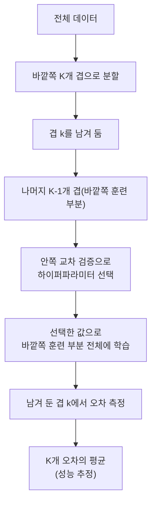
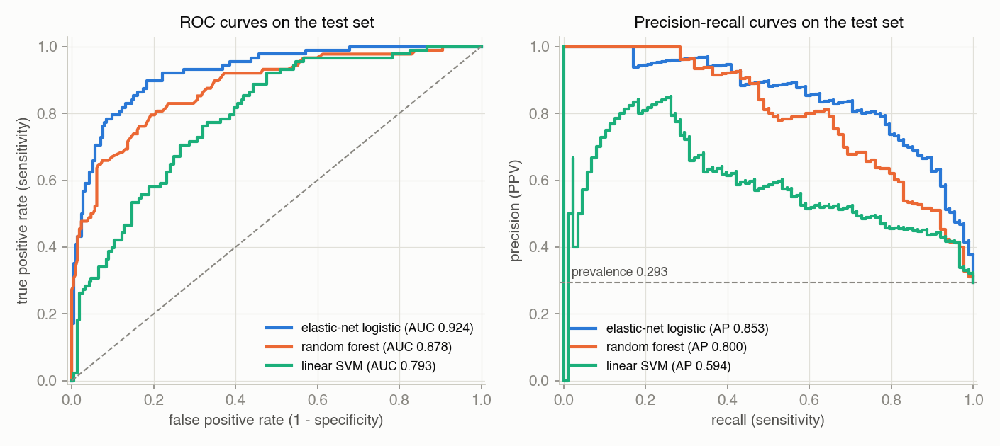
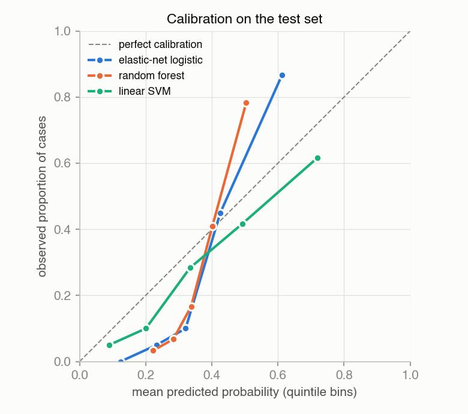

# 12장 — 질병 예측을 위한 기계학습

[레포지토리 안내](../../README.ko.md) | [English](Concepts_Lecture.md) | [한국어](Concepts_Lecture.ko.md)

> **최종 수정일:** 2026-11-26

> **학습 목표:**
> 1. 진단과 예후를 확률을 예측하는 분류 문제로 정식화하고 결정 임계값을 오분류 비용으로 정할 수 있다
> 2. 오믹스 예측에서 데이터 누수가 생기는 경로를 찾고 이를 막는 분할 방법을 설명할 수 있다
> 3. 층화 교차 검증과 중첩 교차 검증을 구성하고 비중첩 추정이 낙관적인 이유를 설명할 수 있다
> 4. 클래스 불균형과 연구 설계의 유병률이 정확도와 예측 확률을 왜곡하는 이유를 설명하고 가중치, 임계값, 사전 확률 보정으로 대처할 수 있다
> 5. AUC의 성질, 정밀도-재현율 곡선, 보정과 Brier 점수를 계산하고 해석할 수 있다
> 6. 규제 로지스틱 회귀, 랜덤 포레스트, SVM을 발현 데이터에 적용하여 비교하고 변수 중요도와 외부 검증 결과를 해석할 수 있다

---

## 목차

- [1. 진단과 예후의 분류 문제화](#1-진단과-예후의-분류-문제화)
  - [1.1 진단 예측과 예후 예측](#11-진단-예측과-예후-예측)
  - [1.2 예측 모형의 구성 요소](#12-예측-모형의-구성-요소)
  - [1.3 확률 예측과 결정 임계값](#13-확률-예측과-결정-임계값)
  - [1.4 모의 코호트 데이터](#14-모의-코호트-데이터)
- [2. 데이터 누수와 오믹스 예측의 함정](#2-데이터-누수와-오믹스-예측의-함정)
  - [2.1 데이터 누수](#21-데이터-누수)
  - [2.2 누수의 경로](#22-누수의-경로)
  - [2.3 같은 환자의 반복 표본](#23-같은-환자의-반복-표본)
  - [2.4 일괄 효과와 교란](#24-일괄-효과와-교란)
  - [2.5 작은 표본과 추정의 불확실성](#25-작은-표본과-추정의-불확실성)
- [3. 교차 검증과 중첩 교차 검증](#3-교차-검증과-중첩-교차-검증)
  - [3.1 교차 검증이 평가하는 것](#31-교차-검증이-평가하는-것)
  - [3.2 층화 교차 검증](#32-층화-교차-검증)
  - [3.3 모형 선택과 성능 추정의 분리](#33-모형-선택과-성능-추정의-분리)
  - [3.4 중첩 교차 검증](#34-중첩-교차-검증)
  - [3.5 시뮬레이션: 신호가 없는 데이터](#35-시뮬레이션-신호가-없는-데이터)
  - [3.6 최종 모형](#36-최종-모형)
- [4. 클래스 불균형](#4-클래스-불균형)
  - [4.1 정확도의 역설](#41-정확도의-역설)
  - [4.2 연구의 유병률과 실제 유병률](#42-연구의-유병률과-실제-유병률)
  - [4.3 대처 방법](#43-대처-방법)
  - [4.4 R로 보는 불균형의 영향](#44-r로-보는-불균형의-영향)
- [5. 평가 지표](#5-평가-지표)
  - [5.1 AUC의 성질](#51-auc의-성질)
  - [5.2 정밀도-재현율 곡선과 평균 정밀도](#52-정밀도-재현율-곡선과-평균-정밀도)
  - [5.3 보정과 Brier 점수](#53-보정과-brier-점수)
  - [5.4 지표의 선택](#54-지표의-선택)
- [6. 발현 데이터에 적용한 세 분류기](#6-발현-데이터에-적용한-세-분류기)
  - [6.1 규제 로지스틱 회귀](#61-규제-로지스틱-회귀)
  - [6.2 랜덤 포레스트](#62-랜덤-포레스트)
  - [6.3 서포트 벡터 머신](#63-서포트-벡터-머신)
  - [6.4 세 모형의 학습](#64-세-모형의-학습)
  - [6.5 테스트 세트에서의 비교](#65-테스트-세트에서의-비교)
  - [6.6 보정의 비교](#66-보정의-비교)
- [7. 모형의 해석](#7-모형의-해석)
  - [7.1 계수에 기반한 중요도](#71-계수에-기반한-중요도)
  - [7.2 랜덤 포레스트의 변수 중요도](#72-랜덤-포레스트의-변수-중요도)
  - [7.3 순열 중요도](#73-순열-중요도)
  - [7.4 해석의 주의](#74-해석의-주의)
- [8. 재현성과 외부 검증](#8-재현성과-외부-검증)
  - [8.1 내부 검증과 외부 검증](#81-내부-검증과-외부-검증)
  - [8.2 외부 코호트에서 성능이 달라지는 이유](#82-외부-코호트에서-성능이-달라지는-이유)
  - [8.3 재보정](#83-재보정)
  - [8.4 재현성을 위한 실천](#84-재현성을-위한-실천)
- [개념 적용](#개념-적용)
- [요약](#요약)
- [점검 문제](#점검-문제)
- [참고 문헌](#참고-문헌)

---

<br>

## 1. 진단과 예후의 분류 문제화

### 1.1 진단 예측과 예후 예측

> **용어 정의:** **진단 모형(diagnostic model)** 은 특정 질병이나 상태가 지금 있을 확률을 추정하는 예측 모형이다.

> **용어 정의:** **예후 모형(prognostic model)** 은 특정 사건이 앞으로 일어날 확률을 추정하는 예측 모형이다.

임상에서 쓰는 예측 모형은 크게 두 종류이다. TRIPOD 보고 지침은 예측 모형을 진단 모형과 예후 모형으로 나눈다 [1]. 두 경우 모두 환자의 정보를 입력으로 받아 확률을 출력한다는 점에서 6장의 분류 문제이다.

| 구분 | 예측 대상 | 반응 변수의 예 | 주의할 점 |
|:-----|:-----|:-----|:-----|
| 진단 예측 | 현재의 질병 상태나 하위 유형 | 암과 정상, 백혈병의 AML과 ALL | 기준 진단(조직 검사 등)이 정확해야 한다 |
| 예후 예측 | 정해진 기간 안의 미래 사건 | 5년 안의 재발 여부, 1년 생존 여부 | 기간을 정해야 하며, 추적이 끝나기 전에 관찰이 중단된 환자가 생긴다 |

*표 1. 진단 예측과 예후 예측*

발현 데이터로 진단 예측을 한 초기 사례로 Golub 등의 급성 백혈병 연구가 있다. 이 연구는 발현 데이터에서 자동으로 만든 클래스 예측기가 새 백혈병 사례의 클래스(AML 또는 ALL)를 판정할 수 있음을 보이고, 유전자 발현 감시만으로 암을 분류하는 것이 가능함을 보였다 [2]. 11장의 클래스 발견이 알려지지 않은 하위 유형을 찾는 일이라면, 이 장의 클래스 예측은 이미 알려진 클래스에 새 환자를 배정하는 일이다.

> **참고:** 예후 예측에서 "5년 안의 재발"을 이진 반응으로 만들면, 5년이 되기 전에 추적이 끊긴 환자는 재발했는지 알 수 없다. 이렇게 관찰이 중도 절단된 환자를 빼거나 재발하지 않은 것으로 처리하면 편향이 생긴다. 사건까지의 시간을 그대로 다루는 생존 분석(Cox 비례 위험 모형 등)이 이런 데이터의 표준 방법이다.

> **용어 정의:** **중도 절단(censoring)** 은 사건을 확인하기 전에 추적 관찰이 끝나거나 끊겨(연구 종료, 추적 소실 등), 관찰이 끊긴 뒤에 사건이 일어났는지 알 수 없게 되는 것이다.

### 1.2 예측 모형의 구성 요소

환자 $`i`$의 발현 벡터를 $`x_i \in \mathbb{R}^p`$, 질병 여부를 $`y_i \in \{0, 1\}`$이라 하자. 예측 모형은 다음 세 부분으로 이루어진다.

1. **위험 점수:** 확률 $`\hat\pi(x) = \hat P(Y = 1 \mid X = x)`$ 또는 그와 순서가 같은 점수 $`s(x)`$를 계산한다.
2. **결정 규칙:** 임계값 $`t`$를 정해 $`\hat\pi(x) \ge t`$이면 양성(질병)으로 판정한다.
3. **평가:** 학습에 쓰지 않은 환자에서 점수의 순서가 맞는지(판별력), 확률 값 자체가 맞는지(보정), 판정이 맞는지(민감도, 특이도)를 잰다.

> **용어 정의:** **결정 임계값(decision threshold)** 은 모형이 낸 예측 확률이나 점수를 양성과 음성의 판정으로 바꾸는 기준값 $`t`$로, 예측 확률이 $`t`$ 이상이면 양성으로 판정한다.

> **용어 정의:** **판별력(discrimination)** 은 예측 모형이 사건이 있는 사람에게 없는 사람보다 높은 점수를 주는 정도, 즉 점수의 순서가 맞는 정도이다.

> **용어 정의:** **보정(calibration)** 은 예측 확률이 실제로 관측되는 사건의 빈도와 일치하는 정도이다. 예측 확률이 0.3인 환자들 가운데 실제로 약 30%가 질병을 가지면 그 모형은 잘 보정되어 있다.

6장의 혼동 행렬 지표는 3단계의 판정을 평가하므로 임계값 $`t`$에 따라 값이 바뀐다. 5절의 ROC 곡선과 AUC는 모든 임계값을 한꺼번에 보아 점수의 판별력을 평가하고, 보정은 확률 값의 정확성을 평가한다. 좋은 임상 예측 모형은 판별력과 보정을 모두 갖추어야 한다.

### 1.3 확률 예측과 결정 임계값

임계값을 0.5로 두는 것은 두 종류의 오류 비용이 같다고 가정하는 것이다. 질병을 놓치는 위음성의 비용을 $`c_{\text{FN}}`$, 건강한 사람을 양성으로 판정하는 위양성의 비용을 $`c_{\text{FP}}`$라 하자. 예측 확률이 $`\pi`$인 환자를 양성으로 판정하면 기대 비용은 $`(1 - \pi) c_{\text{FP}}`$이고, 음성으로 판정하면 $`\pi c_{\text{FN}}`$이다. 양성 판정의 기대 비용이 더 작을 조건은

```math
(1 - \pi) \, c_{\text{FP}} < \pi \, c_{\text{FN}} \iff \pi > \frac{c_{\text{FP}}}{c_{\text{FP}} + c_{\text{FN}}} = t^{*}
```

이다. 예를 들어 암을 놓치는 비용이 추가 검사를 하는 비용의 9배이면 $`t^{*} = 1 / (1 + 9) = 0.1`$이다. 예측 확률이 10%만 넘어도 양성으로 판정하여 추가 검사를 하는 것이 기대 비용을 최소로 한다. 이 결과는 예측 확률 $`\pi`$가 실제 확률과 맞을 때, 즉 모형이 잘 보정되어 있을 때만 성립한다. 보정이 맞지 않는 모형에 이론적 임계값을 그대로 적용하면 의도한 비용 균형이 깨진다(5.3절).

### 1.4 모의 코호트 데이터

이 장의 예제는 유전자 500개의 모의 코호트를 쓴다. 유전자 `g001`\~`g010`은 서로 상관이 0.6인 첫째 묶음, `g011`\~`g020`은 상관이 0.6인 둘째 묶음이고, 나머지 480개는 서로 독립이다. 실제 위험은 네 유전자만으로 정해진다.

```math
\mathrm{logit} \, P(Y = 1 \mid x) = -1.6 + 1.0 \, x_{1} + 0.8 \, x_{2} + 0.8 \, x_{3} - 1.5 \, x_{11}
```

같은 묶음의 다른 유전자(예: `g004`~`g010`)는 원인 유전자와 상관되어 있으므로 위험과 관련된 것처럼 보이지만 실제로는 위험을 정하지 않는다. 실제 발현 데이터에서 같은 경로의 유전자들이 함께 움직이는 상황을 흉내 낸 것이다.

```r
sim_cohort <- function(n, p = 500, b0 = -1.6) {
  blk <- function(m, rho) {                     # 쌍별 상관이 rho인 m x 10 묶음
    z <- rnorm(m)
    sqrt(rho) * z + sqrt(1 - rho) * matrix(rnorm(m * 10), m, 10)
  }
  X <- cbind(blk(n, 0.6), blk(n, 0.6), matrix(rnorm(n * (p - 20)), n, p - 20))
  colnames(X) <- sprintf("g%03d", 1:p)
  eta <- b0 + 1.0 * X[, 1] + 0.8 * X[, 2] + 0.8 * X[, 3] - 1.5 * X[, 11]
  y <- rbinom(n, 1, plogis(eta))               # 실제 위험에서 질병 상태를 추출
  list(X = X, y = y, risk = plogis(eta))
}
set.seed(314)
tr <- sim_cohort(150)
te <- sim_cohort(300)
c(train_n = length(tr$y), train_cases = sum(tr$y),
  test_n = length(te$y), test_cases = sum(te$y))
```

```text
    train_n train_cases      test_n  test_cases 
        150          51         300          88 
```

`blk()`는 공통 요인 `z`와 독립 잡음을 $`\sqrt{\rho}`$와 $`\sqrt{1 - \rho}`$의 비율로 섞어, 열 사이의 상관이 $`\rho`$이고 분산이 1인 10개 열을 만든다. `plogis()`는 로지스틱 함수 $`1/(1 + e^{-\eta})`$이고, `rbinom(n, 1, ...)`은 환자마다 그 확률로 질병 여부를 뽑는다. `risk`는 실제 위험이며, 현실에서는 알 수 없지만 모의 데이터에서는 모형이 도달할 수 있는 성능의 상한을 계산하는 데 쓴다. 훈련 세트 150명 가운데 환자는 51명, 독립된 테스트 세트 300명 가운데 환자는 88명이다.

---

<br>

## 2. 데이터 누수와 오믹스 예측의 함정

### 2.1 데이터 누수

> **용어 정의:** **데이터 누수(data leakage)** 는 모형을 학습하거나 고르는 과정에, 평가에 쓸 데이터의 정보나 예측 시점에는 얻을 수 없는 정보가 들어가는 일이다.

누수가 있으면 평가 성능이 실제로 새 환자에게 쓸 때의 성능보다 좋게 나온다. 누수는 코드의 오류가 아니라 분석 설계의 오류여서 실행 중에 경고가 나오지 않고, 결과가 지나치게 좋다는 것 말고는 드러나는 징후가 없다. 10장 7절의 선택 편향은 가장 흔한 누수의 한 형태이다.

### 2.2 누수의 경로

| 경로 | 예 | 막는 방법 |
|:-----|:-----|:-----|
| 전체 데이터로 한 전처리 | 테스트 표본까지 포함해 계산한 평균과 표준편차로 표준화, 전체로 한 분위수 정규화 | 전처리의 매개변수를 훈련 부분에서만 계산하고 테스트 부분에는 적용만 한다 |
| 전체 데이터로 한 특성 선택 | 모든 표본으로 고른 유전자로 교차 검증 | 선택을 각 겹 안에서 다시 한다(10장 7절) |
| 테스트 데이터로 한 조정 | 테스트 성능을 보며 하이퍼파라미터나 임계값을 바꿈 | 중첩 교차 검증이나 별도의 검증 세트를 쓴다(3절) |
| 같은 환자의 중복 | 한 환자의 반복 측정이나 여러 조직 표본이 훈련과 테스트에 나뉨 | 환자 단위로 분할한다(2.3절) |
| 시간의 역행 | 진단 뒤에 측정한 값이나 치료의 결과로 바뀐 값을 입력으로 씀 | 예측 시점에 얻을 수 있는 변수만 쓴다 |
| 레이블의 대리 변수 | 특정 질병의 환자만 받는 검사의 시행 여부를 변수로 씀 | 변수가 어떻게 생성되었는지 확인한다 |

*표 2. 데이터 누수의 경로와 막는 방법*

### 2.3 같은 환자의 반복 표본

한 환자에서 여러 표본을 얻는 경우는 흔하다. 같은 조직을 기술적으로 반복 측정하거나, 종양의 여러 부위에서 표본을 얻거나, 시간을 두고 여러 번 측정한다. 같은 환자의 표본들은 서로 매우 비슷하므로, 표본 단위로 교차 검증을 하면 테스트 겹의 표본과 거의 같은 표본이 훈련 겹에 들어간다. 그러면 모형은 질병의 패턴이 아니라 환자를 알아보는 법을 배우고도 좋은 성능을 낸다.

아래 시뮬레이션은 환자 40명에서 3개씩, 모두 120개 표본을 만든다. 환자마다 고유한 발현 프로파일이 있고 반복 표본은 그 프로파일에 작은 측정 잡음을 더한 것이다. 질병 레이블은 환자 단위로 무작위로 붙이므로 발현과 레이블은 아무 관계가 없고, 어떤 분류기든 실제 오분류율은 0.5이다.

```r
library(class)
set.seed(8)
n_pat <- 40; reps <- 3; p0 <- 200
profile <- matrix(rnorm(n_pat * p0), n_pat)  # 환자마다 하나의 프로파일
status <- sample(rep(0:1, each = n_pat / 2))  # 발현과 무관한 레이블
patient <- rep(1:n_pat, each = reps)
Xr <- profile[patient, ] + matrix(rnorm(n_pat * reps * p0, sd = 0.3), ncol = p0)
yr <- factor(status[patient])
cv_err <- function(fold) {
  wrong <- 0
  for (k in 1:5) {
    pred <- knn(Xr[fold != k, ], Xr[fold == k, ], yr[fold != k], k = 1)
    wrong <- wrong + sum(pred != yr[fold == k])
  }
  wrong / length(yr)
}
fold_sample  <- sample(rep(1:5, length.out = length(yr)))     # 반복 표본이 여러 겹으로 흩어짐
fold_patient <- sample(rep(1:5, length.out = n_pat))[patient]  # 한 환자는 한 겹에만 있음
round(c(sample_level_cv = cv_err(fold_sample), patient_level_cv = cv_err(fold_patient)), 3)
```

```text
 sample_level_cv patient_level_cv 
           0.058            0.650 
```

`profile[patient, ]`는 환자 번호 벡터로 행을 반복하여 같은 환자의 표본 3개가 같은 프로파일을 갖게 한다. `fold_sample`은 표본 120개를 무작위로 5개 겹에 나누고, `fold_patient`는 환자 40명을 5개 겹에 나눈 뒤 표본에 환자의 겹 번호를 물려준다. 분류기는 6장의 1-최근접 이웃이다.

표본 단위 교차 검증은 오분류율을 0.058로 추정했다. 테스트 표본의 가장 가까운 이웃이 거의 언제나 같은 환자의 다른 표본이어서 레이블을 그대로 맞히기 때문이다. 환자 단위 교차 검증은 0.650으로, 실제 값 0.5보다 높다. 독립된 단위가 환자 40명뿐이어서 오분류율 추정의 표준오차가 $`\sqrt{0.5 \times 0.5 / 40} \approx 0.079`$ 정도로 크기 때문이며, 0.650은 0.5에서 약 1.9 표준오차 떨어진 값이다. 이처럼 분할의 단위는 독립된 단위, 즉 새로 예측하려는 대상과 같아야 한다. 새 환자를 예측하려면 환자 단위로, 새 병원에 적용하려면 병원 단위로 나눈다.

### 2.4 일괄 효과와 교란

> **용어 정의:** **일괄 효과(batch effect)** 는 실험실의 조건, 시약의 제조 단위(lot), 담당자 같은 기술적 요인에 따라 측정값이 체계적으로 달라지는 변동이다.

Leek 등은 일괄 효과가 관심 있는 결과와 상관될 때 잘못된 결론을 낳는 큰 문제가 된다고 지적하고, 일괄 효과를 비롯한 기술적, 생물학적 인공물이 널리 퍼져 있으며 반드시 다루어야 한다고 주장했다 [3].

예측 모형에서 가장 위험한 경우는 일괄이 클래스와 교란된 설계이다. 환자 표본을 모두 1월에, 대조군 표본을 모두 3월에 측정하면, 측정 날짜에 따른 차이와 질병에 따른 차이를 구별할 수 없다. 모형은 측정 날짜의 흔적만으로도 두 클래스를 완벽하게 나눌 수 있고, 교차 검증도 이 문제를 잡지 못한다. 모든 겹에 같은 교란이 있기 때문이다. 이 모형은 다른 날짜에 측정한 새 환자에게는 쓸모가 없다. 교란은 분석 단계에서 고치기 어려우므로 설계 단계에서 막아야 한다. 측정 일괄마다 환자와 대조군을 고르게 섞고, 측정 순서를 무작위로 정한다.

> **용어 정의:** **교란(confounding)** 은 관심 있는 요인(예: 질병)과 다른 요인(예: 측정 일괄)이 함께 변하여 두 요인의 효과를 구별할 수 없게 되는 것이다.

### 2.5 작은 표본과 추정의 불확실성

오믹스 예측 연구는 표본이 수십\~수백 개인 경우가 많아 성능 추정 자체가 불확실하다. 독립된 테스트 표본 $`n`$개에서 정확도 $`\hat p`$를 얻었다면 그 표준오차는 근사적으로 $`\sqrt{\hat p (1 - \hat p) / n}`$이다. 테스트 표본 40개에서 정확도 0.8을 얻으면 표준오차는 $`\sqrt{0.8 \times 0.2 / 40} = 0.063`$이고, 근사 95% 신뢰구간은 $`0.8 \pm 1.96 \times 0.063 = [0.68, 0.92]`$이다. 정확도 0.75인 기존 방법보다 낫다고 주장할 근거가 되지 않는다. 성능을 보고할 때는 점추정값과 함께 신뢰구간을 보고해야 한다.

> **[확률및통계]** 테스트 표본 $`n`$개에서 맞힌 개수는 정확도가 $`p`$일 때 이항분포 $`\mathrm{Bin}(n, p)`$를 따른다. 위의 구간은 정규 근사에 근거한 Wald 구간 $`\hat p \pm z_{\alpha/2} \sqrt{\hat p (1 - \hat p)/n}`$이며, $`n`$이 작거나 $`\hat p`$가 0이나 1에 가까우면 실제 포함 확률이 명목 수준보다 낮아지므로 Wilson 구간이나 정확한 이항 구간을 쓴다.

---

<br>

## 3. 교차 검증과 중첩 교차 검증

### 3.1 교차 검증이 평가하는 것

6장 7절의 K-겹 교차 검증은 데이터를 $`K`$개 겹으로 나누고, 겹마다 나머지로 학습한 모형의 오차를 그 겹에서 재어 평균한다. 겹마다 학습하는 모형이 다르므로, 교차 검증이 평가하는 것은 특정 모형 하나가 아니라 "이 데이터 크기에서 이 절차로 모형을 만들면 얼마나 잘 예측하는가"이다. 그래서 절차에 포함되는 모든 단계(전처리, 특성 선택, 하이퍼파라미터 조정, 임계값 결정)가 겹마다 반복되어야 한다.

### 3.2 층화 교차 검증

환자가 30명, 대조군이 120명인 데이터를 무작위로 5개 겹에 나누면, 어떤 겹에는 환자가 2명뿐이고 다른 겹에는 10명이 들어갈 수 있다. 환자가 적은 겹에서는 민감도를 안정적으로 잴 수 없고, 겹마다 클래스 비율이 다르면 오차 추정의 분산이 커진다. 층화 교차 검증은 이 문제를 막는다. 위 예에서는 각 겹에 환자 6명과 대조군 24명이 들어간다.

> **용어 정의:** **층화 교차 검증(stratified cross-validation)** 은 클래스마다 표본을 따로 나누어 겹에 배정하여, 각 겹의 클래스 비율이 전체 데이터와 같도록 만든 교차 검증이다.

### 3.3 모형 선택과 성능 추정의 분리

교차 검증은 두 가지 목적으로 쓰인다. 하나는 후보 모형이나 하이퍼파라미터(예: LASSO의 $`\lambda`$) 가운데 가장 좋은 것을 고르는 **모형 선택**이고, 다른 하나는 고른 모형이 새 데이터에서 얼마나 잘 할지를 추정하는 **성능 추정**이다. 같은 교차 검증 결과로 두 일을 함께 하면 성능이 낙관적으로 추정된다. 후보마다의 교차 검증 오차에는 우연한 변동이 섞여 있으므로, 최솟값을 고르면 우연히 운이 좋았던 후보가 뽑히기 쉽기 때문이다.

Varma와 Simon은 두 클래스의 특성 분포에 차이가 없는 "귀무" 데이터로 이 편향을 확인했다. 교차 검증 오차를 최소로 하는 매개변수를 고른 분류기는, 클래스 사이에 실제 차이가 없는데도 축소 중심(shrunken centroids) 분류기에서 모의 데이터의 18.5%, SVM에서 38%가 30% 미만의 오차를 추정했지만, 독립된 테스트 세트에서의 성능은 우연 수준과 다르지 않았다 [4]. 바깥쪽 교차 검증으로 오차를 추정하고 안쪽 교차 검증으로 매개변수를 조정하는 중첩 교차 검증은 이 편향을 크게 줄여, 독립된 테스트 세트의 오차에 매우 가까운 추정을 주었다 [4].

### 3.4 중첩 교차 검증

> **용어 정의:** **중첩 교차 검증(nested cross-validation)** 은 바깥쪽 교차 검증의 각 훈련 부분 안에서 다시 안쪽 교차 검증을 하여 하이퍼파라미터를 고르고, 바깥쪽의 남겨 둔 겹으로 성능을 추정하는 방법이다.



*그림 1. 중첩 교차 검증의 구조*

바깥쪽 겹이 5개, 안쪽 겹이 5개, 하이퍼파라미터 후보가 100개이면 학습 횟수는 $`5 \times (5 \times 100 + 1) = 2{,}505`$번이다. 비용이 크지만 표본이 적은 오믹스 데이터에서는 정직한 성능 추정을 얻는 거의 유일한 방법이다. 바깥쪽 겹마다 안쪽에서 고른 하이퍼파라미터가 다를 수 있으며, 그 변동 자체가 선택의 불안정성을 보여 준다.

### 3.5 시뮬레이션: 신호가 없는 데이터

> **용어 정의:** **로지스틱 회귀(logistic regression)** 는 질병 여부 같은 이진 반응의 확률의 로짓(log-odds)을 특성의 선형 결합으로 모형화하는 회귀 방법이다.

표본 60개(클래스마다 30개), 유전자 1,000개의 정규 난수 데이터에서 엘라스틱 넷 로지스틱 회귀($`\alpha = 0.5`$)의 $`\lambda`$를 고른다. 비중첩 방식은 `cv.glmnet()`이 보고하는 교차 검증 오분류율의 최솟값을 성능으로 보고하고, 중첩 방식은 바깥쪽 5-겹마다 안쪽 `cv.glmnet()`으로 $`\lambda`$를 고른다. 실제 오분류율은 0.5이다. 실험을 20번 반복한다.

```r
library(glmnet)
strat_folds <- function(y, K = 5) {            # 층화된 겹 번호
  f <- integer(length(y))
  for (cl in unique(y)) {
    idx <- which(y == cl)
    f[idx] <- sample(rep(1:K, length.out = length(idx)))
  }
  f
}
nested_cv <- function(X, y, K = 5) {
  outer <- strat_folds(y, K); wrong <- 0
  for (k in 1:K) {
    trn <- outer != k
    inner <- cv.glmnet(X[trn, ], y[trn], family = "binomial", alpha = 0.5,
                       type.measure = "class", foldid = strat_folds(y[trn], K))
    pred <- predict(inner, X[!trn, ], s = "lambda.min", type = "class")
    wrong <- wrong + sum(pred != y[!trn])
  }
  wrong / length(y)
}
set.seed(77)
est <- t(replicate(20, {
  X0 <- matrix(rnorm(60 * 1000), 60); y0 <- sample(rep(0:1, each = 30))
  flat <- cv.glmnet(X0, y0, family = "binomial", alpha = 0.5,
                    type.measure = "class", foldid = strat_folds(y0))
  c(min_cv = min(flat$cvm), nested = nested_cv(X0, y0))
}))
round(colMeans(est), 3)
round(apply(est, 2, range), 3)
```

```text
min_cv nested 
 0.433  0.478 
     min_cv nested
[1,]  0.267  0.333
[2,]  0.583  0.617
```

`strat_folds()`는 클래스마다 표본 번호를 1\~K에 고르게 섞어 배정하여 층화된 겹 번호를 만든다. `cv.glmnet()`의 `foldid`에 이 번호를 주면 그 분할로 교차 검증을 한다. `nested_cv()`는 바깥쪽 겹 `k`를 남겨 두고, 나머지(`trn`)에서 안쪽 교차 검증으로 `lambda.min`을 고른 모형으로 남겨 둔 겹을 예측한다. 비중첩 방식의 `flat$cvm`은 $`\lambda`$마다의 교차 검증 오분류율이고, 그 최솟값을 성능으로 보고한다.

비중첩 방식은 평균 0.433으로, 신호가 없는데도 오분류율이 우연 수준보다 7%p 가까이 낮다고 보고한다. 20번 가운데 가장 운이 좋은 경우는 0.267이었다. 중첩 방식은 평균 0.478로 실제 값 0.5에 더 가깝다. 이 예에서 비중첩의 편향이 10장 7.3절의 선택 편향(0.060 대 0.529)보다 작은 것은, 후보 $`\lambda`$들이 하나의 연속된 경로를 이루어 서로 비슷한 모형이기 때문이다. 후보 모형이 다양하고 많을수록 편향이 커진다.

### 3.6 최종 모형

중첩 교차 검증으로 성능을 추정한 뒤 실제로 쓸 모형은 전체 데이터에 안쪽 절차(교차 검증으로 $`\lambda`$를 고르고 학습)를 한 번 적용하여 만든다. 중첩 교차 검증의 추정값은 이 최종 모형 하나의 성능이 아니라, 같은 절차로 만든 모형의 기대 성능이다. 최종 모형은 바깥쪽 겹의 모형들보다 조금 더 많은 데이터로 학습하므로 성능이 약간 더 좋을 것으로 기대된다. 이런 이유로 교차 검증의 추정은 약간 비관적인 경향이 있다.

---

<br>

## 4. 클래스 불균형

### 4.1 정확도의 역설

질병은 대부분 드물다. 6장 8.5절에서 보았듯이 유병률이 1%인 집단에서는 모든 사람을 음성으로 판정하는 분류기도 정확도가 0.99이다. 이처럼 클래스가 불균형하면 정확도가 높은 모형이 환자를 한 명도 찾지 못할 수 있으며, 이를 **정확도의 역설(accuracy paradox)** 이라 한다. 불균형 데이터에서는 민감도와 특이도를 따로 보고하거나, 균형 정확도를 쓴다. 모두 음성으로 판정하는 분류기는 민감도 0, 특이도 1이므로 균형 정확도가 0.5이고, 무작위로 판정하는 분류기와 같은 값이 된다.

> **용어 정의:** **균형 정확도(balanced accuracy)** 는 민감도와 특이도의 평균으로, 클래스가 불균형한 데이터에서 정확도 대신 쓴다.

### 4.2 연구의 유병률과 실제 유병률

6장 8.5절은 민감도와 특이도가 같아도 유병률에 따라 양성 예측도가 크게 달라짐을 보였다. 같은 검사가 유병률 50%에서는 PPV 0.947이지만 1%에서는 0.154이다. 오믹스 예측 연구에서 이 차이가 문제가 되는 것은 연구 데이터의 유병률이 실제 집단과 다른 경우가 많기 때문이다. 드문 질병을 연구할 때는 환자를 먼저 모으고 비슷한 수의 대조군을 모으는 환자-대조군 설계를 흔히 쓴다. 이렇게 만든 데이터의 유병률은 50% 근처이므로, 그 데이터에서 계산한 PPV나 정확도를 유병률이 훨씬 낮은 실제 선별 집단에 그대로 옮기면 안 된다.

> **용어 정의:** **환자-대조군 설계(case-control design)** 는 환자를 먼저 모으고 비교할 대조군을 따로 모아 두 집단을 비교하는 연구 설계로, 데이터의 유병률은 실제 집단이 아니라 연구자가 정한 두 집단의 크기 비율을 따른다.

예측 확률도 같은 영향을 받는다. 로지스틱 회귀의 절편은 훈련 데이터의 유병률을 반영하므로, 유병률 50%의 데이터로 학습한 모형은 실제 위험보다 높은 확률을 낸다. 표본이 클래스마다 무작위로 뽑혔다면(클래스 안에서의 발현 분포가 같다면), 예측 확률은 다음과 같이 실제 유병률에 맞게 고칠 수 있다.

```math
\mathrm{logit}(\pi_{\text{new}}) = \mathrm{logit}(\pi_{\text{old}}) + \log \frac{\rho_{\text{new}} / (1 - \rho_{\text{new}})}{\rho_{\text{old}} / (1 - \rho_{\text{old}})}
```

$`\rho_{\text{old}}`$는 훈련 데이터의 유병률, $`\rho_{\text{new}}`$는 적용할 집단의 유병률이다. 베이즈 정리에서 사후 오즈는 사전 오즈와 우도비의 곱이고, 우도비(발현이 주어졌을 때의 정보)는 유병률과 무관하므로 사전 오즈만 바꾸면 된다. 유병률 50%의 데이터로 학습한 모형이 어떤 사람에게 0.8을 예측했고 실제 유병률이 5%이면, $`\mathrm{logit}(0.8) = 1.386`$에 $`\log(0.05/0.95) - \log(1) = -2.944`$를 더해 $`-1.558`$이 되고, 이를 확률로 되돌리면 0.174이다. 같은 사람의 실제 위험은 80%가 아니라 약 17%이다.

### 4.3 대처 방법

- **클래스 가중치:** 소수 클래스 표본의 오류에 더 큰 클래스 가중치를 준다. 다수 클래스 표본 수를 소수 클래스 표본 수로 나눈 값을 소수 클래스의 가중치로 쓰면 두 클래스의 전체 가중치가 같아진다.
- **임계값 조정:** 모형은 그대로 두고 판정 임계값을 낮춘다. 확률 모형이 잘 보정되어 있으면, 1.3절의 비용 기반 임계값이나 훈련 데이터의 유병률을 임계값으로 쓸 수 있다.
- **재표본 추출:** 소수 클래스를 복제하여 늘리거나(과대 표본 추출), 다수 클래스를 줄인다(과소 표본 추출). Chawla 등이 제안한 **SMOTE(synthetic minority over-sampling technique)** 는 소수 클래스를 단순히 복제하지 않고 인공 표본을 만들어 늘리며, 이를 다수 클래스의 과소 표본 추출과 결합하면 과소 표본 추출만 하는 것보다 성능이 좋았다고 보고했다 [5]. 인공 표본은 소수 클래스 표본 하나와, 같은 소수 클래스 안의 $`k`$개 최근접 이웃 가운데 무작위로 고른 하나를 잇는 선분 위의 무작위 지점에 만든다 [5].

> **용어 정의:** **클래스 가중치(class weight)** 는 손실 함수에서 클래스마다 그 클래스 표본의 오류에 주는 가중치로, 소수 클래스에 더 큰 가중치를 주어 불균형의 영향을 줄인다.

> **주의:** 재표본 추출은 교차 검증의 각 겹 안에서 훈련 부분에만 해야 한다. 과대 표본 추출을 먼저 하고 교차 검증을 하면 같은 표본의 복제본이나 그것으로 만든 인공 표본이 훈련 겹과 테스트 겹에 함께 들어가, 2.3절의 반복 표본과 같은 누수가 생긴다. 또 클래스 가중치나 재표본 추출로 학습한 모형의 예측 확률은 실제 유병률을 반영하지 않으므로 보정이 깨진다.

### 4.4 R로 보는 불균형의 영향

절편을 낮추어 유병률이 약 14%인 코호트를 만들고, 가중치 없는 엘라스틱 넷 로지스틱 회귀, 클래스 가중치를 준 모형, 가중치 없는 모형에 훈련 유병률을 임계값으로 쓴 경우를 독립된 테스트 세트 2,000명에서 비교한다.

```r
set.seed(21)
im_tr <- sim_cohort(400, b0 = -3.6)           # 훈련 데이터의 드문 질병
im_te <- sim_cohort(2000, b0 = -3.6)
c(train_prev = mean(im_tr$y), test_prev = mean(im_te$y))
w <- ifelse(im_tr$y == 1, sum(im_tr$y == 0) / sum(im_tr$y == 1), 1)
fit_u <- cv.glmnet(im_tr$X, im_tr$y, family = "binomial", alpha = 0.5)
fit_w <- cv.glmnet(im_tr$X, im_tr$y, family = "binomial", alpha = 0.5, weights = w)
rates <- function(prob, y, thr) {
  pred <- as.numeric(prob >= thr)
  sens <- mean(pred[y == 1] == 1); spec <- mean(pred[y == 0] == 0)
  c(accuracy = mean(pred == y), sensitivity = sens, specificity = spec,
    balanced = (sens + spec) / 2)
}
p_u <- drop(predict(fit_u, im_te$X, s = "lambda.min", type = "response"))
p_w <- drop(predict(fit_w, im_te$X, s = "lambda.min", type = "response"))
round(rbind(all_negative = rates(rep(0, length(im_te$y)), im_te$y, 0.5),
            unweighted   = rates(p_u, im_te$y, 0.5),
            weighted     = rates(p_w, im_te$y, 0.5),
            thr_at_prev  = rates(p_u, im_te$y, mean(im_tr$y))), 3)
```

```text
train_prev  test_prev 
     0.150      0.137 
             accuracy sensitivity specificity balanced
all_negative    0.863       0.000       1.000    0.500
unweighted      0.886       0.237       0.990    0.613
weighted        0.837       0.777       0.846    0.812
thr_at_prev     0.786       0.777       0.787    0.782
```

`w`는 환자 표본에 (대조군 수 / 환자 수)의 가중치를, 대조군 표본에 1을 준다. `cv.glmnet()`의 `weights` 인수가 이 가중치를 로그우도에 곱한다. `rates()`는 확률 `prob`를 임계값 `thr`로 판정하여 정확도, 민감도, 특이도, 균형 정확도를 계산한다.

모두 음성으로 판정하면 정확도가 0.863이다. 가중치 없는 모형은 임계값 0.5에서 정확도 0.886으로 이보다 조금 높을 뿐이며, 민감도가 0.237이어서 환자 넷 중 셋을 놓친다. 클래스 가중치를 주면 정확도는 0.837로 오히려 떨어지지만 민감도가 0.777로 크게 오르고 균형 정확도가 0.812가 된다. 가중치 없는 모형의 임계값을 훈련 유병률 0.15로 낮추어도 민감도 0.777, 균형 정확도 0.782로 비슷한 효과를 얻는다. 정확도만 보았다면 가장 나쁜 선택(가중치 없는 모형, 임계값 0.5)을 가장 좋은 것으로 골랐을 것이다.

---

<br>

## 5. 평가 지표

### 5.1 AUC의 성질

> **용어 정의:** **AUC(area under the curve)** 는 ROC 곡선 아래의 넓이로, 무작위로 고른 환자의 점수가 무작위로 고른 대조군의 점수보다 높을 확률과 같다.

6장 8.6절에서 정의한 ROC 곡선은 임계값을 바꾸며 위양성률(1 - 특이도)을 가로축, 참 양성률(민감도)을 세로축에 그린 곡선이다. 무작위로 고른 환자의 점수를 $`S_{+}`$, 대조군의 점수를 $`S_{-}`$로 쓰고 점수가 같은 쌍을 절반으로 세면 AUC는 다음과 같다.

```math
\mathrm{AUC} = P(S_{+} > S_{-}) + \frac{1}{2} P(S_{+} = S_{-})
```

이 값은 두 집단의 순위를 비교하는 Mann-Whitney U 통계량을 두 집단 크기의 곱 $`n_{+} n_{-}`$로 나눈 값과 같다. 이 해석에서 AUC의 세 가지 성질이 나온다.

- **유병률과 무관:** AUC는 환자 집단 안과 대조군 집단 안에서 점수의 분포만 비교하므로, 두 집단의 크기 비율이 바뀌어도 기댓값이 바뀌지 않는다. 그래서 환자와 대조군이 각각 실제 집단의 환자와 비환자를 대표하도록 뽑혔다면, 4.2절의 환자-대조군 데이터에서 잰 AUC를 실제 집단에도 옮길 수 있다. 중증 환자와 건강한 대조군만 모은 연구처럼 클래스 안의 구성이 실제 집단과 다르면 AUC도 달라진다(8.2절).
- **단조 변환에 불변:** 점수의 순서만 보므로 점수를 제곱하거나 로그를 취해도 AUC가 바뀌지 않는다. 따라서 AUC가 높다는 것은 확률 값이 맞다는 뜻이 아니다(5.3절).
- **추정의 불확실성:** AUC는 표본에서 계산한 추정값이므로 신뢰구간과 함께 보고한다. pROC 패키지의 `ci.auc()`는 기본값으로 DeLong 방법으로 AUC의 신뢰구간을 계산한다 [6].

환자 4명의 점수가 0.9, 0.8, 0.55, 0.4이고 대조군 4명의 점수가 0.7, 0.35, 0.2, 0.1인 작은 예로 확인한다. 쌍 16개 가운데 환자의 점수가 더 높은 쌍은 14개이다(0.55와 0.4만 대조군 0.7보다 낮다). 따라서 AUC = 14/16 = 0.875이다. 아래 코드는 이 값과 5.2절의 정밀도, 재현율을 계산한다.

```r
library(pROC)
score <- c(0.9, 0.8, 0.7, 0.55, 0.4, 0.35, 0.2, 0.1)
label <- c(1,   1,   0,   1,    1,   0,    0,   0)
roc_toy <- roc(label, score, levels = c(0, 1), direction = "<", quiet = TRUE)
auc(roc_toy)
pairs <- outer(score[label == 1], score[label == 0], ">")
mean(pairs)
ord <- order(score, decreasing = TRUE)
tp <- cumsum(label[ord] == 1)
prec <- tp / seq_along(ord); rec <- tp / sum(label)
rbind(threshold = score[ord], precision = round(prec, 3), recall = rec)
mean(prec[label[ord] == 1])                    # 평균 정밀도
```

```text
Area under the curve: 0.875
[1] 0.875
          [,1] [,2]  [,3] [,4] [,5]  [,6]  [,7] [,8]
threshold 0.90  0.8 0.700 0.55  0.4 0.350 0.200  0.1
precision 1.00  1.0 0.667 0.75  0.8 0.667 0.571  0.5
recall    0.25  0.5 0.500 0.75  1.0 1.000 1.000  1.0
[1] 0.8875
```

`roc()`의 `levels = c(0, 1)`은 0을 대조군, 1을 환자로 지정하고, `direction = "<"`는 환자의 점수가 더 높다는 방향을 지정한다. 방향을 지정하지 않으면 pROC는 데이터를 보고 방향을 정하므로, 판별력이 없는 점수에서 AUC가 0.5보다 크게 나오는 쪽으로 방향이 뒤집힐 수 있다. `outer(..., ">")`는 환자 4명과 대조군 4명의 모든 쌍에 대해 환자의 점수가 더 큰지를 담은 4×4 논리 행렬을 만들고, 그 평균이 위 식의 확률이다. 나머지 줄은 점수를 내림차순으로 정렬하여 위에서부터 $`k`$개를 양성으로 판정할 때의 정밀도와 재현율을 계산한다.

### 5.2 정밀도-재현율 곡선과 평균 정밀도

> **용어 정의:** **정밀도-재현율 곡선(precision-recall curve)** 은 판정 임계값을 바꾸면서 재현율(민감도)을 가로축, 정밀도(PPV)를 세로축에 그린 곡선이다.

위 코드는 점수를 내림차순으로 정렬하여 위에서부터 $`k`$개를 양성으로 판정할 때의 정밀도 $`\mathrm{TP}_k / k`$와 재현율 $`\mathrm{TP}_k / P`$를 계산했다. 예를 들어 위의 3개를 양성으로 판정하면 환자 2명과 대조군 1명이 들어가므로 정밀도는 2/3 = 0.667, 재현율은 2/4 = 0.5이다.

곡선을 하나의 수로 요약할 때는 평균 정밀도를 쓴다. 위 예에서는 환자가 1, 2, 4, 5번째에 있으므로 $`(1 + 1 + 0.75 + 0.8) / 4 = 0.8875`$이다. 무작위 점수의 정밀도는 어느 임계값에서나 기댓값이 유병률과 같으므로, 정밀도-재현율 곡선의 기준선은 대각선이 아니라 유병률 높이의 수평선이다.

> **용어 정의:** **평균 정밀도(average precision, AP)** 는 점수를 내림차순으로 늘어놓았을 때 환자(양성)가 나타나는 순위마다의 정밀도를 평균한 값으로, 정밀도-재현율 곡선을 하나의 수로 요약한다.

ROC 곡선의 위양성률은 대조군 수로 나눈 값이어서, 대조군이 매우 많으면 위양성이 많아도 위양성률은 작게 보인다. Saito와 Rehmsmeier는 음성이 양성보다 훨씬 많은 불균형 데이터에서 ROC 그림의 시각적 해석이 특이도에 대한 직관적이지만 잘못된 해석 때문에 분류 성능의 신뢰성에 관해 오해를 부를 수 있으며, 양성 판정 가운데 참 양성의 비율을 평가하는 정밀도-재현율 그림은 앞으로의 분류 성능을 정확하게 보여 줄 수 있다고 보고했다 [7]. 유병률 1%인 선별 검사에서 위양성률 5%는 작아 보이지만, 6장 8.5절에서 보았듯이 양성 판정의 85%가 위양성이다.

### 5.3 보정과 Brier 점수

> **용어 정의:** **보정 그림(calibration plot)** 은 예측 확률로 환자를 몇 개의 구간으로 나누고, 구간마다 예측 확률의 평균을 가로축, 실제 환자의 비율을 세로축에 찍은 그림으로, 점이 대각선 위에 있으면 보정이 맞다.

보정을 보는 가장 직관적인 방법은 보정 그림이다. 구간은 예를 들어 예측 확률의 5분위로 나눈다. 점들이 대각선보다 가파르게 놓이면(낮은 쪽은 아래, 높은 쪽은 위) 예측이 지나치게 평균 쪽으로 몰린 것이고, 완만하게 놓이면 예측이 지나치게 극단적인 것이다.

보정을 수치로 요약할 때는 보정 기울기를 본다. 기울기가 1이면 보정이 맞고, 1보다 크면 예측이 덜 극단적이고(과소 확신), 1보다 작으면 예측이 지나치게 극단적이다(과대 확신, 과적합된 모형의 전형).

> **용어 정의:** **보정 기울기(calibration slope)** 는 관측된 반응(0 또는 1)을 모형이 낸 예측 확률의 로짓에 로지스틱 회귀했을 때 얻는 기울기로, 예측 확률이 잘 보정되어 있으면 1이다.

> **용어 정의:** **Brier 점수(Brier score)** 는 예측 확률과 실제 반응(0 또는 1)의 차이를 제곱해 평균한 값으로, 작을수록 확률 예측이 정확하다.

Brier 점수를 식으로 쓰면 다음과 같다.

```math
\mathrm{BS} = \frac{1}{n} \sum_{i=1}^{n} (\hat\pi_i - y_i)^2
```

0이 가장 좋고, 판별력과 보정을 모두 반영한다. 5.1절의 여덟 표본의 점수를 확률로 보면 $`\mathrm{BS} = \{(0.9 - 1)^2 + (0.8 - 1)^2 + (0.7 - 0)^2 + (0.55 - 1)^2 + (0.4 - 1)^2 + 0.35^2 + 0.2^2 + 0.1^2\} / 8 = 1.275 / 8 = 0.159`$이다. 기준으로, 모든 환자에게 유병률 $`\bar y`$를 예측하면 $`\mathrm{BS} = \bar y (1 - \bar y)`$이다. 6.5절의 테스트 세트처럼 유병률이 0.293이면 0.207이므로 Brier 점수가 이보다 작아야 정보가 있는 모형이다.

### 5.4 지표의 선택

| 질문 | 지표 | 특징 |
|:-----|:-----|:-----|
| 환자의 점수가 대조군보다 높은가 | AUC | 임계값과 유병률에 무관, 확률 값의 정확성은 보지 않음 |
| 양성 판정이 얼마나 믿을 만한가 | 정밀도-재현율 곡선, AP | 불균형 데이터에서 위양성의 부담을 드러냄, 유병률에 의존 |
| 예측 확률을 그대로 믿어도 되는가 | 보정 그림, 보정 기울기 | 의사 결정에 확률을 쓸 때 필수 |
| 확률 예측의 전반적인 질 | Brier 점수 | 판별력과 보정을 함께 반영 |
| 특정 임계값에서의 판정 | 민감도, 특이도, PPV, NPV | 임계값을 미리 정해야 함 |

*표 3. 평가 지표의 선택*

하나의 지표로 모형을 판단하지 않는다. 임상 예측 모형의 보고에는 적어도 판별력(AUC와 신뢰구간)과 보정(보정 그림이나 기울기)을 함께 넣는다.

---

<br>

## 6. 발현 데이터에 적용한 세 분류기

### 6.1 규제 로지스틱 회귀

3.5절의 로지스틱 회귀를 식으로 쓰면 다음과 같다.

```math
\log \frac{\pi(x)}{1 - \pi(x)} = \beta_0 + x^\top \beta, \qquad \pi(x) = \frac{1}{1 + e^{-(\beta_0 + x^\top \beta)}}
```

계수는 로그우도 $`\ell(\beta) = \sum_i \{ y_i \log \pi(x_i) + (1 - y_i) \log(1 - \pi(x_i)) \}`$를 최대로 하여 추정한다. $`p > n`$이면 10장 2.2절처럼 최대 우도 추정이 하나로 정해지지 않고, 클래스가 완전히 분리되면 계수가 무한대로 발산한다. 그래서 10장 5절의 벌점을 더한 $`-\ell(\beta) + \lambda P(\beta)`$를 최소화하는 규제 로지스틱 회귀를 쓴다. 이 장의 예제는 엘라스틱 넷 벌점($`\alpha = 0.5`$)을 쓰고 $`\lambda`$는 교차 검증으로 고른다.

> **용어 정의:** **규제 로지스틱 회귀(regularized logistic regression)** 는 음의 로그우도에 계수의 벌점 $`\lambda P(\beta)`$를 더한 목적 함수를 최소화하여 계수를 추정하는 로지스틱 회귀이다.

계수의 해석은 간단하다. $`\beta_j`$는 다른 변수가 같을 때 $`x_j`$가 1 늘면 로그 오즈가 $`\beta_j`$만큼 늘어난다는 뜻이고, $`e^{\beta_j}`$는 오즈비이다. 다만 벌점 때문에 계수가 0 쪽으로 줄어 있으므로, 계수 크기를 효과의 크기로 그대로 읽으면 과소평가하게 된다.

### 6.2 랜덤 포레스트

> **용어 정의:** **랜덤 포레스트(random forest)** 는 부트스트랩 표본과 마디마다 무작위로 고른 변수 부분집합으로 만든 많은 결정 트리의 예측을 평균하는 앙상블 방법이다.

랜덤 포레스트는 Breiman이 제안했다 [8]. 결정 트리 하나는 분산이 크다. 훈련 데이터가 조금만 달라져도 첫 분할이 바뀌면 나무 전체가 바뀐다. 랜덤 포레스트는 두 가지 무작위화로 서로 덜 닮은 나무를 많이 만들어 평균함으로써 분산을 줄인다.

1. **부트스트랩 표본:** 나무마다 훈련 표본에서 복원 추출한 표본으로 학습한다(배깅, bagging).
2. **변수의 무작위 부분집합:** 각 마디에서 분할할 변수를 전체가 아니라 무작위로 고른 $`m`$개 가운데서 찾는다. R의 randomForest 패키지는 분류에서 $`m`$의 기본값으로 $`\sqrt{p}`$를 쓴다 [9]. 유전자 500개이면 22개이다.

> **[기계학습]** 결정 트리는 특성 공간을 축에 평행한 분할로 반복해서 나누고, 각 마디에서 지니 불순도나 엔트로피를 가장 많이 줄이는 변수와 분할점을 고른다. 깊게 자란 트리는 편향이 작고 분산이 크며, 배깅은 여러 트리를 평균하여 분산을 줄인다.

부트스트랩 표본에는 원래 표본의 약 36.8%($`(1 - 1/n)^n \approx e^{-1}`$)가 들어가지 않는다. 이 OOB 표본은 그 나무의 학습에 쓰이지 않았으므로, 표본마다 그것을 쓰지 않은 나무들의 예측으로 오차를 계산하면 별도의 교차 검증 없이 일반화 오차를 추정할 수 있다. 랜덤 포레스트는 변수 간 상호작용과 비선형 관계를 스스로 찾을 수 있다는 장점이 있지만, 신호가 소수의 선형 효과로 이루어진 경우에는 규제 선형 모형보다 효율이 떨어질 수 있다.

> **용어 정의:** **OOB 표본(out-of-bag sample)** 은 부트스트랩 표본에 뽑히지 않아 그 나무의 학습에 쓰이지 않은 원래 표본이다.

### 6.3 서포트 벡터 머신

> **용어 정의:** **서포트 벡터 머신(support vector machine, SVM)** 은 두 클래스 사이의 여백(margin)을 최대로 하는 초평면을 찾는 분류기이다.

SVM은 Cortes와 Vapnik이 제안했다 [10]. 클래스가 완전히 분리되지 않는 경우를 위해 여백을 침범하는 표본을 허용하되, 그 침범의 합에 비용 매개변수 $`C`$를 곱한 벌점을 준다. $`C`$가 작으면 침범을 많이 허용하여 여백이 넓고 단순한 경계가 되고, $`C`$가 크면 훈련 표본을 최대한 맞추려 하여 과적합 위험이 커진다. 커널을 쓰면 비선형 경계도 만들 수 있지만, $`p \gg n`$인 발현 데이터는 선형 경계로도 클래스가 분리되기 쉬우므로 선형 커널을 흔히 쓴다.

SVM의 출력은 확률이 아니라 결정 함수 값(초평면까지의 부호 있는 거리)이다. R의 e1071 패키지는 `probability = TRUE`로 학습하면 결정 함수 값에 로지스틱 분포를 최대 우도로 맞추어 사후 클래스 확률을 계산한다 [11]. 이 확률은 결정 함수 값의 단조 변환이므로 AUC는 결정 함수 값으로 계산한 것과 같다.

### 6.4 세 모형의 학습

1.4절의 훈련 세트 150명으로 세 모형을 학습한다. 엘라스틱 넷은 층화된 5-겹 교차 검증으로 $`\lambda`$를 고르고, SVM은 5-겹 교차 검증으로 $`C`$를 $`10^{-4}, \dots, 10^{0}`$ 가운데서 고른다. 랜덤 포레스트는 나무 500개와 기본 $`m`$을 쓴다.

```r
library(randomForest); library(e1071)
set.seed(2718)
en <- cv.glmnet(tr$X, tr$y, family = "binomial", alpha = 0.5, foldid = strat_folds(tr$y))
p_en <- drop(predict(en, te$X, s = "lambda.min", type = "response"))
rf <- randomForest(tr$X, factor(tr$y), ntree = 500)
p_rf <- predict(rf, te$X, type = "prob")[, "1"]
tn <- tune(svm, train.x = tr$X, train.y = factor(tr$y), kernel = "linear",
           ranges = list(cost = 10^(-4:0)), tunecontrol = tune.control(cross = 5))
sv <- svm(tr$X, factor(tr$y), kernel = "linear", cost = tn$best.parameters$cost,
          probability = TRUE)
p_sv <- attr(predict(sv, te$X, probability = TRUE), "probabilities")[, "1"]
c(enet_nonzero = sum(coef(en, s = "lambda.min")[-1] != 0),
  rf_oob_error = unname(rf$err.rate[500, "OOB"]), svm_cost = tn$best.parameters$cost)
```

```text
enet_nonzero rf_oob_error     svm_cost 
  20.0000000    0.3066667    0.0100000 
```

`cv.glmnet()`은 3.5절의 `strat_folds()`로 만든 층화된 겹을 쓰고, 기본 오차 척도인 이항 이탈도(deviance)로 $`\lambda`$를 고른다. `randomForest()`의 `predict(..., type = "prob")`는 나무들 가운데 각 클래스에 투표한 비율을 돌려주며, 열 `"1"`이 환자 클래스의 확률이다. `tune()`은 e1071의 격자 탐색 함수로, `ranges`의 후보마다 5-겹 교차 검증 오분류율을 계산하여 가장 좋은 $`C`$를 고른다. `predict(sv, ..., probability = TRUE)`의 `"probabilities"` 속성이 클래스 확률이다.

엘라스틱 넷은 유전자 20개를 골랐다. 랜덤 포레스트의 OOB 오분류율은 0.307이고, SVM은 $`C = 0.01`$을 골랐다.

### 6.5 테스트 세트에서의 비교

```r
avg_prec <- function(p, y) {
  o <- order(p, decreasing = TRUE); tp <- cumsum(y[o] == 1)
  mean((tp / seq_along(o))[y[o] == 1])
}
evaluate <- function(p, y) {
  r <- roc(y, p, levels = c(0, 1), direction = "<", quiet = TRUE)
  ci <- ci.auc(r)
  c(AUC = ci[2], AUC_lo = ci[1], AUC_hi = ci[3], AP = avg_prec(p, y),
    Brier = mean((p - y)^2), rates(p, y, 0.5)[1:3])
}
probs <- list(enet = p_en, rf = p_rf, svm = p_sv)
round(t(sapply(probs, evaluate, y = te$y)), 3)
round(c(true_risk_AUC = auc(roc(te$y, te$risk, levels = c(0, 1), direction = "<", quiet = TRUE)),
        true_risk_Brier = mean((te$risk - te$y)^2), prevalence = mean(te$y)), 3)
```

```text
       AUC AUC_lo AUC_hi    AP Brier accuracy sensitivity specificity
enet 0.924  0.892  0.956 0.853 0.130    0.853       0.591       0.962
rf   0.878  0.834  0.922 0.800 0.164    0.803       0.364       0.986
svm  0.793  0.741  0.846 0.594 0.167    0.750       0.557       0.830
  true_risk_AUC true_risk_Brier      prevalence 
          0.926           0.094           0.293 
```

`avg_prec()`는 5.2절의 평균 정밀도를 계산한다. `evaluate()`는 `ci.auc()`로 AUC와 95% 신뢰구간(하한, 추정값, 상한의 순서로 돌려준다)을 구하고, 평균 정밀도, Brier 점수, 임계값 0.5에서의 정확도, 민감도, 특이도를 함께 돌려준다. 마지막 줄은 실제 위험 `te$risk`를 점수로 썼을 때의 AUC와 Brier 점수로, 이 데이터에서 어떤 모형도 넘을 수 없는 기준이다.



*그림 2. 테스트 세트에서 세 모형의 ROC 곡선과 정밀도-재현율 곡선*

엘라스틱 넷의 AUC는 0.924로, 실제 위험을 그대로 쓴 0.926과 거의 같다. 실제 위험이 소수 유전자의 선형 결합이라는 이 데이터의 구조가 규제 로지스틱 회귀의 가정과 정확히 맞기 때문이다. 랜덤 포레스트는 0.878, SVM은 0.793이다. 세 모형의 신뢰구간을 보면 엘라스틱 넷과 SVM의 구간 [0.892, 0.956]과 [0.741, 0.846]은 겹치지 않는다. SVM은 500개 유전자를 모두 쓰므로, 480개 잡음 유전자의 가중치가 결정 함수에 잡음을 더한다.

평균 정밀도의 차이는 AUC의 차이보다 크다(0.853, 0.800, 0.594). 정밀도-재현율 곡선은 점수가 높은 쪽, 즉 양성으로 판정되는 환자들의 순서에 민감하기 때문이다. 임계값 0.5에서의 민감도는 세 모형 모두 0.6 미만이다. 1.3절의 관점에서 0.5는 위음성과 위양성의 비용이 같을 때의 임계값이며, 다음 절에서 보듯이 이 모형들의 확률이 보정되어 있지 않아 0.5가 의도한 지점에 놓이지도 않는다.

### 6.6 보정의 비교

```r
calib <- function(p, y, bins = 5) {
  g <- cut(p, quantile(p, 0:bins / bins), include.lowest = TRUE)
  lp <- qlogis(pmin(pmax(p, 1e-6), 1 - 1e-6))  # 예측 확률의 로짓
  cf <- coef(glm(y ~ lp, family = binomial))
  list(bins = round(rbind(mean_pred = tapply(p, g, mean), observed = tapply(y, g, mean)), 3),
       recalibration = round(c(intercept = cf[[1]], slope = cf[[2]]), 3))
}
calib(p_en, te$y)
rbind(rf = calib(p_rf, te$y)$recalibration, svm = calib(p_sv, te$y)$recalibration)
```

```text
$bins
          [0.0361,0.187] (0.187,0.276] (0.276,0.367] (0.367,0.5] (0.5,0.87]
mean_pred          0.124         0.233         0.321       0.426      0.612
observed           0.000         0.050         0.100       0.450      0.867

$recalibration
intercept     slope 
    0.721     3.483 

    intercept slope
rf      1.420 4.469
svm    -0.412 1.065
```

`calib()`는 예측 확률의 5분위로 환자를 다섯 구간에 나누고(`cut()`과 `quantile()`), 구간마다 예측 확률의 평균과 실제 환자 비율을 계산한다. 이어서 반응 `y`를 예측 확률의 로짓 `lp`에 로지스틱 회귀하여 절편과 기울기를 구한다. `pmin(pmax(...))`는 확률 0이나 1에서 로짓이 무한대가 되지 않도록 값을 자른다.



*그림 3. 테스트 세트에서 세 모형의 보정 그림*

엘라스틱 넷의 가장 낮은 구간은 평균 예측 확률이 0.124인데 실제 환자는 한 명도 없고, 가장 높은 구간은 예측이 0.612인데 실제로는 86.7%가 환자이다. 예측이 실제보다 평균 쪽으로 몰려 있으며, 보정 기울기 3.483이 이를 나타낸다. 벌점이 계수를 0 쪽으로 줄여 로짓의 폭이 좁아진 결과이다. 랜덤 포레스트도 기울기가 4.469로 같은 방향이다. 투표 비율은 나무들의 평균이어서 0과 1 근처로 가기 어렵기 때문이다. SVM은 기울기가 1.065로 거의 맞는다. e1071의 확률은 결정 함수 값에 로지스틱 함수를 직접 맞추어 얻기 때문이다. 다만 절편이 -0.412여서 전반적으로 확률을 조금 높게 예측한다.

이 결과는 판별력과 보정이 별개의 성질임을 보여 준다. 엘라스틱 넷은 판별력이 가장 좋지만 확률 값은 그대로 쓸 수 없고, SVM은 판별력이 가장 나쁘지만 확률 값은 비교적 맞는다. 엘라스틱 넷의 확률을 의사 결정에 쓰려면 8.3절의 재보정이 필요하다.

---

<br>

## 7. 모형의 해석

### 7.1 계수에 기반한 중요도

선형 모형에서는 표준화된 변수의 계수 크기가 그 변수의 중요도를 나타낸다. 이 데이터의 유전자는 모두 분산이 1이므로 엘라스틱 넷 계수를 그대로 비교할 수 있다.

```r
b <- coef(en, s = "lambda.min")[-1, 1]
round(head(b[order(-abs(b))], 8), 3)
imp <- importance(randomForest(tr$X, factor(tr$y), ntree = 500, importance = TRUE),
                  type = 1)[, 1]
round(head(sort(imp, decreasing = TRUE), 8), 2)
perm_imp <- function(model, X, y, genes, B = 20) {
  base <- auc(roc(y, attr(predict(model, X, probability = TRUE), "probabilities")[, "1"],
                  levels = c(0, 1), direction = "<", quiet = TRUE))
  sapply(genes, function(g) {
    mean(replicate(B, {
      Xp <- X; Xp[, g] <- sample(Xp[, g])
      p <- attr(predict(model, Xp, probability = TRUE), "probabilities")[, "1"]
      base - auc(roc(y, p, levels = c(0, 1), direction = "<", quiet = TRUE))
    }))
  })
}
set.seed(5)
pi_sv <- perm_imp(sv, te$X, te$y, genes = colnames(te$X)[1:30])
round(head(sort(pi_sv, decreasing = TRUE), 8), 3)
```

```text
  g003   g012   g002   g011   g008   g016   g141   g001 
 0.281 -0.251  0.199 -0.189  0.173 -0.111 -0.095  0.088 
g003 g008 g002 g001 g011 g012 g020 g004 
5.65 5.53 5.34 4.76 4.59 4.01 3.77 3.41 
 g003  g002  g001  g008  g012  g006  g010  g009 
0.019 0.018 0.018 0.013 0.011 0.008 0.008 0.008 
```

첫 두 줄은 엘라스틱 넷 계수를 절댓값 순으로 8개 보여 준다. 다음 줄은 `importance = TRUE`로 학습한 랜덤 포레스트에서 순열 기반 중요도(`type = 1`)를 꺼낸다. `perm_imp()`는 7.3절의 순열 중요도를 SVM에 적용하며, 계산량을 줄이기 위해 앞의 30개 유전자(두 묶음과 잡음 유전자 10개)만 평가한다.

엘라스틱 넷의 상위 계수에는 실제 원인 유전자 `g003`, `g002`, `g011`, `g001`이 있지만, 원인이 아닌 `g012`(-0.251), `g008`(0.173), `g016`(-0.111)도 큰 계수를 받았다. 이들은 원인 유전자와 같은 묶음에 있어 상관이 0.6이다. 특히 `g012`의 계수는 실제 원인인 `g011`의 계수보다 절댓값이 크다. 잡음 유전자 `g141`(-0.095)도 들어왔다. 실제 계수(1.0, 0.8, 0.8, -1.5)와 비교하면 모든 계수가 크게 줄어 있다. `g003`의 계수 0.281은 오즈비 $`e^{0.281} = 1.32`$에 해당하지만, 실제 효과는 오즈비 $`e^{0.8} = 2.23`$이다.

### 7.2 랜덤 포레스트의 변수 중요도

randomForest 패키지는 두 가지 중요도를 제공한다 [9].

- **정확도 감소(mean decrease in accuracy):** 나무마다 OOB 표본의 오차를 기록한 뒤, 변수 하나의 값을 OOB 표본 안에서 무작위로 섞고 다시 오차를 잰다. 두 오차의 차이를 모든 나무에서 평균하고 차이의 표준편차로 나눈다. 값을 섞어도 오차가 늘지 않는 변수는 예측에 쓰이지 않는 변수이다.
- **지니 감소(mean decrease in Gini):** 그 변수로 분할할 때 줄어든 지니 불순도를 모든 나무에서 더해 평균한다. 계산이 빠르지만, 분할점 후보가 많은 변수(연속 변수나 범주가 많은 변수)일수록 우연히 불순도를 줄일 기회가 많아 중요도가 부풀려지는 경향이 있다.

위 결과에서 랜덤 포레스트의 정확도 감소 상위 8개는 모두 두 묶음의 유전자이며, 원인 유전자 `g001`~`g003`, `g011`과 함께 같은 묶음의 `g008`, `g012`, `g020`, `g004`가 들어 있다. 상관된 변수가 있으면 나무마다 무작위로 고른 후보 변수 가운데 원인 유전자 대신 그 대리 유전자로 분할하는 경우가 많아, 중요도가 묶음 전체에 나뉜다.

### 7.3 순열 중요도

> **용어 정의:** **순열 중요도(permutation importance)** 는 학습이 끝난 모형을 고정하고, 평가 데이터에서 변수 하나의 값을 무작위로 섞었을 때 성능(예: AUC)이 얼마나 떨어지는지로 잰 그 변수의 중요도이다.

정확도 감소의 아이디어는 어떤 모형에도 적용할 수 있으며, 그것이 순열 중요도이다. 변수의 값을 섞으면 그 변수와 반응의 관계가 끊어지므로, 성능의 감소가 곧 그 변수에 대한 모형의 의존도이다.

SVM의 순열 중요도에서 AUC 감소가 큰 유전자는 `g003`(0.019), `g002`, `g001`(0.018)의 순이고, 그다음이 대리 유전자 `g008`과 `g012`이다. 실제 원인인 `g011`은 상위 8개에 없다. SVM의 작은 $`C`$(0.01)가 가중치를 상관된 유전자들에 넓게 나누어, 묶음 2에서는 `g011` 하나보다 `g012` 같은 이웃에 의존하는 정도가 커졌기 때문이다. 모든 감소량이 0.02 이하로 작은 것도 같은 이유이다. 한 유전자를 섞어도 같은 묶음의 다른 유전자들이 그 정보를 대신 제공한다.

> **주의:** 상관된 변수가 있으면 순열 중요도는 두 방향으로 오해를 부른다. 상관된 변수를 섞으면 실제로는 일어날 수 없는 값의 조합(예: 상관 0.6인 두 유전자 가운데 하나만 매우 높은 표본)이 만들어지고, 모형은 그런 영역에서 이상하게 행동할 수 있다. 반대로 정보가 여러 변수에 중복되어 있으면 하나를 섞어도 성능이 거의 줄지 않아 모두 중요하지 않은 것처럼 보인다. 상관된 묶음을 함께 섞는 묶음 순열이 대안이다.

### 7.4 해석의 주의

세 모형의 중요도는 공통적으로 원인 유전자와 그 대리 유전자를 구별하지 못했다. 이는 모형의 결함이 아니라 관측 데이터의 한계이다. 상관된 유전자 가운데 어느 것이 원인인지는 예측 성능으로 판별할 수 없으며, 실험적 조작(유전자 억제나 과발현)이 필요하다. 따라서 중요도 목록은 다음과 같이 해석해야 한다.

- 중요도는 "이 모형이 예측에 이 변수를 쓴다"는 뜻이지 "이 변수가 질병을 일으킨다"는 뜻이 아니다.
- 상관된 변수들의 중요도는 서로 나뉘거나 한쪽에 몰린다. 어느 쪽인지는 모형과 데이터의 우연에 달려 있다(10장 8.1절의 불안정성).
- 중요도도 표본에서 계산한 추정값이므로 변동이 있다. 부트스트랩이나 반복 교차 검증으로 그 변동을 함께 보고하는 것이 바람직하다.

---

<br>

## 8. 재현성과 외부 검증

### 8.1 내부 검증과 외부 검증

> **용어 정의:** **내부 검증(internal validation)** 은 모형을 만든 데이터 안에서 교차 검증이나 부트스트랩으로 성능을 추정하는 것이다.

> **용어 정의:** **외부 검증(external validation)** 은 모형을 만들 때 전혀 쓰지 않은 독립 데이터, 이상적으로는 다른 기관, 다른 시기, 다른 측정 플랫폼의 환자에서 고정된 모형의 성능을 재는 것이다.

내부 검증은 같은 모집단에서 새 표본을 뽑았을 때의 성능을 추정하지만, 실제 임상 적용에서는 모집단 자체가 달라지므로 외부 검증이 필요하다.

### 8.2 외부 코호트에서 성능이 달라지는 이유

외부 코호트에서는 다음 이유로 성능이 달라진다.

- **환자 구성의 차이:** 같은 모형이라도 구별하기 쉬운 환자가 많은 집단에서는 AUC가 높게, 경계에 있는 환자가 많은 집단에서는 낮게 나온다.
- **측정의 차이:** 플랫폼, 시약, 처리 절차가 다르면 같은 유전자의 값이 체계적으로 달라진다(2.4절의 일괄 효과).
- **유병률의 차이:** 모형의 절편은 훈련 데이터의 유병률을 반영하므로, 유병률이 다른 집단에서는 확률이 체계적으로 높거나 낮아진다.

> **용어 정의:** **환자 구성(case mix)** 은 평가 집단의 질병 중증도 분포, 유병률, 나이 구성 같은 구성이다.

아래 코드는 6.4절의 엘라스틱 넷을 다른 병원의 코호트 1,000명에 적용한다. 이 병원은 환자의 비율이 더 높고(절편 -1.0), 새 측정 플랫폼 때문에 묶음 1의 유전자 10개가 측정값에서 0.5만큼 낮게 나온다. 실제 위험은 측정 오프셋이 없는 참값으로 정해진다. 코호트의 절반은 8.3절의 재보정에, 나머지 절반은 평가에 쓴다.

```r
set.seed(1618)
ex <- sim_cohort(1000, b0 = -1.0)             # 다른 병원: 환자 비율이 더 높음
ex$X[, 1:10] <- ex$X[, 1:10] - 0.5             # 새 플랫폼에서 일부 유전자의 측정 오프셋
p_ex <- drop(predict(en, ex$X, s = "lambda.min", type = "response"))
half <- rep(1:2, length.out = 1000)            # 절반은 재보정, 절반은 확인에 사용
lp <- qlogis(p_ex)
recal <- glm(ex$y[half == 1] ~ lp[half == 1], family = binomial)
p_re <- plogis(coef(recal)[1] + coef(recal)[2] * lp)
summ <- function(p, y) c(evaluate(p, y)[c("AUC", "Brier")], mean_pred = mean(p), observed = mean(y))
round(rbind(internal_test  = summ(p_en, te$y),
            external_raw   = summ(p_ex[half == 2], ex$y[half == 2]),
            external_recal = summ(p_re[half == 2], ex$y[half == 2]),
            external_truth = summ(ex$risk[half == 2], ex$y[half == 2])), 3)
round(c(intercept = coef(recal)[[1]], slope = coef(recal)[[2]]), 3)
```

```text
                 AUC Brier mean_pred observed
internal_test  0.924 0.130     0.343    0.293
external_raw   0.841 0.177     0.260    0.352
external_recal 0.841 0.155     0.382    0.352
external_truth 0.866 0.143     0.356    0.352
intercept     slope 
    2.164     2.516 
```

`ex$X[, 1:10] - 0.5`는 측정값에만 오프셋을 더하고, `sim_cohort()` 안에서 계산한 실제 위험 `ex$risk`는 오프셋 전의 값으로 정해진다. `half`는 표본을 번갈아 두 절반으로 나눈다. `summ()`은 AUC, Brier 점수, 평균 예측 확률, 실제 유병률을 돌려준다.

외부 코호트에서 AUC는 0.924에서 0.841로 떨어졌다. 그런데 실제 위험을 그대로 써도 외부 코호트의 AUC는 0.866으로, 내부 테스트 세트의 0.926보다 낮다. 외부 코호트는 절편이 달라 환자의 구성이 다르고, 그만큼 구별하기 어려운 환자가 많기 때문이다. 따라서 AUC 하락의 상당 부분은 모형의 결함이 아니라 환자 구성의 차이에서 온다. 묶음 1의 측정 오프셋은 모든 환자의 선형 예측값을 같은 양만큼 옮기므로 선형 모형의 순서, 즉 AUC를 바꾸지 않는다. 오프셋이 망가뜨린 것은 보정이다. 평균 예측 확률은 0.260인데 실제 유병률은 0.352이며, Brier 점수가 0.130에서 0.177로 나빠졌다.

### 8.3 재보정

> **용어 정의:** **재보정(recalibration)** 은 모형의 구조(선택된 유전자와 계수의 상대적 크기)는 그대로 두고 예측 확률의 척도만 새 집단에 맞추는 일이다.

외부 코호트에서 보정이 맞지 않으면 재보정을 할 수 있다. 가장 간단한 방법은 새 집단의 일부 데이터로 다음 로지스틱 회귀를 적합하는 것이다.

```math
\mathrm{logit} \, P(Y = 1) = a + b \cdot \mathrm{logit}(\hat\pi_{\text{old}})
```

절편 $`a`$는 평균 수준(유병률과 측정 오프셋)의 차이를, 기울기 $`b`$는 예측의 퍼짐 정도의 차이를 바로잡는다. 위 결과에서 재보정 계수는 $`a = 2.164`$, $`b = 2.516`$이다. 기울기가 1보다 큰 것은 6.6절에서 본 엘라스틱 넷의 과소 확신이 외부 코호트에서도 그대로 나타난 것이다. 재보정 뒤 평가용 절반에서 평균 예측 확률은 0.382로 실제 유병률 0.352에 가까워졌고, Brier 점수는 0.177에서 0.155로 좋아졌다. 재보정은 확률 값만 바꾸고 순서는 바꾸지 않으므로 AUC는 0.841 그대로이다.

> **주의:** 재보정에 쓴 데이터는 재보정한 모형의 평가에 다시 쓰면 안 된다. 위 예에서 코호트를 절반으로 나눈 것은 이 때문이다. 재보정으로 판별력을 개선할 수는 없으며, 판별력이 크게 떨어졌다면 모형 자체를 다시 만들어야 한다.

### 8.4 재현성을 위한 실천

같은 데이터로 같은 분석을 해도 같은 결과가 나와야 하고(계산 재현성), 다른 데이터에서도 비슷한 결론이 나와야 한다(재현 가능성). MAQC-II 연구에서는 36개 독립된 팀이 마이크로어레이 데이터 6개로 13개 임상, 전임상 종말점을 예측하는 모형을 만들었으며, 3만 개가 넘는 모형을 학습에 쓰지 않은 데이터로 평가했다 [12]. 이 연구는 모형의 성능이 주로 종말점과 팀의 숙련도에 달려 있었고, 서로 다른 방법들이 비슷한 성능의 모형을 만들었다고 보고했다 [12]. 즉 어떤 알고리즘을 쓰느냐보다 무엇을 예측하느냐와 분석을 얼마나 올바르게 하느냐가 더 중요했다.

재현성을 위해 다음을 지킨다.

- **난수의 고정:** `set.seed()`로 난수를 고정하고, 교차 검증의 분할을 저장한다.
- **환경의 기록:** R과 패키지의 버전을 기록한다(`sessionInfo()`). glmnet, randomForest 같은 패키지는 버전에 따라 기본값이나 결과가 달라질 수 있다.
- **분석의 사전 고정:** 테스트 데이터를 열어 보기 전에 전처리, 특성 선택, 모형, 하이퍼파라미터 탐색 범위, 평가 지표를 정하고 기록한다. 테스트 데이터는 마지막에 한 번만 쓴다.
- **전체 절차의 공개:** 코드, 처리된 데이터, 최종 모형의 계수와 임계값을 공개하여 다른 연구자가 같은 결과를 얻고 새 데이터에 적용할 수 있게 한다.
- **보고 지침의 준수:** TRIPOD는 진단 또는 예후 예측 모형을 개발, 검증, 갱신하는 연구를 투명하게 보고하기 위한 22개 항목의 점검표이다 [1]. 예측 모형 연구의 모든 측면을 빠짐없이 보고해야 비뚤림의 위험과 쓸모를 제대로 평가할 수 있다는 것이 이 지침의 출발점이다 [1].

---

<br>

## 개념 적용

**T/F 점검:**

| 문장 | 판단과 근거 |
|:-----|:-----|
| 위음성의 비용이 위양성의 4배이면 잘 보정된 모형의 최적 임계값은 0.2이다. | **T.** $`t^{*} = c_{\text{FP}} / (c_{\text{FP}} + c_{\text{FN}}) = 1/(1 + 4) = 0.2`$이다(1.3절). |
| 같은 환자의 반복 표본이 있어도 표본 단위로 무작위로 겹을 나누면 교차 검증 추정은 편향되지 않는다. | **F.** 같은 환자의 표본이 훈련과 테스트에 나뉘어 누수가 생기며, 신호가 없는 데이터에서도 오분류율이 0.058로 추정되었다(2.3절). |
| 일괄이 클래스와 교란되어 있으면 교차 검증으로 그 문제를 발견할 수 있다. | **F.** 모든 겹에 같은 교란이 있으므로 교차 검증 성능도 함께 부풀려진다. 교란은 설계 단계에서 막아야 한다(2.4절). |
| 중첩 교차 검증의 추정값은 전체 데이터로 학습한 최종 모형 하나의 성능이다. | **F.** 같은 절차로 만든 모형의 기대 성능이며, 최종 모형은 약간 더 많은 데이터로 학습한다(3.6절). |
| 유병률 50%인 환자-대조군 데이터로 학습한 로지스틱 회귀의 예측 확률은 유병률 5%인 집단에서도 그대로 쓸 수 있다. | **F.** 절편이 훈련 데이터의 유병률을 반영하므로 확률이 과대 추정되며, 사전 오즈의 차이만큼 로짓을 고쳐야 한다(4.2절). |
| AUC가 높은 모형은 예측 확률도 정확하다. | **F.** AUC는 순서만 본다. 엘라스틱 넷은 AUC 0.924였지만 보정 기울기가 3.483이었다(6.6절). |
| 외부 코호트에서 일부 유전자에 일정한 측정 오프셋이 생기면 선형 모형의 AUC가 떨어진다. | **F.** 모든 환자의 선형 예측값이 같은 양만큼 옮겨지므로 순서는 그대로이고, 보정이 깨진다(8.2절). |

---

<br>

## 요약

| 개념 | 핵심 요약 |
|:-----|:-----|
| 진단과 예후 | 진단 모형은 현재 질병의 확률을, 예후 모형은 정해진 기간 안의 사건 확률을 추정하는 분류 문제이다. |
| 결정 임계값 | 잘 보정된 모형의 최적 임계값은 $`c_{\text{FP}} / (c_{\text{FP}} + c_{\text{FN}})`$이며 0.5는 두 비용이 같을 때뿐이다. |
| 데이터 누수 | 평가 데이터나 미래의 정보가 학습에 들어가는 설계 오류이며, 전처리, 선택, 조정, 반복 표본, 시간 역행이 주된 경로이다. |
| 분할의 단위 | 같은 환자의 반복 표본은 한 겹에만 두어야 하며, 분할 단위는 새로 예측하려는 대상과 같아야 한다. |
| 일괄 효과와 교란 | 측정 일괄이 클래스와 교란되면 교차 검증으로도 발견할 수 없으므로 설계에서 막는다. |
| 중첩 교차 검증 | 안쪽에서 하이퍼파라미터를 고르고 바깥쪽에서 성능을 추정하여 비중첩 추정의 낙관적 편향을 없앤다. |
| 클래스 불균형 | 정확도는 다수 클래스에 지배되므로 민감도, 특이도, 균형 정확도를 보며, 가중치나 임계값 조정으로 대처한다. |
| 연구의 유병률 | 환자-대조군 데이터의 유병률은 실제 집단과 달라 PPV와 예측 확률이 과대 추정되며, 사전 오즈의 차이만큼 로짓을 고친다. |
| AUC의 성질 | AUC는 환자의 점수가 대조군보다 높을 확률이며 유병률과 단조 변환에 무관하지만 확률 값의 정확성은 보지 않는다. |
| 정밀도-재현율 | 불균형 데이터에서 위양성의 부담을 드러내며, 기준선은 유병률이고 평균 정밀도로 요약한다. |
| 보정과 Brier 점수 | 보정 그림과 기울기로 확률의 정확성을, Brier 점수로 판별력과 보정을 함께 평가한다. |
| 세 분류기 | 선형 신호에서는 규제 로지스틱 회귀가 가장 좋았고, 랜덤 포레스트와 SVM은 판별력이나 보정에서 각각 다른 약점을 보였다. |
| 변수 중요도 | 계수, 정확도 감소, 순열 중요도 모두 원인 유전자와 상관된 대리 유전자를 구별하지 못하며, 중요도는 인과가 아니다. |
| 외부 검증과 재보정 | 환자 구성과 측정의 차이로 판별력과 보정이 달라지며, 재보정은 보정만 고치고 판별력은 고치지 못한다. |

---

<br>

## 점검 문제

1. **결정 임계값:** 잘 보정된 위험 모형으로 정밀 검사 대상을 고른다. 정밀 검사를 하지 않아 환자를 놓치는 비용이 불필요한 정밀 검사 비용의 19배이다. 최적 임계값을 구하고, 예측 확률 0.08인 사람을 정밀 검사해야 하는지 판단하라.

   <details>
   <summary>정답</summary>

   $`t^{*} = c_{\text{FP}} / (c_{\text{FP}} + c_{\text{FN}}) = 1 / (1 + 19) = 0.05`$이다. 예측 확률 0.08은 0.05보다 크므로 정밀 검사를 하는 것이 기대 비용을 최소로 한다. 검사하면 기대 비용은 $`(1 - 0.08) \times 1 = 0.92`$, 검사하지 않으면 $`0.08 \times 19 = 1.52`$로, 검사하는 쪽이 작다.

   </details>

2. **분할의 단위:** 한 연구가 환자 50명에게서 각각 종양 부위 4곳의 표본을 얻어 200개 표본으로 10-겹 교차 검증을 했다. 이 설계의 문제를 설명하고, 새 환자에 대한 성능을 추정하는 올바른 분할을 제시하라.

   <details>
   <summary>정답</summary>

   같은 환자의 표본 4개는 서로 매우 비슷하므로, 표본 단위로 겹을 나누면 테스트 겹의 표본과 같은 환자의 표본이 훈련 겹에 들어간다. 모형은 질병 패턴 대신 환자를 알아보는 것만으로도 맞힐 수 있어 성능이 부풀려진다. 환자 50명을 10개 겹에 나누고(겹마다 5명), 한 환자의 표본 4개를 모두 같은 겹에 두는 환자 단위(그룹) 교차 검증을 해야 한다. 독립된 단위는 환자 50명이므로 성능 추정의 불확실성도 50명을 기준으로 생각해야 한다.

   </details>

3. **중첩 교차 검증의 계산량:** 바깥쪽 10-겹, 안쪽 5-겹, 하이퍼파라미터 후보 20개로 중첩 교차 검증을 한다. 안쪽에서 고른 값으로 바깥쪽 훈련 부분 전체에 다시 학습하는 것까지 포함하면 모형을 모두 몇 번 학습하는가? 최종 모형을 만드는 데는 몇 번이 더 필요한가?

   <details>
   <summary>정답</summary>

   바깥쪽 겹 하나마다 안쪽에서 $`5 \times 20 = 100`$번 학습하고, 고른 값으로 한 번 더 학습하므로 101번이다. 바깥쪽 겹이 10개이므로 $`10 \times 101 = 1{,}010`$번이다. 최종 모형은 전체 데이터에 안쪽 절차를 한 번 적용하므로 $`5 \times 20 + 1 = 101`$번이 더 필요하다.

   </details>

4. **유병률에 맞춘 확률의 보정:** 환자 200명과 대조군 200명으로 학습한 로지스틱 회귀가 어떤 사람에게 질병 확률 0.6을 예측했다. 이 모형을 유병률 10%인 집단에 쓸 때, 그 사람의 확률을 4.2절의 식으로 고쳐라. 표본은 클래스마다 무작위로 뽑혔다고 가정한다.

   <details>
   <summary>정답</summary>

   훈련 데이터의 유병률은 50%이므로 사전 오즈는 1이고, 적용 집단의 사전 오즈는 $`0.1/0.9`$이다. $`\mathrm{logit}(0.6) = \log(0.6/0.4) = 0.405`$에 $`\log(0.1/0.9) - \log 1 = -2.197`$을 더하면 $`-1.792`$이고, 확률로 되돌리면 $`1/(1 + e^{1.792}) \approx 0.143`$이다. 같은 사람의 질병 확률은 60%가 아니라 약 14%이다. 이 보정은 확률 값만 바꾸고 사람들 사이의 순서는 바꾸지 않으므로 AUC는 그대로이다.

   </details>

5. **AUC의 계산:** 환자 3명의 점수가 0.9, 0.6, 0.4이고 대조군 3명의 점수가 0.7, 0.3, 0.2이다. 쌍의 비교로 AUC를 구하고, 모든 점수를 제곱해도 AUC가 바뀌지 않는 이유를 설명하라.

   <details>
   <summary>정답</summary>

   쌍은 $`3 \times 3 = 9`$개이다. 환자 0.9는 대조군 셋보다 모두 높고(3), 0.6은 0.3, 0.2보다 높고(2), 0.4는 0.3, 0.2보다 높다(2). 환자가 더 높은 쌍은 7개이므로 AUC = 7/9 ≈ 0.778이다. 0과 1 사이의 양수를 제곱하는 것은 순서를 보존하는 단조 증가 변환이고, AUC는 점수의 순서만으로 정해지므로 바뀌지 않는다. 반면 Brier 점수와 보정은 바뀐다.

   </details>

6. **보정의 해석:** 어떤 모형의 보정 기울기가 0.6이다. 이 모형의 예측은 어떤 성질을 가지며, 흔한 원인은 무엇인가? 기울기가 3.5인 경우와 비교하라.

   <details>
   <summary>정답</summary>

   기울기가 1보다 작으면 예측 확률이 실제보다 극단적이다. 높게 예측한 환자의 실제 위험은 예측보다 낮고, 낮게 예측한 환자의 실제 위험은 예측보다 높다(과대 확신). 규제 없이 많은 변수로 학습하여 훈련 데이터에 과적합한 모형에서 흔하다. 기울기가 3.5이면 반대로 예측이 평균 쪽으로 지나치게 몰려 있으며(과소 확신), 강한 벌점으로 계수가 크게 줄어든 6.6절의 엘라스틱 넷이 그런 예이다.

   </details>

7. **외부 검증의 해석:** 내부 테스트에서 AUC 0.90, 평균 예측 확률 0.20(실제 유병률 0.20)이던 모형을 다른 병원에 적용했더니 AUC 0.88, 평균 예측 확률 0.20, 실제 유병률 0.35였다. 무엇이 유지되고 무엇이 깨졌으며, 어떻게 대처해야 하는가?

   <details>
   <summary>정답</summary>

   AUC가 0.90에서 0.88로 거의 유지되었으므로 환자의 위험 순서를 매기는 판별력은 유지되었다. 그러나 평균 예측 확률 0.20이 실제 유병률 0.35보다 크게 낮으므로 보정, 특히 평균 수준이 깨졌다. 유병률의 차이나 측정의 체계적 차이가 원인일 수 있다. 새 병원 데이터의 일부로 절편(필요하면 기울기도)을 재보정하고, 재보정에 쓰지 않은 나머지 데이터로 재보정한 모형의 보정을 확인한다. 임계값을 확률로 정해 두었다면 재보정 뒤에 다시 적용해야 한다.

   </details>

8. **변수 중요도:** 랜덤 포레스트의 변수 중요도 1위인 유전자를 질병의 원인 유전자로 보고 신약 표적으로 제안했다. 이 추론의 문제를 이 장의 결과로 설명하라.

   <details>
   <summary>정답</summary>

   변수 중요도는 모형이 예측에 그 변수를 얼마나 쓰는지를 잴 뿐 인과를 보여 주지 않는다. 7.1\~7.3절에서 원인이 아닌 `g008`, `g012`가 원인 유전자와 상관되어 있다는 이유만으로 높은 중요도를 받았고, SVM의 순열 중요도 상위 8개에는 실제 원인 `g011`이 없었다. 중요도 1위 유전자는 원인 유전자와 상관된 대리 유전자일 수 있으며, 상관된 묶음 안에서는 데이터가 조금만 바뀌어도 순위가 바뀐다. 표적으로 제안하려면 유전자 억제나 과발현 같은 실험적 조작으로 인과 관계를 확인해야 한다.

   </details>

---

<br>

## 참고 문헌

1. G. S. Collins, J. B. Reitsma, D. G. Altman, and K. G. M. Moons, "Transparent reporting of a multivariable prediction model for individual prognosis or diagnosis (TRIPOD): The TRIPOD statement," *Annals of Internal Medicine*, vol. 162, no. 1, pp. 55-63, 2015.
2. T. R. Golub et al., "Molecular classification of cancer: Class discovery and class prediction by gene expression monitoring," *Science*, vol. 286, no. 5439, pp. 531-537, 1999.
3. J. T. Leek et al., "Tackling the widespread and critical impact of batch effects in high-throughput data," *Nature Reviews Genetics*, vol. 11, no. 10, pp. 733-739, 2010.
4. S. Varma and R. Simon, "Bias in error estimation when using cross-validation for model selection," *BMC Bioinformatics*, vol. 7, Art. 91, 2006.
5. N. V. Chawla, K. W. Bowyer, L. O. Hall, and W. P. Kegelmeyer, "SMOTE: Synthetic minority over-sampling technique," *Journal of Artificial Intelligence Research*, vol. 16, pp. 321-357, 2002.
6. X. Robin et al., *pROC: Display and Analyze ROC Curves*, R package version 1.19.0.1, 2025. [Online]. Available: https://CRAN.R-project.org/package=pROC
7. T. Saito and M. Rehmsmeier, "The precision-recall plot is more informative than the ROC plot when evaluating binary classifiers on imbalanced datasets," *PLOS ONE*, vol. 10, no. 3, Art. e0118432, 2015.
8. L. Breiman, "Random forests," *Machine Learning*, vol. 45, no. 1, pp. 5-32, 2001.
9. L. Breiman, A. Cutler, A. Liaw, and M. Wiener, *randomForest: Breiman and Cutlers Random Forests for Classification and Regression*, R package version 4.7-1.2, 2024. [Online]. Available: https://CRAN.R-project.org/package=randomForest
10. C. Cortes and V. Vapnik, "Support-vector networks," *Machine Learning*, vol. 20, no. 3, pp. 273-297, 1995.
11. D. Meyer, E. Dimitriadou, K. Hornik, A. Weingessel, and F. Leisch, *e1071: Misc Functions of the Department of Statistics, Probability Theory Group (Formerly: E1071), TU Wien*, R package version 1.7-16, 2024. [Online]. Available: https://CRAN.R-project.org/package=e1071
12. MAQC Consortium, "The MicroArray Quality Control (MAQC)-II study of common practices for the development and validation of microarray-based predictive models," *Nature Biotechnology*, vol. 28, no. 8, pp. 827-838, 2010.
