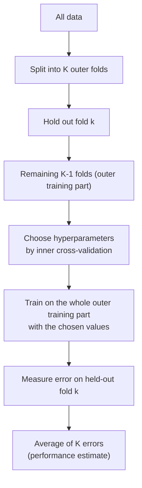
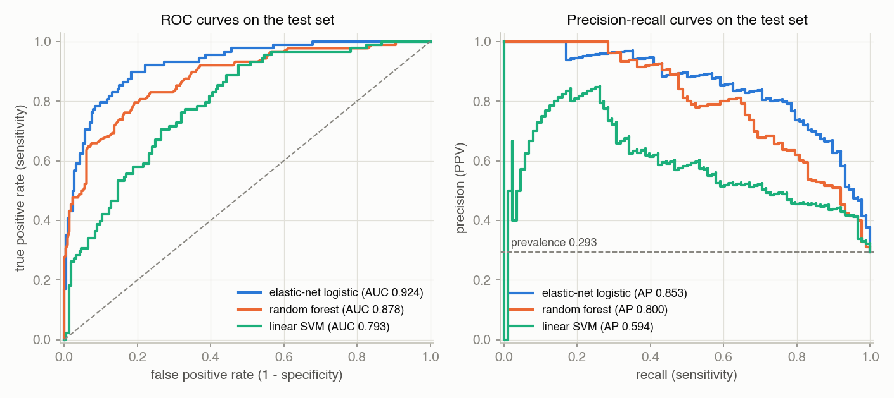
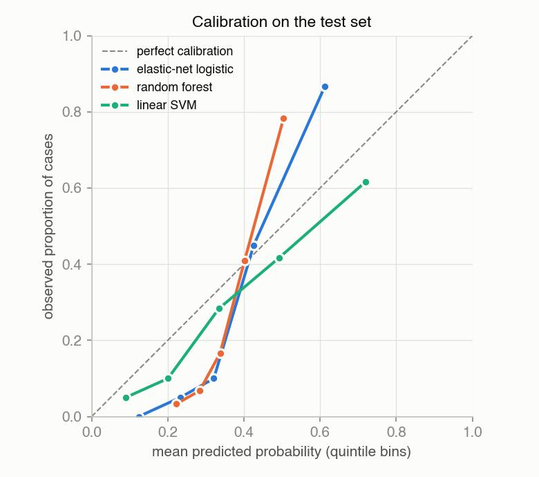

# Chapter 12 — Machine Learning for Disease Prediction

[Repository Guide](../../README.md) | [English](Concepts_Lecture.md) | [한국어](Concepts_Lecture.ko.md)

> **Last Updated:** 2026-11-26

> **Learning Objectives:**
> 1. Formulate diagnosis and prognosis as classification problems that predict probabilities, and set the decision threshold from misclassification costs
> 2. Identify the paths by which data leakage arises in omics prediction and explain the splitting methods that prevent it
> 3. Construct stratified and nested cross-validation and explain why non-nested estimates are optimistic
> 4. Explain why class imbalance and the prevalence of the study design distort accuracy and predicted probabilities, and respond with weights, thresholds, and prior-probability correction
> 5. Compute and interpret the properties of the AUC, precision-recall curves, calibration, and the Brier score
> 6. Apply regularized logistic regression, random forests, and SVMs to expression data, compare them, and interpret variable importance and external validation results

---

## Table of Contents

- [1. Framing Diagnosis and Prognosis as Classification](#1-framing-diagnosis-and-prognosis-as-classification)
  - [1.1 Diagnostic and Prognostic Prediction](#11-diagnostic-and-prognostic-prediction)
  - [1.2 Components of a Prediction Model](#12-components-of-a-prediction-model)
  - [1.3 Probability Prediction and the Decision Threshold](#13-probability-prediction-and-the-decision-threshold)
  - [1.4 Simulated Cohort Data](#14-simulated-cohort-data)
- [2. Data Leakage and the Pitfalls of Omics Prediction](#2-data-leakage-and-the-pitfalls-of-omics-prediction)
  - [2.1 Data Leakage](#21-data-leakage)
  - [2.2 Paths of Leakage](#22-paths-of-leakage)
  - [2.3 Repeated Samples from the Same Patient](#23-repeated-samples-from-the-same-patient)
  - [2.4 Batch Effects and Confounding](#24-batch-effects-and-confounding)
  - [2.5 Small Samples and Uncertainty of Estimates](#25-small-samples-and-uncertainty-of-estimates)
- [3. Cross-Validation and Nested Cross-Validation](#3-cross-validation-and-nested-cross-validation)
  - [3.1 What Cross-Validation Evaluates](#31-what-cross-validation-evaluates)
  - [3.2 Stratified Cross-Validation](#32-stratified-cross-validation)
  - [3.3 Separating Model Selection from Performance Estimation](#33-separating-model-selection-from-performance-estimation)
  - [3.4 Nested Cross-Validation](#34-nested-cross-validation)
  - [3.5 Simulation: Data with No Signal](#35-simulation-data-with-no-signal)
  - [3.6 The Final Model](#36-the-final-model)
- [4. Class Imbalance](#4-class-imbalance)
  - [4.1 The Accuracy Paradox](#41-the-accuracy-paradox)
  - [4.2 Study Prevalence and Real Prevalence](#42-study-prevalence-and-real-prevalence)
  - [4.3 Remedies](#43-remedies)
  - [4.4 The Effect of Imbalance in R](#44-the-effect-of-imbalance-in-r)
- [5. Evaluation Metrics](#5-evaluation-metrics)
  - [5.1 Properties of the AUC](#51-properties-of-the-auc)
  - [5.2 Precision-Recall Curves and Average Precision](#52-precision-recall-curves-and-average-precision)
  - [5.3 Calibration and the Brier Score](#53-calibration-and-the-brier-score)
  - [5.4 Choosing Metrics](#54-choosing-metrics)
- [6. Three Classifiers Applied to Expression Data](#6-three-classifiers-applied-to-expression-data)
  - [6.1 Regularized Logistic Regression](#61-regularized-logistic-regression)
  - [6.2 Random Forests](#62-random-forests)
  - [6.3 Support Vector Machines](#63-support-vector-machines)
  - [6.4 Training the Three Models](#64-training-the-three-models)
  - [6.5 Comparison on the Test Set](#65-comparison-on-the-test-set)
  - [6.6 Comparison of Calibration](#66-comparison-of-calibration)
- [7. Interpreting the Models](#7-interpreting-the-models)
  - [7.1 Coefficient-Based Importance](#71-coefficient-based-importance)
  - [7.2 Variable Importance in Random Forests](#72-variable-importance-in-random-forests)
  - [7.3 Permutation Importance](#73-permutation-importance)
  - [7.4 Cautions in Interpretation](#74-cautions-in-interpretation)
- [8. Reproducibility and External Validation](#8-reproducibility-and-external-validation)
  - [8.1 Internal and External Validation](#81-internal-and-external-validation)
  - [8.2 Why Performance Changes in an External Cohort](#82-why-performance-changes-in-an-external-cohort)
  - [8.3 Recalibration](#83-recalibration)
  - [8.4 Practices for Reproducibility](#84-practices-for-reproducibility)
- [Concept Applications](#concept-applications)
- [Summary](#summary)
- [Self-Check Questions](#self-check-questions)
- [References](#references)

---

<br>

## 1. Framing Diagnosis and Prognosis as Classification

### 1.1 Diagnostic and Prognostic Prediction

> **Definition:** A **diagnostic model** is a prediction model that estimates the probability that a specific disease or condition is present now.

> **Definition:** A **prognostic model** is a prediction model that estimates the probability that a specific event will occur in the future.

Clinical prediction models come in two broad kinds. The TRIPOD reporting guideline divides prediction models into diagnostic and prognostic models [1]. In both cases the model takes a patient's information as input and outputs a probability, so it is a classification problem in the sense of Chapter 6.

| Kind | Target | Example Response | Caveat |
|:-----|:-----|:-----|:-----|
| Diagnostic prediction | Current disease state or subtype | Cancer versus normal, AML versus ALL in leukemia | The reference diagnosis (biopsy, etc.) must be accurate |
| Prognostic prediction | Future event within a fixed period | Relapse within 5 years, survival at 1 year | A period must be fixed, and some patients' observation stops before follow-up ends |

*Table 1. Diagnostic and prognostic prediction*

An early example of diagnostic prediction from expression data is the acute leukemia study of Golub et al. It showed that a class predictor derived automatically from expression data could determine the class (AML or ALL) of new leukemia cases, demonstrating that cancer can be classified by gene expression monitoring alone [2]. Whereas the class discovery of Chapter 11 finds unknown subtypes, the class prediction of this chapter assigns new patients to known classes.

> **Note:** If "relapse within 5 years" is made a binary response in prognostic prediction, it is unknown whether patients whose follow-up stopped before 5 years relapsed. Dropping such censored patients or treating them as non-relapsed introduces bias. Survival analysis (the Cox proportional hazards model and others), which models the time to the event directly, is the standard method for such data.

> **Definition:** **Censoring** occurs when follow-up ends or is interrupted before the event is observed (end of the study, loss to follow-up, and so on), so that it is unknown whether the event happened after observation stopped.

### 1.2 Components of a Prediction Model

Let $`x_i \in \mathbb{R}^p`$ be the expression vector of patient $`i`$ and $`y_i \in \{0, 1\}`$ the disease status. A prediction model consists of three parts.

1. **Risk score:** compute the probability $`\hat\pi(x) = \hat P(Y = 1 \mid X = x)`$ or a score $`s(x)`$ with the same ordering.
2. **Decision rule:** fix a threshold $`t`$ and call the patient positive (diseased) if $`\hat\pi(x) \ge t`$.
3. **Evaluation:** on patients not used for training, measure whether the ordering of scores is right (discrimination), whether the probability values themselves are right (calibration), and whether the calls are right (sensitivity, specificity).

> **Definition:** The **decision threshold** is the cutoff $`t`$ that turns a model's predicted probability or score into a positive or negative call; a patient whose predicted probability is at least $`t`$ is called positive.

> **Definition:** **Discrimination** is the degree to which a prediction model gives higher scores to people with the event than to those without, that is, how well the ordering of its scores is right.

> **Definition:** **Calibration** is the degree to which predicted probabilities match the frequencies of events actually observed. A model is well calibrated if about 30% of the patients with predicted probability 0.3 actually have the disease.

The confusion-matrix metrics of Chapter 6 evaluate the calls of step 3, so their values change with the threshold $`t`$. The ROC curve and AUC of Section 5 look at all thresholds at once to evaluate the discrimination of the score, and calibration evaluates the accuracy of the probability values. A good clinical prediction model needs both discrimination and calibration.

### 1.3 Probability Prediction and the Decision Threshold

Setting the threshold at 0.5 assumes that the two kinds of error cost the same. Let $`c_{\text{FN}}`$ be the cost of a false negative, missing the disease, and $`c_{\text{FP}}`$ the cost of a false positive, calling a healthy person positive. Calling a patient with predicted probability $`\pi`$ positive has expected cost $`(1 - \pi) c_{\text{FP}}`$, and calling the patient negative has expected cost $`\pi c_{\text{FN}}`$. A positive call has the smaller expected cost when

```math
(1 - \pi) \, c_{\text{FP}} < \pi \, c_{\text{FN}} \iff \pi > \frac{c_{\text{FP}}}{c_{\text{FP}} + c_{\text{FN}}} = t^{*}
```

For example, if missing a cancer costs 9 times as much as an extra examination, then $`t^{*} = 1 / (1 + 9) = 0.1`$. Calling a person positive and examining further whenever the predicted probability exceeds just 10% minimizes the expected cost. This result holds only when the predicted probability $`\pi`$ matches the true probability, that is, when the model is well calibrated. Applying the theoretical threshold to a miscalibrated model breaks the intended cost balance (Section 5.3).

### 1.4 Simulated Cohort Data

The examples in this chapter use a simulated cohort of 500 genes. Genes `g001`-`g010` form a first block with mutual correlation 0.6, `g011`-`g020` form a second block with correlation 0.6, and the remaining 480 genes are mutually independent. The true risk is determined by four genes only.

```math
\mathrm{logit} \, P(Y = 1 \mid x) = -1.6 + 1.0 \, x_{1} + 0.8 \, x_{2} + 0.8 \, x_{3} - 1.5 \, x_{11}
```

The other genes of the same blocks (`g004`-`g010`, for example) are correlated with the causal genes, so they appear related to the risk, but they do not actually determine it. This imitates real expression data, in which genes of the same pathway move together.

```r
sim_cohort <- function(n, p = 500, b0 = -1.6) {
  blk <- function(m, rho) {                     # m x 10 block with pairwise correlation rho
    z <- rnorm(m)
    sqrt(rho) * z + sqrt(1 - rho) * matrix(rnorm(m * 10), m, 10)
  }
  X <- cbind(blk(n, 0.6), blk(n, 0.6), matrix(rnorm(n * (p - 20)), n, p - 20))
  colnames(X) <- sprintf("g%03d", 1:p)
  eta <- b0 + 1.0 * X[, 1] + 0.8 * X[, 2] + 0.8 * X[, 3] - 1.5 * X[, 11]
  y <- rbinom(n, 1, plogis(eta))               # disease status drawn from the true risk
  list(X = X, y = y, risk = plogis(eta))
}
set.seed(314)
tr <- sim_cohort(150)
te <- sim_cohort(300)
c(train_n = length(tr$y), train_cases = sum(tr$y),
  test_n = length(te$y), test_cases = sum(te$y))
```

```text
    train_n train_cases      test_n  test_cases 
        150          51         300          88 
```

`blk()` mixes a common factor `z` and independent noise in the proportions $`\sqrt{\rho}`$ and $`\sqrt{1 - \rho}`$, producing 10 columns with mutual correlation $`\rho`$ and variance 1. `plogis()` is the logistic function $`1/(1 + e^{-\eta})`$, and `rbinom(n, 1, ...)` draws each patient's disease status with that probability. `risk` is the true risk; it is unknown in reality, but in simulated data it is used to compute the upper limit of performance any model can reach. Of the 150 training patients, 51 are cases, and of the 300 patients in the independent test set, 88 are cases.

---

<br>

## 2. Data Leakage and the Pitfalls of Omics Prediction

### 2.1 Data Leakage

> **Definition:** **Data leakage** is the entry, into the process of training or choosing a model, of information from the data used for evaluation or information that would not be available at the time of prediction.

With leakage, evaluated performance exceeds the performance on new patients in actual use. Leakage is not a coding error but a design error, so no warning appears at run time, and there is no symptom except results that are too good. The selection bias of Section 7 in Chapter 10 is the most common form of leakage.

### 2.2 Paths of Leakage

| Path | Example | Prevention |
|:-----|:-----|:-----|
| Preprocessing on all data | Standardizing with means and standard deviations that include test samples, quantile normalization over all samples | Compute preprocessing parameters on the training part only and merely apply them to the test part |
| Feature selection on all data | Cross-validating genes chosen from all samples | Redo selection inside each fold (Section 7 of Chapter 10) |
| Tuning on the test data | Changing hyperparameters or thresholds while watching test performance | Use nested cross-validation or a separate validation set (Section 3) |
| Duplicated patients | Repeated measurements or multiple tissue samples of one patient split across training and test | Split by patient (Section 2.3) |
| Reversed time | Using values measured after diagnosis or changed by treatment as inputs | Use only variables available at the time of prediction |
| Proxies for the label | Using as a variable whether a test given only to patients with a particular disease was performed | Check how each variable was generated |

*Table 2. Paths of data leakage and their prevention*

### 2.3 Repeated Samples from the Same Patient

It is common to obtain several samples from one patient: technical replicates of the same tissue, samples from several regions of a tumor, or measurements repeated over time. Samples from the same patient are very similar, so sample-level cross-validation puts nearly identical samples into the training folds of a test sample. The model can then perform well by learning to recognize patients rather than the disease pattern.

The simulation below creates 120 samples, 3 from each of 40 patients. Each patient has a unique expression profile, and the replicates are that profile plus small measurement noise. Disease labels are assigned at random at the patient level, so expression and labels are unrelated, and the true misclassification rate of any classifier is 0.5.

```r
library(class)
set.seed(8)
n_pat <- 40; reps <- 3; p0 <- 200
profile <- matrix(rnorm(n_pat * p0), n_pat)  # one profile per patient
status <- sample(rep(0:1, each = n_pat / 2))  # labels unrelated to expression
patient <- rep(1:n_pat, each = reps)
Xr <- profile[patient, ] + matrix(rnorm(n_pat * reps * p0, sd = 0.3), ncol = p0)
yr <- factor(status[patient])
cv_err <- function(fold) {
  wrong <- 0
  for (k in 1:5) {
    pred <- knn(Xr[fold != k, ], Xr[fold == k, ], yr[fold != k], k = 1)
    wrong <- wrong + sum(pred != yr[fold == k])
  }
  wrong / length(yr)
}
fold_sample  <- sample(rep(1:5, length.out = length(yr)))     # replicates split apart
fold_patient <- sample(rep(1:5, length.out = n_pat))[patient]  # a patient stays in one fold
round(c(sample_level_cv = cv_err(fold_sample), patient_level_cv = cv_err(fold_patient)), 3)
```

```text
 sample_level_cv patient_level_cv 
           0.058            0.650 
```

`profile[patient, ]` repeats rows by the vector of patient numbers so that the 3 samples of a patient share the same profile. `fold_sample` splits the 120 samples at random into 5 folds, and `fold_patient` splits the 40 patients into 5 folds and passes each patient's fold number to its samples. The classifier is the 1-nearest neighbor of Chapter 6.

Sample-level cross-validation estimated the misclassification rate at 0.058, because the nearest neighbor of a test sample is almost always another sample of the same patient, whose label it simply copies. Patient-level cross-validation gave 0.650, above the true value 0.5. With only 40 independent units, the standard error of the misclassification estimate is as large as about $`\sqrt{0.5 \times 0.5 / 40} \approx 0.079`$, and 0.650 lies about 1.9 standard errors from 0.5. The unit of splitting must thus be the independent unit, that is, the object to be predicted: split by patient to predict new patients and by hospital to apply the model to new hospitals.

### 2.4 Batch Effects and Confounding

> **Definition:** A **batch effect** is systematic variation in measurements caused by technical factors such as laboratory conditions, reagent lots, and personnel.

Leek et al. pointed out that batch effects become a major problem leading to incorrect conclusions when they are correlated with an outcome of interest, and argued that batch effects and other technical and biological artifacts are widespread and critical to address [3].

The most dangerous case for a prediction model is a design in which batch is confounded with class. If all case samples are measured in January and all control samples in March, differences due to measurement date cannot be distinguished from differences due to disease. The model can separate the classes perfectly from traces of the measurement date alone, and cross-validation does not catch the problem, because every fold carries the same confounding. Such a model is useless for new patients measured on other dates. Confounding is hard to fix at the analysis stage, so it must be prevented at the design stage: mix cases and controls evenly in each measurement batch and randomize the measurement order.

> **Definition:** **Confounding** occurs when a factor of interest (for example disease) and another factor (for example measurement batch) vary together, so that their effects cannot be distinguished.

### 2.5 Small Samples and Uncertainty of Estimates

Omics prediction studies often have tens to hundreds of samples, so the performance estimate itself is uncertain. If accuracy $`\hat p`$ is obtained on $`n`$ independent test samples, its standard error is approximately $`\sqrt{\hat p (1 - \hat p) / n}`$. With accuracy 0.8 on 40 test samples, the standard error is $`\sqrt{0.8 \times 0.2 / 40} = 0.063`$, and an approximate 95% confidence interval is $`0.8 \pm 1.96 \times 0.063 = [0.68, 0.92]`$. This is no basis for claiming superiority over an existing method with accuracy 0.75. Performance should be reported with a confidence interval alongside the point estimate.

> **[Probability and Statistics]** The number of correct calls among $`n`$ test samples follows the binomial distribution $`\mathrm{Bin}(n, p)`$ when the accuracy is $`p`$. The interval above is the Wald interval $`\hat p \pm z_{\alpha/2} \sqrt{\hat p (1 - \hat p)/n}`$ based on the normal approximation; when $`n`$ is small or $`\hat p`$ is near 0 or 1 its actual coverage falls below the nominal level, so the Wilson interval or an exact binomial interval is used.

---

<br>

## 3. Cross-Validation and Nested Cross-Validation

### 3.1 What Cross-Validation Evaluates

The K-fold cross-validation of Section 7 in Chapter 6 splits the data into $`K`$ folds, measures for each fold the error of a model trained on the rest, and averages. A different model is trained for each fold, so what cross-validation evaluates is not one particular model but "how well does this procedure predict when it builds a model from data of this size?" Every step in the procedure (preprocessing, feature selection, hyperparameter tuning, threshold choice) must therefore be repeated in each fold.

### 3.2 Stratified Cross-Validation

If data with 30 cases and 120 controls are split at random into 5 folds, one fold may get only 2 cases and another 10. Sensitivity cannot be measured stably in a fold with few cases, and differing class proportions across folds increase the variance of the error estimate. Stratified cross-validation prevents this. In the example, each fold gets 6 cases and 24 controls.

> **Definition:** **Stratified cross-validation** is cross-validation that assigns the samples of each class to the folds separately, so that every fold keeps the class proportions of the whole data.

### 3.3 Separating Model Selection from Performance Estimation

Cross-validation serves two purposes. One is **model selection**, choosing the best among candidate models or hyperparameters (the LASSO $`\lambda`$, for example); the other is **performance estimation**, estimating how well the chosen model will do on new data. Doing both with the same cross-validation results gives an optimistic estimate of performance. Each candidate's cross-validation error contains random variation, so choosing the minimum tends to pick a candidate that was lucky by chance.

Varma and Simon confirmed this bias with "null" data in which the feature distributions of the two classes did not differ. For classifiers whose parameters were chosen to minimize the cross-validation error, the estimated error was below 30% on 18.5% of the simulated data sets for the shrunken centroids classifier and on 38% for the SVM, although the classes did not differ, while their performance on independent test sets was no better than chance [4]. Nested cross-validation, which estimates the error with an outer cross-validation and tunes the parameters with an inner one, reduced this bias considerably and gave estimates very close to the error on independent test sets [4].

### 3.4 Nested Cross-Validation

> **Definition:** **Nested cross-validation** is a method that, inside each training part of an outer cross-validation, runs an inner cross-validation to choose hyperparameters, and estimates performance on the held-out outer folds.



*Figure 1. Structure of nested cross-validation*

With 5 outer folds, 5 inner folds, and 100 hyperparameter candidates, the number of fits is $`5 \times (5 \times 100 + 1) = 2{,}505`$. The cost is high, but for omics data with few samples it is almost the only way to obtain an honest performance estimate. The hyperparameters chosen inside may differ from outer fold to outer fold, and this variation itself shows the instability of the selection.

### 3.5 Simulation: Data with No Signal

> **Definition:** **Logistic regression** is a regression method that models the logit (log-odds) of the probability of a binary response, such as disease status, as a linear combination of the features.

The $`\lambda`$ of elastic-net logistic regression ($`\alpha = 0.5`$) is chosen on normal random data with 60 samples (30 per class) and 1,000 genes. The non-nested approach reports the minimum cross-validation misclassification rate reported by `cv.glmnet()` as the performance, and the nested approach chooses $`\lambda`$ with an inner `cv.glmnet()` within each of 5 outer folds. The true misclassification rate is 0.5. The experiment is repeated 20 times.

```r
library(glmnet)
strat_folds <- function(y, K = 5) {            # stratified fold labels
  f <- integer(length(y))
  for (cl in unique(y)) {
    idx <- which(y == cl)
    f[idx] <- sample(rep(1:K, length.out = length(idx)))
  }
  f
}
nested_cv <- function(X, y, K = 5) {
  outer <- strat_folds(y, K); wrong <- 0
  for (k in 1:K) {
    trn <- outer != k
    inner <- cv.glmnet(X[trn, ], y[trn], family = "binomial", alpha = 0.5,
                       type.measure = "class", foldid = strat_folds(y[trn], K))
    pred <- predict(inner, X[!trn, ], s = "lambda.min", type = "class")
    wrong <- wrong + sum(pred != y[!trn])
  }
  wrong / length(y)
}
set.seed(77)
est <- t(replicate(20, {
  X0 <- matrix(rnorm(60 * 1000), 60); y0 <- sample(rep(0:1, each = 30))
  flat <- cv.glmnet(X0, y0, family = "binomial", alpha = 0.5,
                    type.measure = "class", foldid = strat_folds(y0))
  c(min_cv = min(flat$cvm), nested = nested_cv(X0, y0))
}))
round(colMeans(est), 3)
round(apply(est, 2, range), 3)
```

```text
min_cv nested 
 0.433  0.478 
     min_cv nested
[1,]  0.267  0.333
[2,]  0.583  0.617
```

`strat_folds()` assigns the sample indices of each class evenly and at random to 1-K, producing stratified fold labels. Passing these labels to `foldid` of `cv.glmnet()` makes it cross-validate with that split. `nested_cv()` holds out outer fold `k` and predicts it with a model whose `lambda.min` was chosen by inner cross-validation on the rest (`trn`). In the non-nested approach, `flat$cvm` holds the cross-validation misclassification rate at each $`\lambda`$, and its minimum is reported as the performance.

The non-nested approach reports a mean of 0.433, claiming a misclassification rate nearly 7 percentage points below chance although there is no signal. The luckiest of the 20 runs gave 0.267. The nested approach gives a mean of 0.478, closer to the true value 0.5. The non-nested bias here is smaller than the selection bias of Section 7.3 in Chapter 10 (0.060 versus 0.529) because the candidate values of $`\lambda`$ form one continuous path of similar models. The more diverse and numerous the candidate models, the larger the bias.

### 3.6 The Final Model

After estimating performance by nested cross-validation, the model actually used is built by applying the inner procedure (choose $`\lambda`$ by cross-validation and train) once to all the data. The nested estimate is not the performance of this one final model but the expected performance of models built by the same procedure. The final model is trained on somewhat more data than the outer-fold models, so its performance is expected to be slightly better. For this reason cross-validation estimates tend to be slightly pessimistic.

---

<br>

## 4. Class Imbalance

### 4.1 The Accuracy Paradox

Most diseases are rare. As Section 8.5 of Chapter 6 showed, in a population with 1% prevalence even a classifier that calls everyone negative has accuracy 0.99. With imbalanced classes, a model with high accuracy may find not a single patient, which is called the **accuracy paradox**. For imbalanced data, sensitivity and specificity are reported separately, or the balanced accuracy is used. A classifier that calls everyone negative has sensitivity 0 and specificity 1, so its balanced accuracy is 0.5, the same as a classifier that calls at random.

> **Definition:** The **balanced accuracy** is the mean of sensitivity and specificity, used instead of accuracy for imbalanced data.

### 4.2 Study Prevalence and Real Prevalence

Section 8.5 of Chapter 6 showed that, with the same sensitivity and specificity, the positive predictive value changes greatly with prevalence: the same test has a PPV of 0.947 at 50% prevalence but 0.154 at 1%. This difference matters in omics prediction studies because the prevalence of the study data often differs from that of the real population. Studies of rare diseases often use a case-control design, which first collects cases and then a similar number of controls. The prevalence of such data is near 50%, so the PPV or accuracy computed on them must not be carried over directly to a real screening population with much lower prevalence.

> **Definition:** A **case-control design** is a study design that first collects cases and then separately collects controls for comparison; the prevalence of its data follows the group sizes the researcher chose, not the real population.

Predicted probabilities are affected in the same way. The intercept of a logistic regression reflects the prevalence of the training data, so a model trained on data with 50% prevalence produces probabilities higher than the true risk. If samples were drawn at random within each class (so that the expression distribution within each class is the same), predicted probabilities can be corrected to the real prevalence as follows.

```math
\mathrm{logit}(\pi_{\text{new}}) = \mathrm{logit}(\pi_{\text{old}}) + \log \frac{\rho_{\text{new}} / (1 - \rho_{\text{new}})}{\rho_{\text{old}} / (1 - \rho_{\text{old}})}
```

$`\rho_{\text{old}}`$ is the prevalence of the training data and $`\rho_{\text{new}}`$ that of the target population. In Bayes' theorem the posterior odds are the prior odds times the likelihood ratio, and the likelihood ratio (the information given by the expression) does not depend on prevalence, so only the prior odds need to change. If a model trained on data with 50% prevalence predicts 0.8 for a person and the real prevalence is 5%, adding $`\log(0.05/0.95) - \log(1) = -2.944`$ to $`\mathrm{logit}(0.8) = 1.386`$ gives $`-1.558`$, which converts back to a probability of 0.174. The person's true risk is about 17%, not 80%.

### 4.3 Remedies

- **Class weights:** give errors on minority-class samples a larger class weight. Using the number of majority-class samples divided by the number of minority-class samples as the minority weight equalizes the total weight of the two classes.
- **Threshold adjustment:** keep the model and lower the decision threshold. If the probability model is well calibrated, the cost-based threshold of Section 1.3 or the training prevalence can serve as the threshold.
- **Resampling:** enlarge the minority class by duplication (oversampling) or shrink the majority class (undersampling). **SMOTE (synthetic minority over-sampling technique)**, proposed by Chawla et al., enlarges the minority class by creating synthetic samples rather than simply duplicating, and they reported that combining it with undersampling of the majority class performed better than undersampling alone [5]. Each synthetic sample is placed at a random point on the line segment joining a minority-class sample and one neighbor chosen at random from its $`k`$ nearest neighbors within the minority class [5].

> **Definition:** A **class weight** is the weight that the loss function gives to errors on the samples of a class; giving the minority class a larger weight reduces the effect of imbalance.

> **Caution:** Resampling must be done only on the training part, inside each fold of cross-validation. Oversampling first and cross-validating afterwards puts duplicates of the same sample, or synthetic samples made from it, into both training and test folds, causing the same leakage as the repeated samples of Section 2.3. Moreover, the predicted probabilities of a model trained with class weights or resampling do not reflect the real prevalence, so calibration breaks.

### 4.4 The Effect of Imbalance in R

Lowering the intercept gives a cohort with prevalence about 14%, and an unweighted elastic-net logistic regression, a model with class weights, and the unweighted model with the training prevalence as its threshold are compared on an independent test set of 2,000 people.

```r
set.seed(21)
im_tr <- sim_cohort(400, b0 = -3.6)           # rare disease in training
im_te <- sim_cohort(2000, b0 = -3.6)
c(train_prev = mean(im_tr$y), test_prev = mean(im_te$y))
w <- ifelse(im_tr$y == 1, sum(im_tr$y == 0) / sum(im_tr$y == 1), 1)
fit_u <- cv.glmnet(im_tr$X, im_tr$y, family = "binomial", alpha = 0.5)
fit_w <- cv.glmnet(im_tr$X, im_tr$y, family = "binomial", alpha = 0.5, weights = w)
rates <- function(prob, y, thr) {
  pred <- as.numeric(prob >= thr)
  sens <- mean(pred[y == 1] == 1); spec <- mean(pred[y == 0] == 0)
  c(accuracy = mean(pred == y), sensitivity = sens, specificity = spec,
    balanced = (sens + spec) / 2)
}
p_u <- drop(predict(fit_u, im_te$X, s = "lambda.min", type = "response"))
p_w <- drop(predict(fit_w, im_te$X, s = "lambda.min", type = "response"))
round(rbind(all_negative = rates(rep(0, length(im_te$y)), im_te$y, 0.5),
            unweighted   = rates(p_u, im_te$y, 0.5),
            weighted     = rates(p_w, im_te$y, 0.5),
            thr_at_prev  = rates(p_u, im_te$y, mean(im_tr$y))), 3)
```

```text
train_prev  test_prev 
     0.150      0.137 
             accuracy sensitivity specificity balanced
all_negative    0.863       0.000       1.000    0.500
unweighted      0.886       0.237       0.990    0.613
weighted        0.837       0.777       0.846    0.812
thr_at_prev     0.786       0.777       0.787    0.782
```

`w` gives case samples the weight (number of controls / number of cases) and control samples 1. The `weights` argument of `cv.glmnet()` multiplies the log-likelihood by these weights. `rates()` calls the probabilities `prob` at threshold `thr` and computes accuracy, sensitivity, specificity, and balanced accuracy.

Calling everyone negative gives accuracy 0.863. The unweighted model at threshold 0.5 reaches accuracy 0.886, only slightly higher, and with sensitivity 0.237 it misses three of every four patients. With class weights, accuracy actually falls to 0.837, but sensitivity rises sharply to 0.777 and balanced accuracy becomes 0.812. Lowering the threshold of the unweighted model to the training prevalence 0.15 gives a similar effect, with sensitivity 0.777 and balanced accuracy 0.782. Looking at accuracy alone, one would have chosen the worst option (the unweighted model at threshold 0.5) as the best.

---

<br>

## 5. Evaluation Metrics

### 5.1 Properties of the AUC

> **Definition:** The **AUC (area under the curve)** is the area under the ROC curve; it equals the probability that the score of a randomly chosen patient exceeds the score of a randomly chosen control.

The ROC curve defined in Section 8.6 of Chapter 6 plots the false positive rate (1 - specificity) on the horizontal axis against the true positive rate (sensitivity) on the vertical axis as the threshold changes. Writing $`S_{+}`$ for the score of a random patient and $`S_{-}`$ for that of a random control, and counting tied pairs as one half, the AUC is

```math
\mathrm{AUC} = P(S_{+} > S_{-}) + \frac{1}{2} P(S_{+} = S_{-})
```

This value equals the Mann-Whitney U statistic, which compares the ranks of two groups, divided by the product of the group sizes $`n_{+} n_{-}`$. Three properties of the AUC follow from this interpretation.

- **Independent of prevalence:** the AUC compares only the score distributions within the patient group and within the control group, so its expected value does not change when the ratio of the group sizes changes. That is why, if the patients and controls were sampled to represent the patients and non-patients of the real population, an AUC measured on the case-control data of Section 4.2 can be carried over to that population. If the composition within a class differs from the real population, as in a study that collects only severe patients and healthy controls, the AUC also differs (Section 8.2).
- **Invariant to monotone transformations:** it looks only at the order of the scores, so squaring or taking logarithms of the scores leaves the AUC unchanged. A high AUC therefore does not mean that the probability values are right (Section 5.3).
- **Uncertainty of the estimate:** the AUC is an estimate computed from a sample, so it is reported with a confidence interval. `ci.auc()` of the pROC package computes the confidence interval of the AUC by the DeLong method by default [6].

A small example checks this: 4 patients with scores 0.9, 0.8, 0.55, and 0.4, and 4 controls with scores 0.7, 0.35, 0.2, and 0.1. Of the 16 pairs, the patient's score is higher in 14 (only 0.55 and 0.4 fall below the control at 0.7). Hence AUC = 14/16 = 0.875. The code below computes this value and the precision and recall of Section 5.2.

```r
library(pROC)
score <- c(0.9, 0.8, 0.7, 0.55, 0.4, 0.35, 0.2, 0.1)
label <- c(1,   1,   0,   1,    1,   0,    0,   0)
roc_toy <- roc(label, score, levels = c(0, 1), direction = "<", quiet = TRUE)
auc(roc_toy)
pairs <- outer(score[label == 1], score[label == 0], ">")
mean(pairs)
ord <- order(score, decreasing = TRUE)
tp <- cumsum(label[ord] == 1)
prec <- tp / seq_along(ord); rec <- tp / sum(label)
rbind(threshold = score[ord], precision = round(prec, 3), recall = rec)
mean(prec[label[ord] == 1])                    # average precision
```

```text
Area under the curve: 0.875
[1] 0.875
          [,1] [,2]  [,3] [,4] [,5]  [,6]  [,7] [,8]
threshold 0.90  0.8 0.700 0.55  0.4 0.350 0.200  0.1
precision 1.00  1.0 0.667 0.75  0.8 0.667 0.571  0.5
recall    0.25  0.5 0.500 0.75  1.0 1.000 1.000  1.0
[1] 0.8875
```

In `roc()`, `levels = c(0, 1)` designates 0 as control and 1 as patient, and `direction = "<"` specifies that patients have higher scores. Without a specified direction, pROC chooses it from the data, so for a score without discrimination the direction can flip to make the AUC come out above 0.5. `outer(..., ">")` builds a 4×4 logical matrix recording, for every pair of the 4 patients and 4 controls, whether the patient's score is larger, and its mean is the probability in the formula above. The remaining lines sort the scores in decreasing order and compute the precision and recall when the top $`k`$ are called positive.

### 5.2 Precision-Recall Curves and Average Precision

> **Definition:** A **precision-recall curve** plots recall (sensitivity) on the horizontal axis against precision (PPV) on the vertical axis as the decision threshold changes.

The code above sorted the scores in decreasing order and computed, when the top $`k`$ are called positive, the precision $`\mathrm{TP}_k / k`$ and the recall $`\mathrm{TP}_k / P`$. For example, calling the top 3 positive includes 2 patients and 1 control, so the precision is 2/3 = 0.667 and the recall is 2/4 = 0.5.

To summarize the curve by one number, the average precision is used. In the example, patients are at ranks 1, 2, 4, and 5, so AP = $`(1 + 1 + 0.75 + 0.8) / 4 = 0.8875`$. A random score has expected precision equal to the prevalence at every threshold, so the baseline of a precision-recall curve is not the diagonal but a horizontal line at the height of the prevalence.

> **Definition:** The **average precision (AP)** is the mean of the precision at each rank where a patient (positive) appears when the scores are sorted in decreasing order; it summarizes the precision-recall curve by one number.

The false positive rate of the ROC curve is divided by the number of controls, so when controls are very numerous the false positive rate looks small even with many false positives. Saito and Rehmsmeier reported that, on imbalanced data in which negatives far outnumber positives, the visual interpretation of ROC plots can be deceptive about the reliability of classification performance because of an intuitive but wrong interpretation of specificity, whereas precision-recall plots, which evaluate the fraction of true positives among positive calls, can accurately show future classification performance [7]. In a screening test with 1% prevalence, a false positive rate of 5% looks small, but as Section 8.5 of Chapter 6 showed, 85% of positive calls are false positives.

### 5.3 Calibration and the Brier Score

> **Definition:** A **calibration plot** splits patients into several bins by predicted probability and plots, for each bin, the mean predicted probability on the horizontal axis against the actual proportion of patients on the vertical axis; if the points lie on the diagonal, calibration is right.

The most intuitive way to examine calibration is the calibration plot. The bins are, for example, the quintiles of the predicted probability. If the points lie steeper than the diagonal (below at the low end, above at the high end), the predictions are pulled too far toward the mean; if they lie flatter, the predictions are too extreme.

To summarize calibration numerically, the calibration slope is examined. A slope of 1 means calibration is right; a slope above 1 means the predictions are not extreme enough (underconfidence); a slope below 1 means they are too extreme (overconfidence, typical of an overfitted model).

> **Definition:** The **calibration slope** is the slope obtained by a logistic regression of the observed response (0 or 1) on the logit of the model's predicted probability; it equals 1 when the predicted probabilities are well calibrated.

> **Definition:** The **Brier score** is the mean squared difference between the predicted probability and the actual response (0 or 1); smaller values mean more accurate probability predictions.

In formula form, the Brier score is

```math
\mathrm{BS} = \frac{1}{n} \sum_{i=1}^{n} (\hat\pi_i - y_i)^2
```

Zero is best, and it reflects both discrimination and calibration. Treating the scores of the eight samples in Section 5.1 as probabilities gives $`\mathrm{BS} = \{(0.9 - 1)^2 + (0.8 - 1)^2 + (0.7 - 0)^2 + (0.55 - 1)^2 + (0.4 - 1)^2 + 0.35^2 + 0.2^2 + 0.1^2\} / 8 = 1.275 / 8 = 0.159`$. As a reference, predicting the prevalence $`\bar y`$ for every patient gives $`\mathrm{BS} = \bar y (1 - \bar y)`$. With a prevalence of 0.293, as in the test set of Section 6.5, this is 0.207, so an informative model must have a Brier score below that.

### 5.4 Choosing Metrics

| Question | Metric | Characteristics |
|:-----|:-----|:-----|
| Do patients score higher than controls? | AUC | Independent of threshold and prevalence, blind to the accuracy of probability values |
| How trustworthy is a positive call? | Precision-recall curve, AP | Exposes the burden of false positives in imbalanced data, depends on prevalence |
| Can predicted probabilities be trusted as they are? | Calibration plot, calibration slope | Essential when probabilities are used for decisions |
| Overall quality of probability predictions | Brier score | Reflects discrimination and calibration together |
| Calls at a specific threshold | Sensitivity, specificity, PPV, NPV | The threshold must be fixed in advance |

*Table 3. Choosing evaluation metrics*

No model is judged by one metric. Reports of clinical prediction models should include at least discrimination (the AUC with its confidence interval) and calibration (a calibration plot or slope).

---

<br>

## 6. Three Classifiers Applied to Expression Data

### 6.1 Regularized Logistic Regression

Written as a formula, the logistic regression of Section 3.5 is

```math
\log \frac{\pi(x)}{1 - \pi(x)} = \beta_0 + x^\top \beta, \qquad \pi(x) = \frac{1}{1 + e^{-(\beta_0 + x^\top \beta)}}
```

The coefficients are estimated by maximizing the log-likelihood $`\ell(\beta) = \sum_i \{ y_i \log \pi(x_i) + (1 - y_i) \log(1 - \pi(x_i)) \}`$. When $`p > n`$, the maximum likelihood estimate is not unique, as in Section 2.2 of Chapter 10, and if the classes are perfectly separated the coefficients diverge to infinity. So regularized logistic regression is used, minimizing $`-\ell(\beta) + \lambda P(\beta)`$ with the penalty of Section 5 in Chapter 10. The examples in this chapter use the elastic-net penalty ($`\alpha = 0.5`$) and choose $`\lambda`$ by cross-validation.

> **Definition:** **Regularized logistic regression** is logistic regression whose coefficients are estimated by minimizing the negative log-likelihood plus a penalty $`\lambda P(\beta)`$ on the coefficients.

Interpreting the coefficients is simple. $`\beta_j`$ means that, with the other variables held fixed, an increase of 1 in $`x_j`$ raises the log odds by $`\beta_j`$, and $`e^{\beta_j}`$ is the odds ratio. Because the penalty shrinks the coefficients toward 0, however, reading their size directly as effect size underestimates the effect.

### 6.2 Random Forests

> **Definition:** A **random forest** is an ensemble method that averages the predictions of many decision trees, each built from a bootstrap sample with a random subset of variables considered at each node.

Random forests were proposed by Breiman [8]. A single decision tree has high variance: a slight change in the training data can change the first split and thereby the whole tree. A random forest reduces variance by averaging many trees that two kinds of randomization make less alike.

1. **Bootstrap samples:** each tree is trained on a sample drawn with replacement from the training samples (bagging).
2. **Random subsets of variables:** at each node the split variable is searched among $`m`$ randomly chosen variables rather than all of them. R's randomForest package uses $`\sqrt{p}`$ as the default $`m`$ for classification [9]. For 500 genes that is 22.

> **[Machine Learning]** A decision tree repeatedly splits the feature space with axis-parallel splits, choosing at each node the variable and split point that most reduce the Gini impurity or entropy. A deep tree has low bias and high variance, and bagging reduces the variance by averaging many trees.

About 36.8% ($`(1 - 1/n)^n \approx e^{-1}`$) of the original samples are left out of a bootstrap sample. These OOB samples were not used to train that tree, so computing each sample's error from the predictions of the trees that did not use it estimates the generalization error without separate cross-validation. Random forests can find interactions and nonlinear relations among variables by themselves, but when the signal consists of a few linear effects they can be less efficient than regularized linear models.

> **Definition:** An **out-of-bag (OOB) sample** is an original sample that was not drawn into a tree's bootstrap sample and so was not used to train that tree.

### 6.3 Support Vector Machines

> **Definition:** A **support vector machine (SVM)** is a classifier that finds the hyperplane maximizing the margin between two classes.

The SVM was proposed by Cortes and Vapnik [10]. For classes that are not perfectly separable, samples may violate the margin, but the sum of violations is penalized by the cost parameter $`C`$. A small $`C`$ allows many violations and gives a wide margin and a simple boundary; a large $`C`$ tries to fit the training samples as closely as possible and raises the risk of overfitting. Kernels allow nonlinear boundaries, but expression data with $`p \gg n`$ are easily separable by a linear boundary, so a linear kernel is common.

The output of an SVM is not a probability but a decision value (a signed distance to the hyperplane). When trained with `probability = TRUE`, R's e1071 package computes posterior class probabilities by fitting a logistic distribution to the decision values by maximum likelihood [11]. These probabilities are a monotone transformation of the decision values, so the AUC is the same as that computed from the decision values.

### 6.4 Training the Three Models

The three models are trained on the 150 training patients of Section 1.4. The elastic net chooses $`\lambda`$ by stratified 5-fold cross-validation, and the SVM chooses $`C`$ among $`10^{-4}, \dots, 10^{0}`$ by 5-fold cross-validation. The random forest uses 500 trees and the default $`m`$.

```r
library(randomForest); library(e1071)
set.seed(2718)
en <- cv.glmnet(tr$X, tr$y, family = "binomial", alpha = 0.5, foldid = strat_folds(tr$y))
p_en <- drop(predict(en, te$X, s = "lambda.min", type = "response"))
rf <- randomForest(tr$X, factor(tr$y), ntree = 500)
p_rf <- predict(rf, te$X, type = "prob")[, "1"]
tn <- tune(svm, train.x = tr$X, train.y = factor(tr$y), kernel = "linear",
           ranges = list(cost = 10^(-4:0)), tunecontrol = tune.control(cross = 5))
sv <- svm(tr$X, factor(tr$y), kernel = "linear", cost = tn$best.parameters$cost,
          probability = TRUE)
p_sv <- attr(predict(sv, te$X, probability = TRUE), "probabilities")[, "1"]
c(enet_nonzero = sum(coef(en, s = "lambda.min")[-1] != 0),
  rf_oob_error = unname(rf$err.rate[500, "OOB"]), svm_cost = tn$best.parameters$cost)
```

```text
enet_nonzero rf_oob_error     svm_cost 
  20.0000000    0.3066667    0.0100000 
```

`cv.glmnet()` uses the stratified folds made by `strat_folds()` from Section 3.5 and chooses $`\lambda`$ by the default error measure, the binomial deviance. `predict(..., type = "prob")` of `randomForest()` returns the proportion of trees voting for each class, and column `"1"` is the probability of the case class. `tune()` is e1071's grid search function, which computes the 5-fold cross-validation misclassification rate for each candidate in `ranges` and picks the best $`C`$. The `"probabilities"` attribute of `predict(sv, ..., probability = TRUE)` holds the class probabilities.

The elastic net chose 20 genes. The random forest's OOB misclassification rate is 0.307, and the SVM chose $`C = 0.01`$.

### 6.5 Comparison on the Test Set

```r
avg_prec <- function(p, y) {
  o <- order(p, decreasing = TRUE); tp <- cumsum(y[o] == 1)
  mean((tp / seq_along(o))[y[o] == 1])
}
evaluate <- function(p, y) {
  r <- roc(y, p, levels = c(0, 1), direction = "<", quiet = TRUE)
  ci <- ci.auc(r)
  c(AUC = ci[2], AUC_lo = ci[1], AUC_hi = ci[3], AP = avg_prec(p, y),
    Brier = mean((p - y)^2), rates(p, y, 0.5)[1:3])
}
probs <- list(enet = p_en, rf = p_rf, svm = p_sv)
round(t(sapply(probs, evaluate, y = te$y)), 3)
round(c(true_risk_AUC = auc(roc(te$y, te$risk, levels = c(0, 1), direction = "<", quiet = TRUE)),
        true_risk_Brier = mean((te$risk - te$y)^2), prevalence = mean(te$y)), 3)
```

```text
       AUC AUC_lo AUC_hi    AP Brier accuracy sensitivity specificity
enet 0.924  0.892  0.956 0.853 0.130    0.853       0.591       0.962
rf   0.878  0.834  0.922 0.800 0.164    0.803       0.364       0.986
svm  0.793  0.741  0.846 0.594 0.167    0.750       0.557       0.830
  true_risk_AUC true_risk_Brier      prevalence 
          0.926           0.094           0.293 
```

`avg_prec()` computes the average precision of Section 5.2. `evaluate()` obtains the AUC and its 95% confidence interval with `ci.auc()` (returned in the order lower limit, estimate, upper limit) and returns them together with the average precision, the Brier score, and the accuracy, sensitivity, and specificity at threshold 0.5. The last line gives the AUC and Brier score obtained by using the true risk `te$risk` as the score, a benchmark no model can beat on these data.



*Figure 2. ROC and precision-recall curves of the three models on the test set*

The AUC of the elastic net is 0.924, almost equal to the 0.926 obtained with the true risk itself. The structure of these data, in which the true risk is a linear combination of a few genes, matches the assumptions of regularized logistic regression exactly. The random forest reaches 0.878 and the SVM 0.793. The confidence intervals of the elastic net and the SVM, [0.892, 0.956] and [0.741, 0.846], do not overlap. The SVM uses all 500 genes, so the weights of the 480 noise genes add noise to its decision function.

The differences in average precision are larger than those in AUC (0.853, 0.800, 0.594), because the precision-recall curve is sensitive to the ordering at the high-score end, among the patients called positive. Sensitivity at threshold 0.5 is below 0.6 for all three models. From the viewpoint of Section 1.3, 0.5 is the threshold when false negatives and false positives cost the same, and, as the next section shows, the probabilities of these models are not calibrated, so 0.5 does not even fall where it is meant to.

### 6.6 Comparison of Calibration

```r
calib <- function(p, y, bins = 5) {
  g <- cut(p, quantile(p, 0:bins / bins), include.lowest = TRUE)
  lp <- qlogis(pmin(pmax(p, 1e-6), 1 - 1e-6))  # logit of the predicted probability
  cf <- coef(glm(y ~ lp, family = binomial))
  list(bins = round(rbind(mean_pred = tapply(p, g, mean), observed = tapply(y, g, mean)), 3),
       recalibration = round(c(intercept = cf[[1]], slope = cf[[2]]), 3))
}
calib(p_en, te$y)
rbind(rf = calib(p_rf, te$y)$recalibration, svm = calib(p_sv, te$y)$recalibration)
```

```text
$bins
          [0.0361,0.187] (0.187,0.276] (0.276,0.367] (0.367,0.5] (0.5,0.87]
mean_pred          0.124         0.233         0.321       0.426      0.612
observed           0.000         0.050         0.100       0.450      0.867

$recalibration
intercept     slope 
    0.721     3.483 

    intercept slope
rf      1.420 4.469
svm    -0.412 1.065
```

`calib()` splits patients into five bins by the quintiles of the predicted probability (`cut()` and `quantile()`) and computes, for each bin, the mean predicted probability and the actual proportion of patients. It then regresses the response `y` on the logit `lp` of the predicted probability by logistic regression to obtain an intercept and a slope. `pmin(pmax(...))` clips the values so that the logit does not become infinite at probability 0 or 1.



*Figure 3. Calibration plots of the three models on the test set*

The lowest bin of the elastic net has mean predicted probability 0.124 yet contains no patients at all, and the highest bin is predicted at 0.612 while 86.7% are actually patients. The predictions are pulled toward the mean relative to reality, as the calibration slope of 3.483 indicates. This results from the penalty shrinking the coefficients toward 0 and narrowing the range of the logits. The random forest has a slope of 4.469 in the same direction, because vote proportions are averages over trees and rarely approach 0 or 1. The SVM has a slope of 1.065, nearly right, because e1071 obtains its probabilities by fitting a logistic function directly to the decision values. Its intercept of -0.412, however, means it predicts slightly too high probabilities overall.

This shows that discrimination and calibration are separate properties. The elastic net has the best discrimination, but its probability values cannot be used as they are; the SVM has the worst discrimination, but its probability values are relatively accurate. To use the elastic net's probabilities for decisions, the recalibration of Section 8.3 is needed.

---

<br>

## 7. Interpreting the Models

### 7.1 Coefficient-Based Importance

In a linear model the size of a standardized variable's coefficient indicates its importance. All genes in these data have variance 1, so the elastic-net coefficients can be compared directly.

```r
b <- coef(en, s = "lambda.min")[-1, 1]
round(head(b[order(-abs(b))], 8), 3)
imp <- importance(randomForest(tr$X, factor(tr$y), ntree = 500, importance = TRUE),
                  type = 1)[, 1]
round(head(sort(imp, decreasing = TRUE), 8), 2)
perm_imp <- function(model, X, y, genes, B = 20) {
  base <- auc(roc(y, attr(predict(model, X, probability = TRUE), "probabilities")[, "1"],
                  levels = c(0, 1), direction = "<", quiet = TRUE))
  sapply(genes, function(g) {
    mean(replicate(B, {
      Xp <- X; Xp[, g] <- sample(Xp[, g])
      p <- attr(predict(model, Xp, probability = TRUE), "probabilities")[, "1"]
      base - auc(roc(y, p, levels = c(0, 1), direction = "<", quiet = TRUE))
    }))
  })
}
set.seed(5)
pi_sv <- perm_imp(sv, te$X, te$y, genes = colnames(te$X)[1:30])
round(head(sort(pi_sv, decreasing = TRUE), 8), 3)
```

```text
  g003   g012   g002   g011   g008   g016   g141   g001 
 0.281 -0.251  0.199 -0.189  0.173 -0.111 -0.095  0.088 
g003 g008 g002 g001 g011 g012 g020 g004 
5.65 5.53 5.34 4.76 4.59 4.01 3.77 3.41 
 g003  g002  g001  g008  g012  g006  g010  g009 
0.019 0.018 0.018 0.013 0.011 0.008 0.008 0.008 
```

The first two lines show the 8 elastic-net coefficients largest in absolute value. The next line extracts the permutation-based importance (`type = 1`) from a random forest trained with `importance = TRUE`. `perm_imp()` applies the permutation importance of Section 7.3 to the SVM and, to save computation, evaluates only the first 30 genes (the two blocks and 10 noise genes).

The top elastic-net coefficients include the true causal genes `g003`, `g002`, `g011`, and `g001`, but the non-causal `g012` (-0.251), `g008` (0.173), and `g016` (-0.111) also received large coefficients. They lie in the same blocks as the causal genes, with correlation 0.6. In particular, the coefficient of `g012` is larger in absolute value than that of the true cause `g011`. The noise gene `g141` (-0.095) also entered. Compared with the true coefficients (1.0, 0.8, 0.8, -1.5), every coefficient is heavily shrunk. The coefficient 0.281 of `g003` corresponds to an odds ratio of $`e^{0.281} = 1.32`$, whereas the true effect is an odds ratio of $`e^{0.8} = 2.23`$.

### 7.2 Variable Importance in Random Forests

The randomForest package provides two importance measures [9].

- **Mean decrease in accuracy:** for each tree, the error on the OOB samples is recorded; then the values of one variable are permuted at random within the OOB samples and the error is measured again. The difference between the two errors is averaged over all trees and divided by the standard deviation of the differences. A variable whose permutation does not increase the error is not used for prediction.
- **Mean decrease in Gini:** the decrease in Gini impurity from splits on the variable, summed and averaged over all trees. It is fast to compute, but variables with many candidate split points (continuous variables or variables with many categories) have more chances to reduce impurity by chance, so their importance tends to be inflated.

In the results above, the top 8 of the random forest's mean decrease in accuracy are all genes of the two blocks: the causal genes `g001`-`g003` and `g011`, together with `g008`, `g012`, `g020`, and `g004` from the same blocks. With correlated variables, trees often split on a proxy gene instead of the causal gene among their randomly chosen candidates, so importance is spread over the whole block.

### 7.3 Permutation Importance

> **Definition:** **Permutation importance** measures a variable's importance, with a trained model held fixed, by how much performance (the AUC, for example) falls when the values of that variable in the evaluation data are permuted at random.

The idea of the mean decrease in accuracy applies to any model, and permutation importance is that idea. Permuting a variable's values breaks the relation between the variable and the response, so the drop in performance is the model's dependence on that variable.

In the SVM's permutation importance, the genes with the largest AUC drops are `g003` (0.019), `g002`, and `g001` (0.018), followed by the proxy genes `g008` and `g012`. The true cause `g011` is not in the top 8. The SVM's small $`C`$ (0.01) spreads the weights widely over correlated genes, so in block 2 the model depends more on neighbors such as `g012` than on `g011` alone. For the same reason all drops are small, at most 0.02: when one gene is permuted, the other genes of its block supply the same information.

> **Caution:** With correlated variables, permutation importance misleads in two directions. Permuting a correlated variable creates combinations of values that cannot actually occur (a sample in which only one of two genes with correlation 0.6 is very high, for example), and the model may behave strangely in such regions. Conversely, when information is duplicated across several variables, permuting one barely reduces performance, so all of them look unimportant. Permuting a correlated group together, group permutation, is an alternative.

### 7.4 Cautions in Interpretation

The importance measures of all three models failed alike to distinguish causal genes from their proxies. This is not a defect of the models but a limitation of observational data. Which of several correlated genes is causal cannot be determined from predictive performance; experimental manipulation (gene knockdown or overexpression) is needed. Importance lists should therefore be interpreted as follows.

- Importance means "this model uses this variable for prediction", not "this variable causes the disease".
- The importance of correlated variables is split among them or concentrated in one. Which happens depends on the model and on chance in the data (the instability of Section 8.1 in Chapter 10).
- Importance is also an estimate computed from a sample and varies. It is advisable to report that variation as well, using the bootstrap or repeated cross-validation.

---

<br>

## 8. Reproducibility and External Validation

### 8.1 Internal and External Validation

> **Definition:** **Internal validation** estimates performance within the data used to build the model, by cross-validation or the bootstrap.

> **Definition:** **External validation** measures the performance of the fixed model on independent data never used in building it, ideally patients from other institutions, other periods, or other measurement platforms.

Internal validation estimates performance on new samples from the same population, but in real clinical use the population itself changes, so external validation is necessary.

### 8.2 Why Performance Changes in an External Cohort

In an external cohort, performance changes for the following reasons.

- **Differences in case mix:** the same model gives a high AUC in a population with many easily distinguished patients and a low AUC in one with many borderline patients.
- **Differences in measurement:** different platforms, reagents, and processing procedures shift the values of the same gene systematically (the batch effects of Section 2.4).
- **Differences in prevalence:** the model's intercept reflects the prevalence of the training data, so in a population with a different prevalence the probabilities are systematically too high or too low.

> **Definition:** The **case mix** of a population is its composition, such as the distribution of disease severity, the prevalence, and the age structure.

The code below applies the elastic net of Section 6.4 to a cohort of 1,000 patients from another hospital. This hospital has a higher proportion of patients (intercept -1.0), and because of a new measurement platform the 10 genes of block 1 are measured 0.5 lower. The true risk is determined by the true values without the measurement offset. Half of the cohort is used for the recalibration of Section 8.3 and the other half for evaluation.

```r
set.seed(1618)
ex <- sim_cohort(1000, b0 = -1.0)             # other centre: more cases
ex$X[, 1:10] <- ex$X[, 1:10] - 0.5             # probe-specific offset on the new platform
p_ex <- drop(predict(en, ex$X, s = "lambda.min", type = "response"))
half <- rep(1:2, length.out = 1000)            # half 1 for recalibration, half 2 for checking
lp <- qlogis(p_ex)
recal <- glm(ex$y[half == 1] ~ lp[half == 1], family = binomial)
p_re <- plogis(coef(recal)[1] + coef(recal)[2] * lp)
summ <- function(p, y) c(evaluate(p, y)[c("AUC", "Brier")], mean_pred = mean(p), observed = mean(y))
round(rbind(internal_test  = summ(p_en, te$y),
            external_raw   = summ(p_ex[half == 2], ex$y[half == 2]),
            external_recal = summ(p_re[half == 2], ex$y[half == 2]),
            external_truth = summ(ex$risk[half == 2], ex$y[half == 2])), 3)
round(c(intercept = coef(recal)[[1]], slope = coef(recal)[[2]]), 3)
```

```text
                 AUC Brier mean_pred observed
internal_test  0.924 0.130     0.343    0.293
external_raw   0.841 0.177     0.260    0.352
external_recal 0.841 0.155     0.382    0.352
external_truth 0.866 0.143     0.356    0.352
intercept     slope 
    2.164     2.516 
```

`ex$X[, 1:10] - 0.5` adds the offset only to the measured values, while the true risk `ex$risk`, computed inside `sim_cohort()`, is determined by the values before the offset. `half` splits the samples alternately into two halves. `summ()` returns the AUC, the Brier score, the mean predicted probability, and the actual prevalence.

In the external cohort the AUC fell from 0.924 to 0.841. Yet even the true risk itself gives an AUC of only 0.866 in the external cohort, lower than the 0.926 in the internal test set. The external cohort has a different intercept and therefore a different case mix, with correspondingly more patients who are hard to distinguish. Much of the drop in AUC thus comes not from a defect of the model but from the difference in case mix. The measurement offset of block 1 shifts every patient's linear predictor by the same amount, so it does not change the ordering of a linear model, that is, its AUC. What the offset broke is calibration: the mean predicted probability is 0.260 while the actual prevalence is 0.352, and the Brier score worsened from 0.130 to 0.177.

### 8.3 Recalibration

> **Definition:** **Recalibration** keeps a model's structure (the selected genes and the relative sizes of the coefficients) and adjusts only the scale of its predicted probabilities to a new population.

When calibration fails in an external cohort, recalibration can be applied. The simplest method fits the following logistic regression on part of the new population's data.

```math
\mathrm{logit} \, P(Y = 1) = a + b \cdot \mathrm{logit}(\hat\pi_{\text{old}})
```

The intercept $`a`$ corrects the difference in mean level (prevalence and measurement offset), and the slope $`b`$ corrects the difference in the spread of the predictions. In the results above the recalibration coefficients are $`a = 2.164`$ and $`b = 2.516`$. The slope above 1 shows that the underconfidence of the elastic net seen in Section 6.6 persists in the external cohort. After recalibration, on the evaluation half the mean predicted probability became 0.382, close to the actual prevalence 0.352, and the Brier score improved from 0.177 to 0.155. Recalibration changes only the probability values, not the ordering, so the AUC stays at 0.841.

> **Caution:** Data used for recalibration must not be reused to evaluate the recalibrated model; that is why the cohort was split in half in the example. Recalibration cannot improve discrimination, and if discrimination has dropped sharply, the model itself must be rebuilt.

### 8.4 Practices for Reproducibility

The same analysis on the same data must give the same results (computational reproducibility), and other data should lead to similar conclusions (replicability). In the MAQC-II study, 36 independent teams built models predicting 13 clinical and preclinical endpoints from six microarray data sets, and more than 30,000 models were evaluated on data not used for training [12]. The study reported that model performance depended largely on the endpoint and the proficiency of the team, and that different approaches produced models of similar performance [12]. What is predicted, and how correctly the analysis is done, mattered more than which algorithm is used.

For reproducibility, the following practices are observed.

- **Fix random numbers:** fix them with `set.seed()` and save the cross-validation splits.
- **Record the environment:** record the versions of R and the packages (`sessionInfo()`). Packages such as glmnet and randomForest may change defaults or results across versions.
- **Fix the analysis in advance:** before opening the test data, decide and record the preprocessing, feature selection, model, hyperparameter search range, and evaluation metrics. Use the test data only once, at the end.
- **Publish the whole procedure:** publish the code, the processed data, and the final model's coefficients and threshold so that other researchers can obtain the same results and apply the model to new data.
- **Follow reporting guidelines:** TRIPOD is a 22-item checklist for transparent reporting of studies that develop, validate, or update diagnostic or prognostic prediction models [1]. Its starting point is that the risk of bias and the usefulness of prediction models can be adequately assessed only with full reporting of all aspects of a prediction model study [1].

---

<br>

## Concept Applications

**True/False Check:**

| Statement | Judgment and Reason |
|:-----|:-----|
| If a false negative costs four times as much as a false positive, the optimal threshold of a well-calibrated model is 0.2. | **T.** $`t^{*} = c_{\text{FP}} / (c_{\text{FP}} + c_{\text{FN}}) = 1/(1 + 4) = 0.2`$ (Section 1.3). |
| Even with repeated samples from the same patient, splitting folds at random by sample gives an unbiased cross-validation estimate. | **F.** Samples of the same patient are split between training and test, causing leakage; even on data without signal, the misclassification rate was estimated at 0.058 (Section 2.3). |
| If batch is confounded with class, cross-validation can detect the problem. | **F.** Every fold carries the same confounding, so cross-validated performance is inflated as well. Confounding must be prevented at the design stage (Section 2.4). |
| The nested cross-validation estimate is the performance of the one final model trained on all the data. | **F.** It is the expected performance of models built by the same procedure, and the final model is trained on slightly more data (Section 3.6). |
| The predicted probabilities of a logistic regression trained on case-control data with 50% prevalence can be used as they are in a population with 5% prevalence. | **F.** The intercept reflects the training prevalence, so probabilities are overestimated, and the logit must be corrected by the difference in prior odds (Section 4.2). |
| A model with a high AUC also has accurate predicted probabilities. | **F.** The AUC looks only at the ordering. The elastic net had an AUC of 0.924 but a calibration slope of 3.483 (Section 6.6). |
| A constant measurement offset in some genes of an external cohort lowers the AUC of a linear model. | **F.** Every patient's linear predictor shifts by the same amount, so the ordering is unchanged; it is calibration that breaks (Section 8.2). |

---

<br>

## Summary

| Concept | Key Summary |
|:-----|:-----|
| Diagnosis and prognosis | A diagnostic model estimates the probability of current disease and a prognostic model the probability of an event within a fixed period; both are classification problems. |
| Decision threshold | The optimal threshold of a well-calibrated model is $`c_{\text{FP}} / (c_{\text{FP}} + c_{\text{FN}})`$, and 0.5 is right only when the two costs are equal. |
| Data leakage | A design error in which evaluation data or future information enters training; preprocessing, selection, tuning, repeated samples, and reversed time are the main paths. |
| Unit of splitting | Repeated samples of the same patient must stay in one fold, and the unit of splitting must match the object to be predicted. |
| Batch effects and confounding | When measurement batch is confounded with class, even cross-validation cannot detect it, so it is prevented in the design. |
| Nested cross-validation | Choosing hyperparameters inside and estimating performance outside removes the optimistic bias of non-nested estimates. |
| Class imbalance | Accuracy is dominated by the majority class, so sensitivity, specificity, and balanced accuracy are examined, and weights or threshold adjustment are used. |
| Study prevalence | The prevalence of case-control data differs from the real population, so PPV and predicted probabilities are overestimated; the logit is corrected by the difference in prior odds. |
| Properties of the AUC | The AUC is the probability that a patient scores higher than a control; it is independent of prevalence and monotone transformations but blind to the accuracy of probability values. |
| Precision-recall | Exposes the burden of false positives in imbalanced data; its baseline is the prevalence, and it is summarized by the average precision. |
| Calibration and Brier score | Calibration plots and slopes assess the accuracy of probabilities, and the Brier score assesses discrimination and calibration together. |
| Three classifiers | With a linear signal, regularized logistic regression did best, while random forests and SVMs showed different weaknesses in discrimination or calibration. |
| Variable importance | Coefficients, mean decrease in accuracy, and permutation importance all fail to distinguish causal genes from correlated proxies; importance is not causation. |
| External validation and recalibration | Differences in case mix and measurement change discrimination and calibration; recalibration fixes calibration only, not discrimination. |

---

<br>

## Self-Check Questions

1. **Decision threshold:** A well-calibrated risk model selects people for a detailed examination. Missing a patient by not examining costs 19 times as much as an unnecessary examination. Find the optimal threshold and decide whether a person with predicted probability 0.08 should be examined.

   <details>
   <summary>Answer</summary>

   $`t^{*} = c_{\text{FP}} / (c_{\text{FP}} + c_{\text{FN}}) = 1 / (1 + 19) = 0.05`$. The predicted probability 0.08 exceeds 0.05, so examining minimizes the expected cost. Examining has expected cost $`(1 - 0.08) \times 1 = 0.92`$ and not examining $`0.08 \times 19 = 1.52`$, so examining is smaller.

   </details>

2. **Unit of splitting:** A study obtained samples from 4 tumor regions in each of 50 patients and ran 10-fold cross-validation on the 200 samples. Explain the problem with this design and propose the correct split for estimating performance on new patients.

   <details>
   <summary>Answer</summary>

   The 4 samples of a patient are very similar, so sample-level folds put samples of the same patient as a test sample into the training folds. The model can be right merely by recognizing patients instead of the disease pattern, which inflates performance. The 50 patients should be split into 10 folds (5 per fold), with all 4 samples of a patient in the same fold: patient-level (grouped) cross-validation. The independent units are the 50 patients, so the uncertainty of the performance estimate should also be judged on the basis of 50.

   </details>

3. **Computation of nested cross-validation:** Nested cross-validation uses 10 outer folds, 5 inner folds, and 20 hyperparameter candidates. Counting the refit on the whole outer training part with the value chosen inside, how many models are trained in total? How many more are needed to build the final model?

   <details>
   <summary>Answer</summary>

   Each outer fold trains $`5 \times 20 = 100`$ models inside and one more with the chosen value, so 101. With 10 outer folds that is $`10 \times 101 = 1{,}010`$. The final model applies the inner procedure once to all the data, so $`5 \times 20 + 1 = 101`$ more are needed.

   </details>

4. **Correcting probabilities to the prevalence:** A logistic regression trained on 200 patients and 200 controls predicts a disease probability of 0.6 for a person. When the model is used in a population with 10% prevalence, correct the person's probability with the formula of Section 4.2. Assume samples were drawn at random within each class.

   <details>
   <summary>Answer</summary>

   The training prevalence is 50%, so the prior odds are 1, and the prior odds of the target population are $`0.1/0.9`$. Adding $`\log(0.1/0.9) - \log 1 = -2.197`$ to $`\mathrm{logit}(0.6) = \log(0.6/0.4) = 0.405`$ gives $`-1.792`$, which converts back to $`1/(1 + e^{1.792}) \approx 0.143`$. The person's disease probability is about 14%, not 60%. This correction changes only the probability values, not the ordering among people, so the AUC is unchanged.

   </details>

5. **Computing the AUC:** Three patients have scores 0.9, 0.6, and 0.4, and three controls have scores 0.7, 0.3, and 0.2. Find the AUC by comparing pairs, and explain why squaring all scores does not change it.

   <details>
   <summary>Answer</summary>

   There are $`3 \times 3 = 9`$ pairs. The patient at 0.9 exceeds all three controls (3), 0.6 exceeds 0.3 and 0.2 (2), and 0.4 exceeds 0.3 and 0.2 (2). The patient is higher in 7 pairs, so AUC = 7/9 ≈ 0.778. Squaring positive numbers between 0 and 1 is a monotone increasing transformation that preserves order, and the AUC is determined by the order of the scores alone, so it does not change. The Brier score and calibration, by contrast, do change.

   </details>

6. **Interpreting calibration:** A model has a calibration slope of 0.6. What property do its predictions have, and what is a common cause? Compare with a slope of 3.5.

   <details>
   <summary>Answer</summary>

   A slope below 1 means the predicted probabilities are more extreme than reality: patients predicted high have lower true risk than predicted, and patients predicted low have higher true risk than predicted (overconfidence). It is common in models trained on many variables without regularization that overfit the training data. A slope of 3.5 means the opposite, predictions pulled too far toward the mean (underconfidence); the elastic net of Section 6.6, whose coefficients were heavily shrunk by a strong penalty, is an example.

   </details>

7. **Interpreting external validation:** A model with AUC 0.90 and mean predicted probability 0.20 (actual prevalence 0.20) in internal testing gave, at another hospital, AUC 0.88, mean predicted probability 0.20, and actual prevalence 0.35. What was maintained, what broke, and how should one respond?

   <details>
   <summary>Answer</summary>

   The AUC was nearly maintained, from 0.90 to 0.88, so the discrimination that ranks patients by risk was maintained. But the mean predicted probability of 0.20 is far below the actual prevalence of 0.35, so calibration, especially its mean level, broke. A difference in prevalence or a systematic difference in measurement may be the cause. One should recalibrate the intercept (and the slope if needed) on part of the new hospital's data and check the calibration of the recalibrated model on the remaining data not used for recalibration. If a threshold was set on the probability scale, it must be applied again after recalibration.

   </details>

8. **Variable importance:** Someone proposed the gene ranked first in a random forest's variable importance as the disease's causal gene and a drug target. Explain the problem with this reasoning using the results of this chapter.

   <details>
   <summary>Answer</summary>

   Variable importance measures only how much the model uses a variable for prediction; it does not show causation. In Sections 7.1-7.3, the non-causal `g008` and `g012` received high importance merely because they were correlated with causal genes, and the top 8 of the SVM's permutation importance did not include the true cause `g011`. The top-ranked gene may be a proxy correlated with a causal gene, and within a correlated block the ranking changes with slight changes in the data. To propose it as a target, the causal relation must be confirmed by experimental manipulation such as gene knockdown or overexpression.

   </details>

---

<br>

## References

1. G. S. Collins, J. B. Reitsma, D. G. Altman, and K. G. M. Moons, "Transparent reporting of a multivariable prediction model for individual prognosis or diagnosis (TRIPOD): The TRIPOD statement," *Annals of Internal Medicine*, vol. 162, no. 1, pp. 55-63, 2015.
2. T. R. Golub et al., "Molecular classification of cancer: Class discovery and class prediction by gene expression monitoring," *Science*, vol. 286, no. 5439, pp. 531-537, 1999.
3. J. T. Leek et al., "Tackling the widespread and critical impact of batch effects in high-throughput data," *Nature Reviews Genetics*, vol. 11, no. 10, pp. 733-739, 2010.
4. S. Varma and R. Simon, "Bias in error estimation when using cross-validation for model selection," *BMC Bioinformatics*, vol. 7, Art. 91, 2006.
5. N. V. Chawla, K. W. Bowyer, L. O. Hall, and W. P. Kegelmeyer, "SMOTE: Synthetic minority over-sampling technique," *Journal of Artificial Intelligence Research*, vol. 16, pp. 321-357, 2002.
6. X. Robin et al., *pROC: Display and Analyze ROC Curves*, R package version 1.19.0.1, 2025. [Online]. Available: https://CRAN.R-project.org/package=pROC
7. T. Saito and M. Rehmsmeier, "The precision-recall plot is more informative than the ROC plot when evaluating binary classifiers on imbalanced datasets," *PLOS ONE*, vol. 10, no. 3, Art. e0118432, 2015.
8. L. Breiman, "Random forests," *Machine Learning*, vol. 45, no. 1, pp. 5-32, 2001.
9. L. Breiman, A. Cutler, A. Liaw, and M. Wiener, *randomForest: Breiman and Cutlers Random Forests for Classification and Regression*, R package version 4.7-1.2, 2024. [Online]. Available: https://CRAN.R-project.org/package=randomForest
10. C. Cortes and V. Vapnik, "Support-vector networks," *Machine Learning*, vol. 20, no. 3, pp. 273-297, 1995.
11. D. Meyer, E. Dimitriadou, K. Hornik, A. Weingessel, and F. Leisch, *e1071: Misc Functions of the Department of Statistics, Probability Theory Group (Formerly: E1071), TU Wien*, R package version 1.7-16, 2024. [Online]. Available: https://CRAN.R-project.org/package=e1071
12. MAQC Consortium, "The MicroArray Quality Control (MAQC)-II study of common practices for the development and validation of microarray-based predictive models," *Nature Biotechnology*, vol. 28, no. 8, pp. 827-838, 2010.
